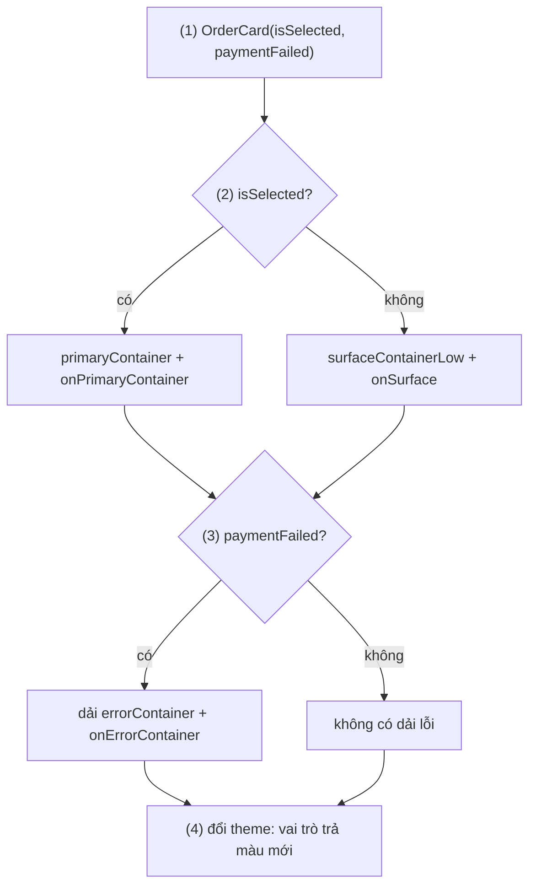
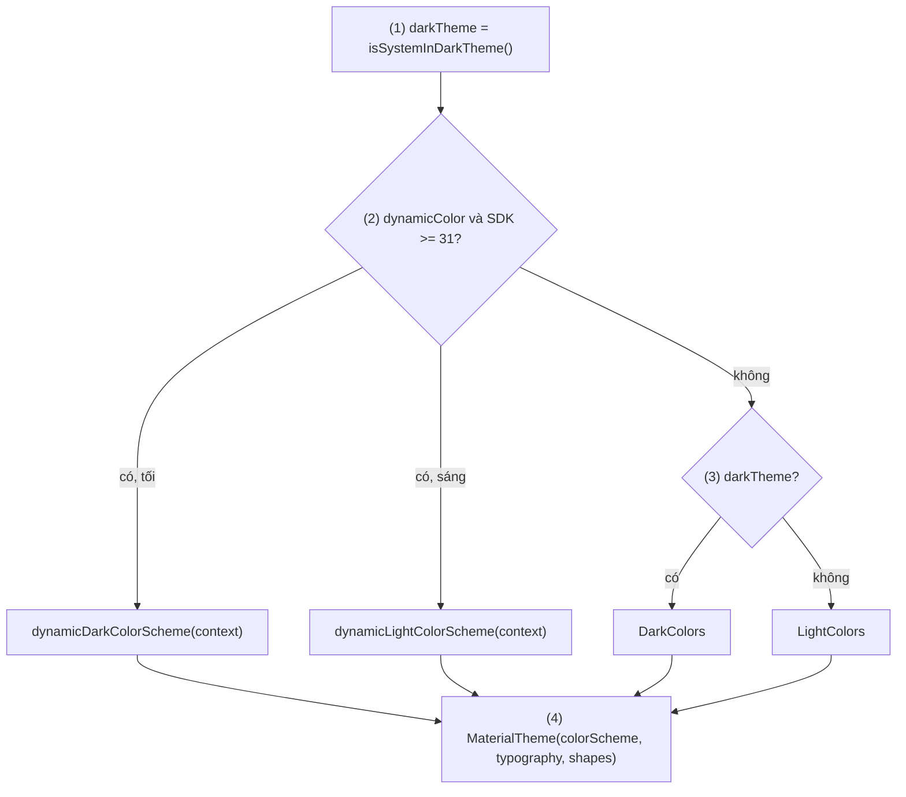
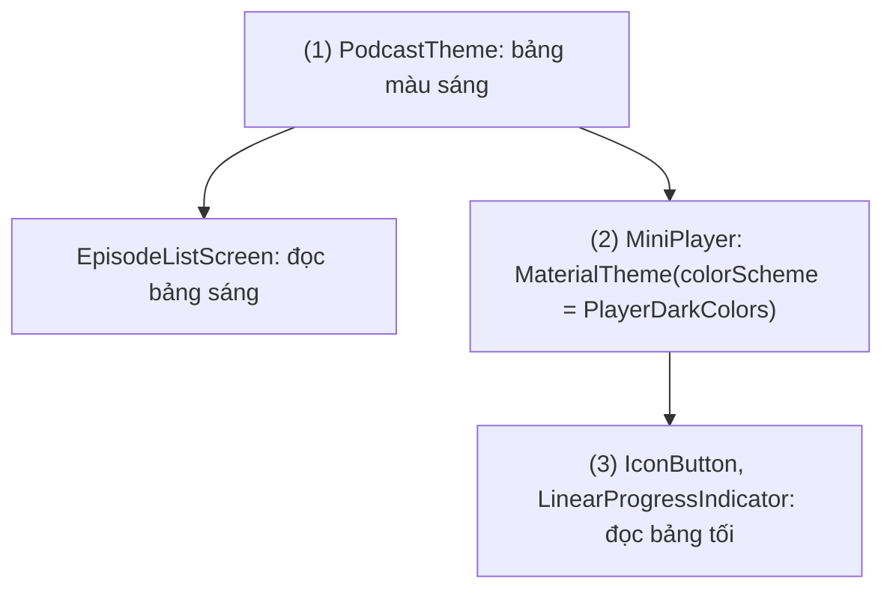
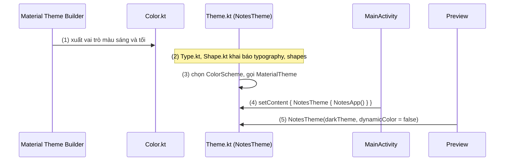

# Material Design Theme (Color, Typography, Shapes)

## Vấn đề cần giải quyết

Một màn hình Compose viết vội thường chọn màu và cỡ chữ ngay tại chỗ dùng:

```kotlin
// OrderCard.kt (cách làm có vấn đề)
@Composable
fun OrderCard(order: Order) {
    Column(Modifier.background(Color(0xFFFFFFFF)).padding(16.dp)) {
        Text(order.code, color = Color(0xFF1B1B1F), fontSize = 18.sp, fontWeight = FontWeight.Bold)
        Text(order.status, color = Color(0xFF006C4C), fontSize = 14.sp)
    }
}
```

Khi app lớn dần, cách viết này gặp bốn vấn đề:

- **Dark mode hỏng:** người dùng bật giao diện tối, phần còn lại của hệ thống chuyển sang nền tối, còn thẻ này vẫn trắng chói. Muốn sửa phải thêm `if (dark)` vào từng chỗ.
- **Không nhất quán:** "tiêu đề thẻ" ở màn này 18.sp, màn kia 17.sp, vì không có chỗ nào nói "tiêu đề thẻ là cỡ nào".
- **Đổi thương hiệu tốn kém:** bộ phận thiết kế đổi màu chủ đạo, developer phải tìm và sửa từng `Color(0xFF006C4C)` trong code.
- **Component của thư viện không theo app:** `Button`, `TextField`, `TopAppBar` của Material vẫn dùng bảng màu mặc định, nên màn hình có hai bộ màu lẫn lộn.

Vấn đề cần giải quyết là: **đặt các quyết định về màu, chữ, hình khối ở một chỗ, đặt tên theo vai trò**, để mọi composable (của app lẫn của thư viện) cùng đọc từ đó, và đổi một chỗ thì cả app đổi theo.

## Sau khi học xong

- Giải thích được MaterialTheme cung cấp ColorScheme, Typography và Shapes cho cây composable thế nào, và vì sao Material component tự đổi theo theme.
- Phân biệt được các vai trò màu của Material 3 (primary, container, surface, on-color) và chọn đúng cặp màu nền với màu nội dung.
- Triển khai được theme của app có light theme, dark theme, dynamic color trên Android 12+ và fallback cho máy cũ.
- Áp dụng được type scale và shape scale của Material 3, kể cả font thương hiệu và theme lồng nhau cho một vùng màn hình.
- Nhận diện được các lỗi như hardcode màu, ghép sai cặp on-color, gọi dynamic color trên máy dưới Android 12 và trộn Material 2 với Material 3.

## Material Design Theme là gì?

**`MaterialTheme`** (Material 3) là một composable đặt ở gốc cây UI, cung cấp ba hệ thống **token** (giá trị thiết kế có tên) là `ColorScheme` (vai trò màu), `Typography` (thang chữ) và `Shapes` (thang bo góc) cho mọi composable con. Material component đọc giá trị mặc định từ đây; code của app đọc qua `MaterialTheme.colorScheme`, `MaterialTheme.typography`, `MaterialTheme.shapes`.

Mental model: theme là **bảng token treo ở gốc cây**. Không composable nào tự chọn "màu xanh #006C4C"; nó hỏi bảng "màu `primary` là gì?". Thay bảng (sáng sang tối, thương hiệu A sang B) thì mọi composable đang hỏi bảng tự nhận giá trị mới.

## Cách hoạt động

### MaterialTheme cung cấp và đọc token thế nào

`MaterialTheme` nhận ba hệ thống và một `content`:

```kotlin
MaterialTheme(
    colorScheme = /* ColorScheme */,
    typography = /* Typography */,
    shapes = /* Shapes */,
) {
    // mọi composable ở đây đọc được theme
}
```

Cả ba tham số đều có giá trị mặc định là **theme đang bao quanh** (`colorScheme: ColorScheme = MaterialTheme.colorScheme`). Ở gốc cây, chưa có theme nào bao quanh, nên giá trị mặc định là bảng màu, thang chữ, thang bo góc chuẩn của Material 3. Đó là lý do một app chỉ gọi `MaterialTheme { }` trống vẫn chạy được, nhưng mang màu tím mặc định của Material chứ không phải màu của app.

Bên trong, `MaterialTheme` đưa các giá trị xuống cây bằng **CompositionLocal**: cơ chế truyền dữ liệu ngầm cho mọi composable con mà không cần tham số. Cơ chế này được dạy đầy đủ ở [9.4.2 Custom Theme](custom_theme.md); ở bài này chỉ cần biết hai hệ quả:

1. Composable con ở bất kỳ độ sâu nào cũng đọc được theme qua `MaterialTheme.colorScheme.primary`, `MaterialTheme.typography.titleMedium`, `MaterialTheme.shapes.medium`. Các getter này là `@Composable`, nên chỉ gọi được trong composable.
2. Theme đổi giá trị (ví dụ chuyển sang tối) thì các composable đọc theme được recompose với giá trị mới.

Ngoài ba hệ thống, `MaterialTheme` còn cung cấp: ripple khi chạm (`LocalIndication`), màu bôi chọn văn bản, và **text style mặc định** là `typography.bodyLarge` (qua `ProvideTextStyle`). Vì vậy `Text("Xin chào")` không truyền `style` vẫn có cỡ chữ của `bodyLarge`.

Material component dùng token theo **vai trò** đã quy định trong spec Material: `Button` lấy nền `primary`, chữ `onPrimary`; `Card` lấy góc `shapes.medium`; `TopAppBar` lấy tiêu đề `titleLarge`. App không phải truyền màu cho từng `Button`; chỉ cần truyền đúng `ColorScheme` vào `MaterialTheme`.

Bài này dạy Material 3 (`androidx.compose.material3`); Material 2 chỉ được nhắc ở mục "So sánh với các cách tiếp cận khác".

### ColorScheme: màu đặt tên theo vai trò

`ColorScheme` không phải danh sách "xanh, đỏ, xám", mà là các **vai trò màu** (color role). Mỗi vai trò trả lời câu hỏi "màu này dùng cho việc gì":

| Nhóm vai trò | Vai trò | Dùng cho |
|---|---|---|
| Accent chính | `primary` / `onPrimary` | Thành phần nổi bật nhất: nút chính, trạng thái đang chọn |
| | `primaryContainer` / `onPrimaryContainer` | Nền nhấn nhẹ hơn: thẻ đang chọn, FAB |
| Accent phụ | `secondary`, `secondaryContainer` (kèm `on...`) | Thành phần ít nổi bật hơn: filter chip, tab phụ |
| Accent tương phản | `tertiary`, `tertiaryContainer` (kèm `on...`) | Điểm nhấn cân bằng với primary, secondary |
| Lỗi | `error`, `errorContainer` (kèm `on...`) | Thông báo lỗi, ô nhập sai |
| Bề mặt | `surface` / `onSurface`, `onSurfaceVariant` | Nền chung của màn hình và nội dung trên đó |
| | `surfaceContainerLowest` … `surfaceContainerHighest` | Các mức nền của container (thẻ, sheet, thanh điều hướng) |
| Viền và phụ trợ | `outline`, `outlineVariant`, `scrim`, `inverseSurface`, `inversePrimary` | Viền ô nhập, đường chia, lớp phủ sau dialog, Snackbar |

Quy tắc quan trọng nhất là **cặp on-color**: màu `onX` được thiết kế để đọc rõ khi đặt trên nền `X`. Chữ trên nền `primary` dùng `onPrimary`; chữ trên `primaryContainer` dùng `onPrimaryContainer`. Docs của Android nhấn mạnh việc dùng đúng cặp này để giữ độ tương phản đạt chuẩn accessibility. Ghép `tertiaryContainer` với chữ `primaryContainer` là tự phá độ tương phản.

Mỗi vai trò lấy từ một **tonal palette** (dải 13 sắc độ) sinh ra từ năm màu gốc (key colors): primary, secondary, tertiary, neutral, neutral variant. Bản tối không phải "đảo màu" bản sáng, mà là chọn sắc độ khác trong cùng dải, nên app tối vẫn giữ được bản sắc thương hiệu.

Hai hàm `lightColorScheme(...)` và `darkColorScheme(...)` tạo `ColorScheme` với mọi vai trò có giá trị mặc định; app chỉ truyền vai trò muốn đổi. Thực tế, ít ai tự chọn đủ hơn hai mươi vai trò bằng tay: công cụ **Material Theme Builder** nhận màu thương hiệu, sinh đủ các vai trò cho bản sáng và tối, và xuất ra `Color.kt`, `Theme.kt`, `Type.kt` dùng ngay trong Compose.

#### Ví dụ: thẻ đơn hàng đang chọn và đơn hàng lỗi thanh toán

**Bài toán:** danh sách đơn hàng cho chọn một đơn để xem chi tiết; đơn đang chọn phải nổi bật, đơn thanh toán lỗi phải có dải cảnh báo. Cả hai phải đọc rõ ở chế độ sáng lẫn tối mà không viết `if (dark)`.

**Luồng chạy:**

1. `OrderCard` nhận `isSelected` và `paymentFailed` từ cha.
2. Chọn cặp màu theo vai trò: đang chọn thì `primaryContainer` với `onPrimaryContainer`, không chọn thì `surfaceContainerLow` với `onSurface`.
3. Dải lỗi dùng cặp `errorContainer` với `onErrorContainer`.
4. Theme đổi (sáng sang tối, hoặc dynamic color đổi bảng màu) thì các vai trò trả giá trị mới, thẻ tự đúng.



**Code:**

```kotlin
// OrderCard.kt
@Composable
fun OrderCard(
    order: Order,
    isSelected: Boolean,
    paymentFailed: Boolean,
    onClick: () -> Unit,
    modifier: Modifier = Modifier,
) {
    val colors = MaterialTheme.colorScheme
    val containerColor = if (isSelected) colors.primaryContainer else colors.surfaceContainerLow // (2)
    val contentColor = if (isSelected) colors.onPrimaryContainer else colors.onSurface

    Card(
        onClick = onClick,
        modifier = modifier,
        colors = CardDefaults.cardColors(containerColor = containerColor, contentColor = contentColor),
    ) {
        Column(Modifier.padding(16.dp)) {
            Text(order.code, style = MaterialTheme.typography.titleMedium)  // màu lấy từ contentColor của Card
            Text(order.totalText, style = MaterialTheme.typography.bodyMedium)
        }
        if (paymentFailed) {                                                // (3)
            Text(
                text = "Thanh toán không thành công",
                color = colors.onErrorContainer,
                style = MaterialTheme.typography.labelLarge,
                modifier = Modifier
                    .fillMaxWidth()
                    .background(colors.errorContainer)
                    .padding(horizontal = 16.dp, vertical = 8.dp),
            )
        }
    }
}
```

`Text` trong `Card` không truyền `color`: `Card` (dựng trên `Surface`) đặt **content color** cho con của nó, và `Text`, `Icon` lấy màu đó khi không được truyền màu riêng. Cơ chế `Surface` và content color được học kỹ ở [9.7.1 Surface and Canvas](../graphics_animations/surface_and_canvas.md).

**Kết quả:** mở `@Preview` cho cả bản sáng và tối (xem mục "Ví dụ thực tế"): thẻ đang chọn có nền nhấn của primary, dải lỗi đọc rõ ở cả hai chế độ. Không có một hằng số màu nào trong `OrderCard`; đổi màu thương hiệu trong `Color.kt` thì thẻ đổi theo.

### Dark theme và dynamic color

App quyết định dùng `ColorScheme` nào ngay trong hàm theme của nó, thường theo hai câu hỏi:

- **Sáng hay tối?** `isSystemInDarkTheme()` đọc cài đặt giao diện tối của hệ thống. Đây là composable, nên khi người dùng bật hoặc tắt chế độ tối, hàm theme được gọi lại. Nếu app có cài đặt riêng ("Sáng / Tối / Theo hệ thống"), giá trị đọc từ cài đặt đó thay cho `isSystemInDarkTheme()`.
- **Có dùng dynamic color không?** Dynamic color là tính năng của **Material You** trên **Android 12 (API 31) trở lên**: hệ thống sinh bảng màu từ hình nền của người dùng, và app có thể dùng bảng đó thay cho màu thương hiệu. Compose cung cấp `dynamicLightColorScheme(context)` và `dynamicDarkColorScheme(context)`; hai hàm này chỉ tồn tại từ API 31, nên phải kiểm tra `Build.VERSION.SDK_INT` và có **fallback** về bảng màu riêng của app trên máy cũ.

Dynamic color là lựa chọn sản phẩm, không phải bắt buộc. App ngân hàng, app thương hiệu mạnh thường tắt nó để giữ màu nhận diện; app tiện ích (ghi chú, đồng hồ) bật nó để hoà vào hệ thống.

#### Ví dụ: hàm theme của app ghi chú

**Bài toán:** app ghi chú muốn theo màu hình nền trên Android 12+, dùng màu riêng trên máy cũ, và tôn trọng chế độ sáng tối của hệ thống.

**Luồng chạy:**

1. `NotesTheme` đọc `isSystemInDarkTheme()` làm giá trị mặc định cho `darkTheme`.
2. Nếu `dynamicColor` bật và máy chạy Android 12+, lấy bảng màu từ hình nền theo sáng hoặc tối.
3. Ngược lại, dùng `DarkColors` hoặc `LightColors` sinh từ Material Theme Builder.
4. Truyền bảng màu đã chọn, cùng `Typography` và `Shapes` của app, vào `MaterialTheme`.



**Code:**

```kotlin
// ui/theme/Theme.kt
@Composable
fun NotesTheme(
    darkTheme: Boolean = isSystemInDarkTheme(),                       // (1)
    dynamicColor: Boolean = true,
    content: @Composable () -> Unit,
) {
    val colorScheme = when {
        dynamicColor && Build.VERSION.SDK_INT >= Build.VERSION_CODES.S -> { // (2)
            val context = LocalContext.current
            if (darkTheme) dynamicDarkColorScheme(context) else dynamicLightColorScheme(context)
        }
        darkTheme -> DarkColors                                         // (3)
        else -> LightColors
    }
    MaterialTheme(                                                      // (4)
        colorScheme = colorScheme,
        typography = NotesTypography,
        shapes = NotesShapes,
        content = content,
    )
}
```

**Kết quả:** trên máy Android 12+, đổi hình nền rồi mở lại app: màu nút, thanh trên cùng đổi theo hình nền. Trên emulator API 30, app dùng `LightColors`/`DarkColors`. Bật giao diện tối trong Quick Settings khi app đang mở: app chuyển ngay, không cần khởi động lại, vì `isSystemInDarkTheme()` là state của composition.

> [!TIP]
> Bật/tắt chế độ tối là một configuration change (`uiMode`). Nếu Activity không khai báo tự xử lý `uiMode`, nó bị tạo lại như khi xoay màn hình; state nào cần giữ phải nằm ngoài composition, xem [Activity State Changes](../../session_04/components/activity/state_changes.md).

### Typography: type scale của Material 3

Material 3 định nghĩa **type scale** gồm 15 style, chia năm nhóm theo vai trò, mỗi nhóm ba cỡ Large, Medium, Small:

| Nhóm | Style | Mặc định (cỡ/line height, sp) | Dùng cho |
|---|---|---|---|
| Display | `displayLarge`, `displayMedium`, `displaySmall` | 57/64, 45/52, 36/44 | Số lớn, chữ ngắn nổi bật (số dư tài khoản) |
| Headline | `headlineLarge`, `headlineMedium`, `headlineSmall` | 32/40, 28/36, 24/32 | Tiêu đề trang |
| Title | `titleLarge`, `titleMedium`, `titleSmall` | 22/28, 16/24, 14/20 | Tiêu đề thanh trên cùng, tiêu đề thẻ |
| Body | `bodyLarge`, `bodyMedium`, `bodySmall` | 16/24, 14/20, 12/16 | Đoạn văn, nội dung chính |
| Label | `labelLarge`, `labelMedium`, `labelSmall` | 14/20, 12/16, 11/16 | Chữ trên nút, chip, chú thích nhỏ |

Mỗi style là một `TextStyle` (font, cỡ, độ đậm, line height, letter spacing). Class `Typography` có giá trị mặc định cho cả 15 style, nên app chỉ đổi style cần đổi. Khác Material 2, `Typography` của Material 3 **không có tham số font mặc định chung**: muốn cả app dùng một font thương hiệu thì phải đặt `fontFamily` cho từng style.

Cỡ chữ dùng đơn vị `sp`, nên tự phóng theo cài đặt cỡ chữ của người dùng. Đừng đổi sang `dp` để "giữ layout không vỡ": đó là phá accessibility.

#### Ví dụ: áp font thương hiệu có dấu tiếng Việt cho toàn app

**Bài toán:** app đọc tin dùng font Be Vietnam Pro (hỗ trợ đầy đủ dấu tiếng Việt) cho mọi chữ, đậm hơn ở nhóm title, giữ nguyên cỡ chữ chuẩn của Material.

**Code** (khai báo, không có luồng chạy nên không cần sơ đồ):

```kotlin
// ui/theme/Type.kt
private val BeVietnamPro = FontFamily(
    Font(R.font.be_vietnam_pro_regular, FontWeight.Normal),   // file trong res/font/
    Font(R.font.be_vietnam_pro_medium, FontWeight.Medium),
    Font(R.font.be_vietnam_pro_semibold, FontWeight.SemiBold),
)

private val Default = Typography()   // type scale chuẩn của Material 3

val NewsTypography = Typography(
    displayLarge = Default.displayLarge.copy(fontFamily = BeVietnamPro),
    headlineMedium = Default.headlineMedium.copy(fontFamily = BeVietnamPro),
    titleLarge = Default.titleLarge.copy(fontFamily = BeVietnamPro, fontWeight = FontWeight.SemiBold),
    titleMedium = Default.titleMedium.copy(fontFamily = BeVietnamPro, fontWeight = FontWeight.SemiBold),
    bodyLarge = Default.bodyLarge.copy(fontFamily = BeVietnamPro),
    bodyMedium = Default.bodyMedium.copy(fontFamily = BeVietnamPro),
    labelLarge = Default.labelLarge.copy(fontFamily = BeVietnamPro, fontWeight = FontWeight.Medium),
    // các style còn lại làm tương tự; style nào không đổi sẽ giữ font mặc định của hệ thống
)
```

Ở chỗ dùng, chọn style theo vai trò: `Text(article.title, style = MaterialTheme.typography.titleMedium)`. Cần biến thể nhỏ thì `copy` từ style của theme (`MaterialTheme.typography.bodyMedium.copy(fontStyle = FontStyle.Italic)`), không tự tạo `TextStyle` từ đầu: `TextStyle(...)` mới làm mất font thương hiệu, line height và letter spacing của theme. Các tham số của `Text` (maxLines, overflow, `AnnotatedString`) học ở [9.6 Layout and View](../layout_and_view.md).

**Kết quả:** mọi `Text`, kể cả chữ trong `Button` và `TopAppBar`, dùng Be Vietnam Pro. Kiểm chứng bằng Preview với chuỗi có dấu như "Thời sự hôm nay": không có ký tự nào rơi về font khác. Tăng cỡ chữ hệ thống lên mức lớn nhất: chữ phóng theo, đây là hành vi đúng.

### Shapes: thang bo góc

`Shapes` của Material 3 là thang năm cỡ bo góc, mặc định:

| Token | Mặc định | Component dùng (theo spec Material) |
|---|---|---|
| `extraSmall` | bo 4.dp | Ô nhập, menu |
| `small` | bo 8.dp | Chip |
| `medium` | bo 12.dp | Card |
| `large` | bo 16.dp | FAB, navigation drawer |
| `extraLarge` | bo 28.dp | Dialog, bottom sheet |

Truyền `Shapes(...)` của app vào `MaterialTheme` thì mọi component dùng token tương ứng đổi theo. Ở chỗ cần hình khối riêng, đọc `MaterialTheme.shapes.medium` hoặc dùng `RectangleShape`, `CircleShape` có sẵn. Một số component (ví dụ `Button` mặc định bo tròn hoàn toàn) không lấy hình dạng từ thang này; muốn đổi thì truyền tham số `shape` cho component đó.

```kotlin
// ui/theme/Shape.kt
val NotesShapes = Shapes(
    extraSmall = RoundedCornerShape(4.dp),
    small = RoundedCornerShape(8.dp),
    medium = RoundedCornerShape(16.dp),   // thẻ ghi chú bo tròn hơn mặc định
    large = RoundedCornerShape(24.dp),
    extraLarge = RoundedCornerShape(32.dp),
)
```

### Theme lồng nhau

Vì `MaterialTheme` lấy giá trị **gần nhất phía trên** trong cây, có thể đặt một `MaterialTheme` khác bên trong để đổi theme cho **một vùng** màn hình. Tham số nào không truyền thì kế thừa theme bên ngoài, nên chỉ cần ghi đè phần khác biệt. `ColorScheme`, `Typography`, `Shapes` đều có hàm `copy(...)` để sửa vài token.

#### Ví dụ: thanh trình phát nhạc luôn tối trong app sáng

**Bài toán:** app podcast dùng theme sáng, nhưng thanh trình phát ở đáy màn hình luôn tối để nổi bật, và các nút trong đó vẫn phải đúng màu Material (nút play, thanh tiến trình).

**Luồng chạy:**

1. Toàn app nằm trong `PodcastTheme` (sáng hoặc tối theo hệ thống).
2. `MiniPlayer` bọc nội dung trong một `MaterialTheme` mới, chỉ truyền `colorScheme` tối; typography và shapes kế thừa từ ngoài.
3. Mọi composable bên trong `MiniPlayer` đọc bảng màu tối; bên ngoài không bị ảnh hưởng.



**Code:**

```kotlin
// MiniPlayer.kt
@Composable
fun MiniPlayer(episode: Episode, isPlaying: Boolean, onTogglePlay: () -> Unit) {
    MaterialTheme(colorScheme = PlayerDarkColors) {                  // (2) chỉ đổi màu
        Surface(color = MaterialTheme.colorScheme.surfaceContainer) { // (3) đã là bảng tối
            Row(Modifier.padding(12.dp), verticalAlignment = Alignment.CenterVertically) {
                Text(
                    episode.title,
                    style = MaterialTheme.typography.titleSmall,      // typography kế thừa từ PodcastTheme
                    modifier = Modifier.weight(1f),
                )
                IconButton(onClick = onTogglePlay) {
                    Icon(
                        painterResource(if (isPlaying) R.drawable.ic_pause else R.drawable.ic_play),
                        contentDescription = if (isPlaying) "Tạm dừng" else "Phát",
                    )
                }
            }
        }
    }
}

// ui/theme/Color.kt
val PlayerDarkColors = darkColorScheme(primary = Color(0xFFFFB4AB), surfaceContainer = Color(0xFF1E1B1B))
```

`Modifier.weight(1f)` là modifier riêng của `Row` (học ở 9.5.2 Chaining), `Row` và `Icon` học ở [9.6 Layout and View](../layout_and_view.md).

**Kết quả:** thanh trình phát tối trên nền danh sách sáng; chữ và icon trong thanh dùng màu nội dung của bảng tối nên đọc rõ. Layout Inspector cho thấy hai `MaterialTheme` trong cây, và chỉ nhánh `MiniPlayer` dùng bảng tối.

## Ví dụ thực tế

Ba bài toán thường gặp khi dựng theme Material 3 cho app:

1. **Bộ file theme của app** từ Material Theme Builder, dùng trong `Activity`, có Preview sáng và tối. Đây là bài toán chính, code bên dưới.
2. **Cài đặt giao diện trong app** ("Sáng / Tối / Theo hệ thống"): đọc lựa chọn từ DataStore ở `MainActivity`, truyền vào `darkTheme` của hàm theme thay cho `isSystemInDarkTheme()`. Hàm theme không đổi gì, vì nó đã nhận `darkTheme` qua tham số.
3. **Một vùng có theme riêng:** banner khuyến mãi, thanh trình phát, như ví dụ "Theme lồng nhau".

### Bộ file theme của app và Preview hai chế độ

**Bài toán:** app ghi chú cần một theme dùng chung: màu thương hiệu xanh lục cho máy cũ, dynamic color cho Android 12+, font và bo góc riêng; developer xem được cùng lúc bản sáng và tối của từng màn hình trong Android Studio.

**Luồng chạy:**

1. Material Theme Builder nhận màu thương hiệu, xuất `Color.kt` với đủ vai trò cho bản sáng và tối.
2. `Type.kt` và `Shape.kt` khai báo `NotesTypography`, `NotesShapes` (như các mục trên).
3. `Theme.kt` chọn bảng màu (sáng/tối/dynamic) rồi gọi `MaterialTheme`.
4. `MainActivity` bọc toàn bộ UI trong `NotesTheme`.
5. Preview gọi `NotesTheme(darkTheme = ..., dynamicColor = false)` để thấy đúng màu thương hiệu ở hai chế độ.



**Code:**

```kotlin
// ui/theme/Color.kt (rút gọn từ file Material Theme Builder xuất ra)  // (1)
private val primaryLight = Color(0xFF3B6939)
private val primaryContainerLight = Color(0xFFBCF0B4)
private val primaryDark = Color(0xFFA1D39A)
private val primaryContainerDark = Color(0xFF235024)
// ... onPrimary, secondary, tertiary, error, surface, outline... cho cả hai bản

val LightColors = lightColorScheme(primary = primaryLight, primaryContainer = primaryContainerLight /* , ... */)
val DarkColors = darkColorScheme(primary = primaryDark, primaryContainer = primaryContainerDark /* , ... */)
```

`Theme.kt` (bước 3) là hàm `NotesTheme` ở mục "Dark theme và dynamic color"; `Type.kt`, `Shape.kt` (bước 2) như các mục Typography và Shapes.

```kotlin
// MainActivity.kt
class MainActivity : ComponentActivity() {
    override fun onCreate(savedInstanceState: Bundle?) {
        super.onCreate(savedInstanceState)
        enableEdgeToEdge()
        setContent {
            NotesTheme {                                              // (4)
                NotesApp()
            }
        }
    }
}
```

```kotlin
// NoteListScreenPreview.kt
@Preview(name = "Sáng", showBackground = true)
@Preview(name = "Tối", showBackground = true, uiMode = Configuration.UI_MODE_NIGHT_YES)
@Composable
private fun NoteListScreenPreview() {
    NotesTheme(dynamicColor = false) {                                // (5) xem màu thương hiệu
        NoteListScreen(notes = sampleNotes, onNoteClick = {})
    }
}
```

Preview với `uiMode = UI_MODE_NIGHT_YES` làm `isSystemInDarkTheme()` trả `true`, nên không cần truyền `darkTheme` bằng tay. `dynamicColor = false` để Preview không phụ thuộc hình nền.

> [!IMPORTANT]
> Theme XML của Activity trong `themes.xml` vẫn quyết định **cửa sổ** trước khi Compose vẽ khung hình đầu tiên (nền cửa sổ, splash). Nếu theme XML luôn sáng, mở app ở chế độ tối sẽ thấy nền trắng chớp lên trước khi nội dung hiện. Dùng một theme XML có hỗ trợ ngày/đêm (ví dụ họ `Theme.Material3.DayNight` của thư viện Material Components cho View, hoặc theme platform kèm `values-night`) cho Activity chứa Compose.

**Kết quả:** chạy app trên Android 12+: màu theo hình nền; trên API 30: màu xanh lục thương hiệu. Panel Preview hiện hai bản sáng và tối cạnh nhau; cả `TopAppBar`, `FloatingActionButton`, thẻ ghi chú đều đổi theo mà không có màu nào hardcode trong màn hình.

## So sánh với các cách tiếp cận khác

| Cách | Token ở đâu | Đọc token thế nào | Ghi chú |
|---|---|---|---|
| Theme XML của View system | `themes.xml`, `colors.xml`, `?attr/colorPrimary` | Thuộc tính style trong XML, `obtainStyledAttributes` trong code | Compose **không** đọc theme XML; cần theme Compose riêng |
| Material 2 trong Compose | `MaterialTheme(colors, typography, shapes)` của `androidx.compose.material` | `MaterialTheme.colors.primary`, style `h1`…`body2`, `caption` | Không có dynamic color, ít vai trò màu hơn; có `Colors.isLight` |
| **Material 3 trong Compose** | `MaterialTheme(colorScheme, typography, shapes)` của `androidx.compose.material3` | `MaterialTheme.colorScheme`, style `displayLarge`…`labelSmall` | Bản hiện hành; vai trò container và surface container, dynamic color, tonal elevation |
| Theme hoàn toàn riêng | `CompositionLocal` của app | `AppTheme.xxx` | Khi design system không theo Material, xem [9.4.2 Custom Theme](custom_theme.md) |

Chuyển Material 2 sang Material 3 không chỉ là đổi import: tên vai trò màu, tên style chữ và cách thể hiện elevation (**tonal elevation**: bề mặt cao hơn có sắc màu đậm hơn) đều khác; docs có hướng dẫn chuyển đổi riêng.

## Khi nào nên và không nên dùng

- **Nên dùng** `MaterialTheme` (Material 3) cho gần như mọi app Compose dùng Material component: đây là cách duy nhất để `Button`, `TextField`, `TopAppBar` mang màu, chữ, hình khối của app.
- **Nên** cân nhắc dynamic color theo sản phẩm: bật cho app tiện ích muốn hoà vào hệ thống, tắt cho app cần giữ màu nhận diện.
- **Không nên** dùng `MaterialTheme` để chứa token mà Material không có (màu `success`, khoảng cách, elevation riêng): thêm chúng bằng theme mở rộng ở [9.4.2 Custom Theme](custom_theme.md).
- **Không nên** lồng theme cho từng component nhỏ: theme lồng dành cho một vùng có bản sắc riêng; đổi màu một nút thì truyền `colors` cho nút đó.

## Sai lầm thường gặp

### 1. Hardcode màu và cỡ chữ trong composable

```kotlin
Text("Đã giao", color = Color(0xFF006C4C), fontSize = 14.sp)          // sai
Text("Đã giao", color = MaterialTheme.colorScheme.primary,
     style = MaterialTheme.typography.labelLarge)                        // đúng
```

**Lỗi lộ ra:** ở chế độ tối hoặc khi dynamic color bật, chữ giữ màu cũ, có thể gần như vô hình trên nền mới. **Cách sửa:** chọn vai trò màu và style theo nghĩa; nếu Material không có vai trò phù hợp, thêm token ở theme mở rộng chứ không hardcode.

### 2. Ghép sai cặp on-color

Đặt chữ `onSurface` lên nền `primary`, hoặc chữ `primary` lên nền `primaryContainer` vì "nhìn ổn trên máy mình". **Lỗi lộ ra:** khi dynamic color đổi bảng màu theo hình nền, độ tương phản tụt mạnh; công cụ Accessibility Scanner báo lỗi tương phản. **Cách sửa:** luôn dùng `onX` trên nền `X`; với component Material, để component tự chọn cặp, hoặc dùng `contentColorFor(backgroundColor)` để lấy màu nội dung tương ứng với một màu nền của theme.

### 3. Gọi dynamic color mà không kiểm tra API level

```kotlin
val colors = dynamicLightColorScheme(LocalContext.current)   // sai: crash trên Android 11 trở xuống
```

**Lỗi lộ ra:** app crash ngay khi mở trên máy dưới Android 12, vì API sinh màu từ hình nền chỉ có từ API 31; Lint cũng cảnh báo `NewApi`. **Cách sửa:** bọc trong `Build.VERSION.SDK_INT >= Build.VERSION_CODES.S` và có fallback như hàm `NotesTheme`.

### 4. Trộn Material 2 và Material 3

Import nhầm `androidx.compose.material.Button` trong màn hình dùng `androidx.compose.material3.MaterialTheme`. **Lỗi lộ ra:** nút mang màu tím mặc định của Material 2 dù app đã có theme, vì component Material 2 đọc theme Material 2 (mà app không cung cấp). **Cách sửa:** chỉ phụ thuộc `material3` cho UI; nếu đang chuyển dần, kiểm tra import của từng màn hình và theo hướng dẫn chuyển đổi chính thức.

## Lịch sử phát triển

- **Compose 1.0 (07/2021):** chỉ có Material 2 (`androidx.compose.material`) với `MaterialTheme(colors, typography, shapes)`.
- **Google I/O 2021:** Material You (Material Design 3) được giới thiệu cùng Android 12, với dynamic color sinh bảng màu từ hình nền.
- **Compose Material 3 1.0 (10/2022):** bản stable đầu tiên của `androidx.compose.material3`, với `ColorScheme`, type scale mới và `dynamicLightColorScheme`/`dynamicDarkColorScheme`.
- **Các bản Material 3 sau đó:** bổ sung nhóm vai trò `surfaceContainer…` (thay dần cách dùng `surfaceColorAtElevation`), rồi các vai trò "fixed" (`primaryFixed`…) theo spec Material.
- **2025:** Google giới thiệu **Material 3 Expressive**, mở rộng Material 3 về shape, motion, typography; các bản Material 3 gần đây có thêm hệ thống `MotionScheme` trong theme và `MaterialExpressiveTheme` (đang ở dạng experimental tại thời điểm viết). Cùng giai đoạn, docs khuyên không dùng thư viện `material-icons` cũ mà tải icon Material Symbols (xem [9.6 Layout and View](../layout_and_view.md)).

Hướng thay đổi xuyên suốt: từ "vài màu chính" sang **vai trò màu sinh từ tonal palette**, để cùng một code UI đúng với mọi bảng màu, kể cả bảng màu developer không biết trước như dynamic color.

## Kết nối hệ thống

- **Tiên quyết:**
  - [Jetpack Compose Overview](../overview.md): composable, composition, recomposition; theme là một composable bọc ngoài cây.
- **Liên quan:**
  - [9.4.2 Custom Theme](custom_theme.md): thêm token Material không có (màu trạng thái, khoảng cách, elevation) và cơ chế CompositionLocal mà `MaterialTheme` dựa vào.
  - [9.6 Layout and View](../layout_and_view.md): `Text`, `Icon` đọc style và content color từ theme.
  - [9.7.1 Surface and Canvas](../graphics_animations/surface_and_canvas.md): `Surface`, content color và tonal elevation.
  - [Activity State Changes](../../session_04/components/activity/state_changes.md): chuyển sáng/tối là configuration change.
  - 8.5.3 Styles và 8.5.4 Design Guide (Materials, Flat) (chưa có bài): theme và style trong View system.
- **Học tiếp:**
  - [9.4.2 Custom Theme (Dimens, Factories, Data)](custom_theme.md).

## Tham khảo

- [Material Design 3 in Compose - Android Developers](https://developer.android.com/develop/ui/compose/designsystems/material3)
- [Anatomy of a theme in Compose - Android Developers](https://developer.android.com/develop/ui/compose/designsystems/anatomy)
- [Migrate from Material 2 to Material 3 in Compose - Android Developers](https://developer.android.com/develop/ui/compose/designsystems/material2-material3)
- [Compose Material 3 API reference - Android Developers](https://developer.android.com/reference/kotlin/androidx/compose/material3/package-summary)
- [Color roles - Material Design 3](https://m3.material.io/styles/color/roles)
- [Dynamic color - Material Design 3](https://m3.material.io/styles/color/dynamic-color/overview)
- [Type scale - Material Design 3](https://m3.material.io/styles/typography/overview)
- [Material Theme Builder](https://material-foundation.github.io/material-theme-builder/)
- [Source code MaterialTheme.kt (material3) - AndroidX](https://cs.android.com/androidx/platform/frameworks/support/+/androidx-main:compose/material3/material3/src/commonMain/kotlin/androidx/compose/material3/MaterialTheme.kt)
