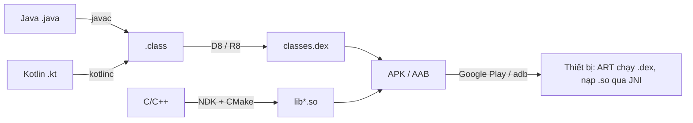

# Session 01: Ngôn ngữ & Gói ứng dụng

## Giới thiệu

Session 01 trả lời hai câu hỏi nền tảng: **ứng dụng Android được viết bằng gì** và **mã nguồn biến thành thứ gì để chạy được trên điện thoại**.

<!-- dd: s01-build-map -->

## Nội dung Session

- **1.1 Languages** — Ngôn ngữ lập trình:
  - [1.1.1 Java Android](languages/java_android.md): Java trên Android khác Java SE ở đâu, chuỗi `javac` → D8/R8 → `.dex`, Dalvik và ART, desugaring, memory leak do inner class.
  - [1.1.2 Kotlin](languages/kotlin.md): Kotlin chạy trên ART thế nào, Null Safety, Java và Kotlin gọi nhau, KAPT và KSP.
  - [1.1.3 JNI: C/C++](languages/jni.md): khi nào cần C/C++, chi phí gọi JNI, NDK và CMake, quản lý reference và bộ nhớ native.
- **1.2 Output Packages** — Định dạng đóng gói:
  - [1.2.1 APK](output_packages/apk_files.md): cấu trúc APK, chữ ký v1–v4, `zipalign`, các yêu cầu căn chỉnh.
  - [1.2.2 AAB](output_packages/aab_files.md): AAB và Split APK, Dynamic Feature Module, Play App Signing, test bằng `bundletool`.

## Thứ tự học đề xuất

Java Android → Kotlin → APK → AAB → JNI. JNI khó nhất và cần hiểu cả ngôn ngữ lẫn cấu trúc APK, nên có thể học sau cùng.

## Học tiếp

Sau Session 01, Session 02 đi vào cách hệ điều hành Android cài đặt, cấp quyền và cô lập ứng dụng (File Permissions, Process Management).
