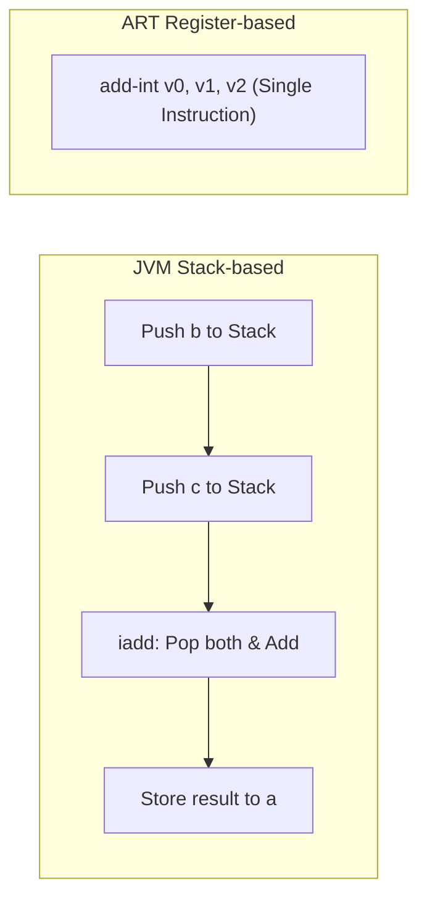
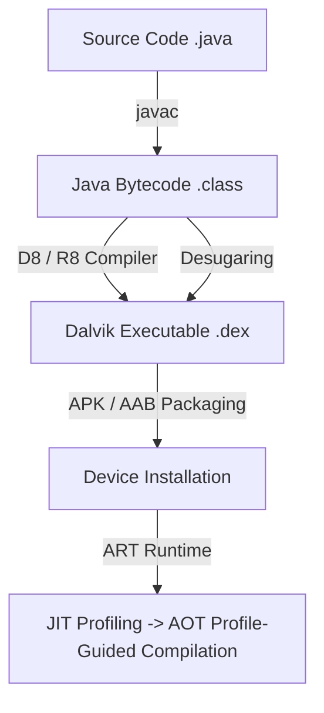
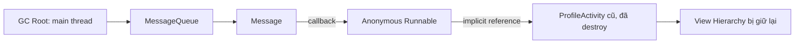
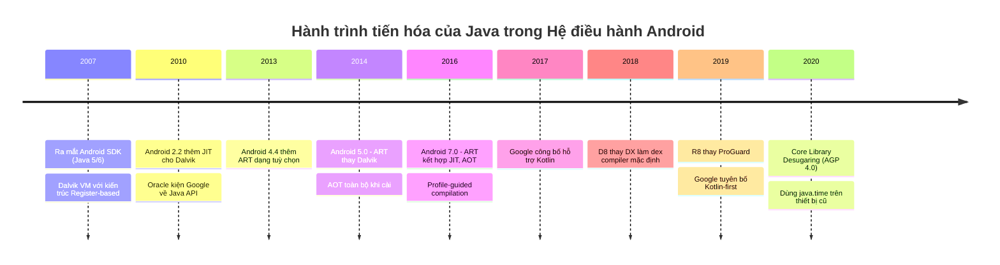

# Java Android trong Hệ sinh thái Android

## Vấn đề cần giải quyết

Khi Andy Rubin và nhóm sáng lập khởi chạy dự án Android năm 2003 (sau đó được Google mua lại năm 2005), hệ điều hành di động đối mặt với một bài toán khó: **Làm sao thu hút đông đảo lập trình viên xây dựng ứng dụng trên phần cứng rất hạn chế?** Điện thoại Android đầu tiên (HTC Dream / T-Mobile G1, 2008) chỉ có 192MB RAM và CPU 528MHz, chia sẻ cho cả hệ điều hành lẫn nhiều ứng dụng cùng lúc.

Nếu Android chọn C/C++ làm ngôn ngữ ứng dụng chính:

- Tốc độ phát triển cực chậm, lập trình viên phải tự quản lý bộ nhớ (`malloc`/`free`), dẫn đến rủi ro crash ứng dụng tràn RAM (`Segmentation Fault`) liên tục.
- Ứng dụng phải biên dịch lại cho từng kiến trúc CPU (ARM, x86, MIPS), phá vỡ mục tiêu hệ sinh thái mở.

Năm 2007, Google chọn Java. Tuy nhiên, thay vì sử dụng tiêu chuẩn Java SE với Java Virtual Machine (JVM) của Sun Microsystems, Google đã tự thiết kế lại toàn bộ Execution Runtime bằng cách tạo ra **Dalvik VM** (sau này là **ART**).

Nếu không nắm vững Java Android bản chất:

- **Khó đọc mã nguồn Android Framework (AOSP)**: các system service cốt lõi (`ActivityManagerService`, `WindowManagerService`, `PackageManagerService`) được viết bằng Java, phía dưới là các native service C++.
- **Dễ gây Rò rỉ bộ nhớ (Memory Leak)**: Anonymous Inner Class (lớp ẩn danh) và Non-Static Inner Class trong Java tự động giữ một tham chiếu ngầm (implicit reference) tới Outer Class (Activity/Fragment). Nếu object đó sống lâu hơn Activity, Garbage Collector không thể thu hồi Activity dù nó đã bị destroy.
- **Rủi ro Crash NullPointerException (NPE) khi Kotlin gọi Java**: Khi code Java không có annotation `@Nullable`/`@NonNull`, Kotlin hiểu kiểu trả về là **Platform Type** (`T!`) và không bắt kiểm tra null.

---

## Sau khi học xong

- Giải thích được luồng biên dịch Java từ .class qua D8/R8 sang .dex và cách ART thực thi .dex trên thiết bị.
- Phân biệt được kiến trúc Stack-based của JVM và Register-based của Dalvik/ART, và biết khác biệt đó còn quan trọng ở đâu.
- Xử lý được rò rỉ bộ nhớ do Anonymous Inner Class và Handler giữ tham chiếu ngầm tới Activity.
- Biết khi nào cần bật Core Library Desugaring để dùng API Java 8+ trên Android đời cũ.
- Xử lý được NullPointerException khi Kotlin gọi Java bằng Nullability Annotations.

---

## Java Android là gì?

**Java Android** là việc sử dụng ngôn ngữ lập trình Java kết hợp với **Android SDK (Software Development Kit)** để xây dựng ứng dụng di động chạy trên nền tảng Android.

Điểm mấu chốt cần hiểu: Java Android **không phải** Java SE (Standard Edition) chạy trên JVM thông thường.

### Mental Model: Java SE vs Java Android

| Đặc tính | Java SE (Desktop/Server) | Java Android |
| :--- | :--- | :--- |
| **Runtime** | JVM (Java Virtual Machine) | ART (Android Runtime) / Dalvik VM |
| **Kiến trúc VM** | Stack-based | Register-based |
| **Executable** | `.class` → `.jar` / `.war` | `.class` → `.dex` → `.apk` / `.aab` |
| **UI Framework** | `java.awt.*`, `javax.swing.*` | `android.widget.*`, `android.view.*` |
| **Thư viện chuẩn** | Full Java SE API | Subset của Java SE + Android SDK API |
| **Garbage Collector** | G1 (mặc định), ZGC / Shenandoah (ưu tiên độ trễ thấp) | Concurrent Copying GC (từ Android 8.0), có generational từ Android 10 |

> **Lưu ý:** Khi nói "viết Java cho Android", thực chất bạn viết Java syntax, nhưng code sẽ chạy trên một runtime engine hoàn toàn khác biệt so với JVM trên máy tính.

---

## Cách hoạt động

### 1. Bản chất sự khác biệt: JVM (Stack-based) vs ART/Dalvik (Register-based)

Bytecode của JVM và bytecode của Dalvik/ART mô tả cùng một chương trình theo hai kiểu "máy ảo" khác nhau:

| Đặc tính | JVM (Java SE) | Dalvik / ART (Android) |
| :--- | :--- | :--- |
| **Kiến trúc VM** | **Stack-based** (dựa trên Operand Stack) | **Register-based** (dựa trên thanh ghi ảo) |
| **Định dạng Executable** | Nhiều tập tin `.class`, mỗi file một Constant Pool | `classes.dex` hợp nhất, Constant Pool dùng chung |
| **Độ dài lệnh** | Opcode 1 byte, toán hạng lấy từ stack | Đơn vị lệnh 16-bit, mỗi lệnh dài 1–5 đơn vị (ghi rõ số thanh ghi) |
| **Số lệnh cho cùng một đoạn code** | Nhiều hơn (phải push/pop liên tục) | Ít hơn, khoảng 47% theo nghiên cứu của Shi và cộng sự (2008) |
| **Kích thước bytecode** | Nhỏ hơn | Lớn hơn, khoảng 25% theo cùng nghiên cứu |

#### Register-based nhanh hơn ở đâu?

Lợi thế nằm ở **interpreter**. Khi thông dịch, mỗi lệnh bytecode tốn một lần "dispatch": đọc opcode, giải mã, nhảy tới đoạn xử lý tương ứng. Register-based cần ít lệnh hơn cho cùng một phép tính, nên ít lần dispatch hơn. Cái giá là mỗi lệnh dài hơn vì phải ghi số thanh ghi, làm bytecode to hơn.

Lựa chọn này hợp lý cho Dalvik năm 2008, khi app chủ yếu chạy bằng interpreter. Ngày nay, ART biên dịch phần lớn code "nóng" sang mã máy (JIT/AOT) với bộ phân bổ thanh ghi riêng, nên khác biệt stack-based và register-based gần như không còn ảnh hưởng tới tốc độ code đã biên dịch. Nó vẫn có ý nghĩa với phần code còn chạy bằng interpreter và với thiết kế định dạng `.dex`.

#### So sánh Bytecode cấp độ Assembly: Phép cộng `a = b + c`

- **JVM (Stack-based Execution)**:

```text
iload_1          ; Push giá trị b vào Operand Stack
iload_2          ; Push giá trị c vào Operand Stack
iadd             ; Pop 2 giá trị, cộng lại, push kết quả vào Stack
istore_3         ; Pop kết quả từ Stack lưu vào biến a (slot 3)
```

*(4 lệnh, nghĩa là 4 lần dispatch khi thông dịch)*

- **Dalvik / ART (Register-based Execution)**:

```text
add-int v0, v1, v2   ; Lấy thanh ghi v1 + v2, ghi trực tiếp kết quả vào thanh ghi v0
```

*(1 lệnh, 1 lần dispatch; đổi lại lệnh dài hơn vì phải mã hoá 3 số thanh ghi)*



<!-- dd: s01-stack-vs-register -->

---

### 2. Luồng biên dịch Android Java: Từ `.java` đến `.dex`

Quá trình dịch code Java trên Android không dừng lại ở tệp `.class` như trên máy tính thông thường:



<!-- dd: s01-java-build -->

1. **`javac` (Java Compiler)**: Biên dịch mã nguồn `.java` thành Java Bytecode tiêu chuẩn `.class`. Bước này giống hệt Java SE.
2. **D8 / R8 Compiler**:
   - **D8**: Đọc các tệp `.class`, gộp toàn bộ Constant Pools trùng lặp từ hàng trăm class thành một Constant Pool duy nhất. Chuyển đổi từ Stack-based instructions sang Register-based Dalvik Bytecode (`.dex`).
   - **R8**: Thay thế ProGuard (mặc định từ AGP 3.4, năm 2019), thực hiện toàn bộ chức năng của D8 cộng thêm code shrinking (loại bỏ code không dùng), obfuscation (đổi tên class/method) và optimization. R8 thường chỉ bật cho bản release (`isMinifyEnabled = true`).
3. **Desugaring**: Chuyển đổi các tính năng cú pháp Java 8+ thành bytecode tương thích với các Android OS cũ hơn. Bước này chạy bên trong D8/R8. Xem chi tiết phần bên dưới.

---

### 3. Java Desugaring — Backport Java 8+ cho Android cũ

#### Vấn đề: API Level Fragmentation

Android có hàng trăm phiên bản OS đang hoạt động đồng thời. Thiết bị chạy Android 5.0 (API 21) không có sẵn các class như `java.time.LocalDate` hay `java.util.stream.Stream` — những API chỉ tồn tại trên JVM 8+ nhưng chưa được đưa vào Android runtime cũ.

#### Hai tầng Desugaring

**Tầng 1 — Syntactic Desugaring (D8 tự xử lý):**

Chuyển đổi cú pháp Java 8 thành bytecode tương đương mà Android runtime cũ hiểu được:

| Tính năng Java 8+ | Cách D8 desugar |
| :--- | :--- |
| Lambda expressions | Sinh một synthetic class implement functional interface (tương tự anonymous class) |
| Method references | Xử lý giống lambda: cũng sinh synthetic class |
| Default / static interface methods | Chuyển body sang một companion class (hậu tố `$-CC`), class implement gọi sang đó |
| `try-with-resources` | Với `minSdk` < 19: viết lại bằng `try-finally` và xử lý `addSuppressed` cho runtime cũ |

**Tầng 2 — Core Library Desugaring (cần cấu hình thêm):**

Backport toàn bộ **Java 8+ API** (`java.time.*`, `java.util.stream.*`, `java.util.Optional`) cho thiết bị cũ bằng cách nhúng một thư viện hỗ trợ vào APK:

```kotlin
// build.gradle.kts (Module: app)
android {
    compileOptions {
        // Phiên bản ngôn ngữ Java của source code
        sourceCompatibility = JavaVersion.VERSION_17
        targetCompatibility = JavaVersion.VERSION_17
        // Bật Core Library Desugaring
        isCoreLibraryDesugaringEnabled = true
    }
}

dependencies {
    // Thư viện backport java.time, java.util.stream... cho thiết bị cũ
    coreLibraryDesugaring("com.android.tools:desugar_jdk_libs:2.1.4")
}
```

> **Cảnh báo:** `java.time` chỉ có sẵn từ Android 8.0 (API 26). Nếu `minSdk` thấp hơn và không bật Core Library Desugaring, Android Lint sẽ báo lỗi `NewApi`. Nếu bỏ qua lỗi đó, app crash với `NoClassDefFoundError` khi gọi `java.time.LocalDate.now()` trên thiết bị API 25 trở xuống.

---

### 4. ART Runtime Execution

Cách thiết bị thực thi `.dex` đã thay đổi nhiều lần qua các phiên bản Android:

#### Dalvik VM (Android 1.0 — 4.4): Interpreter, rồi thêm JIT

- **Android 1.0 — 2.1**: Dalvik chỉ **thông dịch** (interpreter) bytecode. Khi cài app, công cụ `dexopt` tối ưu sẵn file `.dex` cho thiết bị.
- **Android 2.2+**: Dalvik thêm **trace-based JIT**: chỉ những đoạn code chạy lặp nhiều lần ("hot trace") mới được biên dịch sang mã máy, và kết quả mất đi khi process kết thúc.
- **Nhược điểm**: lần chạy nào cũng phải thông dịch và JIT lại từ đầu, tốn CPU và pin.

#### ART (tuỳ chọn ở 4.4, mặc định từ 5.0): AOT, JIT và Profile-Guided

- **Android 5.0 — 6.0, AOT toàn bộ**: khi cài app, `dex2oat` biên dịch toàn bộ `.dex` sang mã máy (file `.oat`). App chạy nhanh, nhưng cài đặt và cập nhật hệ thống rất lâu, và tốn bộ nhớ cho cả code không bao giờ chạy.
- **Android 7.0+, kết hợp**: app cài nhanh, chạy bằng interpreter và JIT trước. JIT ghi lại **profile** những method hay dùng.
- **Profile-Guided Compilation**: khi thiết bị rảnh và đang sạc, ART dùng profile để biên dịch AOT **chỉ những method thường dùng**.
- **Profile có sẵn từ lần cài đầu**: từ Android 9, Google Play gửi kèm **Cloud Profiles** gom từ người dùng khác. Nhà phát triển cũng có thể tự đóng gói **Baseline Profiles** (Jetpack, hoạt động từ Android 7.0) để những luồng quan trọng như khởi động app được biên dịch sẵn ngay từ lần mở đầu tiên.

#### ART Garbage Collector

Từ Android 8.0, GC mặc định của ART là **Concurrent Copying (CC)**:

- **Concurrent**: phần lớn công việc GC chạy song song với các thread của app, thời gian dừng app (pause) rất ngắn.
- **Compacting**: GC copy các object còn sống lại gần nhau, giảm phân mảnh bộ nhớ. Điều này quan trọng trên thiết bị RAM hạn chế.
- **Generational (từ Android 10)**: tách object mới tạo (thu hồi thường xuyên) với object sống lâu (thu hồi ít hơn), giảm chi phí cho mỗi lần GC.

Trước Android 8.0, ART dùng Concurrent Mark Sweep (CMS).

---

## Ví dụ thực tế

### 1. Memory Leak do tham chiếu ngầm tới Outer Class

Trong Java, mọi **Non-Static Inner Class** và **Anonymous Inner Class** luôn âm thầm giữ một tham chiếu `OuterClass.this`.

```java
// ❌ BAD PRACTICE: Runnable ẩn danh giữ Activity sống thêm 10 giây sau khi bị destroy
public class ProfileActivity extends AppCompatActivity {

    @Override
    protected void onCreate(Bundle savedInstanceState) {
        super.onCreate(savedInstanceState);
        setContentView(R.layout.activity_profile);

        // Anonymous Runnable giữ ngầm định tham chiếu đến ProfileActivity.this
        new Handler(Looper.getMainLooper()).postDelayed(new Runnable() {
            @Override
            public void run() {
                // Giả định tác vụ chạy sau 10 giây
                updateUI();
            }
        }, 10000);
    }

    private void updateUI() {
        // ...
    }
}
```

#### Điều gì xảy ra dưới bộ nhớ khi người dùng xoay màn hình?

1. Người dùng bấm Back hoặc xoay màn hình sau 1 giây.
2. Android OS gọi `onDestroy()` trên `ProfileActivity`. Khi xoay màn hình, một instance Activity mới được tạo.
3. Tuy nhiên, `MessageQueue` của main thread vẫn giữ một `Message` chứa `Runnable`. `Runnable` lại giữ ngầm `ProfileActivity.this`.
4. **Garbage Collector (GC)** đi từ GC Root (main thread) theo chuỗi tham chiếu → thấy `ProfileActivity` cũ vẫn được tham chiếu → **không thể thu hồi**.
5. Kết quả: Activity cũ cùng toàn bộ View Hierarchy của nó nằm lại trong bộ nhớ **cho tới khi Runnable chạy xong** (10 giây). Mỗi lần xoay màn hình lại tạo thêm một bản như vậy.

Leak này là tạm thời. Nhưng cùng một lỗi với delay dài hơn, với tác vụ lặp lại (post lại chính nó), hoặc với `Thread` chạy lâu sẽ giữ Activity rất lâu. Ngoài ra, `updateUI()` chạy trên một Activity đã chết có thể gây crash.



<!-- dd: s01-leak-chain -->

#### Giải pháp: huỷ tác vụ theo vòng đời, và không giữ tham chiếu mạnh

```java
// ✅ GOOD PRACTICE
public class ProfileActivity extends AppCompatActivity {

    private final Handler handler = new Handler(Looper.getMainLooper());
    private final Runnable refreshTask = new RefreshTask(this);

    @Override
    protected void onCreate(Bundle savedInstanceState) {
        super.onCreate(savedInstanceState);
        setContentView(R.layout.activity_profile);
        handler.postDelayed(refreshTask, 10_000);
    }

    @Override
    protected void onDestroy() {
        super.onDestroy();
        // Cách chính: huỷ tác vụ đang chờ khi Activity bị destroy
        handler.removeCallbacks(refreshTask);
    }

    // Static nested class: KHÔNG giữ tham chiếu ngầm tới ProfileActivity
    private static class RefreshTask implements Runnable {
        private final WeakReference<ProfileActivity> activityRef;

        RefreshTask(ProfileActivity activity) {
            activityRef = new WeakReference<>(activity);
        }

        @Override
        public void run() {
            ProfileActivity activity = activityRef.get();
            if (activity != null && !activity.isFinishing() && !activity.isDestroyed()) {
                activity.updateUI();
            }
        }
    }

    private void updateUI() {
        // Cập nhật giao diện
    }
}
```

**Tại sao giải pháp này hoạt động:**

- `removeCallbacks(refreshTask)` gỡ `Message` khỏi `MessageQueue`, cắt chuỗi tham chiếu từ GC Root. Chỉ riêng bước này đã đủ sửa leak trong ví dụ.
- `static class` + `WeakReference` là lớp bảo vệ thứ hai: kể cả khi quên huỷ, tác vụ cũng không giữ được Activity, và kiểm tra `isDestroyed()` tránh cập nhật UI trên Activity đã chết.

> **Mẹo:** Với code Kotlin, `lifecycleScope.launch { delay(10_000); updateUI() }` tự huỷ khi Activity bị destroy, nên không cần tự viết hai bước trên.

---

### 2. Viết Java API an toàn cho Kotlin: Nullability Annotations

Java không có khái niệm nullable trong kiểu dữ liệu. Khi Kotlin gọi một method Java không có annotation, Kotlin hiểu kiểu trả về là **Platform Type** (`String!`) và **không bắt kiểm tra null**. Nếu method trả về `null`, code Kotlin crash `NullPointerException` ở runtime. Cơ chế Platform Type và cách xử lý phía Kotlin được trình bày trong `android.languages.kotlin`.

Phía Java, cách sửa tận gốc là bổ sung Nullability Annotations (`@Nullable` / `@NonNull` từ `androidx.annotation`) cho mọi API công khai:

```java
import androidx.annotation.NonNull;
import androidx.annotation.Nullable;

public class UserRepository {
    @Nullable // Giúp Kotlin Compiler hiểu chính xác kiểu dữ liệu là String?
    public String getUserName(int userId) {
        if (userId <= 0) return null;
        return "Lan";
    }

    @NonNull // Kotlin hiểu đây là String (không nullable)
    public String getDefaultName() {
        return "Guest";
    }
}
```

Sau khi thêm annotation, Kotlin sẽ hiểu:
- `getUserName()` → trả về `String?` → buộc check null.
- `getDefaultName()` → trả về `String` → an toàn.

---

### 3. Cấu hình Gradle cho Java Android Project

```kotlin
// build.gradle.kts (Module: app)
plugins {
    id("com.android.application")
}

android {
    namespace = "com.example.shop"
    compileSdk = 35

    defaultConfig {
        applicationId = "com.example.shop"
        // Từ API 21, ART hỗ trợ multidex sẵn, không cần multiDexEnabled
        minSdk = 21
        targetSdk = 35
    }

    compileOptions {
        sourceCompatibility = JavaVersion.VERSION_17
        targetCompatibility = JavaVersion.VERSION_17
        // Backport java.time, java.util.stream... cho API < 26
        isCoreLibraryDesugaringEnabled = true
    }
}

dependencies {
    coreLibraryDesugaring("com.android.tools:desugar_jdk_libs:2.1.4")

    implementation("androidx.appcompat:appcompat:1.7.0")
    // Nullability Annotations cho code Kotlin gọi vào
    implementation("androidx.annotation:annotation:1.9.1")
}
```

Dự án mới dùng Gradle Kotlin DSL (`build.gradle.kts`) theo mặc định. Dự án cũ có thể vẫn dùng Groovy (`build.gradle`), cú pháp khác nhưng các thuộc tính tương đương.

---

## Sai lầm thường gặp

1. **Cho rằng Java trên Android giống hệt Java SE trên PC**:
   - Android Java **không có** thư viện GUI AWT/Swing.
   - Android Java **không chạy** tập tin `.jar` trực tiếp mà phải chuyển đổi qua bytecode `.dex`.
   - Android Runtime sử dụng cơ chế Garbage Collection riêng (Concurrent Copying GC) được tinh chỉnh cho độ trễ di động.

2. **Lạm dụng Anonymous Callbacks cho Network/Async Tasks**:
   - Sử dụng Java `Thread` hoặc `AsyncTask` (đã bị deprecated từ API 30) bằng anonymous class trong Activity dẫn tới Memory Leak và Crash khi Activity bị recreate.

3. **Bỏ qua Java Desugaring khi cấu hình Gradle**:
   - Không bật Core Library Desugaring nhưng vẫn dùng API Java 8+ như `java.time.LocalDate` với `minSdk` < 26, rồi tắt cảnh báo Lint `NewApi`. App crash `NoClassDefFoundError` trên thiết bị API 25 trở xuống.

4. **Không thêm Nullability Annotations khi viết Java API**:
   - Gây Platform Types khi Kotlin gọi vào, dẫn đến `NullPointerException` ở runtime — đặc biệt nguy hiểm trong dự án mixed Java/Kotlin.

5. **Sử dụng Java `Serializable` thay vì `Parcelable`**:
   - `Serializable` dùng reflection và tạo nhiều object tạm, chậm hơn đáng kể so với `Parcelable` trên Android. Khi truyền dữ liệu qua `Intent` hoặc `Bundle`, ưu tiên `Parcelable`.

6. **Giữ reference tới Context trong Singleton hoặc static field**:
   - Lưu `Activity` context vào `static` variable sẽ giữ toàn bộ Activity trong bộ nhớ vĩnh viễn. Luôn dùng `applicationContext` khi cần context trong singleton.

---

## Trade-offs khi chọn Java cho Android

### Ưu điểm

- **Tốc độ biên dịch nhanh**: Java compiler đơn giản hơn Kotlin compiler (ít bước static analysis và metadata generation hơn). Trong các dự án lớn, incremental build Java có thể nhanh hơn.
- **Tương thích 100% với AOSP**: Toàn bộ Android SDK, System Services và mã nguồn mở AOSP đều viết bằng Java. Đọc và debug framework code rất tự nhiên.
- **Tài nguyên học tập phong phú**: Hàng triệu hướng dẫn, ví dụ, và thư viện Java Android tích lũy từ 2007.
- **Không cần migration cost**: Các dự án legacy Java lớn không cần chi phí chuyển đổi sang Kotlin.

### Nhược điểm

- **Cú pháp dài dòng (Boilerplate)**: Phải viết Getters, Setters, `equals()`, `hashCode()`, `toString()` thủ công. Kotlin giải quyết bằng `data class`.
- **Tính năng mới đến chậm**: Java không có Coroutines, Extension Functions hay Null Safety. Các tính năng Java mới (records, sealed classes...) chỉ dùng được trên Android khi D8 hỗ trợ desugar, thường chậm hơn Java SE vài năm.
- **Null Safety hoàn toàn không có**: Mọi reference type đều có thể null. Phải tự kiểm tra `if (obj != null)` thủ công.
- **Không còn là ưu tiên của Google**: Từ 2019, tài liệu chính thức, Jetpack libraries, và code samples đều ưu tiên Kotlin. Compose chỉ hỗ trợ Kotlin.

### So sánh nhanh Java vs Kotlin trên Android

| Tiêu chí | Java | Kotlin |
| :--- | :--- | :--- |
| **Null Safety** | Không có (mọi biến có thể null) | Có (`String` vs `String?`) |
| **Coroutines** | Không (phải dùng Thread/RxJava) | Có (structured concurrency) |
| **Data Class** | Viết tay hàng chục dòng (hoặc `record` nếu toolchain hỗ trợ) | 1 dòng `data class User(...)` |
| **Extension Functions** | Không | Có |
| **Jetpack Compose** | Không hỗ trợ | Hỗ trợ đầy đủ |
| **Google khuyến nghị** | Legacy support | First-class, Kotlin-first |
| **Build Speed** | Thường nhanh hơn | Chậm hơn; compiler K2 (Kotlin 2.0) đã cải thiện |
| **AOSP Compatibility** | 100% | 100% (interop) |

---

## Lịch sử phát triển



<!-- dd: s01-java-history -->

| Phiên bản Android | Java hỗ trợ | Runtime Engine | Đặc điểm nổi bật |
| :--- | :--- | :--- | :--- |
| Android 1.0 — 4.4 | Java 5 / 6 (một phần Java 7 từ 4.4) | Dalvik VM | Interpreter, thêm trace-based JIT từ 2.2 |
| Android 5.0 — 6.0 | Java 7 | ART | AOT toàn bộ khi cài đặt |
| Android 7.0 — 12 | Java 8 (một phần có sẵn, phần còn lại qua desugaring) | ART (JIT + AOT) | Profile-guided compilation |
| Android 13 — 14+ | API của Java 11 (Android 13), Java 17 (Android 14) | ART cập nhật qua Mainline | ART là module cập nhật qua Google Play system updates từ Android 12 |

---

## Edge Cases

### Multidex: Giới hạn 64K Methods

Mỗi file `.dex` chỉ có thể tham chiếu tối đa 65,536 methods (bao gồm cả mã ứng dụng và thư viện Java). Khi vượt quá:

- Build tool tự động tách ra nhiều file `.dex` (`classes.dex`, `classes2.dex`, `classes3.dex`).
- Trên Android 5.0+ (ART): Multidex được hỗ trợ native, không cần cấu hình thêm.
- Trên Android 4.4 trở xuống (Dalvik): Cần thêm `androidx.multidex:multidex` và extends `MultiDexApplication`. App khởi động chậm hơn do phải load nhiều `.dex` files.

### ProGuard/R8 loại bỏ quá nhiều code

Khi bật minification bằng R8, nếu không cấu hình `proguard-rules.pro` đúng cách, R8 có thể xóa các class/method được gọi qua reflection (như JSON serialization, JNI calls), gây crash `ClassNotFoundException` ở runtime.

---

## Kết nối hệ thống

- **Prerequisites**: Cấu trúc hệ điều hành máy tính cơ bản (Stack vs Heap memory, Process, Thread).
- **Related Topics**:
  - `android.languages.kotlin`: Ngôn ngữ First-Class kế thừa và tương tác trực tiếp với Java.
  - `android.languages.jni`: Cầu nối giữa Java/ART với mã nguồn C/C++.
  - `android.output_packages.apk_files`: Nơi chứa tập tin `classes.dex` sau khi biên dịch Java.
- **Downstream Topics**:
  - `android.component.activity.lifecycle`: Nơi các sự kiện vắng bóng Java Object references cần được dọn dẹp để tránh Memory Leak.

---

## Developer Curiosity Checklist

1. **Why was this created?** Để mang lại ngôn ngữ hướng đối tượng an toàn bộ nhớ, đa nền tảng cho hệ điều hành di động mở đầu tiên năm 2007.
2. **What problem does it solve?** Giải quyết rủi ro Memory Leak thủ công (`malloc`/`free`) của C/C++ và khả năng portable trên nhiều phần cứng.
3. **What happens if it doesn't exist?** Android Framework (AOSP) không có tầng ngôn ngữ cấp cao để kết nối các driver C/C++ kernel với ứng dụng người dùng.
4. **How does Android implement it internally?** Biên dịch qua `javac` → `.class` → `D8/R8` → `.dex` (Register-based instructions) → Chạy trên ART với JIT/AOT profile compilation.
5. **What misconceptions do developers have?** Nghĩ Java Android chạy trên JVM tiêu chuẩn và giống hệt Java SE.
6. **What trade-offs does it introduce?** Tốn tài nguyên RAM cho Garbage Collector so với Native C/C++, nhưng phát triển nhanh hơn. Kotlin hiện đại hơn nhưng Java vẫn cần cho AOSP và legacy code.
7. **What are the edge cases?** Chạm ngưỡng 64K Method Limit trong file `.dex` và lỗi `NoClassDefFoundError` do thiếu Desugaring.
8. **What are the real-world problems developers encounter?** Rò rỉ bộ nhớ Activity qua Anonymous Handlers và NullPointerExceptions khi interop với Kotlin.
9. **How is it connected to the Android system?** Là ngôn ngữ gốc của toàn bộ AOSP System Services (`AMS`, `WMS`, `PMS`).
10. **What should developers learn next?** Chuyển dịch lên `android.languages.kotlin` để khai thác Null Safety và Coroutines.

---

## Tham khảo

- Android Developers: [Java 8+ APIs available through desugaring](https://developer.android.com/studio/write/java8-support)
- Android Open Source Project: [ART and Dalvik](https://source.android.com/docs/core/runtime)
- Android Developers: [Baseline Profiles overview](https://developer.android.com/topic/performance/baselineprofiles/overview)
- Shi, Gregg, Beatty, Ertl (2008): *Virtual Machine Showdown: Stack Versus Registers*, ACM TACO. Nguồn của số liệu 47% ít lệnh hơn và 25% bytecode lớn hơn.
