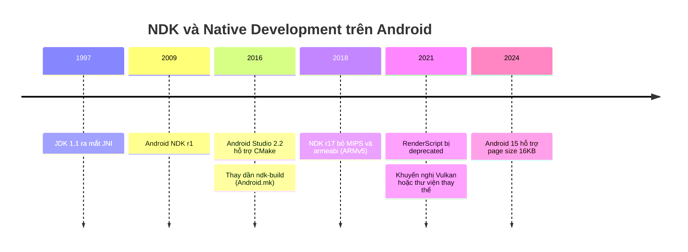
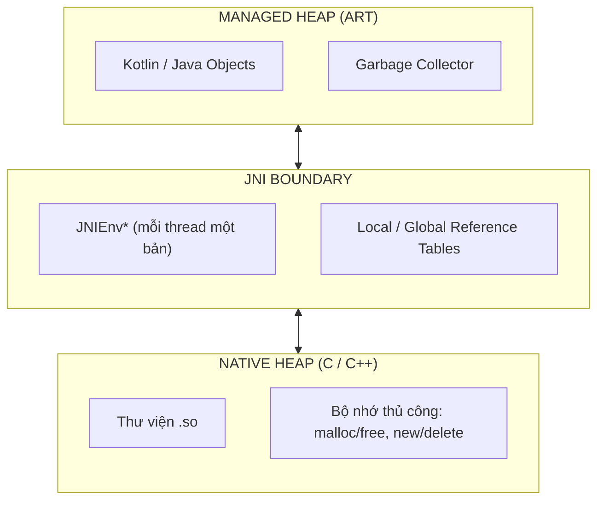

# JNI & C/C++ Native Code trong Android

## Vấn đề cần giải quyết

Kotlin và Java đáp ứng phần lớn nhu cầu của ứng dụng Android. Nhưng có những bài toán mà mã C/C++ là lựa chọn tốt hơn hoặc là lựa chọn duy nhất:

1. **Tính toán nặng, cần kiểm soát bộ nhớ và CPU**: xử lý ảnh/video thời gian thực (OpenCV, FFmpeg), game engine (Unreal, Unity, engine C++ tự viết), AI/ML inference (TensorFlow Lite, ONNX Runtime). Code C/C++ không bị GC tạm dừng, cấp phát bộ nhớ theo ý muốn và dùng được lệnh SIMD (ARM NEON) trực tiếp.
2. **Tái sử dụng thư viện C/C++ sẵn có**: OpenSSL, SQLite, WebRTC, FFmpeg đã được tối ưu qua hàng chục năm. Viết lại bằng Kotlin vừa tốn công vừa khó đạt cùng hiệu năng.
3. **Gây khó cho việc dịch ngược**: bytecode trong `.dex` có thể dịch ngược thành mã gần giống source bằng `jadx`. Mã C/C++ biên dịch thành mã máy (`.so`) khó đọc hơn nhiều. Tuy vậy, công cụ như Ghidra hay IDA vẫn disassemble và phân tích được, nên đây chỉ là **tăng chi phí** cho người dịch ngược, không phải bảo vệ tuyệt đối.

Nếu không nắm vững JNI:

- **Crash SIGSEGV (signal 11)**: truy cập bộ nhớ sai trong C/C++ giết cả process ngay lập tức. `try-catch` của Java/Kotlin không bắt được.
- **Native code chạy chậm hơn Kotlin**: gọi JNI hàng nghìn lần cho những việc nhỏ, chi phí chuyển trạng thái lấn át phần tính toán.
- **Rò rỉ bộ nhớ mà GC không thấy**: bộ nhớ cấp phát bằng `malloc`/`new` và Global Reference quên giải phóng.

---

## Sau khi học xong

- Giải thích được kiến trúc JNI và chi phí chuyển trạng thái mỗi lần code Java/Kotlin gọi sang C/C++.
- Phân biệt được đăng ký hàm native tĩnh (theo quy tắc đặt tên) và đăng ký động (RegisterNatives).
- Xử lý được rò rỉ JNI Reference bằng cách giải phóng Local Reference trong vòng lặp và quản lý Global Reference.
- Triển khai được thư viện C/C++ trong dự án Android với NDK, CMake và external fun.

---

## JNI và NDK là gì?

- **JNI (Java Native Interface)**: chuẩn giao tiếp giữa code chạy trên máy ảo Java và code native C/C++. JNI có từ JDK 1.1; ART cài đặt chuẩn này.
- **NDK (Native Development Kit)**: bộ công cụ của Android để biên dịch C/C++ thành thư viện `.so` cho từng ABI (`arm64-v8a`, `armeabi-v7a`, `x86_64`, `x86`): trình biên dịch Clang, header của Android, và các thư viện hệ thống được phép dùng.
- **CMake**: hệ thống build mà Android Studio dùng để gọi NDK biên dịch phần C/C++.

---

## Lịch sử phát triển



<!-- dd: s01-jni-history -->

---

## Cách hoạt động

### 1. Hai vùng bộ nhớ: Managed Heap và Native Heap

Một app có code native dùng hai vùng bộ nhớ độc lập:



<!-- archify: jni-memory | JNI: Managed Heap và Native Heap -->

- **Managed Heap**: do ART quản lý. GC có thể **di chuyển** object để chống phân mảnh. Vì vậy C/C++ không giữ con trỏ trực tiếp tới object Java, mà giữ **reference** (`jobject`) do JNI quản lý.
- **Native Heap**: C/C++ tự quản lý bằng `malloc`/`free`, `new`/`delete`. GC không thấy và không thu hồi vùng nhớ này.

### 2. Chi phí mỗi lần gọi JNI

Một lời gọi JNI **không phải system call**: không chuyển sang kernel mode. Nhưng nó đắt hơn nhiều so với một lời gọi hàm Kotlin thông thường (vốn có thể được inline). Khi Kotlin gọi `external fun`:

1. ART lưu trạng thái và chuyển thread từ trạng thái **Runnable** sang **Native**. Ở trạng thái Native, GC có thể chạy mà không cần chờ thread này.
2. Các object truyền vào được chuyển thành **Local Reference** trong bảng tham chiếu của thread; C/C++ nhận `jobject`, `jstring`, `jintArray`... là các "tay cầm" gián tiếp.
3. Nhảy vào hàm C/C++.
4. Khi hàm trả về, thread chuyển lại Runnable. Nếu GC đang yêu cầu dừng các thread, thread phải chờ. ART cũng kiểm tra xem C/C++ có để lại exception Java nào không.

<!-- archify: jni-call | Một lần gọi JNI: từ Kotlin sang C++ và quay về -->

Mỗi lần gọi tốn cỡ hàng chục tới hàng trăm nanosecond tuỳ thiết bị, và truy cập dữ liệu Java từ C/C++ (đọc field, copy mảng) tốn thêm. Tốn kém nhất là gọi JNI **rất nhiều lần cho mỗi phần việc nhỏ**, ví dụ mỗi pixel một lần.

> **Quy tắc thực tế:** Gom việc lại để **một lần gọi JNI xử lý cả khối dữ liệu** (cả bức ảnh, cả buffer), thay vì gọi trong vòng lặp. Framework Android còn dùng nội bộ các annotation như `@FastNative` / `@CriticalNative` để giảm chi phí chuyển trạng thái, nhưng với app, giảm số lần gọi là cách hiệu quả nhất.

### 3. Đăng ký hàm Native: tĩnh và động

#### Cách 1: Đăng ký tĩnh (theo quy tắc đặt tên)

ART tìm hàm C++ theo tên ghép từ package, class và method:
`Java_<package>_<Class>_<method>`. Dấu `.` trong package thành `_`; dấu `_` có sẵn trong tên được mã hoá thành `_1`.

```cpp
// C++ (đăng ký tĩnh)
extern "C" JNIEXPORT jstring JNICALL
Java_com_example_shop_MainActivity_stringFromJNI(JNIEnv* env, jobject thiz) {
    return env->NewStringUTF("Hello from C++");
}
```

*Nhược điểm*: tên hàm dài và phải khớp chính xác (đổi tên package là phải đổi theo), lộ tên class/method trong bảng symbol của `.so`, và ART phải tra symbol (`dlsym`) ở lần gọi đầu tiên.

#### Cách 2: Đăng ký động với `RegisterNatives`

Đăng ký con trỏ hàm C++ với ART ngay khi thư viện `.so` được nạp, trong `JNI_OnLoad`:

```cpp
// C++ (đăng ký động)
static jstring native_getMessage(JNIEnv* env, jobject thiz) {
    return env->NewStringUTF("Dynamic Registered Native String");
}

static const JNINativeMethod gMethods[] = {
    {"getMessageFromNative", "()Ljava/lang/String;", (void*) native_getMessage}
};

JNIEXPORT jint JNICALL JNI_OnLoad(JavaVM* vm, void* reserved) {
    JNIEnv* env;
    if (vm->GetEnv((void**) &env, JNI_VERSION_1_6) != JNI_OK) return JNI_ERR;

    jclass clazz = env->FindClass("com/example/shop/MainActivity");
    if (clazz == nullptr) return JNI_ERR;

    if (env->RegisterNatives(clazz, gMethods, 1) != JNI_OK) return JNI_ERR;
    return JNI_VERSION_1_6;
}
```

*Ưu điểm*: không cần tra symbol ở lần gọi đầu (tốc độ các lần gọi sau thì như nhau); tên hàm C++ tuỳ ý và có thể để `static` nên không lộ ra bảng symbol; sai chữ ký method bị phát hiện ngay khi nạp thư viện thay vì lúc gọi.

### 4. Local Reference và Global Reference

- **Local Reference**: mọi `jobject` mà C/C++ nhận được hoặc tạo ra (`NewStringUTF`, `GetObjectArrayElement`...) mặc định là local. Chúng **tự giải phóng khi hàm native trả về**, và chỉ dùng được trên thread hiện tại.
- **Global Reference**: tạo bằng `NewGlobalRef` khi cần giữ object qua nhiều lần gọi hoặc dùng ở thread khác. Global Reference **chỉ được giải phóng khi gọi `DeleteGlobalRef`**. Quên giải phóng là rò rỉ thật sự: object Java đó không bao giờ được GC thu hồi.

Giới hạn số Local Reference:

- **Trước Android 8.0**: số Local Reference mỗi thread bị giới hạn (512 trên nhiều phiên bản). Vượt quá thì app crash với lỗi `local reference table overflow`.
- **Từ Android 8.0 (API 26)**: không còn giới hạn cứng. Nhưng mọi object còn được tham chiếu vẫn bị giữ trong bộ nhớ cho tới khi hàm native trả về.

---

## Ví dụ thực tế

### 1. Thêm thư viện C++ vào dự án với NDK và CMake

Bài toán: làm nét ảnh sản phẩm bằng C++. Toàn bộ mảng pixel được xử lý trong **một** lần gọi JNI.

```kotlin
// ImageFilter.kt
package com.example.shop.image

class ImageFilter {
    external fun sharpen(pixels: IntArray, width: Int, height: Int)

    companion object {
        init {
            System.loadLibrary("imagefilter") // nạp libimagefilter.so
        }
    }
}
```

```cpp
// src/main/cpp/image_filter.cpp
#include <jni.h>

extern "C" JNIEXPORT void JNICALL
Java_com_example_shop_image_ImageFilter_sharpen(JNIEnv* env, jobject thiz,
                                                jintArray pixels, jint width, jint height) {
    jint* data = env->GetIntArrayElements(pixels, nullptr);
    if (data == nullptr) return; // hết bộ nhớ, JNI đã đặt sẵn exception

    // Xử lý width * height pixel trực tiếp trên data

    env->ReleaseIntArrayElements(pixels, data, 0); // 0: ghi kết quả về mảng Java và giải phóng
}
```

File `src/main/cpp/CMakeLists.txt`:

```cmake
cmake_minimum_required(VERSION 3.22.1)
project("imagefilter")

add_library(imagefilter SHARED image_filter.cpp)
target_link_libraries(imagefilter log)
```

```kotlin
// build.gradle.kts (Module: app)
android {
    defaultConfig {
        ndk {
            // Chỉ build các ABI cần thiết
            abiFilters += listOf("arm64-v8a", "armeabi-v7a", "x86_64")
        }
    }
    externalNativeBuild {
        cmake {
            path = file("src/main/cpp/CMakeLists.txt")
            version = "3.22.1"
        }
    }
}
```

Khi build, Gradle gọi CMake và NDK để biên dịch `libimagefilter.so` cho từng ABI, rồi đặt vào thư mục `lib/<abi>/` trong APK/AAB.

### 2. Rò rỉ Local Reference trong vòng lặp

```cpp
// ❌ BAD PRACTICE: tạo Local Reference trong vòng lặp mà không giải phóng
extern "C" JNIEXPORT void JNICALL
Java_com_example_shop_image_ImageProcessor_processBatch(JNIEnv* env, jobject thiz, jobjectArray images) {
    jsize count = env->GetArrayLength(images);
    for (jsize i = 0; i < count; i++) {
        jobject image = env->GetObjectArrayElement(images, i); // 1 Local Reference mới
        // Xử lý image...
        // Không giải phóng:
        // - Android < 8.0: crash "local reference table overflow" khi vượt giới hạn
        // - Android 8.0+: mọi image bị giữ trong bộ nhớ tới khi hàm trả về
    }
}
```

```cpp
// ✅ GOOD PRACTICE: giải phóng ngay khi dùng xong
extern "C" JNIEXPORT void JNICALL
Java_com_example_shop_image_ImageProcessor_processBatch(JNIEnv* env, jobject thiz, jobjectArray images) {
    jsize count = env->GetArrayLength(images);
    for (jsize i = 0; i < count; i++) {
        jobject image = env->GetObjectArrayElement(images, i);
        // Xử lý image...
        env->DeleteLocalRef(image);
    }
}
```

Với đoạn code tạo nhiều reference cùng lúc, có thể bọc bằng `PushLocalFrame` / `PopLocalFrame` để giải phóng cả nhóm.

---

## Sai lầm thường gặp

1. **Nghĩ rằng viết C/C++ luôn làm app chạy nhanh hơn**:
   - Đoạn xử lý nhỏ gọi qua JNI nhiều lần có thể **chậm hơn** viết hoàn toàn bằng Kotlin, vì chi phí chuyển trạng thái lấn át phần tính toán.

2. **Dùng chung `JNIEnv*` giữa nhiều thread**:
   - `JNIEnv*` chỉ hợp lệ trên **thread đã cấp nó**. Dùng ở thread khác gây lỗi hoặc crash.
   - *Giải pháp*: lưu `JavaVM*` (dùng được mọi thread), gọi `AttachCurrentThread()` trên thread mới để lấy `JNIEnv*` riêng, và gọi `DetachCurrentThread()` trước khi thread kết thúc.

3. **Quên giải phóng bộ nhớ native và Global Reference**:
   - GC không thấy bộ nhớ cấp phát bằng `malloc`/`new`. Quên `free`/`delete` thì bộ nhớ của process tăng dần cho tới khi hệ thống (low memory killer) dừng app.
   - Quên `DeleteGlobalRef` giữ object Java sống mãi.

4. **Giữ con trỏ lấy từ `GetIntArrayElements` / `GetStringUTFChars` mà không `Release...`**: rò rỉ bộ nhớ, và với mảng, kết quả có thể không được ghi về phía Java.

---

## Trade-offs và Edge Cases

### Trade-offs

- **Độ phức tạp dự án**: phải duy trì toolchain NDK, CMake, build cho nhiều ABI. Thời gian build tăng rõ rệt.
- **Kích thước APK**: mỗi thư viện `.so` có một bản cho mỗi ABI. APK universal chứa tất cả; AAB giúp mỗi thiết bị chỉ tải bản đúng ABI của nó.
- **An toàn bộ nhớ**: mất các bảo vệ của ART (kiểm tra biên mảng, GC). Lỗi C/C++ có thể thành lỗ hổng bảo mật.

### Edge Cases

- **SIGSEGV và tombstone**: lỗi con trỏ treo (dangling pointer) hoặc con trỏ null trong C++ gây signal `SIGSEGV`, không đi qua cơ chế exception của ART. Debug bằng file tombstone (lấy qua `adb bugreport`) và công cụ `ndk-stack` để đổi địa chỉ thành dòng code.
- **Page size 16KB**: từ Android 15, thiết bị có thể dùng page size 16KB thay vì 4KB. Thư viện `.so` phải được link với căn chỉnh 16KB (mặc định từ NDK r28, hoặc thêm cờ linker `-Wl,-z,max-page-size=16384` với NDK cũ hơn). Google Play yêu cầu app nhắm tới Android 15+ có code native phải hỗ trợ 16KB, áp dụng cho app mới và bản cập nhật từ 1/11/2025.

---

## Kết nối hệ thống

- **Prerequisites**: `android.languages.java_android`, `android.languages.kotlin` (Managed Heap, GC, `external fun`).
- **Related Topics**:
  - `android.output_packages.apk_files`: thư viện `.so` nằm trong `lib/<abi>/` của APK.
  - `android.output_packages.aab_files`: ABI split giúp mỗi thiết bị chỉ tải `.so` đúng kiến trúc CPU của nó.
- **Downstream Topics** (chưa có bài): kiến trúc CPU và ABI, Vulkan, tối ưu hiệu năng native.

---

## Developer Curiosity Checklist

1. **Why was this created?** Để code chạy trên máy ảo Java gọi được thư viện C/C++ hiệu năng cao và tương tác với phần cứng.
2. **What problem does it solve?** Xử lý ảnh/video/AI nặng và tái sử dụng kho thư viện C/C++ có sẵn.
3. **What happens if it doesn't exist?** Android không chạy được game engine 3D, các thư viện media và ML phổ biến.
4. **How does Android implement it internally?** `JNIEnv*` riêng cho mỗi thread, chuyển trạng thái thread giữa Runnable và Native, bảng Local/Global Reference, nạp thư viện bằng `dlopen` và tìm hàm bằng `dlsym` hoặc `RegisterNatives`.
5. **What misconceptions do developers have?** Tưởng C++ luôn nhanh hơn Kotlin; tưởng mã native không thể dịch ngược.
6. **What trade-offs does it introduce?** Build phức tạp, APK lớn hơn, mất an toàn bộ nhớ.
7. **What are the edge cases?** SIGSEGV không bắt được, `JNIEnv*` dùng sai thread, `.so` chưa hỗ trợ page size 16KB.
8. **What are the real-world problems developers encounter?** Rò rỉ Native Heap và Global Reference, crash native khó debug.
9. **How is it connected to the Android system?** Nhiều thành phần lõi của Android (ART, đồ hoạ, media) viết bằng C/C++, và framework Java gọi xuống chúng qua JNI.
10. **What should developers learn next?** `android.output_packages.apk_files` để hiểu cách `.dex` và `.so` được đóng gói vào app.

---

## Tham khảo

- Android Developers: [JNI tips](https://developer.android.com/training/articles/perf-jni)
- Android Developers: [Get started with the NDK](https://developer.android.com/ndk/guides)
- Android Developers: [Support 16 KB page sizes](https://developer.android.com/guide/practices/page-sizes)
