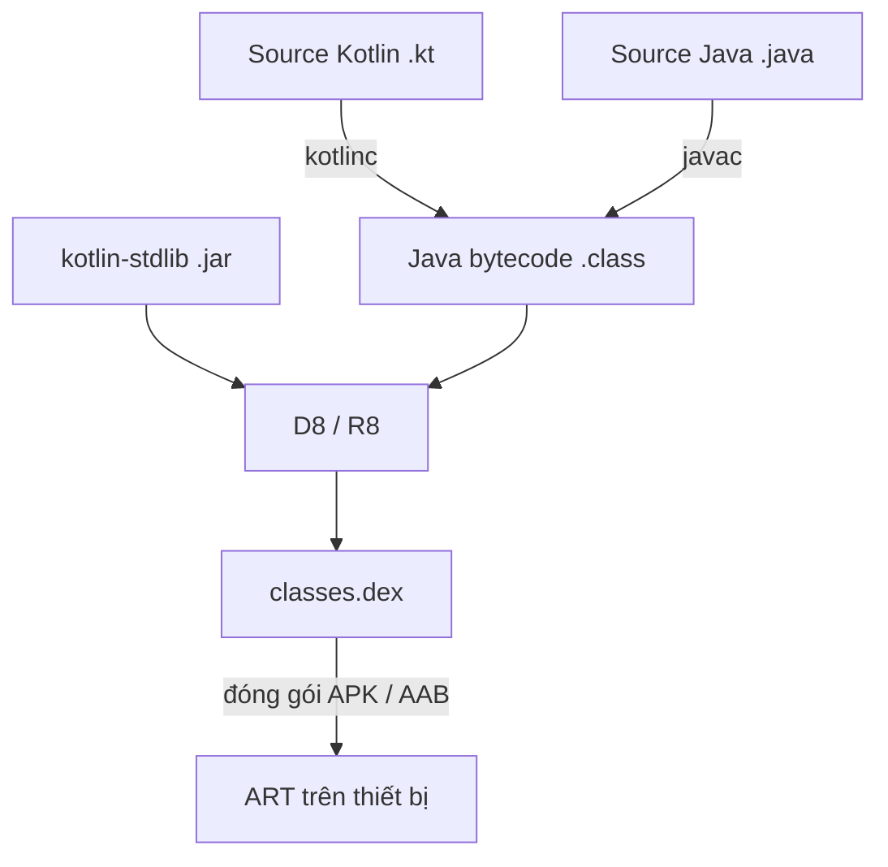
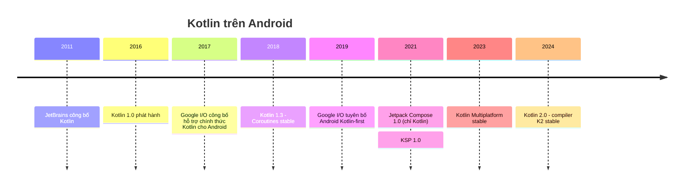

# Kotlin trong Android

## Vấn đề cần giải quyết

Trong gần 10 năm đầu, ứng dụng Android được viết bằng Java. Ba vấn đề lặp đi lặp lại trong các dự án Java Android:

- **`NullPointerException` (NPE)**: mọi biến tham chiếu trong Java đều có thể `null`, và compiler không bắt buộc kiểm tra. NPE là một trong những nguyên nhân crash phổ biến nhất của ứng dụng Android.
- **Boilerplate**: một model đơn giản cần getter, setter, `equals()`, `hashCode()`, `toString()` viết tay; callback lồng nhau khi xử lý bất đồng bộ.
- **Ngôn ngữ bị khoá theo runtime**: tính năng Java mới chỉ dùng được khi D8 hỗ trợ desugar, nên dự án Android luôn chậm hơn Java SE vài phiên bản.

Kotlin, ngôn ngữ của JetBrains, giải quyết các vấn đề này ở **tầng compiler**: kiểu dữ liệu phân biệt nullable và non-null, data class, coroutines. Năm 2017 Google công bố hỗ trợ chính thức Kotlin, năm 2019 tuyên bố Android phát triển theo hướng **Kotlin-first**.

Nếu chỉ học cú pháp mà không hiểu Kotlin được biên dịch thế nào, bạn sẽ gặp:

- NPE vẫn xảy ra khi gọi code Java, dù "Kotlin có Null Safety".
- Build chậm vì vẫn dùng KAPT cho Room/Hilt.
- API viết bằng Kotlin mà đồng nghiệp viết Java gọi rất khó (`Companion`, `UtilsKt`, phải truyền đủ tham số mặc định).

---

## Sau khi học xong

- Giải thích được vì sao Kotlin chạy trên ART mà không cần máy ảo riêng, và vai trò của kotlinc trong chuỗi build.
- Giải thích được Null Safety được thực thi ở compile-time và các kiểm tra null mà kotlinc chèn vào bytecode.
- Xử lý được các điểm ma sát khi Java và Kotlin gọi nhau, gồm Platform Types, @JvmOverloads, @JvmStatic và @file:JvmName.
- Phân biệt được KAPT và KSP, và chọn đúng công cụ annotation processing cho dự án mới.
- Nhận diện được chi phí ẩn của lambda, by lazy và Collection operators để dùng đúng chỗ.

---

## Kotlin là gì?

**Kotlin** là ngôn ngữ kiểu tĩnh (statically typed) do JetBrains phát triển. Kotlin có nhiều target: JVM, Native, JS và Wasm. **Trên Android, Kotlin dùng target JVM**: mã nguồn `.kt` được biên dịch thành Java bytecode `.class`, giống hệt đầu ra của `javac`.

> **Lưu ý:** Không có "máy ảo Kotlin" trên Android. Khi app chạy, ART không biết và không cần biết một class ban đầu được viết bằng Java hay Kotlin.

---

## Cách hoạt động

### 1. Từ `.kt` đến `.dex`



<!-- dd: s01-kotlin-build -->

Trong một module có cả Java và Kotlin, Gradle chạy theo thứ tự:

1. **`kotlinc` chạy trước.** Nó đọc được cả file `.java` trong module để resolve symbol, nhưng chỉ sinh `.class` cho file `.kt`.
2. **`javac` chạy sau**, với các `.class` Kotlin vừa sinh nằm trên classpath. Nhờ vậy Java gọi được Kotlin và ngược lại trong cùng module.
3. **D8/R8** gộp `.class` của cả hai ngôn ngữ cùng thư viện (gồm `kotlin-stdlib`) thành `classes.dex`. Từ bước này trở đi, quy trình giống hệt dự án Java thuần (xem `android.languages.java_android`).

Hệ quả của thiết kế này:

- Dùng được mọi thư viện Java trong dự án Kotlin, và ngược lại.
- App viết bằng Kotlin chạy được trên Android đời cũ; giới hạn là `minSdk` của dự án, không phải Kotlin.
- APK phải mang theo `kotlin-stdlib`. R8 loại bỏ phần không dùng nên phần tăng thêm thường nhỏ.

Mỗi class Kotlin còn được gắn annotation `@kotlin.Metadata`. Annotation này lưu thông tin mà bytecode JVM không biểu diễn được (nullability, tham số mặc định, `data`, extension function...). Compiler Kotlin đọc nó khi bạn dùng một thư viện Kotlin đã biên dịch; `kotlin-reflect` cũng đọc nó.

### 2. Null Safety: compile-time trước, runtime sau

**Ở compile-time**, `String` và `String?` là hai kiểu khác nhau. Compiler không cho gán `null` vào `String` và không cho gọi `.length` trên `String?` khi chưa kiểm tra.

```kotlin
var name: String = "Lan"
// name = null            // Lỗi compile: Null can not be a value of a non-null type String

var nickname: String? = null
// nickname.length         // Lỗi compile: phải dùng ?. hoặc kiểm tra null
val length = nickname?.length ?: 0
```

**Ở runtime**, `kotlinc` chèn thêm kiểm tra vào bytecode ở các "cửa ngõ" mà code Java có thể đi vào:

- Tham số non-null của hàm `public`: đầu hàm có lời gọi `Intrinsics.checkNotNullParameter(...)`. Nếu code Java truyền `null` vào, app ném `NullPointerException` ngay tại đó, kèm tên tham số, thay vì crash ở một chỗ xa hơn. (Trước Kotlin 1.4, ngoại lệ này là `IllegalArgumentException`.)
- Toán tử `!!` biên dịch thành một phép kiểm tra và ném `NullPointerException` nếu giá trị là `null`.

Ngoài ra, `kotlinc` gắn annotation `@NotNull` / `@Nullable` (`org.jetbrains.annotations`) lên chữ ký hàm, để IDE và code Java gọi vào biết hàm nhận và trả về gì.

> **Lưu ý:** Null Safety chỉ chắc chắn khi **cả hai phía** đều là Kotlin. Giá trị đi từ Java sang không có thông tin nullability, đó là Platform Type (xem mục 4).

### 3. Data class: compiler sinh ra gì?

```kotlin
data class CartItem(val productId: Long, val name: String, var quantity: Int)
```

Từ khoá `data` yêu cầu compiler sinh thêm: `equals()`, `hashCode()`, `toString()`, `copy()` và `component1()`... `componentN()` (để destructuring `val (id, name) = item`).

Getter và setter **không** đến từ `data`: chúng là accessor của property. `val` chỉ có getter; `var` có cả getter và setter.

Vì vậy một data class có **nhiều method hơn** class Java tương đương viết tay (thêm `copy`, `componentN` và hàm phụ cho tham số mặc định). Bạn viết ít code hơn, nhưng số method trong DEX không giảm.

### 4. Java và Kotlin gọi nhau

#### Kotlin gọi Java

- Getter/setter Java được dùng như property: `user.name = "Lan"` gọi `setName("Lan")`.
- Interface Java có một method trừu tượng (SAM) nhận lambda Kotlin: `button.setOnClickListener { openCart() }`.
- **Platform Type**: kiểu trả về của Java không có annotation nullability được Kotlin hiểu là `String!`, nghĩa là "không biết có null hay không". Compiler cho phép dùng nó như `String` hoặc `String?`, **không bắt kiểm tra null**. Nếu giá trị thật là `null` và bạn dùng như `String`, app crash NPE tại runtime.

Platform Type là chỗ duy nhất Null Safety của Kotlin "thủng" một cách hợp lệ. Có hai cách bịt:

1. Phía Kotlin: **khai báo kiểu tường minh** ngay khi nhận giá trị từ Java (`val name: String? = repo.getUserName(id)`).
2. Phía Java: thêm `@Nullable` / `@NonNull` (`androidx.annotation`) cho API. Cách này được trình bày trong `android.languages.java_android`.

#### Java gọi Kotlin

Một số cấu trúc Kotlin không có tương đương trực tiếp trong Java. Compiler sinh bytecode theo quy ước, và bạn dùng annotation `@Jvm...` để API thân thiện hơn với Java:

| Cấu trúc Kotlin | Java thấy mặc định | Annotation để gọi tự nhiên hơn |
| :--- | :--- | :--- |
| Hàm top-level trong `PriceFormatter.kt` | Static method của class `PriceFormatterKt` | `@file:JvmName("PriceFormatter")` |
| Tham số mặc định | Một method duy nhất, phải truyền đủ tham số | `@JvmOverloads` sinh thêm các overload |
| Hàm trong `companion object` | `CartRepository.Companion.getInstance()` | `@JvmStatic` → `CartRepository.getInstance()` |
| Property | Getter/setter (`getName()`) | `@JvmField` → field public, không có getter |
| Hàm ném exception | Java không bị buộc `catch` | `@Throws(IOException::class)` |

### 5. Annotation Processing: KAPT và KSP

Room, Hilt, Moshi sinh code từ annotation trong lúc build.

- **KAPT (Kotlin Annotation Processing Tool)**: annotation processor viết cho Java (APT) không đọc được mã Kotlin. KAPT giải quyết bằng cách sinh **Java stub** từ mã Kotlin, rồi chạy processor Java trên stub đó. Bước sinh stub tốn thời gian và chạy lại mỗi khi code đổi.
- **KSP (Kotlin Symbol Processing)**: API do Google phát triển, cho processor đọc trực tiếp cấu trúc mã Kotlin mà không cần stub. Google công bố KSP có thể nhanh tới khoảng 2 lần so với KAPT.

KAPT hiện ở chế độ bảo trì. **Dự án mới nên dùng KSP** cho mọi thư viện đã hỗ trợ (Room, Hilt, Moshi...).

### 6. Chi phí ẩn của tính năng Kotlin

Các tính năng sau giúp code gọn, nhưng sinh thêm object hoặc vòng lặp mà bạn không thấy trong source:

- **Lambda truyền vào hàm thường (không `inline`)**: lambda có capture biến sẽ thành một object mới mỗi lần gọi. Các hàm của stdlib như `forEach`, `map`, `filter` là `inline` nên không có chi phí này.
- **`by lazy`**: tạo một object `Lazy` và mặc định dùng `synchronized` (`LazyThreadSafetyMode.SYNCHRONIZED`). Nếu chắc chắn chỉ truy cập từ main thread, có thể dùng `lazy(LazyThreadSafetyMode.NONE) { ... }`.
- **Collection operators**: `list.filter { }.map { }` chạy **eager**, mỗi bước tạo một `List` trung gian. Với danh sách lớn và chuỗi nhiều bước, `asSequence()` xử lý lần lượt từng phần tử và tránh các list trung gian.

Đây không phải lý do để tránh các tính năng trên. Chỉ cần để ý khi chúng nằm trong code chạy rất thường xuyên: `onDraw()`, adapter, vòng lặp lớn.

---

## Ví dụ thực tế

### 1. Platform Type trong dự án Java và Kotlin chung

```java
// UserRepository.java — code Java cũ, chưa có annotation
public class UserRepository {
    public String getUserName(int userId) {
        if (userId <= 0) return null;
        return "Lan";
    }
}
```

```kotlin
// ProfileViewModel.kt
val repo = UserRepository()

val name = repo.getUserName(-1)   // Kiểu suy ra: String! (Platform Type)
println(name.length)              // Compile được, nhưng crash NullPointerException ở runtime

val safeName: String? = repo.getUserName(-1)  // Khai báo tường minh
println(safeName?.length ?: 0)                // Compiler buộc xử lý null
```

Quy tắc thực tế: **ở ranh giới gọi sang Java, luôn khai báo kiểu tường minh** và đi thêm annotation cho Java API khi có thể.

### 2. Viết API Kotlin để code Java gọi dễ dàng

```kotlin
// PriceFormatter.kt
@file:JvmName("PriceFormatter")

package com.example.shop.util

@JvmOverloads
fun formatPrice(amount: Long, currency: String = "VND"): String =
    "%,d %s".format(amount, currency)
```

```kotlin
// CartRepository.kt
package com.example.shop.cart

class CartRepository private constructor() {
    companion object {
        private val instance = CartRepository()

        @JvmStatic
        fun getInstance(): CartRepository = instance
    }
}
```

```java
// CheckoutActivity.java
String total = PriceFormatter.formatPrice(150000);          // nhờ @JvmOverloads
String totalUsd = PriceFormatter.formatPrice(12, "USD");
CartRepository cart = CartRepository.getInstance();          // nhờ @JvmStatic
```

Nếu bỏ các annotation trên, phía Java phải viết `PriceFormatterKt.formatPrice(150000, "VND")` và `CartRepository.Companion.getInstance()`.

### 3. Chuyển Room từ KAPT sang KSP

```kotlin
// build.gradle.kts (Module: app)
plugins {
    id("com.android.application")
    id("org.jetbrains.kotlin.android")
    id("com.google.devtools.ksp")   // thay cho id("kotlin-kapt")
}

dependencies {
    implementation("androidx.room:room-runtime:2.6.1")
    ksp("androidx.room:room-compiler:2.6.1")   // thay cho kapt(...)
}
```

Phiên bản plugin KSP phải khớp với phiên bản Kotlin của dự án. Khai báo nó ở `build.gradle.kts` gốc hoặc trong version catalog.

---

## Sai lầm thường gặp

1. **Dùng `!!` để cho qua lỗi compile.** `!!` không làm biến an toàn hơn; nó chỉ chuyển lỗi từ compile-time sang crash runtime. Dùng `?.`, `?:`, `let` hoặc sửa lại thiết kế để biến không nullable.
2. **Để Kotlin tự suy kiểu từ Java API.** Platform Type `T!` lan khắp codebase, và NPE xuất hiện ở chỗ cách xa nơi gọi Java.
3. **Lạm dụng `lateinit`.** Truy cập trước khi gán ném `UninitializedPropertyAccessException`. Chỉ dùng cho property chắc chắn được gán trước khi dùng (ví dụ view binding trong `onCreate`).
4. **Vẫn dùng KAPT cho dự án mới**, làm build chậm hơn cần thiết.
5. **Nghĩ Kotlin cần Android mới hoặc có máy ảo riêng.** Kotlin chạy trên ART như Java; giới hạn là `minSdk` và API Android bạn gọi.
6. **Viết API Kotlin mà quên người gọi Java** trong dự án chung: thiếu `@JvmStatic`, `@JvmOverloads`, khiến code Java phải gọi qua `Companion` và truyền đủ mọi tham số.

---

## Trade-offs

**Ưu điểm**

- Null Safety ở compile-time giảm mạnh NPE trong code Kotlin.
- Ít boilerplate: data class, extension function, sealed class/interface để mô tả state UI.
- Coroutines cho code bất đồng bộ viết theo kiểu tuần tự.
- Google ưu tiên: Jetpack, tài liệu chính thức và **Jetpack Compose chỉ hỗ trợ Kotlin**.

**Nhược điểm**

- **Build time**: `kotlinc` làm nhiều việc hơn `javac` (suy luận kiểu, inline, sinh code cho data class). Kotlin 2.0 (2024) đưa compiler K2 vào stable và cải thiện tốc độ biên dịch, nhưng dự án lớn vẫn cần cấu hình build cẩn thận.
- **Kích thước APK**: thêm `kotlin-stdlib`; R8 giảm phần lớn nhưng không về 0.
- **Ma sát trong dự án Java và Kotlin chung**: Platform Type, cần annotation `@Jvm...`, hai bộ quy ước code.

---

## Lịch sử phát triển



<!-- dd: s01-kotlin-history -->

---

## Kết nối hệ thống

- **Prerequisites**: `android.languages.java_android` (chuỗi build `.class` → `.dex`, ART).
- **Related Topics**:
  - `android.languages.jni`: hàm `external fun` trong Kotlin là điểm vào code C/C++.
  - `android.output_packages.apk_files`: nơi `classes.dex` (gồm cả code Kotlin và `kotlin-stdlib`) được đóng gói.
- **Downstream Topics** (chưa có bài): Coroutines (8.4.3), Jetpack Compose, Room với KSP.

---

## Developer Curiosity Checklist

1. **Why was this created?** JetBrains cần một ngôn ngữ hiện đại hơn Java nhưng tương thích hoàn toàn với hệ sinh thái JVM.
2. **What problem does it solve?** NPE, boilerplate và code bất đồng bộ khó đọc trong Java Android.
3. **What happens if it doesn't exist?** Android vẫn chạy được, nhưng mất Null Safety ở compile-time, coroutines và Jetpack Compose.
4. **How does Android implement it internally?** Không có gì riêng: `kotlinc` sinh `.class`, D8/R8 chuyển sang `.dex`, ART chạy như Java.
5. **What misconceptions do developers have?** Kotlin có máy ảo riêng; Null Safety bảo vệ cả giá trị đến từ Java.
6. **What trade-offs does it introduce?** Build lâu hơn, thêm `kotlin-stdlib`, ma sát interop.
7. **What are the edge cases?** Platform Type, `lateinit` chưa khởi tạo, `@JvmOverloads` chỉ sinh overload bỏ tham số từ cuối danh sách.
8. **What are the real-world problems developers encounter?** NPE ở ranh giới Java, build chậm do KAPT.
9. **How is it connected to the Android system?** Chạy trên cùng ART, dùng cùng Android SDK như Java.
10. **What should developers learn next?** Coroutines, sau đó là Jetpack Compose.
