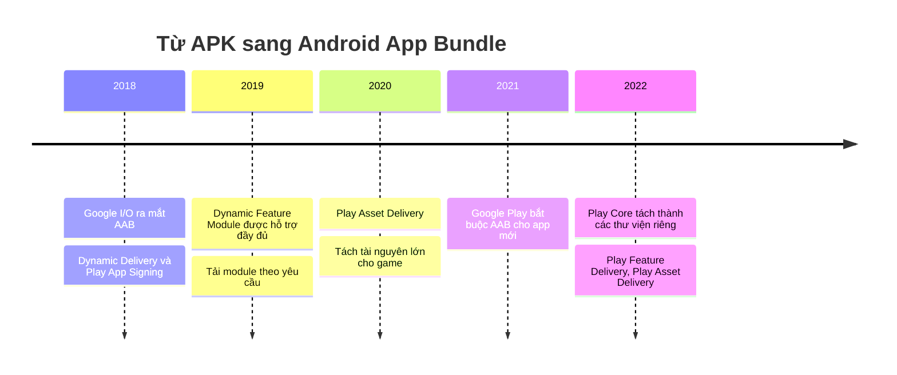
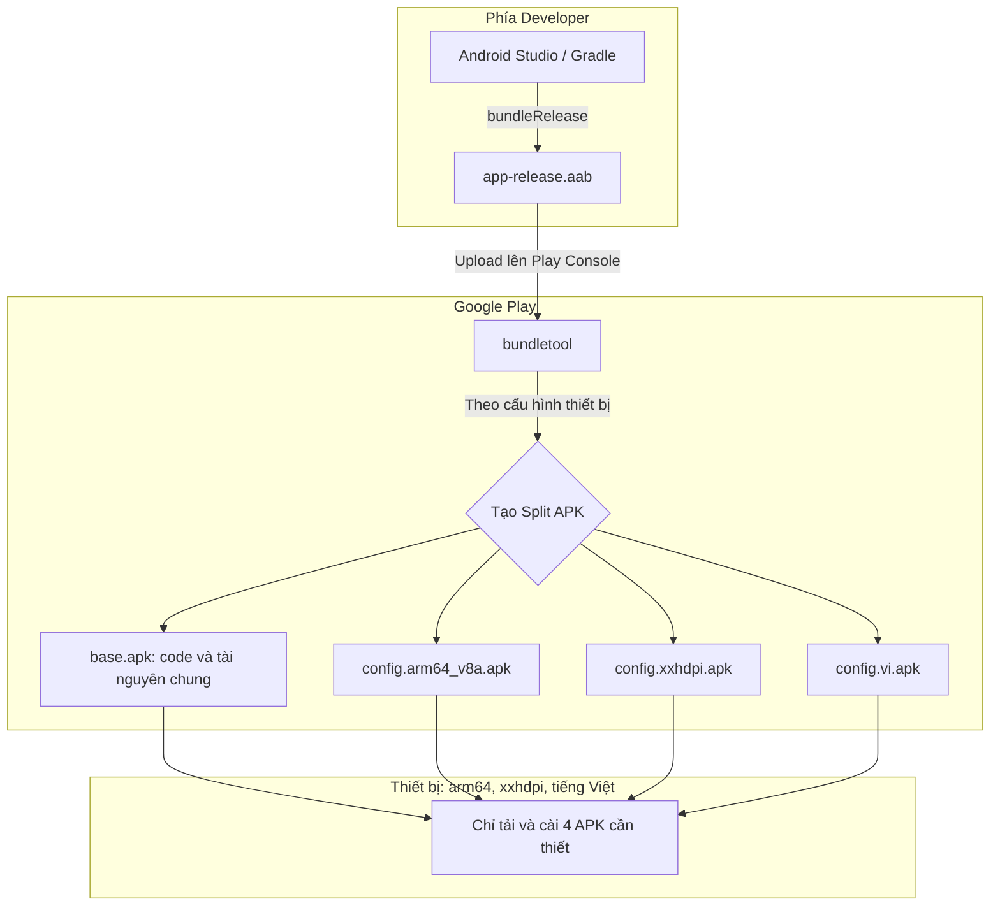
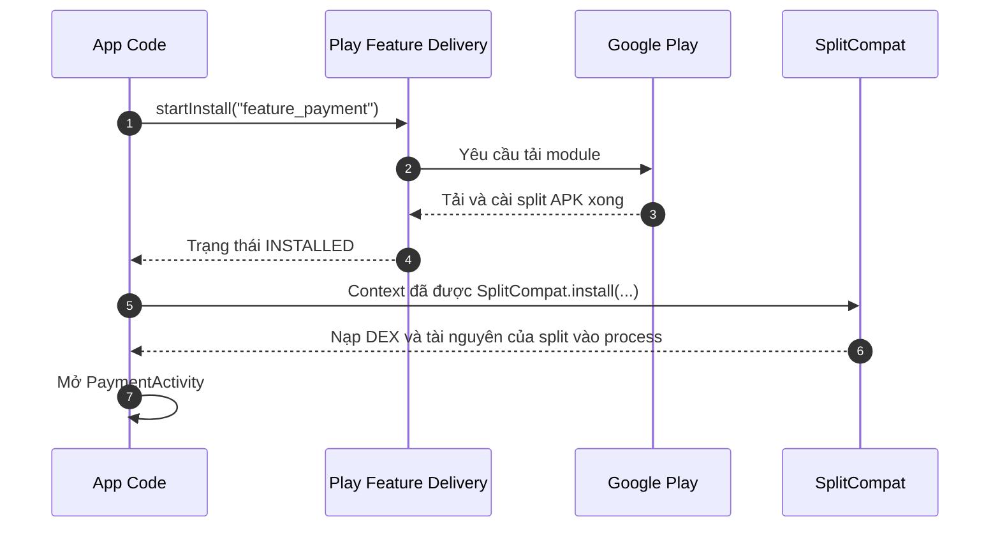

# Android App Bundle (AAB) & Dynamic Delivery

## Vấn đề cần giải quyết

Trong nhiều năm, ứng dụng được phát hành dưới dạng một **APK universal** chứa mọi thứ cho mọi thiết bị. Điều này gây ra ba vấn đề:

1. **Lãng phí dung lượng tải về**: một người dùng có điện thoại màn hình `xxhdpi`, CPU ARM64, chỉ dùng tiếng Việt vẫn phải tải hình ảnh cho mọi mật độ màn hình, thư viện native cho `x86`/`x86_64`, và chuỗi dịch của hàng chục ngôn ngữ khác.
2. **Giảm tỷ lệ cài đặt**: số liệu Google Play công bố năm 2017 cho thấy cứ mỗi 6MB tăng thêm trong dung lượng APK, tỷ lệ cài đặt thành công giảm khoảng 1%.
3. **Không tách được tính năng ít dùng**: tính năng chỉ dùng một lần (ví dụ quét căn cước khi đăng ký) vẫn phải nằm trong APK chính, làm tăng dung lượng cài đặt ban đầu.

Tháng 5/2018, Google giới thiệu **Android App Bundle (AAB)**. Từ tháng 8/2021, Google Play **bắt buộc app mới** phát hành bằng AAB.

---

## Sau khi học xong

- Giải thích được khác biệt bản chất giữa APK (định dạng cài đặt) và Android App Bundle (định dạng xuất bản).
- Giải thích được cách bundletool tạo Split APK theo ngôn ngữ, mật độ màn hình và ABI cho từng thiết bị.
- Triển khai được Dynamic Feature Module tải theo yêu cầu với Play Feature Delivery và SplitCompat.
- Xử lý được việc kiểm thử AAB cục bộ bằng bundletool CLI.

---

## AAB là gì?

**Android App Bundle (AAB)** là định dạng **xuất bản** (publishing format): một file `.aab` chứa toàn bộ code và tài nguyên đã biên dịch của app, chia theo module, để cửa hàng (Google Play) tự sinh và ký các APK tối ưu cho từng thiết bị. Thiết bị không cài trực tiếp được AAB.

Mental model: APK là **thùng hàng đóng sẵn** gửi tới tay người dùng; AAB là **kho nguyên liệu** gửi cho Google Play, để Play đóng từng thùng vừa đúng với từng thiết bị.

---

## Lịch sử phát triển



<!-- dd: s01-aab-history -->

---

## Cách hoạt động

### 1. AAB và APK khác nhau thế nào

> **Quy tắc quan trọng:** Android **không thể** cài trực tiếp file `.aab`. AAB là **định dạng xuất bản** (publishing format) gửi lên cửa hàng ứng dụng. Từ AAB, cửa hàng sinh ra các APK để cài trên thiết bị.



<!-- archify: aab-split-delivery | AAB → Split APK: mỗi thiết bị chỉ tải phần nó cần -->

| Đặc tính | APK universal | Android App Bundle (AAB) |
| :--- | :--- | :--- |
| **Mục đích** | Gói cài đặt trực tiếp lên thiết bị | Định dạng xuất bản lên cửa hàng |
| **Nội dung** | Mọi ABI, mật độ màn hình, ngôn ngữ trong một file | Mọi thứ, chia theo module; manifest và tài nguyên ở dạng Protocol Buffers |
| **Ai ký bản cài đặt** | Developer | Google Play ký bằng app signing key (Play App Signing) |
| **Người dùng tải về** | Toàn bộ file | Chỉ các phần thiết bị cần |
| **Dung lượng** | Lớn nhất | Google công bố giảm trung bình khoảng 15% so với APK universal; app có nhiều tài nguyên theo cấu hình giảm nhiều hơn |

Split APK được PackageManager hỗ trợ từ Android 5.0 (API 21). Với thiết bị cũ hơn, Play sinh **standalone APK** riêng cho từng nhóm cấu hình.

---

### 2. Cấu trúc bên trong file AAB

Khác với APK, nơi `AndroidManifest.xml` và `resources.arsc` ở dạng Binary XML của Android, AAB lưu manifest và bảng tài nguyên ở dạng **Protocol Buffers (protobuf)**. Dạng này dễ để bundletool đọc và tách theo cấu hình.

```text
MyApp.aab (ZIP Archive)
├── BundleConfig.pb              # Cấu hình của bundle (phiên bản bundletool, cách tách split...)
├── BUNDLE-METADATA/             # Metadata cho công cụ, ví dụ mapping file của R8
├── base/                        # Module chính
│   ├── manifest/
│   │   └── AndroidManifest.xml  # Manifest dạng protobuf
│   ├── dex/                     # classes.dex, classes2.dex...
│   ├── res/                     # Tài nguyên
│   ├── assets/                  # Tài nguyên thô
│   ├── lib/                     # Thư viện .so theo ABI
│   ├── root/                    # File sẽ nằm ở gốc APK
│   ├── resources.pb             # Bảng tài nguyên dạng protobuf (thay cho resources.arsc)
│   ├── assets.pb                # Mô tả assets theo cấu hình
│   └── native.pb                # Mô tả thư viện native theo ABI
└── feature_payment/             # Dynamic Feature Module
    ├── manifest/
    ├── dex/
    └── res/
```

**`bundletool`** đọc các file `.pb` này để biết tài nguyên nào thuộc ngôn ngữ, mật độ hay ABI nào, rồi lắp ráp thành các **Split APK**. Đây cũng là công cụ Google Play dùng ở phía server.

---

### 3. Dynamic Feature Module và SplitCompat

**Dynamic Feature Module (DFM)** tách một tính năng thành module riêng với chế độ phân phối:

- **install-time**: cài cùng app (dùng để tổ chức code, vẫn có thể gỡ sau).
- **on-demand**: chỉ tải khi app yêu cầu.
- **conditional**: tải lúc cài nếu thiết bị thoả điều kiện (quốc gia, tính năng phần cứng, API level).

Với module **on-demand**, app yêu cầu tải qua thư viện **Play Feature Delivery** (`SplitInstallManager`). Google Play tải split APK về và hệ thống cài nó cho app.

Vấn đề: process đang chạy **chưa nạp** code và tài nguyên của split vừa cài. Thông thường phải khởi động lại app mới dùng được. **`SplitCompat`** giải quyết việc này: nó nạp code và tài nguyên của split vào process hiện tại (thêm DEX vào `ClassLoader`, thêm tài nguyên vào `AssetManager`), nên app dùng được module ngay.



<!-- dd: s01-splitcompat -->

---

## Ví dụ thực tế

### 1. Tải module on-demand và bật SplitCompat

```kotlin
// build.gradle.kts (Module: app)
dependencies {
    implementation("com.google.android.play:feature-delivery-ktx:2.1.0")
}
```

```kotlin
// ShopApplication.kt
class ShopApplication : Application() {

    override fun attachBaseContext(base: Context) {
        super.attachBaseContext(base)
        // Cho phép process hiện tại dùng code và tài nguyên của split vừa tải
        SplitCompat.install(this)
    }
}
```

Có thể kế thừa `SplitCompatApplication` thay cho việc tự gọi `SplitCompat.install`.

```kotlin
// CheckoutActivity.kt — yêu cầu tải module thanh toán
val splitInstallManager = SplitInstallManagerFactory.create(this)

val request = SplitInstallRequest.newBuilder()
    .addModule("feature_payment")
    .build()

splitInstallManager.startInstall(request)
    .addOnSuccessListener { sessionId ->
        // Theo dõi tiến trình bằng SplitInstallStateUpdatedListener (bên dưới)
    }
    .addOnFailureListener { exception ->
        // Xử lý lỗi: không có mạng, hết dung lượng...
    }
```

`startInstall` thành công chỉ nghĩa là Play **nhận yêu cầu**. Trạng thái tải và cài đến qua `SplitInstallStateUpdatedListener`, trong đó phải xử lý `REQUIRES_USER_CONFIRMATION`:

```kotlin
// CheckoutActivity.kt — đăng ký trước startInstall (vd onStart), huỷ bằng unregisterListener (vd onStop)
// confirmLauncher = registerForActivityResult(ActivityResultContracts.StartIntentSenderForResult()) { }
val listener = SplitInstallStateUpdatedListener { state ->
    when (state.status()) {
        // Play cần người dùng xác nhận: app không cài từ Play, hoặc module lớn khi dùng mobile data
        SplitInstallSessionStatus.REQUIRES_USER_CONFIRMATION ->
            splitInstallManager.startConfirmationDialogForResult(state, confirmLauncher)
        SplitInstallSessionStatus.INSTALLED -> openPaymentScreen()
        SplitInstallSessionStatus.FAILED -> showRetry(state.errorCode())
        else -> Unit // PENDING, DOWNLOADING...: cập nhật progress bằng bytesDownloaded() / totalBytesToDownload()
    }
}
splitInstallManager.registerListener(listener)
```

```kotlin
// PaymentActivity.kt — nằm trong module feature_payment
class PaymentActivity : AppCompatActivity() {

    override fun attachBaseContext(newBase: Context) {
        super.attachBaseContext(newBase)
        // Activity thuộc DFM cần gọi để truy cập tài nguyên của chính module
        SplitCompat.installActivity(this)
    }
}
```

### 2. Kiểm thử AAB cục bộ với `bundletool`

`adb install` chỉ cài được APK. Để kiểm thử đúng luồng mà Google Play sẽ dùng, sinh APK từ AAB bằng `bundletool`.

#### Bước 1: Sinh file `.apks` từ AAB

```bash
java -jar bundletool.jar build-apks \
    --bundle=app-release.aab \
    --output=app.apks \
    --ks=release.jks \
    --ks-pass=file:keystore.pwd \
    --ks-key-alias=release
```

Dùng `--ks-pass=file:...` để mật khẩu không nằm trong lịch sử shell. Thêm `--connected-device` để chỉ sinh APK cho thiết bị đang cắm, hoặc `--mode=universal` để sinh một APK universal (hữu ích khi phân phối ngoài Google Play).

#### Bước 2: Cài lên thiết bị đang kết nối ADB

```bash
java -jar bundletool.jar install-apks --apks=app.apks
```

`bundletool` đọc ABI, mật độ màn hình và ngôn ngữ của thiết bị, rồi chỉ cài các Split APK phù hợp. Để thử tải module on-demand như trên Play, dùng thêm `--local-testing` khi `build-apks`.

---

## Sai lầm thường gặp

1. **Dùng `adb install` với file `.aab`**:
   - `adb` chỉ hiểu APK; file `.aab` bị từ chối. Dùng `bundletool` như ví dụ trên.

2. **Quên `SplitCompat` khi dùng module on-demand**:
   - Module tải thành công nhưng app crash `ClassNotFoundException` hoặc `Resources.NotFoundException` khi mở màn hình thuộc module, vì process chưa nạp split đó.

3. **Nhầm hai loại key của Play App Signing**:
   - **App signing key**: do Google giữ, dùng để ký APK cài lên thiết bị người dùng.
   - **Upload key**: do developer giữ, dùng để ký AAB trước khi upload. AAB được ký bằng `jarsigner` (hoặc `signingConfig` của Gradle); `apksigner` **không** ký được AAB. Chữ ký này chỉ để Play xác minh người upload, còn APK cài lên thiết bị do Play ký lại bằng app signing key (v2/v3).
   - Mất upload key thì chủ tài khoản gửi yêu cầu reset trong Play Console. Không thể tự lấy lại app signing key, nên đừng nhầm hai key khi lưu trữ.

4. **Vẫn dùng thư viện Play Core cũ** (`com.google.android.play:core`): từ 2022 thư viện này được tách thành Play Feature Delivery, Play Asset Delivery, Play In-App Updates... Thư viện cũ không còn tương thích với các phiên bản `targetSdk` mới.

---

## Trade-offs và Edge Cases

### Trade-offs

- **Phụ thuộc cửa hàng hỗ trợ AAB**: tải module on-demand cần Google Play (hoặc cửa hàng có hỗ trợ tương đương). Một số cửa hàng khác cũng nhận AAB, nhưng nhiều nơi vẫn yêu cầu APK. Khi phân phối ngoài Play hoặc cài nội bộ, bạn phải tự sinh APK bằng `bundletool`.
- **Google giữ app signing key**: tiện và an toàn hơn khi lỡ mất key của mình, nhưng bạn phụ thuộc vào Google cho khâu ký cuối.
- **Test phức tạp hơn**: không còn "một file APK" để gửi tester; cần `bundletool` hoặc Internal App Sharing.

### Edge Cases

- **Giới hạn sau khi tải module on-demand**: trong một thời gian (có khi vài ngày) sau khi tải, platform chưa áp dụng manifest entry mới mà module khai báo, và system UI (vd notification) chưa dùng được tài nguyên của module. Tài nguyên cần dùng ngay cho notification nên đặt ở base module.
- **Tài nguyên của module trong Context chưa qua SplitCompat**: gọi `LayoutInflater.from(context)` với một Context chưa được `SplitCompat` xử lý (ví dụ Context tạo riêng hoặc của Service) sẽ crash `Resources$NotFoundException` khi đọc layout/drawable của module.

---

## Kết nối hệ thống

- **Prerequisites**: `android.output_packages.apk_files` (cấu trúc APK và Signature Scheme).
- **Related Topics**:
  - `android.languages.jni`: thư viện `.so` được tách thành ABI split.
- **Downstream Topics**:
  - `android.cicd.overview`: tự động build và đẩy AAB lên Play Console trong pipeline CI/CD.

---

## Developer Curiosity Checklist

1. **Why was this created?** Để mỗi thiết bị chỉ tải đúng phần nó cần thay vì một APK universal.
2. **What problem does it solve?** Giảm dung lượng tải về, tăng tỷ lệ cài đặt, và cho phép tải tính năng theo yêu cầu.
3. **What happens if it doesn't exist?** Người dùng tiếp tục tải tài nguyên và thư viện native mà thiết bị không dùng tới.
4. **How does Android implement it internally?** Bundle lưu manifest và tài nguyên dạng protobuf; `bundletool` tách thành base APK và config split APK; PackageManager cài nhiều APK cho cùng một app (từ API 21).
5. **What misconceptions do developers have?** Nghĩ có thể `adb install` file `.aab`; nhầm upload key với app signing key.
6. **What trade-offs does it introduce?** Phụ thuộc cửa hàng ứng dụng và Play App Signing, test phức tạp hơn.
7. **What are the edge cases?** Crash `ClassNotFoundException` / `Resources$NotFoundException` do thiếu `SplitCompat`.
8. **What are the real-world problems developers encounter?** Test AAB cục bộ, quản lý key với Play App Signing, chuyển từ Play Core sang các thư viện mới.
9. **How is it connected to the Android system?** Dựa trên khả năng cài nhiều Split APK cho một app của PackageManager từ Android 5.0 (API 21).
10. **What should developers learn next?** Session 02 (`android.session02.file_permissions`; Process Management chưa có bài) để hiểu hệ thống cài đặt và cô lập ứng dụng thế nào.

---

## Tham khảo

- Android Developers: [About Android App Bundles](https://developer.android.com/guide/app-bundle)
- Android Developers: [bundletool](https://developer.android.com/tools/bundletool)
- Android Developers: [Play Feature Delivery](https://developer.android.com/guide/playcore/feature-delivery)
- Android Developers: [Configure on-demand delivery](https://developer.android.com/guide/playcore/feature-delivery/on-demand)
- Android Developers: [Build your app from the command line: Build an app bundle](https://developer.android.com/build/building-cmdline#build_bundle)
- Android Developers: [Use Play App Signing](https://support.google.com/googleplay/android-developer/answer/9842756)
- Google Play Apps & Games (2017): *Shrinking APKs, growing installs*. Nguồn của số liệu 6MB và 1%.
