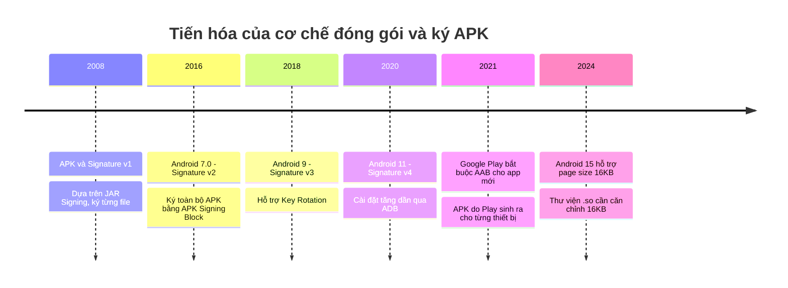
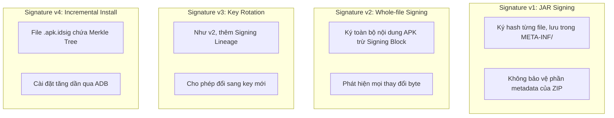
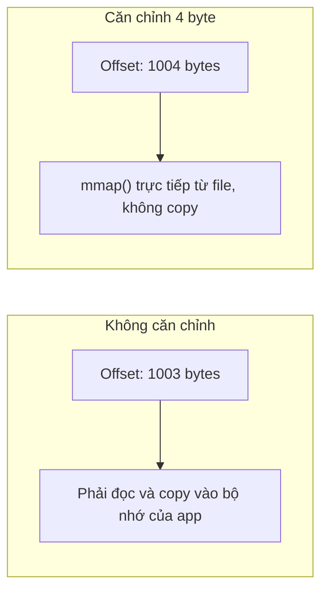

# Gói ứng dụng APK (Android Package)

## Vấn đề cần giải quyết

Khi hoàn tất lập trình một ứng dụng Android, hàng trăm tệp mã nguồn (`.kt`, `.java`), tệp giao diện XML, hình ảnh, thư viện native C/C++ (`.so`) và tệp cấu hình phải được gói thành **một tệp duy nhất** để phân phối tới thiết bị.

Tệp đó là **APK (Android Package)**, về bản chất là một file ZIP với cấu trúc quy ước riêng.

Nếu chỉ nén ZIP thông thường như trên máy tính:

1. **Tốn RAM và chậm khi đọc**: mỗi lần đọc một tài nguyên bị nén, hệ thống phải giải nén nó vào bộ nhớ. Tài nguyên không nén nhưng nằm lệch vị trí trong file cũng không thể ánh xạ (mmap) trực tiếp.
2. **Không chống được sửa đổi**: kẻ xấu có thể giải nén APK, chèn mã độc vào `.dex` rồi nén lại để lừa người dùng cài đặt.
3. **Phân giải tài nguyên chậm**: đọc file XML dạng văn bản (`strings.xml`, layout) ở runtime tốn nhiều CPU để parse chuỗi.

Vì vậy APK có các thành phần đã biên dịch sẵn sang dạng nhị phân, cơ chế ký số (Signature Scheme v1–v4), và quy tắc căn chỉnh dữ liệu bằng `zipalign`.

---

## Sau khi học xong

- Giải thích được cấu trúc của một file APK và vai trò của từng thành phần (classes.dex, resources.arsc, Binary XML, lib, META-INF).
- Phân biệt được các APK Signature Scheme từ v1 (JAR signing), v2 (APK Signing Block), v3 (Key Rotation) đến v4 (cài đặt tăng dần).
- Giải thích được vì sao zipalign giúp hệ thống mmap dữ liệu trực tiếp từ APK thay vì copy vào bộ nhớ.
- Xử lý được các lỗi cài đặt APK thường gặp như INSTALL_PARSE_FAILED_NO_CERTIFICATES và lỗi căn chỉnh khi targetSdk 30+.

---

## APK là gì?

**APK (Android Package)** là định dạng file cài đặt của Android: một file ZIP theo cấu trúc quy ước, chứa code đã biên dịch (`classes.dex`), tài nguyên đã biên dịch (`resources.arsc`, Binary XML), thư viện native (`lib/<abi>/*.so`) và chữ ký số, đủ để hệ thống cài thẳng lên thiết bị.

Mental model: APK là một **thùng hàng đã niêm phong**. Bên trong đã sắp sẵn để dùng ngay, và tem niêm phong (chữ ký) bị rách nếu ai đó mở thùng sửa bên trong.

---

## Lịch sử phát triển



<!-- dd: s01-apk-history -->

---

## Cách hoạt động

### 1. Cấu trúc bên trong một file APK

Đổi đuôi `.apk` thành `.zip` và giải nén (hoặc mở bằng APK Analyzer trong Android Studio), bạn thấy cấu trúc:

```text
MyApp.apk (ZIP Archive)
├── classes.dex                # Bytecode DEX biên dịch từ Java/Kotlin
├── classes2.dex               # File DEX thứ 2 (khi vượt giới hạn 64K method)
├── res/                       # Tài nguyên: hình ảnh, layout đã biên dịch
│   ├── drawable/
│   └── layout/
├── resources.arsc             # Bảng tài nguyên đã biên dịch (Resource Table)
├── AndroidManifest.xml        # Manifest dạng Binary XML
├── lib/                       # Thư viện native (.so) theo từng ABI
│   ├── arm64-v8a/
│   └── armeabi-v7a/
├── assets/                    # Tài nguyên thô không biên dịch (font, database, media)
└── META-INF/                  # Chữ ký v1 (MANIFEST.MF, CERT.SF, CERT.RSA)
```

#### `resources.arsc` và Binary XML

- **Binary XML**: Android không lưu `AndroidManifest.xml` hay layout dưới dạng văn bản UTF-8. Công cụ `aapt2` chuyển tên thẻ và thuộc tính (`<activity>`, `<TextView>`, `android:id`...) thành dạng nhị phân với bảng chuỗi dùng chung và ID số nguyên. Nhờ vậy hệ thống đọc layout ở runtime nhanh hơn nhiều so với parse văn bản.
- **`resources.arsc`**: bảng tra cứu ánh xạ Resource ID (ví dụ `0x7f010002`) tới giá trị thật hoặc đường dẫn file trong APK, theo từng cấu hình (ngôn ngữ, mật độ màn hình...). Resource ID có cấu trúc 32-bit `0xPPTTEEEE`:
  - `PP` (Package ID): `0x7f` là ứng dụng, `0x01` là Android framework.
  - `TT` (Type ID): loại tài nguyên (`drawable`, `layout`, `string`, `color`...).
  - `EEEE` (Entry ID): vị trí của tài nguyên trong loại đó.

---

### 2. APK Signature Schemes (v1 đến v4)

Ký APK là bắt buộc: Android dùng chữ ký để xác định nguồn gốc app, đảm bảo file không bị sửa, và chỉ cho phép cập nhật khi bản mới được ký bởi cùng một key.



<!-- dd: s01-apk-signing -->

- **Signature v1 (JAR Signing)**: ký hash của từng file trong ZIP. Hai nhược điểm: xác minh chậm vì phải đọc và hash từng file; không bảo vệ phần cấu trúc ZIP, mở đường cho lỗ hổng **Janus** (CVE-2017-13156) cho phép ghép thêm DEX vào APK chỉ ký v1 mà chữ ký vẫn hợp lệ.
- **Signature v2 (Android 7.0+)**: chèn một **APK Signing Block** ngay trước Central Directory của file ZIP. Chữ ký bao phủ toàn bộ nội dung file (trừ chính khối chữ ký), được hash theo từng đoạn 1MB. Đổi dù một byte, chữ ký không còn hợp lệ. Xác minh nhanh vì không cần giải nén.
- **Signature v3 (Android 9+)**: định dạng như v2, thêm **Signing Lineage**: bằng chứng rằng key mới được key cũ uỷ quyền. Nhờ đó app có thể **đổi key ký** (Key Rotation) mà thiết bị đã cài bản cũ vẫn chấp nhận cập nhật.
- **Signature v4 (Android 11+)**: lưu trong file riêng `app.apk.idsig`, dựa trên **Merkle Tree** hash của toàn bộ APK. Dùng cho **cài đặt tăng dần** (`adb install --incremental`): app có thể khởi động trước khi toàn bộ APK được chuyển xong, các phần còn thiếu được tải và xác minh khi cần. v4 luôn đi kèm chữ ký v2 hoặc v3.

---

### 3. `zipalign`: căn chỉnh để mmap trực tiếp

Nếu dữ liệu không nén trong APK (như `resources.arsc`, ảnh đã nén sẵn, `.so` không nén) nằm ở vị trí bất kỳ, hệ thống phải **đọc và copy** nó vào bộ nhớ riêng của app trước khi dùng.

`zipalign` dời các entry **không nén** trong ZIP sao cho dữ liệu của chúng bắt đầu ở offset chia hết cho **4 byte** (thư viện `.so` thì căn theo page: 4KB, nay là 16KB).



<!-- dd: s01-zipalign -->

#### Vì sao căn chỉnh giúp mmap được?

Khi dữ liệu nằm đúng vị trí, hệ thống dùng `mmap()` để ánh xạ thẳng vùng đó trong file APK vào không gian địa chỉ ảo của app. Code đọc dữ liệu dạng struct trực tiếp từ vùng nhớ đó (như `resources.arsc`) cần các trường số nguyên 32-bit nằm ở địa chỉ chia hết cho 4; truy cập lệch có thể chậm hoặc lỗi trên một số CPU ARM.

Dữ liệu được mmap **vẫn chiếm RAM khi được truy cập**: các trang được nạp vào page cache. Lợi ích là đây là các trang "sạch": không bị copy thành bộ nhớ riêng của từng app, dùng chung được giữa các process, và hệ thống có thể thu hồi bất kỳ lúc nào khi thiếu RAM rồi đọc lại từ file sau.

---

## Ví dụ thực tế

### 1. Lỗi `INSTALL_PARSE_FAILED_NO_CERTIFICATES`

- **Nguyên nhân thường gặp**:
  - APK chưa được ký (unsigned).
  - App có `targetSdk` từ 30 trở lên nhưng chỉ ký v1. Android 11 yêu cầu chữ ký v2 trở lên cho các app này.
  - Chữ ký bị hỏng do file bị sửa sau khi ký (xem ví dụ 2).
- **Cấu hình ký trong Gradle**: không ghi mật khẩu trực tiếp trong `build.gradle.kts`; đọc từ file `keystore.properties` không commit lên git (hoặc từ biến môi trường trên CI).

```kotlin
// build.gradle.kts (Module: app)
import java.util.Properties

val keystoreProps = Properties().apply {
    load(rootProject.file("keystore.properties").inputStream())
}

android {
    signingConfigs {
        create("release") {
            storeFile = file(keystoreProps.getProperty("storeFile"))
            storePassword = keystoreProps.getProperty("storePassword")
            keyAlias = keystoreProps.getProperty("keyAlias")
            keyPassword = keystoreProps.getProperty("keyPassword")
        }
    }
    buildTypes {
        getByName("release") {
            signingConfig = signingConfigs.getByName("release")
        }
    }
}
```

AGP tự chọn scheme phù hợp: luôn ký v2, và chỉ ký thêm v1 khi `minSdk` dưới 24. Chỉ đặt `enableV1Signing` / `enableV2Signing` khi thật sự cần ép khác đi.

### 2. Ký trước rồi mới `zipalign`: chữ ký v2 bị hỏng

Gradle tự làm đúng thứ tự. Lỗi này thường gặp khi tự viết script ký trên CI hoặc sửa APK bằng công cụ bên ngoài.

- **Nguyên nhân**: chạy `zipalign` **sau** `apksigner`. `zipalign` dời vị trí dữ liệu trong file, làm thay đổi byte, nên chữ ký v2/v3 (bao phủ toàn bộ file) không còn hợp lệ. Thiết bị từ chối cài với lỗi xác minh chữ ký.
- **Thứ tự đúng**:
  1. Build → `app-unsigned.apk`
  2. Căn chỉnh → **`zipalign`** → `app-aligned.apk`
  3. Ký → **`apksigner`** → `app-release.apk`

```bash
zipalign -p -f -v 4 app-unsigned.apk app-aligned.apk
apksigner sign --ks release.jks --out app-release.apk app-aligned.apk
apksigner verify --verbose app-release.apk
```

Tuỳ chọn `-p` căn thư viện `.so` không nén theo page 4KB. Để hỗ trợ page size 16KB, dùng build-tools mới với tuỳ chọn `-P 16`, hoặc để AGP (8.5.1 trở lên) tự xử lý.

---

## Sai lầm thường gặp

1. **Dùng `jarsigner` thay vì `apksigner`**:
   - `jarsigner` là công cụ của JDK và **chỉ tạo chữ ký v1**. Dùng **`apksigner`** trong Android SDK Build-Tools để có v2/v3/v4.
   - Ngược lại, file **AAB** phải ký bằng `jarsigner` (`apksigner` không ký được AAB). Không mâu thuẫn: chữ ký trên AAB chỉ để Google Play xác minh người upload (upload key). Thiết bị không bao giờ cài AAB; Play sinh APK từ AAB rồi ký APK đó bằng app signing key theo v2/v3 (xem `android.output_packages.aab_files`).

2. **Nhầm lẫn về Multidex**:
   - Vượt 65.536 method tham chiếu trong một file DEX thì build cần nhiều file DEX.
   - Với `minSdk` từ 21 trở lên, multidex được bật sẵn, không cần cấu hình.
   - Chỉ khi `minSdk` dưới 21 mới cần `multiDexEnabled` và thư viện `androidx.multidex`.

3. **Để lọt tài nguyên và code thừa**:
   - Không bật `isMinifyEnabled = true` và `isShrinkResources = true` cho bản release khiến APK chứa code không dùng, drawable thừa và chuỗi của các thư viện không cần.

---

## Trade-offs và Edge Cases

### Trade-offs

- **APK nguyên khối (universal)**: một APK phải chứa thư viện `.so` cho mọi ABI (`arm64-v8a`, `armeabi-v7a`, `x86_64`...) và hình ảnh cho mọi mật độ màn hình (`mdpi`, `hdpi`, `xxhdpi`...). Mỗi thiết bị chỉ dùng một phần nhỏ, phần còn lại là dung lượng tải về lãng phí. AAB giải quyết vấn đề này.

### Edge Cases

- **`resources.arsc` bị nén khi targetSdk 30+**: từ Android 11, app có `targetSdk` từ 30 trở lên phải lưu `resources.arsc` **không nén** và căn chỉnh 4 byte. Nếu không, cài đặt thất bại với thông báo *"Targeting R+ (version 30 and above) requires the resources.arsc of installed APKs to be stored uncompressed and aligned on a 4-byte boundary"*. Lỗi này hay gặp khi đóng gói lại APK bằng công cụ bên ngoài.
- **Thư viện `.so` không nén và page size 16KB**: khi `.so` được lưu không nén (mặc định của AGP mới, `useLegacyPackaging = false`), hệ thống nạp thẳng từ APK mà không giải nén ra đĩa. Khi đó `.so` phải căn theo page. Thiết bị Android 15 dùng page 16KB cần cả việc căn chỉnh trong ZIP lẫn việc link `.so` với căn chỉnh 16KB (xem `android.languages.jni`).

---

## Kết nối hệ thống

- **Prerequisites**: `android.languages.java_android`, `android.languages.kotlin` (luồng biên dịch ra `.dex`).
- **Related Topics**:
  - `android.output_packages.aab_files`: định dạng xuất bản giải quyết nhược điểm dung lượng của APK universal.
  - `android.languages.jni`: nguồn của các thư viện `.so` trong thư mục `lib/`.
- **Downstream Topics**:
  - `android.session02.file_permissions`: khi cài APK, hệ thống cấp cho app một UID riêng và thư mục dữ liệu riêng.
  - Process Management (chưa có bài): cách hệ thống tạo process và nạp code từ APK.

---

## Developer Curiosity Checklist

1. **Why was this created?** Để gói toàn bộ code, tài nguyên và cấu hình thành một đơn vị cài đặt duy nhất, có chữ ký.
2. **What problem does it solve?** Phân phối ứng dụng, chống sửa đổi và đọc tài nguyên nhanh ở runtime.
3. **What happens if it doesn't exist?** Hệ thống không kiểm tra được tính toàn vẹn và nguồn gốc của app.
4. **How does Android implement it internally?** ZIP chứa `classes.dex`, `resources.arsc` và Binary XML; xác minh bằng chữ ký v1–v4; dữ liệu căn chỉnh để mmap.
5. **What misconceptions do developers have?** Tưởng APK chỉ là file zip bình thường; dùng `jarsigner`; chạy `zipalign` sau khi ký.
6. **What trade-offs does it introduce?** APK universal chứa tài nguyên của mọi loại thiết bị, làm tăng dung lượng tải về.
7. **What are the edge cases?** `resources.arsc` bị nén khi targetSdk 30+, `.so` chưa căn chỉnh 16KB, đảo thứ tự `zipalign` và `apksigner`.
8. **What are the real-world problems developers encounter?** Lỗi `INSTALL_PARSE_FAILED_NO_CERTIFICATES`, lộ mật khẩu keystore trong repo.
9. **How is it connected to the Android system?** Là đơn vị cài đặt mà `PackageManagerService` (PMS) xác minh, cài đặt và cấp UID.
10. **What should developers learn next?** `android.output_packages.aab_files` để hiểu cách Google Play tạo APK riêng cho từng thiết bị.

---

## Tham khảo

- Android Open Source Project: [APK Signature Scheme v2](https://source.android.com/docs/security/features/apksigning/v2)
- Android Developers: [apksigner](https://developer.android.com/tools/apksigner) và [zipalign](https://developer.android.com/tools/zipalign)
- Android Developers: [Build your app from the command line: Sign your app](https://developer.android.com/build/building-cmdline#sign_cmdline)
- Android Developers: [Sign your app](https://developer.android.com/studio/publish/app-signing)
- Android Developers: [Support 16 KB page sizes](https://developer.android.com/guide/practices/page-sizes)
