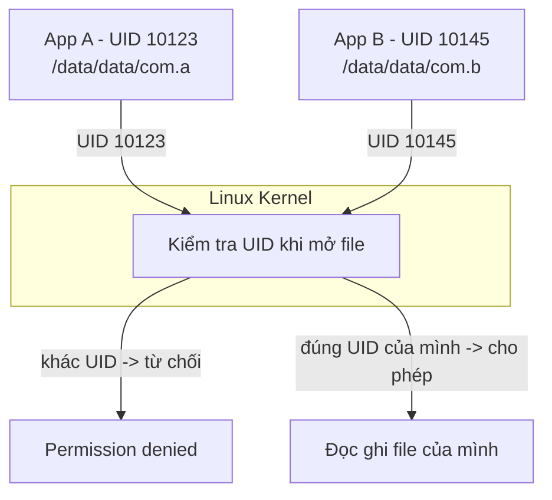
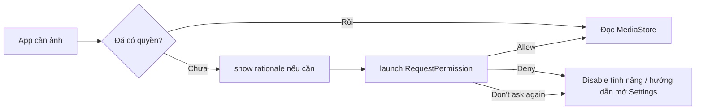
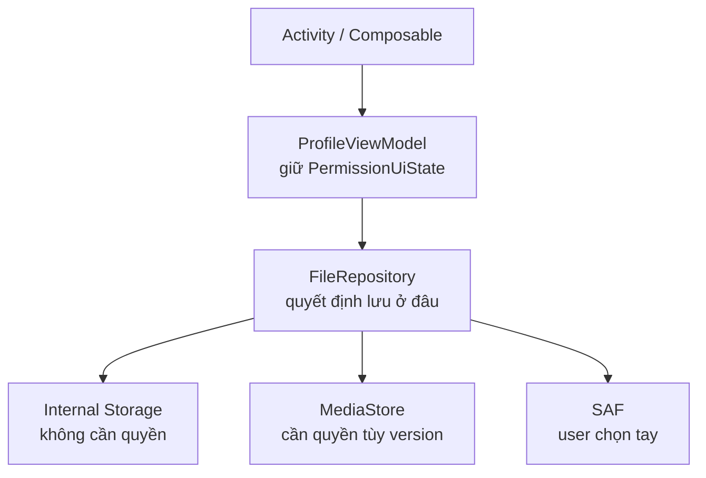
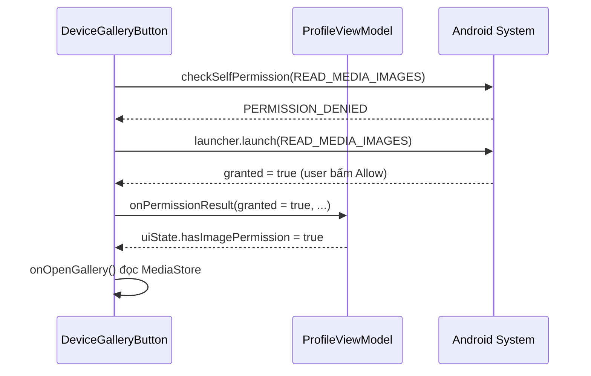
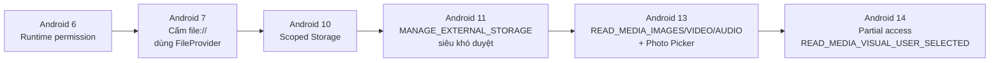
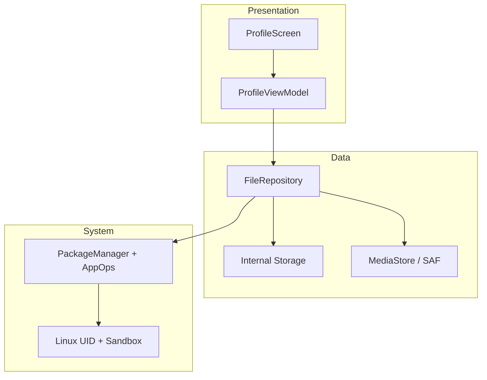

# File Permissions

## Vấn đề cần giải quyết

App nào cũng phải đọc, ghi file: ảnh đại diện, cache ảnh, file export. Nhưng Android không cho app chạm tùy ý vào mọi file, và luật chơi thay đổi qua từng version.

Bạn làm app profile cho phép user đổi avatar. Trên máy test Android 9 chạy ngon. Lên Android 13 thì crash với `SecurityException: Permission denied`. App khác thì bị Play Store từ chối vì xin `MANAGE_EXTERNAL_STORAGE` trong khi chỉ cần lưu avatar.

Cùng một thao tác "lưu file", nhưng:

- Lưu ở đâu thì không cần xin quyền, lưu ở đâu thì bắt buộc xin?
- Vì sao Android 6 xin lúc chạy, Android 10 lại đổi toàn bộ cách lưu?
- Khi nào dùng Photo Picker thì khỏi xin quyền luôn?

> File Permissions trả lời đúng 3 việc này: app được chạm vào file nào, phải xin phép ra sao, và lưu ở đâu cho đúng khi đi làm.

## Sau khi học xong

- Giải thích được sandbox UID và vì sao mỗi app là một user Linux riêng.
- Phân biệt được các loại Storage và chọn đúng chỗ lưu để khỏi xin quyền thừa.
- Phân biệt được Manifest permission và Runtime permission cùng các thay đổi từ Android 6 tới 14.
- Triển khai được luồng xin quyền chuẩn MVVM với ActivityResult API.
- Áp dụng được Photo Picker, SAF và FileProvider để tránh Permission denied khi đi làm.

## File Permissions là gì?

File Permissions là cơ chế quyết định **ai được đọc, ghi, thực thi file nào**. Trên Android, quyết định đó đi qua hai lớp kiểm soát: lớp Linux (kernel so UID của process với owner của file, mỗi app một UID riêng) và lớp Android permission (user cho phép app chạm vào file chung như ảnh, nhạc, download).

Mental model: trước mỗi file có **hai cánh cửa**. Cửa thứ nhất là kernel, hỏi "bạn là ai". Cửa thứ hai là Android permission, hỏi thêm "user đã đồng ý cho bạn chưa". File riêng của app chỉ cần qua cửa thứ nhất; file chung của user phải qua cả hai. Photo Picker và SAF là cách để user tự chọn đúng file rồi trao cho app, nên app không phải xin mở cửa thứ hai cho cả kho.

## Cách hoạt động

Android dựa trên cơ chế quyền file của Linux (kiểm tra theo UID/GID), rồi thêm một lớp sandbox riêng: mỗi app một UID. Từ Android 5.0, Android còn bật **SELinux** ở chế độ enforcing (Mandatory Access Control): kể cả process chạy root cũng chỉ được làm những gì policy cho phép.

### Gốc Linux tối giản đủ để đi làm

Mỗi file Linux có 3 nhóm quyền:

```text
-rwxr-x---  owner group others
 rwx        r-x        ---
```

- `rwx`: read, write, execute.
- `owner`: người sở hữu file, `group`: nhóm, `others`: còn lại.
- `UID/GID`: định danh user và group sở hữu process đang chạy.

Khi process muốn mở file, kernel so UID của process với owner của file để cho phép hay từ chối.

### Android sandbox: mỗi app là một user Linux



<!-- dd: perm-uid -->

Bản chất:

- Lúc cài app, hệ thống cấp một UID riêng. App A không bao giờ có UID của app B.
- Thư mục `/data/data/<package_name>` chỉ owner mới đọc được. Đây là lý do mặc định các app không đọc trộm nhau.
- Muốn chạm vào file chung của user (ảnh, nhạc, download), app phải đi qua cửa kiểm soát thứ hai: Android permission.

Đây là điểm khác Linux thuần: Linux hỏi "bạn là ai", Android hỏi thêm "user đã đồng ý cho bạn chưa".

### Các loại Storage trong Android

Đây là phần gây nhiều bug nhất khi đi làm. Chọn sai chỗ lưu là phải xin quyền thừa hoặc bị từ chối.

| Loại | Đường dẫn ví dụ | Cần xin quyền? | Bị xóa khi gỡ app? | Dùng cho |
|---|---|---|---|---|
| Internal app-specific | `/data/data/<pkg>/files/avatar.jpg` | Không | Có | Token file, dữ liệu riêng, nhạy cảm |
| Cache internal | `/data/data/<pkg>/cache/` | Không | Có, hệ thống có thể xóa khi thiếu bộ nhớ | Ảnh thumb tạm, response cache |
| External app-specific | `/sdcard/Android/data/<pkg>/files/` | Không | Có | File lớn riêng của app: video edit dở, offline map |
| Shared Media | `MediaStore.Images / Video / Audio` | Tùy version, xem dưới | Không | Ảnh chụp, video, nhạc muốn hiện trong Gallery |
| Download / Document | `MediaStore.Downloads` hoặc SAF | Tùy cách dùng | Không | PDF export, backup, file user cần giữ |
| Thích bất kỳ chỗ nào | Storage Access Framework | Không cần permission, user chọn tay | Không | Mở / tạo tài liệu ở chỗ user chỉ định |

Nguyên tắc chọn khi đi làm:

- Nên dùng app-specific nếu file chỉ app mình cần. Không xin quyền, không bị Play Store hỏi, không lo Scoped Storage.
- Chỉ dùng Shared khi user cần thấy file ngoài app (ảnh trong Gallery, PDF trong Download).
- Chỉ dùng SAF khi muốn user tự chọn nơi lưu / mở, ví dụ "Export báo cáo ra Download".

### Manifest Permission vs Runtime Permission

Hai lớp khác nhau, phải làm đủ cả hai.

#### Manifest: khai báo trước

```xml
<!-- app/src/main/AndroidManifest.xml -->
<manifest>
    <!-- Android 13+: chỉ khi cần đọc ảnh/video do app KHÁC tạo (gallery, backup).
         Google Play hạn chế hai quyền này; chọn ảnh thì dùng Photo Picker. -->
    <uses-permission android:name="android.permission.READ_MEDIA_IMAGES" />
    <uses-permission android:name="android.permission.READ_MEDIA_VIDEO" />
    <!-- Android 12 trở xuống cho file chung -->
    <uses-permission
        android:name="android.permission.READ_EXTERNAL_STORAGE"
        android:maxSdkVersion="32" />
    <!-- Ghi file chung: chỉ cần trên Android 9 trở xuống (và Android 10 khi tạm opt-out Scoped Storage), nên maxSdkVersion=29 -->
    <uses-permission
        android:name="android.permission.WRITE_EXTERNAL_STORAGE"
        android:maxSdkVersion="29" />
</manifest>
```

Khai báo trong Manifest chỉ là "thông báo ý định". Từ Android 6, với quyền thuộc nhóm **dangerous** (vd `READ_MEDIA_IMAGES`), user còn phải bấm Allow lúc chạy; quyền **normal** (vd `INTERNET`) được cấp ngay khi cài.

#### Runtime: xin lúc chạy



<!-- dd: perm-ask -->

Code của luồng này (ActivityResult API) ở mục "Xin quyền đọc toàn bộ ảnh bằng ActivityResult API" trong phần Ví dụ thực tế.

### Scoped Storage và quyền đọc media theo version

Luật đọc ghi file chung thay đổi mạnh qua các version (timeline đầy đủ ở phần Lịch sử phát triển). Những gì phải nhớ khi đi làm:

- **Scoped Storage** (Android 10, mặc định cho app target 29 trở lên và tạm opt-out được bằng `requestLegacyExternalStorage`; bắt buộc khi `targetSdk` từ 30 chạy trên Android 11+): trên external storage, app chỉ tự do đọc ghi thư mục app-specific của mình và file media do chính nó tạo. Muốn đọc media của app khác phải qua MediaStore kèm quyền; file khác (PDF, tài liệu) phải qua SAF.
- Đừng xin `READ_EXTERNAL_STORAGE` trên Android 13+, nó không còn tác dụng cho media.
- Android 14: khi app xin quyền đọc ảnh/video, user có thể chọn "Select photos and videos" (bật khi app target 34 trở lên, hoặc target 33 có khai báo `READ_MEDIA_VISUAL_USER_SELECTED`). Kết quả phụ thuộc app có xin `READ_MEDIA_VISUAL_USER_SELECTED` hay không:
  - App xin `READ_MEDIA_VISUAL_USER_SELECTED` cùng lúc với `READ_MEDIA_IMAGES`: khi user chọn một phần, `READ_MEDIA_IMAGES` bị từ chối nhưng `READ_MEDIA_VISUAL_USER_SELECTED` được cấp, nghĩa là app chỉ thấy các ảnh user chọn. `granted = false` chưa chắc là bị từ chối hẳn: kiểm tra thêm quyền này bằng `ContextCompat.checkSelfPermission`.
  - App chỉ xin `READ_MEDIA_IMAGES` (như ví dụ ở phần Ví dụ thực tế): hệ thống chạy chế độ tương thích, trả `granted = true` nhưng app chỉ thấy các ảnh user chọn, và quyền tạm này bị thu lại sau khi app vào background.
- Đừng xin `MANAGE_EXTERNAL_STORAGE` nếu chỉ lưu avatar hay export PDF, Play Store sẽ từ chối.
- Ưu tiên Photo Picker và SAF vì không cần xin quyền gì cả.

## Ví dụ thực tế

Mục tiêu: code đủ để làm task trong 15 phút, tách đúng tầng UI - ViewModel - Repository.



<!-- dd: perm-arch -->

> [!NOTE]
> **Kiến thức dùng trước.** Ví dụ dùng tối thiểu vài kiến thức của Session sau:
> - Coroutine (`suspend`, `withContext(Dispatchers.IO)`, `viewModelScope.launch`): chạy code bất đồng bộ không chặn main thread, học ở 8.4.3 Coroutines (chưa có bài).
> - `StateFlow`: luồng giữ trạng thái mới nhất để UI đọc, học ở 7.1.4.2 Flow (chưa có bài).
> - `ViewModel`: giữ trạng thái của màn hình, học ở [ViewModel](../session_06/viewmodel.md); cách tách UI - ViewModel - Repository học ở [MVVM](../session_07/architecture/mvvm.md).
> - Hilt (`@Inject`, `@HiltViewModel`, `hiltViewModel()`): tự tạo và truyền dependency, học ở 7.1.5.3 Hilt (chưa có bài).
> - Jetpack Compose (`@Composable`, `rememberLauncherForActivityResult`): viết UI bằng Kotlin, xem [Jetpack Compose Overview](../jetpack_compose_ui/overview.md).

### Khung chung: Repository và ViewModel

Các bài toán bên dưới dùng chung hai lớp này.

#### Repository: nơi duy nhất biết lưu ở đâu

```kotlin
package com.example.profile.data

import android.content.Context
import android.net.Uri
import dagger.hilt.android.qualifiers.ApplicationContext
import kotlinx.coroutines.Dispatchers
import kotlinx.coroutines.withContext
import java.io.File
import java.io.IOException
import javax.inject.Inject

// open để test có thể thay bằng FakeFileRepository (xem phần Testing)
open class FileRepository @Inject constructor(
    @ApplicationContext private val context: Context
) {

    // Avatar chỉ app mình dùng -> internal, khỏi xin quyền.
    // Ghi file là IO: chạy trên Dispatchers.IO, không chặn main thread.
    open suspend fun saveAvatar(bytes: ByteArray): File = withContext(Dispatchers.IO) {
        val file = File(context.filesDir, "avatar.jpg")
        file.writeBytes(bytes)
        file
    }

    // Ảnh user chọn qua Photo Picker là một content:// Uri -> copy vào filesDir
    open suspend fun saveAvatarFromUri(uri: Uri): File = withContext(Dispatchers.IO) {
        val file = File(context.filesDir, "avatar.jpg")
        val input = context.contentResolver.openInputStream(uri)
            ?: throw IOException("Không mở được $uri")
        input.use { source -> file.outputStream().use { target -> source.copyTo(target) } }
        file
    }

    // SAF: ghi PDF vào Uri do user chọn, app không cần quyền storage nào
    open suspend fun exportReport(uri: Uri, pdfBytes: ByteArray) = withContext(Dispatchers.IO) {
        val output = context.contentResolver.openOutputStream(uri)
            ?: throw IOException("Không mở được $uri")
        output.use { it.write(pdfBytes) }
    }

    fun readAvatar(): File? {
        val file = File(context.filesDir, "avatar.jpg")
        return file.takeIf { it.exists() }
    }
}
```

Vì sao qua Repository mà không gọi `File` trực tiếp trong ViewModel:

- ViewModel không nên biết file nằm ở `filesDir` hay MediaStore. Đổi chỗ lưu chỉ sửa Repository.
- Dễ test: test ViewModel chỉ cần fake Repository.

#### ViewModel: giữ trạng thái quyền

```kotlin
package com.example.profile.ui

import android.net.Uri
import androidx.lifecycle.ViewModel
import androidx.lifecycle.viewModelScope
import com.example.profile.data.FileRepository
import dagger.hilt.android.lifecycle.HiltViewModel
import kotlinx.coroutines.flow.MutableStateFlow
import kotlinx.coroutines.flow.StateFlow
import kotlinx.coroutines.flow.asStateFlow
import kotlinx.coroutines.flow.update
import kotlinx.coroutines.launch
import java.io.IOException
import javax.inject.Inject

data class PermissionUiState(
    val hasImagePermission: Boolean = false,
    val showRationale: Boolean = false,
    val avatarPath: String? = null
)

@HiltViewModel
class ProfileViewModel @Inject constructor(
    private val repository: FileRepository
) : ViewModel() {

    private val _uiState = MutableStateFlow(PermissionUiState())
    val uiState: StateFlow<PermissionUiState> = _uiState.asStateFlow()

    // Bước (4) của ví dụ xin quyền đọc ảnh: lưu kết quả vào PermissionUiState
    fun onPermissionResult(granted: Boolean, shouldShowRationale: Boolean) {
        _uiState.value = _uiState.value.copy(
            hasImagePermission = granted,
            showRationale = !granted && shouldShowRationale
        )
    }

    fun saveAvatar(bytes: ByteArray) {
        viewModelScope.launch {
            val file = repository.saveAvatar(bytes) // suspend, chạy trên Dispatchers.IO
            _uiState.update { it.copy(avatarPath = file.absolutePath) }
        }
    }

    fun saveAvatarFromUri(uri: Uri) {
        viewModelScope.launch {
            try {
                val file = repository.saveAvatarFromUri(uri)
                _uiState.update { it.copy(avatarPath = file.absolutePath) }
            } catch (e: IOException) {
                // Uri hết hạn hoặc không đọc được: báo lỗi cho UI thay vì crash
            }
        }
    }

    fun exportReport(uri: Uri, pdfBytes: ByteArray) {
        viewModelScope.launch {
            try {
                repository.exportReport(uri, pdfBytes)
            } catch (e: IOException) {
                // Không ghi được vào nơi user chọn: báo lỗi cho UI
            }
        }
    }
}
```

### Xin quyền đọc toàn bộ ảnh bằng ActivityResult API

Cách chuẩn hiện nay, không dùng `requestPermissions` cũ.

Lưu ý phạm vi: **đổi avatar không cần quyền nào** (chọn ảnh bằng Photo Picker ở mục kế tiếp, lưu vào `filesDir`). Chỉ xin `READ_MEDIA_IMAGES` khi tính năng thật sự phải đọc **toàn bộ** ảnh trong máy, ví dụ màn hình "Thư viện ảnh" để sao lưu. Đoạn dưới minh hoạ trường hợp đó.

Luồng chạy khi user bấm nút "Xem toàn bộ ảnh trong máy":

1. UI hỏi hệ thống bằng `ContextCompat.checkSelfPermission` (Android 13+ là `READ_MEDIA_IMAGES`, Android 12 trở xuống là `READ_EXTERNAL_STORAGE`). Không tin trạng thái đã lưu, vì user có thể thu hồi quyền trong Settings.
2. Hệ thống trả `PERMISSION_DENIED`: UI gọi `launcher.launch(permission)`, hệ thống hiện dialog xin quyền.
3. User bấm Allow: callback của launcher nhận `granted = true` (bấm Deny thì `false`, đi nhánh Deny ở sơ đồ của mục "Runtime: xin lúc chạy").
4. UI báo kết quả cho ViewModel qua `onPermissionResult(granted, shouldShowRationale)`; ViewModel cập nhật `PermissionUiState` (`showRationale` chỉ bật khi bị từ chối và hệ thống còn cho hiện giải thích).
5. Có quyền: `onOpenGallery()` mở màn hình đọc MediaStore. Nếu bước 1 đã thấy `PERMISSION_GRANTED` thì đi thẳng tới bước này, không hiện dialog.

Mô phỏng luồng khi user bấm Allow (các mũi tên đi đúng thứ tự 5 bước trên, từ trên xuống):



<!-- dd: perm-seq -->

```kotlin
// DeviceGalleryButton.kt (Compose)
@Composable
fun DeviceGalleryButton(
    onOpenGallery: () -> Unit,
    viewModel: ProfileViewModel = hiltViewModel()
) {
    val context = LocalContext.current
    val activity = LocalActivity.current // androidx.activity:activity-compose 1.10+
    val permission = if (Build.VERSION.SDK_INT >= 33) {
        Manifest.permission.READ_MEDIA_IMAGES
    } else {
        Manifest.permission.READ_EXTERNAL_STORAGE
    }

    val launcher = rememberLauncherForActivityResult(
        ActivityResultContracts.RequestPermission()
    ) { granted ->
        // (3) granted = true khi user bấm Allow, false khi Deny
        // (4) báo kết quả cho ViewModel
        viewModel.onPermissionResult(
            granted = granted,
            shouldShowRationale = activity != null &&
                ActivityCompat.shouldShowRequestPermissionRationale(activity, permission)
        )
        if (granted) onOpenGallery() // (5)
    }

    Button(onClick = {
        // (1) Luôn hỏi hệ thống, không tin trạng thái đã lưu: user có thể thu hồi quyền trong Settings
        val granted = ContextCompat.checkSelfPermission(context, permission) ==
            PackageManager.PERMISSION_GRANTED
        // (2) chưa có quyền thì mở dialog hệ thống; (5) có rồi thì mở thẳng
        if (granted) onOpenGallery() else launcher.launch(permission)
    }) {
        Text("Xem toàn bộ ảnh trong máy")
    }
}
```

**Kết quả:** lần đầu bấm nút, dialog hệ thống hiện; bấm Allow thì `uiState.hasImagePermission = true` và màn hình thư viện mở. Lần bấm sau, `checkSelfPermission` trả `PERMISSION_GRANTED` nên mở thẳng, không hỏi lại. Thu hồi quyền trong Settings rồi bấm lại thì dialog hiện lại. Trên Android 14, nếu user chọn "Select photos and videos", ví dụ này chỉ xin `READ_MEDIA_IMAGES` nên rơi vào chế độ tương thích ở mục "Scoped Storage và quyền đọc media theo version": `granted = true` nhưng app chỉ thấy các ảnh đã chọn.

### Chọn avatar và export PDF không cần xin quyền: Photo Picker và SAF

Khi đi làm, ưu tiên hai cách này vì không cần khai báo quyền gì.

```kotlin
// Photo Picker: có sẵn từ Android 13, Android 11-12 nhận qua Google System Updates.
// Android 4.4-10 cần bản backport do Google Play services cài (khai báo service
// com.google.android.gms.metadata.ModuleDependencies trong manifest).
// Máy không có Photo Picker: AndroidX tự chuyển sang ACTION_OPEN_DOCUMENT.
// Không cần READ_MEDIA_IMAGES. Cần androidx.activity 1.7.0+.
val pickImage = rememberLauncherForActivityResult(
    ActivityResultContracts.PickVisualMedia()
) { uri: Uri? ->
    uri?.let { viewModel.saveAvatarFromUri(it) }
}

Button(onClick = {
    pickImage.launch(PickVisualMediaRequest(ActivityResultContracts.PickVisualMedia.ImageOnly))
}) {
    Text("Chọn ảnh không cần xin quyền")
}
```

```kotlin
// SAF: user tự chọn nơi tạo PDF export
// reportPdfBytes: nội dung PDF đã tạo sẵn (vd bằng android.graphics.pdf.PdfDocument)
val createPdf = rememberLauncherForActivityResult(
    ActivityResultContracts.CreateDocument("application/pdf")
) { uri: Uri? ->
    uri?.let { viewModel.exportReport(it, reportPdfBytes) }
}
```

### Share file: bắt buộc dùng FileProvider

Từ Android 7 (app target API 24 trở lên), đưa `file://` ra ngoài app (vd gắn vào Intent share) sẽ crash `FileUriExposedException`.

```xml
<!-- AndroidManifest.xml -->
<provider
    android:name="androidx.core.content.FileProvider"
    android:authorities="${applicationId}.provider"
    android:exported="false"
    android:grantUriPermissions="true">
    <meta-data
        android:name="android.support.FILE_PROVIDER_PATHS"
        android:resource="@xml/file_paths" />
</provider>
```

```xml
<!-- res/xml/file_paths.xml -->
<paths>
    <files-path name="avatar" path="." />
    <cache-path name="cache" path="." />
</paths>
```

```kotlin
val file = File(context.filesDir, "avatar.jpg")
val uri: Uri = FileProvider.getUriForFile(
    context, "${context.packageName}.provider", file
)

val intent = Intent(Intent.ACTION_SEND).apply {
    type = "image/jpeg"
    putExtra(Intent.EXTRA_STREAM, uri)
    addFlags(Intent.FLAG_GRANT_READ_URI_PERMISSION)
}
context.startActivity(Intent.createChooser(intent, "Chia sẻ avatar"))
```

### Security và Performance ở mức đi làm

Security:

- File riêng luôn để `MODE_PRIVATE`. Không bao giờ lưu token, password ra external.
- External app-specific không dành cho dữ liệu nhạy cảm. Trên Android 9 (API 28) trở xuống, app khác có quyền storage đọc được thư mục app-specific của app bạn; khi scoped storage bật thì app khác không truy cập được. Docs chỉ nói thư mục app-specific trên **internal** storage được mã hoá (từ Android 10), và khuyên dữ liệu nhạy cảm để ở internal storage, preferences hoặc database.
- Khi share qua FileProvider chỉ grant `FLAG_GRANT_READ_URI_PERMISSION` cho intent đó, không mở public cả thư mục.

Performance:

- Đừng đọc file lớn trên UI thread. Repository nên expose `suspend` hoặc `Flow`.
- Cache ảnh resize trước khi lưu, đừng lưu nguyên ảnh 12MP làm avatar.
- `cacheDir` hệ thống có thể xóa, đừng lưu dữ liệu quan trọng ở đó.

### Debug và Testing

Debug trên máy thật:

```text
Device File Explorer trong Android Studio:
data/data/com.example.profile/files/avatar.jpg
data/data/com.example.profile/cache/
sdcard/Android/data/com.example.profile/files/
```

```bash
adb shell dumpsys package com.example.profile | grep permission
adb shell run-as com.example.profile ls -l files
```

Máy chưa root không `ls` được `/data/data/<pkg>` từ `adb shell`; với bản build debuggable, `run-as <pkg>` chạy lệnh dưới UID của app nên đọc được thư mục riêng của nó.

Không log đường dẫn tuyệt đối và nội dung file nhạy cảm ra Logcat production.

Testing:

```kotlin
// testImplementation: kotlinx-coroutines-test, mockk
// Fake override mọi hàm được gọi nên Context giả không bao giờ bị dùng tới
class FakeFileRepository : FileRepository(mockk(relaxed = true)) {
    var savedBytes: ByteArray? = null
    override suspend fun saveAvatar(bytes: ByteArray): File {
        savedBytes = bytes
        return File("fake/avatar.jpg")
    }
}

// Test ViewModel không cần thiết bị thật
@OptIn(ExperimentalCoroutinesApi::class)
class ProfileViewModelTest {
    private val testDispatcher = StandardTestDispatcher()

    // viewModelScope chạy trên Dispatchers.Main, unit test JVM không có Main -> phải thay
    @Before fun setUp() = Dispatchers.setMain(testDispatcher)
    @After fun tearDown() = Dispatchers.resetMain()

    @Test
    fun saveAvatar_updatesUiState() = runTest(testDispatcher) {
        val repo = FakeFileRepository()
        val vm = ProfileViewModel(repo)
        vm.saveAvatar(byteArrayOf(1, 2, 3))
        advanceUntilIdle() // chạy hết coroutine đã launch
        assertNotNull(vm.uiState.value.avatarPath)
        assertArrayEquals(byteArrayOf(1, 2, 3), repo.savedBytes)
    }
}
```

## So sánh với các cách tiếp cận khác

### MediaStore vs SAF vs Photo Picker

| Tiêu chí | MediaStore | SAF | Photo Picker |
|---|---|---|---|
| Cần permission? | Có, tùy version | Không, user chọn tay | Không |
| Trải nghiệm | Tự động, code đọc trực tiếp | User phải chọn file / thư mục | Picker hệ thống đẹp, quen thuộc |
| Phù hợp | App gallery, camera, nhạc | Export / import tài liệu | Chọn avatar, đính kèm ảnh |
| Duyệt Play Store | Bình thường nếu đúng quyền | Dễ duyệt | Dễ duyệt nhất |
| Khuyên dùng khi đi làm | Khi cần quét toàn bộ media | Khi cần quyền lâu dài một file cụ thể | Mặc định cho chọn ảnh / video |

> [!NOTE]
> Trade-off: càng tiện cho dev (đọc thẳng MediaStore) thì càng phải xin quyền và giải trình. Càng nhường quyền chọn cho user (Picker, SAF) thì càng ít permission, càng dễ qua review.

## Sai lầm thường gặp

### 1. Lưu app-specific nhưng vẫn xin full quyền

Sai lầm phổ biến nhất của người mới: lưu avatar vào Download rồi đi xin full quyền storage, trong khi lưu vào app-specific thì khỏi xin gì.

**Cách sửa:** Lưu avatar vào `filesDir` thì khỏi xin. Xin thừa khiến user sợ và Play Store hỏi.

### 2. Quên `maxSdkVersion` khiến xin quyền chết trên máy mới

Từ Android 13, `READ_EXTERNAL_STORAGE` không còn tác dụng (mục "Scoped Storage và quyền đọc media theo version"), nên khai báo không giới hạn version chỉ là quyền thừa trên máy mới.

**Cách sửa:** giới hạn quyền cũ bằng `maxSdkVersion`.

```xml
<!-- Đúng: quyền cũ chỉ cần tới Android 12 -->
<uses-permission
    android:name="android.permission.READ_EXTERNAL_STORAGE"
    android:maxSdkVersion="32" />
```

### 3. Dùng đường dẫn cứng `/sdcard/`

**Cách sửa:** lấy thư mục qua `Context` thay vì tự ghép đường dẫn.

```kotlin
// Sai: máy khác nhau mount khác nhau
val file = File("/sdcard/myapp/avatar.jpg")

// Đúng
val file = File(context.filesDir, "avatar.jpg")
```

### 4. Quên handle Deny và Don't ask again

App chỉ hiện màn hình trắng khi bị deny là lỗi UX phổ biến khi review đi làm.

**Cách sửa:** Luôn có nhánh disable tính năng và nút mở Settings (nhánh Deny ở sơ đồ của mục "Runtime: xin lúc chạy").

### 5. Test chỉ trên một version

Bug File Permissions thường chỉ lộ ra trên version khác.

**Cách sửa:** Khi đi làm phải test tối thiểu: Android 9, Android 11, Android 13/14.

### 6. Share file bằng `file://`

App target API 24 trở lên gắn `file://` vào Intent gửi ra ngoài sẽ crash `FileUriExposedException`.

**Cách sửa:** tạo `content://` URI bằng FileProvider và chỉ grant quyền đọc cho Intent đó, như mục "Share file: bắt buộc dùng FileProvider".

## Lịch sử phát triển

Các mốc version đã định hình cách xin quyền file hiện nay:



<!-- dd: perm-versions -->

- **Android 4.1 (API 16):** thêm `READ_EXTERNAL_STORAGE`; hệ thống chỉ bắt buộc quyền này từ API 19, trước đó mọi app vẫn đọc được external storage.
- **Android 4.3 → 5.0:** SELinux được đưa vào sandbox: Android 4.3 ở chế độ permissive, 4.4 enforcing một phần, từ 5.0 enforcing hoàn toàn.
- **Android 4.4 (API 19):** app không cần quyền storage để đọc ghi thư mục app-specific trên external storage (`getExternalFilesDir()`, `getExternalCacheDir()`). Storage Access Framework ra đời (`ACTION_OPEN_DOCUMENT`, `ACTION_CREATE_DOCUMENT`).
- **Android 6.0 (API 23):** runtime permission. App target 23 trở lên phải kiểm tra (`checkSelfPermission()`) và xin quyền dangerous lúc chạy (`requestPermissions()`); user cấp hoặc thu hồi từng quyền.
- **Android 7.0 (API 24):** với app target 24 trở lên, thư mục riêng của app bị siết về `0700`, nới quyền bằng `MODE_WORLD_READABLE` / `MODE_WORLD_WRITEABLE` gây `SecurityException`; đưa `file://` ra ngoài app gây `FileUriExposedException`, cách chia sẻ được khuyên là `content://` qua FileProvider.
- **Android 10 (API 29):** Scoped Storage mặc định cho app target 29 trở lên, tạm opt-out được bằng `requestLegacyExternalStorage`. App không cần quyền storage để thêm file của chính mình vào shared storage.
- **Android 11 (API 30):** app target 30 trở lên chạy trên Android 11 thì `requestLegacyExternalStorage` bị bỏ qua và `WRITE_EXTERNAL_STORAGE` không còn tác dụng. Thêm `MANAGE_EXTERNAL_STORAGE` (special permission, mức bảo vệ `appop`) cho số ít app quản lý file thay user.
- **Android 13 (API 33):** `READ_MEDIA_IMAGES`, `READ_MEDIA_VIDEO`, `READ_MEDIA_AUDIO` thay `READ_EXTERNAL_STORAGE` cho app target 33 trở lên; từ API 33, `READ_EXTERNAL_STORAGE` không còn tác dụng. Docs khuyên chỉ cần ảnh/video thì dùng Photo Picker thay vì khai báo hai quyền này.
- **Android 14 (API 34):** thêm `READ_MEDIA_VISUAL_USER_SELECTED` cho trường hợp user chỉ cho phép một số ảnh/video.
- **AndroidX Activity:** 1.6.0 (09/2022) thêm `PickVisualMedia` / `PickMultipleVisualMedia`, dùng Photo Picker khi có và `ACTION_OPEN_DOCUMENT` khi không; 1.7.0 (03/2023) thêm fallback qua Photo Picker do Google Play services cung cấp trước khi về `ACTION_OPEN_DOCUMENT`; activity-compose 1.10.0 (01/2025) thêm `LocalActivity` dùng trong ví dụ.

Vì sao thiết kế đổi như vậy: các version mới quyết định quyền truy cập dựa trên **mục đích** của file (media, tài liệu, file riêng) nhiều hơn là **vị trí** của nó, để app chỉ được chạm vào đúng phần file nó thật sự dùng.

## Kết nối hệ thống

### Vị trí trong hệ thống

File Permissions nằm ở Data Layer, dưới ViewModel.



<!-- dd: perm-sum -->

### Topic liên quan

- **Tiên quyết:** [Kotlin](../session_01/languages/kotlin.md): ngôn ngữ của mọi ví dụ trong bài.
- **Liên quan:**
  - [APK](../session_01/output_packages/apk_files.md): lúc cài APK, hệ thống cấp cho app UID riêng và thư mục dữ liệu riêng, tức sandbox ở mục "Android sandbox: mỗi app là một user Linux".
  - [Manifest Tags](../session_04/android_manifest/tags.md), mục "Thẻ <uses-permission> và <permission>" và "Thẻ <provider>": mọi quyền file đều phải khai báo ở Manifest trước; khai báo `provider`, `uses-permission` đầy đủ.
  - [Content Provider](../session_04/components/content_provider.md): MediaStore là một System Provider, FileProvider là Content Provider dùng để chia sẻ file.
  - [Implicit Intents](../session_04/intent/implicit_intents.md): `ACTION_SEND` và chooser dùng khi share avatar qua FileProvider.
- **Học tiếp:**
  - 2.2 Process Management (chưa có bài): app sống ở process nào; mỗi process mang UID, bị giết thì file cache có thể mất.
  - 2.4 Multi User OS (chưa có bài): mỗi user máy có sandbox riêng, app user A không thấy file user B; máy nhiều user thì storage tách ra sao.
  - [Key-Value Storage](../session_05/data_store/key_value.md) và [Relational Database (Room Architecture)](../session_05/data_store/room_architecture.md): khi nào lưu file, khi nào lưu database có cấu trúc.
  - 8.3 Local Storage (chưa có bài): cache ảnh, download nền bằng WorkManager.
  - [Unit Testing](../coding_analyst_and_testing/unit_testing.md): viết test cho ViewModel như phần Debug và Testing.
  - Các kiến thức dùng trước trong ví dụ: 8.4.3 Coroutines, 7.1.4.2 Flow, 7.1.5.3 Hilt (đều chưa có bài), [MVVM](../session_07/architecture/mvvm.md) và [ViewModel](../session_06/viewmodel.md).

## Nguồn tham khảo

- [Data and file storage overview — Android Developers](https://developer.android.com/training/data-storage)
- [App-specific storage — Android Developers](https://developer.android.com/training/data-storage/app-specific)
- [Shared media — Android Developers](https://developer.android.com/training/data-storage/shared/media)
- [Storage use cases and best practices (opt-out Scoped Storage, requestLegacyExternalStorage) — Android Developers](https://developer.android.com/training/data-storage/use-cases)
- [Storage Access Framework — Android Developers](https://developer.android.com/guide/topics/providers/document-provider)
- [Permissions on Android (install-time, runtime, special permission) — Android Developers](https://developer.android.com/guide/topics/permissions/overview)
- [Request runtime permissions — Android Developers](https://developer.android.com/training/permissions/requesting)
- [Manifest.permission (READ_EXTERNAL_STORAGE API 16, WRITE_EXTERNAL_STORAGE, MANAGE_EXTERNAL_STORAGE API 30, READ_MEDIA_* API 33, READ_MEDIA_VISUAL_USER_SELECTED API 34) — Android Developers](https://developer.android.com/reference/android/Manifest.permission)
- [Android 6.0 changes: Runtime Permissions — Android Developers](https://developer.android.com/about/versions/marshmallow/android-6.0-changes)
- [Android 7.0 behavior changes: file system permission, FileUriExposedException — Android Developers](https://developer.android.com/about/versions/nougat/android-7.0-changes)
- [Behavior changes Scoped Storage Android 10 — Android Developers](https://developer.android.com/about/versions/10/privacy/changes#scoped-storage)
- [Photo Picker — Android Developers](https://developer.android.com/training/data-storage/shared/photopicker)
- [FileProvider — Android Developers](https://developer.android.com/reference/androidx/core/content/FileProvider)
- [Permissions behavior Android 13 — Android Developers](https://developer.android.com/about/versions/13/behavior-changes-13#granular-media-permissions)
- [Partial photo access Android 14 — Android Developers](https://developer.android.com/about/versions/14/changes/partial-photo-video-access)
- [Activity release notes (1.6.0 PickVisualMedia, 1.7.0, 1.10.0 LocalActivity) — Android Developers](https://developer.android.com/jetpack/androidx/releases/activity)
- [Security-Enhanced Linux in Android — Android Open Source Project](https://source.android.com/docs/security/features/selinux)
- [Test your code on Android: Coroutines — Android Developers](https://developer.android.com/kotlin/coroutines/test)
