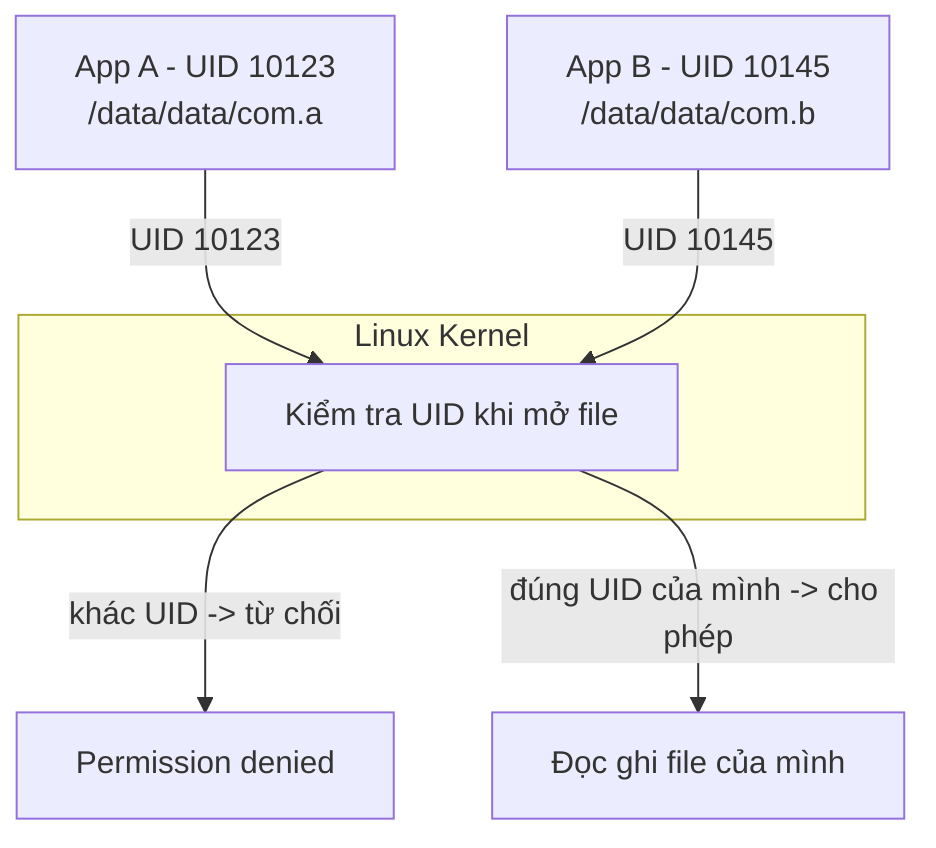
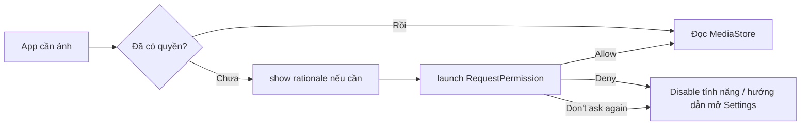
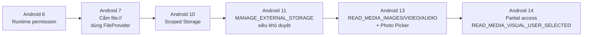
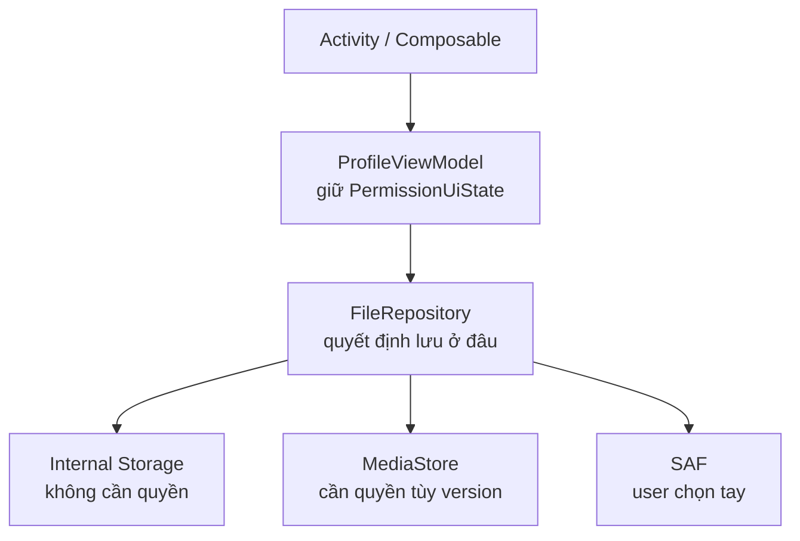
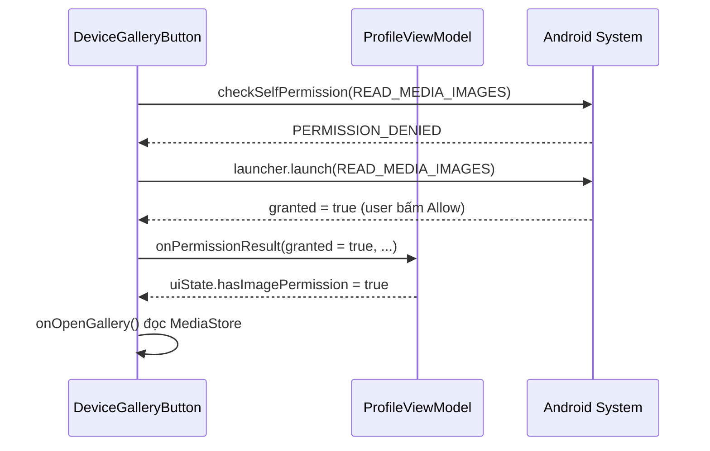
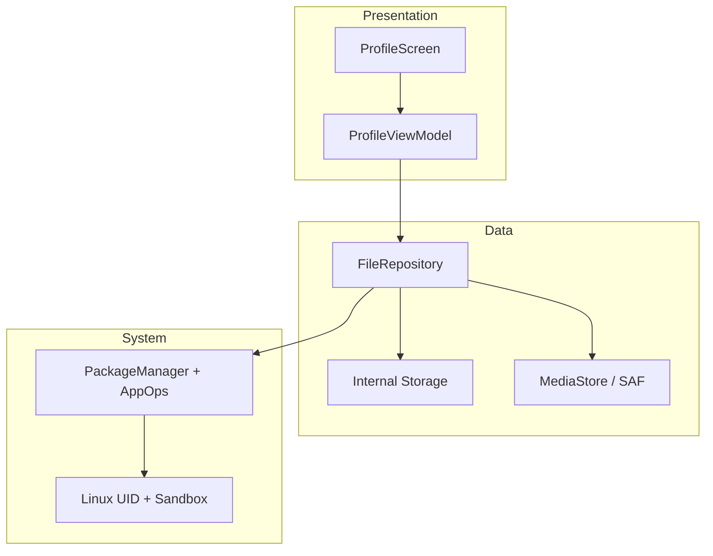

# File Permissions

## Vấn đề cần giải quyết

Bạn làm app profile cho phép user đổi avatar. Trên máy test Android 9 chạy ngon. Lên Android 13 thì crash với `SecurityException: Permission denied`. App khác thì bị Play Store từ chối vì xin `MANAGE_EXTERNAL_STORAGE` trong khi chỉ cần lưu avatar.

Cùng một thao tác "lưu file", nhưng:

- Lưu ở đâu thì không cần xin quyền, lưu ở đâu thì bắt buộc xin?
- Vì sao Android 6 xin lúc chạy, Android 10 lại đổi toàn bộ cách lưu?
- Khi nào dùng Photo Picker thì khỏi xin quyền luôn?

> File Permissions trả lời đúng 3 việc này: app được chạm vào file nào, phải xin phép ra sao, và lưu ở đâu cho đúng khi đi làm.

## File Permissions là gì?

File Permissions là cơ chế quyết định **ai được đọc, ghi, thực thi file nào**.

Android dựa trên cơ chế quyền file của Linux (kiểm tra theo UID/GID), rồi thêm một lớp sandbox riêng: mỗi app một UID. Từ Android 5.0, Android còn bật **SELinux** ở chế độ enforcing (Mandatory Access Control): kể cả process chạy root cũng chỉ được làm những gì policy cho phép.

### Gốc Linux tối giản đủ để đi làm

Mỗi file Linux có 3 nhóm quyền:

```text
-rwxr-x---  owner group others
 rwx        r-x        ---
```

- `rwx`: read, write, execute.
- `owner`: người sở hữu file, `group`: nhóm, `others`: còn lại.
- `UID/GID`: định danh user và group sở hữu process đang chạy.

Khi process muốn mở file, kernel so UID của process với owner của file để cho phép hay từ chối.

### Android sandbox: mỗi app là một user Linux



<!-- dd: perm-uid -->

Bản chất:

- Lúc cài app, hệ thống cấp một UID riêng. App A không bao giờ có UID của app B.
- Thư mục `/data/data/<package_name>` chỉ owner mới đọc được. Đây là lý do mặc định các app không đọc trộm nhau.
- Muốn chạm vào file chung của user (ảnh, nhạc, download), app phải đi qua cửa kiểm soát thứ hai: Android permission.

Đây là điểm khác Linux thuần: Linux hỏi "bạn là ai", Android hỏi thêm "user đã đồng ý cho bạn chưa".

## Các loại Storage trong Android

Đây là phần gây nhiều bug nhất khi đi làm. Chọn sai chỗ lưu là phải xin quyền thừa hoặc bị từ chối.

| Loại | Đường dẫn ví dụ | Cần xin quyền? | Bị xóa khi gỡ app? | Dùng cho |
|---|---|---|---|---|
| Internal app-specific | `/data/data/<pkg>/files/avatar.jpg` | Không | Có | Token file, dữ liệu riêng, nhạy cảm |
| Cache internal | `/data/data/<pkg>/cache/` | Không | Có, hệ thống có thể xóa khi thiếu bộ nhớ | Ảnh thumb tạm, response cache |
| External app-specific | `/sdcard/Android/data/<pkg>/files/` | Không | Có | File lớn riêng của app: video edit dở, offline map |
| Shared Media | `MediaStore.Images / Video / Audio` | Tùy version, xem dưới | Không | Ảnh chụp, video, nhạc muốn hiện trong Gallery |
| Download / Document | `MediaStore.Downloads` hoặc SAF | Tùy cách dùng | Không | PDF export, backup, file user cần giữ |
| Thích bất kỳ chỗ nào | Storage Access Framework | Không cần permission, user chọn tay | Không | Mở / tạo tài liệu ở chỗ user chỉ định |

Nguyên tắc chọn khi đi làm:

- Nên dùng app-specific nếu file chỉ app mình cần. Không xin quyền, không bị Play Store hỏi, không lo Scoped Storage.
- Chỉ dùng Shared khi user cần thấy file ngoài app (ảnh trong Gallery, PDF trong Download).
- Chỉ dùng SAF khi muốn user tự chọn nơi lưu / mở, ví dụ "Export báo cáo ra Download".

> Sai lầm phổ biến nhất của người mới: lưu avatar vào Download rồi đi xin full quyền storage, trong khi lưu vào app-specific thì khỏi xin gì.

## Manifest Permission vs Runtime Permission

Hai lớp khác nhau, phải làm đủ cả hai.

### Manifest: khai báo trước

```xml
<!-- app/src/main/AndroidManifest.xml -->
<manifest>
    <!-- Android 13+: chỉ khi cần đọc ảnh/video do app KHÁC tạo (gallery, backup).
         Google Play hạn chế hai quyền này; chọn ảnh thì dùng Photo Picker. -->
    <uses-permission android:name="android.permission.READ_MEDIA_IMAGES" />
    <uses-permission android:name="android.permission.READ_MEDIA_VIDEO" />
    <!-- Android 12 trở xuống cho file chung -->
    <uses-permission
        android:name="android.permission.READ_EXTERNAL_STORAGE"
        android:maxSdkVersion="32" />
    <!-- Ghi file chung: chỉ cần trên Android 9 trở xuống (và Android 10 khi tạm opt-out Scoped Storage), nên maxSdkVersion=29 -->
    <uses-permission
        android:name="android.permission.WRITE_EXTERNAL_STORAGE"
        android:maxSdkVersion="29" />
</manifest>
```

Khai báo trong Manifest chỉ là "thông báo ý định". Từ Android 6, với quyền thuộc nhóm **dangerous** (vd `READ_MEDIA_IMAGES`), user còn phải bấm Allow lúc chạy; quyền **normal** (vd `INTERNET`) được cấp ngay khi cài.

### Runtime: xin lúc chạy



<!-- dd: perm-ask -->

### Timeline version bắt buộc nhớ khi đi làm



<!-- dd: perm-versions -->

Ý nghĩa thực tế:

- **Scoped Storage** (Android 10, bắt buộc khi `targetSdk` từ 30): trên external storage, app chỉ tự do đọc ghi thư mục app-specific của mình và file media do chính nó tạo. Muốn đọc media của app khác phải qua MediaStore kèm quyền; file khác (PDF, tài liệu) phải qua SAF.
- Đừng xin `READ_EXTERNAL_STORAGE` trên Android 13+, nó không còn tác dụng cho media.
- Android 14 (`targetSdk` 34): user có thể chọn "Select photos and videos". Khi đó `READ_MEDIA_IMAGES` bị từ chối nhưng `READ_MEDIA_VISUAL_USER_SELECTED` được cấp, nghĩa là app chỉ thấy các ảnh user chọn. `granted = false` chưa chắc là bị từ chối hẳn: kiểm tra thêm quyền này bằng `ContextCompat.checkSelfPermission`.
- Đừng xin `MANAGE_EXTERNAL_STORAGE` nếu chỉ lưu avatar hay export PDF, Play Store sẽ từ chối.
- Ưu tiên Photo Picker và SAF vì không cần xin quyền gì cả.

## Triển khai thực tế: Kotlin MVVM

Mục tiêu: code đủ để làm task trong 15 phút, tách đúng tầng UI - ViewModel - Repository.



<!-- dd: perm-arch -->

### 1. Repository: nơi duy nhất biết lưu ở đâu

```kotlin
package com.example.profile.data

import android.content.Context
import android.net.Uri
import dagger.hilt.android.qualifiers.ApplicationContext
import kotlinx.coroutines.Dispatchers
import kotlinx.coroutines.withContext
import java.io.File
import java.io.IOException
import javax.inject.Inject

// open để test có thể thay bằng FakeFileRepository (xem phần Testing)
open class FileRepository @Inject constructor(
    @ApplicationContext private val context: Context
) {

    // Avatar chỉ app mình dùng -> internal, khỏi xin quyền.
    // Ghi file là IO: chạy trên Dispatchers.IO, không chặn main thread.
    open suspend fun saveAvatar(bytes: ByteArray): File = withContext(Dispatchers.IO) {
        val file = File(context.filesDir, "avatar.jpg")
        file.writeBytes(bytes)
        file
    }

    // Ảnh user chọn qua Photo Picker là một content:// Uri -> copy vào filesDir
    open suspend fun saveAvatarFromUri(uri: Uri): File = withContext(Dispatchers.IO) {
        val file = File(context.filesDir, "avatar.jpg")
        val input = context.contentResolver.openInputStream(uri)
            ?: throw IOException("Không mở được $uri")
        input.use { source -> file.outputStream().use { target -> source.copyTo(target) } }
        file
    }

    // SAF: ghi PDF vào Uri do user chọn, app không cần quyền storage nào
    open suspend fun exportReport(uri: Uri, pdfBytes: ByteArray) = withContext(Dispatchers.IO) {
        val output = context.contentResolver.openOutputStream(uri)
            ?: throw IOException("Không mở được $uri")
        output.use { it.write(pdfBytes) }
    }

    fun readAvatar(): File? {
        val file = File(context.filesDir, "avatar.jpg")
        return file.takeIf { it.exists() }
    }
}
```

Vì sao qua Repository mà không gọi `File` trực tiếp trong ViewModel:

- ViewModel không nên biết file nằm ở `filesDir` hay MediaStore. Đổi chỗ lưu chỉ sửa Repository.
- Dễ test: test ViewModel chỉ cần fake Repository.

### 2. ViewModel: giữ trạng thái quyền

```kotlin
package com.example.profile.ui

import android.net.Uri
import androidx.lifecycle.ViewModel
import androidx.lifecycle.viewModelScope
import com.example.profile.data.FileRepository
import dagger.hilt.android.lifecycle.HiltViewModel
import kotlinx.coroutines.flow.MutableStateFlow
import kotlinx.coroutines.flow.StateFlow
import kotlinx.coroutines.flow.asStateFlow
import kotlinx.coroutines.flow.update
import kotlinx.coroutines.launch
import java.io.IOException
import javax.inject.Inject

data class PermissionUiState(
    val hasImagePermission: Boolean = false,
    val showRationale: Boolean = false,
    val avatarPath: String? = null
)

@HiltViewModel
class ProfileViewModel @Inject constructor(
    private val repository: FileRepository
) : ViewModel() {

    private val _uiState = MutableStateFlow(PermissionUiState())
    val uiState: StateFlow<PermissionUiState> = _uiState.asStateFlow()

    fun onPermissionResult(granted: Boolean, shouldShowRationale: Boolean) {
        _uiState.value = _uiState.value.copy(
            hasImagePermission = granted,
            showRationale = !granted && shouldShowRationale
        )
    }

    fun saveAvatar(bytes: ByteArray) {
        viewModelScope.launch {
            val file = repository.saveAvatar(bytes) // suspend, chạy trên Dispatchers.IO
            _uiState.update { it.copy(avatarPath = file.absolutePath) }
        }
    }

    fun saveAvatarFromUri(uri: Uri) {
        viewModelScope.launch {
            try {
                val file = repository.saveAvatarFromUri(uri)
                _uiState.update { it.copy(avatarPath = file.absolutePath) }
            } catch (e: IOException) {
                // Uri hết hạn hoặc không đọc được: báo lỗi cho UI thay vì crash
            }
        }
    }

    fun exportReport(uri: Uri, pdfBytes: ByteArray) {
        viewModelScope.launch {
            try {
                repository.exportReport(uri, pdfBytes)
            } catch (e: IOException) {
                // Không ghi được vào nơi user chọn: báo lỗi cho UI
            }
        }
    }
}
```

### 3. UI: xin quyền bằng ActivityResult API

Cách chuẩn hiện nay, không dùng `requestPermissions` cũ.

Lưu ý phạm vi: **đổi avatar không cần quyền nào** (chọn ảnh bằng Photo Picker ở mục 4, lưu vào `filesDir`). Chỉ xin `READ_MEDIA_IMAGES` khi tính năng thật sự phải đọc **toàn bộ** ảnh trong máy, ví dụ màn hình "Thư viện ảnh" để sao lưu. Đoạn dưới minh hoạ trường hợp đó.

```kotlin
// DeviceGalleryButton.kt (Compose)
@Composable
fun DeviceGalleryButton(
    onOpenGallery: () -> Unit,
    viewModel: ProfileViewModel = hiltViewModel()
) {
    val context = LocalContext.current
    val activity = LocalActivity.current // androidx.activity:activity-compose 1.10+
    val permission = if (Build.VERSION.SDK_INT >= 33) {
        Manifest.permission.READ_MEDIA_IMAGES
    } else {
        Manifest.permission.READ_EXTERNAL_STORAGE
    }

    val launcher = rememberLauncherForActivityResult(
        ActivityResultContracts.RequestPermission()
    ) { granted ->
        viewModel.onPermissionResult(
            granted = granted,
            shouldShowRationale = activity != null &&
                ActivityCompat.shouldShowRequestPermissionRationale(activity, permission)
        )
        if (granted) onOpenGallery()
    }

    Button(onClick = {
        // Luôn hỏi hệ thống, không tin trạng thái đã lưu: user có thể thu hồi quyền trong Settings
        val granted = ContextCompat.checkSelfPermission(context, permission) ==
            PackageManager.PERMISSION_GRANTED
        if (granted) onOpenGallery() else launcher.launch(permission)
    }) {
        Text("Xem toàn bộ ảnh trong máy")
    }
}
```

Mô phỏng luồng khi user bấm Allow:



<!-- dd: perm-seq -->

### 4. Không cần xin quyền: Photo Picker và SAF

Khi đi làm, ưu tiên hai cách này vì không cần khai báo quyền gì.

```kotlin
// Photo Picker: có sẵn từ Android 13, Android 11-12 nhận qua Google System Updates.
// Android 4.4-10 cần bản backport do Google Play services cài (khai báo service
// com.google.android.gms.metadata.ModuleDependencies trong manifest).
// Máy không có Photo Picker: AndroidX tự chuyển sang ACTION_OPEN_DOCUMENT.
// Không cần READ_MEDIA_IMAGES. Cần androidx.activity 1.7.0+.
val pickImage = rememberLauncherForActivityResult(
    ActivityResultContracts.PickVisualMedia()
) { uri: Uri? ->
    uri?.let { viewModel.saveAvatarFromUri(it) }
}

Button(onClick = {
    pickImage.launch(PickVisualMediaRequest(ActivityResultContracts.PickVisualMedia.ImageOnly))
}) {
    Text("Chọn ảnh không cần xin quyền")
}
```

```kotlin
// SAF: user tự chọn nơi tạo PDF export
// reportPdfBytes: nội dung PDF đã tạo sẵn (vd bằng android.graphics.pdf.PdfDocument)
val createPdf = rememberLauncherForActivityResult(
    ActivityResultContracts.CreateDocument("application/pdf")
) { uri: Uri? ->
    uri?.let { viewModel.exportReport(it, reportPdfBytes) }
}
```

### 5. Share file: bắt buộc dùng FileProvider

Từ Android 7, share `file://` sẽ crash `FileUriExposedException`.

```xml
<!-- AndroidManifest.xml -->
<provider
    android:name="androidx.core.content.FileProvider"
    android:authorities="${applicationId}.provider"
    android:exported="false"
    android:grantUriPermissions="true">
    <meta-data
        android:name="android.support.FILE_PROVIDER_PATHS"
        android:resource="@xml/file_paths" />
</provider>
```

```xml
<!-- res/xml/file_paths.xml -->
<paths>
    <files-path name="avatar" path="." />
    <cache-path name="cache" path="." />
</paths>
```

```kotlin
val file = File(context.filesDir, "avatar.jpg")
val uri: Uri = FileProvider.getUriForFile(
    context, "${context.packageName}.provider", file
)

val intent = Intent(Intent.ACTION_SEND).apply {
    type = "image/jpeg"
    putExtra(Intent.EXTRA_STREAM, uri)
    addFlags(Intent.FLAG_GRANT_READ_URI_PERMISSION)
}
context.startActivity(Intent.createChooser(intent, "Chia sẻ avatar"))
```

## So sánh: MediaStore vs SAF vs Photo Picker

| Tiêu chí | MediaStore | SAF | Photo Picker |
|---|---|---|---|
| Cần permission? | Có, tùy version | Không, user chọn tay | Không |
| Trải nghiệm | Tự động, code đọc trực tiếp | User phải chọn file / thư mục | Picker hệ thống đẹp, quen thuộc |
| Phù hợp | App gallery, camera, nhạc | Export / import tài liệu | Chọn avatar, đính kèm ảnh |
| Duyệt Play Store | Bình thường nếu đúng quyền | Dễ duyệt | Dễ duyệt nhất |
| Khuyên dùng khi đi làm | Khi cần quét toàn bộ media | Khi cần quyền lâu dài một file cụ thể | Mặc định cho chọn ảnh / video |

> Trade-off: càng tiện cho dev (đọc thẳng MediaStore) thì càng phải xin quyền và giải trình. Càng nhường quyền chọn cho user (Picker, SAF) thì càng ít permission, càng dễ qua review.

## Security và Performance ở mức đi làm

Security:

- File riêng luôn để `MODE_PRIVATE`. Không bao giờ lưu token, password ra external.
- External app-specific vẫn app khác có root đọc được, không coi là an toàn.
- Khi share qua FileProvider chỉ grant `FLAG_GRANT_READ_URI_PERMISSION` cho intent đó, không mở public cả thư mục.

Performance:

- Đừng đọc file lớn trên UI thread. Repository nên expose `suspend` hoặc `Flow`.
- Cache ảnh resize trước khi lưu, đừng lưu nguyên ảnh 12MP làm avatar.
- `cacheDir` hệ thống có thể xóa, đừng lưu dữ liệu quan trọng ở đó.

## Sai lầm thường gặp

### 1. Lưu app-specific nhưng vẫn xin full quyền

Lưu avatar vào `filesDir` thì khỏi xin. Xin thừa khiến user sợ và Play Store hỏi.

### 2. Quên `maxSdkVersion` khiến xin quyền chết trên máy mới

```xml
<!-- Đúng: quyền cũ chỉ cần tới Android 12 -->
<uses-permission
    android:name="android.permission.READ_EXTERNAL_STORAGE"
    android:maxSdkVersion="32" />
```

### 3. Dùng đường dẫn cứng `/sdcard/`

```kotlin
// Sai: máy khác nhau mount khác nhau
val file = File("/sdcard/myapp/avatar.jpg")

// Đúng
val file = File(context.filesDir, "avatar.jpg")
```

### 4. Quên handle Deny và Don't ask again

Luôn có nhánh disable tính năng và nút mở Settings. App chỉ hiện màn hình trắng khi bị deny là lỗi UX phổ biến khi review đi làm.

### 5. Test chỉ trên một version

Bug File Permissions thường chỉ lộ ra trên version khác. Khi đi làm phải test tối thiểu: Android 9, Android 11, Android 13/14.

## Debug và Testing

Debug trên máy thật:

```text
Device File Explorer trong Android Studio:
data/data/com.example.profile/files/avatar.jpg
data/data/com.example.profile/cache/
sdcard/Android/data/com.example.profile/files/
```

```bash
adb shell dumpsys package com.example.profile | grep permission
adb shell run-as com.example.profile ls -l files
```

Máy chưa root không `ls` được `/data/data/<pkg>` từ `adb shell`; với bản build debuggable, `run-as <pkg>` chạy lệnh dưới UID của app nên đọc được thư mục riêng của nó.

Không log đường dẫn tuyệt đối và nội dung file nhạy cảm ra Logcat production.

Testing:

```kotlin
// testImplementation: kotlinx-coroutines-test, mockk
// Fake override mọi hàm được gọi nên Context giả không bao giờ bị dùng tới
class FakeFileRepository : FileRepository(mockk(relaxed = true)) {
    var savedBytes: ByteArray? = null
    override suspend fun saveAvatar(bytes: ByteArray): File {
        savedBytes = bytes
        return File("fake/avatar.jpg")
    }
}

// Test ViewModel không cần thiết bị thật
@OptIn(ExperimentalCoroutinesApi::class)
class ProfileViewModelTest {
    private val testDispatcher = StandardTestDispatcher()

    // viewModelScope chạy trên Dispatchers.Main, unit test JVM không có Main -> phải thay
    @Before fun setUp() = Dispatchers.setMain(testDispatcher)
    @After fun tearDown() = Dispatchers.resetMain()

    @Test
    fun saveAvatar_updatesUiState() = runTest(testDispatcher) {
        val repo = FakeFileRepository()
        val vm = ProfileViewModel(repo)
        vm.saveAvatar(byteArrayOf(1, 2, 3))
        advanceUntilIdle() // chạy hết coroutine đã launch
        assertNotNull(vm.uiState.value.avatarPath)
        assertArrayEquals(byteArrayOf(1, 2, 3), repo.savedBytes)
    }
}
```

## Vị trí trong hệ thống

File Permissions nằm ở Data Layer, dưới ViewModel.



<!-- dd: perm-sum -->

Liên hệ:

- `2.2 Process Management`: mỗi process mang UID, bị giết thì file cache có thể mất.
- `2.4 Multi User OS`: mỗi user máy có sandbox riêng, app user A không thấy file user B.
- `4.1 Manifest`: mọi quyền file đều phải khai báo ở Manifest trước.

## Học tiếp gì?

- `2.2 Process Management`: app sống ở process nào, vì sao bị giết thì mất file tạm.
- `2.4 Multi User OS`: máy nhiều user thì storage tách ra sao.
- `4.1 Manifest Permission tag`: khai báo `provider`, `uses-permission` đầy đủ.
- `Session 05 Data Store + Room`: khi nào lưu file, khi nào lưu database có cấu trúc.
- `Session 08 Local Storage`: cache ảnh, download nền bằng WorkManager.

## Nguồn tham khảo

- [Data and file storage overview — Android Developers](https://developer.android.com/training/data-storage)
- [App-specific storage — Android Developers](https://developer.android.com/training/data-storage/app-specific)
- [Shared media — Android Developers](https://developer.android.com/training/data-storage/shared/media)
- [Storage Access Framework — Android Developers](https://developer.android.com/guide/topics/providers/document-provider)
- [Request runtime permissions — Android Developers](https://developer.android.com/training/permissions/requesting)
- [Behavior changes Scoped Storage Android 10 — Android Developers](https://developer.android.com/about/versions/10/privacy/changes#scoped-storage)
- [Photo Picker — Android Developers](https://developer.android.com/training/data-storage/shared/photopicker)
- [FileProvider — Android Developers](https://developer.android.com/reference/androidx/core/content/FileProvider)
- [Permissions behavior Android 13 — Android Developers](https://developer.android.com/about/versions/13/behavior-changes-13#granular-media-permissions)
- [Partial photo access Android 14 — Android Developers](https://developer.android.com/about/versions/14/changes/partial-photo-video-access)
- [Security-Enhanced Linux in Android — Android Open Source Project](https://source.android.com/docs/security/features/selinux)
- [Test your code on Android: Coroutines — Android Developers](https://developer.android.com/kotlin/coroutines/test)
