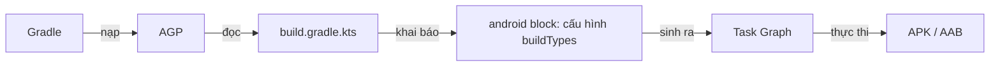
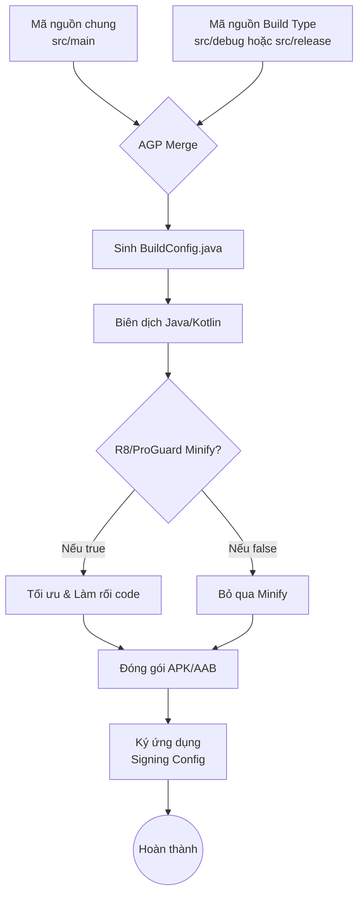
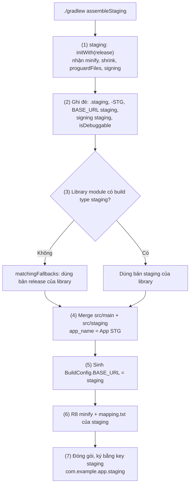

# Build Types

## Vấn đề cần giải quyết

Trong quá trình phát triển một ứng dụng Android, bạn không chỉ tạo ra một phiên bản duy nhất. Bạn cần:

- Một phiên bản để Developer lập trình, có thể debug, build nhanh, log lỗi chi tiết.
- Một phiên bản để QA/Tester kiểm thử nội bộ trên môi trường server giả lập (Staging/QA).
- Một phiên bản hoàn chỉnh để phát hành lên Google Play (Production) — phiên bản này cần được rút gọn và làm rối code (minify/obfuscate bằng R8/ProGuard), loại bỏ log để bảo mật và tối ưu dung lượng.

Nếu không có một cơ chế quản lý, bạn sẽ phải liên tục thay đổi code (ví dụ: đổi URL server, bật/tắt biến `DEBUG`, thay đổi chữ ký chứng chỉ - signing config) mỗi khi muốn tạo ra một phiên bản khác nhau. Điều này rất dễ dẫn đến sai sót (ví dụ: quên tắt log khi release app).

Android cung cấp **Build Types** để giải quyết bài toán này.

## Sau khi học xong

- Giải thích được Build Flow của một Build Type: merge source sets, sinh BuildConfig, minify R8/ProGuard, signing.
- Triển khai được R8/ProGuard rule riêng cho từng Build Type và lưu mapping.txt để đọc crash bản release.
- Triển khai được các Build Type dev, staging, release với signing, minify, applicationIdSuffix và initWith.
- Áp dụng được buildConfigField và manifestPlaceholders để tách biến môi trường khỏi source code.
- Áp dụng được Build Type vào CI/CD và Firebase App Distribution để phân phối bản build cho QA.

## Build Type là gì?

**Build Type** (Loại bản dựng) là các cấu hình xây dựng ứng dụng ở các **giai đoạn khác nhau trong vòng đời phát triển** (development lifecycle) của ứng dụng.

Build Type định nghĩa **cách thức** mà ứng dụng được build và đóng gói: có cho phép debug không, sử dụng khóa ký (signing key) nào, có tối ưu hóa mã nguồn (minify) không, hay có gắn thêm hậu tố vào tên gói (application ID suffix) hay không.

Mental model: cùng một mã nguồn đi qua nhiều **dây chuyền đóng gói**, mỗi Build Type là bản thiết lập của một dây chuyền (gắn debugger được không, có qua R8 không, ký bằng khóa nào, dán hậu tố gì). Đổi Build Type là đổi dây chuyền, không phải sửa code.

## Cách hoạt động

### Vị trí của Build Type trong chuỗi build

> [!NOTE]
> **Kiến thức dùng trước.** **Gradle** là hệ thống build tổng quát, chạy các Task theo Task Graph; **AGP** (Android Gradle Plugin) là plugin chính thức của Google giúp Gradle hiểu và build được dự án Android, và đăng ký khối `android { }` trong `build.gradle.kts` (build script viết bằng Kotlin DSL) nơi bạn khai báo `buildTypes`. Hai khái niệm này được học ở `4.1.1.3` [Plugin](plugin.md), mục "Nền tảng cần biết trước" và "AGP là gì?".

Vị trí của `buildTypes` trong chuỗi build:


<!-- dd: bt-flow -->

### Hai Build Type mặc định: debug và release

Theo mặc định, khi tạo một project Android mới, AGP sẽ tự động cấu hình sẵn hai Build Type:

1. `debug`: Dành cho lúc lập trình. Không minify code, được ký bằng debug key mặc định, hỗ trợ debug đầy đủ.
2. `release`: Dành cho lúc phát hành. Thường được minify (ProGuard/R8), ký bằng release key của riêng bạn, không cho phép debug.

### Build Flow: một Build Type đi qua các bước build thế nào

Khi bạn nhấn nút "Run" hoặc thực thi một lệnh Gradle (ví dụ: `./gradlew assembleDebug`), Gradle và Android Gradle Plugin (AGP) sẽ thực hiện một luồng công việc (Build Flow):

1. **Khởi tạo và cấu hình:** Đọc `build.gradle` (hoặc `build.gradle.kts`) để thu thập thông tin về Build Type được chọn.
2. **Hợp nhất mã nguồn và tài nguyên (Merge Source Sets):** AGP tự động kết hợp mã nguồn (`src/main`) với mã nguồn cụ thể của Build Type (`src/debug` hoặc `src/release`). Resource và manifest của Build Type ghi đè/merge lên `main`; còn class Kotlin/Java thì **không** ghi đè được — trùng tên class giữa hai source set sẽ báo lỗi duplicate class. Thứ tự ưu tiên đầy đủ ở [Flavor](flavor.md), mục "Thứ tự merge Source Set".
3. **Sinh code tự động (Code Generation):** Sinh ra file `BuildConfig.java` (nếu cấu hình) dựa trên các `buildConfigField` tương ứng.
4. **Biên dịch (Compilation):** Biên dịch Kotlin/Java thành bytecode.
5. **Tối ưu hóa (Minification - R8/ProGuard):** (Thường chỉ áp dụng cho `release` hoặc `staging`) Tối ưu code, obfuscate (làm rối), loại bỏ code thừa dựa trên các rules (quy tắc) áp dụng riêng cho Build Type đó.
6. **Đóng gói và Ký (Packaging & Signing):** Đóng gói thành APK/AAB và ký bằng `signingConfig` được chỉ định.


<!-- dd: bt-merge-a -->
<!-- dd: bt-merge-b -->

### Các thuộc tính quan trọng của một Build Type

Trước khi cấu hình, cần nắm các thuộc tính hay dùng nhất:

| Thuộc tính | Ý nghĩa |
|---|---|
| `isDebuggable` | Cho phép debug (true/false). Bản `release` phải là `false`. |
| `isMinifyEnabled` | Bật R8/ProGuard để làm rối, rút gọn code. |
| `isShrinkResources` | Loại bỏ tài nguyên không dùng tới. Thường bật cùng minify. |
| `applicationIdSuffix` | Thêm hậu tố vào application ID (ví dụ `.dev`). Giúp cài nhiều bản cùng lúc. |
| `versionNameSuffix` | Thêm hậu tố vào version name hiển thị. |
| `signingConfig` | Khóa ký cho bản build. |
| `proguardFiles` | Danh sách file rules cho R8/ProGuard. |
| `buildConfigField` | Khai báo biến tĩnh trong `BuildConfig.java`. |
| `manifestPlaceholders` | Truyền biến vào AndroidManifest.xml. |
| `initWith` | Kế thừa toàn bộ cấu hình từ một Build Type khác. |

### buildConfigField: Vì sao nên khai báo biến môi trường ở đây?

**buildConfigField** là cách để bạn khai báo một biến tĩnh trong file `BuildConfig.java` được sinh tự động bởi AGP. Sau khi build, bạn có thể đọc biến này trong code như `BuildConfig.BASE_URL`.

#### Vì sao nên dùng buildConfigField thay vì hardcode?

| Tiêu chí | Hardcode trong source | buildConfigField |
|---|---|---|
| Đổi URL theo môi trường | Phải sửa code, build lại | Tự động đổi theo Build Type |
| Lọt secret ra ngoài | Có thể bị đọc trong APK | Vẫn có thể bị đọc (xem lưu ý) |
| Tách biệt config | Không | Có, tập trung ở 1 nơi |
| Đổi giá trị theo variant | Sửa code + commit lại | Chọn variant rồi build, không sửa code |

#### Lưu ý quan trọng về bảo mật

> [!WARNING]
> Mọi giá trị trong `BuildConfig` đều nằm trong APK và đọc được khi decompile, nên `buildConfigField` chỉ dành cho cấu hình không nhạy cảm (BASE_URL, endpoint, feature flag). Chi tiết và chỗ đặt secret ở [Flavor](flavor.md), mục "buildConfigField theo Flavor".

#### Ví dụ: đổi BASE_URL và cờ log theo Build Type

Bản debug gọi server dev và bật log, bản release gọi server thật và tắt log, mà code Kotlin không có dòng `if` nào theo môi trường.

Trong `build.gradle.kts`:

```kotlin
buildTypes {
    getByName("debug") {
        buildConfigField("String", "BASE_URL", "\"https://dev.api.example.com/\"")
        buildConfigField("boolean", "IS_LOGGING_ENABLED", "true")
    }
    getByName("release") {
        buildConfigField("String", "BASE_URL", "\"https://api.example.com/\"")
        buildConfigField("boolean", "IS_LOGGING_ENABLED", "false")
    }
}
```

Trong code Kotlin:

```kotlin
object AppConfig {
    val baseUrl: String = BuildConfig.BASE_URL
    val isLoggingEnabled: Boolean = BuildConfig.IS_LOGGING_ENABLED
}
```

> [!TIP]
> Từ AGP 8.0 trở đi, `BuildConfig` **mặc định bị tắt** để tăng tốc build. Bạn phải bật lại bằng cách thêm vào `android { }` block:
> ```kotlin
> buildFeatures {
>     buildConfig = true
> }
> ```

> [!NOTE]
> `buildConfigField` trong `buildTypes`/`defaultConfig` như các ví dụ trên là DSL chính thức (`VariantDimension.buildConfigField`), **không** bị deprecated ở AGP 9. Khi giá trị cần tính lúc build (ví dụ đọc từ một `Provider`, git hash), dùng bản lazy `variant.buildConfigFields.put(...)` trong `androidComponents { onVariants { ... } }`.

### manifestPlaceholders: đưa biến vào AndroidManifest

Cùng pattern như `BASE_URL` ở trên, nhưng biến được chèn vào `AndroidManifest.xml` thay vì `BuildConfig`.

#### Ví dụ: deep link host theo Build Type

```kotlin
buildTypes {
    getByName("debug") {
        manifestPlaceholders["deepLinkHost"] = "staging.example.com"
    }
    getByName("release") {
        manifestPlaceholders["deepLinkHost"] = "api.example.com"
    }
}
```

```xml
<data android:host="${deepLinkHost}" android:scheme="https" />
```

Mỗi Flavor cũng khai báo được `manifestPlaceholders` riêng (free/paid, dev/prod), xem [Flavor](flavor.md).

### initWith: Kế thừa cấu hình giữa các Build Type

**initWith** cho phép một Build Type kế thừa toàn bộ cấu hình từ một Build Type khác, sau đó ghi đè các thuộc tính cần thiết.

#### Ví dụ: staging giống release nhưng khác server

Ví dụ điển hình: Build Type `staging` cần giống hệt `release` (bật R8, dùng proguard, ký release) nhưng khác URL server.

```kotlin
buildTypes {
    getByName("release") {
        isMinifyEnabled = true
        isShrinkResources = true
        proguardFiles(...)
        signingConfig = signingConfigs.getByName("release")
    }
    create("staging") {
        // Kế thừa toàn bộ cấu hình từ release
        initWith(getByName("release"))
        // Sau đó ghi đè những gì cần khác
        applicationIdSuffix = ".staging"
        buildConfigField("String", "BASE_URL", "\"https://staging.api.example.com/\"")
        signingConfig = signingConfigs.getByName("staging")
        isDebuggable = true
    }
}
```

> [!NOTE]
> `initWith` giúp tránh lặp lại code. Nhưng lưu ý: thứ tự khai báo quan trọng — `initWith` phải gọi **trước** khi ghi đè các thuộc tính khác, vì mỗi dòng sau sẽ thay thế giá trị đã kế thừa.

### Quản lý ProGuard và R8 Rule cho từng môi trường

Khi bật `isMinifyEnabled = true`, R8 (công cụ biên dịch thế hệ mới của Android thay thế ProGuard) sẽ tiến hành làm rối mã (obfuscate) và loại bỏ các class/method không dùng tới.

Vấn đề R8 giải quyết: APK release không xử lý vừa **to** (dead code, thư viện thừa làm tăng dung lượng tải) vừa **dễ bị decompile đọc gần như nguyên code** (lộ logic nghiệp vụ, endpoint, cách xử lý dữ liệu). R8 xử cả hai trong một lần chạy: gói nhỏ lại + khó đọc ngược.

#### R8 làm gì trong bản build của bạn

R8 chạy đúng bước minify trong Build Flow ở trên: **sau biên dịch, trước đóng gói**. Một lần chạy làm 3 việc:

1. **Shrink (lược bỏ):** xóa class/method không ai gọi tới (tree-shaking) cho APK nhẹ đi. `isShrinkResources = true` dọn tiếp phần resource thừa đi kèm.
2. **Optimize (tối ưu):** viết lại bytecode cho gọn (inline hàm, gộp code...), app chạy nhanh hơn.
3. **Obfuscate (làm rối):** đổi tên `com.example.LoginManager` thành `a.b.c` để decompile khó đọc. Đây **không phải mã hóa** — app vẫn chạy bình thường, chỉ khó đọc ngược.

Điểm gãy duy nhất: R8 chỉ nhìn thấy lời gọi **trực tiếp**. Code gọi qua **Reflection** — Gson/Moshi parse JSON, Retrofit tạo implementation, Hilt/Navigation sinh code lúc chạy — R8 tưởng không ai dùng nên xóa nhầm. Kết quả: app **chỉ crash ở bản release/staging** (`ClassNotFoundException`, `NoSuchMethodError`) trong khi bản debug chạy ngon. Đó chính là lý do đội QA phải test trên bản staging bật R8 thay vì bản debug.

#### Đọc crash bản release: mapping.txt

Mỗi lần build có minify, AGP sinh file `app/build/outputs/mapping/<variant>/mapping.txt` — bảng tra cứu tên thật ↔ tên rối. Không có file này, stacktrace crash toàn `a.b.c` và vô dụng. Quy tắc:

- Lưu `mapping.txt` của **mỗi** bản release/staging (đúng variant, đúng versionCode).
- Upload lên Play Console / Crashlytics để tự động giải mã crash.
- Hoặc giải tay trong Android Studio bằng Analyze Stack Trace với đúng file mapping đó.

#### Cú pháp rule tối thiểu

Rule là file `.pro` nói cho R8 biết "đừng đụng vào chỗ này". Chỉ cần 4 câu lệnh là đủ dùng hàng ngày:

| Cú pháp | Ý nghĩa | Khi nào dùng |
|---|---|---|
| `-keep class com.example.model.** { *; }` | Giữ nguyên cả class + member | Model parse JSON (Gson), API interface |
| `-keepnames class com.example.api.**` | Giữ tên class, cho tối ưu bên trong | Ít dùng, khi chỉ cần stacktrace đọc được |
| `-keepclassmembers class * extends ... { <fields>; }` | Chỉ giữ member, không giữ cả class | Message protobuf (xem ví dụ Proto DataStore ở dưới) |
| `-dontwarn org.conscrypt.**` | Bỏ qua warning của thư viện | Thư viện lớn báo warning không liên quan; không dùng để che lỗi thật |

Mặc định AGP đã kèm `proguard-android-optimize.txt` (rule chuẩn của Google), nên file của bạn chỉ chứa rule cho **code của mình**.

#### Quy trình dùng R8 cho bản release/staging

1. **Bật R8:** `isMinifyEnabled = true` (+ `isShrinkResources = true`) trong `release`, `staging` kế thừa qua `initWith` — như ví dụ 3 môi trường ở mục "Ví dụ thực tế".
2. **Viết rule:** thêm rule cho chỗ dùng Reflection của mình (model Gson, message Proto — xem mục rule mẫu ở dưới). Thư viện Jetpack hiện đại tự kèm rule nên không viết thừa.
3. **Kiểm chứng mỗi bản build:**
   - File `app/build/outputs/mapping/<variant>/mapping.txt` có sinh ra không — không có nghĩa là R8 chưa chạy thật.
   - Cài bản staging/release lên máy, đi qua các màn hình dùng API, database, parse JSON. Crash `ClassNotFoundException` / `NoSuchMethodError` mà bản debug không bị = thiếu `-keep`, thêm rule rồi build lại.

Các lỗi hay gặp khi viết rule (giữ hết, copy rule cũ tắt R8, test bằng bản debug) ở mục "Sai lầm thường gặp".

Đôi khi, bạn muốn sử dụng các rules riêng biệt cho `staging` (để giữ lại một số log crash nội bộ hoặc SDK tracking ẩn) và `release`.

#### Cách 1: Sử dụng thư mục Source Sets

Android tự động liên kết các file có trong thư mục mang tên Build Type.
Bạn có thể tổ chức thư mục như sau:

```text
app/
 ├── src/
 │   ├── main/
 │   ├── staging/
 │   │   └── proguard-rules-staging.pro  <-- Rules riêng cho staging
 │   └── release/
```

Trong `build.gradle.kts`:

```kotlin
buildTypes {
    create("staging") {
        isMinifyEnabled = true
        // Thêm rule riêng cho staging
        proguardFiles(
            getDefaultProguardFile("proguard-android-optimize.txt"), 
            "proguard-rules.pro", // Rule chung ở gốc
            "src/staging/proguard-rules-staging.pro" // Rule cụ thể
        )
    }
    
    getByName("release") {
        isMinifyEnabled = true
        proguardFiles(
            getDefaultProguardFile("proguard-android-optimize.txt"), 
            "proguard-rules.pro" // Chỉ dùng rule chung
        )
    }
}
```

#### Cách 2: Quản lý R8 Rules theo Library

Nếu bạn viết thư viện (Android Library Module), thay vì bắt app module phải định nghĩa proguard rule, bạn nên gói kèm `consumerProguardFiles` vào trong thư viện. Rule này sẽ tự động được truyền lên (propagate) mọi Build Type đang sử dụng thư viện đó.

```kotlin
android {
    defaultConfig {
        consumerProguardFiles("consumer-rules.pro")
    }
}
```

#### Ví dụ: rule mẫu cho stack Lifecycle + Room + Retrofit + Hilt + DataStore

Nguyên tắc: thư viện Jetpack hiện đại (2024+) tự kèm rule qua `consumerProguardFiles`, nên **chỉ viết rule cho code của mình**. Bảng tra nhanh:

| Thư viện | Cần rule tay? | Vì sao |
|---|---|---|
| Lifecycle, Room, Hilt, Preferences DataStore, Navigation, WorkManager | Không | Tự kèm consumer rules; code sinh (generated) không dùng Reflection |
| Retrofit (interface, suspend) | Không | Retrofit tự kèm rule giữ `Signature`/`InnerClasses` |
| Gson models (dùng kèm Retrofit) | **Có** | Gson đọc field qua Reflection, R8 không thấy ai gọi nên xóa nhầm |
| Proto DataStore | **Có** | Message protobuf cần giữ schema/parser |
| Moshi codegen (KSP) | Không | Code sinh sẵn; chỉ Moshi reflection mới cần keep model như Gson |

`proguard-rules.pro` dùng chung cho cả staging và release:

```pro
# Gson: giữ model parse JSON (đổi com.example.data.model thành package model của bạn)
-keepattributes Signature, *Annotation*
-keep class com.example.data.model.** { *; }

# Proto DataStore: giữ message protobuf (Preferences DataStore không cần dòng này)
-keepclassmembers class * extends com.google.protobuf.GeneratedMessageLite {
  <fields>;
}

# Bỏ warning của thư viện, không che lỗi thật
-dontwarn org.conscrypt.**
```

`src/staging/proguard-rules-staging.pro` — staging giữ log để QA gửi logcat kèm crash, release strip log cho nhẹ và sạch:

```pro
# Staging: KHÔNG strip Log.
# File release thêm các dòng dưới để xóa log d/v/i khỏi APK:
# -assumenosideeffects class android.util.Log {
#     public static *** d(...);
#     public static *** v(...);
#     public static *** i(...);
# }
```

Giới hạn của `-assumenosideeffects` (không strip `Log.e/wtf`, không truyền lời gọi hàm làm đối số) ở mục "Sai lầm thường gặp".

## Ví dụ thực tế

### Cấu hình 3 môi trường Dev / Staging / Production

Trong thực tế dự án lớn, `debug` và `release` là không đủ. Đội ngũ QA cần một môi trường giống `release` nhất có thể để test (tức là có Minify/ProGuard) nhưng ứng dụng vẫn trỏ về máy chủ Staging/Dev, và có thể cài song song với app Production trên cùng một điện thoại.

Luồng chạy khi build bản cho QA bằng `./gradlew assembleStaging`:

1. AGP đọc `buildTypes`; `staging` gọi `initWith(getByName("release"))` nên nhận lại minify, shrink resources, `proguardFiles` và signing của `release` (vì vậy `release` được khai báo trước).
2. Các dòng sau `initWith` ghi đè phần khác của staging: `applicationIdSuffix = ".staging"`, `versionNameSuffix = "-STG"`, `BASE_URL` của server staging, signing config `staging`, `isDebuggable = true`.
3. Khi resolve dependency, library module không có build type `staging`, nên `matchingFallbacks` cho Gradle lấy bản `release` của library.
4. AGP merge Source Set `src/main` với `src/staging`: resource cùng tên trong `src/staging/res/` (ví dụ `app_name`) ghi đè bản trong `src/main/res/`.
5. AGP sinh `BuildConfig` với `BASE_URL` của staging (cần `buildFeatures { buildConfig = true }`).
6. R8 chạy theo `proguardFiles` kế thừa từ release và sinh `mapping.txt` cho variant staging.
7. AGP đóng gói và ký APK bằng signing config `staging`, ra app có application ID `com.example.app.staging`.



Đây là cách khai báo các môi trường bằng Build Type trong `build.gradle.kts`:

```kotlin
android {
    // (7) Cấu hình Signing (Bảo mật)
    // Không hardcode password. Đọc từ biến môi trường hoặc local.properties (đã gitignore).
    signingConfigs {
        create("staging") {
            storeFile = file("staging-keystore.jks")
            storePassword = System.getenv("STAGING_STORE_PASSWORD")
            keyAlias = System.getenv("STAGING_KEY_ALIAS")
            keyPassword = System.getenv("STAGING_KEY_PASSWORD")
        }
        create("release") {
            storeFile = file("release-keystore.jks")
            storePassword = System.getenv("RELEASE_STORE_PASSWORD")
            keyAlias = System.getenv("RELEASE_KEY_ALIAS")
            keyPassword = System.getenv("RELEASE_KEY_PASSWORD")
        }
    }

    // (5) Bật BuildConfig để dùng buildConfigField
    buildFeatures {
        buildConfig = true
    }

    buildTypes {
        // Build Type mặc định cho Dev
        getByName("debug") {
            applicationIdSuffix = ".dev"
            versionNameSuffix = "-DEV"
            buildConfigField("String", "BASE_URL", "\"https://dev.api.example.com/\"")
            isDebuggable = true
        }

        // Build Type cho Production — khai báo TRƯỚC để staging kế thừa đúng minify/proguard/signing
        getByName("release") {
            buildConfigField("String", "BASE_URL", "\"https://api.example.com/\"")
            isMinifyEnabled = true // (6) Bật R8/ProGuard
            isShrinkResources = true // Loại bỏ resource thừa

            proguardFiles(
                getDefaultProguardFile("proguard-android-optimize.txt"),
                "proguard-rules.pro"
            )
            signingConfig = signingConfigs.getByName("release")
        }

        // Build Type cho môi trường Staging/QA
        create("staging") {
            // QUAN TRỌNG: initWith phải gọi TRƯỚC khi ghi đè.
            // Mọi dòng sau initWith sẽ thay thế giá trị đã kế thừa.
            // (1) Kế thừa thuộc tính từ release để test giống thật nhất (minify/proguard/signing)
            initWith(getByName("release"))

            // (2) Giúp cài song song bản Staging và Prod trên cùng 1 máy
            applicationIdSuffix = ".staging"
            versionNameSuffix = "-STG"

            buildConfigField("String", "BASE_URL", "\"https://staging.api.example.com/\"")

            // Gán signing config riêng để nhận diện
            signingConfig = signingConfigs.getByName("staging")

            // Có thể muốn vẫn cho phép debug trên staging đôi chút (tuỳ team)
            isDebuggable = true

            // (3) Library module không có build type "staging" → cho Gradle dùng bản "release" của library
            matchingFallbacks += listOf("release")
        }
    }
}
```

Ngoài `buildConfigField`, AGP còn merge Source Set theo Build Type (bước 2 của Build Flow): resource trong `src/staging/res/` ghi đè resource cùng tên trong `src/main/res/`, còn class trùng tên giữa `src/main/` và `src/staging/` báo lỗi duplicate class. Quy tắc merge đầy đủ ở [Flavor](flavor.md), mục "Thứ tự merge Source Set". Ví dụ đổi tên app của bản staging mà không đụng bản release:

```xml
<!-- (4) app/src/staging/res/values/strings.xml -->
<resources>
    <string name="app_name">App STG</string>
</resources>
```

**Kết quả:** `./gradlew assembleStaging` ra APK trỏ server staging (`BuildConfig.BASE_URL`), tên app "App STG", đã qua R8 và có `app/build/outputs/mapping/staging/mapping.txt`; cài được cạnh bản dev và bản production.

> [!NOTE]
> Bằng cách cấu hình `applicationIdSuffix`, bạn có thể cài cả 3 app: `com.example.app.dev`, `com.example.app.staging`, và `com.example.app` lên cùng một thiết bị!

> [!WARNING]
> Staging bật đồng thời `isMinifyEnabled = true` và `isDebuggable = true` chỉ dùng nội bộ cho QA. Bản `debuggable` bị Google Play từ chối khi upload, và R8 + debuggable làm stacktrace khó đọc hơn bản release thật.

> [!NOTE]
> File `*-keystore.jks` thật không commit lên Git. Tên file trong ví dụ chỉ minh họa; password đọc từ biến môi trường hoặc CI secrets như đoạn code trên.

### Đặt tên file output theo môi trường

Mặc định, file APK/AAB sẽ có tên kiểu `app-debug.apk`, `app-staging.apk`... Muốn đặt tên rõ ràng hơn theo môi trường, ưu tiên đổi tên gốc (Cách 1). Chỉ khi cần tùy biến hoàn toàn tên file theo từng variant mới dùng Variant API (Cách 2 mới). Cách dùng `applicationVariants` (Cách cũ) là Legacy Variant API: AGP 9 mặc định `android.newDsl=true` nên không còn truy cập được API này (opt-out `android.newDsl=false` sẽ bị bỏ ở AGP 10).

Cách 1 — Đổi tên gốc (chỉ đổi phần base name, AGP vẫn ghép thêm `-debug` / `-staging` / `-release` phía sau):

| Gradle | Cú pháp | Ghi chú |
|---|---|---|
| Gradle 8 trở xuống | `setProperty("archivesBaseName", ...)` trong `defaultConfig` | Vẫn chạy nhưng đã deprecated |
| Gradle 9+ (AGP 9) | `base { archivesName = ... }` ngoài `android { }` | Bắt buộc, `archivesBaseName` đã bị xóa |

Gradle 9+ (AGP 9, khuyến nghị):

```kotlin
// app/build.gradle.kts — nằm NGOÀI và NGANG CẤP với android { }
base {
    // Tên file output sẽ là: MyApp-debug.apk, MyApp-staging.apk, MyApp-release.apk
    archivesName = "MyApp"
}
```

<details>
<summary>Gradle 8 trở xuống — `archivesBaseName` (Legacy, chỉ để bảo trì project cũ)</summary>

```kotlin
android {
    defaultConfig {
        // Tên file output sẽ là: MyApp-debug.apk, MyApp-staging.apk, MyApp-release.apk
        setProperty("archivesBaseName", "MyApp")
    }
}
```

</details>

Cách 2 mới — Tùy biến hoàn toàn tên file với Variant API (AGP 8/9, khuyến nghị khi cần custom). Variant API công khai **không** cho đổi tên file output trực tiếp; cách chuẩn là lấy artifact APK của variant rồi copy ra tên mới:

```kotlin
// app/build.gradle.kts
import com.android.build.api.artifact.SingleArtifact

// Lưu ý: androidComponents nằm NGOÀI và NGANG CẤP với android { }, không nằm trong đó.
androidComponents {
    onVariants(selector().all()) { variant ->
        val name = variant.name
        // versionName nằm trên VariantOutput, không nằm trên Variant
        val versionName = variant.outputs.first().versionName
        tasks.register<Copy>("copy${name.replaceFirstChar { it.uppercase() }}Apk") {
            from(variant.artifacts.get(SingleArtifact.APK)) { include("*.apk") }
            into(layout.buildDirectory.dir("renamed-apk/$name"))
            rename { "MyApp-$name-${versionName.getOrElse("1.0")}.apk" }
        }
    }
}
```

Chỉ đổi tên một Build Type cụ thể: thay `selector().all()` bằng `selector().withBuildType("staging")`, phần thân giữ nguyên.

> [!NOTE]
> - `VariantOutput` công khai chỉ có `versionCode`, `versionName`, `enabled`; **không có** `outputFileName` (thuộc implementation nội bộ của API cũ), nên code kiểu `output.outputFileName.set(...)` không compile với AGP 9.
> - Chạy `./gradlew copyStagingApk`: Gradle build APK staging trước (vì task phụ thuộc artifact `SingleArtifact.APK`), rồi copy ra `app/build/renamed-apk/staging/MyApp-staging-1.0.0-STG.apk`.
> - `variant.name` sẽ là `debug`, `staging` hoặc `release` (hoặc `freeStaging`, `paidRelease`... khi kết hợp Flavor + Build Type). Dùng `getOrElse` để không crash khi variant chưa set versionName.
> - Cách này tương thích Configuration Cache và Gradle 9. Nó chỉ áp dụng cho APK: `VariantOutput` không áp dụng cho AAB (bundle không có nhiều output).

<details>
<summary>Cách cũ — `applicationVariants` (Legacy, chỉ AGP 8 trở xuống, không nên dùng mới)</summary>

> [!WARNING]
> `applicationVariants` là Legacy Variant API, đã được thay bằng `androidComponents`. AGP 9 mặc định `android.newDsl=true` nên không còn truy cập được (`android.newDsl=false` chỉ là opt-out tạm thời, bị bỏ ở AGP 10). Đó là lý do Android Studio mới không gợi ý `applicationVariants`. Đoạn code dưới chỉ để tham khảo khi bảo trì project cũ, và dùng internal API `BaseVariantOutputImpl` vốn đã bị Google cấm.

```kotlin
android {
    applicationVariants.all {
        val variant = this
        outputs.all {
            val output = this as com.android.build.gradle.api.ApkVariantOutput
            output.outputFileName = "MyApp-${variant.name}-${variant.versionName}.apk"
        }
    }
}
```

</details>

### Kết hợp Build Type với CI/CD

CI đọc cùng một `build.gradle.kts` và chạy task Gradle của đúng build type: `./gradlew assembleDebug`, `./gradlew assembleStaging`, `./gradlew assembleRelease` (thay `assemble` bằng `bundle` để ra AAB). Quy tắc đặt tên task khi có thêm flavor và workflow GitHub Actions mẫu ở [Flavor](flavor.md), mục "Kết hợp Flavor với CI/CD". Mục tiếp theo đi vào một việc riêng của build type `staging`: giao bản build cho QA.

### Phân phối bản build cho QA bằng Firebase App Distribution

**Firebase App Distribution** (trước đây là Firebase App Tester) cho phép bạn đẩy file APK/AAB lên Firebase để tester tải về trực tiếp trên điện thoại — rất hợp khi cần giao bản staging cho QA.

#### Bước 1: Thêm plugin Firebase App Distribution

Trong `build.gradle.kts` (project root — block `plugins`):

```kotlin
plugins {
    id("com.android.application") version "8.x" apply false
    id("com.google.firebase.appdistribution") version "5.3.0" apply false
}
```

Trong `build.gradle.kts` (module app):

```kotlin
plugins {
    id("com.android.application")
    id("com.google.firebase.appdistribution")
}
```

#### Bước 2: Cấu hình nhóm tester cho từng Build Type

Bắt buộc import extension từ plugin 5.x, nếu không Gradle dùng nhầm receiver và nhận sai credentials theo build type:

```kotlin
import com.google.firebase.appdistribution.gradle.firebaseAppDistribution

buildTypes {
    getByName("debug") {
        // Không cần đẩy lên Firebase
    }
    create("staging") {
        // ... cấu hình signing, minify như trên ...
        
        firebaseAppDistribution {
            groups = "qa-team"          // Nhóm tester nhận bản staging
            releaseNotes = "Bản staging mới - cập nhật API"
            serviceCredentialsFile = System.getenv("FIREBASE_CREDENTIALS_FILE")
        }
    }
    getByName("release") {
        firebaseAppDistribution {
            groups = "release-reviewers"
            releaseNotes = "Bản release chuẩn bị phát hành"
            serviceCredentialsFile = System.getenv("FIREBASE_CREDENTIALS_FILE")
        }
    }
}
```

#### Bước 3: Đẩy bản build lên Firebase

Chạy lệnh:

```bash
# Build staging và đẩy lên Firebase cho nhóm qa-team
./gradlew assembleStaging appDistributionUploadStaging
```

> [!NOTE]
> `serviceCredentialsFile` nên đọc từ **biến môi trường** (như ví dụ trên) chứ không hardcode đường dẫn, để tránh lộ credential khi commit lên Git. File credential thường là JSON của Service Account từ Firebase Console.

> [!NOTE]
> Plugin 5.2.0 đã fix lỗi nhận sai credentials theo build type. Nếu vẫn gặp (đặc biệt khi kết hợp Flavor), dùng `configure<AppDistributionExtension>` thay cho block `firebaseAppDistribution` trong `buildTypes`.

> [!TIP]
> Kết hợp CI/CD + Firebase App Distribution: thay vì chạy tay, bạn có thể để pipeline CI (GitHub Actions, GitLab CI, Jenkins...) tự động chạy `appDistributionUploadStaging` mỗi khi có commit mới trên nhánh `staging`. Đây là pattern phổ biến để QA luôn có bản mới nhất mà không cần developer build thủ công.

## Khi nào nên và không nên dùng

### Phân biệt Build Types và Product Flavors

Build Type quyết định một **giai đoạn** trong vòng đời phát triển được build và đóng gói ra sao (debug, khóa ký, minify), còn Product Flavor quyết định **phiên bản sản phẩm** nào được build (free/paid, white-label, cửa hàng); ghép một flavor với một build type ra một **Build Variant**. Bảng so sánh, quy tắc đặt môi trường dev/staging/prod ở đâu và khi nào không nên tạo Build Type mới ở [Flavor](flavor.md), mục "Phân biệt Build Types và Product Flavors".

- **Nên dùng Build Type** khi khác biệt nằm ở cách build theo giai đoạn: có debug được không, khóa ký nào, có R8 không, hậu tố application ID, server dev/staging/prod mặc định theo giai đoạn (như ví dụ 3 môi trường ở trên).
- **Không nên dùng Build Type** cho biến thể về nội dung hoặc giao diện sản phẩm (theme, tính năng, khách hàng): dùng Product Flavors (xem Sai lầm 3 ở dưới).

## Sai lầm thường gặp

### 1. Test QA trên bản `debug`

Đội QA test trên bản `debug`, nhưng khi release người dùng lại chạy bản `release` có chạy R8 làm rối mã. Kết quả: App crash ngay trên Production vì lỗi Not Found Method do R8 xóa nhầm (thường xảy ra với Reflection hoặc Gson/Moshi). Dùng bản debug để kiểm tra rule R8 cũng vô nghĩa, vì R8 chỉ chạy khi `isMinifyEnabled = true`.

**Cách sửa:** Phải có một môi trường (ví dụ `staging`) bật R8 `isMinifyEnabled = true` để QA test.

### 2. Hardcode cấu hình bảo mật vào file Gradle

Chèn cứng password keystore trực tiếp vào `build.gradle.kts`.

**Cách sửa:** Sử dụng Biến môi trường (Environment Variables) hoặc file `local.properties` (được đưa vào `.gitignore`) để đọc key, giống như ví dụ ở phần Staging bên trên.

### 3. Quá nhiều Build Types dư thừa

Sử dụng Build Type để định nghĩa giao diện (ví dụ `redTheme`, `blueTheme`). Việc này làm chậm quá trình Gradle Sync và sai mục đích.

**Cách sửa:** Dùng Product Flavors cho các biến thể về mặt nội dung/giao diện sản phẩm.

### 4. Quên bật `buildConfig = true`

Với AGP 8+, dùng `BuildConfig.BASE_URL` mà quên khai báo `buildFeatures { buildConfig = true }` sẽ báo lỗi không tìm thấy field.

**Cách sửa:** Bật `buildConfig` khi dùng `buildConfigField`.

### 5. Đặt secret thật sự vào `buildConfigField`

Dù không hiển thị trên UI, mọi giá trị BuildConfig vẫn nằm trong APK và có thể bị decompile.

**Cách sửa:** Chỉ đặt config không nhạy cảm; secret phải nằm ở server. Chi tiết ở [Flavor](flavor.md), mục "buildConfigField theo Flavor".

### 6. Quên `applicationIdSuffix`

Bản staging đè mất bản production trên máy QA vì cùng application ID.

**Cách sửa:** Luôn set `applicationIdSuffix` (`.staging`, `.dev`) như ví dụ ở trên để cài song song.

### 7. Trùng `versionCode` giữa các variant

Khi staging và release dùng chung applicationId (không có suffix), cài bản staging đè bản release nhưng versionCode bằng nhau gây lỗi update hoặc nhầm bản khi đối chiếu crash.

**Cách sửa:** Kết hợp `versionNameSuffix` và quản `versionCode` riêng theo variant khi cần phân biệt.

### 8. Thiếu `matchingFallbacks` cho Build Type tự tạo

Build Type tự tạo (`staging`) không tồn tại trong các library module (`:core:network`, `:feature:cart`...). Thiếu `matchingFallbacks`, Gradle không chọn được variant của library và build `assembleStaging` báo lỗi resolve dependency.

**Cách sửa:** `matchingFallbacks += listOf("release")` bảo Gradle: library nào không có `staging` thì lấy `release`.

### 9. Quên upload `mapping.txt`

Bật R8 mà không lưu/upload file mapping thì crash bản release không giải được stacktrace.

**Cách sửa:** Lưu `app/build/outputs/mapping/<variant>/mapping.txt` mỗi bản release và upload lên Play Console / Crashlytics.

### 10. Giữ hết bằng `-keep ** { *; }` cho "chắc ăn"

R8 thành vô dụng, APK không nhỏ đi.

**Cách sửa:** Giữ hẹp từng package, chỉ cho chỗ dùng Reflection (xem bảng "Cú pháp rule tối thiểu").

### 11. Copy rule Stack Overflow cũ có `-dontoptimize` / `-dontobfuscate` vào bản release

Hai dòng này tắt luôn tác dụng R8.

**Cách sửa:** Bỏ hai dòng đó khỏi rule của bản release; chỉ thêm rule `-keep` hẹp cho đúng chỗ bị crash.

### 12. Strip log sai cách bằng `-assumenosideeffects`

`-assumenosideeffects` chỉ dùng cho hàm không có side effect. Đừng strip `Log.e/wtf` (cần khi đọc crash), và đừng viết `Log.d(TAG, expensiveCall())` — R8 xóa cả lời gọi hàm lẫn đối số, hành vi sẽ khác nhau giữa các variant.

**Cách sửa:** Chỉ strip `Log.d/v/i` như rule mẫu ở trên, và không đặt lời gọi có side effect trong đối số của log.

### 13. Dùng `archivesBaseName` trên Gradle 9

Từ Gradle 9, `archivesBaseName` đã bị xóa. Viết `setProperty("archivesBaseName", ...)` sẽ lỗi:
`Could not set unknown property 'archivesBaseName' for project ':app'`.

**Cách sửa:** Lỗi này nghĩa là bạn đang set property lên `Project` nhưng property đó không còn tồn tại — hãy chuyển sang `base { archivesName = ... }` như trên. Check version trong `gradle/wrapper/gradle-wrapper.properties`.

## Lịch sử phát triển

- **AGP 3.0.0 (10/2017):** thêm variant-aware dependency management: khi build một variant, AGP tự khớp variant tương ứng của library module. `matchingFallbacks` là cách khai báo bản thay thế khi library thiếu build type đó.
- **AGP 3.4.0 (04/2019):** R8 bật mặc định cho cả app và library module (R8 có từ AGP 3.3.0), gộp desugar, shrink, obfuscate, optimize và dex vào một bước; vẫn đọc được ProGuard rule cũ.
- **AGP 7.0.0 (07/2021):** Variant API mới (`androidComponents`, package `com.android.build.api.variant`) stable, kèm `Artifacts` để lấy artifact trung gian như APK của variant.
- **AGP 8.0 (2023):** `android.defaults.buildfeatures.buildconfig` đổi mặc định từ `true` sang `false`: AGP không sinh `BuildConfig` nữa, module nào cần thì bật `buildFeatures { buildConfig = true }`. Cùng bản này R8 full mode bật mặc định.
- **Gradle 9.0:** xóa hẳn cơ chế convention (đã deprecated từ Gradle 8.2), trong đó có `project.archivesBaseName`; thay bằng extension `base` (`BasePluginExtension`).
- **AGP 9.0:** yêu cầu Gradle 9.1.0+; `android.newDsl` đổi mặc định sang `true`, nên Legacy Variant API như `applicationVariants` không còn truy cập được. Opt-out `android.newDsl=false` sẽ bị bỏ ở AGP 10.0.

## Kết nối hệ thống

- **Tiên quyết:** [APK](../../../session_01/output_packages/apk_files.md) và [AAB](../../../session_01/output_packages/aab_files.md): định dạng output mà mỗi Build Type tạo ra.
- **Kiến thức dùng trước:** [Plugin](plugin.md) (`4.1.1.3`): định nghĩa Gradle, AGP và khối `android { }` nơi khai báo `buildTypes`.
- **Liên quan:**
  - [Manifest Tags](../tags.md): dùng `manifestPlaceholders` để tránh trùng `authorities` của Provider giữa các variant.
- **Học tiếp:**
  - [Flavor](flavor.md) (`4.1.1.2`): Product Flavor nhân với Build Type thành Build Variant; thứ tự merge Source Set, `buildConfigField` theo Flavor và chỗ đặt secret, workflow CI/CD mẫu.
  - [Plugin](plugin.md) (`4.1.1.3`): ngoài định nghĩa Gradle/AGP, bài học cách AGP và các plugin khác được khai báo và nạp.
  - Session 11 (CI/CD): 11.1 Jenkins, 11.2 Bitrise, 11.3 Travis CI, 11.4 Github CI (chưa có bài): chạy các task `assemble<BuildType>` trong pipeline.

## Nguồn tham khảo

- [Android Developers — Configure build variants](https://developer.android.com/build/build-variants)
- [Android Developers — Configure build types](https://developer.android.com/build/build-types)
- [Android Developers — AGP DSL/API migration timeline (applicationVariants → androidComponents)](https://developer.android.com/build/releases/gradle-plugin-roadmap)
- [Android Gradle recipes (GitHub, dùng Artifacts API thay cho API cũ)](https://github.com/android/gradle-recipes)
- [Android Developers — AGP 9.0 release notes](https://developer.android.com/build/releases/agp-9-0-0-release-notes)
- [Android Developers — AGP 8.0.0 release notes (buildConfig mặc định false, R8 full mode)](https://developer.android.com/build/releases/past-releases/agp-8-0-0-release-notes)
- [Android Developers — AGP 7.0.0 release notes (Variant API stable)](https://developer.android.com/build/releases/past-releases/agp-7-0-0-release-notes)
- [Android Developers — AGP 3.4.0 release notes (R8 bật mặc định)](https://developer.android.com/build/releases/past-releases/agp-3-4-0-release-notes)
- [Android Developers — AGP 3.0.0 release notes (variant-aware dependency management)](https://developer.android.com/build/releases/past-releases/agp-3-0-0-release-notes)
- [Gradle Documentation — Upgrading to Gradle 9.0 (xóa convention, archivesBaseName)](https://docs.gradle.org/current/userguide/upgrading_major_version_9.html)
- [Android Developers — VariantOutput (gradle-api 9.0)](https://developer.android.com/reference/tools/gradle-api/9.0/com/android/build/api/variant/VariantOutput)
- [Android Developers — VariantDimension.buildConfigField (gradle-api 9.0)](https://developer.android.com/reference/tools/gradle-api/9.0/com/android/build/api/dsl/VariantDimension)
- [Android Developers — BuildConfig](https://developer.android.com/build/releases/gradle-plugin#build-config)
- [Gradle Documentation — Build System](https://docs.gradle.org/current/userguide/what_is_gradle.html)
- [Firebase App Distribution](https://firebase.google.com/docs/app-distribution)
- [Android Developers — Shrink your code and resources](https://developer.android.com/build/shrink-code)
