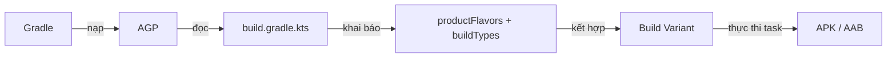
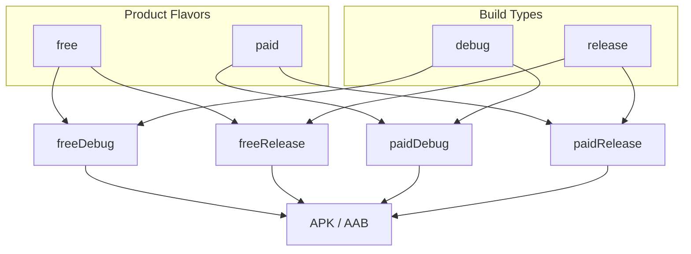
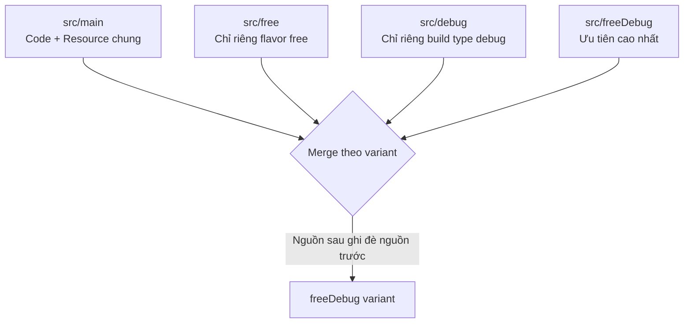
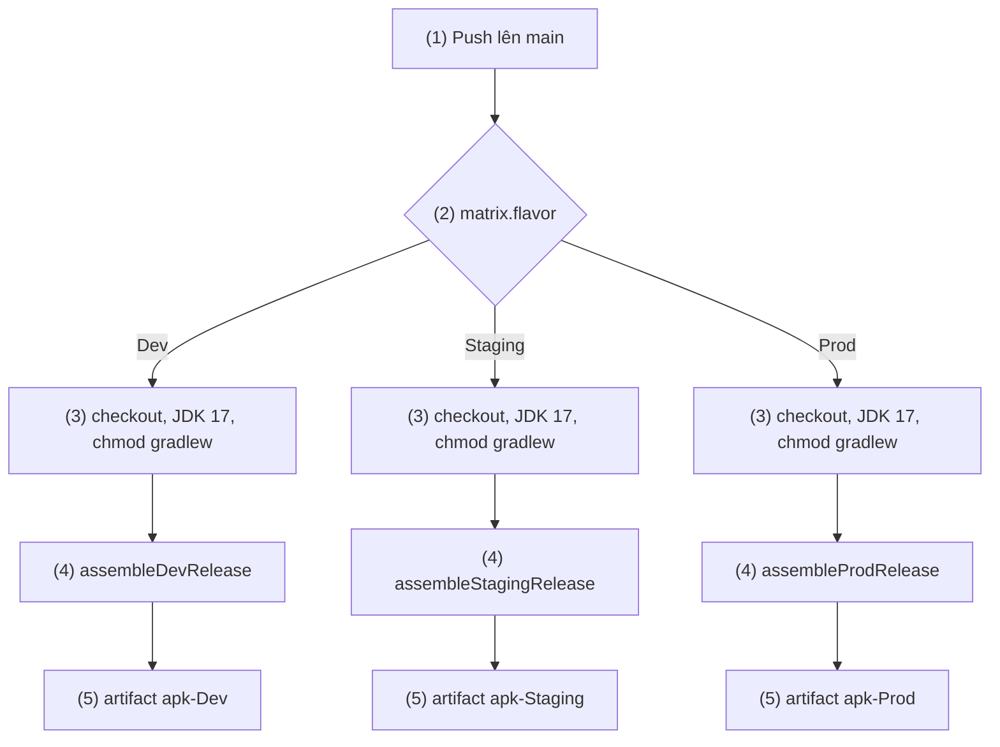

# Flavor

## Vấn đề cần giải quyết

Trong một dự án Android thực tế, rất hiếm khi bạn chỉ phát hành **một** sản phẩm duy nhất. Cùng một mã nguồn, bạn thường phải tạo ra nhiều phiên bản khác nhau:

- **Theo giai đoạn phát triển:** bản cho Developer (dev), bản cho QA test (staging), bản phát hành (production).
- **Theo nội dung sản phẩm:** bản miễn phí (free) và bản trả phí (paid), bản cho đối tác (white-label) có logo và màu sắc riêng.
- **Theo kênh phân phối:** bản Google Play, bản Samsung Store, bản dành cho thị trường Trung Quốc.

Nếu chỉ dùng **Build Types** (đã học ở 4.1.1.1 [Build Types](build_types.md)), bạn mới giải quyết được phần giai đoạn phát triển: mỗi giai đoạn (debug/staging/release) được build ra sao, có minify hay không, ký khóa nào. Nhưng bạn **không thể** tách nội dung như: bản free không có màn hình nâng cấp, bản trả phí có tất cả tính năng, mỗi khách hàng một màu sắc riêng.

Nếu bạn cứ copy nguyên một project để làm phiên bản thứ hai, bạn sẽ gặp thảm họa bảo trì:

- Sửa một bug phải sửa ở 3 project khác nhau.
- Các phiên bản dần dần lệch nhau không thể gộp lại.
- Khó nâng cấp, khó theo dõi, build chậm.

**Android cung cấp Product Flavor để giải quyết bài toán "nhiều phiên bản sản phẩm từ một mã nguồn duy nhất".**

## Sau khi học xong

- Giải thích được Product Flavor là gì, cơ chế Build Variant, flavorDimensions và thứ tự merge Source Set.
- Phân biệt được Build Types và Product Flavors cùng lúc nào dùng loại nào.
- Triển khai được productFlavors, flavorDimensions và source set riêng để tách code, resources, buildConfigField theo từng flavor.
- Xử lý được việc khớp flavor giữa app module và library module bằng matchingFallbacks và missingDimensionStrategy.
- Áp dụng được Flavor vào CI/CD và phân phối đa cửa hàng (multi-store).

## Product Flavor là gì?

**Product Flavor** (Loại sản phẩm) là một **phiên bản sản phẩm** của ứng dụng mà bạn khai báo trong khối `productFlavors` của `build.gradle.kts`: mọi flavor dùng chung mã nguồn gốc, mỗi flavor chỉ ghi đè phần cấu hình và source set khác biệt của mình. AGP ghép mỗi flavor với một Build Type thành một **Build Variant**, và mỗi variant là một bản build hoàn chỉnh có task build riêng.

> [!TIP]
> **Mental model đơn giản:** Build Type trả lời câu hỏi *"Ứng dụng được build ở giai đoạn nào?"* (debug/staging/release). Product Flavor trả lời câu hỏi *"Phiên bản sản phẩm này dành cho ai, chứa những gì?"* (free/paid/enterprise, từng cửa hàng).

## Cách hoạt động

### Product Flavor trong chuỗi build: Gradle, AGP và Build Types

- **Gradle** là hệ thống build tổng quát, chạy các Task theo Task Graph; **AGP** (Android Gradle Plugin) là plugin chính thức của Google giúp Gradle hiểu và build được dự án Android, và đăng ký khối `android { }` trong `build.gradle.kts` nơi bạn khai báo `productFlavors`. Hai khái niệm này được học ở `4.1.1.3` [Plugin](plugin.md), mục "Nền tảng cần biết trước" và "AGP là gì?".
- **Build Type** định nghĩa một giai đoạn trong vòng đời phát triển (debug, staging, release) được build và đóng gói ra sao. Chi tiết ở [Build Types](build_types.md).

Sơ đồ dưới tóm tắt chỗ `productFlavors` tham gia vào chuỗi build:


<!-- dd: flav-flow -->

### Phân biệt Build Types và Product Flavors

Đây là chỗ nhầm lẫn phổ biến nhất khi cấu hình build Android. Tài liệu Android ("Configure your build") phân vai như sau: build type định nghĩa các thiết lập build và đóng gói, thường cấu hình theo **giai đoạn của vòng đời phát triển**; product flavor đại diện cho các **phiên bản ứng dụng phát hành tới người dùng**, như bản free và bản paid.

| Tiêu chí | Build Types | Product Flavors |
|---|---|---|
| Câu hỏi | Giai đoạn nào trong vòng đời phát triển, build và đóng gói ra sao? | Phiên bản sản phẩm nào, dành cho ai, chứa những gì? |
| Ví dụ | `debug`, `staging`, `release` | `free`, `paid`, bản white-label, `gplay`, `samsung` |
| Thay đổi gì | Khả năng debug, khóa ký, minify/R8, log, `applicationIdSuffix` | applicationId, tính năng, code/resource riêng, icon, màu sắc, server theo từng khách hàng, `minSdk` |
| Người dùng có thấy không | Không (không nên thấy) | Có (đây là sản phẩm họ dùng) |
| Bắt buộc không | Có, ít nhất một; AGP tạo sẵn `debug` và `release` | Không, tự tạo khi cần; mỗi flavor phải thuộc một dimension |
| Vai trò trong variant | Ghép với flavor tạo variant | Ghép với build type tạo variant |

> [!TIP]
> **Quy tắc ngón tay cái:** thay đổi gắn với **giai đoạn phát triển** và người dùng cuối không nên quan tâm (có debug không, ký khóa nào, có R8 không) → **Build Type**. Thay đổi tạo ra **một phiên bản sản phẩm** mà người dùng sẽ thấy và so sánh (tên app, icon, tính năng, cửa hàng, server riêng cho từng khách hàng) → **Flavor**.
>
> Môi trường server dev/staging/prod gắn với giai đoạn, nên mặc định đặt ở **build type** (`debug` trỏ dev, `staging` trỏ staging, `release` trỏ prod), như ví dụ ở [Build Types](build_types.md), mục "Ví dụ thực tế", phần "Cấu hình 3 môi trường Dev / Staging / Production". Chỉ đưa môi trường thành một **flavor dimension** khi nó phải độc lập với cách build, tức là cần cả bản debug lẫn bản release cho từng môi trường (xem "Tách môi trường setup bằng Flavor" ở phần Ví dụ thực tế). Cần thêm trục sản phẩm (free/paid) thì build type vẫn nhân được với flavor sản phẩm như thường (`freeStaging`, `paidRelease`), không bắt buộc phải chuyển môi trường sang flavor.

> [!WARNING]
> **Khi nào KHÔNG tạo Build Type mới:** cần biến thể về nội dung, khách hàng hoặc giao diện (free/paid, màu sắc, icon, server theo từng khách hàng) thì dùng **Product Flavors**, đừng tạo thêm Build Type. Build Type chỉ dành cho debug/signing/minify theo giai đoạn. Mỗi Build Type mới làm tăng thời gian Gradle Sync và số variant phải kiểm thử, vì nó nhân với mọi flavor.

### Khai báo Product Flavor cơ bản trong build.gradle.kts

Mỗi flavor có thể định nghĩa lại:

- `applicationId` (tên gói) — giúp cài song song hai phiên bản trên cùng một máy.
- `versionName` / `versionCode`.
- `buildConfigField` — biến môi trường, cờ bật/tắt tính năng.
- `manifestPlaceholders` — biến chèn vào `AndroidManifest.xml`.
- Source Set riêng: code, resources, assets, manifest riêng.

Đây là cấu hình tối thiểu — tách 2 phiên bản sản phẩm `free` và `paid`:

```kotlin
android {
    // Bắt buộc: mọi flavor phải thuộc một dimension.
    // Chỉ có một dimension nên AGP tự gán free/paid vào "version".
    flavorDimensions += "version"

    productFlavors {
        create("free") {
            applicationId = "com.example.myapp.free"
            versionName = "1.0.0-free"
            buildConfigField("String", "PRODUCT", "\"free\"")
        }
        create("paid") {
            applicationId = "com.example.myapp.paid"
            versionName = "1.0.0-paid"
            buildConfigField("String", "PRODUCT", "\"paid\"")
        }
    }
}
```

> [!NOTE]
> `applicationId` của từng flavor thường kế thừa `applicationId` trong `defaultConfig`, sau đó ghi đè bằng hậu tố `.free`, `.paid`. Nhờ đó hai bản có thể cài song song trên cùng một máy để QA so sánh.

### Build Variant: Product Flavor × Build Type

**Build Variant** là kết quả kết hợp của **một Product Flavor** với **một Build Type**.

Công thức:

```text
Build Variant = Product Flavor × Build Type
```

Ví dụ với 2 flavor (`free`, `paid`) và 2 build type (`debug`, `release`), bạn có **4 build variant**:

```text
freeDebug     → bản miễn phí, cho dev chạy debug
freeRelease   → bản miễn phí, phát hành
paidDebug     → bản trả phí, cho dev chạy debug
paidRelease   → bản trả phí, phát hành
```

Mỗi variant có **tên task build riêng**: `assembleFreeDebug`, `assembleFreeRelease`, `assemblePaidDebug`, `assemblePaidRelease`. Thêm build type `staging` (như bài Build Types) thì có 2 × 3 = 6 variant, thêm `freeStaging` và `paidStaging`.


<!-- dd: flav-matrix -->

### flavorDimensions: Vì sao cần khai báo dimension?

**Mọi flavor đều phải thuộc một flavor dimension**; flavor không có dimension sẽ làm build fail với lỗi *"All flavors must now belong to a named flavor dimension"*. Khi module chỉ khai báo **một** dimension (ví dụ `flavorDimensions += "version"` cho free/paid), AGP tự gán mọi flavor vào dimension đó nên bạn không cần ghi `dimension = ...` trong từng flavor. Khi có **nhiều chiều phân loại cùng lúc**, mỗi flavor phải ghi rõ `dimension` của mình.

#### Ví dụ: phân loại theo môi trường và kênh phân phối

App vừa phân loại theo **môi trường** (dev/prod), vừa phân loại theo **kênh phân phối** (gplay/samsung). Mỗi chiều là một `flavorDimension`:

```kotlin
android {
    flavorDimensions += listOf("environment", "store")

    productFlavors {
        create("dev") { dimension = "environment" }
        create("prod") { dimension = "environment" }
        create("gplay") { dimension = "store" }
        create("samsung") { dimension = "store" }
    }
}
```

Số variant bây giờ = số flavor của mỗi dimension nhân với nhau, rồi nhân với build type:

```text
2 (environment) × 2 (store) × 2 (build type) = 8 variant
```

> [!WARNING]
> **Cảnh báo:** số lượng variant tăng theo cấp số nhân (`n_dim1 × n_dim2 × n_buildtype`). Càng nhiều dimension, Gradle Sync càng lâu và thời gian build toàn bộ càng tăng. Chỉ thêm dimension khi thật sự cần tách độc lập hai trục phân loại.

### Source Sets theo Flavor

Một trong những sức mạnh lớn nhất của Flavor là **Source Set riêng**.

Mặc định, mọi code/resource chung nằm ở `src/main/`. Mỗi flavor có thư mục riêng tên theo flavor:

```text
app/
 ├── src/
 │   ├── main/            ← code + resource chung cho mọi flavor
 │   │   ├── java/com/example/myapp/
 │   │   └── res/
 │   ├── free/            ← chỉ dành cho flavor free
 │   │   ├── java/com/example/myapp/
 │   │   └── res/
 │   ├── paid/            ← chỉ dành cho flavor paid
 │   │   ├── java/com/example/myapp/
 │   │   └── res/
 │   ├── debug/           ← source set theo build type (đã học ở Build Types)
 │   └── release/
```

#### Thứ tự merge Source Set (quan trọng!)

Khi build một variant, AGP gộp nhiều source set lại. **Nguồn sau ghi đè nguồn trước.** Thứ tự ưu tiên từ cao đến thấp:

```text
src/<flavor><BuildType>/     (cao nhất — ví dụ freeDebug/)
src/<BuildType>/             (ví dụ debug/)
src/<flavor>/                (ví dụ free/)
src/main/                    (nền tảng chung)
library dependencies         (thấp nhất — resource, manifest của thư viện)
```

Khi có nhiều dimension (ví dụ `demo` thuộc dimension đầu, `minApi24` thuộc dimension sau, build type `debug`), thứ tự là: `src/demoMinApi24Debug/` → `src/debug/` → `src/demoMinApi24/` (tổ hợp flavor, phải gồm đủ mọi dimension) → `src/demo/` → `src/minApi24/` (flavor đơn lẻ, xếp theo thứ tự khai báo trong `flavorDimensions`) → `src/main/`. Không có source set nào đặt theo **tên dimension**.


<!-- dd: flav-merge -->

"Ghi đè" ở đây áp dụng khác nhau cho từng loại file:

- **Resource** (`res/`, `assets/`): file cùng tên ở source set ưu tiên cao thắng. Ví dụ `drawable/logo.png` ở `src/free` thay bản ở `src/main` khi build flavor `free`.
- **`values/`** (ví dụ `strings.xml`): các file được gộp theo từng giá trị; giá trị trùng tên lấy theo thứ tự ưu tiên ở trên, ví dụ giá trị trong source set build type thắng giá trị cùng tên trong source set flavor.
- **Manifest**: các manifest được hợp nhất thành một bằng manifest merger, cũng theo thứ tự này, nên thiết lập manifest của build type thắng thiết lập của flavor.
- **Code Kotlin/Java**: **không** ghi đè. Mọi file trong `java/`, `kotlin/` của các source set tham gia một variant được biên dịch chung thành một output.

> [!WARNING]
> Trong cùng một variant, một class (cùng package, cùng tên, ví dụ `MainActivity.kt`) chỉ được nằm ở **một** source set. Có class đó ở cả `src/main` và `src/free` (hoặc `src/main` và `src/debug`), Gradle báo lỗi duplicate class khi build. Muốn mỗi flavor hoặc mỗi build type có một phiên bản riêng của class, đặt bản riêng vào **từng** source set (`src/free/`, `src/paid/`) và **không** đặt nó trong `src/main/`, như ví dụ ở mục sau.

### Tách Code theo Flavor

Khi bạn muốn mỗi flavor có logic riêng, đặt file code vào source set của flavor đó.

#### Ví dụ: quảng cáo chỉ có ở bản free

Ví dụ: flavor `free` hiển thị quảng cáo, flavor `paid` thì không. Tạo interface chung trong `main`, rồi mỗi flavor có một class **cùng tên, cùng package** `FlavorAdsProvider` để code trong `main` gọi được mà không cần biết đang build flavor nào:

```kotlin
// src/main/java/com/example/myapp/feature/AdsProvider.kt (chung)
interface AdsProvider {
    fun showBanner()
}
```

```kotlin
// src/free/java/com/example/myapp/feature/FlavorAdsProvider.kt (chỉ có trong flavor free)
class FlavorAdsProvider : AdsProvider {
    override fun showBanner() {
        // Hiển thị banner quảng cáo
    }
}
```

```kotlin
// src/paid/java/com/example/myapp/feature/FlavorAdsProvider.kt (chỉ có trong flavor paid)
class FlavorAdsProvider : AdsProvider {
    override fun showBanner() {
        // Không có quảng cáo
    }
}
```

```kotlin
// src/main/java/com/example/myapp/feature/HomeScreenAds.kt (chung)
// Biên dịch được cho cả hai flavor vì flavor nào cũng có class FlavorAdsProvider
val adsProvider: AdsProvider = FlavorAdsProvider()
```

> [!NOTE]
> Class nằm trong source set của flavor nào chỉ được biên dịch khi build flavor đó. Đây là cách sạch nhất để "có/không có" tính năng theo từng phiên bản sản phẩm, thay vì rải rác câu `if (BuildConfig.FLAVOR == "free")`.

### Tách Resources theo Flavor

#### strings.xml theo từng flavor

Đặt file `strings.xml` cùng tên ở cả `src/main` và `src/free`, `src/paid`:

```text
src/main/res/values/strings.xml   → app_name = "MyApp"
src/free/res/values/strings.xml   → app_name = "MyApp Free"
src/paid/res/values/strings.xml   → app_name = "MyApp Pro"
```

Khi build flavor `free`, tên app hiển thị là **MyApp Free**. Resource này không cần viết thêm code — AGP tự chọn theo quy tắc merge ở trên.

#### Icon, màu sắc, logo riêng

Cũng tương tự: đặt `mipmap`, `drawable`, `values/colors.xml` vào thư mục resource của từng flavor để mỗi phiên bản sản phẩm có giao diện riêng (white-label).

### buildConfigField theo Flavor

Bên cạnh build type, bạn có thể khai báo `buildConfigField` theo flavor. Đây là nơi đặt cấu hình khác nhau **theo từng phiên bản sản phẩm**, hoặc theo môi trường khi môi trường đã là một flavor dimension (xem "Phân biệt Build Types và Product Flavors"):

```kotlin
android {
    flavorDimensions += "environment"

    productFlavors {
        create("dev") {
            buildConfigField("String", "API_BASE_URL", "\"https://dev.api.example.com/\"")
            buildConfigField("boolean", "ENABLE_ANALYTICS", "false")
        }
        create("prod") {
            buildConfigField("String", "API_BASE_URL", "\"https://api.example.com/\"")
            buildConfigField("boolean", "ENABLE_ANALYTICS", "true")
        }
    }
}
```

Trong code:

```kotlin
object AppConfig {
    val apiBaseUrl: String = BuildConfig.API_BASE_URL
    val isAnalyticsEnabled: Boolean = BuildConfig.ENABLE_ANALYTICS
}
```

> [!WARNING]
> `buildConfigField` **không phải** nơi an toàn để chứa secret, dù khai báo theo build type hay theo flavor. Mọi giá trị trong `BuildConfig` được biên dịch thành hằng số nằm trong APK/AAB và đọc được khi decompile; R8 làm rối tên class, không giấu giá trị chuỗi. Chỉ đặt ở đây config không nhạy cảm (BASE_URL, endpoint, feature flag). Mật khẩu, API key nhạy cảm phải nằm ở phía server hoặc qua kiến trúc bảo mật riêng (ví dụ Backend proxy, Play Integrity). Password keystore cũng không ghi thẳng vào `build.gradle.kts`: đọc từ biến môi trường hoặc CI secrets, như ví dụ signing ở [Build Types](build_types.md).

### BuildConfig.FLAVOR: Đọc tên flavor trong code

AGP tự sinh hằng số `BuildConfig.FLAVOR` chứa tên flavor hiện tại:

```kotlin
Log.d("Flavor", "Đang chạy bản: ${BuildConfig.FLAVOR}")
```

Khi bạn có nhiều dimension, mỗi dimension được sinh một hằng số riêng theo tên dimension, còn `FLAVOR` chứa tên ghép của cả variant:

```kotlin
// flavorDimensions = ["environment", "store"]
// flavor dev + gplay
BuildConfig.FLAVOR              // "devGplay" (tên ghép của các flavor)
BuildConfig.FLAVOR_environment  // "dev"
BuildConfig.FLAVOR_store        // "gplay"
```

Quy tắc sinh (đọc từ class `GenerateBuildConfig` của AGP 8.11.2; docs không mô tả các field này):

- Chỉ một dimension: chỉ có `FLAVOR`, không có `FLAVOR_<dimension>`.
- Từ hai dimension trở lên: thêm `FLAVOR_<dimension>` cho từng dimension. Ký tự không hợp lệ trong tên Java (ngoài `a-z`, `A-Z`, `0-9`, `_`, `$`) của tên dimension được thay bằng `_`, ví dụ dimension `api-level` thành `FLAVOR_api_level`.

> [!TIP]
> Ưu tiên dùng `buildConfigField` hoặc source set riêng thay vì rải rác `if (BuildConfig.FLAVOR == ...)` trong code chính. Kiểm tra `FLAVOR` chỉ phù hợp cho các tình huống nhỏ, tạm thời, không nằm trong luồng nghiệp vụ chính.

### matchingFallbacks: Khi app module kết hợp với library module

Khi project của bạn có **library module** (Android Library) và library đó cũng định nghĩa flavor riêng, Gradle tự khớp variant theo **tên dimension và tên flavor**. Có hai tình huống cần khai báo thêm:

- **Cùng dimension, khác tên flavor** → dùng **`matchingFallbacks`** trong flavor của app. Ví dụ app và library đều có dimension `tier`; app có `free`/`paid`, library chỉ có `demo`/`paid`. Flavor `free` của app không có bản tương ứng nên phải chỉ định flavor thay thế.
- **Library có dimension mà app không có** → dùng **`missingDimensionStrategy`** để chọn flavor mặc định của dimension đó. Ví dụ library có dimension `content` gồm `minimal`/`full`, app không có dimension này.

```kotlin
android {
    flavorDimensions += "tier"

    defaultConfig {
        // Library có dimension "content" mà app không có: chọn "minimal" (dự phòng "full")
        missingDimensionStrategy("content", "minimal", "full")
    }

    productFlavors {
        create("free") {
            dimension = "tier"
            // Library không có "free" trong dimension "tier": dùng "demo" thay thế
            matchingFallbacks += listOf("demo")
        }
        create("paid") {
            dimension = "tier"
            // Library cũng có "paid" → tự khớp, không cần fallback
        }
    }
}
```

> [!NOTE]
> Thiếu `matchingFallbacks`/`missingDimensionStrategy` ở các tình huống trên, Gradle không chọn được variant của library và build báo lỗi resolve dependency (không tìm thấy variant khớp). `matchingFallbacks` cũng dùng được cho **build type** (ví dụ build type `staging` của app dùng bản `release` của library).

## Ví dụ thực tế

### Tách môi trường setup bằng Flavor

Bài toán: **tạo nhiều bản build dựa trên môi trường setup**.

Có hai cách tiếp cận, chọn theo quy tắc ở mục "Phân biệt Build Types và Product Flavors":

| Cách | Mô tả | Phù hợp khi |
|---|---|---|
| Dùng Build Type cho môi trường (mặc định) | `debug`/`staging`/`release` là môi trường, cài song song nhờ `applicationIdSuffix`; ví dụ đầy đủ ở [Build Types](build_types.md), mục "Ví dụ thực tế", phần "Cấu hình 3 môi trường Dev / Staging / Production" | Mỗi môi trường chỉ cần một cách build: dev luôn debug, staging và prod luôn minify |
| Dùng Flavor cho môi trường | `dev`/`staging`/`prod` là flavor của dimension `environment` | Cần cả bản debug lẫn bản release cho từng môi trường |

Ví dụ khi cần bản `prodDebug` (debug lỗi chỉ xảy ra trên server thật) và bản `stagingRelease` (QA test bản đã minify trỏ staging), môi trường phải độc lập với build type, nên Flavor là lựa chọn phù hợp. Mỗi flavor vẫn có `applicationId` riêng để cài song song.

```kotlin
android {
    // Bật BuildConfig để dùng buildConfigField
    buildFeatures {
        buildConfig = true
    }

    flavorDimensions += "environment"

    productFlavors {
        create("dev") {
            dimension = "environment"
            applicationId = "com.example.myapp.dev"
            versionNameSuffix = "-DEV"
            buildConfigField("String", "API_BASE_URL", "\"https://dev.api.example.com/\"")
            buildConfigField("String", "API_KEY", "\"dev_key_not_secret\"")
        }
        create("staging") {
            dimension = "environment"
            applicationId = "com.example.myapp.staging"
            versionNameSuffix = "-STG"
            buildConfigField("String", "API_BASE_URL", "\"https://staging.api.example.com/\"")
            buildConfigField("String", "API_KEY", "\"staging_key_not_secret\"")
        }
        create("prod") {
            dimension = "environment"
            applicationId = "com.example.myapp"
            buildConfigField("String", "API_BASE_URL", "\"https://api.example.com/\"")
            buildConfigField("String", "API_KEY", "\"prod_key_not_secret\"")
        }
    }
}
```

> [!TIP]
> Các `API_KEY` ở trên chỉ là config không nhạy cảm; key thật không bao giờ đặt trong `buildConfigField` (xem cảnh báo ở mục "buildConfigField theo Flavor").

### Kết hợp Flavor môi trường + Flavor sản phẩm + Build Type

Khi môi trường đã là flavor (lý do ở "Tách môi trường setup bằng Flavor") và dự án còn cần tách sản phẩm (free/paid), ta dùng **2 dimension + build types**:

```kotlin
android {
    flavorDimensions += listOf("environment", "version")

    productFlavors {
        // Trục môi trường
        create("dev") { dimension = "environment" }
        create("prod") { dimension = "environment" }

        // Trục phiên bản sản phẩm
        create("free") {
            dimension = "version"
            applicationId = "com.example.myapp.free"
        }
        create("paid") {
            dimension = "version"
            applicationId = "com.example.myapp.paid"
        }
    }
}
```

Số variant:

```text
dev × free × debug  = devFreeDebug
dev × free × release = devFreeRelease
dev × paid × debug  = devPaidDebug
dev × paid × release = devPaidRelease
prod × free × debug = prodFreeDebug
prod × free × release = prodFreeRelease
prod × paid × debug = prodPaidDebug
prod × paid × release = prodPaidRelease
```

Tên task build tương ứng: `./gradlew assembleProdPaidRelease`, `./gradlew assembleDevFreeDebug`...

### Kết hợp Flavor với CI/CD

Build Type và Flavor là nền tảng để CI tự động build nhiều phiên bản. CI đọc cùng một `build.gradle.kts` và chạy task Gradle của đúng variant, nên chỉ cần nắm cách AGP đặt tên task:

- Chỉ có build type: `assemble<BuildType>`, ví dụ `./gradlew assembleDebug`, `./gradlew assembleStaging`, `./gradlew assembleRelease`.
- Có flavor: `assemble<Flavor><BuildType>`, ví dụ `./gradlew assembleFreeRelease`, `./gradlew assembleProdDebug`.
- Nhiều dimension: ghép tên flavor theo thứ tự khai báo trong `flavorDimensions`, rồi tới build type: `assemble<FlavorDim1><FlavorDim2><BuildType>`, ví dụ `./gradlew assembleProdPaidRelease`.
- Thay `assemble` bằng `bundle` để ra AAB, ví dụ `./gradlew bundleProdPaidRelease`.

Mỗi tên flavor và build type viết hoa chữ cái đầu khi ghép vào tên task. Với **GitHub Actions**, dùng matrix build để chạy song song các flavor (ở đây là flavor môi trường của "Tách môi trường setup bằng Flavor"). Giá trị matrix viết hoa sẵn để ghép thẳng vào tên task.

Luồng chạy của workflow:

1. Push lên nhánh `main` kích hoạt workflow.
2. `strategy.matrix` tách thành ba job chạy song song, mỗi job nhận một giá trị `flavor` (`Dev`, `Staging`, `Prod`).
3. Mỗi job checkout code, cài JDK 17 và cấp quyền chạy cho `gradlew`.
4. Job ghép giá trị matrix vào tên task: `assemble${{ matrix.flavor }}Release` thành `assembleDevRelease`, `assembleStagingRelease`, `assembleProdRelease`.
5. Job upload APK trong thư mục output của variant thành artifact `apk-<flavor>`.



```yaml
name: Android Build Flavors

# (1) Push lên main kích hoạt workflow
on:
  push:
    branches: [main]

jobs:
  build:
    runs-on: ubuntu-latest
    # (2) Mỗi giá trị flavor là một job chạy song song
    strategy:
      matrix:
        flavor: [Dev, Staging, Prod]
    steps:
      # (3) Chuẩn bị môi trường build
      - uses: actions/checkout@v4
      - name: Set up JDK 17
        uses: actions/setup-java@v4
        with:
          distribution: temurin
          java-version: '17'
      - name: Grant execute permission
        run: chmod +x gradlew
      # (4) Ghép giá trị matrix vào tên task
      - name: Build APK
        run: ./gradlew assemble${{ matrix.flavor }}Release
      # (5) Upload APK của variant
      - name: Upload artifact
        uses: actions/upload-artifact@v4
        with:
          name: apk-${{ matrix.flavor }}
          # Thư mục output dùng tên flavor viết thường (apk/dev/release/), nên dùng wildcard
          path: app/build/outputs/apk/*/release/*.apk
```

**Kết quả:** mỗi lần push lên `main`, trang của lần chạy workflow trên GitHub Actions có ba job `Dev`, `Staging`, `Prod` và ba artifact `apk-Dev`, `apk-Staging`, `apk-Prod`, mỗi artifact chứa APK release của đúng flavor đó.

> [!NOTE]
> Project chỉ dùng build type cho môi trường thì workflow giống hệt, chỉ đổi bước build thành `./gradlew assembleStaging` và đường dẫn thành `app/build/outputs/apk/staging/*.apk`. Đẩy bản staging cho QA qua Firebase App Distribution ở [Build Types](build_types.md), mục "Phân phối bản build cho QA bằng Firebase App Distribution".

### Kết hợp Flavor với đa cửa hàng (Multi-store)

Khi phát hành app trên nhiều cửa hàng (Google Play, Samsung Store, Huawei AppGallery), mỗi nơi có thể yêu cầu applicationId hoặc SDK riêng. Dùng dimension `store`:

```kotlin
android {
    flavorDimensions += "store"

    productFlavors {
        create("gplay") {
            dimension = "store"
            // Google Play: có thể dùng Dynamic Delivery / Play Billing
        }
        create("samsung") {
            dimension = "store"
            applicationId = "com.example.myapp.samsung"
            // Samsung: có thể thêm Galaxy Store SDK qua source set samsung
        }
    }
}
```

Kết hợp với CI/CD, pipeline có thể build và upload từng flavor về đúng store:

```yaml
- name: Build & Deploy gplay
  run: ./gradlew assembleGplayRelease
- name: Build & Deploy samsung
  run: ./gradlew assembleSamsungRelease
```

> [!NOTE]
> Mỗi store thường yêu cầu một keystore / signing config riêng. Có thể gán `signingConfig` khác nhau trong từng flavor, hoặc trong từng build type release.

## Khi nào nên và không nên dùng

Product Flavor tồn tại vì một lý do duy nhất: **tạo nhiều phiên bản sản phẩm từ một mã nguồn duy nhất**, giúp:

- **Giảm chi phí bảo trì:** sửa một chỗ, tất cả flavor đều có thay đổi.
- **Tách nội dung hợp lý:** code chung đặt ở `src/main`, code riêng đặt ở `src/<flavor>`.
- **Phát hành độc lập:** mỗi flavor có applicationId riêng nên có thể lên store độc lập hoặc cài song song để QA.
- **Tự động hóa:** CI/CD có thể build hàng loạt flavor bằng lệnh `assemble` tương ứng.

Không dùng Product Flavor khi:

- Thay đổi chỉ gắn với giai đoạn phát triển (debug, khóa ký, minify, hoặc môi trường mà mỗi môi trường chỉ cần một cách build): dùng Build Type, theo quy tắc ở mục "Phân biệt Build Types và Product Flavors".
- Hai trục phân loại không cần độc lập với nhau: đừng thêm dimension, vì mỗi dimension nhân số variant lên (xem mục "flavorDimensions: Vì sao cần khai báo dimension?").

## Sai lầm thường gặp

### 1. Dùng Build Type để tách nội dung sản phẩm

Định nghĩa `buildTypes { create("free")... }`, `create("paid")...` để đổi icon/màu. Đây là dùng sai mục đích — Build Type quyết định *cách build*, Flavor mới quyết định *nội dung*. Hậu quả: không tách được source set theo sản phẩm, variant lộn xộn.

**Cách sửa:** khai báo `free`/`paid` trong `productFlavors` (mục "Khai báo Product Flavor cơ bản trong build.gradle.kts") và đặt icon/màu vào source set của từng flavor (mục "Tách Resources theo Flavor").

### 2. Quên khai báo `flavorDimensions`

Gradle báo lỗi *"All flavors must now belong to a named flavor dimension"* ngay khi sync, kể cả khi chỉ có một nhóm flavor.

**Cách sửa:** Luôn khai báo dimension; có từ 2 dimension trở lên thì ghi rõ `dimension` trong từng flavor.

### 3. Tạo quá nhiều dimension

Mỗi dimension nhân số variant lên. 3 dimension × 3 flavor mỗi cái × 2 build type = 54 variant → build toàn bộ rất lâu.

**Cách sửa:** Chỉ thêm dimension khi thật sự cần.

### 4. Đặt cùng một class vào nhiều source set của một variant

Ví dụ đặt `MainActivity.kt` cả ở `main` và `free` → lỗi duplicate class khi build.

**Cách sửa:** Muốn mỗi flavor một bản thì đặt ở từng `src/<flavor>/` và bỏ khỏi `main`, như ví dụ ở mục "Tách Code theo Flavor".

### 5. Quên `matchingFallbacks`/`missingDimensionStrategy` khi dùng library có flavor

Build fail vì Gradle không resolve được variant của library.

**Cách sửa:** Dùng `matchingFallbacks` khi cùng dimension nhưng khác tên flavor, `missingDimensionStrategy` khi library có dimension mà app không có.

### 6. Đặt secret vào `buildConfigField`

API key, mật khẩu bị decompile từ APK.

**Cách sửa:** Chỉ đặt config không nhạy cảm; secret thật nằm ở phía server (xem cảnh báo ở mục "buildConfigField theo Flavor").

### 7. Quên bật `buildConfig = true`

Với AGP 8+, dùng `BuildConfig.API_BASE_URL` mà chưa bật `buildFeatures { buildConfig = true }` sẽ báo lỗi không tìm thấy field.

**Cách sửa:** Bật `buildFeatures { buildConfig = true }` trong module dùng `BuildConfig`, như ví dụ ở mục "Tách môi trường setup bằng Flavor".

### 8. Nhầm tên task build

Tên task là `assemble<Flavor><BuildType>` (ghi hoa chữ cái đầu, không có dấu phân cách). `assemblefreeRelease` sai → phải `assembleFreeRelease`.

**Cách sửa:** Ghép tên task theo quy tắc ở mục "Kết hợp Flavor với CI/CD".

## Lịch sử phát triển

- **AGP 3.0.0 (10/2017):** thêm variant-aware dependency management: khi build một variant của module, plugin tự khớp variant tương ứng của library module local. Để khớp được, plugin yêu cầu mọi flavor thuộc một flavor dimension có tên (kể cả khi chỉ dùng một dimension), và migration guide của bản này hướng dẫn dùng `matchingFallbacks` (cho build type và flavor không khớp trực tiếp) và `missingDimensionStrategy` (cho dimension chỉ library có).
- **AGP 8.0.0 (04/2023):** không còn sinh `BuildConfig` mặc định (`android.defaults.buildfeatures.buildconfig` đổi mặc định từ `true` sang `false`); module cần `BuildConfig` phải bật bằng DSL `buildFeatures { buildConfig = true }`.

## Kết nối hệ thống

- **Tiên quyết:**
  - [Build Types](build_types.md) (4.1.1.1): flavor luôn được ghép với build type thành Build Variant.
  - [APK](../../../session_01/output_packages/apk_files.md) và [AAB](../../../session_01/output_packages/aab_files.md) (1.2.1, 1.2.2): hiểu định dạng output mà mỗi build variant tạo ra và cách đóng gói.
- **Học tiếp:**
  - [Plugin](plugin.md) (4.1.1.3): hiểu cách AGP và các plugin được khai báo, nạp và ảnh hưởng tới build.
  - [Manifest Tags](../tags.md) (4.1.2): các thẻ trong `AndroidManifest.xml`, nơi `manifestPlaceholders` của flavor chèn giá trị vào.
- **Liên quan:** [Kotlin](../../../session_01/languages/kotlin.md) (1.1.2): ngôn ngữ của `build.gradle.kts` và các ví dụ trong bài.

Trong kiến trúc dự án Android thực tế (MVVM/Clean Architecture), Flavor nằm ở tầng **build configuration** — ngoài mã nguồn nghiệp vụ:

- **UI layer** (Activity, Compose): đọc cấu hình từ `BuildConfig` hoặc DI container (Hilt/Koin) mà không quan tâm flavor nào.
- **Domain layer** (UseCase, Model): hoàn toàn độc lập, không bao giờ chạm `BuildConfig`.
- **Data layer** (Repository, API): nhận `API_BASE_URL` từ config do flavor/build type sinh ra — nơi duy nhất biết flavor.

Tách biệt này giúp việc đổi flavor không phá vỡ logic nghiệp vụ: bạn chỉ cần chọn đúng variant để build, phần còn lại của hệ thống tự hoạt động với đúng cấu hình.

## Nguồn tham khảo

- [Android Developers — Configure your build (Build types, Product flavors, Build variants)](https://developer.android.com/build)
- [Android Developers — Configure build variants](https://developer.android.com/build/build-variants)
- [Android Developers — Configure product flavors](https://developer.android.com/build/build-variants#product-flavors)
- [Android Developers — Build types](https://developer.android.com/build/build-variants#build-types)
- [Android Developers — Resolve matching errors (matchingFallbacks, missingDimensionStrategy)](https://developer.android.com/build/build-variants#resolve_matching_errors)
- [Android Developers — Android Gradle Plugin 8.0.0 release notes (BuildConfig tắt mặc định)](https://developer.android.com/build/releases/agp-8-0-0-release-notes)
- [Android Developers — Android Gradle Plugin 3.0.0 release notes (variant-aware dependency management)](https://developer.android.com/build/releases/agp-3-0-0-release-notes)
- [Android Developers — Migrate to Android Plugin for Gradle 3.0.0 (bản lưu web.archive.org 11/2017: flavor dimension bắt buộc, matchingFallbacks, missingDimensionStrategy)](https://web.archive.org/web/20171127044902/https://developer.android.com/studio/build/gradle-plugin-3-0-0-migration.html)
- [Android Developers — Shrink your code and resources](https://developer.android.com/build/shrink-code)
