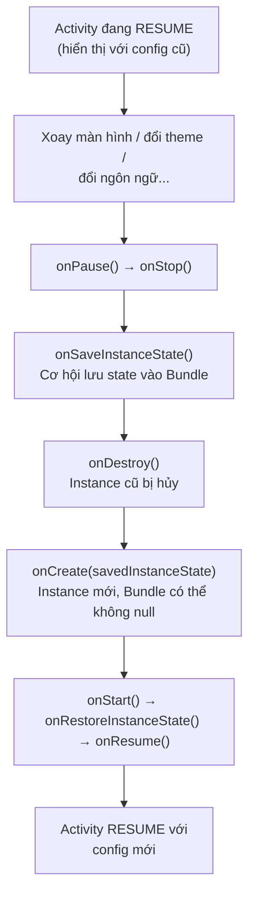
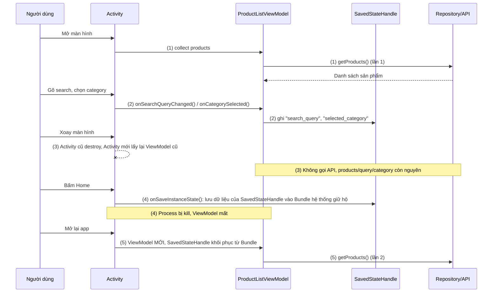
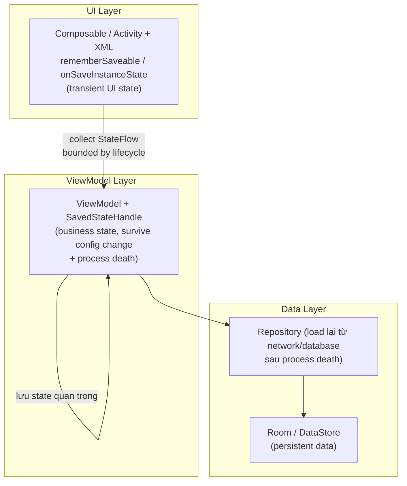

# Activity State Changes

## Vấn đề cần giải quyết

Bạn đang điền form đặt hàng: đã chọn 2 sản phẩm, nhập xong số điện thoại, chọn đúng giao hàng nhanh. Đang định bấm "Đặt hàng" thì xoay điện thoại sang ngang.

Kết quả:

- Toàn bộ form trống trơn, phải điền lại từ đầu
- Danh sách sản phẩm quay về đầu trang, mất vị trí scroll
- Giao diện flash trắng rồi load lại API từ con số 0

Nguyên nhân không phải "app lỗi". Đây là **hành vi mặc định của Android**: khi màn hình xoay, Activity bị **destroy hoàn toàn rồi tạo lại từ đầu**. Nếu bạn không chủ động lưu state thì mọi thứ trong Activity instance cũ đều biến mất.

Bài viết này dạy bạn: **hiểu vì sao điều đó xảy ra, phân biệt các tình huống mất dữ liệu, và chọn đúng công cụ lưu state cho từng loại dữ liệu trong project thực tế.**

## Sau khi học xong

- Giải thích được vì sao Android phải destroy/recreate Activity khi configuration change.
- Phân biệt được configuration change và process death về hành vi, dữ liệu bị mất và cách test.
- Biết khi nào dùng ViewModel, SavedStateHandle, onSaveInstanceState hay rememberSaveable cho từng loại dữ liệu.
- Triển khai được luồng lưu/khôi phục state trong app MVVM bằng cả View (XML) và Jetpack Compose.
- Xử lý được các lỗi phổ biến: fetch API lặp, đưa dữ liệu lớn vào saved state, lạm dụng android:configChanges.

## Activity State Changes là gì?

**Activity State Changes** là tập hợp các sự kiện khiến Android **thay đổi trạng thái tồn tại của Activity**, trong đó quan trọng nhất là **Configuration Change** và **Process Death**.

Mental model: Activity instance là **đồ dùng một lần**, hệ thống có thể bỏ nó đi và thay bằng một instance mới. State chỉ sống sót nếu được gửi ra **ngoài** instance: vào ViewModel (được giữ hộ qua configuration change, nhưng chết theo process) hoặc vào saved state Bundle mà hệ thống giữ hộ (sống qua cả process death). Thứ gì chỉ nằm trong field của Activity thì mất theo instance cũ.

## Cách hoạt động

### Configuration Change

Configuration Change là sự thay đổi cấu hình thiết bị mà Android cho rằng ảnh hưởng tới tài nguyên đang hiển thị (layout, drawable, string, theme...). Khi xảy ra, Android **bắt buộc** tải lại tài nguyên phù hợp với cấu hình mới.

| Configuration | Trigger | Ví dụ thực tế |
|--------------|---------|---------------|
| `orientation` | Xoay màn hình | Portrait → Landscape |
| `screenSize` | Thay đổi kích thước | Gập mở màn hình fold, multi-window |
| `locale` | Đổi ngôn ngữ | Tiếng Anh → Tiếng Việt |
| `uiMode` | Đổi theme | Light → Dark mode |
| `fontScale` | Đổi cỡ chữ | Normal → Large |
| `density` | Đổi DPI | Chuyển display settings |
| `keyboard` | Gắn/ngắt bàn phím ngoài | Kết nối bluetooth keyboard |

### Vì sao phải "destroy rồi tạo lại"?

Khi orientation thay đổi, hệ thống cần tải `layout-land/`, drawable theo density mới, string theo locale mới, theme theo uiMode mới. Cách đơn giản và chắc chắn nhất để mọi tài nguyên được reload đúng là **tạo lại Activity từ đầu bằng `onCreate()`**.


<!-- dd: actconfig -->

**Điểm mấu chốt:** `onSaveInstanceState()` là cơ hội để đưa UI state nhỏ vào Bundle, thứ sống qua cả cú destroy/recreate này lẫn process death. ViewModel cũng sống qua configuration change (xem mục "ViewModel" bên dưới) nhưng chết theo process. Những gì không nằm trong Bundle hay ViewModel thì mất.

> [!NOTE]
> Thứ tự phụ thuộc **`targetSdkVersion`** của app, không phải API của thiết bị. App có targetSdk ≥ 28 (Android 9): `onSaveInstanceState()` luôn được gọi **sau** `onStop()`, nên có thể commit fragment transaction an toàn trong `onStop()`. App có targetSdk < 28: `onSaveInstanceState()` được gọi **trước** `onStop()` (không đảm bảo trước hay sau `onPause()`).

### Khi nào dữ liệu bị mất? — 3 tình huống cần phân biệt

Không phải lúc nào Activity biến mất cũng giống nhau. Bạn phải phân biệt **3 tình huống** vì mỗi loại đòi hỏi công cụ khác nhau:

#### 1. Configuration Change — dữ liệu mất, app vẫn "sống"

- Activity destroy/recreate nhưng **process vẫn chạy**.
- ViewModel **sống sót** (được giữ lại qua `NonConfigurationInstances`).
- Bundle trong `onSaveInstanceState()` được khôi phục.
- Dữ liệu nào không thuộc ViewModel và không nằm trong Bundle thì mất.

#### 2. Process Death — toàn bộ app chết

- System kill toàn bộ process (thiếu bộ nhớ, ép buộc dừng...).
- ViewModel **biến mất**, static/singleton **reset về 0**.
- Bundle đã lưu qua `onSaveInstanceState()` vẫn được hệ thống **giữ lại và khôi phục** khi người dùng quay lại app.
- `onDestroy()` **không đảm bảo** được gọi.

#### 3. Người dùng thoát hẳn (bấm Back / finish)

- Activity finish vĩnh viễn, không ai cần khôi phục. Process **vẫn chạy** (Back không kill process).
- `onSaveInstanceState()` **không được gọi**.
- Từ Android 12, bấm Back ở root launcher activity không finish Activity nữa mà đưa task về background (giống bấm Home), nên trường hợp này hành xử như tình huống bấm Home.
- Không nên lưu state — dữ liệu cần giữ lâu dài phải đi vào **Room / DataStore** (persistent), không phải state management.

| Tiêu chí | Configuration Change | Process Death | User quits (Back) |
|----------|---------------------|---------------|-------------------|
| Process có chết không? | ❌ | ✅ | ❌ (chỉ Activity finish) |
| ViewModel | ✅ Sống | ❌ Mất | ❌ Mất |
| Bundle (savedState) | ✅ Khôi phục | ✅ Khôi phục | Không cần |
| onSaveInstanceState | ✅ Gọi | ✅ Gọi (nếu có cơ hội) | ❌ Không gọi |
| Cách phòng thủ | ViewModel + Bundle | Bundle / SavedStateHandle | Room / DataStore |

### Chọn công cụ nào? — Bản đồ quyết định

Trước khi vào code, ghi nhớ nguyên tắc lựa chọn sau:

```text
Dữ liệu cần xử lý
    │
    ├── Dữ liệu lâu dài (giỏ hàng, profile, settings)?
    │       └── ✅ Room / DataStore  ← KHÔNG phải state management
    │
    ├── Dữ liệu load từ network/database (danh sách sản phẩm)?
    │       └── ✅ ViewModel  ← sống qua config change, load lại nếu process death
    │
    ├── User input quan trọng (search query, filter, tab, step trong form)?
    │       └── ✅ SavedStateHandle (cả XML lẫn Compose) / onSaveInstanceState, rememberSaveable cho state thuần UI
    │
    └── Dữ liệu lớn (list, bitmap)?
            └── ✅ ViewModel + chỉ lưu ID vào Bundle để load lại sau process death
```

| Tiêu chí | ViewModel | SavedStateHandle | onSaveInstanceState |
|----------|-----------|------------------|---------------------|
| Survive config change | ✅ | ✅ | ✅ |
| Survive process death | ❌ | ✅ | ✅ |
| Giới hạn kích thước | Không | Nên dưới 50KB (Bundle) | Nên dưới 50KB (Bundle) |
| Cần Parcelable/Serializable | ❌ | ✅ | ✅ |
| Phù hợp cho | Business data, API response, dữ liệu lớn | State quan trọng, kích thước nhỏ | Transient UI state (XML) |

### ViewModel: giữ dữ liệu business qua configuration change

Loại dữ liệu nguy hiểm nhất khi xoay màn hình là **kết quả API**: fetch lại trong `onCreate` thì mỗi lần xoay là một lần gọi mạng. ViewModel giải quyết điều này vì nó được cất trong `ViewModelStore`, và store được chuyển sang Activity mới khi Activity bị tạo lại do configuration change. Dữ liệu đã tải vẫn còn, Activity mới không gọi lại API. Store chỉ nằm trong bộ nhớ, nên ViewModel **mất khi process chết**.

Cơ chế giữ store qua configuration change, vòng đời và `onCleared()`, scope, factory và cách tải dữ liệu lười (`stateIn`, không launch trong `init`) ở [ViewModel](../../../session_06/viewmodel.md). `StateFlow` và `stateIn` dùng trong bài là luồng dữ liệu quan sát được, học ở [Flow](../../../session_07/design_pattern/observer/flow.md).

Code của `products` (pipeline `stateIn` khởi động lười) ở mục "Ví dụ thực tế", bước (1) và (3).

### SavedStateHandle: lưu user input quan trọng qua process death

ViewModel giải quyết config change nhưng **chết theo process**. Search query hay bước form đang nhập là dữ liệu người dùng đã đánh máy — để mất là trải nghiệm cực tệ. Đây là chỗ dùng **SavedStateHandle**: nó nằm trong ViewModel nhưng tự động serialize vào Bundle qua `onSaveInstanceState()`, nên **sống sót cả process death**.

**Cơ chế:** SavedStateHandle dùng `onSaveInstanceState()` của Activity để lưu dữ liệu vào Bundle. Sau process death, hệ thống khôi phục Bundle, tạo ViewModel mới và **đổ lại dữ liệu vào SavedStateHandle** — dữ liệu trở về như chưa từng mất.

Code đọc/ghi `search_query` và `selected_category` qua `getStateFlow()` ở mục "Ví dụ thực tế", bước (2), (4) và (5).

### onSaveInstanceState: transient UI state (View/XML)

Trong View system, ngoài ViewModel, bạn vẫn cần xử lý các **transient UI state** thuộc riêng Activity: vị trí scroll của `RecyclerView`, tab đang chọn, vị trí cursor. Công cụ là `onSaveInstanceState()` / `onRestoreInstanceState()`.

> [!NOTE]
> Bản mặc định của `onSaveInstanceState()` đã lưu state của view hierarchy: mỗi View có `android:id` tự lưu state của chính nó (text trong `EditText`, trạng thái `CheckBox`, vị trí scroll của list). Bạn chỉ cần tự lưu state không thuộc về View nào, như `selectedTab` dưới đây, và phải gọi `super.onSaveInstanceState()` để giữ phần tự động này. Ví dụ dưới lưu cả scroll của `RecyclerView` để thấy rõ cách dùng Bundle.

**Khi nào được gọi:**
- Configuration change → **luôn gọi**
- User bấm Home (Activity có thể bị kill sau đó) → **luôn gọi**
- User bấm Back / finish → **không gọi**

> [!WARNING]
> **Saved state phải nhỏ:** docs khuyến nghị giữ saved state **dưới 50KB**, vì system process phải giữ bản này suốt thời gian người dùng còn có thể quay lại Activity, kể cả khi process của app đã bị kill. Chỉ lưu ID và giá trị nhỏ; Bitmap, danh sách lớn hay API response để trong ViewModel hoặc load lại từ database. Con số 50KB là khuyến nghị, khác với giới hạn cứng 1MB của Binder transaction buffer gây `TransactionTooLargeException`; cơ chế ở [Parcelables and Bundle](parcelables_and_bundle.md), mục "Giới hạn kích thước — Binder Transaction Buffer".

#### Ví dụ: giữ tab đang chọn và vị trí scroll của danh sách

Màn hình danh sách sản phẩm (XML) có tab và `RecyclerView`: sau khi xoay màn hình hoặc process death, tab đang chọn và vị trí scroll phải còn nguyên.

```kotlin
class ProductListActivity : AppCompatActivity() {

    private lateinit var binding: ActivityProductListBinding
    private var selectedTab = 0

    override fun onCreate(savedInstanceState: Bundle?) {
        super.onCreate(savedInstanceState)
        binding = ActivityProductListBinding.inflate(layoutInflater)
        setContentView(binding.root)

        selectedTab = savedInstanceState?.getInt("selected_tab") ?: 0
        binding.recyclerView.layoutManager = LinearLayoutManager(this)
        if (savedInstanceState != null) {
            binding.recyclerView.layoutManager
                ?.onRestoreInstanceState(
                    BundleCompat.getParcelable(savedInstanceState, "recycler_scroll", Parcelable::class.java)
                )
        }
    }

    override fun onSaveInstanceState(outState: Bundle) {
        super.onSaveInstanceState(outState)
        outState.putInt("selected_tab", selectedTab)
        outState.putParcelable(
            "recycler_scroll",
            binding.recyclerView.layoutManager?.onSaveInstanceState()
        )
    }
}
```

### rememberSaveable: saved state trong Compose

Trong Jetpack Compose, `rememberSaveable` tương đương `onSaveInstanceState` — dữ liệu sống qua cả config change lẫn process death, còn `remember` chỉ sống qua recomposition.

`remember`/`rememberSaveable` và `mutableStateOf` là API state của Compose, học ở 9.2.2 Remember and rememberSaveable (chưa có bài); `collectAsStateWithLifecycle()` biến Flow thành Compose State theo lifecycle, giới thiệu ở [Activity Lifecycle](lifecycle.md), mục "Cách hoạt động — Compose với Lifecycle".

#### Ví dụ: ô tìm kiếm sản phẩm trong Compose

Màn hình danh sách sản phẩm viết bằng Compose: chữ đang gõ trong ô tìm kiếm phải còn sau khi xoay màn hình và sau process death, còn danh sách lấy từ ViewModel.

```kotlin
@Composable
fun ProductListScreen(viewModel: ProductListViewModel) {
    // ✅ Survive config change + process death (tự lưu vào Bundle)
    var searchQuery by rememberSaveable { mutableStateOf("") }

    // ✅ Cùng hiệu quả khi là thành viên của SavedStateHandle trong ViewModel
    val category by viewModel.selectedCategory.collectAsStateWithLifecycle()

    // ❌ Chỉ survive recomposition — mất ngay khi Activity recreate
    var scrollOffset by remember { mutableStateOf(0) }

    // Dữ liệu API — ViewModel giữ, KHÔNG dùng rememberSaveable
    val products by viewModel.products.collectAsStateWithLifecycle()

    Column(
        modifier = Modifier
            .fillMaxSize()
            .verticalScroll(rememberScrollState())
    ) {
        OutlinedTextField(
            value = searchQuery,
            onValueChange = { searchQuery = it },
            label = { Text("Tìm sản phẩm") }
        )
        products.forEach { product ->
            ProductRow(product = product)
        }
    }
}
```

> [!NOTE]
> **Lưu ý với custom object:** `rememberSaveable` cũng giới hạn bởi Bundle. Với object tự định nghĩa, cần implement `Saver` hoặc `@Parcelize`. Nếu không, app sẽ crash khi cố lưu object không Serializable/Parcelable. Cách viết `@Parcelize` ở [Parcelables and Bundle](parcelables_and_bundle.md), mục "@Parcelize — cách viết Parcelable hiện đại".

### android:configChanges: ngoại lệ cho trường hợp đặc biệt

Bạn có thể khai báo trong Manifest để **ngăn** Android destroy Activity khi một số configuration change nhất định xảy ra:

```xml
<activity
    android:name=".VideoPlayerActivity"
    android:configChanges="orientation|screenSize|screenLayout" />
```

Khi khai báo, Android gọi `onConfigurationChanged()` thay vì destroy/recreate:

```kotlin
override fun onConfigurationChanged(newConfig: Configuration) {
    super.onConfigurationChanged(newConfig)
    if (newConfig.orientation == Configuration.ORIENTATION_LANDSCAPE) {
        playerView.resizeMode = RESIZE_MODE_FIT  // tự xử lý layout
    }
}
```

**Khi nào nên dùng:**
- Video player — không muốn interrupt playback
- Game — không muốn mất game state
- Map — không muốn reset camera position

**Khi nào KHÔNG nên dùng:**
- App thông thường — bạn phải tự xử lý toàn bộ việc tải lại layout/string/drawable
- Khi cần layout riêng cho landscape

> [!WARNING]
> `android:configChanges` chỉ "né" config change, KHÔNG giải quyết process death. Dùng nó như miếng vá cho mất state là **sai gốc rễ** — bạn vẫn phải làm đúng ViewModel + SavedStateHandle, và còn thêm gánh nặng tự quản lý resource. Hãy coi nó là ngoại lệ hiếm hoi, không phải thói quen.

## Ví dụ thực tế

### Danh sách sản phẩm: search và filter sống qua xoay màn hình và process death

Lấy bối cảnh cụ thể: một app **mua sắm** (giống các app thương mại điện tử thực tế). Màn hình chính là `ProductListScreen` — có ô **search**, **filter theo category**, danh sách sản phẩm load từ API, và **cart** hiển thị số lượng. Yêu cầu: xoay màn hình và process death đều không được làm mất trải nghiệm người dùng.

Mỗi loại dữ liệu đi vào đúng công cụ theo bản đồ quyết định: danh sách sản phẩm (dữ liệu từ network) nằm trong ViewModel, search query và category (user input) nằm trong `SavedStateHandle`. Luồng chạy:

1. Mở màn hình: UI bắt đầu collect `products`, pipeline `stateIn` khởi động và gọi `repository.getProducts()` lần đầu.
2. Người dùng gõ search, chọn category: ViewModel ghi giá trị vào `SavedStateHandle`, `getStateFlow()` phát giá trị mới cho UI.
3. Xoay màn hình: Activity cũ bị destroy, Activity mới lấy lại đúng ViewModel cũ và collect lại trong vòng 5 giây (`WhileSubscribed(5_000)`), nên `products`, search query và category còn nguyên, **không** gọi API lại.
4. Người dùng bấm Home: `onSaveInstanceState()` chạy, dữ liệu của `SavedStateHandle` được ghi vào Bundle mà hệ thống giữ hộ. Sau đó process bị kill, ViewModel mất theo.
5. Người dùng mở lại app: hệ thống khôi phục Bundle, tạo ViewModel mới với `SavedStateHandle` chứa lại search query và category; `products` không nằm trong Bundle nên Repository load lại từ network/database.



```kotlin
class ProductListViewModel(
    private val repository: ProductRepository,
    private val savedStateHandle: SavedStateHandle
) : ViewModel() {

    // (1) Pipeline khởi động lười: API chỉ được gọi khi UI bắt đầu collect,
    // (3) kết quả nằm trong StateFlow của ViewModel nên sống qua config change
    val products: StateFlow<List<Product>> =
        flow { emit(repository.getProducts()) }
            .catch { emit(emptyList()) /* app thật: chuyển sang error state */ }
            .stateIn(
                scope = viewModelScope,
                started = SharingStarted.WhileSubscribed(5_000),
                initialValue = emptyList()
            )

    // (5) Auto-save/restore qua process death
    val searchQuery: StateFlow<String> =
        savedStateHandle.getStateFlow("search_query", "")

    val selectedCategory: StateFlow<String> =
        savedStateHandle.getStateFlow("selected_category", "all")

    fun onSearchQueryChanged(query: String) {
        savedStateHandle["search_query"] = query  // (2) và (4): được ghi vào Bundle khi Activity lưu state
    }

    fun onCategorySelected(category: String) {
        savedStateHandle["selected_category"] = category  // (2)
    }
}
```

**Kết quả:** xoay màn hình thì danh sách, search query và category còn nguyên mà không có request mạng mới; sau process death (kiểm tra như mục dưới), search query và category trở lại đúng như trước, danh sách được load lại một lần.

### Process Death — hiểu và test

Cách duy nhất để biết app có sống sót qua process death hay không là **test thật**, vì xoay màn hình KHÔNG test được process death.

```bash
# Đưa app về background trước (bấm Home), sau đó:
adb shell am kill com.example.shoppingapp
```

Hoặc trong Android Studio: chạy app → bấm Home → **Logcat panel → Terminate Application** → mở lại app từ Recent Apps. App phải khôi phục về đúng màn hình và trạng thái trước khi bị kill.

Tuỳ chọn **Don't keep activities** trong Developer Options **trên thiết bị** chỉ mô phỏng một phần: Activity bị destroy ngay khi rời đi, nhưng process vẫn sống nên static/singleton không bị reset. Dùng nó để test nhanh việc lưu/khôi phục Bundle, còn kiểm tra process death thật thì vẫn phải `am kill`.

**Quy tắc kiểm tra mọi màn hình:**
1. Điền dữ liệu / cuộn danh sách / mở tab.
2. Bấm Home → kill process → mở lại.
3. UI phải đúng như trước: search query, filter, scroll, dữ liệu đã load.

## Sai lầm thường gặp

### 1. Chỉ test xoay màn hình, bỏ qua process death

ViewModel "che" lỗi khi xoay màn hình, nên mọi thứ có vẻ OK. Nhưng sau process death, ViewModel mất → mất search query, mất bước form.

**Cách sửa:** Luôn test bằng `am kill` (mục "Process Death — hiểu và test").

### 2. Lưu dữ liệu lớn vào Bundle

List sản phẩm vài trăm item hoặc Bitmap trong saved state vượt xa khuyến nghị 50KB và có thể crash `TransactionTooLargeException`. Vì sao crash: xem [Parcelables and Bundle](parcelables_and_bundle.md), mục "Giới hạn kích thước — Binder Transaction Buffer".

**Cách sửa:** Chỉ lưu ID, load lại từ database; dữ liệu lớn để trong ViewModel.

### 3. Fetch API trong onCreate mỗi lần recreate

```kotlin
// ❌ SAI — onCreate chạy lại sau mỗi config change → gọi lại API
class ProductListActivity : AppCompatActivity() {
    override fun onCreate(savedInstanceState: Bundle?) {
        super.onCreate(savedInstanceState)
        viewModel.loadProducts() // hàm public, không kiểm tra đã load hay chưa
    }
}
```

`onCreate` chạy lại sau mỗi lần xoay màn hình, gọi mạng lại vô ích, làm UI flash và tốn băng thông.

**Cách sửa:** để ViewModel tải dữ liệu một cách lười (`stateIn`, như mục "Ví dụ thực tế") hoặc qua một hàm `initialize()` idempotent. Không chuyển lời gọi vào `init` của ViewModel: docs khuyên không launch việc bất đồng bộ trong constructor. Lý do và code của cả hai cách ở [ViewModel](../../../session_06/viewmodel.md), mục "Tải dữ liệu: lười, không launch trong init".

### 4. Dùng android:configChanges để "fix" mất state

Không giải quyết được process death, còn phá vỡ cơ chế resource reload của hệ thống.

**Cách sửa:** Xử lý đúng bản chất bằng ViewModel + SavedStateHandle; chỉ dùng `android:configChanges` cho các trường hợp ở mục "android:configChanges: ngoại lệ cho trường hợp đặc biệt".

### 5. Không phân biệt transient state và persistent data

Lẫn lộn hai loại này làm logic lưu trữ vừa thừa vừa thiếu.

**Cách sửa:** Search query đang gõ là transient (SavedStateHandle), còn giỏ hàng phải là persistent (Room/DataStore).

## Lịch sử phát triển

- **API 1:** `onSaveInstanceState(Bundle)`, `onRestoreInstanceState(Bundle)`, `onConfigurationChanged(Configuration)` và `onRetainNonConfigurationInstance()` đều có từ API level 1: cơ chế destroy/recreate khi configuration change và saved state Bundle tồn tại từ phiên bản Android đầu tiên.
- **Android 9 (API 28):** với app có targetSdk ≥ 28, `onSaveInstanceState()` luôn được gọi sau `onStop()`.
- **01/2020 (Lifecycle ViewModel SavedState 1.0.0):** thêm `SavedStateHandle`, cho ViewModel đọc và ghi vào saved state; factory mặc định của Fragment và `AppCompatActivity` tự truyền `SavedStateHandle` vào constructor của ViewModel.
- **Android 12 (API 31):** bấm Back ở root launcher activity đưa Activity và task về background thay vì finish Activity.
- **06/2022 (Lifecycle 2.5.0):** thêm `SavedStateHandle.getStateFlow()`, trả về `StateFlow` thay cho `LiveData` khi theo dõi giá trị.
- **03/2023 (Lifecycle 2.6.0):** `collectAsStateWithLifecycle()` ổn định (thêm từ 2.6.0-alpha01, 06/2022), dùng trong ví dụ Compose của bài.

## Kết nối hệ thống

### Vị trí trong MVVM/Clean Architecture


<!-- dd: vm-layers -->

State Changes không phải việc của riêng UI. Trong kiến trúc đúng:

- **UI Layer** chỉ giữ transient UI state (scroll, input đang hiển thị) qua `rememberSaveable`/`onSaveInstanceState`.
- **ViewModel** là nơi duy nhất giữ business state, dùng `SavedStateHandle` cho dữ liệu quan trọng cần sống qua process death.
- **Data Layer** chịu trách nhiệm "load lại" dữ liệu bất cứ khi nào được hỏi — vì vậy sau process death, Repository chỉ việc đọc lại từ network/database.

### Topic liên quan

- **Tiên quyết:** [Activity Lifecycle](lifecycle.md): thứ tự callback khi Activity bị destroy rồi tạo lại, `viewModelScope`, collect Flow theo lifecycle.
- **Liên quan:**
  - [Parcelables and Bundle](parcelables_and_bundle.md) — cơ chế serialize dữ liệu qua Binder, giới hạn kích thước.
  - [Task and Backstack](task_and_backstack.md): Back ở root launcher activity, ngữ cảnh Activity bị finish hay chỉ về background.
- **Học tiếp:**
  - [Fragment State Changes](../fragment/state_changes.md) — cách Fragment lưu/khôi phục state riêng.
  - [ViewModel](../../../session_06/viewmodel.md): cơ chế store, vòng đời, scope, factory, `viewModelScope`.
  - 9.2 State and State Hoisting (chưa có bài), gồm 9.2.1 MutableState và 9.2.2 Remember and rememberSaveable: `remember`, `rememberSaveable`, `mutableStateOf` và Saver.
  - [MVVM](../../../session_07/architecture/mvvm.md) và [Clean Architecture](../../../session_07/architecture/clean_architecture.md): kiến trúc mà mục "Vị trí trong MVVM/Clean Architecture" dựa vào.

## Nguồn tham khảo

- [Android Developers — Save UI states](https://developer.android.com/topic/libraries/architecture/saving-states)
- [Android Developers — Activity lifecycle / state changes](https://developer.android.com/guide/components/activities/activity-lifecycle)
- [Android Developers — ViewModel overview](https://developer.android.com/topic/libraries/architecture/viewmodel)
- [Android Developers — Handle process death](https://developer.android.com/topic/libraries/architecture/saving-states#process_can_recreate_an_activity)
- [Android Developers — SavedStateHandle](https://developer.android.com/topic/libraries/architecture/viewmodel-savedstate)
- [Android Developers — Activity.onSaveInstanceState](https://developer.android.com/reference/android/app/Activity#onSaveInstanceState(android.os.Bundle))
- [Android Developers — Activity reference (API level 1 của onSaveInstanceState, onRestoreInstanceState, onConfigurationChanged, onRetainNonConfigurationInstance; thứ tự với targetSdk P)](https://developer.android.com/reference/android/app/Activity)
- [Android Developers — Parcelables and bundles](https://developer.android.com/guide/components/activities/parcelables-and-bundles)
- [Android Developers — Tasks and the back stack (Back ở root launcher activity)](https://developer.android.com/guide/components/activities/tasks-and-back-stack)
- [Android Developers — Save UI states (Views)](https://developer.android.com/topic/libraries/architecture/views/saving-states-views)
- [Android Developers — UI State production (khởi tạo pipeline, cảnh báo về `init`)](https://developer.android.com/topic/architecture/ui-layer/state-production)
- [Android Developers — Lifecycle release notes (ViewModel SavedState 1.0.0, 2.5.0: getStateFlow, 2.6.0: collectAsStateWithLifecycle)](https://developer.android.com/jetpack/androidx/releases/lifecycle)
