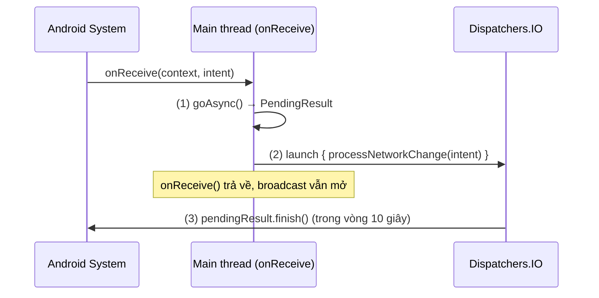
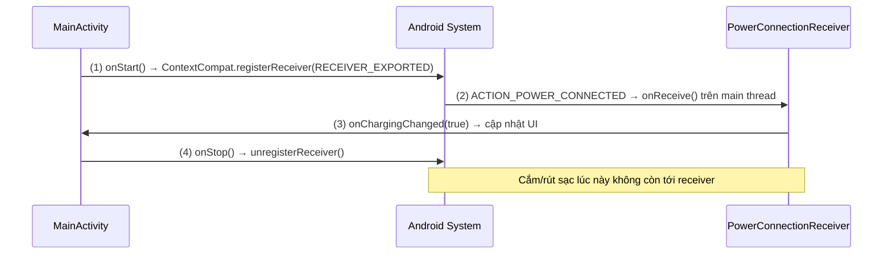
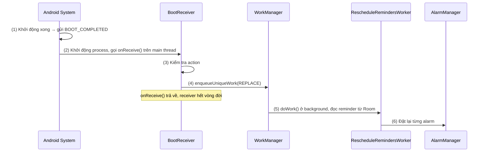

# Broadcast Receiver

## Vấn đề cần giải quyết

Trong một hệ sinh thái Android, nhiều thứ xảy ra độc lập với ứng dụng của bạn:

- Pin sắp hết
- Mạng vừa kết nối lại
- Thiết bị vừa được khởi động
- Một file vừa được download xong
- SMS mới đến

Không có Broadcast Receiver, ứng dụng của bạn **không có cách nào biết** những sự kiện này xảy ra — trừ khi bạn liên tục polling (rất tốn pin và tài nguyên). Broadcast Receiver giải quyết vấn đề này theo mô hình **pub/sub (publish-subscribe)** ở cấp độ hệ điều hành.

## Sau khi học xong

- Giải thích được bản chất Broadcast Receiver (cơ chế pub/sub của hệ điều hành) và vòng đời ngắn của nó.
- Phân biệt được Static Receiver và Dynamic Receiver, biết khi nào dùng loại nào và các giới hạn từ Android 8 đến Android 14.
- Triển khai được Dynamic Receiver đúng cách (ContextCompat.registerReceiver với cờ export, đăng ký và huỷ theo lifecycle) trong MVVM với Hilt.
- Biết khi nào nên dùng WorkManager, NetworkCallback hoặc Flow/SharedFlow thay vì Broadcast Receiver.
- Xử lý được các lỗi phổ biến như lỗ hổng bảo mật, leak do quên unregister, ANR trên main thread.

## Broadcast Receiver là gì?

**Broadcast Receiver** là một **Application Component** cho phép ứng dụng **lắng nghe và phản ứng với các sự kiện (broadcast)** được phát đi bởi hệ thống hoặc các ứng dụng khác. Nó là phía nhận (subscriber) của cơ chế pub/sub ở cấp hệ điều hành: mỗi broadcast là một Intent mang một action, và mỗi lần nhận, receiver chỉ sống trong thời gian chạy `onReceive()`.

Hãy nghĩ về nó như một **radio receiver**: hệ thống (hoặc app khác) phát đi một tín hiệu trên một "kênh" nhất định (một Intent với một Action cụ thể), và bất kỳ ai đang "dò" kênh đó sẽ nhận được tín hiệu đó.

## Cách hoạt động

> [!NOTE]
> **Kiến thức dùng trước.** Các ví dụ trong bài dùng tối thiểu vài kiến thức của Session sau:
> - Coroutine (`CoroutineScope`, `launch`, `Dispatchers.IO`, hàm `suspend`) là cách chạy việc bất đồng bộ ngoài main thread: 8.4.3 Coroutines (chưa có bài).
> - WorkManager (thư viện Jetpack lên lịch việc nền, lưu work lại và tự lên lịch lại sau reboot): [Android Service](../services/android_service.md), mục "WorkManager — Lựa chọn hiện đại cho background task".
> - Room (database của app) chỉ xuất hiện sau `ReminderRepository`: [Relational Database (Room Architecture)](../../../session_05/data_store/room_architecture.md).
> - Flow (`callbackFlow`, `StateFlow`, `SharedFlow`): 7.1.4.2 Flow (chưa có bài).
> - ViewModel và Hilt (`@HiltViewModel`, `@Inject`, `@Module`): 6.4 ViewModel (chưa có bài), 7.1.5.3 Hilt (chưa có bài).
> - MVVM, MVI và Clean Architecture (app chia thành Presentation, Domain, Data layer): 7.2.3 MVVM, 7.2.4 MVI, 7.2.5 Clean Architecture (chưa có bài).

### Lifecycle: Cực kỳ ngắn

Đây là điều quan trọng nhất cần hiểu về Broadcast Receiver:

> [!IMPORTANT]
> Một Broadcast Receiver chỉ "sống" trong thời gian thực thi hàm `onReceive()`. Sau khi `onReceive()` kết thúc, Receiver có thể bị GC bất cứ lúc nào.

```text
Intent được gửi đi
        ↓
Android tìm Receiver phù hợp
        ↓
Tạo instance Receiver (nếu cần)
        ↓
Gọi onReceive(context, intent)   ← Receiver "sống" ở đây
        ↓
onReceive() kết thúc
        ↓
Receiver "chết" — không còn tham chiếu nào được giữ
```

### Thread và thời gian giới hạn

- **`onReceive()` luôn chạy trên Main Thread (UI Thread)** theo mặc định.
- Android giới hạn tối đa **10 giây** để `onReceive()` hoàn thành.
- Nếu vượt quá 10 giây → **ANR (Application Not Responding)**.

```kotlin
// ❌ ĐỪNG làm điều này trong onReceive()
override fun onReceive(context: Context, intent: Intent) {
    val data = fetchDataFromNetwork() // Block main thread → ANR
}
```

Vì lifecycle cực ngắn, bạn **không thể** bắt đầu một coroutine bình thường hoặc AsyncTask bên trong `onReceive()` và mong chờ nó hoàn thành: sau khi `onReceive()` trả về, hệ thống có thể kill cả process. Tài liệu chính thức cũng cảnh báo việc tạo thread hoặc start background service từ `onReceive()`. Việc ngắn (dưới 10 giây) thì dùng `goAsync()`; việc nặng thì schedule job qua **WorkManager** (hoặc `JobScheduler`).

### goAsync() — Khi cần thêm thời gian

Nếu bạn cần làm gì đó bất đồng bộ nhỏ ngay trong Receiver, `goAsync()` giữ broadcast ở trạng thái "đang xử lý" sau khi `onReceive()` trả về, cho tới khi bạn gọi `finish()`.

#### Ví dụ: chuyển việc ngắn của receiver ra khỏi main thread

Receiver nhận sự kiện thay đổi mạng và cần làm một việc bất đồng bộ ngắn mà không chặn main thread:

1. `goAsync()` trả về `PendingResult`, báo hệ thống broadcast chưa xử lý xong dù `onReceive()` sắp trả về.
2. Việc ngắn chạy trong coroutine trên `Dispatchers.IO`, ngoài main thread; `onReceive()` trả về ngay.
3. `pendingResult.finish()` trong `finally` báo hệ thống đã xong, kể cả khi việc bị lỗi. Toàn bộ thời gian từ `goAsync()` tới `finish()` vẫn nằm trong giới hạn 10 giây.



```kotlin
class NetworkReceiver : BroadcastReceiver() {
    override fun onReceive(context: Context, intent: Intent) {
        val pendingResult = goAsync() // (1) Báo cho Android "chưa xong đâu"

        CoroutineScope(Dispatchers.IO).launch {
            try {
                // (2) Công việc bất đồng bộ ngắn (< 10 giây)
                processNetworkChange(intent)
            } finally {
                pendingResult.finish() // (3) Báo Android "xong rồi"
            }
        }
    }
}
```

**Kết quả:** main thread không bị chặn trong lúc xử lý, và hệ thống chỉ coi broadcast là xong khi `finish()` được gọi.

> [!WARNING]
> `goAsync()` vẫn có giới hạn 10 giây. Không dùng cho tác vụ dài. Dùng WorkManager cho tác vụ dài.

### Normal broadcast và Ordered broadcast

Cách bên gửi phát broadcast quyết định các receiver nhận nó ra sao:

- **Normal broadcast** (`sendBroadcast()`): hệ thống giao cho mọi receiver khớp filter theo thứ tự không xác định. Receiver không đọc được kết quả của receiver khác, không truyền tiếp dữ liệu và không chặn được broadcast. Đây là loại hiệu quả nhất và là loại phổ biến.
- **Ordered broadcast** (`sendOrderedBroadcast()`): hệ thống giao cho **từng receiver một**. Receiver chạy trước có thể ghi kết quả (`setResultData()`, `setResultExtras()`) cho receiver sau đọc (`getResultData()`), hoặc gọi `abortBroadcast()` để broadcast không tới các receiver phía sau.

Thứ tự trong ordered broadcast do `android:priority` của `<intent-filter>` (hoặc `IntentFilter.setPriority()` với receiver đăng ký động) quyết định: priority cao nhận trước, cùng priority thì thứ tự tuỳ ý. Từ Android 16, priority chỉ được tôn trọng giữa các receiver **trong cùng một process**; giữa các process khác nhau thứ tự không còn được đảm bảo. Vì vậy đừng thiết kế luồng dựa vào việc receiver của app mình chạy trước receiver của app khác.

Phía gửi (`sendBroadcast`, `sendOrderedBroadcast`, `setPackage`, permission) được trình bày ở [Push data and send event via Intent](../../intent/push_data_event.md), mục "2. Send Event — Gửi sự kiện qua Broadcast Intent".

### Static Receiver vs Dynamic Receiver

#### So sánh tổng quan

| Tiêu chí | Static Receiver | Dynamic Receiver |
|---|---|---|
| Khai báo ở đâu | `AndroidManifest.xml` | Trong code (Activity/Fragment/Service) |
| App có cần đang chạy? | Không (Android có thể khởi động process) | Có — chỉ nhận khi component đang active |
| Còn nhận sau Android 8+? | **Chỉ với explicit và một số system broadcast** | Có |
| Khi nào dùng | Boot completed, SMS, Phone call | Sạc pin, screen on/off (chỉ khi app đang mở) |
| Nguy cơ leak | Không | **Có** nếu quên unregister |

#### Static Receiver — Khai báo trong Manifest

```xml
<!-- AndroidManifest.xml -->
<receiver
    android:name=".receiver.BootReceiver"
    android:exported="true">
    <intent-filter>
        <action android:name="android.intent.action.BOOT_COMPLETED" />
    </intent-filter>
</receiver>
```

```kotlin
// BootReceiver.kt
class BootReceiver : BroadcastReceiver() {
    override fun onReceive(context: Context, intent: Intent) {
        if (intent.action == Intent.ACTION_BOOT_COMPLETED) {
            // Alarm đặt bằng AlarmManager bị xoá khi thiết bị khởi động lại → đặt lại.
            // (Job của WorkManager thì KHÔNG cần: WorkManager tự lưu và lên lịch lại sau reboot.)
            // onReceive phải ngắn → giao việc đọc DB và đặt lại alarm cho WorkManager
            WorkManager.getInstance(context)
                .enqueueUniqueWork(
                    RescheduleRemindersWorker.UNIQUE_NAME,
                    ExistingWorkPolicy.REPLACE,
                    OneTimeWorkRequestBuilder<RescheduleRemindersWorker>().build()
                )
        }
    }
}
```

> [!NOTE]
> Cần permission `RECEIVE_BOOT_COMPLETED` trong Manifest. `BOOT_COMPLETED` là protected broadcast, chỉ hệ thống gửi được, nên để `exported="true"` như tài liệu khuyến nghị cho receiver nghe broadcast hệ thống vẫn an toàn (xem mục "`android:exported` — Quan trọng từ Android 12+" bên dưới).

#### Dynamic Receiver — Đăng ký trong code

Dynamic Receiver được đăng ký bằng một Context (thường là Activity) và chỉ nhận broadcast trong khoảng giữa lúc đăng ký và lúc huỷ đăng ký.

> [!NOTE]
> **Lưu ý Android 13/14 với Dynamic Receiver:**
> - Từ Android 14 (targetSdk 34), `registerReceiver()` **bắt buộc** truyền cờ `RECEIVER_EXPORTED` hoặc `RECEIVER_NOT_EXPORTED` (trừ receiver chỉ nhận system broadcast), nếu không sẽ ném `SecurityException`. Dùng `ContextCompat.registerReceiver()` để có cùng API trên mọi version. `RECEIVER_NOT_EXPORTED` vẫn nhận được một số system broadcast và broadcast của chính app, nhưng không nhận broadcast từ app đặc quyền (Bluetooth, telephony).
> - Chọn cờ theo nguồn gửi: nghe broadcast của hệ thống hoặc app khác → `RECEIVER_EXPORTED`; nghe action tự định nghĩa mà chỉ app mình gửi (ví dụ `com.example.ACTION_REFRESH_DATA`) → `RECEIVER_NOT_EXPORTED`, để app khác không gửi giả vào được: `ContextCompat.registerReceiver(this, receiver, IntentFilter(ACTION_REFRESH_DATA), ContextCompat.RECEIVER_NOT_EXPORTED)`.
> - Từ Android 14, khi app ở trạng thái **cached**, hệ thống hoãn các system broadcast ít quan trọng (vd `ACTION_SCREEN_ON`) gửi tới receiver đăng ký bằng context, và chỉ giao khi app thoát khỏi trạng thái cached.
> - Theo dõi mạng thì **không** dùng `CONNECTIVITY_ACTION` (deprecated từ API 28) và `activeNetworkInfo` (deprecated từ API 29): dùng `ConnectivityManager.registerDefaultNetworkCallback()` (xem mục "Ví dụ thực tế", phần theo dõi trạng thái mạng).

#### Ví dụ: Đăng ký và hủy đăng ký đúng cách

Màn hình phát video muốn hiện gợi ý "Đang sạc: có thể tải video chất lượng cao" khi user cắm sạc, nhưng chỉ khi màn hình đang hiển thị. Luôn đảm bảo `register` và `unregister` ở cùng cặp lifecycle:

1. `onStart()`: tạo `IntentFilter` cho `ACTION_POWER_CONNECTED` và `ACTION_POWER_DISCONNECTED`, đăng ký bằng `ContextCompat.registerReceiver()` với `RECEIVER_EXPORTED` vì đây là broadcast hệ thống.
2. User cắm hoặc rút sạc: hệ thống gửi broadcast; receiver đang được đăng ký nên `onReceive()` chạy trên main thread.
3. `onReceive()` đọc action và gọi callback `onChargingChanged(true/false)`; Activity cập nhật UI.
4. `onStop()`: `unregisterReceiver()`; màn hình không còn hiển thị thì không nhận nữa, và receiver không còn giữ Context của Activity.



```kotlin
// PowerConnectionReceiver.kt
class PowerConnectionReceiver(
    private val onChargingChanged: (Boolean) -> Unit
) : BroadcastReceiver() {
    override fun onReceive(context: Context, intent: Intent) {
        // (2) Hệ thống gọi onReceive() trên main thread
        when (intent.action) {
            Intent.ACTION_POWER_CONNECTED -> onChargingChanged(true) // (3)
            Intent.ACTION_POWER_DISCONNECTED -> onChargingChanged(false) // (3)
        }
    }
}
```

```kotlin
// Activity
class MainActivity : AppCompatActivity() {
    private val powerReceiver = PowerConnectionReceiver { isCharging ->
        // (3) Cập nhật UI, vd hiện gợi ý "Đang sạc: có thể tải video chất lượng cao"
    }

    override fun onStart() {
        super.onStart()
        val filter = IntentFilter().apply {
            addAction(Intent.ACTION_POWER_CONNECTED)
            addAction(Intent.ACTION_POWER_DISCONNECTED)
        }
        // (1) Android 14+ (targetSdk 34): receiver đăng ký bằng context phải chọn
        // RECEIVER_EXPORTED hoặc RECEIVER_NOT_EXPORTED. Nghe broadcast hệ thống → EXPORTED.
        ContextCompat.registerReceiver(this, powerReceiver, filter, ContextCompat.RECEIVER_EXPORTED)
    }

    override fun onStop() {
        super.onStop()
        unregisterReceiver(powerReceiver) // (4) ← Bắt buộc!
    }
}
```

**Kết quả:** gợi ý chỉ đổi khi màn hình đang hiển thị; rời màn hình rồi cắm sạc thì receiver không chạy, và không có receiver nào còn giữ Activity sau `onStop()`.

### Giới hạn của Android 8+ (API 26) — Implicit Broadcast Restrictions

Từ Android 8.0 (Oreo), Google đã **cấm hầu hết Static Receiver nhận implicit broadcasts** để cải thiện hiệu năng và tuổi thọ pin.

#### Nguyên nhân

Nếu 50 ứng dụng trên thiết bị đều đăng ký lắng nghe `CONNECTIVITY_CHANGE` qua Manifest, mỗi khi mạng thay đổi, Android phải khởi động 50 process. Điều này gây lãng phí tài nguyên nghiêm trọng.

#### Implicit Broadcast nào vẫn còn hoạt động với Static Receiver?

Giới hạn chỉ áp dụng cho broadcast **implicit**, tức broadcast không nhắm riêng vào app của bạn. Broadcast gửi đích danh cho app (explicit) vẫn tới Static Receiver bình thường. Ngoài ra, một số broadcast implicit **được miễn trừ** (exempted), ví dụ:

- `ACTION_BOOT_COMPLETED`, `ACTION_LOCKED_BOOT_COMPLETED` — máy khởi động xong.
- `ACTION_TIME_SET`, `ACTION_TIMEZONE_CHANGED`, `ACTION_NEXT_ALARM_CLOCK_CHANGED` — đổi giờ, múi giờ, báo thức.
- `ACTION_LOCALE_CHANGED`.
- `ACTION_PACKAGE_FULLY_REMOVED`, `ACTION_PACKAGE_DATA_CLEARED` — app khác bị gỡ hẳn / bị xoá dữ liệu.
- `ACTION_MEDIA_MOUNTED`, `ACTION_MEDIA_UNMOUNTED`... (gắn/tháo bộ nhớ), các sự kiện gắn/tháo USB, kết nối/ngắt thiết bị Bluetooth.
- `SMS_RECEIVED_ACTION`, `WAP_PUSH_RECEIVED_ACTION`.
- `ACTION_NEW_OUTGOING_CALL` (bản thân action này đã deprecated từ API 29).

Danh sách đầy đủ: [Implicit broadcast exceptions](https://developer.android.com/develop/background-work/background-tasks/broadcasts/broadcast-exceptions). Docs vẫn khuyên hạn chế đăng ký cả những broadcast được miễn.

> [!WARNING]
> **Không** có trong danh sách miễn trừ (hay bị tưởng nhầm): `ACTION_POWER_CONNECTED`/`ACTION_POWER_DISCONNECTED`, `CONNECTIVITY_ACTION`, `ACTION_BATTERY_LOW`, `ACTION_HEADSET_PLUG`, `ACTION_PACKAGE_ADDED`/`ACTION_PACKAGE_REMOVED`/`ACTION_PACKAGE_REPLACED`. Static Receiver khai báo các action này sẽ không nhận được gì trên Android 8+; chỉ Dynamic Receiver nhận được (khi app đang chạy). Riêng `ACTION_MY_PACKAGE_REPLACED` vẫn tới Static Receiver, nhưng không phải nhờ danh sách miễn trừ: hệ thống gửi nó đích danh cho app vừa được cập nhật, tức là broadcast explicit.

> [!NOTE]
> Nhận `BOOT_COMPLETED` cần `<uses-permission android:name="android.permission.RECEIVE_BOOT_COMPLETED" />`. Thẻ `<queries>` (Package Visibility) không liên quan tới việc nhận broadcast; nó chỉ cần khi app muốn truy vấn hoặc nhìn thấy package khác.

#### Giải pháp thay thế

```text
Static Receiver cho CONNECTIVITY_CHANGE (Android 8+)
            ↓
        Bị chặn!
            ↓
   Dynamic Receiver (CONNECTIVITY_ACTION đã deprecated từ API 28)
   hoặc tốt hơn
   NetworkCallback (ConnectivityManager.registerDefaultNetworkCallback)
```
<!-- dd: br-blocked -->

### Security — Bảo mật với Broadcast Receiver

Broadcast Receiver là một **bề mặt tấn công (attack surface)** tiềm ẩn nếu không cấu hình đúng.

#### `android:exported` — Quan trọng từ Android 12+

Từ Android 12 (API 31), mọi receiver có `<intent-filter>` **bắt buộc phải khai báo** `android:exported`:

```xml
<!-- ✅ Đúng — Chỉ nhận broadcast từ nội bộ app -->
<receiver
    android:name=".receiver.InternalReceiver"
    android:exported="false">
    ...
</receiver>

<!-- ✅ Đúng — Nhận broadcast từ hệ thống hoặc app khác -->
<receiver
    android:name=".receiver.BootReceiver"
    android:exported="true">
    ...
</receiver>
```

> [!NOTE]
> **`exported` với system broadcast:** broadcast do chính hệ thống (system UID) gửi, như `BOOT_COMPLETED`, vẫn tới được receiver `exported="false"`. Nhưng một số system broadcast đến từ app đặc quyền (Bluetooth, telephony) không chạy dưới UID hệ thống, nên receiver `exported="false"` sẽ không nhận được. Vì vậy tài liệu chính thức khuyên: receiver nghe broadcast từ **hệ thống hoặc app khác** thì đặt `exported="true"`, kết hợp kiểm tra action trong `onReceive()` và permission khi cần.

> [!TIP]
> **Rule of thumb:** Luôn dùng `exported="false"` trừ khi bạn có lý do rõ ràng cần nhận từ bên ngoài.

#### Permission — Hạn chế ai được gửi broadcast đến receiver của bạn

```xml
<!-- Chỉ app có permission này mới gửi được -->
<receiver
    android:name=".receiver.SecureReceiver"
    android:exported="true"
    android:permission="com.example.SEND_SECURE_BROADCAST">
    <intent-filter>
        <action android:name="com.example.SECURE_ACTION" />
    </intent-filter>
</receiver>
```

#### Phía gửi: giới hạn ai nhận được

Bên gửi giới hạn người nhận bằng `setPackage()` hoặc truyền permission vào `sendBroadcast(intent, receiverPermission)`, và không đặt dữ liệu nhạy cảm vào extras của broadcast. Chi tiết ở [Push data and send event via Intent](../../intent/push_data_event.md), mục "2.3 Explicit Broadcast vs Implicit Broadcast" và "2.5 Gửi broadcast có permission".

#### Validate Intent trong onReceive()

```kotlin
override fun onReceive(context: Context, intent: Intent) {
    // Validate action trước khi xử lý
    if (intent.action != Intent.ACTION_BOOT_COMPLETED) return

    // Validate extras nếu có
    val payload = intent.getStringExtra("payload") ?: return
    if (!isValidPayload(payload)) return

    // Xử lý an toàn
    processBootCompleted(context)
}
```

## Ví dụ thực tế

### Broadcast Receiver thực sự cần thiết — Boot Receiver + WorkManager

#### Bài toán: Đặt lại alarm nhắc uống thuốc sau khi thiết bị khởi động lại

Alarm đặt bằng `AlarmManager` bị hệ thống xoá khi thiết bị tắt/khởi động lại, nên app phải tự đặt lại khi nhận `BOOT_COMPLETED`. Ngược lại, job của **WorkManager không cần** BootReceiver: WorkManager lưu work vào database và tự lên lịch lại sau reboot.

Luồng chạy:

1. Thiết bị khởi động xong: hệ thống gửi `BOOT_COMPLETED`. Khi app vừa được cập nhật, hệ thống gửi `MY_PACKAGE_REPLACED` đích danh cho app.
2. `BootReceiver` khai báo trong Manifest nên hệ thống khởi động process của app (nếu chưa chạy), tạo instance receiver và gọi `onReceive()` trên main thread.
3. `onReceive()` kiểm tra action, bỏ qua Intent không phải hai action trên.
4. `onReceive()` giao việc cho WorkManager bằng `enqueueUniqueWork(..., REPLACE, ...)` rồi trả về ngay; receiver hết vòng đời.
5. WorkManager chạy `RescheduleRemindersWorker` ở background: đọc các lần nhắc sắp tới từ Room qua `ReminderRepository`.
6. Worker đặt lại từng alarm qua `ReminderScheduler` (bọc `AlarmManager`) rồi trả `Result.success()`.



```kotlin
// receiver/BootReceiver.kt
class BootReceiver : BroadcastReceiver() {

    override fun onReceive(context: Context, intent: Intent) {
        // (2) Hệ thống gọi onReceive() trên main thread
        // (3) Chỉ xử lý action đã biết
        if (intent.action != Intent.ACTION_BOOT_COMPLETED &&
            intent.action != Intent.ACTION_MY_PACKAGE_REPLACED) return

        // (4) onReceive chạy trên main thread và phải xong nhanh:
        // giao việc đọc DB + đặt lại alarm cho WorkManager
        WorkManager.getInstance(context).enqueueUniqueWork(
            RescheduleRemindersWorker.UNIQUE_NAME,
            ExistingWorkPolicy.REPLACE,
            OneTimeWorkRequestBuilder<RescheduleRemindersWorker>().build()
        )
    }
}
```

> [!NOTE]
> **Lưu ý Hilt:** Receiver ở đây không cần inject gì. Nếu cần inject vào BroadcastReceiver, annotate receiver với `@AndroidEntryPoint` (Application cũng phải dùng `@HiltAndroidApp`). Worker dùng `@HiltWorker` cần cấu hình `HiltWorkerFactory` cho WorkManager.

```kotlin
// worker/RescheduleRemindersWorker.kt
@HiltWorker
class RescheduleRemindersWorker @AssistedInject constructor(
    @Assisted context: Context,
    @Assisted params: WorkerParameters,
    private val reminderRepository: ReminderRepository,
    private val reminderScheduler: ReminderScheduler // bọc AlarmManager
) : CoroutineWorker(context, params) {

    override suspend fun doWork(): Result {
        // (5) Đọc các lần nhắc sắp tới từ Room rồi đặt lại từng alarm
        reminderRepository.getUpcomingReminders().forEach { reminder ->
            reminderScheduler.schedule(reminder) // (6) AlarmManager.setAndAllowWhileIdle(...)
        }
        return Result.success()
    }

    companion object {
        const val UNIQUE_NAME = "reschedule_reminders"
    }
}
```

```xml
<!-- AndroidManifest.xml -->
<uses-permission android:name="android.permission.RECEIVE_BOOT_COMPLETED" />

<!-- Nghe broadcast hệ thống → exported="true" (BOOT_COMPLETED là protected broadcast,
     app khác không giả mạo được) -->
<receiver
    android:name=".receiver.BootReceiver"
    android:exported="true">
    <intent-filter>
        <action android:name="android.intent.action.BOOT_COMPLETED" />
        <action android:name="android.intent.action.MY_PACKAGE_REPLACED" />
    </intent-filter>
</receiver>
```

**Kết quả:** sau khi thiết bị khởi động lại (hoặc app được cập nhật), các alarm nhắc uống thuốc được đặt lại trong khi `onReceive()` vẫn trả về ngay. Test Robolectric dưới đây kiểm chứng receiver đã enqueue work.

#### Test Static Receiver với Robolectric

```kotlin
@RunWith(RobolectricTestRunner::class)
class BootReceiverTest {

    private lateinit var context: Context

    @Before
    fun setup() {
        context = ApplicationProvider.getApplicationContext()
        // WorkManager phải được khởi tạo bản test trước khi gọi getInstance()
        WorkManagerTestInitHelper.initializeTestWorkManager(context)
    }

    @Test
    fun `onReceive BOOT_COMPLETED should enqueue reschedule work`() {
        BootReceiver().onReceive(context, Intent(Intent.ACTION_BOOT_COMPLETED))

        val workInfos = WorkManager.getInstance(context)
            .getWorkInfosForUniqueWork(RescheduleRemindersWorker.UNIQUE_NAME)
            .get()

        assertThat(workInfos).isNotEmpty()
    }
}
```

### Triển khai thực chiến trong MVVM + Clean Architecture + Hilt

#### Bài toán: Theo dõi trạng thái mạng

Use case phổ biến nhất: App cần biết khi nào mạng mất/khôi phục để retry API call hoặc hiển thị banner offline.

> [!NOTE]
> Mục này **không dùng BroadcastReceiver**: đây là phương án thay thế hiện đại cho `CONNECTIVITY_ACTION`. `NetworkCallback` không đi qua broadcast; `ConnectivityService` của hệ thống gọi callback trực tiếp vào app qua Binder. Flow wrapper giúp nó type-safe và dễ test.

#### Kiến trúc

```text
NetworkConnectivityObserver (Data Layer)
        ↓ Flow<ConnectivityStatus>
NetworkRepository (Domain Layer)
        ↓
NetworkStatusViewModel (Presentation Layer)
        ↓
Activity/Fragment (UI Layer)
```
<!-- dd: br-observer -->

#### Data Layer: NetworkConnectivityObserver

```kotlin
// domain/connectivity/ConnectivityObserver.kt
interface ConnectivityObserver {
    fun observe(): Flow<ConnectivityStatus>

    enum class ConnectivityStatus { Available, Unavailable, Losing, Lost }
}
```

```kotlin
// data/connectivity/NetworkConnectivityObserver.kt
class NetworkConnectivityObserver @Inject constructor(
    @ApplicationContext private val context: Context
) : ConnectivityObserver {

    private val connectivityManager =
        context.getSystemService(Context.CONNECTIVITY_SERVICE) as ConnectivityManager

    override fun observe(): Flow<ConnectivityObserver.ConnectivityStatus> = callbackFlow {
        val callback = object : ConnectivityManager.NetworkCallback() {
            override fun onAvailable(network: Network) {
                trySend(ConnectivityObserver.ConnectivityStatus.Available)
            }
            override fun onLosing(network: Network, maxMsToLive: Int) {
                trySend(ConnectivityObserver.ConnectivityStatus.Losing)
            }
            override fun onLost(network: Network) {
                trySend(ConnectivityObserver.ConnectivityStatus.Lost)
            }
            override fun onUnavailable() {
                trySend(ConnectivityObserver.ConnectivityStatus.Unavailable)
            }
        }

        // Theo dõi network MẶC ĐỊNH: onLost chỉ báo khi app thật sự không còn network mặc định.
        // (registerNetworkCallback(request) báo onLost cho TỪNG network, vd mất Wi-Fi
        // trong khi vẫn còn 4G → báo offline sai)
        connectivityManager.registerDefaultNetworkCallback(callback)

        awaitClose { connectivityManager.unregisterNetworkCallback(callback) }
    }.distinctUntilChanged()
}
```

#### DI Module

```kotlin
// di/ConnectivityModule.kt
@Module
@InstallIn(SingletonComponent::class)
abstract class ConnectivityModule {

    @Binds
    @Singleton
    abstract fun bindConnectivityObserver(
        impl: NetworkConnectivityObserver
    ): ConnectivityObserver
}
```

#### Presentation Layer: ViewModel

```kotlin
// presentation/NetworkStatusViewModel.kt
@HiltViewModel
class NetworkStatusViewModel @Inject constructor(
    private val connectivityObserver: ConnectivityObserver
) : ViewModel() {

    val connectivityStatus: StateFlow<ConnectivityObserver.ConnectivityStatus> =
        connectivityObserver.observe()
            .stateIn(
                scope = viewModelScope,
                started = SharingStarted.WhileSubscribed(5000),
                initialValue = ConnectivityObserver.ConnectivityStatus.Unavailable
            )
}
```

#### UI Layer: Fragment với MVI

Nếu dùng MVI, bạn sẽ map network status thành một phần của **UiState**:

```kotlin
// MVI State
data class HomeUiState(
    val posts: List<Post> = emptyList(),
    val isLoading: Boolean = false,
    val isOffline: Boolean = false,
    val errorMessage: String? = null
)

// HomeViewModel với MVI
@HiltViewModel
class HomeViewModel @Inject constructor(
    private val connectivityObserver: ConnectivityObserver,
    private val getPostsUseCase: GetPostsUseCase
) : ViewModel() {

    private val _uiState = MutableStateFlow(HomeUiState())
    val uiState: StateFlow<HomeUiState> = _uiState.asStateFlow()

    init {
        observeConnectivity()
        loadPosts()
    }

    private fun observeConnectivity() {
        viewModelScope.launch {
            connectivityObserver.observe().collect { status ->
                _uiState.update { state ->
                    state.copy(
                        isOffline = status != ConnectivityObserver.ConnectivityStatus.Available
                    )
                }
                // Auto-retry khi mạng khôi phục
                if (status == ConnectivityObserver.ConnectivityStatus.Available) {
                    loadPosts()
                }
            }
        }
    }

    private fun loadPosts() {
        viewModelScope.launch {
            _uiState.update { it.copy(isLoading = true) }
            getPostsUseCase()
                .onSuccess { posts ->
                    _uiState.update { it.copy(posts = posts, isLoading = false) }
                }
                .onFailure { error ->
                    _uiState.update { it.copy(errorMessage = error.message, isLoading = false) }
                }
        }
    }
}
```

```kotlin
// HomeFragment.kt
@AndroidEntryPoint
class HomeFragment : Fragment() {
    private val viewModel: HomeViewModel by viewModels()

    override fun onViewCreated(view: View, savedInstanceState: Bundle?) {
        super.onViewCreated(view, savedInstanceState)

        viewLifecycleOwner.lifecycleScope.launch {
            repeatOnLifecycle(Lifecycle.State.STARTED) {
                viewModel.uiState.collect { state ->
                    binding.offlineBanner.isVisible = state.isOffline
                    binding.progressBar.isVisible = state.isLoading
                    // ...
                }
            }
        }
    }
}
```

#### Luồng hoạt động (Flow Simulation)

```text
Mạng bị ngắt (Network Lost)
        ↓
ConnectivityManager phát NetworkCallback.onLost()
        ↓
callbackFlow trySend(ConnectivityStatus.Lost)
        ↓
Flow<ConnectivityStatus> emit → ViewModel collect
        ↓
_uiState.update { isOffline = true }
        ↓
StateFlow<HomeUiState> emit → Fragment collect
        ↓
offlineBanner.isVisible = true (hiển thị banner)

Mạng khôi phục (Network Available)
        ↓
ConnectivityManager phát NetworkCallback.onAvailable()
        ↓
Flow emit ConnectivityStatus.Available
        ↓
ViewModel: isOffline = false + gọi loadPosts()
        ↓
offlineBanner.isVisible = false (ẩn banner)
```
<!-- dd: br-offline -->

#### Test Dynamic Receiver Behavior qua ViewModel

Test logic trong ViewModel dễ hơn nhiều khi bạn tách flow qua `ConnectivityObserver`:

```kotlin
@OptIn(ExperimentalCoroutinesApi::class)
class HomeViewModelTest {

    @get:Rule val mainDispatcherRule = MainDispatcherRule()

    // Fake implementation
    private val fakeConnectivityObserver = FakeConnectivityObserver()
    private lateinit var viewModel: HomeViewModel

    @Before
    fun setup() {
        viewModel = HomeViewModel(fakeConnectivityObserver, FakeGetPostsUseCase())
    }

    @Test
    fun `when network lost, isOffline should be true`() = runTest {
        fakeConnectivityObserver.emit(ConnectivityObserver.ConnectivityStatus.Lost)

        val state = viewModel.uiState.value
        assertThat(state.isOffline).isTrue()
    }
}

class FakeConnectivityObserver : ConnectivityObserver {
    private val _statusFlow = MutableSharedFlow<ConnectivityObserver.ConnectivityStatus>()

    suspend fun emit(status: ConnectivityObserver.ConnectivityStatus) {
        _statusFlow.emit(status)
    }

    override fun observe() = _statusFlow
}
```

### Tư duy hệ thống — Vị trí trong Clean Architecture

```text
┌─────────────────────────────────────────────────────────┐
│                    Presentation Layer                    │
│  Activity / Fragment                                     │
│  ↑ collect StateFlow<UiState>                           │
│  ViewModel (MVVM) / MVI Store                           │
└─────────────────────────────────────────────────────────┘
                          ↑ inject
┌─────────────────────────────────────────────────────────┐
│                     Domain Layer                         │
│  ConnectivityObserver (interface)                       │
│  ReminderRepository (interface)                         │
│  GetPostsUseCase                                        │
└─────────────────────────────────────────────────────────┘
                          ↑ implement
┌─────────────────────────────────────────────────────────┐
│                      Data Layer                          │
│  NetworkConnectivityObserver  ← bọc NetworkCallback    │
│  ReminderScheduler            ← bọc AlarmManager       │
│  BootReceiver                 → enqueue Worker         │
└─────────────────────────────────────────────────────────┘
                    ↑ system events
┌─────────────────────────────────────────────────────────┐
│                    Android System                        │
│  NetworkCallback / BroadcastReceiver                    │
└─────────────────────────────────────────────────────────┘
```
<!-- dd: br-arch -->

**Nguyên tắc quan trọng trong kiến trúc:**

1. **Broadcast Receiver chỉ là entry point** — nhận sự kiện từ hệ thống và ngay lập tức delegate xuống domain/data layer. Không bao giờ đặt business logic trong Receiver.
2. **Domain layer không biết đến Broadcast** — interface `ConnectivityObserver` hoàn toàn độc lập với implementation chi tiết.
3. **ViewModel không import bất kỳ Android broadcast API** — chỉ làm việc với `Flow` và interface, giúp test dễ dàng.

## So sánh với các cách tiếp cận khác

### LocalBroadcastManager — Deprecated và thay thế

#### LocalBroadcastManager là gì?

`LocalBroadcastManager` là utility class của AndroidX cho phép gửi và nhận broadcast **chỉ trong nội bộ ứng dụng** (không qua hệ thống).

```kotlin
// Gửi
LocalBroadcastManager.getInstance(context)
    .sendBroadcast(Intent("com.example.REFRESH_DATA"))

// Nhận
LocalBroadcastManager.getInstance(this)
    .registerReceiver(receiver, IntentFilter("com.example.REFRESH_DATA"))
```

#### Vì sao nó deprecated?

`LocalBroadcastManager` bắt đầu bị deprecated từ artifact **`androidx.localbroadcastmanager` 1.1.0-alpha01** (12/2018) và bị deprecated hoàn toàn ở bản stable **1.1.0** (01/2022) vì:

1. **Không phải giải pháp tốt cho giao tiếp component**: Nó chỉ là wrapper của BroadcastReceiver — vẫn có overhead của Intent và Receiver creation.
2. **Không type-safe**: Mọi dữ liệu phải serialize vào Intent extras → dễ lỗi runtime.
3. **Có giải pháp tốt hơn nhiều** trong Kotlin ecosystem.

#### Thay thế LocalBroadcastManager

| Use case | Giải pháp thay thế |
|---|---|
| ViewModel ↔ UI | `StateFlow` / `LiveData` |
| Giữa các ViewModel | `SharedViewModel` / `SharedFlow` |
| Giữa các màn hình (navigation) | `SavedStateHandle` |
| Giữa các layer (Repository → ViewModel) | `Flow` / `SharedFlow` |
| Broadcast toàn app (one-to-many) | `SharedFlow` với replay=0 |

**Ví dụ thay thế: `SharedFlow` thay vì `LocalBroadcastManager`**

```kotlin
// AppEventBus.kt — Singleton dạng object (hoặc class @Singleton inject qua Hilt)
object AppEventBus {
    private val _events = MutableSharedFlow<AppEvent>(extraBufferCapacity = 64)
    val events: SharedFlow<AppEvent> = _events.asSharedFlow()

    suspend fun emit(event: AppEvent) = _events.emit(event)
}

sealed class AppEvent {
    object RefreshData : AppEvent()
    data class ShowError(val message: String) : AppEvent()
}

// ViewModel phát sự kiện
viewModelScope.launch {
    AppEventBus.emit(AppEvent.RefreshData)
}

// ViewModel nhận sự kiện
viewModelScope.launch {
    AppEventBus.events
        .filterIsInstance<AppEvent.RefreshData>()
        .collect { handleRefresh() }
}
```

Docs cũng khuyên tránh hẳn "self-broadcast" (broadcast mà mọi receiver nằm cùng process với bên gửi): nó tốn chi phí IPC của hệ thống mà không đem lại gì so với Flow, Shared ViewModel hay callback.

```text
Use case: "Repository thông báo cho ViewModel khi data cache expired"
        ↓
LocalBroadcastManager ❌ (deprecated, không type-safe)
Flow/SharedFlow ✅ (type-safe, reactive, testable)
```
<!-- dd: br-flow -->

## Khi nào nên và không nên dùng

Broadcast Receiver chỉ là **điểm nhận sự kiện** và sống trong thời gian `onReceive()` (tối đa khoảng 10 giây). Việc chạy lâu hoặc phải chắc chắn hoàn thành thuộc về WorkManager hay Foreground Service, còn giao tiếp trong cùng app thuộc về Flow/SharedFlow. Bảng chọn giữa Service, WorkManager và Flow/SharedFlow ở [Android Service](../services/android_service.md), mục "Service, WorkManager hay Flow/SharedFlow?".

### Khi nào dùng Broadcast Receiver

✅ Dùng khi bạn cần **phản ứng với sự kiện hệ thống** mà không có API thay thế:
- `ACTION_BOOT_COMPLETED` — đặt lại alarm của `AlarmManager` sau reboot (job WorkManager tự được lên lịch lại)
- `ACTION_MY_PACKAGE_REPLACED` — migrate data sau update
- `SMS_RECEIVED` — xử lý SMS trong OTP flow
- ~~`ACTION_POWER_CONNECTED` — bắt đầu sync khi sạc~~: không nhận được qua Manifest từ Android 8 (không có trong danh sách miễn trừ). Muốn sync khi sạc, dùng WorkManager với `setRequiresCharging(true)`

### Khi việc cần làm vượt quá onReceive()

Nhận sự kiện bằng receiver, rồi giao việc cho WorkManager ngay trong `onReceive()` như ví dụ Boot Receiver ở mục "Ví dụ thực tế". Đừng cố làm việc dài trong receiver:

```text
Use case: "Upload ảnh khi có WiFi, ngay cả khi user đóng app"
        ↓
Broadcast Receiver ❌ (không thể đảm bảo, max 10s)
WorkManager ✅ (persist, constraint-aware, guaranteed)
```
<!-- dd: br-upload -->

Giao tiếp trong cùng app (thay `LocalBroadcastManager`) dùng Flow/SharedFlow, xem mục "LocalBroadcastManager — Deprecated và thay thế".

## Sai lầm thường gặp

### 1. Memory Leak — Quên unregister Dynamic Receiver

Receiver đăng ký trong `onCreate()` mà không có `unregisterReceiver()` tương ứng thì tiếp tục giữ Context của Activity.

**Cách sửa:** đăng ký và huỷ ở cùng cặp lifecycle (`onStart`/`onStop`), như ví dụ "Đăng ký và hủy đăng ký đúng cách" ở trên.

```kotlin
// ❌ Lỗi thường gặp
class BadActivity : AppCompatActivity() {
    private val receiver = NetworkReceiver()

    override fun onCreate(savedInstanceState: Bundle?) {
        super.onCreate(savedInstanceState)
        ContextCompat.registerReceiver(this, receiver, IntentFilter(...), ContextCompat.RECEIVER_EXPORTED)
        // Không có unregister → memory leak!
    }
}

// ✅ Đúng — Unregister ở đúng lifecycle counterpart
class GoodActivity : AppCompatActivity() {
    private val receiver = NetworkReceiver()

    override fun onStart() {
        super.onStart()
        ContextCompat.registerReceiver(this, receiver, IntentFilter(...), ContextCompat.RECEIVER_EXPORTED)
    }

    override fun onStop() {
        super.onStop()
        unregisterReceiver(receiver)
    }
}
```

### 2. Làm việc nặng trong onReceive()

`onReceive()` chạy trên main thread; tác vụ nặng chặn main thread và gây ANR.

**Cách sửa:** giao việc cho WorkManager ngay trong `onReceive()`.

```kotlin
// ❌ Block main thread → ANR sau 10 giây
override fun onReceive(context: Context, intent: Intent) {
    uploadFilesToServer() // Tác vụ nặng
}

// ✅ Delegate sang WorkManager
override fun onReceive(context: Context, intent: Intent) {
    WorkManager.getInstance(context)
        .enqueue(OneTimeWorkRequestBuilder<UploadWorker>().build())
}
```

### 3. Dùng Static Receiver cho implicit broadcast trên Android 8+

Receiver khai báo trong Manifest cho một implicit broadcast không được miễn trừ sẽ không bao giờ được gọi.

**Cách sửa:** dùng Dynamic Receiver hoặc, với mạng, `NetworkCallback`.

```xml
<!-- ❌ Sẽ không hoạt động trên Android 8+
     (riêng CONNECTIVITY_CHANGE: đã không tới receiver khai báo trong Manifest từ Android 7.0, app target API 24+) -->
<receiver android:name=".NetworkReceiver">
    <intent-filter>
        <action android:name="android.net.conn.CONNECTIVITY_CHANGE" />
    </intent-filter>
</receiver>
```

```kotlin
// ✅ Dùng Dynamic Receiver hoặc NetworkCallback thay thế
val request = NetworkRequest.Builder()
    .addCapability(NetworkCapabilities.NET_CAPABILITY_INTERNET)
    .build()
connectivityManager.registerNetworkCallback(request, networkCallback)
```

### 4. Không khai báo exported trên Android 12+

```xml
<!-- ❌ Cài đặt thất bại trên Android 12+ (INSTALL_PARSE_FAILED_MANIFEST_MALFORMED) -->
<receiver android:name=".MyReceiver">
    <intent-filter>...</intent-filter>
</receiver>

<!-- ✅ Phải khai báo rõ -->
<receiver android:name=".MyReceiver" android:exported="false">
    <intent-filter>...</intent-filter>
</receiver>
```

Với targetSdk 31+, thiếu `exported` trên component có `<intent-filter>` làm build lỗi ngay ở bước manifest merger; APK dựng bằng công cụ cũ thì cài thất bại. Chi tiết ở [Manifest Tags](../../android_manifest/tags.md), mục "android:exported — quy tắc quan trọng nhất từ Android 12".

**Cách sửa:** khai báo `android:exported` rõ ràng trên mọi receiver có `<intent-filter>`.

## Lịch sử phát triển

- **API 1 (Android 1.0):** `BroadcastReceiver`, `onReceive()` và các API của ordered broadcast (`abortBroadcast()`, `setResultData()`, `setResultExtras()`, `getResultData()`) có từ API level đầu tiên; `CONNECTIVITY_ACTION` cũng có từ API 1.
- **API 11 (Android 3.0):** thêm `goAsync()`.
- **Android 7.0 (API 24):** hệ thống không còn gửi `ACTION_NEW_PICTURE`/`ACTION_NEW_VIDEO`; app target API 24+ chỉ nhận `CONNECTIVITY_ACTION` qua receiver đăng ký bằng code, khai báo trong Manifest không còn tác dụng. `registerDefaultNetworkCallback()` cũng có từ API 24.
- **Android 8.0 (API 26):** app target API 26+ không khai báo được receiver trong Manifest cho hầu hết implicit broadcast (trừ danh sách được miễn); receiver đăng ký bằng code vẫn nhận khi app đang được dùng.
- **Android 9 (API 28):** `CONNECTIVITY_ACTION` bị deprecated, docs chuyển sang `NetworkCallback`.
- **12/2018 (LocalBroadcastManager 1.1.0-alpha01):** `LocalBroadcastManager` bắt đầu bị deprecated; bản 1.1.0 (01/2022) deprecated hoàn toàn, docs khuyên thay bằng LiveData hoặc reactive stream.
- **Android 12 (API 31):** app target API 31+ phải khai báo `android:exported` cho receiver (cùng Activity, Service) có `<intent-filter>`, nếu không app không cài được.
- **Android 13 (API 33):** thêm cờ `RECEIVER_EXPORTED` / `RECEIVER_NOT_EXPORTED` cho receiver đăng ký bằng code.
- **Android 14 (API 34):** app target API 34+ đăng ký receiver bằng code phải chỉ định một trong hai cờ trên (trừ receiver chỉ nhận system broadcast); khi app ở trạng thái cached, hệ thống hoãn các system broadcast ít quan trọng.
- **Android 16:** `android:priority` của ordered broadcast chỉ được tôn trọng giữa các receiver trong cùng một process.

## Kết nối hệ thống

- **Tiên quyết:**
  - [Activity](../activity/index.md) và [Activity Lifecycle](../activity/lifecycle.md): Dynamic Receiver đăng ký và huỷ theo cặp lifecycle của Activity.
  - [Intent Filters Value](../../intent/intent_filters.md): filter quyết định receiver nhận action nào, và `android:priority` của filter có ý nghĩa với ordered broadcast.
- **Liên quan:**
  - [Push data and send event via Intent](../../intent/push_data_event.md): phía gửi broadcast (`sendBroadcast`, `sendOrderedBroadcast`, `setPackage`, permission).
  - [Explicit Intents](../../intent/explicit_intents.md): Intent đích danh, cơ sở của explicit broadcast vẫn tới được Static Receiver.
  - [Manifest Tags](../../android_manifest/tags.md): khai báo `<receiver>`, `android:exported`, `android:permission`.
  - [Pending Intent](../../intent/pending_intent.md): PendingIntent tạo bằng `getBroadcast()` (AlarmManager, nút action trên Notification) được giao tới receiver.
  - [Android Service](../services/android_service.md): WorkManager (mục "WorkManager — Lựa chọn hiện đại cho background task") nhận việc mà receiver giao, và Foreground Service (mục "Foreground Service — Phát nhạc nền") khi cần chạy nền nhưng user cần biết (music player, location tracking).
- **Học tiếp:**
  - [Content Provider](../content_provider.md): Application Component tiếp theo trong mục 4.2.
  - [Networking](../../../session_05/networking.md), mục "6. Quản lý trạng thái kết nối ở tầng OS: ConnectivityManager & NetworkCallback": API hiện đại hơn để theo dõi mạng.
  - 7.1.4.2 Flow (chưa có bài): `SharedFlow`/`StateFlow` thay cho broadcast nội bộ.
  - 7.1.5.3 Hilt (chưa có bài), 7.2.4 MVI và 7.2.5 Clean Architecture (chưa có bài): kiến trúc mà phần "Ví dụ thực tế" dựa vào.
  - [Unit Testing](../../../coding_analyst_and_testing/unit_testing.md): nền cho test Robolectric và test ViewModel với fake.

## Nguồn tham khảo

- [Android Developers — Broadcast overview](https://developer.android.com/guide/components/broadcasts)
- [Android Developers — Implicit Broadcast Exceptions (Android 8+)](https://developer.android.com/develop/background-work/background-tasks/broadcasts/broadcast-exceptions)
- [Android Developers — BroadcastReceiver (API 1, goAsync API 11, giới hạn 10 giây)](https://developer.android.com/reference/android/content/BroadcastReceiver)
- [AndroidX LocalBroadcastManager deprecation](https://developer.android.com/reference/androidx/localbroadcastmanager/content/LocalBroadcastManager)
- [LocalBroadcastManager release notes (1.1.0-alpha01 12/2018, 1.1.0 01/2022)](https://developer.android.com/jetpack/androidx/releases/localbroadcastmanager)
- [Android Developers — WorkManager](https://developer.android.com/topic/libraries/architecture/workmanager)
- [Kotlin Coroutines — SharedFlow](https://kotlinlang.org/api/kotlinx.coroutines/kotlinx-coroutines-core/kotlinx.coroutines.flow/-shared-flow/)
- [Hilt — Inject into Android classes](https://developer.android.com/training/dependency-injection/hilt-android)
- [Android Developers — Broadcasts (RECEIVER_EXPORTED, Android 7.0/8.0/14/16 changes)](https://developer.android.com/develop/background-work/background-tasks/broadcasts)
- [Context — RECEIVER_EXPORTED / RECEIVER_NOT_EXPORTED (API 33)](https://developer.android.com/reference/android/content/Context#RECEIVER_EXPORTED)
- [Android 12 behavior changes — Safer component exporting](https://developer.android.com/about/versions/12/behavior-changes-12)
- [Android 14 behavior changes](https://developer.android.com/about/versions/14/behavior-changes-14)
- [ConnectivityManager — CONNECTIVITY_ACTION (deprecated)](https://developer.android.com/reference/android/net/ConnectivityManager#CONNECTIVITY_ACTION)
- [Persistent work with WorkManager](https://developer.android.com/develop/background-work/background-tasks/persistent)
- [Android Developers — Broadcasts: Send broadcasts (ordered broadcast, priority)](https://developer.android.com/develop/background-work/background-tasks/broadcasts#sending-broadcasts)
- [Android 16 behavior changes — ordered broadcast priority](https://developer.android.com/about/versions/16/behavior-changes-all#ordered-broadcast-priority)
