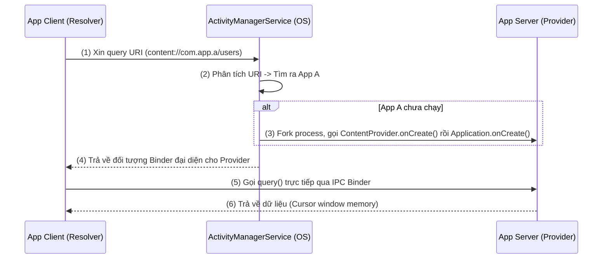
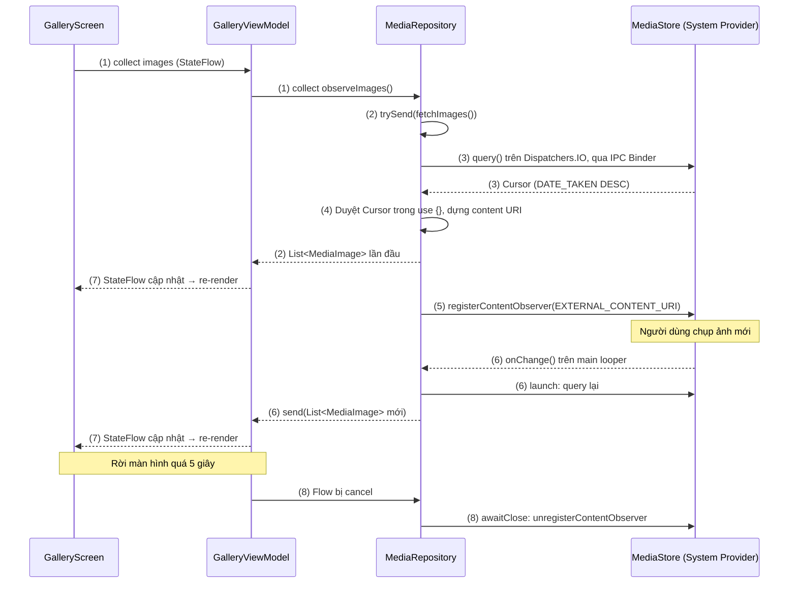

# 4.2.5 Content Provider

## Vấn đề cần giải quyết

Android ứng dụng mô hình **sandbox bảo mật nghiêm ngặt**: mỗi app chạy trong một Linux process riêng với User ID riêng. Điều này có nghĩa là:

- App A **không thể đọc** file `.db` hay `SharedPreferences` của App B
- App của bạn **không thể trực tiếp** truy cập danh bạ, ảnh, lịch của hệ thống

Từ đó nảy ra hai bài toán:

1. Làm sao app lấy được danh bạ, tin nhắn, danh sách ảnh từ hệ điều hành (vốn thuộc các app khác)?
2. Làm sao app chia sẻ một phần dữ liệu cho app đối tác một cách an toàn mà không làm lộ toàn bộ database?

Nếu không có cơ chế chuẩn hóa, việc chia sẻ dữ liệu yêu cầu các hack như: ghi file ra `external storage`, mở socket server nội bộ, hoặc hardcode path database — tất cả đều nguy hiểm và không nhất quán.

Content Provider giải quyết điều này bằng mô hình **client-server chuẩn hóa**:

- App sở hữu dữ liệu → triển khai **ContentProvider** (server), kiểm soát ai được đọc/ghi gì
- App cần dữ liệu → dùng **ContentResolver** (client), gửi request theo URI chuẩn

## Sau khi học xong

- Giải thích được vai trò của Content Provider trong sandbox Android và cơ chế IPC Binder phía sau ContentResolver.
- Triển khai được truy vấn MediaStore và Contacts Provider bằng Coroutines + Flow, đúng permission theo từng version Android.
- Áp dụng được ContentObserver + callbackFlow để lắng nghe thay đổi dữ liệu thời gian thực.
- Triển khai được Custom Content Provider có permission kiểm soát truy cập và package visibility cho app client.
- Xử lý được ANR do query trên Main Thread, leak do quên đóng Cursor, và biết khi nào không nên dùng Content Provider.

## Content Provider là gì?

**Content Provider** là một trong 4 Application Component cốt lõi của Android (Activity, Service, Broadcast Receiver, Content Provider). Nó đóng vai trò **cổng giao tiếp dữ liệu có kiểm soát** giữa các ứng dụng và hệ thống: app sở hữu dữ liệu mở dữ liệu qua Content URI chuẩn, app khác đọc/ghi bằng các thao tác CRUD qua `ContentResolver`.

> **Mental model:** hãy hình dung Content Provider như một **REST API nội bộ của hệ điều hành**: URI là endpoint, `query/insert/update/delete` là các method, permission là cơ chế xác thực.

## Cách hoạt động

### Content URI — "địa chỉ" của dữ liệu

URI là địa chỉ để xác định dữ liệu cần truy cập. Cấu trúc:

```text
content://com.android.contacts/contacts/42
  [scheme] [authority/package]  [path]  [id]
```

- **scheme**: Luôn là `content://`
- **authority**: Package name hoặc tên định danh duy nhất của Provider
- **path**: Tên bảng hoặc loại dữ liệu
- **id** (tuỳ chọn): ID của một bản ghi cụ thể

### ContentResolver — client giao tiếp với Provider

`ContentResolver` là proxy của hệ thống Android. Khi bạn gọi `contentResolver.query()`, hệ thống tự tìm đúng ContentProvider từ URI và route request đến đó. Bạn **không bao giờ** instantiate ContentProvider trực tiếp.

### Cursor — kết quả truy vấn

Cursor là con trỏ duyệt qua tập kết quả trả về, giống `ResultSet` trong JDBC. Cursor giữ tài nguyên hệ thống và **phải được đóng** sau khi dùng.

### Cơ chế hoạt động bên trong (IPC Binder)

Đây là phần nhiều developer bỏ qua nhưng rất quan trọng để hiểu tại sao query Content Provider có thể chậm và tại sao phải dùng background thread.

Hệ thống chỉ làm trung gian lúc tìm Provider; sau đó client gọi thẳng vào Provider qua Binder:

1. App Client gọi `ContentResolver.query()` với một Content URI; request đi qua Binder IPC tới hệ thống (`ActivityManagerService`).
2. Hệ thống phân tích authority trong URI để tìm Provider và app sở hữu nó (App Server).
3. Nếu App Server chưa chạy, hệ thống khởi động process của nó; khi khởi động, `ContentProvider.onCreate()` được gọi trước `Application.onCreate()`.
4. Hệ thống trả về cho client đối tượng Binder đại diện cho Provider.
5. Client gọi `query()` trực tiếp vào Provider qua Binder; Provider xử lý query.
6. Provider trả Cursor; dữ liệu về client qua vùng nhớ dùng chung (Cursor window, shared memory).



**Tác động thực tế:**

1. IPC Binder có overhead — đặc biệt khi App Server chưa chạy, Android phải fork process mới
2. Khi khởi động process, hệ thống gọi `ContentProvider.onCreate()` của mọi Provider trên main thread **trước** `Application.onCreate()`. Toàn bộ thời gian này, `query()` của client **bị block**. Vì vậy `onCreate()` của Provider phải thật nhẹ. Đây cũng là lý do nhiều thư viện dùng một Provider rỗng để tự khởi tạo sớm (vd `FirebaseInitProvider` của Firebase, xem [Google Service](services/google_service.md), mục "Bước 2 — Thêm plugin vào Gradle"; `InitializationProvider` của App Startup)
3. `query()` **block thread** cho đến khi nhận được response
4. **Không bao giờ gọi ContentResolver trên Main Thread** → ANR
5. Ngược lại, `query()/insert()/update()/delete()` của Provider được gọi trên các Binder thread, có thể **song song** từ nhiều client: code Provider phải thread-safe (Room/SQLiteDatabase đã tự xử lý đồng bộ)

### Đọc dữ liệu từ System Provider (Client Side)

App client đọc dữ liệu của System Provider (MediaStore, ContactsProvider...) bằng `ContentResolver`, nhưng trước đó phải có đúng permission. Với ảnh trong MediaStore, permission thay đổi theo version Android, nên khai báo trong `AndroidManifest.xml` như sau:

```xml
<!-- Android 12L trở xuống (API ≤ 32) -->
<uses-permission
    android:name="android.permission.READ_EXTERNAL_STORAGE"
    android:maxSdkVersion="32" />

<!-- Android 13+ (API 33+) — granular permissions -->
<uses-permission android:name="android.permission.READ_MEDIA_IMAGES" />

<!-- Android 14+ (API 34+) — người dùng có thể chỉ cho phép một số ảnh -->
<uses-permission android:name="android.permission.READ_MEDIA_VISUAL_USER_SELECTED" />
```

> [!NOTE]
> - Từ Android 14, khi người dùng chọn "Chỉ cho phép một số ảnh", app chỉ được cấp `READ_MEDIA_VISUAL_USER_SELECTED` và MediaStore chỉ trả về những ảnh đã chọn. Khai báo permission này để app xử lý đúng trường hợp đó và cho người dùng chọn lại.
> - Nếu app chỉ cần người dùng chọn vài ảnh (đổi avatar, đính kèm), dùng **Photo Picker** (`PickVisualMedia`): không cần permission nào.
> - Không dựa vào cột `MediaStore.Images.Media.DATA` (đường dẫn file tuyệt đối): docs cảnh báo file ở đường dẫn đó không phải lúc nào cũng truy cập được, và từ Android 11 cột này chỉ đọc với app target API 30+. Luôn truy cập ảnh qua content URI (`ContentUris.withAppendedId`) như code ở mục "Ví dụ thực tế".

Một truy vấn gồm: URI của bảng, `projection` (các cột cần lấy), `selection` + `selectionArgs` (điều kiện WHERE, giá trị truyền qua placeholder `?`) và `sortOrder`. Kết quả là một Cursor, luôn bọc trong `use {}` để tự đóng.

#### Ví dụ: Tìm danh bạ theo tên từ ContactsProvider

ContactsProvider có schema phức tạp hơn MediaStore. Cần runtime permission `READ_CONTACTS` trước khi query:

```kotlin
// data/contacts/ContactsRepository.kt
suspend fun searchContacts(query: String): List<Contact> = withContext(Dispatchers.IO) {
    val contacts = mutableListOf<Contact>()

    val projection = arrayOf(
        ContactsContract.Contacts._ID,
        ContactsContract.Contacts.DISPLAY_NAME_PRIMARY,
        ContactsContract.Contacts.HAS_PHONE_NUMBER
    )

    context.contentResolver.query(
        ContactsContract.Contacts.CONTENT_URI,
        projection,
        "${ContactsContract.Contacts.DISPLAY_NAME_PRIMARY} LIKE ?",
        arrayOf("%$query%"), // % là wildcard
        "${ContactsContract.Contacts.DISPLAY_NAME_PRIMARY} ASC"
    )?.use { cursor ->
        val idCol   = cursor.getColumnIndexOrThrow(ContactsContract.Contacts._ID)
        val nameCol = cursor.getColumnIndexOrThrow(ContactsContract.Contacts.DISPLAY_NAME_PRIMARY)
        val hasPhoneCol = cursor.getColumnIndexOrThrow(ContactsContract.Contacts.HAS_PHONE_NUMBER)

        while (cursor.moveToNext()) {
            if (cursor.getInt(hasPhoneCol) > 0) {
                contacts += Contact(
                    id = cursor.getLong(idCol),
                    name = cursor.getString(nameCol)
                )
            }
        }
    }

    contacts
}
```

**Kết quả:** gõ "an" trả về các liên hệ có tên chứa "an" và có số điện thoại, sắp xếp theo tên; chuỗi người dùng gõ chỉ đi qua `selectionArgs`, không nối vào câu WHERE.

### Lắng nghe thay đổi thời gian thực (ContentObserver)

Người dùng có thể chụp ảnh mới trong khi app đang chạy. Làm sao để gallery tự refresh?

**ContentObserver** là cơ chế của Android để theo dõi thay đổi trên một URI. Kết hợp với `callbackFlow` của Kotlin để tạo một reactive stream: đăng ký observer khi Flow bắt đầu được collect, mỗi lần `onChange()` thì query lại và emit, gỡ observer khi Flow bị cancel. Code đầy đủ ở mục "Ví dụ thực tế".

**Luồng hoạt động:**

```text
Người dùng chụp ảnh mới
        ↓
MediaStore.Images URI thay đổi
        ↓
ContentObserver.onChange() được gọi
        ↓
callbackFlow.trySend(fetchImages())
        ↓
Flow emit List<MediaImage> mới
        ↓
StateFlow cập nhật → UI tự re-render
```
<!-- dd: intent-observe -->

Observer chỉ được gọi khi Provider báo thay đổi: System Provider như MediaStore tự làm việc này; Provider tự viết phải tự gọi `notifyChange()` (xem mục "Tự tạo Custom Content Provider (Server Side)").

### Tự tạo Custom Content Provider (Server Side)

App sở hữu dữ liệu kế thừa `ContentProvider`, dùng `UriMatcher` để biết URI nào trỏ tới bảng nào, kiểm tra permission của bên gọi, khai báo `<provider>` trong Manifest kèm permission; app client khai báo `<uses-permission>` và `<queries>` để thấy Provider.

#### Ví dụ: App companion đọc profile user từ app chính

Kịch bản: Công ty bạn có **App A** (app chính) và **App B** (app companion). App B cần đọc profile user từ database của App A.

**Bước 1: Tạo ContentProvider trong App A**

```kotlin
// provider/UserProvider.kt (App A)
class UserProvider : ContentProvider() {

    companion object {
        const val AUTHORITY = "com.company.appa.provider"

        // URI patterns
        val CONTENT_URI: Uri = Uri.parse("content://$AUTHORITY/users")

        private val uriMatcher = UriMatcher(UriMatcher.NO_MATCH).apply {
            addURI(AUTHORITY, "users", 1)       // content://authority/users
            addURI(AUTHORITY, "users/#", 2)     // content://authority/users/42
        }
    }

    // Khởi tạo nhẹ nhất có thể — đừng block ở đây
    override fun onCreate(): Boolean = true

    override fun query(
        uri: Uri,
        projection: Array<String>?,
        selection: String?,
        selectionArgs: Array<String>?,
        sortOrder: String?
    ): Cursor? {
        // Kiểm tra permission trước
        context?.checkCallingPermission("com.company.permission.READ_USER")
            ?.takeIf { it != PackageManager.PERMISSION_GRANTED }
            ?.let { throw SecurityException("Missing READ_USER permission") }

        val db = UserDatabase.getInstance(context!!).readableDatabase

        return when (uriMatcher.match(uri)) {
            1 -> db.query("users", projection, selection, selectionArgs, null, null, sortOrder)
            2 -> {
                val id = ContentUris.parseId(uri)
                db.query("users", projection, "_id = ?", arrayOf(id.toString()), null, null, null)
            }
            else -> throw IllegalArgumentException("Unknown URI: $uri")
        }
    }

    // Implement nếu cần write operations
    override fun getType(uri: Uri): String = when (uriMatcher.match(uri)) {
        1 -> "vnd.android.cursor.dir/vnd.com.company.appa.users"
        2 -> "vnd.android.cursor.item/vnd.com.company.appa.users"
        else -> throw IllegalArgumentException("Unknown URI: $uri")
    }

    override fun insert(uri: Uri, values: ContentValues?): Uri? = null
    override fun update(uri: Uri, values: ContentValues?, selection: String?, selectionArgs: Array<String>?): Int = 0
    override fun delete(uri: Uri, selection: String?, selectionArgs: Array<String>?): Int = 0
}
```

> [!NOTE]
> - **Thông báo thay đổi:** trong `query()` gọi `cursor.setNotificationUri(context!!.contentResolver, uri)`, và sau mỗi `insert/update/delete` gọi `context!!.contentResolver.notifyChange(uri, null)`. Thiếu bước này, `ContentObserver` của client (mục "Lắng nghe thay đổi thời gian thực (ContentObserver)") sẽ không bao giờ được gọi với Provider tự viết.
> - Dữ liệu không nằm trong SQLite thì có thể trả `MatrixCursor` dựng trong bộ nhớ:

```kotlin
val cursor = MatrixCursor(arrayOf("_id", "name", "email"))
cursor.addRow(arrayOf(1, "Nguyễn Văn An", "an.nguyen@example.com"))
return cursor
```

**Bước 2: Khai báo trong AndroidManifest.xml của App A**

```xml
<!-- Khai báo custom permission -->
<permission
    android:name="com.company.permission.READ_USER"
    android:protectionLevel="signature" />
    <!-- signature: chỉ app cùng chữ ký mới được cấp quyền này -->

<provider
    android:name=".provider.UserProvider"
    android:authorities="com.company.appa.provider"
    android:exported="true"
    android:readPermission="com.company.permission.READ_USER" />
```

> [!NOTE]
> `android:protectionLevel="signature"` nghĩa là chỉ app được ký cùng keystore với App A mới được cấp permission này tự động. Đây là cách bảo mật chuẩn cho các app cùng công ty.

**Bước 3: App B khai báo và sử dụng**

```xml
<!-- AndroidManifest.xml của App B -->
<uses-permission android:name="com.company.permission.READ_USER" />

<!-- App B target Android 11+ (API 30+): package visibility — phải khai báo Provider muốn truy cập,
     nếu không ContentResolver không "thấy" Provider của App A -->
<queries>
    <provider android:authorities="com.company.appa.provider" />
</queries>
```

> Custom permission được đăng ký khi cài app: **App A (app định nghĩa permission) phải được cài trước** App B thì App B mới được cấp quyền.

```kotlin
// data/user/RemoteUserRepository.kt (App B)
suspend fun fetchUsersFromAppA(): List<User> = withContext(Dispatchers.IO) {
    val users = mutableListOf<User>()
    val uri = Uri.parse("content://com.company.appa.provider/users")

    context.contentResolver.query(uri, null, null, null, null)?.use { cursor ->
        while (cursor.moveToNext()) {
            // Parse cursor...
        }
    }

    users
}
```

**Kết quả:** App B (cùng chữ ký, cài sau App A) đọc được danh sách user; một app khác không có `READ_USER` gọi cùng URI sẽ nhận `SecurityException`.

## Ví dụ thực tế

### Gallery ảnh tự cập nhật khi có ảnh mới (MediaStore + ContentObserver + Flow)

Màn hình gallery hiện ảnh trong máy, mới nhất trước, và tự cập nhật khi người dùng chụp ảnh mới trong lúc màn hình đang mở. Đây là bài toán dùng cả hai phía client của Content Provider: query System Provider (mục "Đọc dữ liệu từ System Provider (Client Side)") và lắng nghe thay đổi (mục "Lắng nghe thay đổi thời gian thực (ContentObserver)"). Luồng chạy:

1. UI collect `images`; `stateIn(WhileSubscribed(5_000))` bắt đầu collect `observeImages()`.
2. `callbackFlow` gửi data lần đầu ngay khi được collect: `trySend(fetchImages())`.
3. `fetchImages()` chuyển sang `Dispatchers.IO` rồi gọi `contentResolver.query()` vào MediaStore với `projection` và `sortOrder` `DATE_TAKEN DESC` (đi qua IPC Binder như mục "Cơ chế hoạt động bên trong (IPC Binder)").
4. Duyệt Cursor trong `use {}`: đọc từng cột, dựng content URI cho từng ảnh bằng `ContentUris.withAppendedId`; Cursor tự đóng khi ra khỏi `use {}`.
5. Đăng ký `ContentObserver` trên `MediaStore.Images.Media.EXTERNAL_CONTENT_URI` (`notifyForDescendants = true`).
6. MediaStore thay đổi (ảnh mới): `onChange()` chạy trên main looper, `launch` một coroutine query lại và `send()` danh sách mới.
7. StateFlow nhận danh sách mới, UI re-render.
8. UI ngừng collect quá 5 giây: Flow bị cancel, `awaitClose` gỡ observer.



> [!NOTE]
> **Kiến thức dùng trước.** Ví dụ dùng tối thiểu vài kiến thức của Session sau:
> - Coroutine (`suspend`, `withContext(Dispatchers.IO)`, `launch`): chạy code bất đồng bộ không chặn thread gọi, học ở 8.4.3 Coroutines (chưa có bài).
> - `Flow`, `callbackFlow`, `StateFlow`, `stateIn`: luồng dữ liệu quan sát được, học ở [Flow](../../session_07/design_pattern/observer/flow.md).
> - `@HiltViewModel`, `@Inject`: Hilt tự tạo và truyền dependency, học ở [Hilt](../../session_07/design_pattern/di/hilt.md); ViewModel và `viewModelScope` học ở [ViewModel](../../session_06/viewmodel.md).

Permission `READ_MEDIA_IMAGES` (hoặc `READ_EXTERNAL_STORAGE` trên API ≤ 32) đã được khai báo và cấp như mục "Đọc dữ liệu từ System Provider (Client Side)".

```kotlin
// data/media/MediaRepository.kt
class MediaRepository @Inject constructor(
    @ApplicationContext private val context: Context
) {
    // suspend fun → phải gọi từ coroutine scope
    // (3) chuyển sang IO trước khi query
    suspend fun fetchImages(): List<MediaImage> = withContext(Dispatchers.IO) {
        val images = mutableListOf<MediaImage>()

        val projection = arrayOf(
            MediaStore.Images.Media._ID,
            MediaStore.Images.Media.DISPLAY_NAME,
            MediaStore.Images.Media.DATE_TAKEN,
            MediaStore.Images.Media.SIZE
        )

        // (3) query qua ContentResolver → IPC Binder tới MediaStore
        context.contentResolver.query(
            MediaStore.Images.Media.EXTERNAL_CONTENT_URI,
            projection,
            null, // selection (WHERE)
            null, // selectionArgs
            "${MediaStore.Images.Media.DATE_TAKEN} DESC" // sortOrder
        )?.use { cursor -> // (4) .use {} tự đóng Cursor ngay cả khi exception
            val idCol       = cursor.getColumnIndexOrThrow(MediaStore.Images.Media._ID)
            val nameCol     = cursor.getColumnIndexOrThrow(MediaStore.Images.Media.DISPLAY_NAME)
            val dateTakenCol= cursor.getColumnIndexOrThrow(MediaStore.Images.Media.DATE_TAKEN)
            val sizeCol     = cursor.getColumnIndexOrThrow(MediaStore.Images.Media.SIZE)

            while (cursor.moveToNext()) {
                val id = cursor.getLong(idCol)
                // (4) Tạo content URI từ ID để dùng với Coil/Glide
                val contentUri = ContentUris.withAppendedId(
                    MediaStore.Images.Media.EXTERNAL_CONTENT_URI, id
                )
                images += MediaImage(
                    id = id,
                    uri = contentUri,
                    name = cursor.getString(nameCol),
                    dateTaken = cursor.getLong(dateTakenCol),
                    size = cursor.getLong(sizeCol)
                )
            }
        }

        images
    }
}

data class MediaImage(
    val id: Long,
    val uri: Uri,
    val name: String,
    val dateTaken: Long,
    val size: Long
)
```

```kotlin
// data/media/MediaRepository.kt — thêm hàm observe
fun observeImages(): Flow<List<MediaImage>> = callbackFlow {
    // (2) Gửi data lần đầu ngay khi collect
    trySend(fetchImages())

    val observer = object : ContentObserver(Handler(Looper.getMainLooper())) {
        override fun onChange(selfChange: Boolean) {
            // (6) onChange chạy trên main looper: KHÔNG block ở đây (vd runBlocking).
            // Mỗi khi MediaStore thay đổi → re-fetch trong coroutine của callbackFlow
            launch { send(fetchImages()) }
        }
    }

    // (5) Đăng ký observer trên URI ảnh
    context.contentResolver.registerContentObserver(
        MediaStore.Images.Media.EXTERNAL_CONTENT_URI,
        true, // notifyForDescendants
        observer
    )

    // (8) Khi Flow bị cancel (scope hủy, màn hình đóng) → unregister để tránh leak
    awaitClose {
        context.contentResolver.unregisterContentObserver(observer)
    }
}
```

> Biến thể gọn hơn: observer chỉ phát tín hiệu (`trySend(Unit)`), rồi phía ngoài dùng `mapLatest { fetchImages() }` để query lại; `mapLatest` tự huỷ lần query cũ nếu có thay đổi mới.

**Sử dụng trong ViewModel:**

```kotlin
@HiltViewModel
class GalleryViewModel @Inject constructor(
    private val mediaRepository: MediaRepository
) : ViewModel() {

    // (1) UI collect images → bắt đầu collect observeImages()
    // (7) mỗi List mới từ Flow cập nhật StateFlow → UI re-render
    val images: StateFlow<List<MediaImage>> = mediaRepository
        .observeImages()
        .stateIn(
            scope = viewModelScope,
            started = SharingStarted.WhileSubscribed(5_000), // (8) hết subscriber 5 giây → cancel Flow
            initialValue = emptyList()
        )
}
```

**Kết quả:** mở gallery thấy ảnh mới nhất ở đầu danh sách; chụp một ảnh mới khi màn hình đang mở thì ảnh đó tự xuất hiện mà không cần kéo refresh; rời màn hình quá 5 giây thì observer được gỡ (không còn `onChange()` nào chạy).

### Các bài toán khác

- **Tìm danh bạ theo tên:** query `ContactsContract.Contacts.CONTENT_URI` với `selection` dùng `LIKE ?` và `selectionArgs`, cần runtime permission `READ_CONTACTS` (code ở mục "Đọc dữ liệu từ System Provider (Client Side)").
- **Chia sẻ dữ liệu giữa hai app cùng công ty:** App A mở Custom Provider có permission mức `signature`, App B query qua `ContentResolver` sau khi khai báo `<uses-permission>` và `<queries>` (code ở mục "Tự tạo Custom Content Provider (Server Side)"). Khi App B hiển thị danh sách user lấy từ App A, luồng đi từ màn hình → ViewModel → Repository (`fetchUsersFromAppA()`) → `contentResolver.query()` → Provider của App A → SQLite/Room query → Cursor về App B → Repository parse Cursor → ViewModel StateFlow → UI re-render.

## So sánh với các cách tiếp cận khác

| Giải pháp | Khi nào dùng | Trade-off |
|---|---|---|
| Content Provider | Chia sẻ tabular data giữa apps, system data | IPC overhead, setup phức tạp, cần permission |
| Room + Repository | Data nội bộ trong app | Đơn giản, type-safe, không IPC |
| FileProvider | Chia sẻ file (ảnh, PDF) giữa apps | Chỉ dùng cho file, không phải tabular data |
| SharedFlow | Event/message nội bộ trong app | In-memory, không persist qua process death |
| Messenger / AIDL | IPC phức tạp, two-way communication | Boilerplate nhiều, khó maintain |

## Khi nào nên và không nên dùng

| Use case | Nên dùng Content Provider? |
|---|---|
| Đọc danh bạ/ảnh/lịch từ hệ thống | ✅ Bắt buộc |
| Chia sẻ data giữa 2 app cùng công ty | ✅ Phù hợp |
| Cung cấp Search Suggestions cho hệ thống | ✅ Phù hợp |
| Lưu data nội bộ trong một app | ❌ Dùng Room/DataStore |
| Truyền data nhỏ giữa các Activity | ❌ Dùng Intent/Bundle |

Không dùng Content Provider khi:

- **Data nội bộ**: Dùng Room + DataStore
- **Giao tiếp real-time**: Dùng SharedFlow
- **File transfer lớn**: Dùng `FileProvider` + Intent chooser: tạo content URI bằng `FileProvider.getUriForFile()`, gắn vào Intent kèm `Intent.FLAG_GRANT_READ_URI_PERMISSION` để app nhận được đọc tạm thời đúng file đó, không cần export Provider
- **API server**: Dùng Retrofit/Ktor

Content Provider phù hợp nhất khi cần **truy cập dữ liệu tabular có cấu trúc** từ system providers (MediaStore, ContactsProvider, CalendarProvider) hoặc chia sẻ data có kiểm soát giữa các app. Trước đây Google từng khuyến khích bọc SQLite bằng Provider ngay cả khi chỉ dùng nội bộ; nay đó là anti-pattern vì Room đã thay thế.

**Tổng kết best practices:**

- **Security:** dùng `android:readPermission` và `android:writePermission`; không bao giờ `exported="true"` vô điều kiện.
- **Performance:** luôn truy vấn qua Coroutines (`Dispatchers.IO`); giữ `onCreate()` của Provider thật nhẹ vì nó chặn quá trình khởi động app và cả client đang chờ.
- **Resource:** luôn bọc Cursor trong `use {}`.

## Sai lầm thường gặp

### 1. Query trên Main Thread

```kotlin
// ❌ Block main thread → ANR (StrictMode báo vi phạm nếu đã bật)
fun onClick() {
    val cursor = contentResolver.query(MediaStore.Images.Media.EXTERNAL_CONTENT_URI, ...)
}

// ✅ Dùng Coroutines
fun onClick() {
    viewModelScope.launch {
        val images = withContext(Dispatchers.IO) {
            repository.fetchImages()
        }
    }
}
```

**Cách sửa:** `query()` block thread gọi cho tới khi Provider trả kết quả qua Binder (mục "Cơ chế hoạt động bên trong (IPC Binder)"), nên luôn chạy trên `Dispatchers.IO`.

### 2. Quên đóng Cursor

```kotlin
// ❌ Memory/resource leak — Cursor giữ file descriptor
val cursor = contentResolver.query(...)
cursor?.moveToFirst()
val name = cursor?.getString(0) // cursor không được đóng!

// ✅ .use {} tự động close()
contentResolver.query(...)?.use { cursor ->
    cursor.moveToFirst()
    val name = cursor.getString(0)
} // close() được gọi tự động ở đây
```

**Cách sửa:** luôn bọc Cursor trong `use {}`.

### 3. Dùng Content Provider để lưu data nội bộ

```kotlin
// ❌ Anti-pattern — dùng ContentProvider cho data chỉ dùng trong app: thêm overhead IPC không cần thiết
class InternalUserProvider : ContentProvider() { ... }

// ✅ Dùng Room + Repository
@Dao interface UserDao { @Query("SELECT * FROM users") fun getAll(): Flow<List<User>> }
```

**Cách sửa:** data chỉ dùng trong app thì dùng Room/DataStore (mục "Khi nào nên và không nên dùng").

### 4. exported="true" không có permission

```xml
<!-- ❌ Nguy hiểm — mọi app đều đọc được -->
<provider android:exported="true" />

<!-- ✅ Luôn kèm permission -->
<provider
    android:exported="true"
    android:readPermission="com.company.permission.READ_USER" />
```

**Cách sửa:** Provider export ra ngoài luôn kèm `android:readPermission` / `android:writePermission`, với app cùng công ty thì dùng permission mức `signature` (mục "Tự tạo Custom Content Provider (Server Side)").

### 5. Nối input của người dùng vào `selection`

**Bẫy phổ biến:** Khi truy vấn có filter (`selection`), **không bao giờ** nối thẳng string như `"name = '$userInput'"` — dễ bị SQL Injection. Dùng placeholder `?` và `selectionArgs` array.

```kotlin
// ❌ SQL Injection risk
query(uri, projection, "display_name = '$input'", null, null)

// ✅ Dùng selectionArgs
query(uri, projection, "${MediaStore.Images.Media.DISPLAY_NAME} = ?", arrayOf(input), null)
```

**Cách sửa:** mọi giá trị đến từ người dùng đi qua `selectionArgs`, như ví dụ tìm danh bạ ở mục "Đọc dữ liệu từ System Provider (Client Side)".

### 6. Custom Provider không báo thay đổi

Client đăng ký `ContentObserver` trên URI của Provider tự viết nhưng `onChange()` không bao giờ được gọi, vì Provider không báo thay đổi.

**Cách sửa:** trong `query()` gọi `cursor.setNotificationUri(...)`, sau mỗi `insert/update/delete` gọi `notifyChange(uri, null)` (mục "Tự tạo Custom Content Provider (Server Side)").

## Lịch sử phát triển

- **API 1 (Android 1.0):** `ContentProvider`, `ContentResolver`, `ContentObserver` (`onChange(boolean)`), `MediaStore`, thẻ `<provider>` trong Manifest và permission `READ_CONTACTS` có từ API level đầu tiên.
- **Android 2.0 (API 5):** thêm `ContactsContract`, API của Contacts Provider dùng trong bài, thay cho API `Contacts` cũ.
- **Android 4.1 (API 16):** thêm permission `READ_EXTERNAL_STORAGE`.
- **Android 4.2 (API 17):** thêm thuộc tính `android:exported` cho `<provider>`. Thiết bị API 16 trở xuống luôn coi Provider là exported; app target API 17+ thì mặc định `exported="false"` trên thiết bị API 17+.
- **Android 11 (API 30):** app target API 30+ chịu package visibility, phải khai báo `<queries>` (có thể theo provider authority) để thấy Provider của app khác; cột `MediaStore.MediaColumns.DATA` chỉ đọc với app target API 30+.
- **Android 13 (API 33):** thêm `READ_MEDIA_IMAGES` (granular media permission), thay `READ_EXTERNAL_STORAGE` khi đọc ảnh.
- **Android 14 (API 34):** thêm `READ_MEDIA_VISUAL_USER_SELECTED` cho trường hợp người dùng chỉ cho phép một số ảnh.

## Kết nối hệ thống

- **Tiên quyết:**
  - [File Permissions](../../session_02/file_permissions.md), mục "Android sandbox: mỗi app là một user Linux": sandbox mà Content Provider là cổng đi qua; các loại storage, runtime permission và FileProvider.
  - [Activity Lifecycle](activity/lifecycle.md) và [Android Service](services/android_service.md): hai Application Component khác, đặt Content Provider vào đúng chỗ trong 4 component cốt lõi.
- **Liên quan:**
  - [Manifest Tags](../android_manifest/tags.md), mục "Thẻ <provider>" và "<permission> — tự định nghĩa quyền": khai báo `<provider>`, `authorities`, custom permission và `protectionLevel`.
  - [Broadcast Receiver](broadcast/broadcast_receiver.md): component cùng nhóm, cũng phải cân nhắc `exported` và permission khi mở cho app khác.
  - [Google Service](services/google_service.md): `FirebaseInitProvider` dùng thứ tự `ContentProvider.onCreate()` trước `Application.onCreate()` để khởi tạo Firebase.
- **Học tiếp:**
  - [Relational Database (Room Architecture)](../../session_05/data_store/room_architecture.md): lưu data nội bộ thay cho Content Provider.
  - [Working with Thread](../../session_05/working_with_thread.md): Main Thread, ANR và vì sao query phải chạy nền.
  - 8.4.3 Coroutines (chưa có bài), [Flow](../../session_07/design_pattern/observer/flow.md), [Hilt](../../session_07/design_pattern/di/hilt.md): các kiến thức dùng trước trong ví dụ.

## Nguồn tham khảo

- [Android Developers — Content Provider basics](https://developer.android.com/guide/topics/providers/content-provider-basics)
- [Android Developers — Creating a Content Provider](https://developer.android.com/guide/topics/providers/content-provider-creating)
- [Android Developers — MediaStore](https://developer.android.com/reference/android/provider/MediaStore)
- [Android Developers — MediaStore.MediaColumns (DATA: read-only từ Android 11 với app target API 30+)](https://developer.android.com/reference/android/provider/MediaStore.MediaColumns)
- [Android Developers — ContactsContract (API 5)](https://developer.android.com/reference/android/provider/ContactsContract)
- [Android Developers — FileProvider](https://developer.android.com/reference/androidx/core/content/FileProvider)
- [Android Developers — ContentProvider (thread-safety, onCreate, API 1)](https://developer.android.com/reference/android/content/ContentProvider)
- [Android Developers — ContentResolver (API 1)](https://developer.android.com/reference/android/content/ContentResolver)
- [Android Developers — ContentObserver (API 1)](https://developer.android.com/reference/android/database/ContentObserver)
- [Android Developers — Application.onCreate](https://developer.android.com/reference/android/app/Application#onCreate())
- [Android Developers — <provider> element (exported mặc định theo API 17)](https://developer.android.com/guide/topics/manifest/provider-element)
- [Android Developers — Manifest.permission (READ_CONTACTS API 1, READ_EXTERNAL_STORAGE API 16, READ_MEDIA_IMAGES API 33, READ_MEDIA_VISUAL_USER_SELECTED API 34)](https://developer.android.com/reference/android/Manifest.permission)
- [Android 14 behavior changes — partial photo/video access](https://developer.android.com/about/versions/14/behavior-changes-14)
- [Package visibility — declaring queries](https://developer.android.com/training/package-visibility/declaring)
