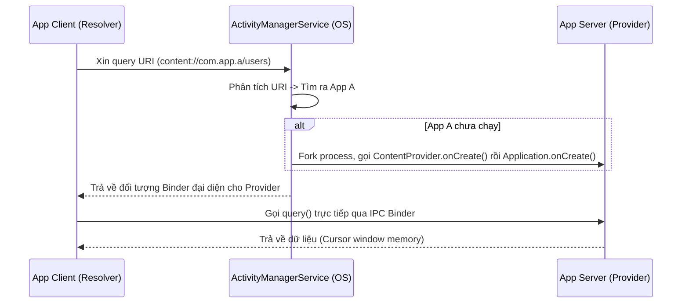

# 4.2.5 Content Provider

## 1. Nó là gì và vì sao nó tồn tại?

**Content Provider** là một trong 4 Application Component cốt lõi của Android (Activity, Service, Broadcast Receiver, Content Provider). Nó đóng vai trò **cổng giao tiếp dữ liệu có kiểm soát** giữa các ứng dụng và hệ thống: app sở hữu dữ liệu mở dữ liệu qua Content URI chuẩn, app khác đọc/ghi bằng các thao tác CRUD qua `ContentResolver`.

> **Mental model:** hãy hình dung Content Provider như một **REST API nội bộ của hệ điều hành**: URI là endpoint, `query/insert/update/delete` là các method, permission là cơ chế xác thực.

### Vấn đề nó giải quyết

Android ứng dụng mô hình **sandbox bảo mật nghiêm ngặt**: mỗi app chạy trong một Linux process riêng với User ID riêng. Điều này có nghĩa là:

- App A **không thể đọc** file `.db` hay `SharedPreferences` của App B
- App của bạn **không thể trực tiếp** truy cập danh bạ, ảnh, lịch của hệ thống

Từ đó nảy ra hai bài toán:
1. Làm sao app lấy được danh bạ, tin nhắn, danh sách ảnh từ hệ điều hành (vốn thuộc các app khác)?
2. Làm sao app chia sẻ một phần dữ liệu cho app đối tác một cách an toàn mà không làm lộ toàn bộ database?

Nếu không có cơ chế chuẩn hóa, việc chia sẻ dữ liệu yêu cầu các hack như: ghi file ra `external storage`, mở socket server nội bộ, hoặc hardcode path database — tất cả đều nguy hiểm và không nhất quán.

Content Provider giải quyết điều này bằng mô hình **client-server chuẩn hóa**:

- App sở hữu dữ liệu → triển khai **ContentProvider** (server), kiểm soát ai được đọc/ghi gì
- App cần dữ liệu → dùng **ContentResolver** (client), gửi request theo URI chuẩn

### Khi nào nên dùng Content Provider?

| Use case | Nên dùng Content Provider? |
|---|---|
| Đọc danh bạ/ảnh/lịch từ hệ thống | ✅ Bắt buộc |
| Chia sẻ data giữa 2 app cùng công ty | ✅ Phù hợp |
| Cung cấp Search Suggestions cho hệ thống | ✅ Phù hợp |
| Lưu data nội bộ trong một app | ❌ Dùng Room/DataStore |
| Truyền data nhỏ giữa các Activity | ❌ Dùng Intent/Bundle |

---

## 2. Các khái niệm cốt lõi

### Content URI — "địa chỉ" của dữ liệu

URI là địa chỉ để xác định dữ liệu cần truy cập. Cấu trúc:

```text
content://com.android.contacts/contacts/42
  [scheme] [authority/package]  [path]  [id]
```

- **scheme**: Luôn là `content://`
- **authority**: Package name hoặc tên định danh duy nhất của Provider
- **path**: Tên bảng hoặc loại dữ liệu
- **id** (tuỳ chọn): ID của một bản ghi cụ thể

### ContentResolver — client giao tiếp với Provider

`ContentResolver` là proxy của hệ thống Android. Khi bạn gọi `contentResolver.query()`, hệ thống tự tìm đúng ContentProvider từ URI và route request đến đó. Bạn **không bao giờ** instantiate ContentProvider trực tiếp.

### Cursor — kết quả truy vấn

Cursor là con trỏ duyệt qua tập kết quả trả về, giống `ResultSet` trong JDBC. Cursor giữ tài nguyên hệ thống và **phải được đóng** sau khi dùng.

---

## 3. Cơ chế hoạt động bên trong (IPC Binder)

Đây là phần nhiều developer bỏ qua nhưng rất quan trọng để hiểu tại sao query Content Provider có thể chậm và tại sao phải dùng background thread.

```text
App Client                 Android System               App Server
-----------               ----------------              ----------
ContentResolver.query()
        ↓
  Gửi Binder IPC  ──────► ActivityManagerService ──────► ContentProvider.query()
                                  │                              │
                          Tìm Provider từ URI               Xử lý query
                          Khởi động App Server               trả Cursor
                          nếu chưa chạy                        │
                                  ◄──────────────────────── Cursor data
        ◄─────────────────────────
  Cursor (shared memory)
```

Chi tiết hơn: hệ thống chỉ làm trung gian lúc tìm Provider; sau đó client gọi thẳng vào Provider qua Binder.



**Tác động thực tế:**

1. IPC Binder có overhead — đặc biệt khi App Server chưa chạy, Android phải fork process mới
2. Khi khởi động process, hệ thống gọi `ContentProvider.onCreate()` của mọi Provider trên main thread **trước** `Application.onCreate()`. Toàn bộ thời gian này, `query()` của client **bị block**. Vì vậy `onCreate()` của Provider phải thật nhẹ. Đây cũng là lý do nhiều thư viện dùng một Provider rỗng để tự khởi tạo sớm (vd `FirebaseInitProvider` của Firebase, `InitializationProvider` của App Startup)
3. `query()` **block thread** cho đến khi nhận được response
4. **Không bao giờ gọi ContentResolver trên Main Thread** → ANR
5. Ngược lại, `query()/insert()/update()/delete()` của Provider được gọi trên các Binder thread, có thể **song song** từ nhiều client: code Provider phải thread-safe (Room/SQLiteDatabase đã tự xử lý đồng bộ)

---

## 4. Đọc dữ liệu từ System Provider (Client Side)

### Ví dụ thực chiến: Đọc danh sách ảnh từ MediaStore

**Bước 1: Khai báo permission trong AndroidManifest.xml**

```xml
<!-- Android 12L trở xuống (API ≤ 32) -->
<uses-permission
    android:name="android.permission.READ_EXTERNAL_STORAGE"
    android:maxSdkVersion="32" />

<!-- Android 13+ (API 33+) — granular permissions -->
<uses-permission android:name="android.permission.READ_MEDIA_IMAGES" />

<!-- Android 14+ (API 34+) — người dùng có thể chỉ cho phép một số ảnh -->
<uses-permission android:name="android.permission.READ_MEDIA_VISUAL_USER_SELECTED" />
```

> [!NOTE]
> - Từ Android 14, khi người dùng chọn "Chỉ cho phép một số ảnh", app chỉ được cấp `READ_MEDIA_VISUAL_USER_SELECTED` và MediaStore chỉ trả về những ảnh đã chọn. Khai báo permission này để app xử lý đúng trường hợp đó và cho người dùng chọn lại.
> - Nếu app chỉ cần người dùng chọn vài ảnh (đổi avatar, đính kèm), dùng **Photo Picker** (`PickVisualMedia`): không cần permission nào.
> - Không dùng cột `MediaStore.Images.Media.DATA` (đường dẫn file tuyệt đối): deprecated từ API 29 do scoped storage. Luôn truy cập ảnh qua content URI (`ContentUris.withAppendedId`) như code dưới.

**Bước 2: Viết Repository tầng Data**

```kotlin
// data/media/MediaRepository.kt
class MediaRepository @Inject constructor(
    @ApplicationContext private val context: Context
) {
    // suspend fun → phải gọi từ coroutine scope
    suspend fun fetchImages(): List<MediaImage> = withContext(Dispatchers.IO) {
        val images = mutableListOf<MediaImage>()

        val projection = arrayOf(
            MediaStore.Images.Media._ID,
            MediaStore.Images.Media.DISPLAY_NAME,
            MediaStore.Images.Media.DATE_TAKEN,
            MediaStore.Images.Media.SIZE
        )

        context.contentResolver.query(
            MediaStore.Images.Media.EXTERNAL_CONTENT_URI,
            projection,
            null, // selection (WHERE)
            null, // selectionArgs
            "${MediaStore.Images.Media.DATE_TAKEN} DESC" // sortOrder
        )?.use { cursor -> // .use {} tự đóng Cursor ngay cả khi exception
            val idCol       = cursor.getColumnIndexOrThrow(MediaStore.Images.Media._ID)
            val nameCol     = cursor.getColumnIndexOrThrow(MediaStore.Images.Media.DISPLAY_NAME)
            val dateTakenCol= cursor.getColumnIndexOrThrow(MediaStore.Images.Media.DATE_TAKEN)
            val sizeCol     = cursor.getColumnIndexOrThrow(MediaStore.Images.Media.SIZE)

            while (cursor.moveToNext()) {
                val id = cursor.getLong(idCol)
                // Tạo content URI từ ID để dùng với Coil/Glide
                val contentUri = ContentUris.withAppendedId(
                    MediaStore.Images.Media.EXTERNAL_CONTENT_URI, id
                )
                images += MediaImage(
                    id = id,
                    uri = contentUri,
                    name = cursor.getString(nameCol),
                    dateTaken = cursor.getLong(dateTakenCol),
                    size = cursor.getLong(sizeCol)
                )
            }
        }

        images
    }
}

data class MediaImage(
    val id: Long,
    val uri: Uri,
    val name: String,
    val dateTaken: Long,
    val size: Long
)
```

> [!WARNING]
> **Bẫy phổ biến:** Khi truy vấn có filter (`selection`), **không bao giờ** nối thẳng string như `"name = '$userInput'"` — dễ bị SQL Injection. Dùng placeholder `?` và `selectionArgs` array.

```kotlin
// ❌ SQL Injection risk
query(uri, projection, "display_name = '$input'", null, null)

// ✅ Dùng selectionArgs
query(uri, projection, "${MediaStore.Images.Media.DISPLAY_NAME} = ?", arrayOf(input), null)
```

---

## 5. Lắng nghe thay đổi thời gian thực (ContentObserver + Flow)

Người dùng có thể chụp ảnh mới trong khi app đang chạy. Làm sao để gallery tự refresh?

**ContentObserver** là cơ chế của Android để theo dõi thay đổi trên một URI. Kết hợp với `callbackFlow` của Kotlin để tạo một reactive stream:

```kotlin
// data/media/MediaRepository.kt — thêm hàm observe
fun observeImages(): Flow<List<MediaImage>> = callbackFlow {
    // Gửi data lần đầu ngay khi collect
    trySend(fetchImages())

    val observer = object : ContentObserver(Handler(Looper.getMainLooper())) {
        override fun onChange(selfChange: Boolean) {
            // onChange chạy trên main looper: KHÔNG block ở đây (vd runBlocking).
            // Mỗi khi MediaStore thay đổi → re-fetch trong coroutine của callbackFlow
            launch { send(fetchImages()) }
        }
    }

    context.contentResolver.registerContentObserver(
        MediaStore.Images.Media.EXTERNAL_CONTENT_URI,
        true, // notifyForDescendants
        observer
    )

    // Khi Flow bị cancel (scope hủy, màn hình đóng) → unregister để tránh leak
    awaitClose {
        context.contentResolver.unregisterContentObserver(observer)
    }
}
```

> Biến thể gọn hơn: observer chỉ phát tín hiệu (`trySend(Unit)`), rồi phía ngoài dùng `mapLatest { fetchImages() }` để query lại; `mapLatest` tự huỷ lần query cũ nếu có thay đổi mới.

**Sử dụng trong ViewModel:**

```kotlin
@HiltViewModel
class GalleryViewModel @Inject constructor(
    private val mediaRepository: MediaRepository
) : ViewModel() {

    val images: StateFlow<List<MediaImage>> = mediaRepository
        .observeImages()
        .stateIn(
            scope = viewModelScope,
            started = SharingStarted.WhileSubscribed(5_000),
            initialValue = emptyList()
        )
}
```

**Luồng hoạt động:**

```text
Người dùng chụp ảnh mới
        ↓
MediaStore.Images URI thay đổi
        ↓
ContentObserver.onChange() được gọi
        ↓
callbackFlow.trySend(fetchImages())
        ↓
Flow emit List<MediaImage> mới
        ↓
StateFlow cập nhật → UI tự re-render
```
<!-- dd: intent-observe -->

---

## 6. Đọc danh bạ từ ContactsProvider

Một use case thực tế khác. ContactsProvider có schema phức tạp hơn MediaStore. Cần runtime permission `READ_CONTACTS` trước khi query:

```kotlin
// data/contacts/ContactsRepository.kt
suspend fun searchContacts(query: String): List<Contact> = withContext(Dispatchers.IO) {
    val contacts = mutableListOf<Contact>()

    val projection = arrayOf(
        ContactsContract.Contacts._ID,
        ContactsContract.Contacts.DISPLAY_NAME_PRIMARY,
        ContactsContract.Contacts.HAS_PHONE_NUMBER
    )

    context.contentResolver.query(
        ContactsContract.Contacts.CONTENT_URI,
        projection,
        "${ContactsContract.Contacts.DISPLAY_NAME_PRIMARY} LIKE ?",
        arrayOf("%$query%"), // % là wildcard
        "${ContactsContract.Contacts.DISPLAY_NAME_PRIMARY} ASC"
    )?.use { cursor ->
        val idCol   = cursor.getColumnIndexOrThrow(ContactsContract.Contacts._ID)
        val nameCol = cursor.getColumnIndexOrThrow(ContactsContract.Contacts.DISPLAY_NAME_PRIMARY)
        val hasPhoneCol = cursor.getColumnIndexOrThrow(ContactsContract.Contacts.HAS_PHONE_NUMBER)

        while (cursor.moveToNext()) {
            if (cursor.getInt(hasPhoneCol) > 0) {
                contacts += Contact(
                    id = cursor.getLong(idCol),
                    name = cursor.getString(nameCol)
                )
            }
        }
    }

    contacts
}
```

---

## 7. Tự tạo Custom Content Provider (Server Side)

Kịch bản: Công ty bạn có **App A** (app chính) và **App B** (app companion). App B cần đọc profile user từ database của App A.

### Bước 1: Tạo ContentProvider trong App A

```kotlin
// provider/UserProvider.kt (App A)
class UserProvider : ContentProvider() {

    companion object {
        const val AUTHORITY = "com.company.appa.provider"

        // URI patterns
        val CONTENT_URI: Uri = Uri.parse("content://$AUTHORITY/users")

        private val uriMatcher = UriMatcher(UriMatcher.NO_MATCH).apply {
            addURI(AUTHORITY, "users", 1)       // content://authority/users
            addURI(AUTHORITY, "users/#", 2)     // content://authority/users/42
        }
    }

    // Khởi tạo nhẹ nhất có thể — đừng block ở đây
    override fun onCreate(): Boolean = true

    override fun query(
        uri: Uri,
        projection: Array<String>?,
        selection: String?,
        selectionArgs: Array<String>?,
        sortOrder: String?
    ): Cursor? {
        // Kiểm tra permission trước
        context?.checkCallingPermission("com.company.permission.READ_USER")
            ?.takeIf { it != PackageManager.PERMISSION_GRANTED }
            ?.let { throw SecurityException("Missing READ_USER permission") }

        val db = UserDatabase.getInstance(context!!).readableDatabase

        return when (uriMatcher.match(uri)) {
            1 -> db.query("users", projection, selection, selectionArgs, null, null, sortOrder)
            2 -> {
                val id = ContentUris.parseId(uri)
                db.query("users", projection, "_id = ?", arrayOf(id.toString()), null, null, null)
            }
            else -> throw IllegalArgumentException("Unknown URI: $uri")
        }
    }

    // Implement nếu cần write operations
    override fun getType(uri: Uri): String = when (uriMatcher.match(uri)) {
        1 -> "vnd.android.cursor.dir/vnd.com.company.appa.users"
        2 -> "vnd.android.cursor.item/vnd.com.company.appa.users"
        else -> throw IllegalArgumentException("Unknown URI: $uri")
    }

    override fun insert(uri: Uri, values: ContentValues?): Uri? = null
    override fun update(uri: Uri, values: ContentValues?, selection: String?, selectionArgs: Array<String>?): Int = 0
    override fun delete(uri: Uri, selection: String?, selectionArgs: Array<String>?): Int = 0
}
```

> [!NOTE]
> - **Thông báo thay đổi:** trong `query()` gọi `cursor.setNotificationUri(context!!.contentResolver, uri)`, và sau mỗi `insert/update/delete` gọi `context!!.contentResolver.notifyChange(uri, null)`. Thiếu bước này, `ContentObserver` của client (mục 5) sẽ không bao giờ được gọi với Provider tự viết.
> - Dữ liệu không nằm trong SQLite thì có thể trả `MatrixCursor` dựng trong bộ nhớ:

```kotlin
val cursor = MatrixCursor(arrayOf("_id", "name", "email"))
cursor.addRow(arrayOf(1, "Nguyễn Văn An", "an.nguyen@example.com"))
return cursor
```

### Bước 2: Khai báo trong AndroidManifest.xml của App A

```xml
<!-- Khai báo custom permission -->
<permission
    android:name="com.company.permission.READ_USER"
    android:protectionLevel="signature" />
    <!-- signature: chỉ app cùng chữ ký mới được cấp quyền này -->

<provider
    android:name=".provider.UserProvider"
    android:authorities="com.company.appa.provider"
    android:exported="true"
    android:readPermission="com.company.permission.READ_USER" />
```

### Bước 3: App B khai báo và sử dụng

```xml
<!-- AndroidManifest.xml của App B -->
<uses-permission android:name="com.company.permission.READ_USER" />

<!-- Android 11+ (API 30+): package visibility — phải khai báo Provider muốn truy cập,
     nếu không ContentResolver không "thấy" Provider của App A -->
<queries>
    <provider android:authorities="com.company.appa.provider" />
</queries>
```

> Custom permission được đăng ký khi cài app: **App A (app định nghĩa permission) phải được cài trước** App B thì App B mới được cấp quyền.

```kotlin
// data/user/RemoteUserRepository.kt (App B)
suspend fun fetchUsersFromAppA(): List<User> = withContext(Dispatchers.IO) {
    val users = mutableListOf<User>()
    val uri = Uri.parse("content://com.company.appa.provider/users")

    context.contentResolver.query(uri, null, null, null, null)?.use { cursor ->
        while (cursor.moveToNext()) {
            // Parse cursor...
        }
    }

    users
}
```

> [!NOTE]
> `android:protectionLevel="signature"` nghĩa là chỉ app được ký cùng keystore với App A mới được cấp permission này tự động. Đây là cách bảo mật chuẩn cho các app cùng công ty.

---

## 8. Luồng hoàn chỉnh end-to-end

```text
[App B - GalleryScreen]
        ↓ collect StateFlow
[App B - GalleryViewModel]
        ↓ observeImages() / fetchUsersFromAppA()
[App B - Repository]
        ↓ contentResolver.query()
[Android OS - ActivityManagerService]
        ↓ IPC Binder
[App A/System - ContentProvider.query()]
        ↓ SQLite / Room query
[Cursor - Shared Memory Window]
        ↑ trả về App B qua Binder
[App B - Repository parse Cursor]
        ↑ emit vào Flow
[App B - ViewModel StateFlow update]
        ↑ LazyColumn re-render
[App B - GalleryScreen hiển thị ảnh]
```

---

## 9. Sai lầm thường gặp

### 1. Query trên Main Thread

```kotlin
// ❌ Block main thread → ANR (StrictMode báo vi phạm nếu đã bật)
fun onClick() {
    val cursor = contentResolver.query(MediaStore.Images.Media.EXTERNAL_CONTENT_URI, ...)
}

// ✅ Dùng Coroutines
fun onClick() {
    viewModelScope.launch {
        val images = withContext(Dispatchers.IO) {
            repository.fetchImages()
        }
    }
}
```

### 2. Quên đóng Cursor

```kotlin
// ❌ Memory/resource leak — Cursor giữ file descriptor
val cursor = contentResolver.query(...)
cursor?.moveToFirst()
val name = cursor?.getString(0) // cursor không được đóng!

// ✅ .use {} tự động close()
contentResolver.query(...)?.use { cursor ->
    cursor.moveToFirst()
    val name = cursor.getString(0)
} // close() được gọi tự động ở đây
```

### 3. Dùng Content Provider để lưu data nội bộ

```kotlin
// ❌ Anti-pattern — dùng ContentProvider cho data chỉ dùng trong app
class InternalUserProvider : ContentProvider() { ... }

// ✅ Dùng Room + Repository
@Dao interface UserDao { @Query("SELECT * FROM users") fun getAll(): Flow<List<User>> }
```

### 4. exported="true" không có permission

```xml
<!-- ❌ Nguy hiểm — mọi app đều đọc được -->
<provider android:exported="true" />

<!-- ✅ Luôn kèm permission -->
<provider
    android:exported="true"
    android:readPermission="com.company.permission.READ_USER" />
```

---

## 10. Khi nào không dùng Content Provider

- **Data nội bộ**: Dùng Room + DataStore
- **Giao tiếp real-time**: Dùng SharedFlow
- **File transfer lớn**: Dùng `FileProvider` + Intent chooser: tạo content URI bằng `FileProvider.getUriForFile()`, gắn vào Intent kèm `Intent.FLAG_GRANT_READ_URI_PERMISSION` để app nhận được đọc tạm thời đúng file đó, không cần export Provider
- **API server**: Dùng Retrofit/Ktor

Content Provider phù hợp nhất khi cần **truy cập dữ liệu tabular có cấu trúc** từ system providers (MediaStore, ContactsProvider, CalendarProvider) hoặc chia sẻ data có kiểm soát giữa các app. Trước đây Google từng khuyến khích bọc SQLite bằng Provider ngay cả khi chỉ dùng nội bộ; nay đó là anti-pattern vì Room đã thay thế.

| Giải pháp | Khi nào dùng | Trade-off |
|---|---|---|
| Content Provider | Chia sẻ tabular data giữa apps, system data | IPC overhead, setup phức tạp, cần permission |
| Room + Repository | Data nội bộ trong app | Đơn giản, type-safe, không IPC |
| FileProvider | Chia sẻ file (ảnh, PDF) giữa apps | Chỉ dùng cho file, không phải tabular data |
| SharedFlow | Event/message nội bộ trong app | In-memory, không persist qua process death |
| Messenger / AIDL | IPC phức tạp, two-way communication | Boilerplate nhiều, khó maintain |

**Tổng kết best practices:**
- **Security:** dùng `android:readPermission` và `android:writePermission`; không bao giờ `exported="true"` vô điều kiện.
- **Performance:** luôn truy vấn qua Coroutines (`Dispatchers.IO`); giữ `onCreate()` của Provider thật nhẹ vì nó chặn quá trình khởi động app và cả client đang chờ.
- **Resource:** luôn bọc Cursor trong `use {}`.

---

## References

- [Android Developers — Content Provider basics](https://developer.android.com/guide/topics/providers/content-provider-basics)
- [Android Developers — Creating a Content Provider](https://developer.android.com/guide/topics/providers/content-provider-creating)
- [Android Developers — MediaStore](https://developer.android.com/reference/android/provider/MediaStore)
- [Android Developers — ContactsContract](https://developer.android.com/reference/android/provider/ContactsContract)
- [Android Developers — FileProvider](https://developer.android.com/reference/androidx/core/content/FileProvider)
- [Android Developers — ContentProvider (thread-safety, onCreate)](https://developer.android.com/reference/android/content/ContentProvider)
- [Android Developers — Application.onCreate](https://developer.android.com/reference/android/app/Application#onCreate())
- [Android 14 behavior changes — partial photo/video access](https://developer.android.com/about/versions/14/behavior-changes-14)
- [Package visibility — declaring queries](https://developer.android.com/training/package-visibility/declaring)
