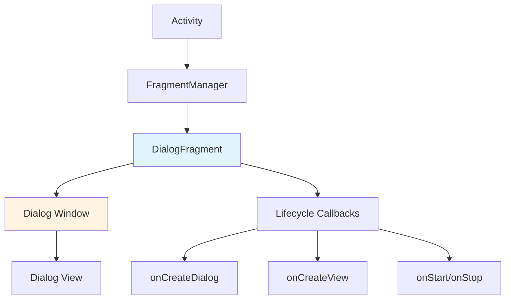
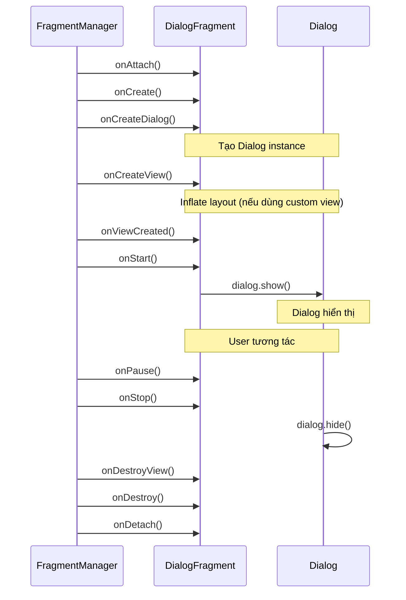
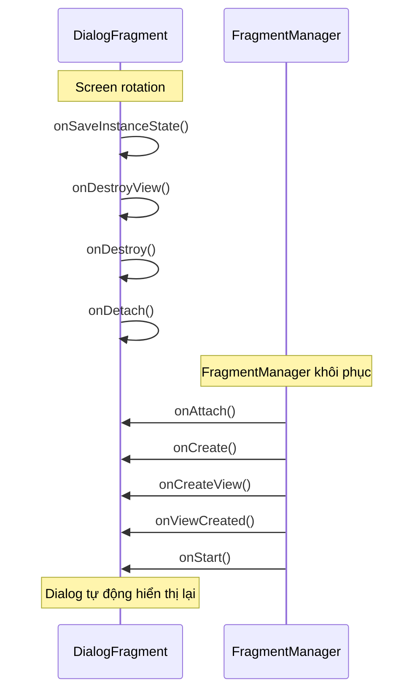
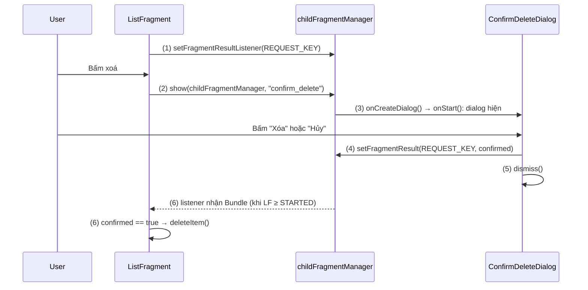
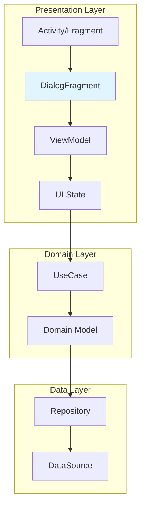

# Dialog and DialogFragment

## Vấn đề cần giải quyết

Dialog là cửa sổ nhỏ xuất hiện phía trước màn hình hiện tại, dùng để:
- Hiển thị thông báo quan trọng.
- Yêu cầu xác nhận từ người dùng.
- Thu thập input ngắn (chọn ngày, chọn thời gian, nhập liệu).
- Hiển thị menu tùy chọn.

### Vấn đề với AlertDialog truyền thống

Trước khi có DialogFragment, lập trình viên thường dùng `AlertDialog` trực tiếp:

```kotlin
// Cách cũ - KHÔNG khuyến nghị
AlertDialog.Builder(this)
    .setTitle("Xác nhận")
    .setMessage("Bạn có chắc chắn muốn xóa?")
    .setPositiveButton("Xóa") { _, _ -> deleteItem() }
    .setNegativeButton("Hủy", null)
    .show()
```

**Vấn đề:**
- **Mất dialog khi rotation**: Activity bị destroy và recreate, dialog biến mất.
- **Không thể khôi phục trạng thái**: Nếu dialog có input (checkbox, text field), dữ liệu bị mất.
- **Khó quản lý lifecycle**: Dialog không có lifecycle rõ ràng, dễ gây memory leak.
- **Không tái sử dụng được**: Mỗi nơi cần dialog phải viết lại code.
- **Crash khi Activity đã destroy**: Nếu callback được gọi sau khi Activity bị destroy.

### DialogFragment ra đời để giải quyết vấn đề gì?

DialogFragment kết hợp **sức mạnh của Fragment** với **giao diện của Dialog**:
- **Tự động xử lý rotation**: FragmentManager tự động khôi phục dialog.
- **Lifecycle rõ ràng**: Có đầy đủ callback vòng đời như Fragment.
- **Tái sử dụng được**: Đóng gói logic dialog vào một class riêng.
- **Giao tiếp an toàn**: Dùng Fragment Result API hoặc Shared ViewModel.
- **Quản lý bởi FragmentManager**: Nhất quán với cách quản lý Fragment khác.

## Sau khi học xong

- Giải thích được tại sao DialogFragment an toàn hơn AlertDialog truyền thống, lifecycle của DialogFragment và cách FragmentManager quản lý dialog.
- Triển khai được DialogFragment với custom layout và BottomSheetDialogFragment.
- Áp dụng được Fragment Result API để giao tiếp giữa dialog và Fragment/Activity cha.
- Biết khi nào hiển thị DialogFragment bằng `show()` và khi nào khai báo nó thành `<dialog>` destination của Navigation Component.
- Triển khai được dialog trong Compose (AlertDialog, Dialog, ModalBottomSheet).

## DialogFragment là gì?

**DialogFragment** là một Fragment do `FragmentManager` quản lý, tạo và sở hữu một `Dialog` riêng làm cửa sổ hiển thị: Fragment giữ lifecycle, state và logic, còn Dialog chỉ là Window nằm trên Window của Activity.

Mental model: DialogFragment là **người quản lý**, Dialog là **cửa sổ** do người quản lý mở ra. FragmentManager ghi nhớ người quản lý, kể cả qua xoay màn hình; cửa sổ thì bị đóng và mở lại mỗi lần người quản lý được tạo lại (`onCreateDialog()` chạy lại). Vì vậy state và logic đặt ở DialogFragment (hoặc ViewModel), không đặt vào Dialog.

## Cách hoạt động

> [!NOTE]
> **Kiến thức dùng trước.** Các ví dụ dùng tối thiểu vài kiến thức của Session sau:
> - ViewBinding (class sinh ra từ layout để truy cập View an toàn): [View Binding](../../../session_06/view_binding.md).
> - ViewModel (giữ state qua configuration change) và `activityViewModels()`: [ViewModel](../../../session_06/viewmodel.md); phạm vi `viewModels()` / `activityViewModels()` ở [Fragment State Changes](state_changes.md).
> - `StateFlow` và coroutine (`lifecycleScope`, `repeatOnLifecycle`): 7.1.4.2 Flow (chưa có bài), 8.4.3 Coroutines (chưa có bài); mẫu collect an toàn trong Fragment ở [Fragment Lifecycle](lifecycle.md).
> - Composable và state của Compose (`remember`, `rememberSaveable`): [Jetpack Compose Overview](../../../jetpack_compose_ui/overview.md), 9.2.2 Remember and rememberSaveable (chưa có bài).

### Kiến trúc tổng thể

DialogFragment là một **Fragment đặc biệt** được hiển thị dưới dạng dialog. Nó:
- Kế thừa từ `Fragment` (không phải `Dialog`).
- Được quản lý bởi `FragmentManager`.
- Có lifecycle đầy đủ như Fragment.
- Tự động xử lý configuration changes (rotation, dark mode...).


<!-- dd: dlg-tree -->

DialogFragment tạo ra một **Window riêng** (Dialog Window) nằm trên Window của Activity. Window này chứa View của dialog.

### Lifecycle của DialogFragment

#### So sánh với Fragment thông thường


<!-- dd: dlg-show-a -->
<!-- dd: dlg-show-b -->

#### Các callback quan trọng

**1. onCreateDialog()**
- Được gọi để tạo Dialog instance.
- Trả về `Dialog` (thường là `AlertDialog`).
- Được gọi mỗi khi DialogFragment tạo view (ngay sau `onCreate`, trước `onCreateView`), nên chạy lại sau mỗi lần DialogFragment được tạo lại (ví dụ xoay màn hình).

```kotlin
override fun onCreateDialog(savedInstanceState: Bundle?): Dialog {
    return AlertDialog.Builder(requireContext())
        .setTitle("Xác nhận")
        .setMessage("Bạn có chắc chắn?")
        .setPositiveButton("OK") { _, _ -> }
        .create()
}
```

**2. onCreateView()**
- Được gọi nếu bạn muốn dùng **custom layout** cho dialog.
- Không cần thiết nếu chỉ dùng `onCreateDialog()`.

```kotlin
override fun onCreateView(
    inflater: LayoutInflater,
    container: ViewGroup?,
    savedInstanceState: Bundle?
): View? {
    return inflater.inflate(R.layout.dialog_custom, container, false)
}
```

**3. onStart() và onStop()**
- `onStart()`: Dialog hiển thị.
- `onStop()`: Dialog ẩn (không phải destroy).
- Dùng để đăng ký/hủy listener.

**4. onDismiss() và onCancel()**
- `onDismiss()`: dialog bị dismiss, nơi cleanup.
- `onCancel()`: user nhấn Back hoặc tap outside.

```kotlin
class MyDialog : DialogFragment() {
    
    override fun onDismiss(dialog: DialogInterface) {
        super.onDismiss(dialog)
        // Cleanup khi dialog bị dismiss
    }
    
    override fun onCancel(dialog: DialogInterface) {
        super.onCancel(dialog)
        // Handle khi user nhấn Back hoặc tap outside
    }
}
```

#### Lifecycle khi rotation


<!-- dd: dlg-rotate -->

FragmentManager **tự động khôi phục** DialogFragment sau rotation. Dialog sẽ hiển thị lại mà không cần code thêm.

### AlertDialog trong DialogFragment

#### Ví dụ: xác nhận xoá, cách 1 dùng onCreateDialog() (khuyến nghị)

```kotlin
class ConfirmDeleteDialog : DialogFragment() {
    
    override fun onCreateDialog(savedInstanceState: Bundle?): Dialog {
        return AlertDialog.Builder(requireContext())
            .setTitle("Xác nhận xóa")
            .setMessage("Bạn có chắc chắn muốn xóa item này?")
            .setPositiveButton("Xóa") { _, _ ->
                // Xử lý khi nhấn Xóa
                onConfirmDelete()
            }
            .setNegativeButton("Hủy") { dialog, _ ->
                dialog.dismiss()
            }
            .create()
    }
    
    private fun onConfirmDelete() {
        // Logic xóa
        dismiss()
    }
}
```

**Cách hiển thị:**

```kotlin
// Trong Activity hoặc Fragment
ConfirmDeleteDialog().show(supportFragmentManager, "confirm_delete")
```

#### Ví dụ: dialog nhập liệu, cách 2 dùng onCreateView() cho custom layout

```kotlin
class CustomInputDialog : DialogFragment() {
    
    private var _binding: DialogCustomInputBinding? = null
    private val binding get() = _binding!!
    
    override fun onCreateView(
        inflater: LayoutInflater,
        container: ViewGroup?,
        savedInstanceState: Bundle?
    ): View {
        _binding = DialogCustomInputBinding.inflate(inflater, container, false)
        return binding.root
    }
    
    override fun onViewCreated(view: View, savedInstanceState: Bundle?) {
        super.onViewCreated(view, savedInstanceState)
        
        binding.btnSubmit.setOnClickListener {
            val input = binding.etInput.text.toString()
            onSubmit(input)
        }
        
        binding.btnCancel.setOnClickListener {
            dismiss()
        }
    }
    
    override fun onDestroyView() {
        super.onDestroyView()
        _binding = null
    }
    
    private fun onSubmit(input: String) {
        // Xử lý input
        dismiss()
    }
}
```

#### Ví dụ: dialog toàn màn hình, set dialog style trong onCreate()

`setStyle()` chỉnh giao diện và hành vi của Dialog, nên phải gọi trước khi Dialog được tạo ở `onCreateDialog()`; gọi sau đó thì không có tác dụng.

```kotlin
class FullScreenDialog : DialogFragment() {
    
    override fun onCreate(savedInstanceState: Bundle?) {
        super.onCreate(savedInstanceState)
        setStyle(STYLE_NORMAL, R.style.FullScreenDialog)
    }
}
```

### BottomSheetDialogFragment

#### BottomSheetDialogFragment là gì?

BottomSheetDialogFragment là DialogFragment hiển thị dialog **từ dưới lên** (bottom sheet). Phù hợp cho:
- Menu tùy chọn.
- Form nhập liệu.
- Hiển thị chi tiết nhanh.
- Filter, sort options.

#### Ví dụ: bottom sheet bộ lọc, triển khai BottomSheetDialogFragment

```kotlin
class FilterBottomSheet : BottomSheetDialogFragment() {
    
    private var _binding: BottomSheetFilterBinding? = null
    private val binding get() = _binding!!
    
    override fun onCreateView(
        inflater: LayoutInflater,
        container: ViewGroup?,
        savedInstanceState: Bundle?
    ): View {
        _binding = BottomSheetFilterBinding.inflate(inflater, container, false)
        return binding.root
    }
    
    override fun onViewCreated(view: View, savedInstanceState: Bundle?) {
        super.onViewCreated(view, savedInstanceState)
        
        setupListeners()
    }
    
    private fun setupListeners() {
        binding.btnApply.setOnClickListener {
            val filters = getSelectedFilters()
            onApplyFilters(filters)
            dismiss()
        }
        
        binding.btnCancel.setOnClickListener {
            dismiss()
        }
    }
    
    override fun onDestroyView() {
        super.onDestroyView()
        _binding = null
    }
    
    private fun getSelectedFilters(): Filters {
        // Lấy filter đã chọn
        return Filters()
    }
    
    private fun onApplyFilters(filters: Filters) {
        // Áp dụng filter
    }
}
```

**Cách hiển thị:**

```kotlin
FilterBottomSheet().show(supportFragmentManager, "filter_bottom_sheet")
```

#### Customizing BottomSheet behavior

```kotlin
class CustomBottomSheet : BottomSheetDialogFragment() {
    
    override fun onCreateDialog(savedInstanceState: Bundle?): Dialog {
        val dialog = super.onCreateDialog(savedInstanceState) as BottomSheetDialog
        
        dialog.setOnShowListener {
            val bottomSheet = dialog.findViewById<View>(
                com.google.android.material.R.id.design_bottom_sheet
            )
            
            // Set behavior
            val behavior = BottomSheetBehavior.from(bottomSheet as View)
            behavior.peekHeight = 400 // Chiều cao khi peek
            behavior.state = BottomSheetBehavior.STATE_EXPANDED
            
            // Disable drag
            // behavior.isDraggable = false
        }
        
        return dialog
    }
}
```

### Communication - Giao tiếp với Dialog

#### Pattern 1: Fragment Result API (Khuyến nghị)

Đây là pattern **hiện đại và an toàn nhất** để dialog trả kết quả cho Fragment/Activity cha. Dialog gọi `setFragmentResult(requestKey, bundle)`, Fragment cha đăng ký listener với cùng `requestKey` trên **cùng FragmentManager** đã dùng để show dialog. Code đầy đủ và luồng chạy ở mục "Ví dụ thực tế", bài toán xác nhận xoá item.

**Ưu điểm:**
- Fragment không cần biết về dialog.
- Kết quả được gửi qua Bundle (key-value, **không** type-safe: sai key hay sai kiểu chỉ lộ ra lúc runtime).
- Hoạt động đúng ngay cả khi dialog bị dismiss do rotation.
- Không cần interface callback.

Fragment Result API dùng chung cho mọi cặp Fragment, không riêng dialog: xem [FragmentManager](fragment_manager.md), mục "Pattern 2: Fragment Result API (Cho one-time event)".

#### Pattern 2: Shared ViewModel

Dùng khi dialog và Fragment/Activity cha cần **chia sẻ dữ liệu phức tạp**.

```kotlin
// SharedViewModel.kt
class SharedViewModel : ViewModel() {
    private val _dialogResult = MutableStateFlow<DialogResult?>(null)
    val dialogResult: StateFlow<DialogResult?> = _dialogResult
    
    fun setDialogResult(result: DialogResult) {
        _dialogResult.value = result
    }
    
    fun clearResult() {
        _dialogResult.value = null
    }
}

// ConfirmDialog.kt
class ConfirmDialog : DialogFragment() {
    private val viewModel: SharedViewModel by activityViewModels()
    
    override fun onCreateDialog(savedInstanceState: Bundle?): Dialog {
        return AlertDialog.Builder(requireContext())
            .setTitle("Xác nhận")
            .setPositiveButton("OK") { _, _ ->
                viewModel.setDialogResult(DialogResult.Confirmed)
                dismiss()
            }
            .create()
    }
}

// Fragment cha
class ParentFragment : Fragment() {
    private val viewModel: SharedViewModel by activityViewModels()
    
    override fun onViewCreated(view: View, savedInstanceState: Bundle?) {
        viewLifecycleOwner.lifecycleScope.launch {
            viewLifecycleOwner.repeatOnLifecycle(Lifecycle.State.STARTED) {
                viewModel.dialogResult.collect { result ->
                    result?.let {
                        handleResult(it)
                        viewModel.clearResult()
                    }
                }
            }
        }
    }
    
    private fun handleResult(result: DialogResult) {
        when (result) {
            is DialogResult.Confirmed -> { /* ... */ }
            is DialogResult.Cancelled -> { /* ... */ }
        }
    }
}
```

#### Pattern 3: Interface Callback (Legacy)

Pattern cũ, không khuyến nghị trong project mới.

```kotlin
class ConfirmDialog : DialogFragment() {
    
    interface OnConfirmListener {
        fun onConfirm()
        fun onCancel()
    }
    
    private var listener: OnConfirmListener? = null
    
    override fun onAttach(context: Context) {
        super.onAttach(context)
        listener = when {
            parentFragment is OnConfirmListener -> parentFragment as OnConfirmListener
            context is OnConfirmListener -> context as OnConfirmListener
            else -> throw ClassCastException("$context must implement OnConfirmListener")
        }
    }
    
    override fun onCreateDialog(savedInstanceState: Bundle?): Dialog {
        return AlertDialog.Builder(requireContext())
            .setPositiveButton("OK") { _, _ -> listener?.onConfirm() }
            .setNegativeButton("Cancel") { _, _ -> listener?.onCancel() }
            .create()
    }
    
    override fun onDetach() {
        super.onDetach()
        listener = null
    }
}
```

**Nhược điểm:**
- Coupling cao giữa dialog và Activity/Fragment.
- Khó tái sử dụng.
- Khó test.

### DialogFragment vs Navigation Component Dialog

#### Navigation Component Dialog

Navigation Component cung cấp cách hiển thị dialog thông qua NavGraph:

```xml
<!-- nav_graph.xml -->
<dialog
    android:id="@+id/confirmDialog"
    android:name="com.example.ConfirmDialog"
    android:label="ConfirmDialog" />
```

```kotlin
// Điều hướng đến dialog
findNavController().navigate(R.id.confirmDialog)
```

Class khai báo trong `<dialog>` vẫn là một DialogFragment bình thường. Khác biệt nằm ở chỗ ai hiển thị và ai giữ nó:

- **`show()` thủ công**: bạn chọn FragmentManager (`childFragmentManager` hay `parentFragmentManager`) và tag; dialog không nằm trong back stack điều hướng.
- **`<dialog>` destination**: NavController tự show DialogFragment và đặt nó lên back stack của NavController, hiện đè lên destination trước đó. User dismiss dialog (Back, chạm ra ngoài) thì destination này bị pop. Nhờ vậy dialog nhận argument (Safe Args), có action và deep link như mọi destination khác.

Vì sao chọn Navigation Component hay FragmentManager trực tiếp nói chung (type safety, deep link, testing…) ở [FragmentManager](fragment_manager.md), mục "So sánh FragmentManager vs Navigation Component". Với dialog: app đã dùng Navigation thì khai báo dialog thành `<dialog>` destination; app tự quản lý FragmentManager thì `show()` như các mục trên.

### Dialog trong Compose

Trong Compose, dialog không phải Fragment mà là một composable: nó hiện khi state hiển thị là `true` và biến mất khi state về `false`.

#### AlertDialog trong Compose

```kotlin
@Composable
fun ConfirmDeleteDialog(
    onConfirm: () -> Unit,
    onDismiss: () -> Unit
) {
    AlertDialog(
        onDismissRequest = onDismiss,
        title = { Text("Xác nhận xóa") },
        text = { Text("Bạn có chắc chắn muốn xóa item này?") },
        confirmButton = {
            TextButton(onClick = onConfirm) {
                Text("Xóa")
            }
        },
        dismissButton = {
            TextButton(onClick = onDismiss) {
                Text("Hủy")
            }
        }
    )
}

// Cách sử dụng
@Composable
fun ListScreen() {
    // rememberSaveable: dialog vẫn mở sau khi xoay màn hình (remember sẽ mất)
    var showDialog by rememberSaveable { mutableStateOf(false) }
    
    if (showDialog) {
        ConfirmDeleteDialog(
            onConfirm = {
                // Xóa item
                showDialog = false
            },
            onDismiss = { showDialog = false }
        )
    }
    
    Button(onClick = { showDialog = true }) {
        Text("Xóa")
    }
}
```

#### Custom Dialog trong Compose

```kotlin
@Composable
fun CustomInputDialog(
    onDismiss: () -> Unit,
    onSubmit: (String) -> Unit
) {
    var inputText by rememberSaveable { mutableStateOf("") } // giữ text đang gõ qua rotation
    
    Dialog(onDismissRequest = onDismiss) {
        Surface(
            shape = RoundedCornerShape(16.dp),
            modifier = Modifier.padding(16.dp)
        ) {
            Column(
                modifier = Modifier.padding(16.dp),
                verticalArrangement = Arrangement.spacedBy(16.dp)
            ) {
                Text(
                    text = "Nhập tên",
                    style = MaterialTheme.typography.titleLarge
                )
                
                OutlinedTextField(
                    value = inputText,
                    onValueChange = { inputText = it },
                    label = { Text("Tên") },
                    modifier = Modifier.fillMaxWidth()
                )
                
                Row(
                    modifier = Modifier.fillMaxWidth(),
                    horizontalArrangement = Arrangement.End
                ) {
                    TextButton(onClick = onDismiss) {
                        Text("Hủy")
                    }
                    Spacer(modifier = Modifier.width(8.dp))
                    Button(onClick = { onSubmit(inputText) }) {
                        Text("Xác nhận")
                    }
                }
            }
        }
    }
}
```

#### ModalBottomSheet trong Compose

```kotlin
@OptIn(ExperimentalMaterial3Api::class)
@Composable
fun FilterBottomSheet(
    onDismiss: () -> Unit,
    onApply: (Filters) -> Unit
) {
    ModalBottomSheet(
        onDismissRequest = onDismiss,
        sheetState = rememberModalBottomSheetState()
    ) {
        Column(
            modifier = Modifier
                .fillMaxWidth()
                .padding(16.dp)
        ) {
            Text(
                text = "Bộ lọc",
                style = MaterialTheme.typography.titleLarge
            )
            
            Spacer(modifier = Modifier.height(16.dp))
            
            // Filter options
            // ...
            
            Spacer(modifier = Modifier.height(16.dp))
            
            Row(
                modifier = Modifier.fillMaxWidth(),
                horizontalArrangement = Arrangement.spacedBy(8.dp)
            ) {
                OutlinedButton(
                    onClick = onDismiss,
                    modifier = Modifier.weight(1f)
                ) {
                    Text("Hủy")
                }
                Button(
                    onClick = { onApply(Filters()) },
                    modifier = Modifier.weight(1f)
                ) {
                    Text("Áp dụng")
                }
            }
            
            Spacer(modifier = Modifier.height(16.dp))
        }
    }
}
```

## Ví dụ thực tế

### Xác nhận xoá item, trả kết quả về Fragment cha bằng Fragment Result API

Màn hình danh sách cần hỏi lại trước khi xoá một item. Dialog chỉ hỏi và trả về `true`/`false`; việc xoá thuộc về Fragment cha. Luồng chạy:

1. `ListFragment.onCreate()` đăng ký listener với `REQUEST_KEY` trên `childFragmentManager`, đúng manager sẽ dùng để show dialog.
2. User bấm xoá: `ConfirmDeleteDialog().show(childFragmentManager, "confirm_delete")`.
3. FragmentManager add dialog; `onCreateDialog()` tạo `AlertDialog`, dialog hiện ở `onStart()`.
4. User bấm "Xóa" hoặc "Hủy": dialog gọi `setFragmentResult(REQUEST_KEY, bundleOf(RESULT_KEY to true/false))`, kết quả được ghi vào `childFragmentManager` của `ListFragment`.
5. Dialog `dismiss()`.
6. `childFragmentManager` chuyển Bundle cho listener khi `ListFragment` ít nhất `STARTED`; `confirmed == true` thì `deleteItem()`.



```kotlin
// ConfirmDeleteDialog.kt
class ConfirmDeleteDialog : DialogFragment() {
    
    companion object {
        const val REQUEST_KEY = "confirm_delete_request"
        const val RESULT_KEY = "confirmed"
    }
    
    override fun onCreateDialog(savedInstanceState: Bundle?): Dialog { // (3)
        return AlertDialog.Builder(requireContext())
            .setTitle("Xác nhận xóa")
            .setMessage("Bạn có chắc chắn muốn xóa?")
            .setPositiveButton("Xóa") { _, _ ->
                // (4) Gửi kết quả TRUE
                setFragmentResult(REQUEST_KEY, bundleOf(RESULT_KEY to true))
                dismiss() // (5)
            }
            .setNegativeButton("Hủy") { dialog, _ ->
                // (4) Gửi kết quả FALSE
                setFragmentResult(REQUEST_KEY, bundleOf(RESULT_KEY to false))
                dialog.dismiss() // (5)
            }
            .create()
    }
}

// Fragment/Activity cha
class ListFragment : Fragment() {
    
    override fun onCreate(savedInstanceState: Bundle?) {
        super.onCreate(savedInstanceState)
        
        // (1) Dialog được show bằng childFragmentManager (bên dưới), nên setFragmentResult() trong dialog
        // ghi kết quả vào childFragmentManager của ListFragment. Listener phải đăng ký trên CÙNG manager đó;
        // setFragmentResultListener() dạng KTX đăng ký trên parentFragmentManager → không bao giờ nhận được.
        childFragmentManager.setFragmentResultListener(ConfirmDeleteDialog.REQUEST_KEY, this) { _, bundle ->
            val confirmed = bundle.getBoolean(ConfirmDeleteDialog.RESULT_KEY) // (6)
            if (confirmed) {
                deleteItem()
            }
        }
    }
    
    private fun showDeleteConfirmation() {
        ConfirmDeleteDialog().show(childFragmentManager, "confirm_delete") // (2)
    }
    
    private fun deleteItem() {
        // Logic xóa
    }
}
```

**Kết quả:** bấm "Xóa" thì `ListFragment` nhận `confirmed = true` và xoá item, bấm "Hủy" thì không có gì bị xoá; dialog không giữ reference nào tới `ListFragment`, nên dùng lại được ở bất kỳ Fragment nào đăng ký cùng `REQUEST_KEY`.

### Dialog xác nhận gọi ViewModel của Fragment cha (MVVM + Clean Architecture)

DialogFragment chỉ thuộc Presentation Layer: nó hiển thị dialog và thu thập input, rồi giao việc cho ViewModel. MVVM và Clean Architecture được học ở [MVVM](../../../session_07/architecture/mvvm.md) và 7.2.5 Clean Architecture (chưa có bài).


<!-- dd: dlg-layers -->

**Vai trò của DialogFragment**:
- **Presentation Layer**: Hiển thị dialog, thu thập input từ user.
- **Không thuộc Domain Layer**: DialogFragment không nên xuất hiện trong UseCase.
- **Không thuộc Data Layer**: DialogFragment không nên biết về Repository.

Nguyên tắc Separation of Concerns: dialog nhận `itemId` qua arguments, khi user bấm "Xóa" thì gọi ViewModel của Fragment cha rồi dismiss.

```kotlin
// Đúng: DialogFragment chỉ ở Presentation Layer
class ConfirmDeleteDialog : DialogFragment() {
    // ViewModel của Fragment cha (dialog được show bằng childFragmentManager của nó).
    // Nếu dùng by viewModels() của chính dialog, ViewModel bị clear ngay khi dismiss → coroutine xoá bị huỷ.
    private val viewModel: ItemListViewModel by viewModels({ requireParentFragment() })
    private val itemId: String by lazy { requireArguments().getString(ARG_ITEM_ID)!! }
    
    override fun onCreateDialog(savedInstanceState: Bundle?): Dialog {
        return AlertDialog.Builder(requireContext())
            .setTitle("Xác nhận xóa")
            .setPositiveButton("Xóa") { _, _ ->
                viewModel.deleteItem(itemId)
                dismiss()
            }
            .create()
    }

    companion object {
        const val ARG_ITEM_ID = "item_id"
    }
}
```

**Kết quả:** việc xoá chạy trong ViewModel của Fragment cha nên không bị huỷ khi dialog đóng; phản ví dụ đưa DialogFragment xuống Domain Layer ở mục "Sai lầm thường gặp" (mục 11).

### Debug DialogFragment

#### 1. Log lifecycle của DialogFragment

```kotlin
class MyDialog : DialogFragment() {
    
    override fun onAttach(context: Context) {
        super.onAttach(context)
        Log.d("DialogLifecycle", "onAttach")
    }
    
    override fun onCreate(savedInstanceState: Bundle?) {
        super.onCreate(savedInstanceState)
        Log.d("DialogLifecycle", "onCreate")
    }
    
    override fun onCreateDialog(savedInstanceState: Bundle?): Dialog {
        Log.d("DialogLifecycle", "onCreateDialog")
        return super.onCreateDialog(savedInstanceState)
    }
    
    override fun onStart() {
        super.onStart()
        Log.d("DialogLifecycle", "onStart - Dialog visible")
    }
    
    override fun onStop() {
        super.onStop()
        Log.d("DialogLifecycle", "onStop - Dialog hidden")
    }
    
    override fun onDestroyView() {
        super.onDestroyView()
        Log.d("DialogLifecycle", "onDestroyView")
    }
}
```

#### 2. Debug dialog stack

```kotlin
fun debugDialogStack() {
    val fragmentManager = supportFragmentManager
    fragmentManager.fragments.forEach { fragment ->
        if (fragment is DialogFragment) {
            Log.d("DialogStack", "Dialog: ${fragment.javaClass.simpleName}")
            Log.d("DialogStack", "  isAdded: ${fragment.isAdded}")
            Log.d("DialogStack", "  isVisible: ${fragment.isVisible}")
            Log.d("DialogStack", "  dialog: ${fragment.dialog}")
        }
    }
}
```

#### 3. Dùng Layout Inspector

Mở **Layout Inspector** trong Android Studio để xem:
- Dialog window hierarchy.
- View tree của dialog.
- Properties của từng view.

## So sánh với các cách tiếp cận khác

### So sánh Dialog XML vs Compose

| Aspect | XML (DialogFragment) | Compose (Dialog/AlertDialog) |
|--------|---------------------|------------------------------|
| **Đơn vị** | Fragment | Composable function |
| **State management** | Bundle, ViewModel | Compose state |
| **Lifecycle** | Fragment lifecycle | Composition lifecycle |
| **Rotation handling** | Tự động (FragmentManager) | Chỉ khi state hiển thị/input dùng `rememberSaveable` hoặc nằm trong ViewModel (`remember` sẽ mất) |
| **Animation** | XML animation | AnimatedVisibility, Crossfade |
| **Customization** | Custom layout | Composable tree |
| **Testing** | FragmentScenario | ComposeTestRule |

## Khi nào nên và không nên dùng

- **Nên dùng DialogFragment** cho dialog trong UI viết bằng View/Fragment, nhất là khi dialog phải sống qua rotation, có input cần giữ, hoặc được tái sử dụng ở nhiều màn hình.
- **Nên dùng BottomSheetDialogFragment** cho menu tùy chọn, form nhập liệu, chi tiết nhanh, filter/sort.
- **`<dialog>` destination hay `show()`**: app đã dùng Navigation thì khai báo dialog thành `<dialog>` destination; app tự quản lý FragmentManager thì `show()`.
- **Giao tiếp**: Fragment Result API cho kết quả trả về từ dialog; Shared ViewModel khi cần chia sẻ dữ liệu phức tạp; không dùng Interface Callback trong project mới.
- **Màn hình viết bằng Compose**: dùng `AlertDialog`, `Dialog`, `ModalBottomSheet` của Compose, state hiển thị đặt trong `rememberSaveable` hoặc ViewModel.
- **Không nên** gọi `AlertDialog.Builder(...).show()` trực tiếp trong Activity/Fragment: dialog mất khi rotation và không có lifecycle rõ ràng.

## Sai lầm thường gặp

### 1. Truyền callback cho dialog qua setter

```kotlin
// Sai (coupling cao)
class MyDialog : DialogFragment() {
    private lateinit var callback: () -> Unit
    
    fun setCallback(cb: () -> Unit) {
        callback = cb
    }
}
```

Dialog giữ thẳng lambda của nơi gọi, nên phụ thuộc vào nơi gọi. Ngoài ra, sau rotation FragmentManager tạo instance dialog mới, không ai gọi lại `setCallback()`.

**Cách sửa:** Luôn dùng Fragment Result API cho communication.

```kotlin
// Đúng
class MyDialog : DialogFragment() {
    override fun onCreateDialog(savedInstanceState: Bundle?): Dialog {
        return AlertDialog.Builder(requireContext())
            .setPositiveButton("OK") { _, _ ->
                setFragmentResult("request_key", bundleOf("result" to true))
                dismiss()
            }
            .create()
    }
}
```

### 2. Đăng ký result listener trên sai FragmentManager

Dialog được show bằng `childFragmentManager` thì `setFragmentResult()` ghi kết quả vào `childFragmentManager` của Fragment cha. `setFragmentResultListener()` dạng KTX trong Fragment cha lại đăng ký trên `parentFragmentManager`, nên listener không bao giờ nhận được kết quả.

**Cách sửa:** Đăng ký listener trên đúng manager đã show dialog: `childFragmentManager.setFragmentResultListener(...)` (xem code ở mục "Ví dụ thực tế").

### 3. Memory leak do giữ reference đến Activity

```kotlin
// Sai
class MyDialog : DialogFragment() {
    // (Đặt tên `activity` sẽ không compile: trùng getter final getActivity() của Fragment)
    private var hostActivity: MainActivity? = null
    
    override fun onAttach(context: Context) {
        super.onAttach(context)
        hostActivity = context as MainActivity  // Memory leak!
    }
}
```

**Cách sửa:**

```kotlin
// Đúng
class MyDialog : DialogFragment() {
    // Dùng Fragment Result API hoặc Shared ViewModel
}
```

### 4. Dùng `context!!` thay vì `requireContext()`

```kotlin
// Sai (có thể null)
override fun onCreateDialog(savedInstanceState: Bundle?): Dialog {
    return AlertDialog.Builder(context!!)  // Crash nếu context null
        .setTitle("Title")
        .create()
}
```

**Cách sửa:** Dùng `requireContext()` thay vì `context` hoặc `activity`.

```kotlin
// Đúng
override fun onCreateDialog(savedInstanceState: Bundle?): Dialog {
    return AlertDialog.Builder(requireContext())
        .setTitle("Title")
        .create()
}
```

### 5. Không cleanup binding trong onDestroyView()

View của dialog bị hủy ở `onDestroyView()`, nhưng nếu `_binding` vẫn giữ reference thì View cũ không được giải phóng.

**Cách sửa:** Inflate binding trong `onCreateView()` và gán `_binding = null` trong `onDestroyView()`.

```kotlin
class CustomDialog : DialogFragment() {
    private var _binding: DialogCustomBinding? = null
    private val binding get() = _binding!!
    
    override fun onCreateView(
        inflater: LayoutInflater,
        container: ViewGroup?,
        savedInstanceState: Bundle?
    ): View {
        // Chỉ inflate khi cần
        _binding = DialogCustomBinding.inflate(inflater, container, false)
        return binding.root
    }
    
    override fun onDestroyView() {
        super.onDestroyView()
        _binding = null  // Tránh memory leak
    }
}
```

### 6. Crash khi dismiss sau khi Activity đã destroy

```kotlin
// Sai
fun someCallback() {
    dismiss()  // Crash nếu dialog đã bị gỡ, hoặc IllegalStateException nếu state đã được lưu
}
```

**Cách sửa:** kiểm tra dialog còn được add và state chưa được lưu trước khi dismiss.

```kotlin
// Đúng
fun someCallback() {
    if (!isAdded) return                     // dialog đã bị gỡ khỏi FragmentManager
    if (parentFragmentManager.isStateSaved) {
        dismissAllowingStateLoss()           // sau onSaveInstanceState, dismiss() sẽ ném IllegalStateException
    } else {
        dismiss()
    }
}
```

Với non-critical dialogs, có thể dùng thẳng `dismissAllowingStateLoss()`:

```kotlin
// Dialog không quan trọng, có thể mất nếu Activity bị kill
fun dismissDialog() {
    dismissAllowingStateLoss()
}
```

### 7. Dùng dialog.show() mà không check state

```kotlin
// Sai
fun showDialog() {
    MyDialog().show(supportFragmentManager, "tag")
}
```

**Cách sửa:** chỉ show khi FragmentManager chưa lưu state.

```kotlin
// Đúng
fun showDialog() {
    if (!supportFragmentManager.isStateSaved) {
        MyDialog().show(supportFragmentManager, "tag")
    }
}
```

### 8. Tạo DialogFragment không cần thiết

```kotlin
// Sai: Tạo dialog mới mỗi lần
fun showDialog() {
    MyDialog().show(supportFragmentManager, "tag")
}
```

**Cách sửa:** Tái sử dụng dialog nếu đã tồn tại, tìm theo tag trước khi show.

```kotlin
// Đúng: Tái sử dụng dialog nếu đã tồn tại
fun showDialog() {
    val existingDialog = supportFragmentManager.findFragmentByTag("tag")
    if (existingDialog == null) {
        MyDialog().show(supportFragmentManager, "tag")
    }
}
```

### 9. Không handle rotation cho custom view

```kotlin
// Sai
class CustomDialog : DialogFragment() {
    private var inputText = ""
    
    override fun onViewCreated(view: View, savedInstanceState: Bundle?) {
        binding.etInput.setText(inputText)
        binding.etInput.addTextChangedListener {
            inputText = it.toString()  // Không lưu khi rotation
        }
    }
}
```

**Cách sửa:** lưu state vào `outState` và đọc lại từ `savedInstanceState`.

```kotlin
// Đúng
class CustomDialog : DialogFragment() {
    private var inputText = ""
    
    override fun onSaveInstanceState(outState: Bundle) {
        super.onSaveInstanceState(outState)
        outState.putString("input_text", inputText)
    }
    
    override fun onViewCreated(view: View, savedInstanceState: Bundle?) {
        savedInstanceState?.let {
            inputText = it.getString("input_text", "")
        }
        binding.etInput.setText(inputText)
    }
}
```

> [!NOTE]
> EditText có `android:id` vốn **tự lưu và khôi phục** text đang gõ qua state của View hierarchy, nên với riêng text trong EditText thì phần "Đúng" ở trên là thừa. Chỉ cần tự lưu state không nằm trong View (biến tạm, lựa chọn chưa hiển thị), hoặc đưa nó vào ViewModel + `SavedStateHandle`.

### 10. Giữ state hiển thị dialog Compose bằng `remember`

`remember` mất giá trị khi Activity bị recreate, nên dialog đang mở (và text đang gõ) biến mất sau khi xoay màn hình.

**Cách sửa:** dùng `rememberSaveable` (như `showDialog` và `inputText` ở mục Dialog trong Compose) hoặc đặt state trong ViewModel.

### 11. DialogFragment xuất hiện ở Domain Layer

```kotlin
// Sai: DialogFragment xuất hiện ở Domain Layer
class DeleteItemUseCase(
    private val repository: Repository,
    private val dialog: DialogFragment  // KHÔNG NÊN
) {
    suspend fun execute(itemId: String) {
        dialog.show()  // KHÔNG NÊN
        repository.delete(itemId)
    }
}
```

**Cách sửa:** để dialog ở Presentation Layer và gọi ViewModel, UseCase không biết dialog tồn tại (xem mục Dialog xác nhận gọi ViewModel của Fragment cha ở "Ví dụ thực tế").

## Lịch sử phát triển

- **Android 3.0 (API 11):** `android.app.DialogFragment` ra đời cùng Fragment của framework. Bản framework bị deprecated từ **API 28**, thay bằng `androidx.fragment.app.DialogFragment` của Jetpack để hành vi đồng nhất trên mọi máy và có Lifecycle.
- **Support Library 23.2.0 (02/2016):** Design Support Library thêm bottom sheet (`BottomSheetBehavior`), nền của `BottomSheetDialogFragment` ngày nay nằm trong Material Components.
- **Navigation 2.1.0 (09/2019):** thêm `<dialog>` destination, `navigate()` tới nó sẽ show một DialogFragment; `NavHostFragment` hỗ trợ sẵn.
- **Fragment 1.3.0-alpha02 (03/2020):** DialogFragment có constructor nhận `@LayoutRes`, layout mà `onCreateView()` inflate mặc định.
- **Fragment 1.3.0 (stable 02/2021):** Fragment Result API (thêm từ 1.3.0-alpha04, 04/2020) truyền kết quả giữa hai Fragment, dùng được cho DialogFragment, và chỉ gửi kết quả khi Fragment nhận ít nhất `STARTED`. Target fragment API cũ bị deprecated.
- **Fragment 1.3.1 (03/2021):** Dialog của DialogFragment truy cập được ViewTree owners qua DecorView, nên dùng được `ComposeView` bên trong DialogFragment.
- **Fragment 1.5.0:** `onCreateDialog()` mặc định trả về `ComponentDialog` (từ 1.5.0-alpha03, 02/2022).
- **Fragment 1.6.0 (06/2023):** thêm `requireComponentDialog()`; class kế thừa DialogFragment bắt buộc gọi `super` khi override `onDismiss()` (từ 1.6.0-alpha03).
- **Compose Material3 1.1.0 (05/2023):** thêm `ModalBottomSheet` (có từ 1.1.0-alpha06, 02/2023).

## Kết nối hệ thống

- **Tiên quyết:**
  - [Fragment Lifecycle](lifecycle.md): DialogFragment đi qua đúng các callback của Fragment, thêm `onCreateDialog()`.
  - [FragmentManager](fragment_manager.md): `show()` là một transaction của FragmentManager; bài đó có Fragment Result API cho mọi cặp Fragment và so sánh FragmentManager với Navigation Component.
- **Liên quan:**
  - [Fragment State Changes](state_changes.md): lưu state qua rotation và process death, phạm vi `viewModels()` / `activityViewModels()` dùng cho Shared ViewModel.
  - [Fragment Overview](index.md): khi nào dùng Fragment, trong đó có dialog và bottom sheet.
- **Học tiếp:**
  - [View Binding](../../../session_06/view_binding.md), [ViewModel](../../../session_06/viewmodel.md).
  - [MVVM](../../../session_07/architecture/mvvm.md), 7.2.5 Clean Architecture (chưa có bài): vị trí của DialogFragment trong Presentation Layer.
  - [Jetpack Compose Overview](../../../jetpack_compose_ui/overview.md) và 9.2.2 Remember and rememberSaveable (chưa có bài): nền cho dialog trong Compose.

## Nguồn tham khảo

- [Android Developers - DialogFragment](https://developer.android.com/reference/androidx/fragment/app/DialogFragment)
- [Android Developers - Dialogs](https://developer.android.com/guide/topics/ui/dialogs)
- [Android Developers - Communicate with fragments (parent/child Fragment Result)](https://developer.android.com/guide/fragments/communicate)
- [Android Developers - Display dialogs with DialogFragment](https://developer.android.com/guide/fragments/dialogs)
- [Android Developers - BottomSheetDialogFragment](https://developer.android.com/reference/com/google/android/material/bottomsheet/BottomSheetDialogFragment)
- [Material Design - Dialogs](https://m3.material.io/components/dialogs)
- [Jetpack Compose - Dialogs](https://developer.android.com/jetpack/compose/elements#dialogs)
- [android.app.DialogFragment (API 11, deprecated API 28) - Android Developers](https://developer.android.com/reference/android/app/DialogFragment)
- [Fragment release notes (1.3.0-alpha02, 1.3.0, 1.3.1, 1.5.0-alpha03, 1.6.0) - Android Developers](https://developer.android.com/jetpack/androidx/releases/fragment)
- [Navigation release notes (2.1.0: dialog destinations) - Android Developers](https://developer.android.com/jetpack/androidx/releases/navigation)
- [Support Library revision archive (23.2.0: bottom sheets) - Android Developers](https://developer.android.com/topic/libraries/support-library/rev-archive)
- [Compose Material3 release notes (1.1.0: ModalBottomSheet) - Android Developers](https://developer.android.com/jetpack/androidx/releases/compose-material3)
