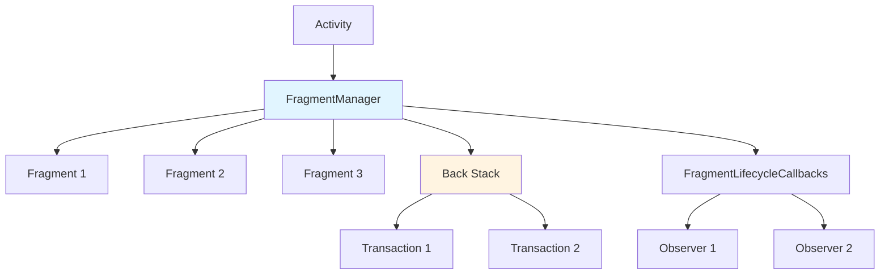
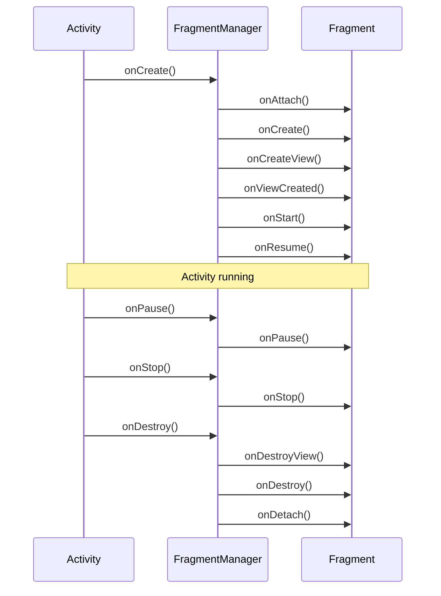
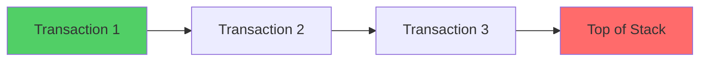
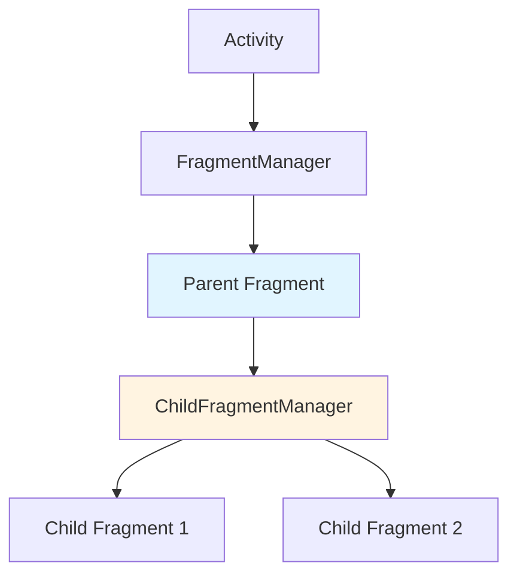
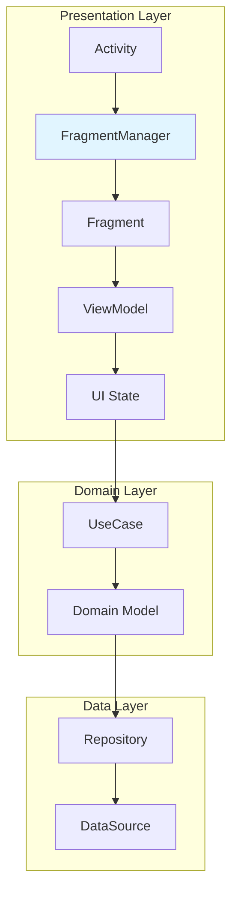

# FragmentManager

## FragmentManager là gì?

FragmentManager là thành phần trung tâm trong hệ thống Fragment của Android, chịu trách nhiệm:

- **Quản lý vòng đời** của tất cả Fragment trong Activity.
- **Thực hiện các thao tác** (thêm, xóa, thay thế, ẩn/hiện) thông qua FragmentTransaction.
- **Quản lý Back Stack** - điều hướng ngược qua các Fragment.
- **Tìm kiếm Fragment** theo ID hoặc tag.
- **Phối hợp với Activity** để đồng bộ trạng thái khi cấu hình thay đổi (rotation, dark mode...).

FragmentManager không phải là một class bạn tự khởi tạo. Nó được cung cấp bởi Activity hoặc Fragment cha thông qua:

```kotlin
// Trong Activity
val fragmentManager = supportFragmentManager

// Trong Fragment (để quản lý Child Fragment)
val childFragmentManager = childFragmentManager

// Trong Fragment (để truy cập FragmentManager của Activity cha)
val parentFragmentManager = parentFragmentManager
```

## Tại sao FragmentManager tồn tại?

### Vấn đề trước khi có FragmentManager

Trước Android 3.0 (API 11), Activity là đơn vị UI duy nhất. Khi cần hiển thị nhiều màn hình trong cùng một Activity, lập trình viên phải:

- Tự quản lý View hierarchy phức tạp.
- Tự xử lý vòng đời của từng phần UI.
- Tự đồng bộ trạng thái khi cấu hình thay đổi.
- Không có cơ chế tái sử dụng UI giữa các Activity.

### FragmentManager giải quyết vấn đề gì?

Fragment không tự quản lý chính mình. Nó không thể tự thêm vào UI, tự thay thế Fragment khác, hay tự quay lại Fragment trước. Tất cả những thao tác này đều cần một "người quản lý", đó chính là FragmentManager.

FragmentManager giải quyết 3 vấn đề cốt lõi:

**1. Tách biệt trách nhiệm quản lý**

Activity không cần biết chi tiết về vòng đời của từng Fragment. FragmentManager đảm nhận vai trò "quản lý vòng đời thay mặt Activity".

**2. Cung cấp API thống nhất cho thao tác UI**

Thay vì thao tác View trực tiếp (addView, removeView), FragmentManager cung cấp FragmentTransaction - một API bậc cao, an toàn hơn, có hỗ trợ Back Stack.

**3. Tự động xử lý cấu hình thay đổi**

FragmentManager tự động lưu trữ và khôi phục trạng thái của Fragment khi Activity bị destroy và recreate (do rotation, dark mode...).

Hiểu FragmentManager là nền tảng để hiểu tại sao Jetpack Navigation Component hoạt động được, bởi Navigation Component là abstraction layer phía trên FragmentManager.

## Cơ chế hoạt động

### Kiến trúc tổng thể


<!-- dd: fmg-tree-a -->
<!-- dd: fmg-tree-b -->

FragmentManager hoạt động như một **trung gian** giữa Activity và các Fragment:

1. **Activity** yêu cầu FragmentManager thực hiện thao tác (thêm Fragment, chuyển Fragment...).
2. **FragmentManager** tạo FragmentTransaction, thực thi thao tác.
3. **FragmentManager** cập nhật Back Stack nếu cần.
4. **FragmentManager** đồng bộ vòng đời của tất cả Fragment với Activity.

### Vòng đời phối hợp

FragmentManager đảm bảo vòng đời của Fragment luôn đồng bộ với Activity:


<!-- dd: fmg-up -->
<!-- dd: fmg-down -->

FragmentManager gọi các callback vòng đời của Fragment **theo đúng thứ tự** và **đồng bộ với Activity**. Nếu Activity ở trạng thái `RESUMED`, Fragment cũng sẽ ở `RESUMED`.

## FragmentTransaction - Thao tác với Fragment

### FragmentTransaction là gì?

FragmentTransaction là một **đối tượng mô tả một loạt thao tác** sẽ thực hiện trên Fragment. Nó tuân theo pattern **Builder** và **Command**.

```kotlin
supportFragmentManager.beginTransaction()
    .add(R.id.container, ProfileFragment())
    .addToBackStack(null)
    .commit()
```

Mỗi FragmentTransaction có thể chứa nhiều thao tác:

- `add()`: Thêm Fragment vào container.
- `replace()`: Xóa Fragment cũ, thêm Fragment mới.
- `remove()`: Xóa Fragment khỏi container.
- `hide()`: Ẩn Fragment (không xóa khỏi bộ nhớ).
- `show()`: Hiển thị Fragment đã ẩn.
- `attach()`: Attach Fragment đã detach.
- `detach()`: Detach Fragment (xóa View, giữ instance).
- `setReorderingAllowed(true)`: Cho phép tối ưu thứ tự thực thi.

### add vs replace - Khi nào dùng cái nào?

```kotlin
// add: Fragment cũ VẪN CÒN dưới Fragment mới (stacking)
supportFragmentManager.beginTransaction()
    .add(R.id.container, FragmentB())
    .addToBackStack(null)
    .commit()

// replace: Fragment cũ BỊ XÓA, Fragment mới thay thế
supportFragmentManager.beginTransaction()
    .replace(R.id.container, FragmentB())
    .addToBackStack(null)
    .commit()
```

**Quy tắc thực tế:** Trong đa số trường hợp navigation, dùng `replace()` + `addToBackStack()`. Chỉ dùng `add()` khi cần nhiều Fragment cùng hiển thị (ví dụ: multi-pane layout trên tablet).

### Commit vs CommitAllowingStateLoss

```kotlin
// Cách 1: Commit thông thường
fragmentManager.beginTransaction()
    .replace(R.id.container, fragment)
    .commit()

// Cách 2: Commit cho phép mất trạng thái
fragmentManager.beginTransaction()
    .replace(R.id.container, fragment)
    .commitAllowingStateLoss()

// Cách 3: Commit và chờ kết quả (synchronous)
fragmentManager.beginTransaction()
    .replace(R.id.container, fragment)
    .commitNow()
```

**Khi nào dùng cái nào?**

- `commit()`: Mặc định, an toàn. Thao tác được thực hiện bất đồng bộ trong message queue.
- `commitAllowingStateLoss()`: Cho phép commit cả **sau** khi Activity đã lưu state (sau `onSaveInstanceState()`), chấp nhận transaction có thể bị mất nếu Activity bị kill rồi khôi phục từ state đã lưu.
- `commitNow()`: Thực thi đồng bộ. Hữu ích khi cần Fragment đã sẵn sàng ngay sau khi commit. Không dùng chung với `addToBackStack()`: `commitNow()` ném `IllegalStateException` nếu transaction đã yêu cầu vào back stack.

### Animation và Transition

```kotlin
supportFragmentManager.beginTransaction()
    .setCustomAnimations(
        R.anim.slide_in_right,  // enter
        R.anim.slide_out_left,  // exit
        R.anim.slide_in_left,   // popEnter
        R.anim.slide_out_right  // popExit
    )
    .replace(R.id.container, fragment)
    .addToBackStack(null)
    .commit()
```

Animation được áp dụng cho cả 2 chiều:
- **Forward**: Khi thêm Fragment mới (enter/exit).
- **Backward**: Khi pop Fragment khỏi Back Stack (popEnter/popExit).

## Back Stack - Điều hướng ngược

### Back Stack là gì?

Back Stack là một **ngăn xếp các FragmentTransaction**. Khi người dùng nhấn Back, FragmentManager sẽ **pop** transaction gần nhất ra khỏi Back Stack và **đảo ngược** thao tác.


<!-- dd: fmg-tx -->

### addToBackStack()

```kotlin
supportFragmentManager.beginTransaction()
    .replace(R.id.container, ProfileFragment())
    .addToBackStack("profile")  // Tag để nhận diện
    .commit()
```

**Quan trọng**: `addToBackStack()` lưu **transaction** (danh sách thao tác để đảo ngược), còn Fragment bị `replace` vẫn được FragmentManager **giữ instance** (chỉ View bị hủy, dừng ở `onDestroyView`) để khi pop thì gắn lại đúng instance đó. Sau process death, FragmentManager tạo instance mới từ state đã lưu. Khi pop, FragmentManager sẽ **đảo ngược** thao tác:

- Nếu transaction là `add()` → pop sẽ `remove()`.
- Nếu transaction là `replace()` → pop sẽ khôi phục Fragment cũ.
- Nếu transaction là `remove()` → pop sẽ `add()` lại.

### popBackStack()

```kotlin
// Pop 1 transaction
supportFragmentManager.popBackStack()

// Pop đến tag cụ thể
supportFragmentManager.popBackStack("profile", 0)

// Pop đến tag, bao gồm cả tag đó
supportFragmentManager.popBackStack("profile", POP_BACK_STACK_INCLUSIVE)

// Pop đến ID
supportFragmentManager.popBackStack(transactionId, 0)
```

### Ví dụ thực tế: Bottom Navigation với Back Stack

```kotlin
class MainActivity : AppCompatActivity() {
    
    private var currentFragment: Fragment? = null
    
    fun navigateTo(fragment: Fragment, tag: String) {
        val fragmentManager = supportFragmentManager
        val existingFragment = fragmentManager.findFragmentByTag(tag)
        val target = existingFragment ?: fragment
        if (target == currentFragment) return

        fragmentManager.beginTransaction().apply {
            currentFragment?.let { hide(it) } // Lần đầu currentFragment = null, không có gì để ẩn
            if (existingFragment == null) {
                add(R.id.container, fragment, tag) // Fragment chưa tồn tại → thêm mới
            } else {
                show(existingFragment)             // Fragment đã tồn tại → chỉ show
            }
        }.commit()

        currentFragment = target
    }
}
```

**Tại sao không dùng `addToBackStack()` trong trường hợp này?**

Vì Bottom Navigation cần **giữ trạng thái** của tất cả tab. Nếu dùng `addToBackStack()`, khi nhấn Back sẽ pop Fragment ra khỏi Back Stack, làm mất trạng thái.

Thay vào đó, ta dùng `hide()`/`show()` để **giữ Fragment trong bộ nhớ** nhưng không hiển thị.

## Communication - Giao tiếp giữa các Fragment

### Pattern 1: Shared ViewModel (Khuyến nghị)

Đây là pattern **chuẩn mực** trong MVVM. Các Fragment chia sẻ cùng một ViewModel thông qua Activity scope.

```kotlin
// SharedViewModel.kt
class SharedViewModel : ViewModel() {
    private val _selectedItem = MutableStateFlow<Item?>(null)
    val selectedItem: StateFlow<Item?> = _selectedItem
    
    fun selectItem(item: Item) {
        _selectedItem.value = item
    }
}

// ListFragment.kt
class ListFragment : Fragment() {
    private val viewModel: SharedViewModel by activityViewModels()
    
    override fun onViewCreated(view: View, savedInstanceState: Bundle?) {
        viewLifecycleOwner.lifecycleScope.launch {
            viewLifecycleOwner.repeatOnLifecycle(Lifecycle.State.STARTED) {
                viewModel.selectedItem.collect { item ->
                    // Xử lý khi item được chọn
                }
            }
        }
        
        // RecyclerView không có setOnItemClickListener: click đi qua callback của Adapter
        binding.recyclerView.adapter = ItemAdapter { item ->
            viewModel.selectItem(item)
        }
    }
}

// DetailFragment.kt
class DetailFragment : Fragment() {
    private val viewModel: SharedViewModel by activityViewModels()
    
    override fun onViewCreated(view: View, savedInstanceState: Bundle?) {
        viewLifecycleOwner.lifecycleScope.launch {
            viewLifecycleOwner.repeatOnLifecycle(Lifecycle.State.STARTED) {
                viewModel.selectedItem.collect { item ->
                    item?.let { displayDetail(it) }
                }
            }
        }
    }
}
```

**Ưu điểm**:
- Fragment không cần biết về nhau.
- Dữ liệu được quan sát (observable), tự động cập nhật.
- Dễ test, dễ bảo trì.

### Pattern 2: Fragment Result API (Cho one-time event)

Dùng khi Fragment A cần **gửi kết quả** cho Fragment B (ví dụ: chọn ảnh, chọn file).

```kotlin
// FragmentA.kt - Gửi kết quả
class FragmentA : Fragment() {
    
    fun onItemSelected(item: Item) {
        setFragmentResult("requestKey", bundleOf("item" to item))
        findNavController().popBackStack()
    }
}

// FragmentB.kt - Nhận kết quả
class FragmentB : Fragment() {
    
    override fun onCreate(savedInstanceState: Bundle?) {
        super.onCreate(savedInstanceState)
        
        setFragmentResultListener("requestKey") { requestKey, bundle ->
            val item = BundleCompat.getParcelable(bundle, "item", Item::class.java)
            // Xử lý kết quả
        }
    }
}
```

**Khi nào dùng?**
- One-time event (chọn ảnh, chọn file, confirm dialog).
- Fragment không cần quan sát liên tục.
- Kết quả được gửi qua Bundle (phải Parcelable/Serializable).

### Pattern 3: Interface Callback (Legacy)

Pattern cũ, không khuyến nghị trong project mới.

```kotlin
// FragmentA.kt
class FragmentA : Fragment() {
    
    interface OnItemSelectedListener {
        fun onItemSelected(item: Item)
    }
    
    private var listener: OnItemSelectedListener? = null
    
    override fun onAttach(context: Context) {
        super.onAttach(context)
        listener = context as? OnItemSelectedListener
            ?: throw ClassCastException("$context must implement OnItemSelectedListener")
    }
    
    fun onItemClick(item: Item) {
        listener?.onItemSelected(item)
    }
}
```

**Nhược điểm**:
- Fragment phụ thuộc vào Activity (coupling cao).
- Không tái sử dụng được.
- Khó test.

## Child Fragment - Fragment lồng nhau

### Child Fragment là gì?

Child Fragment là Fragment được **quản lý bởi Fragment khác** thay vì Activity. FragmentManager của Fragment cha được gọi là `childFragmentManager`.


<!-- dd: fmg-child -->

### Khi nào dùng Child Fragment?

**Trường hợp 1: ViewPager2 với TabLayout**

```kotlin
class ParentFragment : Fragment() {
    
    override fun onViewCreated(view: View, savedInstanceState: Bundle?) {
        val adapter = ViewPagerAdapter(childFragmentManager, lifecycle)
        binding.viewPager.adapter = adapter
        
        TabLayoutMediator(binding.tabLayout, binding.viewPager) { tab, position ->
            tab.text = when (position) {
                0 -> "Tab 1"
                1 -> "Tab 2"
                else -> "Tab 3"
            }
        }.attach()
    }
}
```

**Trường hợp 2: Nested Navigation**

Khi một phần của màn hình có navigation riêng (ví dụ: tab "Profile" có sub-tab "Posts", "Photos", "Videos").

```kotlin
class ProfileFragment : Fragment() {
    
    fun navigateToPosts() {
        childFragmentManager.beginTransaction()
            .replace(R.id.profile_container, PostsFragment())
            .addToBackStack(null)
            .commit()
    }
}
```

### Lưu ý quan trọng

- **Vòng đời**: Child Fragment bị ảnh hưởng bởi vòng đời của Parent Fragment. Khi Parent bị destroy, Child cũng bị destroy.
- **Back Stack**: Child Fragment có Back Stack riêng. Back chỉ được giao cho child trước khi Parent Fragment là **primary navigation fragment** (`setPrimaryNavigationFragment(parent)`; `NavHostFragment` tự làm việc này khi có `app:defaultNavHost="true"`). Nếu không, Back pop back stack của FragmentManager cha, bỏ qua back stack của child.
- **Communication**: Child Fragment nên giao tiếp với Parent Fragment thông qua Shared ViewModel hoặc Fragment Result API.

## So sánh FragmentManager vs Navigation Component

### Navigation Component là gì?

Navigation Component là thư viện của Jetpack, cung cấp API bậc cao để quản lý điều hướng trong ứng dụng. Nó **sử dụng FragmentManager bên dưới**.

### So sánh chi tiết

| Tiêu chí | FragmentManager | Navigation Component |
|----------|----------------|---------------------|
| **Learning curve** | Thấp, API đơn giản | Trung bình, cần hiểu NavGraph, NavHost |
| **Type safety** | Không (dùng tag/id string) | Có (dùng Safe Args plugin) |
| **Deep linking** | Tự implement | Hỗ trợ sẵn |
| **Back Stack management** | Thủ công | Tự động, có thể customize |
| **Animation** | Thủ công | Hỗ trợ sẵn trong XML |
| **Testing** | Khó (phụ thuộc Activity) | Dễ hơn (có TestNavHostController) |
| **Modularization** | Khó | Dễ (dynamic feature module) |
| **Compose support** | Không | Có (Navigation Compose) |
| **Boilerplate** | Nhiều | Ít |

### Khi nào dùng FragmentManager?

- Project nhỏ, ít màn hình.
- Cần kiểm soát chi tiết Back Stack.
- Không muốn thêm dependency.
- Đang maintain codebase cũ.

### Khi nào dùng Navigation Component?

- Project lớn, nhiều màn hình.
- Cần deep linking.
- Làm việc với team lớn, cần type safety.
- Dùng Compose.
- Cần modularization.

### Ví dụ so sánh code

**FragmentManager:**

```kotlin
// Điều hướng
supportFragmentManager.beginTransaction()
    .replace(R.id.container, DetailFragment())
    .addToBackStack(null)
    .commit()

// Truyền dữ liệu
val fragment = DetailFragment().apply {
    arguments = bundleOf("itemId" to itemId)
}
supportFragmentManager.beginTransaction()
    .replace(R.id.container, fragment)
    .addToBackStack(null)
    .commit()
```

**Navigation Component:**

```kotlin
// Điều hướng
findNavController().navigate(R.id.action_to_detail)

// Truyền dữ liệu (với Safe Args)
val action = ListFragmentDirections.actionToDetail(itemId)
findNavController().navigate(action)
```

## FragmentManager trong XML vs Compose

### XML (Traditional View System)

```kotlin
class MainActivity : AppCompatActivity() {
    
    override fun onCreate(savedInstanceState: Bundle?) {
        super.onCreate(savedInstanceState)
        setContentView(R.layout.activity_main)
        
        if (savedInstanceState == null) {
            supportFragmentManager.beginTransaction()
                .add(R.id.container, HomeFragment())
                .commit()
        }
    }
}
```

### Compose (Navigation Compose)

Trong Compose, bạn **không dùng FragmentManager trực tiếp**. Thay vào đó, dùng **Navigation Compose** - một thư viện điều hướng dành riêng cho Compose.

```kotlin
@Composable
fun AppNavigation() {
    val navController = rememberNavController()
    
    NavHost(navController = navController, startDestination = "home") {
        composable("home") {
            HomeScreen(onNavigateToDetail = { itemId ->
                navController.navigate("detail/$itemId")
            })
        }
        
        composable(
            route = "detail/{itemId}",
            arguments = listOf(navArgument("itemId") { type = NavType.StringType })
        ) { backStackEntry ->
            val itemId = backStackEntry.arguments?.getString("itemId")
            DetailScreen(itemId = itemId)
        }
    }
}
```

### Sự khác biệt cốt lõi

| Aspect | XML (FragmentManager) | Compose (Navigation Compose) |
|--------|----------------------|------------------------------|
| **Đơn vị điều hướng** | Fragment | Composable function |
| **Quản lý trạng thái** | Fragment lifecycle | Compose state + SavedStateHandle |
| **Back Stack** | FragmentTransaction | NavBackStackEntry |
| **Animation** | XML animation | AnimatedContent, Crossfade |
| **Type safety** | Bundle (Parcelable) | NavType + Safe Args |

### Chuyển từ XML sang Compose

Nếu đang migrate từ XML sang Compose, bạn có thể **dùng chung Fragment và Compose** trong cùng một Activity:

```kotlin
class MainActivity : AppCompatActivity() {
    
    override fun onCreate(savedInstanceState: Bundle?) {
        super.onCreate(savedInstanceState)
        // Layout chứa cả FragmentContainerView (R.id.fragment_container) và ComposeView (R.id.compose_view).
        // Không gọi setContent { } của Activity: nó thay toàn bộ content view, xoá luôn container của Fragment.
        setContentView(R.layout.activity_main)

        // Fragment XML truyền thống
        if (savedInstanceState == null) {
            supportFragmentManager.beginTransaction()
                .add(R.id.fragment_container, LegacyFragment())
                .commit()
        }

        // Compose trong cùng Activity, gắn vào một ComposeView của layout
        findViewById<ComposeView>(R.id.compose_view).setContent {
            AppNavigation()
        }
    }
}
```

## Best Practices

### 1. Luôn dùng `commit()` thay vì `commitAllowingStateLoss()`

```kotlin
// Đúng
supportFragmentManager.beginTransaction()
    .replace(R.id.container, fragment)
    .commit()

// Sai (trừ khi thật sự cần)
supportFragmentManager.beginTransaction()
    .replace(R.id.container, fragment)
    .commitAllowingStateLoss()
```

`commitAllowingStateLoss()` có thể gây mất trạng thái nếu Activity bị kill. Chỉ dùng khi bạn **chấp nhận rủi ro** (ví dụ: hiển thị dialog không quan trọng).

### 2. Dùng `setReorderingAllowed(true)` cho nhiều thao tác

```kotlin
supportFragmentManager.beginTransaction()
    .setReorderingAllowed(true)
    .hide(currentFragment)
    .add(R.id.container, newFragment)
    .commit()
```

`setReorderingAllowed(true)` cho phép FragmentManager **tối ưu thứ tự thực thi**, tránh việc Fragment bị create/destroy không cần thiết.

### 3. Luôn dùng Shared ViewModel cho communication

```kotlin
// Đúng
class FragmentA : Fragment() {
    private val viewModel: SharedViewModel by activityViewModels()
}

class FragmentB : Fragment() {
    private val viewModel: SharedViewModel by activityViewModels()
}

// Sai (coupling cao)
class FragmentA : Fragment() {
    private lateinit var fragmentB: FragmentB
    
    fun sendData(data: Data) {
        fragmentB.receiveData(data)
    }
}
```

### 4. Dùng `viewLifecycleOwner` thay vì `this` khi observe LiveData/Flow

```kotlin
// Đúng
override fun onViewCreated(view: View, savedInstanceState: Bundle?) {
    viewLifecycleOwner.lifecycleScope.launch {
        viewModel.data.collect { /* ... */ }
    }
}

// Sai (memory leak)
override fun onCreate(savedInstanceState: Bundle?) {
    lifecycleScope.launch {
        viewModel.data.collect { /* ... */ }
    }
}
```

`viewLifecycleOwner` chỉ sống trong khoảng View tồn tại (tạo ở `onCreateView()`, hủy ở `onDestroyView()`). Dùng `this` (Fragment lifecycle) sẽ gây **memory leak** vì coroutine sống lâu hơn View.

### 5. Tránh nested Fragment quá sâu

```kotlin
// Tránh
Activity
  └─ Fragment A
      └─ Fragment B
          └─ Fragment C
              └─ Fragment D
```

Nested Fragment quá sâu gây:
- Khó debug.
- Vòng đời phức tạp.
- Back Stack khó kiểm soát.

Nếu cần nested navigation, cân nhắc dùng **Navigation Component** với **nested NavGraph**.

## Common Mistakes

### Lỗi 1: Transaction đã commit sau `onSaveInstanceState()`

```kotlin
// Lỗi
override fun onSaveInstanceState(outState: Bundle) {
    super.onSaveInstanceState(outState)
    
    // Crash: IllegalStateException
    supportFragmentManager.beginTransaction()
        .replace(R.id.container, fragment)
        .commit()
}
```

**Nguyên nhân**: Sau `onSaveInstanceState()`, Activity không cho phép commit transaction vì có thể gây mất trạng thái. Lỗi thường gặp nhất trong thực tế: callback của một network request trả về khi app đã ở background, rồi gọi `commit()`. Crash báo `IllegalStateException: Can not perform this action after onSaveInstanceState`.

**Giải pháp**:
- Kiểm tra `supportFragmentManager.isStateSaved` trước khi commit.
- Dùng `commitAllowingStateLoss()` cho các cập nhật không quan trọng, nếu chấp nhận mất trạng thái.
- Hoặc delay transaction đến `onResume()`.

### Lỗi 2: Memory leak do retain Fragment

```kotlin
// Lỗi
class MyFragment : Fragment() {
    
    override fun onCreate(savedInstanceState: Bundle?) {
        super.onCreate(savedInstanceState)
        retainInstance = true  // Deprecated, không dùng
    }
}
```

`retainInstance = true` giữ Fragment instance khi Activity bị recreate, gây **memory leak** nếu Fragment giữ reference đến Activity hoặc View.

**Giải pháp**: Dùng `ViewModel` với `SavedStateHandle` để lưu trữ dữ liệu.

### Lỗi 3: Find Fragment bằng ID sai

```kotlin
// Lỗi
val fragment = supportFragmentManager.findFragmentById(R.id.container)
fragment as MyFragment  // ClassCastException nếu không phải MyFragment

// Đúng
val fragment = supportFragmentManager.findFragmentByTag("my_fragment")
if (fragment is MyFragment) {
    // Xử lý
}
```

Luôn dùng `findFragmentByTag()` với tag rõ ràng. Check type trước khi cast.

### Lỗi 4: Không handle Back Stack đúng cách

```kotlin
// Lỗi
override fun onBackPressed() {
    if (supportFragmentManager.backStackEntryCount > 0) {
        supportFragmentManager.popBackStack()
    } else {
        super.onBackPressed()
    }
}
```

Vấn đề: Không handle trường hợp có nhiều Back Stack (ví dụ: Bottom Navigation + nested navigation).

**Giải pháp**: Không override `onBackPressed()` (đã deprecated từ API 33) và không tự viết callback pop back stack. FragmentManager của AndroidX đã tự đăng ký callback với `OnBackPressedDispatcher` của Activity: Back pop back stack của nó (và của child thuộc primary navigation fragment), hết back stack thì trả Back về Activity. Callback tự viết kiểu `popBackStackImmediate()` còn làm hỏng predictive back. Chỉ thêm `OnBackPressedCallback` khi cần hành vi riêng, ví dụ hỏi xác nhận trước khi rời form chưa lưu:

```kotlin
class EditProfileFragment : Fragment() {

    override fun onViewCreated(view: View, savedInstanceState: Bundle?) {
        super.onViewCreated(view, savedInstanceState)
        // Callback gắn với viewLifecycleOwner: tự gỡ khi View bị hủy
        requireActivity().onBackPressedDispatcher.addCallback(viewLifecycleOwner) {
            showDiscardChangesDialog()
        }
    }
}
```

## Debug Techniques

### 1. Log tất cả FragmentTransaction

```kotlin
supportFragmentManager.beginTransaction()
    .replace(R.id.container, fragment)
    .addToBackStack(null)
    .commit()

// Log Back Stack
fun logBackStack() {
    val fragmentManager = supportFragmentManager
    Log.d("BackStack", "Entry count: ${fragmentManager.backStackEntryCount}")
    
    for (i in 0 until fragmentManager.backStackEntryCount) {
        val entry = fragmentManager.getBackStackEntryAt(i)
        Log.d("BackStack", "[$i] ${entry.name} - ${entry.id}")
    }
}
```

### 2. Dùng FragmentLifecycleCallbacks

```kotlin
class MyApplication : Application() {
    
    override fun onCreate() {
        super.onCreate()
        
        registerActivityLifecycleCallbacks(object : ActivityLifecycleCallbacks {
            override fun onActivityCreated(activity: Activity, savedInstanceState: Bundle?) {
                if (activity is AppCompatActivity) {
                    activity.supportFragmentManager.registerFragmentLifecycleCallbacks(
                        object : FragmentManager.FragmentLifecycleCallbacks() {
                            override fun onFragmentCreated(fm: FragmentManager, f: Fragment, savedInstanceState: Bundle?) {
                                Log.d("FragmentLifecycle", "${f.javaClass.simpleName} - onFragmentCreated")
                            }
                            
                            override fun onFragmentResumed(fm: FragmentManager, f: Fragment) {
                                Log.d("FragmentLifecycle", "${f.javaClass.simpleName} - onFragmentResumed")
                            }
                        },
                        true  // true = recursive (bao gồm Child Fragment)
                    )
                }
            }
            // ActivityLifecycleCallbacks là interface: phải override đủ các method còn lại
            override fun onActivityStarted(activity: Activity) {}
            override fun onActivityResumed(activity: Activity) {}
            override fun onActivityPaused(activity: Activity) {}
            override fun onActivityStopped(activity: Activity) {}
            override fun onActivitySaveInstanceState(activity: Activity, outState: Bundle) {}
            override fun onActivityDestroyed(activity: Activity) {}
        })
    }
}
```

### 3. Debug Back Stack bằng adb

Stetho và Flipper đã ngừng phát triển. Cách gọn hơn là dùng `adb`: lệnh đầu bật log chi tiết của FragmentManager (FragmentManager tôn trọng `Log.isLoggable`), lệnh sau dump Activity đang ở top, gồm danh sách Fragment đã add và Back Stack:

```bash
adb shell setprop log.tag.FragmentManager VERBOSE
adb shell dumpsys activity top
```

## Performance Considerations

### 1. Tránh tạo Fragment không cần thiết

```kotlin
// Sai: Tạo Fragment mới mỗi lần
fun navigateToDetail() {
    supportFragmentManager.beginTransaction()
        .replace(R.id.container, DetailFragment())
        .commit()
}

// Đúng: Tái sử dụng Fragment nếu đã tồn tại
fun navigateToDetail() {
    val fragment = supportFragmentManager.findFragmentByTag("detail")
        ?: DetailFragment()
    
    supportFragmentManager.beginTransaction()
        .replace(R.id.container, fragment, "detail")
        .commit()
}
```

### 2. Dùng `hide()`/`show()` thay vì `replace()` cho Bottom Navigation

```kotlin
// Sai: Replace mỗi lần switch tab
fun switchTab(tab: Int) {
    val fragment = when (tab) {
        0 -> HomeFragment()
        1 -> SearchFragment()
        else -> ProfileFragment()
    }
    supportFragmentManager.beginTransaction()
        .replace(R.id.container, fragment)
        .commit()
}

// Đúng: Hide/Show để giữ trạng thái
fun switchTab(tab: Int) {
    val tag = when (tab) {
        0 -> "home"
        1 -> "search"
        else -> "profile"
    }
    
    val fragmentManager = supportFragmentManager
    val existing = fragmentManager.findFragmentByTag(tag)
    val target = existing ?: createFragment(tab)
    if (target == currentFragment) return

    // Một transaction duy nhất: ẩn tab cũ (nếu có), add hoặc show tab mới
    fragmentManager.beginTransaction().apply {
        currentFragment?.let { hide(it) }
        if (existing == null) add(R.id.container, target, tag) else show(target)
    }.commit()

    currentFragment = target
}
```

### 3. Lazy initialization cho Child Fragment

```kotlin
class ParentFragment : Fragment() {
    
    fun showChildFragment() {
        // Tìm bằng tag thay vì giữ field: sau khi xoay, childFragmentManager đã tự khôi phục
        // child, còn field thì về null → add trùng một child nữa
        if (childFragmentManager.findFragmentByTag(CHILD_TAG) == null) {
            childFragmentManager.beginTransaction()
                .add(R.id.child_container, ChildFragment(), CHILD_TAG)
                .commit()
        }
    }

    companion object {
        private const val CHILD_TAG = "child"
    }
}
```

Chỉ tạo Child Fragment khi cần, không tạo sẵn trong `onCreate()`.

## System Thinking - Vị trí trong kiến trúc

### FragmentManager trong MVVM + Clean Architecture


<!-- dd: fmg-layers -->

**Vai trò của FragmentManager**:
- **Presentation Layer**: Quản lý vòng đời Fragment, điều hướng Back Stack.
- **Không thuộc Domain Layer**: FragmentManager không nên xuất hiện trong UseCase hay Domain Model.
- **Không thuộc Data Layer**: FragmentManager không nên biết về Repository hay DataSource.

### Nguyên tắc Separation of Concerns

```kotlin
// Đúng: FragmentManager chỉ ở Presentation Layer
class HomeFragment : Fragment() {
    private val viewModel: HomeViewModel by viewModels()
    
    override fun onViewCreated(view: View, savedInstanceState: Bundle?) {
        // FragmentManager ở đây
        viewLifecycleOwner.lifecycleScope.launch {
            viewModel.uiState.collect { state ->
                render(state)
            }
        }
    }
    
    fun navigateToDetail(itemId: String) {
        // FragmentManager điều hướng
        findNavController().navigate(
            HomeFragmentDirections.actionToDetail(itemId)
        )
    }
}

// Sai: FragmentManager xuất hiện ở Domain Layer
class HomeUseCase(
    private val repository: Repository,
    private val fragmentManager: FragmentManager  // KHÔNG NÊN
) {
    suspend fun execute() {
        val data = repository.getData()
        fragmentManager.beginTransaction()  // KHÔNG NÊN
            .replace(R.id.container, DetailFragment())
            .commit()
    }
}
```

### FragmentManager và Dependency Injection

```kotlin
@Module
@InstallIn(ActivityComponent::class)
object FragmentModule {

    // @Binds không có thân hàm; tạo object từ code phải dùng @Provides.
    // Hilt cung cấp sẵn Activity trong ActivityComponent.
    @Provides
    fun provideFragmentManager(activity: Activity): FragmentManager =
        (activity as FragmentActivity).supportFragmentManager
}

// Trong Fragment
@AndroidEntryPoint
class HomeFragment : Fragment() {
    
    // Không đặt tên `fragmentManager`: trùng getter final getFragmentManager() của Fragment
    @Inject
    lateinit var activityFragmentManager: FragmentManager
    
    override fun onViewCreated(view: View, savedInstanceState: Bundle?) {
        // Dùng FragmentManager của Activity đã được inject
        activityFragmentManager.beginTransaction()
            .replace(R.id.container, DetailFragment())
            .commit()
    }
}
```

**Lưu ý**: Chỉ inject `FragmentManager` khi cần thiết. Trong hầu hết trường hợp, dùng `supportFragmentManager` hoặc `childFragmentManager` trực tiếp là đủ.

## References

- [Android Developers - FragmentManager](https://developer.android.com/reference/androidx/fragment/app/FragmentManager)
- [Android Developers - FragmentTransaction](https://developer.android.com/reference/androidx/fragment/app/FragmentTransaction)
- [Android Developers - Fragment manager (back stack, primary navigation fragment)](https://developer.android.com/guide/fragments/fragmentmanager)
- [Android Developers - Provide custom back navigation](https://developer.android.com/guide/navigation/custom-back)
- [Android Developers - Navigation Component](https://developer.android.com/guide/navigation)
- [Android Developers - Fragment best practices](https://developer.android.com/guide/fragments)
- [Jetpack Navigation Compose](https://developer.android.com/jetpack/compose/navigation)
