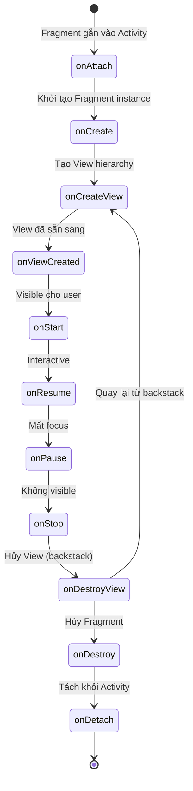
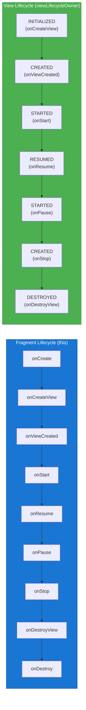
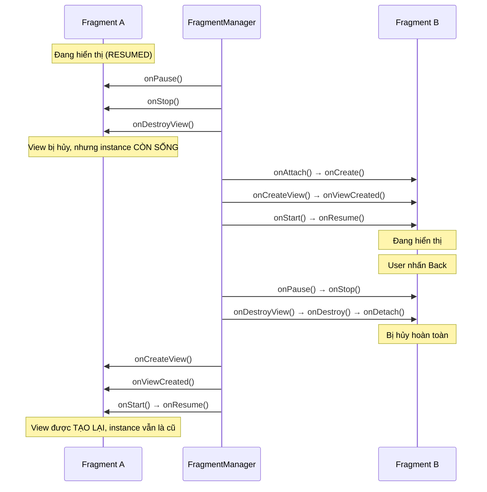
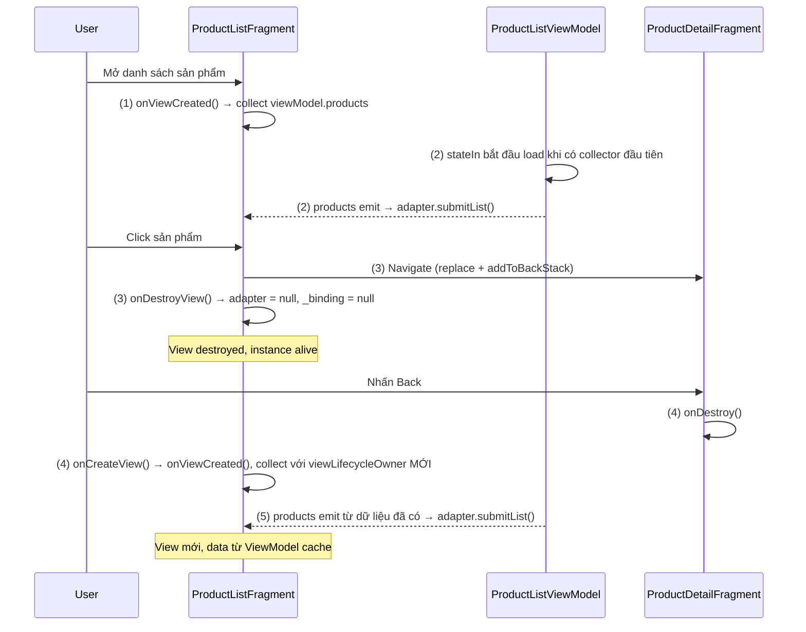
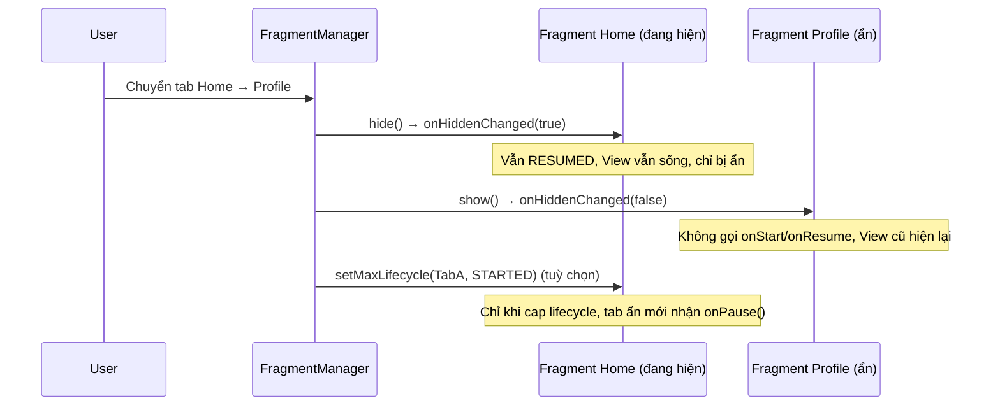

# Fragment Lifecycle

## Vấn đề cần giải quyết

Activity có **một vòng đời duy nhất**: từ `onCreate` đến `onDestroy`. Khi Activity bị destroy, toàn bộ UI đi theo.

Fragment thì khác. Fragment **tách biệt sự tồn tại của chính nó** (Fragment instance) và **sự tồn tại của giao diện** (View). Đây là điểm khác biệt cốt lõi tạo ra phần lớn bug và memory leak trong Android development.

Tình huống điển hình:
- Bạn mở Fragment A → navigate sang Fragment B → Fragment A bị đưa vào **backstack**
- **View của Fragment A bị destroy** (để giải phóng bộ nhớ), nhưng **Fragment A instance vẫn sống** trong backstack
- Khi nhấn Back, Fragment A được khôi phục → View được tạo lại, nhưng Fragment instance vẫn là cái cũ

Nếu không hiểu cơ chế này, bạn sẽ:
- Observe LiveData bằng `this` → duplicate observer mỗi lần quay lại
- Truy cập `binding` sau `onDestroyView` → crash
- Không cleanup resource → memory leak

## Sau khi học xong

- Giải thích được toàn bộ Fragment Lifecycle callbacks và thứ tự gọi, kể cả khi Fragment bị đưa vào backstack.
- Phân biệt được Fragment Lifecycle và View Lifecycle — điểm khác biệt cốt lõi so với Activity.
- Áp dụng được viewLifecycleOwner khi observe LiveData/Flow trong Fragment.
- Biết khi nào dùng từng callback để khởi tạo, bind data, giải phóng tài nguyên.
- Phân biệt được lifecycle của show/hide (tab) so với replace (điều hướng sâu) trong app Single-Activity.

## Fragment Lifecycle là gì?

**Fragment Lifecycle** là chuỗi trạng thái mà `FragmentManager` đưa một Fragment đi qua, gồm hai vòng đời lồng nhau: vòng đời của **Fragment instance** (`this`, từ `onAttach` đến `onDetach`) và vòng đời ngắn hơn của **View** (`viewLifecycleOwner`, từ `onCreateView` đến `onDestroyView`).

Mental model: Fragment instance là **cái khung**, View là **bức tranh lồng trong khung**. Khi Fragment vào backstack, bức tranh bị gỡ ra và vứt đi, cái khung vẫn được giữ; khi quay lại, một bức tranh mới được lồng vào đúng cái khung cũ. Thứ gì gắn với bức tranh (binding, observer cập nhật UI) phải đi theo vòng đời của bức tranh, không theo cái khung.

## Cách hoạt động

### Các callback của Fragment

Fragment có nhiều callback hơn Activity vì phải xử lý thêm quá trình tạo/hủy View riêng biệt.


<!-- dd: frag-state-a -->
<!-- dd: frag-state-b -->

#### Ý nghĩa từng callback

| Callback | Khi nào được gọi | Nên làm gì |
|---|---|---|
| `onAttach(context)` | Fragment gắn vào Activity/parent | Lấy reference đến Activity nếu cần (hiếm khi dùng) |
| `onCreate(savedInstanceState)` | Khởi tạo Fragment instance | Khởi tạo ViewModel, nhận arguments, restore saved state |
| `onCreateView(inflater, container, savedInstanceState)` | Tạo View hierarchy | Inflate layout (hoặc truyền layout qua constructor) |
| `onViewCreated(view, savedInstanceState)` | View đã được tạo xong | **Callback quan trọng nhất**: Bind data, setup listeners, observe LiveData/Flow |
| `onViewStateRestored(savedInstanceState)` | Sau `onViewCreated`, trước `onStart`; state của View hierarchy (text, checkbox có id) đã được khôi phục | Áp lại UI state phụ thuộc giá trị View vừa restore |
| `onStart()` | Fragment visible | Hiếm khi cần override |
| `onResume()` | Fragment interactive (có focus) | Bắt đầu animation, camera, sensor |
| `onPause()` | Mất focus (dialog overlay...) | Tạm dừng animation, camera |
| `onStop()` | Không còn visible | Dừng heavy operations |
| `onDestroyView()` | View bị hủy (backstack hoặc remove) | **Bắt buộc**: Cleanup binding, adapter references |
| `onDestroy()` | Fragment instance bị hủy | Cleanup final resources |
| `onDetach()` | Tách khỏi Activity | Hiếm khi cần override |

`onActivityCreated()` đã **deprecated**: code chạm vào View đặt trong `onViewCreated`, khởi tạo khác đặt trong `onCreate`.

> [!TIP]
> **Quy tắc 80/20:** Trong thực tế, bạn chỉ cần override 3 callbacks: `onCreate` (ViewModel), `onViewCreated` (UI logic), và `onDestroyView` (cleanup binding). Các callback còn lại rất hiếm khi cần.
>
> **Khi nào dùng `onCreate` vs `onViewCreated`:**
> - `onCreate`: Logic không liên quan View — khởi tạo ViewModel, parse arguments, setup analytics.
> - `onViewCreated`: Mọi thứ liên quan View — bind data, click listeners, observe LiveData/Flow, setup RecyclerView.
>
> Quy tắc: Nếu code cần `binding` hoặc `view`, nó thuộc `onViewCreated`.

### View Lifecycle: vòng đời thứ hai trong Fragment

Đây là khái niệm **không tồn tại trong Activity** và là nguồn gốc của phần lớn bug Fragment.


<!-- dd: frag-twins -->

**Fragment Lifecycle (`this`):** Kéo dài từ `onAttach` đến `onDetach`. Fragment instance tồn tại trong bộ nhớ suốt khoảng này.

**View Lifecycle (`viewLifecycleOwner`):** Chỉ tồn tại từ `onCreateView` đến `onDestroyView`. Mỗi lần Fragment quay lại từ backstack, một View Lifecycle mới được tạo, nhưng Fragment Lifecycle không thay đổi.

#### Ví dụ: chọn đúng LifecycleOwner khi observe dữ liệu

Khi bạn observe LiveData hoặc collect Flow, bạn cần chọn đúng LifecycleOwner:

```kotlin
// ❌ SAI — Dùng Fragment lifecycle (this)
// Observer KHÔNG bị remove khi view bị destroy (backstack)
// → Mỗi lần quay lại, thêm 1 observer mới → duplicate updates
viewModel.users.observe(this) { users ->
    binding.recyclerView.adapter = UsersAdapter(users)
}

// ✅ ĐÚNG — Dùng View lifecycle (viewLifecycleOwner)
// Observer tự động bị remove khi view destroy
// → Quay lại từ backstack, observer mới được tạo, không duplicate
viewModel.users.observe(viewLifecycleOwner) { users ->
    binding.recyclerView.adapter = UsersAdapter(users)
}
```

Tương tự cho Flow. Flow không tự gắn với lifecycle như LiveData, nên mẫu an toàn cần hai lớp:

- `viewLifecycleOwner.lifecycleScope` huỷ coroutine ở `onDestroyView`, nên collector không sống lâu hơn View.
- `repeatOnLifecycle(Lifecycle.State.STARTED)` dừng collect khi View xuống dưới `STARTED` (sau `onStop`) và collect lại khi View `STARTED` trở lại. Thiếu lớp này thì Flow vẫn collect và cập nhật UI khi app đang ở background.

```kotlin
// ❌ SAI — collect bằng Fragment lifecycle (this) trong onCreate
// Coroutine sống đến onDestroy: khi Fragment nằm trong backstack (View đã hủy)
// nó vẫn collect và chạm vào binding đã null → crash hoặc giữ View cũ (leak)
override fun onCreate(savedInstanceState: Bundle?) {
    super.onCreate(savedInstanceState)
    lifecycleScope.launch {
        viewModel.uiState.collect { state -> updateUI(state) }
    }
}

// ✅ ĐÚNG — collect trong viewLifecycleOwner scope, chỉ khi View từ STARTED trở lên
override fun onViewCreated(view: View, savedInstanceState: Bundle?) {
    super.onViewCreated(view, savedInstanceState)
    viewLifecycleOwner.lifecycleScope.launch {
        viewLifecycleOwner.repeatOnLifecycle(Lifecycle.State.STARTED) {
            viewModel.uiState.collect { state ->
                updateUI(state)
            }
        }
    }
}
```

> [!WARNING]
> **Quy tắc vàng:** Bất kỳ operation nào liên quan đến **View** (observe, bind, click listener, adapter) đều phải dùng `viewLifecycleOwner`. Chỉ dùng `this` (Fragment lifecycle) cho những thứ không liên quan đến View (ví dụ: log analytics event).

### Lifecycle khi Fragment vào backstack

Khi Fragment bị đưa vào backstack (ví dụ: navigate từ A sang B bằng `replace` + `addToBackStack`), chuỗi callback xảy ra khác với khi Fragment bị remove hoàn toàn.


<!-- dd: frag-replace -->

**Điểm mấu chốt:**
- Fragment A chỉ gọi đến `onDestroyView` (không gọi `onDestroy`, `onDetach`): View Lifecycle chuyển sang `DESTROYED`, còn Fragment Lifecycle dừng ở `CREATED` cho đến khi được pop lại hoặc bị remove hẳn
- `addToBackStack()` lưu transaction; FragmentManager giữ nguyên **instance** Fragment A để khi pop thì gắn lại đúng instance đó. Không gọi `addToBackStack()` thì Fragment bị replace bị destroy luôn khi commit
- Khi quay lại, Fragment A **không gọi** `onAttach`, `onCreate` (vì instance vẫn sống)
- Fragment A gọi lại `onCreateView` → `onViewCreated` (View mới hoàn toàn)
- `savedInstanceState` trong `onViewCreated` là `null` khi quay lại từ backstack (khác với configuration change)
- Instance chỉ được giữ trong lúc process còn sống. Sau configuration change hoặc process death, FragmentManager tạo instance **mới** cho mọi Fragment (kể cả Fragment trong backstack) từ state đã lưu và dựng lại backstack

## Ví dụ thực tế

### Danh sách sản phẩm: mở chi tiết rồi nhấn Back

Màn hình danh sách sản phẩm là Fragment chuẩn production: View được dựng ở `onViewCreated`, dữ liệu đến từ ViewModel, và mọi thứ gắn với View được dọn ở `onDestroyView`. Luồng khi user mở chi tiết một sản phẩm rồi quay lại:

1. Mở danh sách: `onViewCreated` bind View và collect `products` trong `repeatOnLifecycle(STARTED)` của `viewLifecycleOwner`.
2. ViewModel bắt đầu load khi có collector đầu tiên (`stateIn`), chỉ một lần cho mỗi ViewModel; dữ liệu emit về và `adapter.submitList()`.
3. Click sản phẩm: `replace` + `addToBackStack` sang chi tiết; danh sách nhận `onDestroyView`, gỡ adapter và gán `_binding = null`. Instance vẫn sống.
4. Nhấn Back: Fragment chi tiết bị hủy; danh sách gọi lại `onCreateView` → `onViewCreated` và collect với một `viewLifecycleOwner` mới.
5. ViewModel vẫn là cái cũ nên trả ngay dữ liệu đã có, không fetch lại.



```kotlin
class ProductListFragment : Fragment(R.layout.fragment_product_list) {

    // ViewModel — khởi tạo bằng delegate, tồn tại theo Fragment lifecycle
    private val viewModel: ProductListViewModel by viewModels()

    // ViewBinding — phải nullable vì View lifecycle ngắn hơn Fragment lifecycle
    private var _binding: FragmentProductListBinding? = null
    private val binding get() = _binding!!

    // Không gọi viewModel.loadProducts() trong onCreate: sau mỗi lần xoay, Fragment instance
    // mới chạy lại onCreate trong khi ViewModel vẫn là cái cũ → fetch lặp.
    // ViewModel tự đọc "category_id" từ SavedStateHandle (by viewModels() tự đưa arguments
    // của Fragment vào đó) và load lười bằng stateIn khi UI bắt đầu collect
    // (xem activity/state_changes.md, Bước 5: không launch coroutine trong init).

    override fun onViewCreated(view: View, savedInstanceState: Bundle?) {
        super.onViewCreated(view, savedInstanceState)
        _binding = FragmentProductListBinding.bind(view)  // (1) và (4): mỗi View mới một binding mới

        // Setup UI components
        val adapter = ProductAdapter { product ->
            // (3) Navigate to detail
        }
        binding.recyclerView.adapter = adapter

        // (1) Observe data — PHẢI dùng viewLifecycleOwner
        viewLifecycleOwner.lifecycleScope.launch {
            viewLifecycleOwner.repeatOnLifecycle(Lifecycle.State.STARTED) {
                viewModel.products.collect { products ->
                    adapter.submitList(products)  // (2) và (5)
                }
            }
        }

        viewLifecycleOwner.lifecycleScope.launch {
            viewLifecycleOwner.repeatOnLifecycle(Lifecycle.State.STARTED) {
                viewModel.isLoading.collect { isLoading ->
                    binding.progressBar.isVisible = isLoading
                }
            }
        }
    }

    override fun onDestroyView() {
        // (3) Cleanup TRƯỚC khi gọi super
        // Tránh memory leak từ RecyclerView adapter giữ reference đến views
        binding.recyclerView.adapter = null
        _binding = null
        super.onDestroyView()
    }
}
```

**Kết quả:** quay lại từ chi tiết, danh sách hiện ngay dữ liệu cũ, không có request mạng mới và không có observer trùng (mỗi lần chỉ một collector gắn với View đang sống).

### Đa tab trong app Single-Activity: show/hide giữ View sống

Trong app Single-Activity, Bottom Navigation chứa nhiều tab, mỗi tab là một Fragment. Khi chuyển tab bạn có **hai cách**, và chúng kích hoạt lifecycle **khác nhau hoàn toàn**:

| Hành vi | `replace` | `show` / `hide` |
|---|---|---|
| Fragment cũ nhận callback đến đâu? | `onDestroyView` | Không có callback lifecycle nào: vẫn `RESUMED`, chỉ nhận `onHiddenChanged(true)` |
| View cũ | Bị hủy | Giữ nguyên, chỉ bị ẩn |
| Quay lại tab | `onCreateView` → `onViewCreated` lại từ đầu | Không gọi `onStart`/`onResume`, chỉ `onHiddenChanged(false)` |
| State UI (scroll, input) | Mất → phải lưu/restore | Giữ nguyên |
| Observer trong `viewLifecycleOwner` | Bị remove | Vẫn hoạt động, kể cả khi tab đang ẩn |
| Khi nào dùng | Điều hướng sâu (list → detail) | Bottom nav / tab cố định |


<!-- dd: frag-tabs -->

Code chuyển tab (một transaction: `hide` tab cũ kèm `setMaxLifecycle`, `add` hoặc `show` tab mới, khôi phục tab đang hiện sau khi xoay) ở [FragmentManager](fragment_manager.md), mục "Ví dụ thực tế: Bottom Navigation với Back Stack". Bài đó cũng so sánh khi nào chọn `replace`, show/hide hay multiple back stacks.

> [!TIP]
> **Vì sao show/hide giữ được state?** Vì `hide()` chỉ **ẩn View**, không đổi lifecycle: Fragment vẫn ở `RESUMED`, View và instance đều sống → `viewLifecycleOwner` vẫn hoạt động, observer không bị remove, scroll position của RecyclerView được giữ nguyên. Hệ quả: tab ẩn vẫn chạy như đang hiện. Muốn phản ứng khi bị ẩn/hiện thì override `onHiddenChanged(hidden)`; muốn tab ẩn thật sự dừng ở một mức lifecycle thì gọi `setMaxLifecycle(tab, Lifecycle.State.STARTED)` trong cùng transaction với `hide()`: tab ẩn nhận `onPause()` và dừng ở `STARTED`, tab được hiện cần `setMaxLifecycle(tab, Lifecycle.State.RESUMED)` để lên lại `RESUMED`. `setUserVisibleHint()` cũ đã **deprecated**, docs chuyển sang `setMaxLifecycle()`.

## So sánh Fragment Lifecycle với Activity Lifecycle

| Đặc điểm | Activity | Fragment |
|---|---|---|
| Số lượng Lifecycle | 1 | 2 (Fragment + View) |
| LifecycleOwner cho observe | `this` | `viewLifecycleOwner` |
| View có thể bị hủy riêng? | Không | Có (backstack) |
| Callback tạo View | `setContentView` trong `onCreate` | `onCreateView` / `onViewCreated` |
| Cleanup binding | Không cần | **Bắt buộc** trong `onDestroyView` |
| Tồn tại khi view bị hủy? | Không áp dụng | Có (trong backstack) |

## Sai lầm thường gặp

### 1. Observe bằng `this` thay vì `viewLifecycleOwner`

Đây là lỗi phổ biến nhất. Nếu bạn gọi `viewModel.data.observe(this, observer)`, observer **không bị remove** khi view bị destroy (backstack). Mỗi lần `onViewCreated` được gọi lại, bạn thêm thêm một observer mới. Kết quả: UI update nhiều lần, memory leak, và có thể crash.

**Cách sửa:** Luôn dùng `viewLifecycleOwner` (xem ví dụ ở mục View Lifecycle).

### 2. Truy cập binding sau `onDestroyView`

Nếu bạn có callback bất đồng bộ (delay, network callback) trả về sau khi view đã bị destroy, `binding` sẽ là `null` (vì bạn đã gán `_binding = null`). Nếu dùng `binding!!` → crash `NullPointerException`.

**Cách sửa:** Dùng `viewLifecycleOwner.lifecycleScope` — coroutine tự cancel khi view destroy. Hoặc kiểm tra `_binding != null` trước khi truy cập.

### 3. Không gỡ adapter của RecyclerView

RecyclerView giữ strong reference đến Adapter, Adapter giữ reference đến ViewHolder, ViewHolder giữ reference đến View. Nếu không set `recyclerView.adapter = null` trong `onDestroyView`, toàn bộ chuỗi này sẽ không được GC thu hồi khi Fragment trong backstack.

**Cách sửa:** Gán `binding.recyclerView.adapter = null` trong `onDestroyView()`, **trước** `_binding = null`.

## Lịch sử phát triển

- **Android 3.0 (API 11, 2011):** Fragment ra đời trong framework (`android.app.Fragment`) để chia màn hình tablet thành nhiều phần. Bản framework bị deprecated từ **API 28**, thay bằng Fragment của Jetpack (`androidx.fragment`) để hành vi đồng nhất trên mọi máy và có Lifecycle.
- **2018:** `getViewLifecycleOwner()` đã có trong Support Library 28.0.0, tách vòng đời của View khỏi vòng đời của Fragment thành một `LifecycleOwner` riêng.
- **09/2019 (Fragment 1.1.0):** thêm `setMaxLifecycle()` thay cho `setUserVisibleHint()` (deprecated), và constructor nhận layout id (`Fragment(R.layout.…)`).
- **01/2020 (Fragment 1.2.0):** thêm Lint check nhắc dùng `getViewLifecycleOwner()` khi observe từ Fragment.
- **Fragment 1.3.0 (stable năm 2021):** `onActivityCreated()` bị deprecated (từ bản 1.3.0-alpha02, 03/2020); code chạm vào View chuyển sang `onViewCreated()`.
- **Lifecycle 2.4.0 (stable 10/2021):** thêm `repeatOnLifecycle`, mẫu collect Flow an toàn dùng trong bài.

## Kết nối hệ thống

- **Tiên quyết:** [Activity Lifecycle](../activity/lifecycle.md) (Fragment Lifecycle chạy bên trong và không vượt quá lifecycle của Activity chứa nó) và [Fragment Overview](index.md).
- **Học tiếp:**
  - [Fragment State Changes](state_changes.md): lưu và khôi phục state khi xoay màn hình, process death (`arguments`, ViewModel, `SavedStateHandle`). Recreate luôn đi kèm lifecycle, nên đây là phần cần ngay sau bài này.
  - [FragmentManager](fragment_manager.md): transaction (`add`/`replace`/`remove`), backstack, commit strategy, kèm code chuyển tab bằng `show`/`hide` mà mục đa tab ở trên dẫn sang.
- **Liên quan:** cách ViewModel load lười bằng `stateIn` thay vì launch trong `init` ở [Activity State Changes](../activity/state_changes.md).

## Nguồn tham khảo

- [Fragment Lifecycle - Android Developers](https://developer.android.com/guide/fragments/lifecycle)
- [Handling Lifecycles with Lifecycle-Aware Components](https://developer.android.com/topic/libraries/architecture/lifecycle)
- [ViewLifecycleOwner - Android Developers](https://developer.android.com/reference/androidx/fragment/app/Fragment#getViewLifecycleOwner())
- [Fragment manager (addToBackStack: Fragment bị replace chỉ STOPPED, View bị hủy) - Android Developers](https://developer.android.com/guide/fragments/fragmentmanager)
- [Use Kotlin coroutines with lifecycle-aware components (repeatOnLifecycle) - Android Developers](https://developer.android.com/topic/libraries/architecture/coroutines)
- [FragmentTransaction (hide, setMaxLifecycle) - Android Developers](https://developer.android.com/reference/androidx/fragment/app/FragmentTransaction)
- [Fragment release notes (1.1.0, 1.2.0, 1.3.0) - Android Developers](https://developer.android.com/jetpack/androidx/releases/fragment)
- [Lifecycle release notes (2.4.0: repeatOnLifecycle) - Android Developers](https://developer.android.com/jetpack/androidx/releases/lifecycle)
- [android.app.Fragment (API 11, deprecated API 28) - Android Developers](https://developer.android.com/reference/android/app/Fragment)
- [A Deep Dive into Fragment Lifecycle - Google I/O](https://www.youtube.com/watch?v=Q2sH93cQ3YI)
