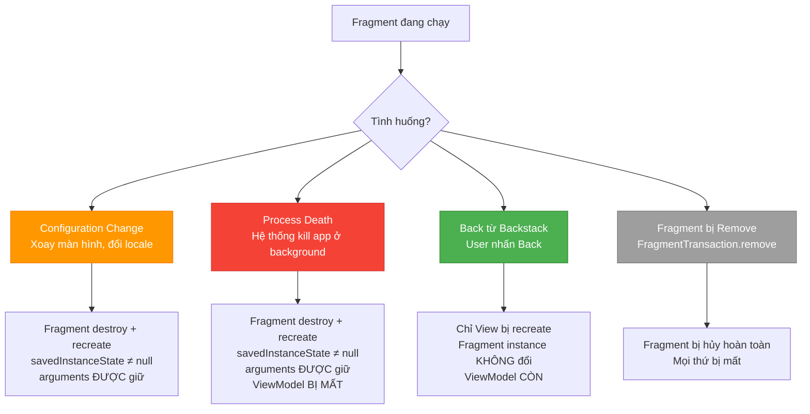
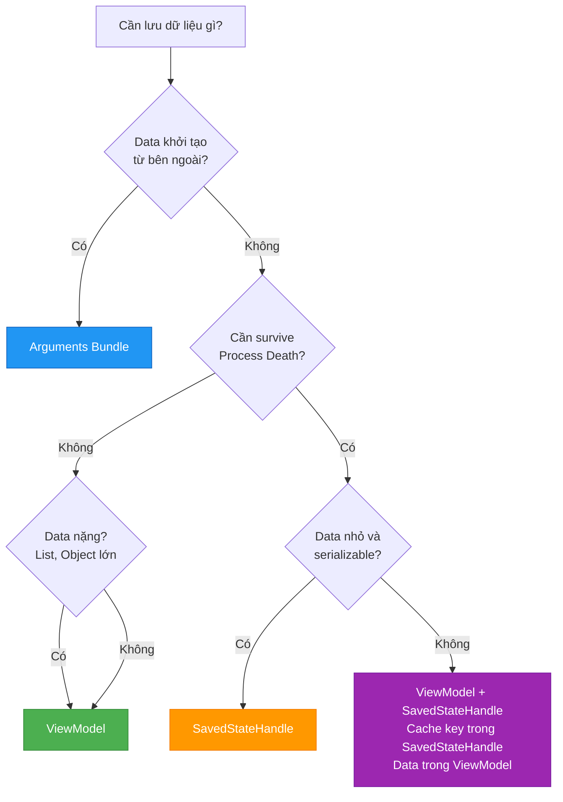
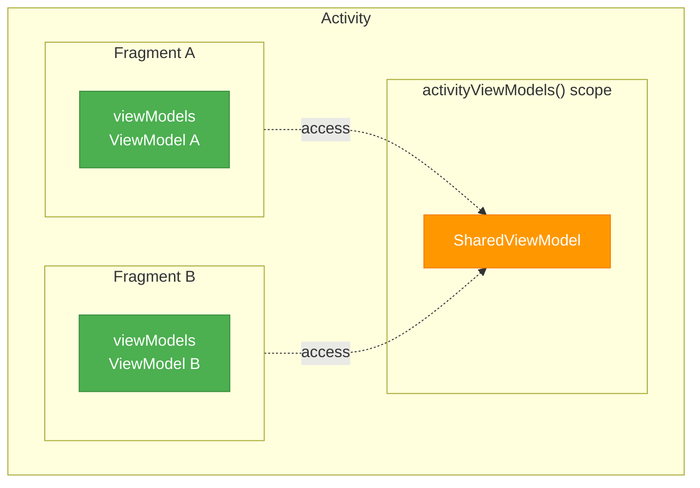

# Fragment State Changes

## Vấn đề cần giải quyết

Fragment thừa hưởng vấn đề Configuration Change từ Activity: **khi xoay màn hình, đổi ngôn ngữ, hoặc thay đổi font size — Fragment bị destroy và tạo lại**.

Nhưng Fragment có thêm những tình huống phức tạp hơn Activity:
- Fragment bị destroy view nhưng instance vẫn sống (backstack)
- Fragment có `arguments` Bundle tồn tại xuyên suốt vòng đời
- Fragment có thể dùng ViewModel scope theo Activity hoặc scope theo chính nó
- `setRetainInstance(true)` từng là giải pháp phổ biến nhưng đã **deprecated**

Nếu không hiểu rõ những cơ chế này, bạn sẽ:
- Mất dữ liệu form khi xoay màn hình
- Gọi network request trùng lặp sau mỗi configuration change
- Crash khi process bị kill vì không lưu state quan trọng

## Sau khi học xong

- Phân biệt được các tình huống Fragment bị recreate và hành vi tương ứng.
- Giải thích được sự khác biệt giữa Arguments, onSaveInstanceState và ViewModel trong Fragment.
- Áp dụng được SavedStateHandle để survive process death.
- Phân biệt được viewModels() vs activityViewModels() và chọn đúng scope.
- Nhận diện được setRetainInstance đã deprecated và giải pháp thay thế.

## Các tình huống Fragment bị Recreate


<!-- dd: fsc-cases -->

### Chi tiết từng tình huống

| Tình huống | Fragment instance | View | Arguments | savedInstanceState | ViewModel |
|---|---|---|---|---|---|
| **Configuration Change** | Destroy → New | Destroy → New | ✅ Giữ | ✅ Có data | ✅ Giữ |
| **Process Death** | Destroy → New | Destroy → New | ✅ Giữ | ✅ Có data | ❌ Mất |
| **Back từ Backstack** | Giữ nguyên | Destroy → New | ✅ Giữ | null | ✅ Giữ |
| **Remove** | Destroy | Destroy | Mất | Mất | Mất |

> [!IMPORTANT]
> **Arguments luôn được bảo toàn** qua mọi tình huống recreate (Configuration Change, Process Death). Đây là lý do bạn phải truyền dữ liệu khởi tạo qua `arguments` Bundle thay vì constructor parameter.

## Ba công cụ lưu State

### 1. Arguments (Bundle khởi tạo)

Arguments là Bundle gắn vào Fragment **trước khi** Fragment được add vào FragmentManager. Nó tồn tại xuyên suốt vòng đời Fragment.

```kotlin
// Tạo Fragment với Arguments
val fragment = ProductDetailFragment().apply {
    arguments = Bundle().apply {
        putString("product_id", "SKU-12345")
        putString("source", "search")
    }
}

// Hoặc dùng companion object pattern
class ProductDetailFragment : Fragment(R.layout.fragment_product_detail) {
    
    companion object {
        fun newInstance(productId: String) = ProductDetailFragment().apply {
            arguments = Bundle().apply {
                putString("product_id", productId)
            }
        }
    }
    
    // Đọc arguments — an toàn, tồn tại xuyên recreate
    private val productId: String by lazy {
        requireArguments().getString("product_id")!!
    }
}
```

**Khi nào dùng:** Truyền dữ liệu khởi tạo (ID, filter params, config) khi tạo Fragment. Tương tự Intent extras của Activity.

**Giới hạn:** Chỉ chứa kiểu Bundle hỗ trợ (primitive, `String`, `Parcelable`…). Arguments được lưu cùng saved state của Fragment nên phải nhỏ như saved state; ngưỡng và lý do ở [Parcelables and Bundle](../activity/parcelables_and_bundle.md), mục "Ba con số cần phân biệt".

### 2. ViewModel (In-memory state)

ViewModel tồn tại qua Configuration Change nhưng **mất khi Process Death**. Cơ chế giữ ViewModel qua xoay màn hình và cách load dữ liệu ban đầu không bị lặp ở [State Changes](../activity/state_changes.md), mục "Bước 1" và "Bước 5". Phần riêng của Fragment: `by viewModels()` tự đưa `arguments` vào `SavedStateHandle`, nên ViewModel đọc được ID mà Fragment không phải chuyển tay.

```kotlin
class ProductDetailFragment : Fragment(R.layout.fragment_product_detail) {

    // Scope theo Fragment — mỗi instance Fragment có ViewModel riêng.
    // by viewModels() đưa arguments ("product_id") vào SavedStateHandle của ViewModel.
    // Không gọi hàm load dữ liệu trong onCreate: sau xoay màn hình onCreate chạy lại → fetch lặp.
    // (ViewModel có repository trong constructor cần factory hoặc Hilt, học ở 6.4 ViewModel, chưa có bài)
    private val viewModel: ProductDetailViewModel by viewModels()
}

class ProductDetailViewModel(
    savedStateHandle: SavedStateHandle,
    private val repository: ProductRepository
) : ViewModel() {
    private val productId: String = checkNotNull(savedStateHandle["product_id"])

    // Load lười: chỉ gọi API khi Fragment bắt đầu collect, không launch trong init
    val product: StateFlow<Product?> =
        flow { emit(repository.getProduct(productId)) }
            .stateIn(viewModelScope, SharingStarted.WhileSubscribed(5_000), initialValue = null)
}
```

**Khi nào dùng:** Mọi dữ liệu UI cần survive qua configuration change: network responses, processed lists, UI state.

### 3. SavedStateHandle (Survive Process Death)

SavedStateHandle kết hợp ưu điểm của ViewModel (reactive) và savedInstanceState (survive process death). Cơ chế lưu/khôi phục ở [State Changes](../activity/state_changes.md), mục "Bước 2"; trong Fragment cách dùng giống hệt Activity.

```kotlin
class ProductDetailViewModel(
    private val savedStateHandle: SavedStateHandle
) : ViewModel() {

    // Tự động restore khi process death
    val searchQuery = savedStateHandle.getStateFlow("query", "")

    fun updateQuery(query: String) {
        savedStateHandle["query"] = query
    }
}
```

```kotlin
// Trong Fragment — SavedStateHandle tự động được inject
private val viewModel: ProductDetailViewModel by viewModels()
```

**Khi nào dùng:** Dữ liệu người dùng nhập (search query, form input, scroll position, selected tab) cần survive cả process death.

> [!NOTE]
> **`onSaveInstanceState(outState)` của Fragment** vẫn tồn tại như Activity: FragmentManager gọi nó khi host Activity lưu state, và Bundle được trả lại ở `onCreate`/`onCreateView`/`onViewCreated`/`onViewStateRestored`. View có `android:id` trong layout của Fragment tự lưu state của chính nó như ở Activity ([State Changes](../activity/state_changes.md), mục "Bước 3"). Khác biệt của Fragment: khi chỉ View bị destroy (Fragment vào backstack), FragmentManager giữ state của view hierarchy và trả lại khi View được tạo lại, nên text đang gõ vẫn còn khi người dùng bấm Back quay về.

## Ma trận quyết định — Chọn đúng công cụ


<!-- dd: fsc-decide -->

| Loại dữ liệu | Công cụ | Ví dụ |
|---|---|---|
| ID, config, filter params | **Arguments** | `product_id`, `category`, `isEditing` |
| Network response, processed data | **ViewModel** | Danh sách sản phẩm, user profile |
| User input, UI state nhỏ | **SavedStateHandle** | Search query, selected tab, scroll position |
| Large data + cần survive process death | **ViewModel + SavedStateHandle** | Cache key trong SavedStateHandle, data trong ViewModel, re-fetch khi null |

## ViewModel Scoping — viewModels() vs activityViewModels()

Fragment có thể chọn scope cho ViewModel:

```kotlin
class FragmentA : Fragment() {
    // Scope theo Fragment — ViewModel riêng cho Fragment này
    private val viewModel: MyViewModel by viewModels()
    
    // Scope theo Activity — chia sẻ với tất cả Fragment trong Activity
    private val sharedViewModel: SharedViewModel by activityViewModels()
    
    // Scope theo Navigation Graph — chia sẻ trong cùng nav graph
    private val navViewModel: NavViewModel by navGraphViewModels(R.id.main_nav_graph)
}
```


<!-- dd: fsc-scopes -->

**Quy tắc chọn scope:**
- `viewModels()` — Dữ liệu thuộc riêng Fragment (product detail, form data)
- `activityViewModels()` — Dữ liệu chia sẻ giữa các Fragment (selected item, auth state)
- `navGraphViewModels()` — Dữ liệu chia sẻ trong một luồng navigation cụ thể (checkout flow)

## setRetainInstance — Deprecated và thay thế

Trước đây, `setRetainInstance(true)` cho phép Fragment instance tồn tại qua configuration change (Activity bị recreate nhưng Fragment instance giữ nguyên). Cách này đã **deprecated từ AndroidX Fragment 1.3.0** (API 28 là mốc deprecate `android.app.Fragment` của framework, không phải `setRetainInstance` của AndroidX).

**Lý do deprecated:**
- Gây rối loạn lifecycle: Fragment instance sống nhưng host Activity mới, context cũ bị leak
- Không tương thích với Navigation Component
- ViewModel đã giải quyết hoàn toàn nhu cầu retain data qua configuration change

**Thay thế:** Dùng `ViewModel` cho mọi trường hợp cần retain data.

## Triển khai thực tế — Fragment với đầy đủ State Management

```kotlin
class EditProfileFragment : Fragment(R.layout.fragment_edit_profile) {

    // ViewModel với SavedStateHandle — survive cả process death
    private val viewModel: EditProfileViewModel by viewModels()

    private var _binding: FragmentEditProfileBinding? = null
    private val binding get() = _binding!!

    override fun onViewCreated(view: View, savedInstanceState: Bundle?) {
        super.onViewCreated(view, savedInstanceState)
        _binding = FragmentEditProfileBinding.bind(view)

        // Restore UI state từ ViewModel (survive config change)
        // SavedStateHandle bên trong ViewModel giữ draft data (survive process death)
        viewLifecycleOwner.lifecycleScope.launch {
            viewLifecycleOwner.repeatOnLifecycle(Lifecycle.State.STARTED) {
                viewModel.uiState.collect { state ->
                    // Chỉ setText khi khác: tránh vòng lặp với doAfterTextChanged và con trỏ nhảy về đầu
                    if (binding.etName.text.toString() != state.name) binding.etName.setText(state.name)
                    if (binding.etEmail.text.toString() != state.email) binding.etEmail.setText(state.email)
                    binding.btnSave.isEnabled = state.isValid
                }
            }
        }

        // Lưu user input vào ViewModel (auto-save draft)
        binding.etName.doAfterTextChanged { text ->
            viewModel.updateName(text.toString())
        }

        binding.etEmail.doAfterTextChanged { text ->
            viewModel.updateEmail(text.toString())
        }
    }

    override fun onDestroyView() {
        _binding = null
        super.onDestroyView()
    }
}
```

```kotlin
class EditProfileViewModel(
    private val savedStateHandle: SavedStateHandle
) : ViewModel() {

    // Draft data — survive process death
    val uiState: StateFlow<EditProfileState> = combine(
        savedStateHandle.getStateFlow("name", ""),
        savedStateHandle.getStateFlow("email", "")
    ) { name, email ->
        EditProfileState(
            name = name,
            email = email,
            isValid = name.isNotBlank() && email.contains("@")
        )
    }.stateIn(viewModelScope, SharingStarted.WhileSubscribed(5000), EditProfileState())

    fun updateName(name: String) { savedStateHandle["name"] = name }
    fun updateEmail(email: String) { savedStateHandle["email"] = email }
}
```

## Trade-offs & Pitfalls

> [!CAUTION]
> **Không dùng constructor parameter để truyền data:**
> `class MyFragment(val userId: String)` sẽ crash khi system recreate Fragment vì system gọi **no-args constructor**.
> **Fix:** Dùng `arguments` Bundle hoặc SafeArgs (Jetpack Navigation).

> [!WARNING]
> **activityViewModels() leak concern:**
> ViewModel scope theo Activity tồn tại cho đến khi Activity bị destroy. Nếu Fragment chỉ cần data tạm thời mà dùng `activityViewModels()`, data sẽ chiếm bộ nhớ suốt vòng đời Activity.
> **Fix:** Chỉ dùng `activityViewModels()` cho data thực sự cần chia sẻ. Dùng `viewModels()` cho data riêng.

> [!WARNING]
> **SavedStateHandle giới hạn size:**
> SavedStateHandle ghi vào saved state Bundle nên chịu cùng khuyến nghị kích thước (xem [State Changes](../activity/state_changes.md), mục "Bước 3"). Không lưu bitmap, large list, hoặc complex object.
> **Fix:** Lưu key/ID trong SavedStateHandle, re-fetch data khi restore.

> [!TIP]
> **Test Process Death:** cách test giống Activity (`adb shell am kill`, và giới hạn của "Don't keep activities"), xem [State Changes](../activity/state_changes.md), mục "Process Death — hiểu và test". Với Fragment, kiểm tra thêm Fragment trong backstack: sau khi mở lại app, bấm Back phải về đúng Fragment trước với đủ state.

## So sánh với Activity State Changes

Cơ chế cốt lõi giống nhau: cả Activity lẫn Fragment đều bị destroy/recreate khi Configuration Change, đều dùng `onSaveInstanceState` / `SavedStateHandle` để survive Process Death, đều dựa vào ViewModel để giữ dữ liệu qua xoay màn hình. Bạn đã học phần này ở topic 4.2.1.2 [Activity State Changes](../activity/state_changes.md).

| Đặc điểm | Activity (4.2.1.2) | Fragment (4.2.2.2) |
|---|---|---|
| Số vòng đời | 1 (Activity) | 2 (Fragment + View) |
| View có bị destroy riêng? | Không | Có — vào backstack thì View destroy, instance sống |
| Dữ liệu khởi tạo | Intent extras | `arguments` Bundle |
| LifecycleOwner để observe | `this` | `viewLifecycleOwner` |
| ViewModel scope | Scope theo Activity | `viewModels()` (theo Fragment) / `activityViewModels()` (theo Activity) |
| Ai lưu state khi recreate | Hệ thống | FragmentManager lưu & khôi phục từng Fragment + backstack |
| Survive process death | SavedStateHandle / Bundle | SavedStateHandle / Bundle (giống) |
| Giải pháp cũ đã deprecated | Không có | `setRetainInstance` (deprecated từ AndroidX Fragment 1.3.0) |

**Điểm thực chiến quan trọng nhất:** với Activity, hệ thống quản lý `savedInstanceState` của Activity; với Fragment, **FragmentManager** chịu trách nhiệm lưu/khôi phục state của mọi Fragment đang quản lý (kể cả Fragment nằm trong backstack). Khi xoay màn hình, FragmentManager tự khôi phục đúng Fragment đang hiển thị — bạn chỉ cần lo phần dữ liệu (`arguments`, ViewModel, `SavedStateHandle`), không cần tự tay khôi phục Fragment instance.

## Nên học tiếp

- **FragmentManager** (`android.component.fragment.fragment_manager`) — transaction (`add`/`replace`/`remove`), backstack, và cách FragmentManager lưu/khôi phục state của từng Fragment.
- **Dialog and DialogFragment** (`android.component.fragment.dialog_and_dialogfragment`) — màn hình dialog có vòng đời riêng và cách lưu state khi rotate.
- **Activity State Changes** (`android.component.activity.state_changes`) — nền tảng mà Fragment State Changes thừa hưởng.

## Nguồn tham khảo

- [Save UI States - Android Developers](https://developer.android.com/topic/libraries/architecture/saving-states)
- [ViewModel Overview - Android Developers](https://developer.android.com/topic/libraries/architecture/viewmodel)
- [SavedStateHandle - Android Developers](https://developer.android.com/topic/libraries/architecture/viewmodel/viewmodel-savedstate)
- [Fragment Arguments (setArguments) - Android Developers](https://developer.android.com/reference/androidx/fragment/app/Fragment#setArguments(android.os.Bundle))
- [Fragment (setRetainInstance deprecated) - Android Developers](https://developer.android.com/reference/androidx/fragment/app/Fragment)
- [Parcelables and bundles (giới hạn kích thước) - Android Developers](https://developer.android.com/guide/components/activities/parcelables-and-bundles)
- [Activity lifecycle / state changes - Android Developers](https://developer.android.com/guide/components/activities/activity-lifecycle)
