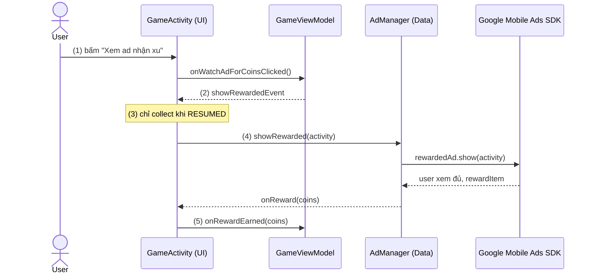

# Ads trong kiến trúc app

## Vấn đề cần giải quyết

Cách tích hợp nhanh nhất là gọi SDK quảng cáo ngay trong Activity hoặc ViewModel. App chạy được, nhưng sớm gặp ba vấn đề:

- **Không test được:** ViewModel gọi thẳng `RewardedAd.load()` thì unit test phải có SDK thật và network.
- **Không đổi được ad network:** code của Google rải khắp các màn hình, đổi sang network khác là sửa toàn bộ.
- **Dễ leak:** show ad cần `Activity`, nên ViewModel có xu hướng giữ Activity, mà ViewModel sống lâu hơn Activity.

Cái khó là quảng cáo vừa là external dependency (giống Retrofit, Room), vừa gắn chặt với UI và lifecycle (phải có Activity đang foreground mới show được).

## Sau khi học xong

- Giải thích được vì sao SDK quảng cáo thuộc Data Layer còn thời điểm show thuộc UI.
- Triển khai được interface AdManager bọc Google Mobile Ads SDK, ViewModel phát event, Activity show trong repeatOnLifecycle(RESUMED).
- Tối ưu được latency và tần suất load ad, giải phóng ad đúng lúc để không tốn network và không leak.
- Nhận diện được các cách đặt ad sai tầng (SDK trong ViewModel, ad trong Domain, ViewModel giữ Activity).

## Ads trong kiến trúc app là gì?

**Đặt quảng cáo vào kiến trúc app** là chia trách nhiệm quảng cáo theo tầng: SDK được bọc sau một interface ở Data Layer, ViewModel chỉ giữ state và phát event, còn UI là nơi duy nhất cầm `Activity` để show.

Mental model: ViewModel nói **"đến lúc show"**, UI quyết định **"show được chưa"** (màn hình có đang foreground không), còn `AdManager` lo **"show bằng SDK nào"**.

### Mỗi tầng làm gì

Quảng cáo có bản chất **gắn với UI và lifecycle Activity** — nó cần `Activity`/`Context` để show. Vì vậy:

**Tầng Data:**
- AdMob SDK nằm ở Data Layer (hoặc `AdManager`/`AdRepository` riêng).
- Bọc toàn bộ API của Google.
- Trả kết quả thuần (suspend/flow) cho tầng trên.

**Tầng Domain:**
- Hoàn toàn không biết ad tồn tại.
- UseCase chỉ xử lý nghiệp vụ.

**Tầng Presentation:**
- UI quyết định thời điểm show (vì chỉ UI mới biết Activity foreground).
- ViewModel điều phối trạng thái.

Ngoài ra, `AdManager` là nơi xử lý retry và lỗi load; UI phản ánh trạng thái ad (đang load, sẵn sàng, đã show), ví dụ bật hoặc tắt nút "Xem quảng cáo".

## Cách hoạt động

Luồng một lần user bấm "Xem quảng cáo để nhận xu" đi qua các tầng như sau:

1. User bấm nút, Activity chuyển hành động cho ViewModel (`onWatchAdForCoinsClicked()`).
2. ViewModel phát một event "cần show rewarded ad" qua `SharedFlow`. ViewModel không cầm Activity và không biết SDK.
3. Activity collect event trong `repeatOnLifecycle(Lifecycle.State.RESUMED)`, nên chỉ nhận khi màn hình đang foreground.
4. Activity gọi `adManager.showRewarded(activity)`. `AdManager` (Data Layer) là chỗ duy nhất gọi Google Mobile Ads SDK.
5. User xem đủ, SDK gọi callback reward, Activity chuyển số xu cho ViewModel (`onRewardEarned`) để cập nhật state.



### Tại sao Ad ở Data Layer?

**Lý do:**

1. **AdMob SDK là external dependency** — giống như Firebase, Room, Retrofit.
2. **Dễ thay thế** — nếu đổi sang AppLovin, chỉ cần viết lại `AdMobAdManager`, không đụng UI/Domain.
3. **Dễ test** — mock `AdManager` interface, test ViewModel mà không cần SDK thật.
4. **Tách biệt trách nhiệm** — UI chỉ lo hiển thị, Data lo tích hợp SDK.

## Ví dụ thực tế: xem rewarded ad để nhận xu

> [!NOTE]
> Kiến thức dùng trước: `@Inject`, `@HiltViewModel`, `@AndroidEntryPoint` là Hilt, học ở mục [Hilt](../../../../session_07/design_pattern/di/hilt.md); `suspendCoroutine` bọc callback thành suspend function, học ở mục 8.4.3 Coroutines (chưa có bài). Ở đây chỉ cần biết Hilt tạo sẵn `AdManager` và inject vào Activity.

### Interface

```kotlin
interface AdManager {
    suspend fun loadInterstitial(): Boolean
    fun showInterstitial(activity: Activity)
    suspend fun loadRewarded(): Boolean
    fun showRewarded(activity: Activity, onReward: (Int) -> Unit)
}

### Implementation

```kotlin
class AdMobAdManager @Inject constructor(
    @ApplicationContext private val context: Context
) : AdManager {

    private var interstitialAd: InterstitialAd? = null
    private var rewardedAd: RewardedAd? = null

    override suspend fun loadInterstitial(): Boolean =
        suspendCoroutine { cont ->
            InterstitialAd.load(context, INTERSTITIAL_ID, AdRequest.Builder().build(),
                object : InterstitialAdLoadCallback() {
                    override fun onAdLoaded(ad: InterstitialAd) {
                        interstitialAd = ad
                        cont.resume(true)
                    }

                    override fun onAdFailedToLoad(error: LoadAdError) {
                        cont.resume(false)
                    }
                })
        }

    override fun showInterstitial(activity: Activity) {
        if (activity.lifecycle.currentState.isAtLeast(Lifecycle.State.RESUMED)) {
            interstitialAd?.show(activity)
            interstitialAd = null
        }
    }

    override suspend fun loadRewarded(): Boolean =
        suspendCoroutine { cont ->
            RewardedAd.load(context, REWARDED_ID, AdRequest.Builder().build(),
                object : RewardedAdLoadCallback() {
                    override fun onAdLoaded(ad: RewardedAd) {
                        rewardedAd = ad
                        cont.resume(true)
                    }

                    override fun onAdFailedToLoad(error: LoadAdError) {
                        cont.resume(false)
                    }
                })
        }

    override fun showRewarded(activity: Activity, onReward: (Int) -> Unit) {
        if (activity.lifecycle.currentState.isAtLeast(Lifecycle.State.RESUMED)) {
            rewardedAd?.show(activity) { rewardItem ->
                onReward(rewardItem.amount)
            }
            rewardedAd = null
        }
    }
}
```

### ViewModel

```kotlin
@HiltViewModel
class GameViewModel @Inject constructor() : ViewModel() {
    // ViewModel không biết AdManager hay SDK: chỉ giữ state và phát event

    private val _showRewardedEvent = MutableSharedFlow<Boolean>(extraBufferCapacity = 1)
    val showRewardedEvent: SharedFlow<Boolean> = _showRewardedEvent.asSharedFlow()

    private val _rewardGranted = MutableStateFlow(0)
    val rewardGranted: StateFlow<Int> = _rewardGranted.asStateFlow()

    fun onWatchAdForCoinsClicked() {
        _showRewardedEvent.tryEmit(true)  // (2) Phát event, không cầm Activity
    }

    fun onRewardEarned(coins: Int) {
        _rewardGranted.value += coins  // (5) Cập nhật state sau khi có thưởng
    }
}
```

### Activity

```kotlin
@AndroidEntryPoint
class GameActivity : AppCompatActivity() {

    @Inject lateinit var adManager: AdManager
    private val viewModel: GameViewModel by viewModels()

    override fun onCreate(savedInstanceState: Bundle?) {
        super.onCreate(savedInstanceState)
        setContentView(R.layout.activity_game)

        findViewById<Button>(R.id.btnWatchAd).setOnClickListener {
            viewModel.onWatchAdForCoinsClicked()  // (1)
        }

        lifecycleScope.launch {
            repeatOnLifecycle(Lifecycle.State.RESUMED) {  // (3) Chỉ nhận event khi màn hình foreground
                viewModel.showRewardedEvent.collect { shouldShow ->
                    if (shouldShow) {
                        adManager.showRewarded(this@GameActivity) { coins ->  // (4)
                            viewModel.onRewardEarned(coins)
                        }
                    }
                }
            }
        }
    }
}
```

## Hiệu năng

### 1. Giảm latency khi load ad

**Vấn đề:**
- Load ad mất thời gian (1-5 giây).
- User phải đợi nếu load khi cần show.

**Giải pháp:**
- Load ad **trước** khi cần show.
- Ví dụ: load interstitial khi bắt đầu level, show khi hoàn thành level.

```kotlin
// Load ad khi Activity tạo
override fun onCreate(savedInstanceState: Bundle?) {
    super.onCreate(savedInstanceState)
    loadInterstitial()  // Load trước
}

// Show ad khi user hoàn thành level
fun onLevelComplete() {
    showInterstitial()  // Show ngay (ad đã sẵn sàng)
}
```

### 2. Tránh load ad quá nhiều

**Vấn đề:**
- Load ad liên tục → tốn network, battery.
- AdMob có thể xem là invalid traffic.

**Giải pháp:**
- Chỉ load ad khi cần.
- Không reload ad nếu ad cũ vẫn còn (chưa expire).

```kotlin
private fun loadInterstitial() {
    // Chỉ load nếu chưa có ad
    if (interstitialAd == null) {
        InterstitialAd.load(...)
    }
}
```

### 3. Giải phóng ad khi không dùng

**Vấn đề:**
- Banner (WebView) tốn nhiều memory.
- Native ad giữ reference đến Context.

**Giải pháp:**
- Destroy ad khi không dùng.
- Không giữ reference đến ad cũ.

```kotlin
override fun onDestroy() {
    adView.destroy()
    nativeAd?.destroy()
    interstitialAd = null
    rewardedAd = null
    super.onDestroy()
}
```

## Sai lầm thường gặp

### 1. Gọi SDK quảng cáo thẳng trong ViewModel

**Triệu chứng:**
- Unit test ViewModel cần SDK thật và network; đổi ad network phải sửa ViewModel.

**Nguyên nhân:**
- ViewModel biết về AdMob SDK, nên khó test, khó đổi network.

**Giải pháp:**
- Bọc SDK sau interface `AdManager` ở Data Layer; khi test, thay bằng một `AdManager` giả.

### 2. Đưa quảng cáo vào Domain Layer

**Triệu chứng:**
- UseCase nghiệp vụ (tính điểm, lưu tiến độ) phụ thuộc vào thư viện quảng cáo.

**Nguyên nhân:**
- Domain không nên biết về external dependencies; UseCase chỉ xử lý nghiệp vụ thuần.

**Giải pháp:**
- Domain không biết quảng cáo tồn tại; phần thưởng từ ad đi vào như một hành động bình thường (vd "cộng 50 xu").

### 3. ViewModel giữ Activity

**Triệu chứng:**
- Memory leak sau khi xoay màn hình hoặc rời màn hình.

**Nguyên nhân:**
- ViewModel sống lâu hơn Activity; giữ Activity (hoặc callback giữ Activity) trong ViewModel làm Activity cũ không được giải phóng.

**Giải pháp:**
- ViewModel chỉ phát event; Activity truyền chính nó vào `show()` lúc nhận event. Chỗ nào cần Context để load thì dùng `applicationContext`.

## Lịch sử phát triển

- **2017:** Google giới thiệu Architecture Components và Guide to app architecture, chuẩn hoá cách tách UI, ViewModel và Data Layer trên Android.
- **2018:** Kotlin coroutines ổn định (Kotlin 1.3), cho phép bọc API callback như `InterstitialAd.load()` thành suspend function như `AdManager` ở trên.
- **2021:** Guide to app architecture được viết lại, thêm Domain Layer (tuỳ chọn). Google Mobile Ads SDK đến nay vẫn dùng callback, nên lớp bọc kiểu `AdManager` vẫn do app tự viết.

## Kết nối hệ thống

- **Clean Architecture (7.2.5):** quảng cáo là ví dụ điển hình của external dependency nằm ở Data Layer, Domain không biết nó tồn tại. Xem [Clean Architecture](../../../../session_07/architecture/clean_architecture.md).
- **Hilt (7.1.5.3):** `AdManager` là singleton được inject; khi test thay bằng bản giả. Xem [Hilt](../../../../session_07/design_pattern/di/hilt.md).
- **Fragment Lifecycle (4.2.2.1):** `repeatOnLifecycle(Lifecycle.State.RESUMED)` là cách UI chỉ show khi foreground. Xem [Fragment Lifecycle](../../fragment/lifecycle.md).
- **Full-screen Ads (4.2.3.3.3):** `AdManager` bọc đúng vòng load, show, reload ở bài đó. Xem [Full-screen Ads](fullscreen_ads.md).
- **Inline Ads (4.2.3.3.2):** banner, native là View nên nằm ở UI; việc có hiện hay không là state từ ViewModel. Xem [Inline Ads](inline_ads.md).
- **Ads Privacy & Policy (4.2.3.3.5):** `AdManager` là chỗ hợp lý để kiểm tra `canRequestAds()` trước mỗi lần load. Xem [Ads Privacy & Policy](privacy_policy.md).

## Nguồn tham khảo

- [Guide to app architecture](https://developer.android.com/topic/architecture)
- [Domain layer](https://developer.android.com/topic/architecture/domain-layer)
- [AdMob Rewarded](https://developers.google.com/admob/android/rewarded)
