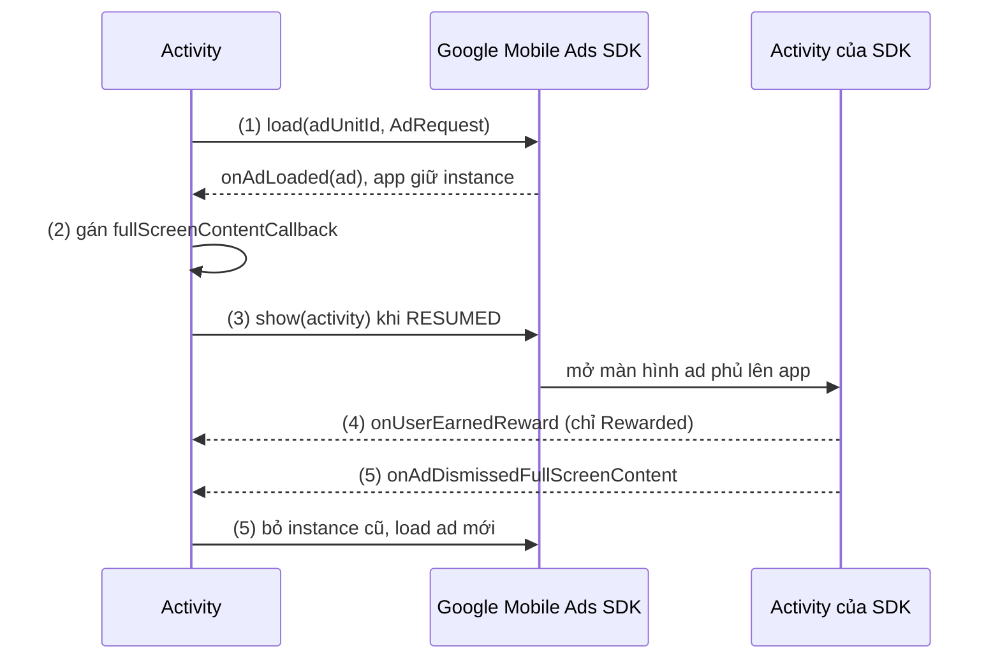

# Full-screen Ads

## Vấn đề cần giải quyết

Một số quảng cáo chiếm toàn màn hình: sau khi user qua màn, trước khi mở bài viết tiếp theo, hoặc khi user bấm "Xem quảng cáo để nhận xu". Loại ad này trả tiền cao hơn banner, nhưng cũng dễ làm hỏng trải nghiệm và dễ dùng sai nhất.

Ba đặc điểm gây lỗi:

- Load mất vài giây, nên không thể đợi đến lúc cần mới load.
- Một instance ad chỉ show được một lần. Quên load lại thì lần sau không có ad.
- Ad mở một màn hình riêng chồng lên app. Show khi Activity đã vào background có thể crash hoặc vi phạm policy.

## Sau khi học xong

- Giải thích được vì sao full-screen ad phải load trước, show sau và mỗi instance chỉ show được một lần.
- Phân biệt được Interstitial, Rewarded, Rewarded Interstitial và App Open theo thời điểm hiển thị và cách user nhận thưởng.
- Áp dụng được vòng load, show, reload với FullScreenContentCallback, chỉ show khi Activity ở RESUMED.
- Xử lý được show trùng ad, app vào background và App Open Ad khi app quay lại foreground.
- Biết khi nào nên và không nên show từng loại full-screen ad.

## Full-screen Ads là gì?

**Full-screen ad** là quảng cáo được SDK hiển thị trong một Activity riêng phủ lên app (Interstitial, Rewarded, Rewarded Interstitial, App Open). App không đặt view nào vào layout: nó chỉ giữ một instance ad đã load và gọi `show(activity)` đúng thời điểm.

Mental model: full-screen ad giống **vé dùng một lần**. Mua vé trước (load), xé vé khi vào cửa (show), vào xong phải mua vé mới cho lần sau (load lại).

### Interstitial Ads

**Bản chất:** Interstitial là một Activity fullscreen nội bộ của SDK. Nó không phải View của app, mà là một màn hình riêng được SDK quản lý.

**Đặc điểm:**
- Chiếm toàn bộ màn hình.
- User phải đóng (nút X) hoặc tương tác (click) để quay lại app.
- Một instance chỉ show được một lần.

### Rewarded Ads

**Bản chất:** Rewarded là ad mà user **chủ động chọn xem** để đổi lấy thứ gì đó có giá trị trong app (xu, lives, unlock tính năng).

**Đặc điểm:**
- User phải xem hết (hoặc qua thời gian tối thiểu) mới nhận thưởng.
- Doanh thu cao nhất vì user tương tác chủ động.
- Không được ép buộc — user phải tự bấm nút xem.

### Rewarded Interstitial Ads

**Bản chất:** Kết hợp Interstitial và Rewarded — ad fullscreen tự động hiển thị, nhưng user phải xem hết mới nhận thưởng.

**Khác với Rewarded thông thường:**
- Rewarded: user bấm nút để xem.
- Rewarded Interstitial: ad tự động hiển thị ở điểm dừng, user phải xem để nhận thưởng.

### App Open Ads

**Bản chất:**
- App Open Ad hiển thị mỗi khi app mở lại từ background.
- Giống như splash screen nhưng có quảng cáo.

## Cách hoạt động

Mọi full-screen ad đi theo cùng một vòng, khớp với sơ đồ vòng đời ad ở [AdMob Overview](overview.md) (`NOT_READY → LOADING → LOADED → SHOWN`):

1. **Load trước:** gọi `XxxAd.load(...)` từ sớm (đầu màn hình, đầu level). Kết quả về bất đồng bộ qua `onAdLoaded`, app giữ instance lại.
2. **Gán callback:** gán `fullScreenContentCallback` trước khi show để biết khi nào ad đóng hoặc show lỗi.
3. **Show đúng lúc:** đến điểm dừng tự nhiên của flow và Activity đang `RESUMED` thì gọi `show(activity)`. SDK mở Activity riêng của nó phủ lên app.
4. **Trao thưởng (chỉ Rewarded):** user xem đủ thời gian thì SDK gọi listener reward; đóng giữa chừng thì không có thưởng.
5. **Dọn và load lại:** khi `onAdDismissedFullScreenContent` (hoặc show lỗi), bỏ instance cũ và load instance mới cho lần sau.



### Interstitial: load trước

```kotlin
class MainActivity : AppCompatActivity() {

    private var interstitialAd: InterstitialAd? = null
    private val TAG = "Interstitial"

    override fun onCreate(savedInstanceState: Bundle?) {
        super.onCreate(savedInstanceState)
        setContentView(R.layout.activity_main)
        
        // Load ad ngay khi Activity tạo
        loadInterstitial()
    }

    private fun loadInterstitial() {
        InterstitialAd.load(  // (1) Load trước, bất đồng bộ
            this,
            "ca-app-pub-3940256099942544/1033173712",
            AdRequest.Builder().build(),
            object : InterstitialAdLoadCallback() {
                override fun onAdLoaded(ad: InterstitialAd) {
                    interstitialAd = ad
                    Log.d(TAG, "Ad loaded successfully")
                    
                    // (2) Gán callback trước khi show
                    interstitialAd?.fullScreenContentCallback = object : FullScreenContentCallback() {
                        override fun onAdClicked() {
                            Log.d(TAG, "Ad clicked")
                        }

                        override fun onAdDismissedFullScreenContent() {
                            Log.d(TAG, "Ad dismissed")
                            // Ad đã đóng → xóa reference và load ad mới
                            interstitialAd = null
                            loadInterstitial()  // (5) Load ad mới cho lần sau
                        }

                        override fun onAdFailedToShowFullScreenContent(error: AdError) {
                            Log.e(TAG, "Ad failed to show: ${error.message}")
                            interstitialAd = null
                        }

                        override fun onAdImpression() {
                            Log.d(TAG, "Ad impression recorded")
                        }

                        override fun onAdShowedFullScreenContent() {
                            Log.d(TAG, "Ad showed fullscreen")
                        }
                    }
                }

                override fun onAdFailedToLoad(error: LoadAdError) {
                    Log.e(TAG, "Ad failed to load: ${error.message}")
                    interstitialAd = null
                    // Không load lại ngay — đợi một thời gian rồi thử lại
                }
            }
        )
    }
}
```

**Chi tiết:**

- `InterstitialAd.load()`: Bắt đầu load ad asynchronous.
- `InterstitialAdLoadCallback`: Callback khi load xong hoặc lỗi.
- `onAdLoaded`: Ad đã sẵn sàng, gán vào variable.
- `onAdFailedToLoad`: Lỗi (no fill, network error, invalid ad unit).
- `fullScreenContentCallback`: Theo dõi sự kiện khi show ad.
- **Quan trọng:** Trong `onAdDismissedFullScreenContent`, phải load ad mới vì ad cũ đã dùng xong.

### Interstitial: show đúng thời điểm

```kotlin
private fun showInterstitial() {
    // Kiểm tra Activity có ở foreground không
    if (lifecycle.currentState.isAtLeast(Lifecycle.State.RESUMED)) {
        interstitialAd?.let { ad ->
            ad.show(this)  // (3) Show khi Activity ở RESUMED
        } ?: run {
            // Chưa có ad sẵn sàng → không show
            Log.d(TAG, "Ad not ready yet")
        }
    } else {
        // Activity không ở foreground → không show
        Log.w(TAG, "Cannot show ad: Activity not in foreground")
    }
}
```

**Khi nào gọi `showInterstitial()`?**

- Sau khi user hoàn thành level (game).
- Sau khi user save document (app productivity).
- Sau khi user xem xong bài viết (app content).
- **Không** gọi ngay khi mở app.
- **Không** gọi khi user đang nhập liệu.

#### Chú thích lifecycle (Interstitial)

**Load trước, show sau:**
- Tải ad khi bắt đầu màn hình/level.
- Hiển thị khi user hoàn thành hành động.
- **Không** vừa load vừa show — ad chưa sẵn sàng sẽ gây lỗi.

**Một ad chỉ dùng một lần:**
- Sau khi show, instance ad "chết".
- Phải load ad mới trong `onAdDismissedFullScreenContent`.

**Chỉ show khi Activity ở RESUMED:**
- Kiểm tra `lifecycle.currentState.isAtLeast(Lifecycle.State.RESUMED)`.
- **Không** show khi Activity đang `onPause`/`onStop` (app về background).
- SDK có thể crash hoặc vi phạm policy nếu show sai thời điểm.

**Không show quá thường xuyên:**
- Mỗi 3-5 phút một lần là hợp lý.
- Show mỗi 30 giây → user chán, gỡ app.
- Google có thể gỡ app nếu phát hiện ad quá nhiều.

**Xử lý lỗi:**

| Error Code | Ý nghĩa | Xử lý |
|------------|---------|-------|
| 0 | ERROR_CODE_INTERNAL_ERROR | Lỗi nội bộ SDK. Thử lại sau. |
| 1 | ERROR_CODE_INVALID_REQUEST | Ad unit ID sai hoặc request invalid. Kiểm tra config. |
| 2 | ERROR_CODE_NETWORK_ERROR | Lỗi mạng. Kiểm tra kết nối. |
| 3 | ERROR_CODE_NO_FILL | Không có ad phù hợp. Bình thường, thử lại sau vài phút. |

```kotlin
override fun onAdFailedToLoad(error: LoadAdError) {
    when (error.code) {
        AdRequest.ERROR_CODE_NO_FILL -> {
            // Không có ad → không làm gì, thử lại sau
            Log.d(TAG, "No fill, will retry later")
        }
        AdRequest.ERROR_CODE_NETWORK_ERROR -> {
            // Lỗi mạng → kiểm tra kết nối
            Log.e(TAG, "Network error")
        }
        else -> {
            Log.e(TAG, "Ad failed: ${error.code}")
        }
    }
}
```

### Rewarded: trao thưởng trong callback

> [!NOTE]
> Ví dụ này để ViewModel giữ `RewardedAd` cho gọn, để tập trung vào vòng load/show/reward. Cách tách SDK ra sau một interface ở Data Layer nằm ở [Ads trong kiến trúc app](ads_architecture.md).

**ViewModel:**

```kotlin
class GameViewModel : ViewModel() {

    private var rewardedAd: RewardedAd? = null

    // State
    private val _coins = MutableStateFlow(100)
    val coins: StateFlow<Int> = _coins.asStateFlow()

    private val _canShowRewardedAd = MutableStateFlow(false)
    val canShowRewardedAd: StateFlow<Boolean> = _canShowRewardedAd.asStateFlow()

    fun loadRewarded(context: Context) {
        // Dùng applicationContext: callback sống lâu hơn Activity, giữ Activity ở đây sẽ leak
        val appContext = context.applicationContext
        RewardedAd.load(  // (1)
            appContext,
            "ca-app-pub-3940256099942544/5224354917",
            AdRequest.Builder().build(),
            object : RewardedAdLoadCallback() {
                override fun onAdLoaded(ad: RewardedAd) {
                    rewardedAd = ad
                    _canShowRewardedAd.value = true

                    ad.fullScreenContentCallback = object : FullScreenContentCallback() {
                        override fun onAdDismissedFullScreenContent() {
                            rewardedAd = null
                            _canShowRewardedAd.value = false
                            loadRewarded(appContext)  // (5) Load ad mới
                        }

                        override fun onAdFailedToShowFullScreenContent(error: AdError) {
                            rewardedAd = null
                            _canShowRewardedAd.value = false
                        }
                    }
                }

                override fun onAdFailedToLoad(error: LoadAdError) {
                    rewardedAd = null
                    _canShowRewardedAd.value = false
                }
            }
        )
    }

    fun showRewarded(activity: Activity, onReward: (Int) -> Unit) {
        rewardedAd?.let { ad ->
            ad.show(activity) { rewardItem ->  // (3)
                // (4) User xem đủ → trao thưởng
                val rewardAmount = rewardItem.amount
                _coins.value += rewardAmount
                onReward(rewardAmount)
            }
        }
    }
}
```

**Activity:**

```kotlin
class GameActivity : AppCompatActivity() {

    private val viewModel: GameViewModel by viewModels()

    override fun onCreate(savedInstanceState: Bundle?) {
        super.onCreate(savedInstanceState)
        setContentView(R.layout.activity_game)

        // Load ad
        viewModel.loadRewarded(this)

        // Nút "Watch Ad for Coins"
        findViewById<Button>(R.id.btnWatchAd).setOnClickListener {
            if (viewModel.canShowRewardedAd.value) {
                viewModel.showRewarded(this) { coins ->
                    Toast.makeText(this, "Earned $coins coins!", Toast.LENGTH_SHORT).show()
                }
            } else {
                Toast.makeText(this, "Ad not ready yet", Toast.LENGTH_SHORT).show()
            }
        }

        // Observe coins
        lifecycleScope.launch {
            viewModel.coins.collect { coins ->
                findViewById<TextView>(R.id.tvCoins).text = "Coins: $coins"
            }
        }

        // Observe ad availability
        lifecycleScope.launch {
            viewModel.canShowRewardedAd.collect { canShow ->
                findViewById<Button>(R.id.btnWatchAd).isEnabled = canShow
            }
        }
    }
}
```

#### Chú thích lifecycle (Rewarded)

**Reward chỉ trao trong callback `onUserEarnedReward`:**
- Không được tưởng thưởng trước khi ad xem xong.
- Callback chỉ gọi khi user xem đủ thời gian yêu cầu.
- Nếu user đóng ad giữa chừng → callback không gọi → không có thưởng.

**Không tái sử dụng RewardedAd:**
- Mỗi ad một lần show.
- Sau khi show, load ad mới trong `onAdDismissedFullScreenContent`.

**Cơ chế bảo vệ revenue:**
- Nếu user đóng ad giữa chừng, callback reward không được gọi.
- Đây là cơ chế bảo vệ advertiser — họ chỉ trả tiền khi user xem đủ.
- Đừng cố hack (ví dụ: tự gọi reward khi user đóng ad) — vi phạm policy, bị banned.

**UX tốt:**
- Hiển thị nút "Watch Ad" rõ ràng.
- Cho biết user sẽ nhận được gì (ví dụ: "Watch ad to get 50 coins").
- Không ép buộc — user phải tự chọn xem.

## Quy tắc hiển thị theo lifecycle

Đây là phần các nhà phát triển hay bỏ qua, dẫn đến crash, leak và bị Google phạt. Banner có quy tắc riêng ở [Inline Ads](inline_ads.md); các quy tắc dưới đây cho full-screen ad.

### 1. Chỉ show khi Activity ở RESUMED

**Quy tắc:**
- **Chỉ show khi Activity ở `RESUMED`.**
- Kiểm tra bằng `lifecycle.currentState.isAtLeast(Lifecycle.State.RESUMED)`.
- Hoặc dùng `repeatOnLifecycle(Lifecycle.State.RESUMED)`.

**Tại sao:**
- Nếu show khi Activity đang `onPause`/`onStop`:
  - SDK có thể crash.
  - Vi phạm chính sách (ad không được hiển thị khi app không ở foreground).
  - User không thấy ad → không có revenue.

**Không show trong `onCreate`:**
- Màn hình chưa sẵn sàng.
- Activity chưa visible.
- Có thể gây crash hoặc hiển thị sai.

**Không show khi Activity đang bị overlay:**
- Dialog đang mở.
- Notification drawer đang kéo.
- SDK xử lý không chính xác trong các trường hợp này.

**Sau khi đóng fullscreen ad:**
- Hệ thống gọi lại `onPause`/`onResume` của Activity.
- Đừng show ad ngay trong lúc này nếu không cần thiết.
- Đợi user thực hiện hành động khác rồi mới show.

### 2. Tránh hiển thị trùng lặp

**Quy tắc:**
- Chỉ hiển thị **một fullscreen ad tại một thời điểm**.
- Không bao giờ mở interstitial chồng lên rewarded đang hiển thị.

**Tại sao:**
- Gây confuse cho user.
- SDK có thể crash.
- Vi phạm chính sách.

**Cách implement:**

```kotlin
private var isAdShowing = false

private fun showInterstitial() {
    if (isAdShowing) {
        // Đang có ad hiển thị → không show ad mới
        return
    }
    
    interstitialAd?.let { ad ->
        isAdShowing = true
        ad.show(this)
    }
}

// Trong fullScreenContentCallback
override fun onAdDismissedFullScreenContent() {
    isAdShowing = false
    interstitialAd = null
    loadInterstitial()
}
```

### 3. Process life

**Khi app vào background:**
- Fullscreen ad đang hiển thị nên được coi như đã đóng.
- Đừng giữ reference đến ad cũ.
- Không chủ động load ad liên tục ở background.

**Tại sao:**
- Load ad ở background → bị AdMob xem là traffic bất thường.
- Tốn network, battery.
- Ad có thể expire trước khi app trở lại foreground.

**Implement:**

```kotlin
// Cờ của app (không phải API của SDK): mọi chỗ load ad kiểm tra cờ này trước
object AdLoadGate {
    @Volatile var isAppInForeground = true
}

class MyApplication : Application() {

    override fun onCreate() {
        super.onCreate()
        
        ProcessLifecycleOwner.get().lifecycle.addObserver(object : LifecycleEventObserver {
            override fun onStateChanged(source: LifecycleOwner, event: Lifecycle.Event) {
                when (event) {
                    // Google Mobile Ads SDK không có API kiểu "pauseAdLoading()":
                    // app tự giữ một cờ và kiểm tra nó trước mỗi lần gọi load()
                    Lifecycle.Event.ON_STOP -> AdLoadGate.isAppInForeground = false
                    Lifecycle.Event.ON_START -> AdLoadGate.isAppInForeground = true
                    else -> Unit
                }
            }
        })
    }
}
```

## Ví dụ thực tế

### Chuyển level sau interstitial

Game load interstitial khi vào level và chỉ chuyển sang level mới khi ad đã đóng (hoặc show lỗi), nên user không bị cắt ngang giữa lúc chơi.

```kotlin
class GameActivity : AppCompatActivity() {

    private var interstitialAd: InterstitialAd? = null

    override fun onCreate(savedInstanceState: Bundle?) {
        super.onCreate(savedInstanceState)
        setContentView(R.layout.activity_game)
        
        loadInterstitial()
        
        // Nút "Next Level"
        findViewById<Button>(R.id.btnNextLevel).setOnClickListener {
            goToNextLevel()
        }
    }

    private fun goToNextLevel() {
        // Hiển thị interstitial trước khi chuyển level
        if (interstitialAd != null) {
            // Chuyển level khi ad đóng (hoặc show lỗi), không phải ngay lúc gọi show
            interstitialAd?.fullScreenContentCallback = object : FullScreenContentCallback() {
                override fun onAdDismissedFullScreenContent() {
                    interstitialAd = null
                    startNextLevel()
                    loadInterstitial()
                }

                override fun onAdFailedToShowFullScreenContent(error: AdError) {
                    interstitialAd = null
                    startNextLevel()
                }
            }
            showInterstitial()
        } else {
            // Không có ad → chuyển level ngay
            startNextLevel()
        }
    }

    private fun startNextLevel() {
        // Logic chuyển level
        Log.d("Game", "Starting next level")
    }
}
```

### App Open Ad khi app quay lại foreground

App Open Ad gắn với process chứ không với một màn hình: `ProcessLifecycleOwner` báo app vừa về foreground, `ActivityLifecycleCallbacks` cho biết Activity nào đang hiển thị để gọi `show()`.

**Implement:**

```kotlin
class MyApplication : Application(), Application.ActivityLifecycleCallbacks, DefaultLifecycleObserver {

    private var appOpenAd: AppOpenAd? = null
    private var isLoadingAd = false
    private var isShowingAd = false
    private var loadTime = 0L
    private var currentActivity: Activity? = null  // show() cần Activity, không nhận Application

    override fun onCreate() {
        super<Application>.onCreate()
        registerActivityLifecycleCallbacks(this)
        ProcessLifecycleOwner.get().lifecycle.addObserver(this)
    }

    // App vừa về foreground → show app open ad trên Activity đang hiển thị
    override fun onStart(owner: LifecycleOwner) {
        currentActivity?.let { showAdIfAvailable(it) }
    }

    // Theo dõi Activity hiện tại; bỏ qua AdActivity của SDK khi đang show ad
    override fun onActivityStarted(activity: Activity) {
        if (!isShowingAd) currentActivity = activity
    }

    override fun onActivityDestroyed(activity: Activity) {
        if (currentActivity === activity) currentActivity = null
    }

    override fun onActivityCreated(activity: Activity, savedInstanceState: Bundle?) {}
    override fun onActivityResumed(activity: Activity) {}
    override fun onActivityPaused(activity: Activity) {}
    override fun onActivityStopped(activity: Activity) {}
    override fun onActivitySaveInstanceState(activity: Activity, outState: Bundle) {}

    private fun loadAd() {
        if (isLoadingAd || isAdAvailable()) return
        isLoadingAd = true
        AppOpenAd.load(this, APP_OPEN_AD_ID, AdRequest.Builder().build(),
            object : AppOpenAd.AppOpenAdLoadCallback() {
                override fun onAdLoaded(ad: AppOpenAd) {
                    appOpenAd = ad
                    isLoadingAd = false
                    loadTime = System.currentTimeMillis()
                }

                override fun onAdFailedToLoad(error: LoadAdError) {
                    isLoadingAd = false
                }
            })
    }

    // App open ad hết hạn sau 4 giờ kể từ lúc load
    private fun isAdAvailable(): Boolean =
        appOpenAd != null && System.currentTimeMillis() - loadTime < 4 * 3_600_000L

    private fun showAdIfAvailable(activity: Activity) {
        if (isShowingAd) return
        if (!isAdAvailable()) {
            loadAd()
            return
        }
        // Gán callback TRƯỚC khi show
        appOpenAd?.fullScreenContentCallback = object : FullScreenContentCallback() {
            override fun onAdDismissedFullScreenContent() {
                appOpenAd = null
                isShowingAd = false
                loadAd()
            }

            override fun onAdFailedToShowFullScreenContent(error: AdError) {
                appOpenAd = null
                isShowingAd = false
                loadAd()
            }
        }
        isShowingAd = true
        appOpenAd?.show(activity)
    }
}
```

## Khi nào nên và không nên dùng

### Interstitial

**Khi nào dùng:**
- Ở **natural break point** của flow:
  - Sau khi user hoàn thành level (game).
  - Sau khi user save document (app productivity).
  - Sau khi user xem xong bài viết (app content).
- Giữa các màn hình chính (không nên show quá thường xuyên).

**Khi nào KHÔNG dùng:**
- Ngay khi mở app (user chưa kịp làm gì).
- Khi user đang nhập liệu (đánh máy, điền form).
- Khi user đang chơi game hồi căng thẳng.
- Quá thường xuyên (mỗi 30 giây một lần) — gây khó chịu, bị gỡ app.

### Rewarded

**Khi nào dùng:**
- Game: xem ad nhận coin, extra lives, unlock skin.
- App productivity: xem ad để mở khóa tính năng premium tạm thời.
- App content: xem ad để đọc bài viết premium.

**Khi nào KHÔNG dùng:**
- Ép buộc user xem ad để dùng tính năng cơ bản (vi phạm policy).
- Thưởng không đủ giá trị (user không muốn xem).
- App không có cơ chế thưởng rõ ràng.

### Rewarded Interstitial

**Khi nào dùng:**
- Game: sau khi hoàn thành level, ad tự động hiện, user xem để nhận bonus.
- Flow có nhiều bước, mỗi bước có thưởng.

### App Open

- App Open Ads có nhiều quy định riêng.
- Dễ gây khó chịu nếu show quá thường xuyên.
- Chỉ dùng khi thực sự cần và luôn thử nghiệm cẩn thận.
- Không show khi user đang thực hiện tác vụ quan trọng.

## Sai lầm thường gặp

### 1. Show Interstitial ngay khi vừa load xong

**Triệu chứng:**
- User khó chịu.
- Tỷ lệ uninstall cao.
- Google có thể gỡ app.

**Nguyên nhân:**
- Show ad ngay khi app mở hoặc user chưa kịp làm gì.

**Giải pháp:**
- Show ở **natural break point** của flow:
  - Sau khi user hoàn thành level.
  - Sau khi user save document.
  - Sau khi user xem xong bài viết.

### 2. Không tải lại ad sau khi show

**Triệu chứng:**
- Lần sau user không có ad để xem.
- Mất revenue.

**Nguyên nhân:**
- Một instance ad chỉ dùng được một lần.
- Sau khi show, ad "chết".

**Giải pháp:**

```kotlin
override fun onAdDismissedFullScreenContent() {
    interstitialAd = null  // Xóa reference
    loadInterstitial()     // Load ad mới
}
```

### 3. Show khi Activity không còn ở RESUMED

**Triệu chứng:**
- Ad không hiện, hoặc app crash, khi user vừa rời màn hình.

**Nguyên nhân:**
- `show()` được gọi từ một callback đến muộn (load xong, timer, kết quả network) sau khi Activity đã vào `onPause`/`onStop`.

**Giải pháp:**
- Kiểm tra `lifecycle.currentState.isAtLeast(Lifecycle.State.RESUMED)` ngay trước khi show, hoặc nhận lệnh show trong `repeatOnLifecycle(Lifecycle.State.RESUMED)`.

### 4. Tự trao thưởng khi user đóng rewarded ad

**Triệu chứng:**
- Tài khoản AdMob bị cảnh báo hoặc bị khoá.

**Nguyên nhân:**
- Trao thưởng trong `onAdDismissedFullScreenContent` thay vì trong listener reward, nên user đóng giữa chừng vẫn được thưởng.

**Giải pháp:**
- Chỉ trao thưởng trong listener truyền vào `show(activity) { rewardItem -> ... }`.

## Lịch sử phát triển

- **01/2021:** SDK 19.7.0 đổi API full-screen sang kiểu `InterstitialAd.load()` + `*AdLoadCallback`: ad được load bằng hàm static và trả instance qua callback, thay vì tạo object rồi gọi `loadAd()`.
- **04/2021:** SDK 20.0.0 bỏ hẳn API Interstitial và `RewardedVideoAd` cũ.
- Lịch sử chung của AdMob và SDK: [AdMob Overview](overview.md).

## Kết nối hệ thống

- **Activity Lifecycle (4.2.1.1):** quy tắc "chỉ show khi `RESUMED`" và việc Activity gọi lại `onPause`/`onResume` khi ad đóng đều xuất phát từ lifecycle. Xem [Activity Lifecycle](../../activity/lifecycle.md).
- **Fragment Lifecycle (4.2.2.1):** `repeatOnLifecycle(Lifecycle.State.RESUMED)` để nhận lệnh show chỉ khi màn hình foreground. Xem [Fragment Lifecycle](../../fragment/lifecycle.md).
- **Process Management (2.2):** App Open Ad dựa vào `ProcessLifecycleOwner` để biết cả app vào background hay quay lại foreground. Mục 2.2 Process Management (chưa có bài).
- **Ads trong kiến trúc app (4.2.3.3.4):** ví dụ ở đây giữ ad trong Activity/ViewModel cho gọn; trong app thật, việc load bọc sau `AdManager` ở Data Layer, còn UI quyết định thời điểm show. Xem [Ads trong kiến trúc app](ads_architecture.md).
- **Ads Privacy & Policy (4.2.3.3.5):** chỉ load khi `canRequestAds()` trả `true`; các hành vi ép xem ad bị Google Play cấm. Xem [Ads Privacy & Policy](privacy_policy.md).

## Nguồn tham khảo

- [AdMob Interstitial](https://developers.google.com/admob/android/interstitial)
- [AdMob Rewarded](https://developers.google.com/admob/android/rewarded)
- [AdMob Rewarded Interstitial](https://developers.google.com/admob/android/rewarded-interstitial)
- [AdMob App Open](https://developers.google.com/admob/android/app-open)
- [Google Mobile Ads SDK release notes](https://developers.google.com/admob/android/rel-notes)
