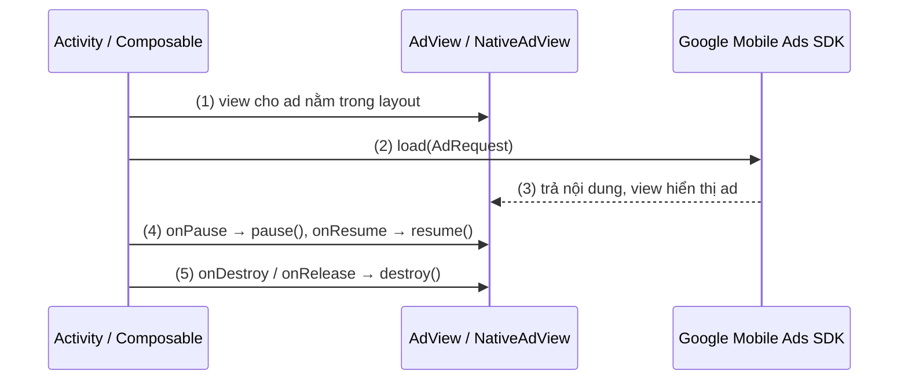

# Inline Ads

## Vấn đề cần giải quyết

Có những quảng cáo không bật lên toàn màn hình mà nằm ngay trong giao diện: một thanh banner dưới đáy màn hình, một ô quảng cáo xen giữa danh sách bài viết. Với app, chúng chỉ là một View nữa trong layout.

Nhưng View này đặc biệt. Banner thực chất là WebView chạy HTML ad, có thể phát video, tự refresh qua network. Nếu màn hình đã vào background mà ad vẫn chạy, app tốn pin, phát tiếng quảng cáo khi user không nhìn thấy, và vi phạm policy. Nếu màn hình đã bị huỷ mà ad còn giữ Context, app bị memory leak. Native ad còn thêm một yêu cầu: hoà vào giao diện app nhưng user vẫn phải nhận ra đó là quảng cáo.

## Sau khi học xong

- Giải thích được vì sao Banner và Native là View trong layout của app và phải đi theo lifecycle của màn hình chứa nó.
- Áp dụng được Banner trong View System (XML) lẫn Jetpack Compose, gọi pause/resume/destroy đúng thời điểm.
- Triển khai được Native Ad với NativeAdView, bind từng asset rồi gọi setNativeAd() sau cùng.
- Biết khi nào chọn Banner, khi nào chọn Native.
- Xử lý được memory leak và âm thanh chạy nền do banner hoặc native ad không được giải phóng.

## Inline Ads là gì?

**Inline ad** là quảng cáo hiển thị như một View nằm trong layout của app (Banner, Native), sống cùng vòng đời với màn hình chứa nó. Khác với full-screen ad, SDK không mở màn hình riêng: app tự đặt view, tự load và tự giải phóng.

Mental model: inline ad là **một ô trong layout mà SDK lấp nội dung**. Ô đó thuộc về màn hình, nên màn hình pause thì ô pause, màn hình bị huỷ thì ô bị huỷ.

### Banner Ads

**Bản chất:** Banner là một View (thực chất là WebView) hiển thị HTML ad. Nó gắn vào layout của app, luôn hiển thị.

**Kích thước chuẩn:**

| Ad Size | Dimensions (WxH) | Use case |
|---------|------------------|----------|
| BANNER | 320x50 | Điện thoại, dưới màn hình |
| LARGE_BANNER | 320x100 | Điện thoại, cao hơn |
| MEDIUM_RECTANGLE | 300x250 | Tablet, giữa nội dung |
| FULL_BANNER | 468x60 | Tablet |
| LEADERBOARD | 728x90 | Tablet, trên cùng |
| ADAPTIVE_BANNER | Tự động | Tự động theo chiều rộng màn hình |

### Native Ads

**Bản chất:** Native Ads cho phép customize UI ad để hòa lẫn với UI của app. Bạn tự bind dữ liệu (headline, image, call-to-action) vào layout của mình.

**Đặc điểm:**
- Hợp với giao diện app nhưng **bắt buộc có nhãn attribution** (vd "Quảng cáo"/"Ad") để user biết đó là quảng cáo; biểu tượng AdChoices do SDK tự chèn.
- UX tốt nhất vì ad không phá UI.
- Implementation phức tạp nhất — phải tự bind từng view.

## Cách hoạt động

Cả Banner lẫn Native đi qua cùng một vòng đời, gắn với màn hình chứa nó:

1. Màn hình có sẵn một view cho ad trong layout: `AdView` (banner) hoặc `NativeAdView` (native).
2. App gọi load với một `AdRequest`. SDK gửi request bất đồng bộ theo luồng ở [AdMob Overview](overview.md).
3. SDK trả nội dung về: banner tự hiển thị trong `AdView`; native trả dữ liệu (`NativeAd`) để app tự bind vào view.
4. Màn hình vào `onPause` thì gọi `pause()`, quay lại `onResume` thì gọi `resume()`, để ad không chạy khi user không nhìn thấy.
5. Màn hình bị huỷ (hoặc Composable rời composition) thì gọi `destroy()` để giải phóng WebView và Context.



### Banner trong View System (XML)

**Layout:**

```xml
<com.google.android.gms.ads.AdView
    android:id="@+id/adView"
    android:layout_width="wrap_content"
    android:layout_height="wrap_content"
    android:layout_gravity="bottom|center_horizontal"
    app:adSize="BANNER"
    app:adUnitId="ca-app-pub-3940256099942544/6300978111"/>
```

**Activity:**

```kotlin
class MainActivity : AppCompatActivity() {

    private lateinit var adView: AdView

    override fun onCreate(savedInstanceState: Bundle?) {
        super.onCreate(savedInstanceState)
        setContentView(R.layout.activity_main)
        
        adView = findViewById(R.id.adView)  // (1) AdView khai báo sẵn trong layout
                adView.loadAd(AdRequest.Builder().build())  // (2)
    }

    // Quan trọng: phải synchronous lifecycle với Activity
    override fun onPause() {
        adView.pause()  // (4) Dừng load ad, dừng animation/video
        super.onPause()
    }

    override fun onResume() {
        super.onResume()
        adView.resume()  // (4) Tiếp tục load ad
    }

    override fun onDestroy() {
        adView.destroy()  // (5) Giải phóng resource, tránh memory leak
        super.onDestroy()
    }
}
```

**Chi tiết lifecycle:**

- `pause()`: Dừng mọi hoạt động của banner (load ad, animation, video). Gọi khi Activity không còn visible (onPause).
- `resume()`: Tiếp tục hoạt động. Gọi khi Activity trở lại foreground (onResume).
- `destroy()`: Giải phóng resource (WebView, memory). Gọi khi Activity bị destroy. **Bắt buộc** để tránh memory leak.

**Tại sao phải gọi pause/resume/destroy?**

- Banner thực chất là **WebView** hiển thị HTML ad.
- Nếu không pause khi app ở background:
  - WebView vẫn chạy → tốn CPU, battery.
  - Video ad vẫn phát → user nghe tiếng quảng cáo khi app bị ẩn.
  - Vi phạm chính sách Google Play (ad không được chạy ngầm).
- Nếu không destroy khi Activity bị hủy:
  - WebView vẫn giữ reference đến Context → memory leak.
  - Ad vẫn load → tốn network, battery.

### Banner trong Jetpack Compose

> [!NOTE]
> Kiến thức dùng trước: `AndroidView` (nhúng View vào Compose) và `DisposableEffect` thuộc Session 09: Jetpack Compose UI, mục 9.3.2 DisposableEffect (chưa có bài). Ở đây chỉ cần biết `DisposableEffect` chạy `onDispose` khi Composable rời composition.

```kotlin
@Composable
fun AdBannerView(
    modifier: Modifier = Modifier,
    adUnitId: String,
    adSize: AdSize = AdSize.BANNER
) {
    AndroidView(
        modifier = modifier,
        factory = { context ->
            AdView(context).apply {
                this.adSize = adSize
                this.adUnitId = adUnitId
                loadAd(AdRequest.Builder().build())
            }
        },
        update = { adView ->
            // Called khi recomposition với tham số mới
            // Thường không cần reload ad trừ khi adUnitId thay đổi
            if (adView.adUnitId != adUnitId) {
                adView.adUnitId = adUnitId
                adView.loadAd(AdRequest.Builder().build())
            }
        },
        onRelease = { adView ->
            // Called khi Composable rời khỏi composition
            adView.destroy()  // (5) Tương đương onDestroy trong View System
        }
    )
}

// Sử dụng
@Composable
fun MainScreen() {
    Box(modifier = Modifier.fillMaxSize()) {
        // Nội dung màn hình
        Column(modifier = Modifier.fillMaxSize()) {
            // ... content ...
        }
        
        // Banner ở dưới cùng
        AdBannerView(
            modifier = Modifier
                .align(Alignment.BottomCenter)
                .padding(8.dp),
            adUnitId = "ca-app-pub-3940256099942544/6300978111"
        )
    }
}
```

**Chi tiết Compose:**

- `AndroidView`: Bridge giữa Compose và View System.
- `factory`: Tạo AdView lần đầu. Chỉ gọi một lần.
- `update`: Gọi khi recomposition với tham số mới. Kiểm tra `adUnitId` thay đổi mới reload.
- `onRelease`: Gọi khi Composable rời khỏi composition. **Phải gọi `destroy()`** để tránh leak.

**Lưu ý:**

- Không nên khởi tạo AdView trong `remember {}` với lambda không ổn định — có thể tạo lại View gây double load.
- Nếu cần pause/resume theo lifecycle, dùng `DisposableEffect` với `LocalLifecycleOwner`:

```kotlin
@Composable
fun AdBannerViewWithLifecycle(
    modifier: Modifier = Modifier,
    adUnitId: String
) {
    val context = LocalContext.current
    val lifecycleOwner = LocalLifecycleOwner.current

    // Giữ AdView trong remember để observer bên dưới gọi được pause()/resume()
    val adView = remember {
        AdView(context).apply {
            adSize = AdSize.BANNER
            this.adUnitId = adUnitId
            loadAd(AdRequest.Builder().build())
        }
    }

    AndroidView(modifier = modifier, factory = { adView })

    // AndroidView KHÔNG tự pause/resume AdView: phải tự nối với lifecycle
    DisposableEffect(lifecycleOwner) {
        val observer = LifecycleEventObserver { _, event ->
            when (event) {
                Lifecycle.Event.ON_RESUME -> adView.resume()
                Lifecycle.Event.ON_PAUSE -> adView.pause()
                else -> Unit
            }
        }
        lifecycleOwner.lifecycle.addObserver(observer)
        onDispose {
            lifecycleOwner.lifecycle.removeObserver(observer)
        }
    }

    // Rời composition → destroy để tránh leak
    DisposableEffect(adView) {
        onDispose { adView.destroy() }
    }
}

#### Lưu ý lifecycle

**Trong Compose:**
- `onRelease` callback của `AndroidView` chính là nơi gọi `destroy()`.
- AndroidView **không** tự pause/resume AdView: phải tự gọi `pause()`/`resume()` qua `LifecycleEventObserver` (như `AdBannerViewWithLifecycle` ở trên).

**Nếu app có nhiều Activity cùng hiển thị banner:**
- Chỉ một banner duy nhất nên hoạt động tại một thời điểm.
- Khi chuyển Activity, pause banner cũ, resume banner mới.

### Banner refresh

**Vấn đề:**
- Banner có thể tự refresh theo cấu hình của ad unit.
- Nếu refresh quá thường xuyên → tốn network.

**Giải pháp:**
- Refresh rate chỉ chỉnh trong **AdMob UI** (cài đặt ad unit): Google optimized (khuyến nghị), custom 30–150 giây, hoặc tắt hẳn. Refresh chỉ chạy khi banner đang hiển thị trên màn hình.
- Nếu tắt auto-refresh trong AdMob UI, app tự gọi `adView.loadAd()` khi cần ad mới.

```xml
<!-- Không có attribute XML nào để chỉnh refresh: cấu hình trong AdMob UI (ad unit settings) -->
<com.google.android.gms.ads.AdView
    android:id="@+id/adView"
    android:layout_width="wrap_content"
    android:layout_height="wrap_content"
    app:adSize="BANNER"
    app:adUnitId="..."/>
```

## Ví dụ thực tế: Native ad trong màn hình bài viết

Màn hình đọc bài viết chèn một native ad giữa nội dung, giao diện giống một khối "bài liên quan" nhưng có nhãn "Quảng cáo". Các bước (1)–(5) khớp với luồng ở trên.

### Layout

```xml
<!-- layout/native_ad_layout.xml -->
<com.google.android.gms.ads.nativead.NativeAdView
    xmlns:android="http://schemas.android.com/apk/res/android"
    android:id="@+id/native_ad_view"
    android:layout_width="match_parent"
    android:layout_height="wrap_content"
    android:padding="16dp">

    <LinearLayout
        android:layout_width="match_parent"
        android:layout_height="wrap_content"
        android:orientation="vertical">

        <!-- Nhãn attribution: bắt buộc theo policy native ads -->
        <TextView
            android:id="@+id/ad_attribution"
            android:layout_width="wrap_content"
            android:layout_height="wrap_content"
            android:text="Quảng cáo"
            android:textSize="12sp"/>

        <!-- Media (image/video) -->
        <com.google.android.gms.ads.nativead.MediaView
            android:id="@+id/ad_media"
            android:layout_width="match_parent"
            android:layout_height="200dp"/>

        <!-- Headline -->
        <TextView
            android:id="@+id/ad_headline"
            android:layout_width="wrap_content"
            android:layout_height="wrap_content"
            android:textSize="16sp"
            android:textStyle="bold"
            android:layout_marginTop="8dp"/>

        <!-- Body -->
        <TextView
            android:id="@+id/ad_body"
            android:layout_width="wrap_content"
            android:layout_height="wrap_content"
            android:textSize="14sp"
            android:layout_marginTop="4dp"/>

        <!-- Call to action -->
        <Button
            android:id="@+id/ad_call_to_action"
            android:layout_width="wrap_content"
            android:layout_height="wrap_content"
            android:layout_marginTop="8dp"/>

    </LinearLayout>
</com.google.android.gms.ads.nativead.NativeAdView>
```

### Load và bind

```kotlin
class ArticleActivity : AppCompatActivity() {

    private var nativeAd: NativeAd? = null

    override fun onCreate(savedInstanceState: Bundle?) {
        super.onCreate(savedInstanceState)
        setContentView(R.layout.activity_main)

        loadNativeAd()
    }

    private fun loadNativeAd() {
        val adLoader = AdLoader.Builder(this, "ca-app-pub-3940256099942544/2247696110")
            .forNativeAd { ad ->  // (3) SDK trả về dữ liệu ad
                // Callback có thể đến sau khi Activity đã bị huỷ: huỷ ad ngay, không bind
                if (isDestroyed) {
                    ad.destroy()
                    return@forNativeAd
                }
                nativeAd?.destroy()  // Bỏ ad cũ trước khi giữ ad mới
                nativeAd = ad
                bindNativeAd(ad)
            }
            .withAdListener(object : AdListener() {
                override fun onAdFailedToLoad(error: LoadAdError) {
                    Log.e("NativeAd", "Failed to load: ${error.message}")
                }
            })
            .build()

        adLoader.loadAd(AdRequest.Builder().build())  // (2)
    }

    private fun bindNativeAd(nativeAd: NativeAd) {
        // (1) Layout của app, gốc là NativeAdView
        val adView = layoutInflater.inflate(R.layout.native_ad_layout, null) as NativeAdView

        // Bind headline
        adView.headlineView = adView.findViewById(R.id.ad_headline)
        (adView.headlineView as TextView).text = nativeAd.headline

        // Bind body (optional)
        if (nativeAd.body != null) {
            adView.bodyView = adView.findViewById(R.id.ad_body)
            (adView.bodyView as TextView).text = nativeAd.body
            adView.bodyView?.visibility = View.VISIBLE
        } else {
            adView.bodyView?.visibility = View.GONE
        }

        // Bind media
        adView.mediaView = adView.findViewById(R.id.ad_media)

        // Bind call to action
        adView.callToActionView = adView.findViewById(R.id.ad_call_to_action)
        (adView.callToActionView as Button).text = nativeAd.callToAction
        adView.callToActionView?.visibility = View.VISIBLE

        // Gán xong mọi asset view (kể cả MediaView) rồi mới setNativeAd(): gọi SAU CÙNG
        adView.setNativeAd(nativeAd)

        // Add ad view vào layout
        findViewById<LinearLayout>(R.id.adContainer).addView(adView)
    }

    override fun onDestroy() {
        nativeAd?.destroy()  // (5) Native ad giữ reference tới Context
        super.onDestroy()
    }
}
```

### Chú thích

**Phải bind từng view:**
- `headlineView`, `bodyView`, `mediaView`, `callToActionView`...
- Gọi `adView.setNativeAd(nativeAd)` **sau cùng**, sau khi đã gán mọi asset view (kể cả `mediaView`), để SDK đăng ký đúng view và đo click/impression.

**Destroy khi không dùng:**
- Native ad giữ reference đến Context.
- Khi Activity bị destroy, phải destroy native ad để tránh leak.

## Khi nào nên và không nên dùng

### Banner

**Khi nào dùng:**
- App cần revenue ổn định, liên tục.
- Không muốn làm phiền user quá nhiều.
- App có màn hình dài, có chỗ trống dưới cùng.

**Khi nào KHÔNG dùng:**
- App có UI chật chội, không có chỗ trống.
- App yêu cầu user tập trung cao (game hành động, đọc sách).
- App có nhiều màn hình nhỏ, banner sẽ chiếm quá nhiều không gian.

### Native

**Khi nào dùng:**
- Feed content (news, social media).
- List items (product list, video list).
- Khi muốn ad hòa lẫn tự nhiên.

**Khi nào KHÔNG dùng:**
- App đơn giản, không cần customize.
- Không có thời gian implement (Native phức tạp hơn Banner nhiều).

## Sai lầm thường gặp

### 1. Memory leak banner

**Triệu chứng:**
- App tốn nhiều memory.
- Crash OOM (Out Of Memory) sau thời gian dài.

**Nguyên nhân:**
- Không gọi `adView.destroy()` khi Activity bị hủy.
- WebView vẫn giữ reference đến Context.

**Giải pháp:**

```kotlin
override fun onDestroy() {
    adView.destroy()  // Bắt buộc
    super.onDestroy()
}
```

### 2. Bọc AdView bằng AndroidView mà không pause/resume

**Triệu chứng:**
- Video ad trong banner vẫn phát tiếng khi app đã về background.

**Nguyên nhân:**
- `AndroidView` chỉ có `onRelease` (tương đương destroy), không tự gọi `pause()`/`resume()` theo lifecycle.

**Giải pháp:**
- Nối AdView với lifecycle bằng `LifecycleEventObserver` trong `DisposableEffect`, như `AdBannerViewWithLifecycle` ở trên.

### 3. Gọi setNativeAd() trước khi gán asset view

**Triệu chứng:**
- Click vào native ad không mở quảng cáo, impression không được ghi nhận.

**Nguyên nhân:**
- `setNativeAd()` đăng ký các asset view đã gán lúc gọi; view gán sau đó SDK không biết.

**Giải pháp:**
- Gán hết `headlineView`, `bodyView`, `mediaView`, `callToActionView`... rồi mới gọi `adView.setNativeAd(nativeAd)` ở cuối.

### 4. Native ad không có nhãn attribution

**Triệu chứng:**
- App bị cảnh báo vi phạm policy native ads.

**Nguyên nhân:**
- Native ad hoà vào giao diện đến mức user không biết đó là quảng cáo.

**Giải pháp:**
- Luôn có nhãn "Quảng cáo"/"Ad" trong layout (biểu tượng AdChoices do SDK tự chèn).

## Lịch sử phát triển

- Banner (`AdView`) là định dạng có từ những bản AdMob SDK đầu tiên; bộ API `loadAd`/`pause`/`resume`/`destroy` của nó không đổi qua các bản SDK. Thay đổi API lớn năm 2021 chỉ áp dụng cho full-screen ad (xem [Full-screen Ads](fullscreen_ads.md)).
- Ngoài kích thước cố định, SDK có **adaptive banner** (tự tính chiều cao theo chiều rộng màn hình); test ad unit chính thức hiện có riêng cho adaptive banner (xem bảng test ads ở [AdMob Overview](overview.md)).
- Lịch sử chung của AdMob và SDK: [AdMob Overview](overview.md).

## Kết nối hệ thống

- **AdMob Overview (4.2.3.3.1):** luồng load, test ad unit và cách debug dùng chung cho mọi loại ad. Xem [AdMob Overview](overview.md).
- **Activity Lifecycle (4.2.1.1):** `pause()`/`resume()`/`destroy()` của ad map thẳng vào `onPause`/`onResume`/`onDestroy` của màn hình chứa nó. Xem [Activity Lifecycle](../../activity/lifecycle.md).
- **Fragment Lifecycle (4.2.2.1):** banner trong Fragment gắn với view lifecycle của Fragment (destroy ở `onDestroyView`, không phải `onDestroy`). Xem [Fragment Lifecycle](../../fragment/lifecycle.md).
- **Full-screen Ads (4.2.3.3.3):** ngược với inline ad, SDK tự mở màn hình riêng và app chỉ giữ một instance để show. Xem [Full-screen Ads](fullscreen_ads.md).
- **Ads trong kiến trúc app (4.2.3.3.4):** inline ad là View nên nằm ở tầng UI; việc có hiện ad hay không (vd user đã mua "remove ads") là state đến từ ViewModel. Xem [Ads trong kiến trúc app](ads_architecture.md).

## Nguồn tham khảo

- [AdMob Banner](https://developers.google.com/admob/android/banner)
- [AdMob Native](https://developers.google.com/admob/android/native/start)
- [Native advanced (attribution, setNativeAd)](https://developers.google.com/admob/android/native/advanced)
- [Automatic refresh for banner ads](https://support.google.com/admob/answer/3245199)
