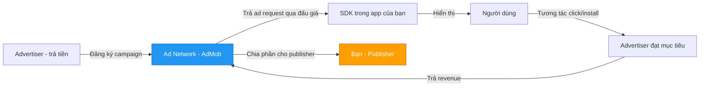
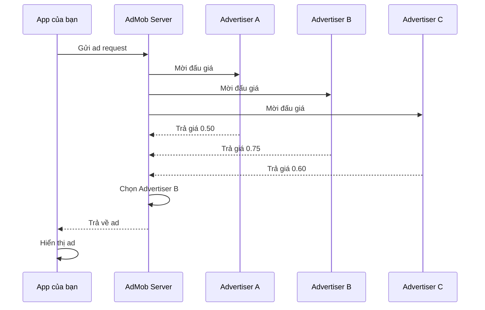
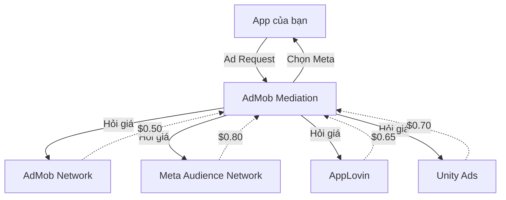
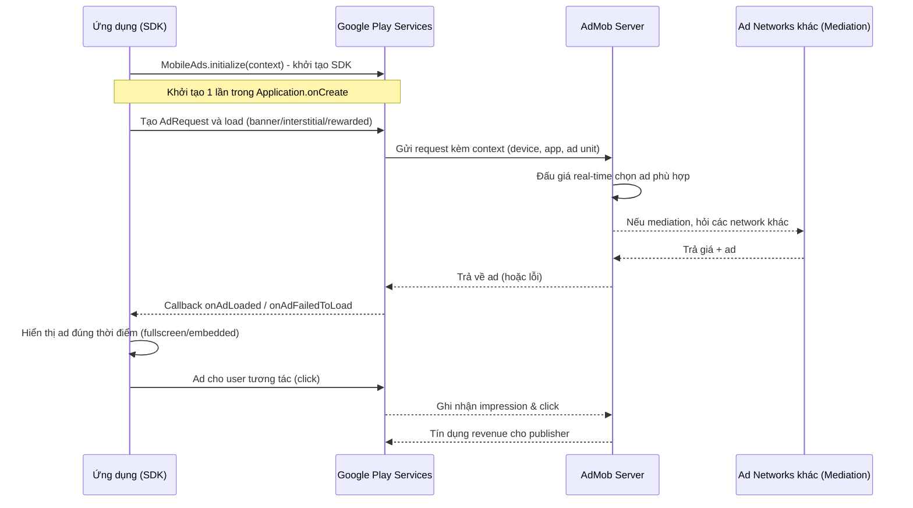
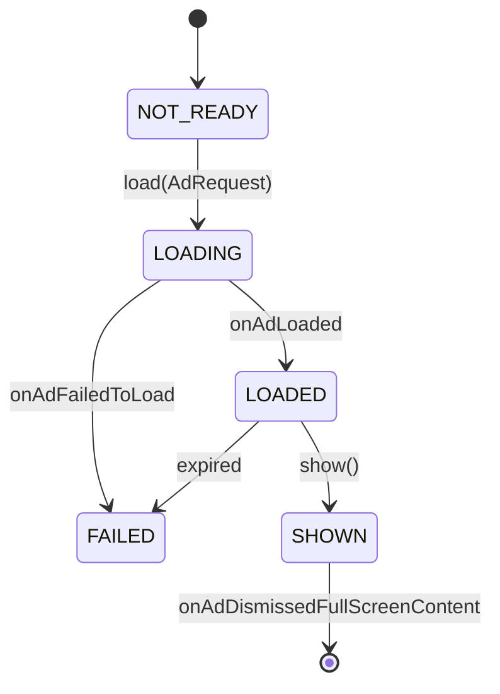

# AdMob Overview

## Vấn đề cần giải quyết

Người dùng đa số không muốn trả tiền để dùng app. Nhà phát triển cần tiền để duy trì máy chủ, trả lương, phát triển tính năng. Mâu thuẫn này được giải quyết bằng **quảng cáo**: app miễn phí cho user, revenue đến từ advertiser trả tiền cho mỗi lần hiển thị.

Nhưng quảng cáo không đơn giản là "dán một banner lên màn hình". App của bạn chỉ là **một phía** (Publisher). Để có quảng cáo hiển thị, phải có cả một hệ thống gồm:

- **Advertiser** (advertiser) — người trả tiền để quảng bá sản phẩm/dịch vụ.
- **Ad Network** (ad network) — trung gian kết nối advertiser với publisher, vận hành real-time bidding.
- **Publisher** (bạn) — app show ad để kiếm revenue.
- **SDK** — thư viện chạy trong app để yêu cầu và show ad.

Nếu tự xây toàn bộ hệ thống này thì không khả thi. Bài này giải thích hệ sinh thái **Google AdMob** (ad network lớn nhất của Google), đường đi của một ad request từ app tới lúc hiển thị, và cách tích hợp **Google Mobile Ads SDK** đúng ngay từ đầu. Cách dùng từng loại ad, cách đặt quảng cáo vào kiến trúc app và các quy định privacy nằm ở các bài 4.2.3.3.2 đến 4.2.3.3.5.

## Sau khi học xong

- Giải thích được vai trò của Advertiser, Ad Network, Publisher, SDK và đường đi của một ad request qua đấu giá, mediation tới khi hiển thị.
- Phân biệt được App ID với Ad Unit ID, và các loại ad (Banner, Interstitial, Rewarded, Rewarded Interstitial, Native, App Open) theo hình thức và use case.
- Áp dụng được 4 bước tích hợp Google Mobile Ads SDK (dependency, App ID, khởi tạo, test ads) mà không tạo invalid traffic.
- Debug được lỗi load ad bằng Ad Inspector, logcat và mã lỗi (no fill).
- Biết khi nào dùng AdMob, mediation, tự xây ad server hay In-app Purchase.

## Quảng cáo trên Android là gì?

**Quảng cáo trên Android** là việc một app (Publisher) hiển thị nội dung quảng bá trả phí cho user thông qua một SDK của Ad Network. Phổ biến nhất là **Google AdMob** — nền tảng quản lý quảng cáo của Google, hoạt động dựa trên **Google Mobile Ads SDK**.

```text
Quảng cáo (Ads) = cầu nối giữa advertiser (trả tiền) và app miễn phí (phục vụ user)
```

### Các thành phần tham gia


<!-- dd: gg-ads -->

**Chi tiết từng thành phần:**

**Advertiser (Nhà quảng cáo):**
- Là công ty/cá nhân muốn quảng bá sản phẩm, dịch vụ.
- Trả tiền cho Ad Network theo mô hình:
  - **CPC (Cost Per Click):** trả tiền khi user click vào ad.
  - **CPM (Cost Per Mille):** trả tiền cho mỗi 1000 impression.
  - **CPI (Cost Per Install):** trả tiền khi user cài app qua ad.
- Tạo campaign quảng cáo trên Google Ads, đặt budget, chọn target audience.

**Ad Network (Mạng quảng cáo - AdMob):**
- Trung gian kết nối advertiser với publisher.
- Vận hành **real-time bidding (Real-Time Bidding - RTB)**: mỗi khi có ad request, nhiều advertiser đấu giá, ad trả tiền cao nhất sẽ được hiển thị.
- Quản lý payment, report, fraud detection (invalid traffic).
- Cung cấp SDK cho publisher tích hợp vào app.

**Publisher (Bạn):**
- Tích hợp SDK vào app.
- Hiển thị ad để kiếm revenue.
- Tuân thủ chính sách của Ad Network (không click fraud, không show ad sai cách...).

**SDK (Google Mobile Ads SDK):**
- Thư viện chạy trong app của bạn.
- Gửi ad request đến Ad Network.
- Nhận ad về và hiển thị.
- Theo dõi impression, click, gửi dữ liệu về Ad Network.

**App ID và Ad Unit ID** — hai mã định danh quan trọng:

- **App ID** (`ca-app-pub-XXXX~YYYY`) — định danh **app của bạn** trong AdMob, khai báo trong `AndroidManifest.xml`. Mỗi app chỉ có một App ID.
- **Ad Unit ID** (`ca-app-pub-XXXX/YYYY`) — định danh từng **vị trí show ad** trong app. Một app có thể có nhiều Ad Unit ID:
  - `ca-app-pub-XXXX/1111` — Banner ở màn hình chính.
  - `ca-app-pub-XXXX/2222` — Interstitial sau khi hoàn thành level.
  - `ca-app-pub-XXXX/3333` — Rewarded khi user muốn nhận thưởng.

## Vì sao AdMob tồn tại? Nó giải quyết vấn đề gì?

### Vấn đề khi không có Ad Network

Nếu không có Ad Network, bạn sẽ phải:

- **Tự tìm advertiser** — rất khó, cần đội ngũ sales, hợp đồng pháp lý.
- **Tự xây hệ thống đấu giá** — phức tạp, cần server, thuật toán tối ưu.
- **Tự quản lý payment** — xử lý tiền từ nhiều nguồn, reconciliation, thuế.
- **Tự fraud detection** — phát hiện invalid click, invalid impression.
- **Tự cung cấp nguồn ad** — nếu không có advertiser, app trống trơn.

Tất cả những việc này đòi hỏi nguồn lực khổng lồ, không khả thi với đa số app.

### AdMob giải quyết những gì?

**1. Nguồn quảng cáo khổng lồ**

AdMob kết nối với hàng nghìn advertiser qua Google Ads — nền tảng quảng cáo lớn nhất thế giới. Bạn không cần tìm advertiser, AdMob tự động cung cấp ad phù hợp với ngữ cảnh app của bạn.

**2. Tự động đấu giá (Ad Auction)**

Mỗi lần app yêu cầu ad, AdMob tổ chức real-time bidding:


<!-- dd: gg-auction -->

**3. Mediation — tối đa revenue**

AdMob có thể làm trung gian với các ad network khác (Meta Audience Network, AppLovin, Unity Ads...). Khi app yêu cầu ad, AdMob hỏi nhiều network cùng lúc, chọn ad trả tiền cao nhất:


<!-- dd: gg-mediation -->

**4. Thanh toán, report, fraud detection**

- **Thanh toán:** AdMob tự động chuyển tiền vào tài khoản ngân hàng của bạn hàng tháng (khi đạt ngưỡng tối thiểu $100).
- **Báo cáo:** Dashboard chi tiết về impression, click, revenue, eCPM (effective Cost Per Mille — revenue trên 1000 impression).
- **Chống fraud:** Google tự động phát hiện invalid click, invalid impression, bảo vệ advertiser và publisher.

## Cách hoạt động bên trong

### Luồng yêu cầu ad chi tiết


<!-- dd: gg-sdkinit -->

**Chi tiết từng bước:**

**Bước 1: Khởi tạo SDK**

```kotlin
MobileAds.initialize(this) { initializationStatus ->
    // SDK đã sẵn sàng
}
```

- Gọi **một lần** trong `Application.onCreate()`.
- SDK tải cấu hình từ AdMob (ad units, mediation config, A/B testing).
- Không cần chờ xong mới load ad — SDK tự xếp hàng (queue) các request.

**Bước 2: Tạo AdRequest**

```kotlin
val adRequest = AdRequest.Builder()
    .addNetworkExtrasBundle(AdMobAdapter::class.java, bundle)  // tùy chọn
    .build()
```

- AdRequest chứa thông tin về ngữ cảnh: thiết bị, vị trí, nội dung app.
- AdMob dùng thông tin này để chọn ad phù hợp (targeting).

**Bước 3: Load ad**

```kotlin
InterstitialAd.load(context, adUnitId, adRequest, object : InterstitialAdLoadCallback() {
    override fun onAdLoaded(ad: InterstitialAd) {
        // Ad đã tải xong, có thể show
    }

    override fun onAdFailedToLoad(error: LoadAdError) {
        // Lỗi: no fill, network error, invalid ad unit...
    }
})
```

- Load **asynchronous** — không block UI thread.
- Kết quả trả về qua callback.
- Ad có thể không có sẵn (no fill) nếu không có advertiser phù hợp.

**Bước 4: Hiển thị ad**

```kotlin
ad.show(activity)
```

- Chỉ show khi Activity ở foreground (RESUMED state).
- Fullscreen ad (interstitial, rewarded) chiếm toàn bộ màn hình.
- Banner ad hiển thị trong layout.

**Bước 5: Theo dõi tương tác**

```kotlin
ad.fullScreenContentCallback = object : FullScreenContentCallback() {
    override fun onAdClicked() { /* User click */ }
    override fun onAdDismissedFullScreenContent() { /* Ad đóng */ }
    override fun onAdFailedToShowFullScreenContent(error: AdError) { /* Show lỗi */ }
    override fun onAdImpression() { /* Ad hiển thị */ }
    override fun onAdShowedFullScreenContent() { /* Ad bắt đầu hiển thị */ }
}
```

### Vòng đời của một ad


<!-- dd: gg-adstate -->

**Điểm mấu chốt:**

- **Ad tải asynchronous** — SDK không bao giờ block UI thread.
- **Một ad chỉ dùng được một lần** — sau khi show, phải load ad mới.
- **Ad có thể expire** — nếu load xong mà không show trong thời gian dài, ad bị hủy.
- **Callback không synchronous** — `onAdLoaded` có thể gọi sau vài giây hoặc vài phút.

## Các loại quảng cáo

### Bảng so sánh chi tiết

| Tiêu chí | Banner | Interstitial | Rewarded | Rewarded Interstitial | Native |
|----------|--------|--------------|----------|----------------------|--------|
| **Hình thức** | Thanh nhỏ (320x50, 320x100...) | Toàn màn hình | Toàn màn hình | Toàn màn hình | Tùy chỉnh layout |
| **Nơi hiển thị** | Gắn trong layout | Tự động bật lên | Tự chọn (nút xem) | Tự chọn | Nhúng trong list |
| **User tương tác** | Click | Click hoặc đóng | Xem hết để nhận thưởng | Xem + đóng | Click |
| **Doanh thu (eCPM)** | Thấp ($0.5-2) | Trung bình ($5-15) | Cao ($15-30) | Cao ($15-30) | Tùy thuộc |
| **UX impact** | Ít xâm lấn | Xâm lấn vừa | User tự chọn | User tự chọn | Hòa lẫn nội dung |
| **Use case** | App tiện ích, content | Giữa các màn hình | Game: coin, lives | Game level | Feed content |
| **Implementation** | View trong layout | Load trước, show sau | Load trước, show khi user bấm | Tương tự rewarded | Bind từng view |

**App Open Ad** (hiển thị khi app quay lại từ background) cũng là ad toàn màn hình, nằm ở bài Full-screen Ads.

Bảng trên dùng để chọn loại ad. Cách hoạt động, code và quy tắc lifecycle của từng loại:

- Banner, Native (nằm trong layout của app): [Inline Ads](inline_ads.md).
- Interstitial, Rewarded, Rewarded Interstitial, App Open (SDK mở màn hình riêng): [Full-screen Ads](fullscreen_ads.md).

## Ví dụ thực tế: tích hợp Google Mobile Ads SDK

Bốn bước dưới đây làm một lần cho cả app, trước khi dùng bất kỳ loại ad nào.

### Bước 1: Khai báo dependency

```kotlin
// app/build.gradle.kts
plugins {
    id("com.android.application")
    // Không cần plugin đặc biệt cho AdMob (khác với Firebase)
}

dependencies {
    implementation("com.google.android.gms:play-services-ads:25.5.0")
}
```

**Lưu ý:**
- Version mới nhất kiểm tra tại: https://developers.google.com/admob/android/quick-start (tháng 11/2026 là 25.5.0). Trang docs hiện gắn nhãn SDK này là "Google Mobile Ads SDK (Legacy)": khi bắt đầu dự án mới, đọc docs để chọn đúng SDK.
- Không cần `google-services.json` (khác với Firebase).
- SDK tự động thêm permissions cần thiết (`INTERNET`, `ACCESS_NETWORK_STATE`, `com.google.android.gms.permission.AD_ID`).

### Bước 2: Khai báo App ID trong Manifest

```xml
<manifest>
    <application>
        <meta-data
            android:name="com.google.android.gms.ads.APPLICATION_ID"
            android:value="ca-app-pub-3940256099942544~3347511713"/>
    </application>
</manifest>
```

**Quan trọng:**
- Thay `ca-app-pub-3940256099942544~3347511713` bằng App ID thật của bạn (lấy từ AdMob Console).
- Nếu quên khai báo → app crash ngay khi khởi tạo SDK với lỗi: `"The Google Mobile Ads SDK was initialized incorrectly"`.
- Dùng test App ID khi develop: `ca-app-pub-3940256099942544~3347511713`.

### Bước 3: Khởi tạo SDK một lần

```kotlin
class MyApplication : Application() {
    override fun onCreate() {
        super.onCreate()
        
        // Khởi tạo SDK
        MobileAds.initialize(this) { initializationStatus ->
            // SDK đã sẵn sàng
            // initializationStatus.adapterStatusMap chứa trạng thái của từng ad network
            initializationStatus.adapterStatusMap.forEach { (adapterClass, status) ->
                Log.d("AdMob", "$adapterClass: ${status.state}, ${status.description}")
            }
        }
        
        // Không cần chờ callback xong mới load ad
        // SDK tự xếp hàng các request
    }
}
```

**Chi tiết:**
- `MobileAds.initialize()` gọi **một lần** trong `Application.onCreate()`.
- Callback `initializationStatus` trả về trạng thái của từng ad network (AdMob, mediation networks...).
- Không cần chờ callback xong mới load ad — SDK tự queue requests.
- Khởi tạo càng sớm càng tốt để giảm latency khi load ad đầu tiên.
- Quick-start của Google minh hoạ gọi `initialize()` trên background thread (`CoroutineScope(Dispatchers.IO).launch { ... }`) để không chặn main thread lúc mở app.
- App có user ở vùng cần consent (EEA, UK, Thuỵ Sĩ) phải kiểm tra `canRequestAds()` trước khi request ad: xem [Ads Privacy & Policy](privacy_policy.md).

### Bước 4: Test ads — bắt buộc dùng

**Tại sao phải dùng test ads?**

- AdMob theo dõi mọi ad request.
- Nếu bạn dùng ad unit ID thật trong lúc develop, AdMob sẽ ghi nhận impression/click từ developer.
- Đây bị coi là **invalid traffic** → tài khoản bị đình chỉ vĩnh viễn.
- Không có cách nào khôi phục tài khoản bị banned vì invalid traffic.

**Test Ad Unit IDs (chính thức từ Google):**

| Loại | Test Ad Unit ID |
|------|-----------------|
| Adaptive Banner | `ca-app-pub-3940256099942544/9214589741` |
| Fixed Size Banner | `ca-app-pub-3940256099942544/6300978111` |
| Interstitial | `ca-app-pub-3940256099942544/1033173712` |
| Rewarded | `ca-app-pub-3940256099942544/5224354917` |
| Rewarded Interstitial | `ca-app-pub-3940256099942544/5354046379` |
| Native | `ca-app-pub-3940256099942544/2247696110` |
| Native Video | `ca-app-pub-3940256099942544/1044960115` |
| App Open | `ca-app-pub-3940256099942544/9257395921` |

**Test App ID:** `ca-app-pub-3940256099942544~3347511713`

**Cách dùng:**

```kotlin
// Development - dùng test ad unit ID
val AD_UNIT_ID = if (BuildConfig.DEBUG) {
    "ca-app-pub-3940256099942544/6300978111"  // Test
} else {
    "ca-app-pub-XXXXXXXXXXXXXXXX/YYYYYYYYYY"  // Production
}
```

**Hoặc dùng test device:**

```kotlin
// Đăng ký test device cho mọi ad request (gọi trước khi load ad)
val configuration = RequestConfiguration.Builder()
    .setTestDeviceIds(listOf("YOUR_TEST_DEVICE_ID"))  // Lấy từ logcat khi chạy app
    .build()
MobileAds.setRequestConfiguration(configuration)
```

- Test device ID hiển thị trong logcat khi bạn chạy app với ad unit ID thật.
- AdMob sẽ trả về test ads cho device này, không tính là invalid traffic.

## So sánh với công nghệ tương tự

### AdMob so với Ad Networks khác

**Meta Audience Network (Facebook):**

| Tiêu chí | AdMob | Meta Audience Network |
|----------|-------|----------------------|
| **Hệ sinh thái** | Google Ads rộng nhất | Facebook/Instagram |
| **Fill rate** | Cao (90%+) | Trung bình (70-80%) |
| **eCPM** | Trung bình | Cao hơn AdMob 10-20% |
| **Native Ads** | Hỗ trợ tốt | Hỗ trợ tốt |
| **Rewarded** | Tốt | Tốt |
| **Mediation** | Có (làm trung tâm) | Có (qua AdMob) |
| **Phù hợp** | Mọi loại app | App có user Meta nhiều |

**Unity Ads:**

| Tiêu chí | AdMob | Unity Ads |
|----------|-------|-----------|
| **Hệ sinh thái** | Google Ads | Unity Game Engine |
| **Fill rate** | Cao | Cao (cho game Unity) |
| **eCPM** | Trung bình | Cao (cho game) |
| **Rewarded** | Tốt | Rất tốt (game) |
| **Mediation** | Có | Có |
| **Phù hợp** | Mọi loại app | Game Unity |

**AppLovin:**

| Tiêu chí | AdMob | AppLovin |
|----------|-------|----------|
| **Hệ sinh thái** | Google Ads | AppLovin MAX |
| **Fill rate** | Cao | Cao |
| **eCPM** | Trung bình | Cao |
| **Mediation** | Có | MAX (rất mạnh) |
| **Phù hợp** | Mọi loại app | Game, utility |

**Kết luận:**
- **AdMob:** Chuẩn cho hầu hết app, fill rate cao, dễ tích hợp.
- **Meta:** eCPM cao hơn, phù hợp app có user Meta nhiều.
- **Unity:** Tốt cho game Unity.
- **AppLovin:** MAX mediation rất mạnh, eCPM cao.

**Best practice:** Dùng **mediation** để kết hợp nhiều network, tối đa revenue.

### AdMob so với tự xây Ad Server

| Tiêu chí | AdMob | Ad Server tự xây |
|----------|-------|------------------|
| **Chi phí khởi tạo** | Miễn phí | Tốn server + nhân lực |
| **Nguồn advertiser** | Có sẵn (hàng nghìn) | Phải tự tìm |
| **Đấu giá** | Tự động (RTB) | Tự xây thuật toán |
| **Chống fraud** | Google lo | Tự lo |
| **Thanh toán** | Tự động | Tự xử lý |
| **Báo cáo** | Dashboard đầy đủ | Tự xây |
| **Kiểm soát** | Ít (tuân thủ policy Google) | Toàn quyền |
| **Kết luận** | Chuẩn cho 99% app | Chỉ app cực lớn (100M+ users) |

**Khi nào tự xây:**
- App có 100M+ users.
- Có đội ngũ engineering lớn.
- Cần kiểm soát toàn bộ (data, algorithm).
- Ví dụ: TikTok, Instagram tự xây ad server.

**Khi nào dùng AdMob:**
- App dưới 100M users.
- Không muốn đầu tư vào ad infrastructure.
- Muốn tập trung vào product, không phải ad tech.

### AdMob so với In-app Purchase (IAP)

| Tiêu chí | Ad (Quảng cáo) | IAP (Mua trong app) |
|----------|----------------|---------------------|
| **Doanh thu/user** | Thấp ($0.01-0.1/ngày) | Cao ($1-100/lần mua) |
| **Tỷ lệ user tạo doanh thu** | Hầu hết user (ai dùng app cũng thấy ad) | Thường chỉ vài phần trăm (số ít user mua) |
| **UX** | Xâm lấn (phải xem ad) | Tốt (user tự chọn mua) |
| **Implementation** | Dễ (tích hợp SDK) | Phức tạp (Google Play Billing) |
| **Phù hợp** | App miễn phí, user không muốn trả tiền | App có tính năng premium |

**Best practice: Kết hợp cả hai**

- App free có ad → revenue từ đa số user.
- User có thể trả tiền để **tắt quảng cáo** (remove ads) → revenue từ user muốn UX tốt.
- Ví dụ: Spotify free có ad, Spotify Premium không có ad.

**Implement:**

```kotlin
class MainActivity : AppCompatActivity() {

    private val viewModel: MainViewModel by viewModels()

    override fun onCreate(savedInstanceState: Bundle?) {
        super.onCreate(savedInstanceState)
        setContentView(R.layout.activity_main)

        // Check nếu user đã mua remove ads
        lifecycleScope.launch {
            viewModel.hasRemoveAds.collect { hasRemoveAds ->
                if (hasRemoveAds) {
                    // Ẩn banner
                    findViewById<AdView>(R.id.adView).visibility = View.GONE
                } else {
                    // Hiển thị banner
                    findViewById<AdView>(R.id.adView).visibility = View.VISIBLE
                }
            }
        }
    }
}
```

## Sai lầm thường gặp

### 1. Quên khai báo App ID trong Manifest

**Triệu chứng:**
- App crash ngay khi khởi tạo SDK.
- Logcat: `"The Google Mobile Ads SDK was initialized incorrectly"`.

**Nguyên nhân:**
- Quên thêm `<meta-data>` trong `AndroidManifest.xml`.
- Sai App ID.

**Giải pháp:**

```xml
<manifest>
    <application>
        <meta-data
            android:name="com.google.android.gms.ads.APPLICATION_ID"
            android:value="ca-app-pub-XXXXXXXXXXXXXXXX~YYYYYYYYYY"/>
    </application>
</manifest>
```

### 2. Dùng Ad Unit ID thật khi test

**Triệu chứng:**
- Tài khoản AdMob bị đình chỉ.
- Email từ Google: "Invalid traffic detected".

**Nguyên nhân:**
- Dùng ad unit ID thật trong lúc develop.
- AdMob ghi nhận impression/click từ developer → invalid traffic.

**Giải pháp:**
- Luôn dùng test ad unit ID khi develop.
- Chỉ dùng ad unit ID thật khi release.

```kotlin
val AD_UNIT_ID = if (BuildConfig.DEBUG) {
    "ca-app-pub-3940256099942544/6300978111"  // Test
} else {
    "ca-app-pub-XXXXXXXXXXXXXXXX/YYYYYYYYYY"  // Production
}
```

### 3. Mã lỗi 3 (No fill) không phải bug

**Triệu chứng:**
- Logcat: `"Ad failed to load: 3"`.
- Developer tưởng là lỗi.

**Nguyên nhân:**
- Error code 3 = `ERROR_CODE_NO_FILL`.
- Không có ad phù hợp vào thời điểm đó.
- Bình thường, không phải bug.

**Giải pháp:**
- Xử lý âm thầm (log nhẹ, thử lại sau).
- Không hiển thị lỗi cho user.

```kotlin
override fun onAdFailedToLoad(error: LoadAdError) {
    if (error.code == AdRequest.ERROR_CODE_NO_FILL) {
        Log.d("AdMob", "No fill, will retry later")
    } else {
        Log.e("AdMob", "Ad failed: ${error.code}")
    }
}
```

## Debug Techniques

### 1. Bật debug mode

```kotlin
// Mở Ad Inspector (chỉ chạy trên test device): xem từng ad request,
// kết quả mediation của từng ad source và lỗi chi tiết
MobileAds.openAdInspector(context) { error ->
    // error == null: Ad Inspector đã đóng bình thường
}
```

**Tác dụng:**
- SDK không có API kiểu `MobileAds.setDebugConfig()`; công cụ debug chính thức là **Ad Inspector**.
- Xem chi tiết ad request/response và kết quả mediation (waterfall, bidding) của từng ad unit.
- Ad Inspector chỉ mở trên thiết bị đã đăng ký test device.

### 2. Kiểm tra logcat

```bash
adb logcat -s Ads
```

**Logs quan trọng:**
- `Ad loaded successfully` — ad đã tải.
- `Ad failed to load: 3` — no fill.
- `Ad impression recorded` — ad đã hiển thị.
- `Ad clicked` — user click.

### 3. AdMob Dashboard

- Truy cập: https://apps.admob.com
- Kiểm tra:
  - Impressions, clicks, revenue.
  - Fill rate (tỷ lệ ad request thành công).
  - eCPM (revenue trên 1000 impressions).
  - Ad units performance.

### 4. Test với test device

```kotlin
// Đăng ký test device cho mọi ad request (gọi trước khi load ad)
val configuration = RequestConfiguration.Builder()
    .setTestDeviceIds(listOf("YOUR_TEST_DEVICE_ID"))  // Lấy từ logcat khi chạy app
    .build()
MobileAds.setRequestConfiguration(configuration)
```

**Lấy test device ID:**
- Chạy app với ad unit ID thật.
- Logcat (tag `Ads`) sẽ in: `Use RequestConfiguration.Builder.setTestDeviceIds(Arrays.asList("33BE2250B43518CCDA7DE426D04EE231")) to get test ads on this device.`
- Copy device ID và thêm vào `setTestDeviceIds()`.

## Lịch sử phát triển

- **2006:** AdMob ra đời, là nền tảng quảng cáo mobile độc lập.
- **2010:** Google mua lại AdMob với giá $750 triệu.
- **2013:** Google Mobile Ads SDK được đưa vào Google Play services 4.0, thay thế AdMob SDK độc lập cũ.
- **2014:** Google hợp nhất AdMob với Google Ads, tạo thành nền tảng quảng cáo thống nhất.
- **2020:** SDK 19.0.0 deprecated `addTestDevice()`, thay bằng `RequestConfiguration.setTestDeviceIds()`.
- **07/2020:** UMP SDK 1.0.0 ra mắt để xin consent (xem [Ads Privacy & Policy](privacy_policy.md)).
- **2021:** API full-screen ad đổi sang kiểu `load()` + callback (chi tiết ở [Full-screen Ads](fullscreen_ads.md)).
- **2023:** SDK 23.x với cải thiện performance, mediation.
- **2026:** SDK 25.x; docs gắn nhãn SDK này là "Legacy".

## Kết nối hệ thống

- **Các bài con của 4.2.3.3:** bài này là nền chung (các bên tham gia, luồng request, tích hợp SDK, test ads). [Inline Ads](inline_ads.md) và [Full-screen Ads](fullscreen_ads.md) dùng lại luồng load ở đây cho từng loại ad; [Ads trong kiến trúc app](ads_architecture.md) đặt SDK vào đúng tầng; [Ads Privacy & Policy](privacy_policy.md) quyết định khi nào được phép request ad.
- **Google Service (4.2.3.2):** AdMob là một Google service chạy trong process của app như FCM, Analytics, nhưng không cần `google-services.json`. Xem [Google Service](../google_service.md).
- **Activity Lifecycle (4.2.1.1):** ad tải qua network nhưng hiển thị qua Activity, nên chỉ show khi Activity ở foreground. Xem [Activity Lifecycle](../../activity/lifecycle.md).
- **Manifest (4.1.2):** App ID khai báo bằng `<meta-data>` trong `AndroidManifest.xml`; SDK tự merge thêm permission `INTERNET`, `ACCESS_NETWORK_STATE`, `AD_ID`.

## Nguồn tham khảo

- [Google AdMob Documentation](https://developers.google.com/admob/android/quick-start) — Official, bắt buộc đọc.
- [Android Developers - AdMob](https://developer.android.com/develop/ui/views/admob)
- [AdMob Mediation](https://developers.google.com/admob/android/mediation)
- [AdMob Test ads](https://developers.google.com/admob/android/test-ads)
- [Ad Inspector](https://developers.google.com/admob/android/ad-inspector)
- [Google Mobile Ads SDK release notes](https://developers.google.com/admob/android/rel-notes)
