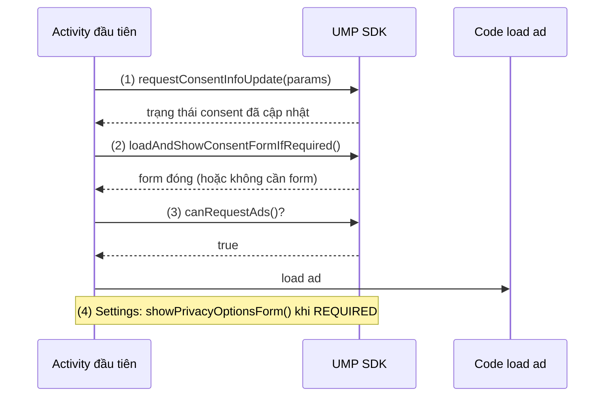

# Ads Privacy & Policy

## Vấn đề cần giải quyết

Quảng cáo cá nhân hoá dùng dữ liệu của user (định danh quảng cáo, hành vi trong app) để chọn ad phù hợp. Nhiều nơi có luật về việc này: ở EU phải xin đồng ý trước khi dùng dữ liệu (GDPR), ở Mỹ có luật riêng cho trẻ em (COPPA). Google Play và AdMob còn có policy riêng về cách hiển thị quảng cáo.

App vi phạm thì bị từ chối khi submit, bị gỡ khỏi store, hoặc tài khoản developer và tài khoản AdMob bị khoá. Vì vậy câu hỏi "khi nào được phép request ad" phải được trả lời trước mọi đoạn code load ad.

## Sau khi học xong

- Giải thích được vì sao phải xin consent trước khi request ad ở các vùng như EEA, UK và vai trò của UMP SDK.
- Áp dụng được luồng consent requestConsentInfoUpdate, loadAndShowConsentFormIfRequired, canRequestAds và nút privacy options.
- Áp dụng được cấu hình quảng cáo cho app hướng tới trẻ em bằng setAgeRestrictedTreatment và setMaxAdContentRating.
- Nhận diện được các hành vi quảng cáo bị Google Play cấm và hậu quả.

## Ads Privacy & Policy là gì?

**Ads Privacy & Policy** là các quy định mà app có quảng cáo phải tuân thủ: xin consent trước khi dùng dữ liệu cho quảng cáo (GDPR, qua UMP SDK), cấu hình riêng cho trẻ em (COPPA) và policy quảng cáo của Google Play.

Mental model: consent là **cổng trước mọi ad request**. Code load ad ở các bài khác chỉ chạy khi cổng mở (`canRequestAds()` trả `true`).

## Cách hoạt động

### Luồng consent với UMP SDK

UMP (User Messaging Platform) SDK của Google quyết định user có cần thấy form consent không, hiển thị form, lưu lựa chọn trên máy và báo cho app biết đã được request ad chưa:

1. Mỗi lần mở app, gọi `requestConsentInfoUpdate()` để cập nhật trạng thái consent của user.
2. Gọi `loadAndShowConsentFormIfRequired()`: nếu user ở vùng cần consent và chưa chọn, form hiện ra; không cần thì callback chạy ngay.
3. Chỉ request ad khi `canRequestAds()` trả `true`.
4. Với user ở vùng cần consent, màn hình Settings có nút mở lại form (privacy options) để user đổi lựa chọn.



### GDPR (Châu Âu)

**Bản chất:**
- GDPR (General Data Protection Regulation) là luật bảo vệ dữ liệu cá nhân của EU.
- App phải xin sự đồng ý của user trước khi thu thập dữ liệu để quảng cáo cá nhân hóa.

### COPPA / Đối tượng trẻ em

**Bản chất:**
- COPPA (Children's Online Privacy Protection Act) là luật bảo vệ trẻ em dưới 13 tuổi ở Mỹ.
- Nếu app hướng đến trẻ em, phải tuân thủ COPPA.

**Cấu hình:**

```kotlin
// Cấu hình toàn cục cho mọi ad request (gọi trước khi load ad)
val requestConfiguration = MobileAds.getRequestConfiguration().toBuilder()
    // App hướng đến trẻ em; thay cho setTagForChildDirectedTreatment (đã deprecated)
    .setAgeRestrictedTreatment(AgeRestrictedTreatment.CHILD)
    // Chỉ nhận ad có xếp hạng nội dung G
    .setMaxAdContentRating(RequestConfiguration.MAX_AD_CONTENT_RATING_G)
    .build()
MobileAds.setRequestConfiguration(requestConfiguration)
```

**Tác động:**
- Google chỉ phục vụ ad an toàn cho trẻ (không có nội dung nhạy cảm).
- Không thu thập dữ liệu cá nhân của trẻ.
- Doanh thu có thể thấp hơn (ít advertiser target trẻ em).

### Quy tắc Google Play

**Không được:**
- Quảng cáo lừa đảo, nội dung nhạy cảm (sex, bạo lực).
- Ép buộc user xem ad (ví dụ: chặn toàn bộ app trừ khi xem ad).
- Bắt chước UI hệ thống (fake close button, fake notification).

**Hậu quả:**
- App bị từ chối khi submit.
- App bị gỡ nếu đã publish.
- Tài khoản developer bị banned (khó khôi phục).

**Best practice:**
- Đọc kỹ [Google Play Policy](https://support.google.com/googleplay/android-developer/answer/113468).
- Test app với policy checker trước khi submit.
- Nếu không chắc, hỏi Google trước.

## Ví dụ thực tế: xin consent trước khi load ad

Activity đầu tiên của app chạy luồng consent, rồi mới load ad. Các bước (1)–(4) khớp với luồng ở trên.

```kotlin
// Trong Activity đầu tiên (vd MainActivity.onCreate)
// (1) Lấy ConsentInformation và cập nhật trạng thái consent mỗi lần mở app
val consentInformation = UserMessagingPlatform.getConsentInformation(this)
val params = ConsentRequestParameters.Builder().build()

consentInformation.requestConsentInfoUpdate(this, params, {
    // (2) Hiển thị form nếu cần (vd user ở EEA/UK chưa có consent); không cần thì callback chạy ngay
    UserMessagingPlatform.loadAndShowConsentFormIfRequired(this) { formError ->
        if (formError != null) {
            Log.w("Consent", formError.message)
        }
        // (3) Chỉ request ad khi canRequestAds() = true
        if (consentInformation.canRequestAds()) loadAd()
    }
}, { requestError ->
    Log.w("Consent", requestError.message)
})

// Consent từ phiên trước đã đủ thì có thể load ad song song (loadAd() tự chặn gọi trùng bằng một cờ)
if (consentInformation.canRequestAds()) loadAd()
```

Màn hình Settings hiện nút privacy options khi UMP yêu cầu:

```kotlin
// (4) Chỉ hiện nút khi user ở vùng cần consent
val consentInformation = UserMessagingPlatform.getConsentInformation(this)
privacyButton.isVisible = consentInformation.privacyOptionsRequirementStatus ==
    ConsentInformation.PrivacyOptionsRequirementStatus.REQUIRED

privacyButton.setOnClickListener {
    UserMessagingPlatform.showPrivacyOptionsForm(this) { formError ->
        formError?.let { Log.w("Consent", it.message) }
    }
}
```

**Chi tiết:**

- `canRequestAds()`: Trả về true nếu user đã đồng ý hoặc không cần consent.
- `UserMessagingPlatform.loadAndShowConsentFormIfRequired()`: Tự động hiển thị form nếu cần.
- Lựa chọn consent được UMP lưu trên máy; Google Mobile Ads SDK đọc lựa chọn đó và tự điều chỉnh loại ad (vd ad không cá nhân hoá), không cần đổi `AdRequest`. `setMaxAdContentRating` chỉ giới hạn mức nội dung của ad, không liên quan tới cá nhân hoá.
- Với user ở vùng cần consent, nên có nút mở lại form trong Settings: kiểm tra `privacyOptionsRequirementStatus` rồi gọi `UserMessagingPlatform.showPrivacyOptionsForm()`.

## Sai lầm thường gặp

### 1. Request ad trước khi biết consent

**Triệu chứng:**
- Ad được request cho user ở EEA/UK trước khi form consent kịp hiện.

**Nguyên nhân:**
- Gọi load ad ngay trong `onCreate`, không chờ kết quả của UMP.

**Giải pháp:**
- Chỉ load sau khi `canRequestAds()` trả `true`. Nếu kiểm tra ở hai chỗ (consent của phiên trước và sau khi form đóng), dùng một cờ để không request trùng.

### 2. Dùng API trẻ em đã deprecated

**Triệu chứng:**
- Android Studio cảnh báo deprecated ở `setTagForChildDirectedTreatment()` / `setTagForUnderAgeOfConsent()`.

**Nguyên nhân:**
- Hai API này đã bị thay bằng `setAgeRestrictedTreatment()`.

**Giải pháp:**
- Dùng `setAgeRestrictedTreatment(AgeRestrictedTreatment.CHILD)` trong `RequestConfiguration`.

### 3. Ép user xem ad hoặc làm giả nút đóng

**Triệu chứng:**
- App bị từ chối hoặc bị gỡ khỏi Google Play.

**Nguyên nhân:**
- Chặn tính năng cơ bản cho tới khi xem ad, hoặc bắt chước UI hệ thống (fake close button, fake notification).

**Giải pháp:**
- Rewarded ad luôn là lựa chọn của user; không đặt quảng cáo giả dạng UI hệ thống.

## Lịch sử phát triển

- **1998:** Mỹ thông qua COPPA (có hiệu lực từ 2000; FTC sửa đổi quy định năm 2013).
- **25/05/2018:** GDPR có hiệu lực ở EU.
- **07/2020:** UMP SDK 1.0.0 ra mắt bản chính thức.
- **10/2025:** UMP SDK 4.0.0.
- Các bản Google Mobile Ads SDK gần đây thay `setTagForChildDirectedTreatment()` và `setTagForUnderAgeOfConsent()` bằng `setAgeRestrictedTreatment()`.

## Kết nối hệ thống

- **AdMob Overview (4.2.3.3.1):** khởi tạo SDK và test device; consent là điều kiện trước mọi ad request ở bài đó. Xem [AdMob Overview](overview.md).
- **Inline Ads và Full-screen Ads (4.2.3.3.2, 4.2.3.3.3):** mọi đoạn `load()` trong hai bài chỉ chạy sau khi `canRequestAds()` trả `true`. Xem [Inline Ads](inline_ads.md), [Full-screen Ads](fullscreen_ads.md).
- **Ads trong kiến trúc app (4.2.3.3.4):** kiểm tra consent đặt trong `AdManager` để mọi màn hình dùng chung. Xem [Ads trong kiến trúc app](ads_architecture.md).
- **Manifest Tags (4.1.2):** permission `com.google.android.gms.permission.AD_ID` do SDK merge vào manifest liên quan tới định danh quảng cáo. Xem [Manifest Tags](../../../android_manifest/tags.md).

## Nguồn tham khảo

- [UMP SDK - User Messaging Platform](https://developers.google.com/admob/android/privacy)
- [UMP SDK release notes](https://developers.google.com/admob/android/privacy/release-notes)
- [AdMob Targeting (RequestConfiguration)](https://developers.google.com/admob/android/targeting)
- [Google Play Policy - Ads](https://support.google.com/googleplay/android-developer/answer/113468)
