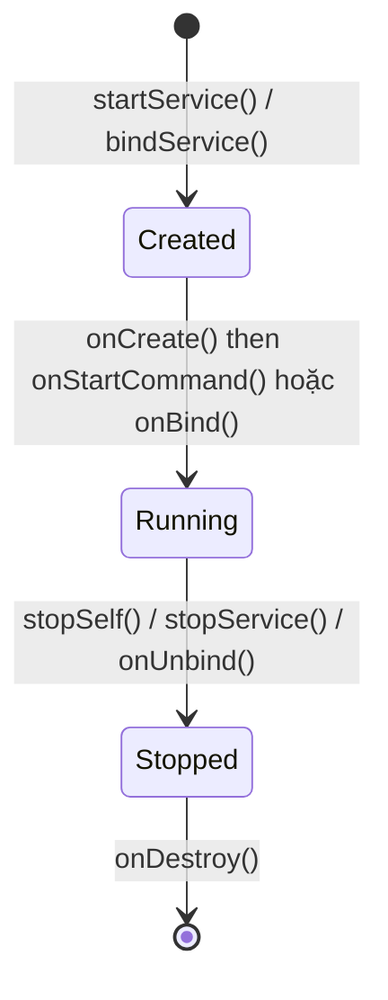
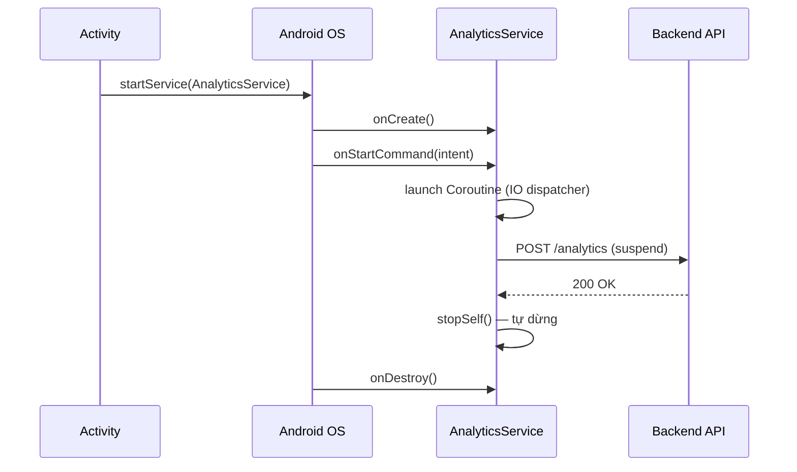
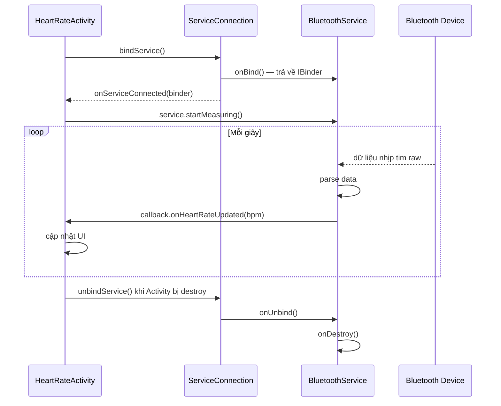
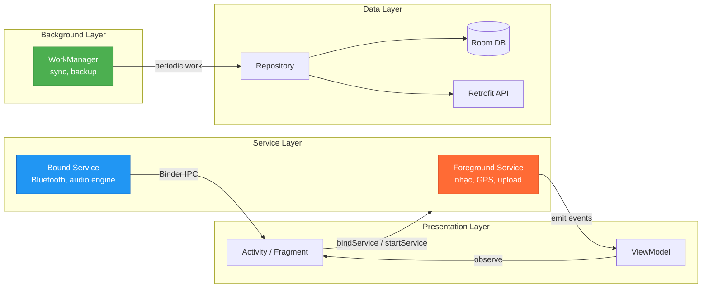
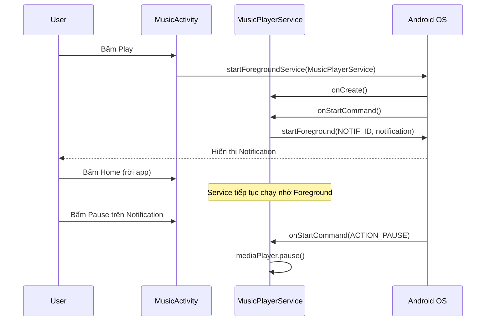
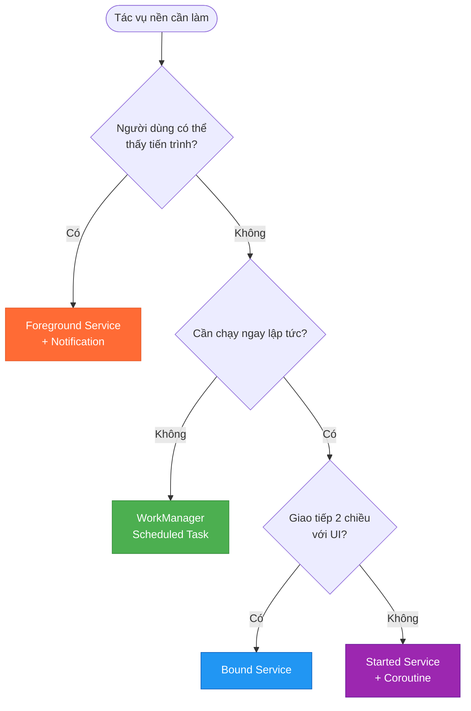

# Android Service

## Vấn đề cần giải quyết

Activity chỉ làm việc trong lúc người dùng nhìn vào nó: khi người dùng rời màn hình, Activity bị dừng, và công việc gắn với màn hình dừng theo. Thế nhưng có những tác vụ cần tiếp tục thực thi **ngay cả khi người dùng rời khỏi màn hình**:

| Tình huống | Ví dụ thực tế |
|---|---|
| Phát nhạc nền | Spotify, YouTube Music |
| Tải file / Upload ảnh | Google Photos sync |
| Theo dõi vị trí liên tục | Google Maps navigation |
| Đồng bộ dữ liệu định kỳ | Email, Calendar sync |
| Kết nối thiết bị ngoại vi | Bluetooth heart rate monitor |

App cần một cách để nói với hệ thống "tôi vẫn đang có việc", đồng thời hệ thống phải giữ quyền thu hồi tài nguyên để app chạy ngầm không làm chậm app người dùng đang dùng. Service là câu trả lời của Android cho bài toán đó, và cũng vì thế mà nó bị giới hạn ngày càng chặt qua các phiên bản (mục "Foreground Service và giới hạn chạy nền theo phiên bản Android").

## Sau khi học xong

- Giải thích được bản chất của Android Service (component không UI, mặc định chạy trên main thread) và vai trò của nó trong hệ thống.
- Phân biệt được Started, Bound và Foreground Service, biết khi nào dùng loại nào.
- Triển khai được Foreground Service với Notification và foregroundServiceType, và Bound Service với Binder.
- Biết khi nào nên dùng WorkManager thay cho Service thuần.
- Xử lý được các lỗi phổ biến như ANR, memory leak, crash do giới hạn background của Android 8, 12, 14 và 15.

## Android Service là gì?

**Android Service** là một **Application Component** chạy **không có giao diện người dùng (UI)**. Nó được thiết kế để thực thi các tác vụ chạy nền hoặc phục vụ các component khác trong ứng dụng.

Mental model: Service là **lời khai báo với hệ thống**, không phải một thread. `startService()` báo "app đang có việc cần làm dù người dùng không nhìn vào màn hình", `bindService()` mở một cửa để component khác gọi vào; còn code bên trong vẫn chạy trong process và trên main thread của app (docs của lớp `Service` nói rõ Service không phải process riêng, cũng không phải thread).

Một điều quan trọng cần hiểu ngay từ đầu:

> Service **không tự động chạy trên một thread riêng**. Mặc định, Service chạy trên **Main Thread (UI Thread)** của ứng dụng. Nếu bạn làm tác vụ nặng (gọi network, đọc file lớn) trực tiếp trong Service mà không dùng Coroutine hoặc Thread, ứng dụng sẽ bị ANR (Application Not Responding).

## Cách hoạt động

### Ba loại Service — So sánh tổng quan

| Đặc điểm | Started Service | Foreground Service | Bound Service |
|---|---|---|---|
| **Khởi động bằng** | `startService()` | `startForegroundService()`, rồi service tự gọi `ServiceCompat.startForeground()` | `bindService()` |
| **Lifecycle** | Chạy đến khi `stopSelf()` / `stopService()` | Chạy đến khi dừng | Chạy khi có ít nhất 1 client bind |
| **Notification** | Không | **Bắt buộc** | Không |
| **Giao tiếp 2 chiều** | Không | Không | **Có (Binder)** |
| **Bị kill khi thiếu RAM?** | Có thể | **Ưu tiên cao, khó bị kill** | Có thể |
| **Ví dụ thực tế** | Xử lý upload 1 lần | Phát nhạc, navigation | Audio engine, Bluetooth |

### Vòng đời Service (Lifecycle)


<!-- dd: svc-state -->

#### `onStartCommand()` — Return value quan trọng

```kotlin
override fun onStartCommand(intent: Intent?, flags: Int, startId: Int): Int {
    // Quyết định hành vi khi Service bị kill bởi hệ thống:
    return START_STICKY        // Tái tạo Service, intent = null
    // return START_NOT_STICKY // KHÔNG tái tạo Service (tốt cho tác vụ 1 lần)
    // return START_REDELIVER_INTENT // Tái tạo Service, gửi lại intent cũ
}
```

> [!NOTE]
> **START_STICKY** phù hợp cho Media Player (muốn Service sống lại sau khi bị kill).
> **START_NOT_STICKY** phù hợp cho tác vụ một lần như upload file (không cần chạy lại nếu bị kill giữa chừng).

### Started Service

Started Service được khởi động bằng `startService()` và chạy đến khi tự gọi `stopSelf()` hoặc bị `stopService()`; nó không trả dữ liệu về cho bên gọi.

#### Ví dụ: gửi log analytics sau một session

**Tình huống:** Gửi log analytics lên server sau khi người dùng hoàn thành một session mà không chặn UI.

> [!WARNING]
> Ví dụ này chỉ để minh hoạ vòng đời Started Service. Với upload analytics trong app thật, **WorkManager** mới là công cụ được khuyến nghị: tài liệu chính thức xếp "gửi log hoặc analytics" vào nhóm persistent work. Lý do: tác vụ không cần chạy ngay, WorkManager lưu work vào database nên vẫn chạy lại sau khi app bị kill hoặc thiết bị khởi động lại, hỗ trợ constraint (có mạng) và retry với backoff. Ngoài ra, app target Android 8+ gọi `startService()` khi đang ở background sẽ ném `IllegalStateException`, nên Started Service chỉ an toàn khi được start lúc app còn ở foreground.


<!-- dd: svc-analytics -->

**AndroidManifest.xml**
```xml
<service
    android:name=".service.AnalyticsService"
    android:exported="false" />
```

**AnalyticsService.kt**
```kotlin
import android.app.Service
import android.content.Intent
import android.os.IBinder
import kotlinx.coroutines.*

class AnalyticsService : Service() {

    // Job riêng để có thể cancel khi Service bị destroy
    private val serviceJob = SupervisorJob()
    private val serviceScope = CoroutineScope(Dispatchers.IO + serviceJob)

    override fun onBind(intent: Intent?): IBinder? = null

    override fun onStartCommand(intent: Intent?, flags: Int, startId: Int): Int {
        val sessionId = intent?.getStringExtra(EXTRA_SESSION_ID) ?: run {
            stopSelf(startId)
            return START_NOT_STICKY
        }

        serviceScope.launch {
            try {
                uploadSessionData(sessionId)
            } catch (e: Exception) {
                // Log lỗi, retry hoặc lưu local để retry sau
            } finally {
                stopSelf(startId) // Báo OS tác vụ này đã xong
            }
        }

        return START_NOT_STICKY
    }

    private suspend fun uploadSessionData(sessionId: String) {
        // analyticsRepository.uploadSession(sessionId)
    }

    override fun onDestroy() {
        super.onDestroy()
        serviceJob.cancel() // Hủy tất cả Coroutine khi Service bị destroy
    }

    companion object {
        const val EXTRA_SESSION_ID = "extra_session_id"

        fun buildIntent(context: android.content.Context, sessionId: String): Intent {
            return Intent(context, AnalyticsService::class.java).apply {
                putExtra(EXTRA_SESSION_ID, sessionId)
            }
        }
    }
}
```

**Kết quả:** `onStartCommand()` trả về ngay nên main thread không bị chặn; upload chạy trên `Dispatchers.IO`, xong thì `stopSelf(startId)` dừng service, và nếu service bị destroy giữa chừng thì `serviceJob.cancel()` huỷ coroutine đang chạy.

### Bound Service

Bound Service sống khi có ít nhất một client bind bằng `bindService()`, và cho client giao tiếp hai chiều qua `Binder`: client gọi hàm của service, service đẩy dữ liệu về client.

#### Ví dụ: nhận nhịp tim real-time từ thiết bị Bluetooth

**Tình huống:** App đo nhịp tim kết nối với thiết bị Bluetooth. UI cần nhận dữ liệu nhịp tim liên tục, real-time, trong khi app đang mở.


<!-- dd: svc-bound -->

**BluetoothHeartRateService.kt**
```kotlin
import android.app.Service
import android.content.Intent
import android.os.Binder
import android.os.IBinder

class BluetoothHeartRateService : Service() {

    interface HeartRateCallback {
        fun onHeartRateUpdated(bpm: Int)
        fun onConnectionStateChanged(connected: Boolean)
    }

    inner class LocalBinder : Binder() {
        fun getService(): BluetoothHeartRateService = this@BluetoothHeartRateService
    }

    private val binder = LocalBinder()
    private var callback: HeartRateCallback? = null

    override fun onBind(intent: Intent?): IBinder = binder

    fun setCallback(callback: HeartRateCallback) {
        this.callback = callback
    }

    fun startMeasuring() {
        // Kết nối Bluetooth GATT và bắt đầu nhận dữ liệu
        simulateHeartRateData()
    }

    private fun simulateHeartRateData() {
        callback?.onHeartRateUpdated(bpm = 75)
    }

    fun stopMeasuring() {
        callback = null
    }

    override fun onUnbind(intent: Intent?): Boolean {
        stopMeasuring()
        return false
    }
}
```

**HeartRateActivity.kt**
```kotlin
import android.content.ComponentName
import android.content.Context
import android.content.Intent
import android.content.ServiceConnection
import android.os.IBinder
import androidx.appcompat.app.AppCompatActivity

class HeartRateActivity : AppCompatActivity(), BluetoothHeartRateService.HeartRateCallback {

    private var heartRateService: BluetoothHeartRateService? = null
    private var isServiceBound = false

    private val serviceConnection = object : ServiceConnection {
        override fun onServiceConnected(name: ComponentName?, binder: IBinder?) {
            val localBinder = binder as BluetoothHeartRateService.LocalBinder
            heartRateService = localBinder.getService()
            heartRateService?.setCallback(this@HeartRateActivity)
            heartRateService?.startMeasuring()
            isServiceBound = true
        }

        override fun onServiceDisconnected(name: ComponentName?) {
            heartRateService = null
            isServiceBound = false
        }
    }

    override fun onStart() {
        super.onStart()
        Intent(this, BluetoothHeartRateService::class.java).also { intent ->
            bindService(intent, serviceConnection, Context.BIND_AUTO_CREATE)
        }
    }

    override fun onStop() {
        super.onStop()
        if (isServiceBound) {
            unbindService(serviceConnection)
            isServiceBound = false
        }
    }

    override fun onHeartRateUpdated(bpm: Int) {
        runOnUiThread {
            // binding.tvHeartRate.text = "$bpm BPM"
        }
    }

    override fun onConnectionStateChanged(connected: Boolean) { }
}
```

**Kết quả:** service chỉ tồn tại trong lúc `HeartRateActivity` đang hiển thị (bind ở `onStart()`, unbind ở `onStop()`); khi client cuối cùng unbind, `onUnbind()` gỡ callback và service bị destroy, nên không còn reference nào giữ Activity.

### Foreground Service và giới hạn chạy nền theo phiên bản Android

Foreground Service là service đã được nâng lên foreground: nó bắt buộc hiện Notification và được ưu tiên cao nên khó bị kill (bảng "Ba loại Service" ở trên). Đổi lại, mỗi phiên bản Android thêm điều kiện cho việc khởi động nó.

> [!IMPORTANT]
> Từ **Android 8 (API 26)**, Background Service bị giới hạn nghiêm ngặt. Nếu app chạy ngầm và cần tiếp tục làm việc lâu dài, **bắt buộc** phải dùng Foreground Service với Notification.
> App target **Android 14 (API 34)** trở lên phải khai báo rõ `foregroundServiceType` trong Manifest.

#### Background Execution Limits (Android 8+)

Từ Android 8 (Oreo), khi app chuyển xuống background, nó chỉ còn **vài phút** để tiếp tục tạo và dùng background service; hết khoảng đó, hệ thống dừng các background service của app (như thể chúng tự gọi `stopSelf()`). Giới hạn này không áp dụng cho Foreground Service và Bound Service.

**Giải pháp:** Dùng Foreground Service nếu cần chạy lâu, hoặc WorkManager cho tác vụ deferrable.

#### Khởi động Foreground Service đúng cách (Android 8+ và 12+)

Gọi `startForegroundService()`, rồi trong service gọi `ServiceCompat.startForeground(service, id, notification, type)` trong vòng vài giây (khoảng 5 giây). Quá hạn, hệ thống dừng service và báo lỗi (ANR, hoặc `ForegroundServiceDidNotStartInTimeException` trên Android 12+).

App target Android 12 (API 31) trở lên **không được** start Foreground Service khi đang ở background, trừ một số ngoại lệ (người dùng tương tác với notification/widget, FCM high priority, exact alarm, `BOOT_COMPLETED`...). Vi phạm sẽ ném `ForegroundServiceStartNotAllowedException`.

#### Foreground Service Type bắt buộc (Android 14+)

App target Android 14 phải khai báo `android:foregroundServiceType` trong Manifest và permission `FOREGROUND_SERVICE_<TYPE>` tương ứng (vd `FOREGROUND_SERVICE_MEDIA_PLAYBACK`), cùng runtime permission của type đó (vd `location` cần quyền vị trí).

- Service không khai báo type trong Manifest: `MissingForegroundServiceTypeException` khi gọi `startForeground()`.
- Truyền vào `startForeground()` một type không có trong Manifest: `IllegalArgumentException`.
- Thiếu permission `FOREGROUND_SERVICE_<TYPE>` hoặc runtime permission bắt buộc: `SecurityException`.

Các type phổ biến: `mediaPlayback`, `location`, `dataSync`, `camera`, `microphone`, `shortService`.

#### Giới hạn thời gian `dataSync` và `mediaProcessing` (Android 15+)

App target Android 15 chỉ được chạy Foreground Service type `dataSync` (và `mediaProcessing`) tổng cộng 6 giờ trong 24 giờ khi ở background (mỗi type có bộ đếm riêng; người dùng mở app thì bộ đếm reset). Hết hạn, hệ thống gọi `Service.onTimeout(int, int)`; service phải gọi `stopSelf()` trong vài giây, nếu không app bị lỗi `RemoteServiceException`. Với đồng bộ/upload dữ liệu, ưu tiên WorkManager hoặc user-initiated data transfer job thay cho `dataSync`.

Code đầy đủ của một Foreground Service tuân thủ các điều kiện trên ở mục "Ví dụ thực tế".

### Service trong kiến trúc MVVM / Clean Architecture


<!-- dd: svc-layers -->

**Nguyên tắc quan trọng:** Service không được biết đến UI. Service chỉ thực thi tác vụ và emit kết quả (qua BroadcastReceiver, EventBus, Flow, hoặc Binder callback). UI quyết định cách hiển thị kết quả đó.

## Ví dụ thực tế

### Foreground Service — Phát nhạc nền

**Tình huống:** Music Player — cần tiếp tục phát nhạc khi người dùng khóa màn hình, hiển thị notification với control (play/pause).

Luồng chạy (sơ đồ bên dưới minh hoạ bước 1–5):

1. Người dùng bấm Play khi Activity đang hiển thị: Activity gọi `ContextCompat.startForegroundService()` với `ACTION_PLAY`.
2. Hệ thống tạo service: `onCreate()` tạo notification channel.
3. `onStartCommand(ACTION_PLAY)`: trong vài giây, service gọi `ServiceCompat.startForeground()` với notification và type `mediaPlayback`; hệ thống hiện notification. Không lên được foreground (vd `ForegroundServiceStartNotAllowedException`) thì service tự dừng.
4. Service phát nhạc. Người dùng bấm Home, service tiếp tục chạy vì đang ở foreground.
5. Người dùng bấm Pause trên notification: PendingIntent tạo bằng `getService()` gửi `ACTION_PAUSE` vào `onStartCommand()`; service tạm dừng nhạc và cập nhật notification (nút đổi thành "Phát").
6. `ACTION_STOP`: dừng nhạc, gỡ notification bằng `stopForeground(STOP_FOREGROUND_REMOVE)` rồi `stopSelf()`.
7. Nếu hệ thống kill rồi tạo lại service (`START_STICKY`, intent = null): hiện lại notification ở trạng thái tạm dừng, không được thì dừng hẳn.


<!-- dd: svc-music -->

**AndroidManifest.xml**
```xml
<uses-permission android:name="android.permission.FOREGROUND_SERVICE" />
<uses-permission android:name="android.permission.FOREGROUND_SERVICE_MEDIA_PLAYBACK" />

<service
    android:name=".service.MusicPlayerService"
    android:foregroundServiceType="mediaPlayback"
    android:exported="false" />
```

**Cách gọi từ Activity:**
```kotlin
val intent = Intent(this, MusicPlayerService::class.java).apply {
    action = MusicPlayerService.ACTION_PLAY
}
// (1) Gọi khi Activity đang hiển thị (người dùng vừa bấm Play): app target Android 12+ bị chặn start FGS từ background
ContextCompat.startForegroundService(this, intent)
```

**MusicPlayerService.kt**
```kotlin
import android.app.*
import android.content.Intent
import android.content.pm.ServiceInfo
import android.os.Build
import android.os.IBinder
import androidx.core.app.NotificationCompat
import androidx.core.app.ServiceCompat

class MusicPlayerService : Service() {

    companion object {
        const val CHANNEL_ID = "music_player_channel"
        const val NOTIFICATION_ID = 1001
        const val ACTION_PLAY = "action_play"
        const val ACTION_PAUSE = "action_pause"
        const val ACTION_STOP = "action_stop"
    }

    override fun onCreate() {
        super.onCreate()
        createNotificationChannel() // (2)
    }

    override fun onStartCommand(intent: Intent?, flags: Int, startId: Int): Int {
        when (intent?.action) {
            ACTION_PLAY -> {
                // (3) Phải lên foreground trong vài giây sau startForegroundService()
                if (promoteToForeground(isPlaying = true)) playMusic() else stopSelf() // (4) phát nhạc
            }
            ACTION_PAUSE -> {
                pauseMusic() // (5)
                updateNotification(isPlaying = false)
            }
            ACTION_STOP -> {
                stopMusic() // (6)
                ServiceCompat.stopForeground(this, ServiceCompat.STOP_FOREGROUND_REMOVE)
                stopSelf()
            }
            null -> {
                // (7) Hệ thống tạo lại Service sau khi kill (START_STICKY, intent = null):
                // hiện lại notification ở trạng thái tạm dừng, không được thì dừng hẳn
                if (!promoteToForeground(isPlaying = false)) stopSelf()
            }
        }
        return START_STICKY
    }

    private fun promoteToForeground(isPlaying: Boolean): Boolean = try {
        ServiceCompat.startForeground(
            this,
            NOTIFICATION_ID,
            buildNotification(isPlaying),
            if (Build.VERSION.SDK_INT >= Build.VERSION_CODES.Q) {
                ServiceInfo.FOREGROUND_SERVICE_TYPE_MEDIA_PLAYBACK
            } else {
                0
            }
        )
        true
    } catch (e: Exception) {
        // App target Android 12+: ForegroundServiceStartNotAllowedException nếu đang ở background
        false
    }

    private fun buildNotification(isPlaying: Boolean): Notification {
        // (5) Nút trên notification đổi theo trạng thái: đang phát thì gửi PAUSE, đang dừng thì gửi PLAY
        val toggleAction = if (isPlaying) ACTION_PAUSE else ACTION_PLAY
        val toggleIntent = PendingIntent.getService(
            this, 0,
            Intent(this, MusicPlayerService::class.java).apply { action = toggleAction },
            PendingIntent.FLAG_IMMUTABLE
        )

        return NotificationCompat.Builder(this, CHANNEL_ID)
            .setContentTitle("Đang phát: Shape of You")
            .setContentText("Ed Sheeran • Divide")
            .setSmallIcon(android.R.drawable.ic_media_play)
            .addAction(
                if (isPlaying) android.R.drawable.ic_media_pause else android.R.drawable.ic_media_play,
                if (isPlaying) "Tạm dừng" else "Phát",
                toggleIntent
            )
            .setOngoing(true)
            .build()
    }

    private fun createNotificationChannel() {
        if (Build.VERSION.SDK_INT >= Build.VERSION_CODES.O) {
            val channel = NotificationChannel(CHANNEL_ID, "Trình phát nhạc", NotificationManager.IMPORTANCE_LOW)
            getSystemService(NotificationManager::class.java).createNotificationChannel(channel)
        }
    }

    private fun updateNotification(isPlaying: Boolean) {
        getSystemService(NotificationManager::class.java).notify(NOTIFICATION_ID, buildNotification(isPlaying))
    }

    private fun playMusic() { /* MediaPlayer logic */ }
    private fun pauseMusic() { /* MediaPlayer logic */ }
    private fun stopMusic() { /* MediaPlayer logic */ }

    override fun onBind(intent: Intent?): IBinder? = null
}
```

**Kết quả:** bấm Play rồi về Home thì nhạc vẫn phát và notification vẫn hiện; bấm nút trên notification thì service nhận `ACTION_PAUSE`/`ACTION_PLAY` và nút đổi theo trạng thái. Trên app target Android 14+, nếu Manifest thiếu type hoặc permission `FOREGROUND_SERVICE_MEDIA_PLAYBACK` thì `startForeground()` ném exception (mục "Foreground Service Type bắt buộc (Android 14+)"); `promoteToForeground()` bắt lỗi và service tự dừng thay vì crash.

> [!TIP]
> Với app nghe nhạc thật, nên dùng `MediaSessionService` của Jetpack Media3: thư viện tự quản lý notification media, foreground state và media session thay cho phần viết tay ở trên.

### WorkManager — Lựa chọn hiện đại cho background task

**Tình huống:** Backup ảnh lên server mỗi đêm khi có WiFi và đang sạc pin.

> [!TIP]
> **WorkManager** là thư viện Jetpack được Google khuyến nghị cho hầu hết background tasks. Nó hoạt động được trên mọi API level, tôn trọng Doze mode, battery saver, và đảm bảo task hoàn thành ngay cả khi app bị kill hoặc thiết bị restart.

**BackupWorker.kt**
```kotlin
import android.content.Context
import androidx.work.*
import kotlinx.coroutines.Dispatchers
import kotlinx.coroutines.withContext

class BackupWorker(
    context: Context,
    params: WorkerParameters
) : CoroutineWorker(context, params) {

    override suspend fun doWork(): Result {
        return withContext(Dispatchers.IO) {
            try {
                val userId = inputData.getString(KEY_USER_ID)
                    ?: return@withContext Result.failure(workDataOf("error" to "Missing user ID"))

                // uploadPhotos(userId)
                val uploadedCount = 42 // Kết quả từ API

                Result.success(workDataOf(KEY_UPLOADED_COUNT to uploadedCount))
            } catch (e: Exception) {
                if (runAttemptCount < 3) Result.retry()
                else Result.failure(workDataOf("error" to e.message))
            }
        }
    }

    companion object {
        const val KEY_USER_ID = "key_user_id"
        const val KEY_UPLOADED_COUNT = "key_uploaded_count"
    }
}
```

**Đặt lịch chạy và quan sát trạng thái:**
```kotlin
fun scheduleNightlyBackup(context: Context, userId: String) {
    val constraints = Constraints.Builder()
        .setRequiredNetworkType(NetworkType.UNMETERED) // Chỉ chạy khi có WiFi
        .setRequiresCharging(true)                     // Chỉ chạy khi đang sạc
        .build()

    val backupRequest = PeriodicWorkRequestBuilder<BackupWorker>(24, TimeUnit.HOURS)
        .setConstraints(constraints)
        .setInputData(workDataOf(BackupWorker.KEY_USER_ID to userId))
        .setBackoffCriteria(BackoffPolicy.EXPONENTIAL, WorkRequest.MIN_BACKOFF_MILLIS, TimeUnit.MILLISECONDS)
        .build()

    WorkManager.getInstance(context).enqueueUniquePeriodicWork(
        "nightly_photo_backup",          // Unique name để tránh duplicate
        ExistingPeriodicWorkPolicy.KEEP, // Nếu đã có task này, giữ nguyên
        backupRequest
    )
}

// Quan sát trạng thái từ Activity/Fragment (LifecycleOwner):
WorkManager.getInstance(context)
    .getWorkInfosForUniqueWorkLiveData("nightly_photo_backup")
    .observe(this) { workInfos ->
        workInfos.firstOrNull()?.let { info ->
            when (info.state) {
                WorkInfo.State.RUNNING -> { /* Hiển thị progress */ }
                WorkInfo.State.SUCCEEDED -> {
                    val count = info.outputData.getInt(BackupWorker.KEY_UPLOADED_COUNT, 0)
                    // "Đã backup $count ảnh"
                }
                WorkInfo.State.FAILED -> { /* Hiển thị lỗi */ }
                else -> {}
            }
        }
    }
```

**Kết quả:** không cần Service nào: work chỉ chạy khi máy có Wi-Fi không tính phí và đang sạc, lỗi thì retry với backoff exponential cho tới khi `runAttemptCount` đạt 3, và gọi `scheduleNightlyBackup()` nhiều lần vẫn chỉ có một lịch nhờ unique name với `KEEP`.

## So sánh với các cách tiếp cận khác

### Service, WorkManager hay Flow/SharedFlow?

Ba thứ này hay bị đặt cạnh nhau nhưng giải quyết hai việc khác nhau: **Service** và **WorkManager** là cách *thực thi* công việc khi người dùng không nhìn vào màn hình, còn **Flow/SharedFlow** là cách *truyền dữ liệu, sự kiện* giữa các thành phần trong cùng process. Flow không giữ process sống và không chạy được khi app đã bị kill.

| Tiêu chí | Service (Started / Foreground / Bound) | WorkManager | Flow / SharedFlow |
|---|---|---|---|
| Bản chất | Component của hệ thống, chạy trong process của app | Thư viện lên lịch công việc, lưu work vào database | Stream dữ liệu trong bộ nhớ (Kotlin Coroutines) |
| App phải đang chạy? | Có: service giữ process sống trong lúc chạy | Không: hệ thống tự mở process khi đến lúc chạy | Có: chỉ tồn tại khi có scope đang collect |
| Sống qua app bị kill / thiết bị khởi động lại? | Không tự đảm bảo (`START_STICKY` chỉ xin tạo lại service sau khi bị kill, không qua reboot) | Có: work được lưu lại và tự lên lịch lại sau reboot (ngoại lệ: người dùng Force stop app thì work bị huỷ tới khi app được mở lại) | Không |
| Chạy ngay, liên tục, người dùng thấy | Foreground Service (có notification, bị giới hạn bởi `foregroundServiceType`) | Không phải mục đích chính (có expedited work cho việc ngắn, gấp) | Không áp dụng |
| Constraint (Wi-Fi, sạc), retry, chain | Tự viết | Có sẵn (`Constraints`, `BackoffPolicy`, `then()`) | Không áp dụng |
| Type-safe | Intent extras: không; Binder interface: có | Một phần (`Data` key-value) | Có |
| Phạm vi giao tiếp | Bound Service: client trong app hoặc app khác (qua Binder) | Không dùng để giao tiếp | Trong cùng process |

Câu hỏi để chọn nhanh:

1. Việc cần **chạy xong dù app bị kill hoặc máy khởi động lại**, và không cần ngay lập tức? → **WorkManager**.
2. Việc **người dùng đang chờ, phải chạy ngay và liên tục** (phát nhạc, dẫn đường, cuộc gọi)? → **Foreground Service**.
3. Màn hình cần **gọi hàm và nhận dữ liệu liên tục** từ một thành phần đang chạy (thiết bị Bluetooth, audio engine)? → **Bound Service**.
4. Chỉ cần **báo sự kiện hoặc chia sẻ trạng thái giữa các phần trong app**? → **Flow/SharedFlow** hoặc Shared ViewModel, không cần Service. Docs cũng khuyên không dùng broadcast cho việc này.

Broadcast Receiver không nằm trong bảng vì nó không thực thi công việc: nó chỉ là điểm nhận sự kiện hệ thống rồi giao việc cho WorkManager hoặc Service (xem [Broadcast Receiver](../broadcast/broadcast_receiver.md), mục "Khi nào nên và không nên dùng").

## Khi nào nên và không nên dùng

Dùng Service khi việc phải tiếp tục lúc người dùng rời màn hình và cần chạy ngay (Foreground Service), hoặc khi một màn hình cần giao tiếp hai chiều với một thành phần đang chạy (Bound Service). Các trường hợp còn lại thường có công cụ phù hợp hơn.

### Khi nào KHÔNG nên dùng Service thuần?

- **Tác vụ một lần, không cần ngay lập tức:** Dùng **WorkManager** (đảm bảo hoàn thành dù app bị kill, hỗ trợ Doze mode, constraint như có WiFi).
- **Tác vụ ngắn do người dùng trigger:** Dùng **Coroutine trong ViewModel/Activity** (tác vụ sẽ bị hủy khi người dùng thoát app — đây là hành vi đúng đắn).
- **Giao tiếp giữa các phần của cùng một app:** Dùng **Shared ViewModel** hoặc **SharedFlow** thay vì Bound Service (so sánh ở mục "Service, WorkManager hay Flow/SharedFlow?").

### Bản đồ quyết định: Nên dùng gì?


<!-- dd: svc-choose -->

### Bảng so sánh tổng hợp: Nên dùng gì?

| Kịch bản | Giải pháp tốt nhất | Lý do |
|---|---|---|
| Phát nhạc nền | Foreground Service | Cần UI (Notification) + chạy liên tục |
| Upload file lớn 1 lần do người dùng bấm | User-initiated data transfer job (hoặc WorkManager) | Cần báo tiến trình cho người dùng; docs khuyên dùng thay cho Foreground Service `dataSync` |
| Sync data mỗi ngày | WorkManager (Periodic) | Không cần ngay, cần đảm bảo completion |
| Sync data khi có WiFi | WorkManager + Constraints | WorkManager xử lý constraint tốt nhất |
| Nhận dữ liệu sensor real-time | Bound Service | Cần giao tiếp 2 chiều, vòng đời gắn với Activity |
| Tác vụ ngắn do user trigger | Coroutine trong ViewModel | Không cần Service, đơn giản hơn nhiều |
| GPS tracking nền | Foreground Service | Cần chạy dù người dùng thoát app |
| Gửi log / analytics | WorkManager | Không cần chạy ngay; docs xếp vào persistent work, có retry và constraint |
| Báo sự kiện giữa các phần trong cùng app (Service → UI, Repository → ViewModel) | Flow / SharedFlow (hoặc Shared ViewModel) | In-process, type-safe; không cần Service hay broadcast |

> [!TIP]
> **WorkManager hay Service? Câu hỏi để tự hỏi:** *"Tác vụ này có cần chạy lập tức không?"* Nếu không, WorkManager là lựa chọn tốt hơn. WorkManager hiểu Doze mode, battery saver và tự lên lịch chạy lại sau khi thiết bị khởi động lại, những thứ mà Service thuần không có.

## Sai lầm thường gặp

### 1. Làm việc blocking ngay trong Service: ANR

**Service không phải thread riêng — ANR rình rập:** Code trong `onStartCommand()` chạy trên Main Thread. Bất kỳ thao tác blocking nào (network, file IO, database query nặng) sẽ freeze UI trong 5 giây → ANR.

**Cách sửa:** Luôn launch Coroutine với `Dispatchers.IO` cho các tác vụ blocking trong Service (như `AnalyticsService` ở mục "Started Service"), và huỷ scope trong `onDestroy()`.

### 2. Bind mà quên unbind: Memory Leak với Bound Service

Nếu bind trong `onStart()` nhưng quên `unbindService()` trong `onStop()`, Activity context sẽ bị rò rỉ bộ nhớ.

**Cách sửa:** Luôn đối xứng: bind ↔ unbind trong cùng cặp lifecycle callback (`onStart`/`onStop` hoặc `onCreate`/`onDestroy`).

### 3. Lách giới hạn background để giữ Service sống

Cố tình bypass giới hạn background của Android 8+ (ví dụ dùng alarm để restart Service liên tục) vi phạm Play Store policy và có thể khiến app bị gỡ khỏi store.

**Cách sửa:** việc người dùng cần thấy và chạy lâu thì dùng Foreground Service; việc trì hoãn được thì giao cho WorkManager (mục "Background Execution Limits (Android 8+)").

### 4. Start Foreground Service từ background, hoặc gọi `startForeground()` quá muộn

App target Android 12+ gọi `startForegroundService()` khi đang ở background (ngoài các ngoại lệ) thì nhận `ForegroundServiceStartNotAllowedException`; service đã được start nhưng không gọi `startForeground()` trong khoảng 5 giây thì bị hệ thống dừng và báo ANR.

**Cách sửa:** chỉ start Foreground Service khi app đang hiển thị hoặc thuộc một ngoại lệ, gọi `ServiceCompat.startForeground()` ngay trong `onStartCommand()`, và bọc lời gọi trong `try/catch` như `promoteToForeground()` ở mục "Ví dụ thực tế" (mục "Khởi động Foreground Service đúng cách (Android 8+ và 12+)").

### 5. Thiếu `foregroundServiceType` hoặc permission của type (Android 14+)

App target Android 14 mà Manifest không khai báo type, truyền type không có trong Manifest, hoặc thiếu `FOREGROUND_SERVICE_<TYPE>`/runtime permission thì `startForeground()` ném `MissingForegroundServiceTypeException`, `IllegalArgumentException` hoặc `SecurityException`.

**Cách sửa:** khai báo `android:foregroundServiceType`, permission `FOREGROUND_SERVICE_<TYPE>`, và xin runtime permission của type **trước** khi start service (mục "Foreground Service Type bắt buộc (Android 14+)").

### 6. Chạy `dataSync` hết hạn mà không xử lý `onTimeout()` (Android 15+)

Service type `dataSync` hoặc `mediaProcessing` dùng hết 6 giờ mà không gọi `stopSelf()` sau `onTimeout(int, int)` thì app bị lỗi `RemoteServiceException`.

**Cách sửa:** override `onTimeout(int, int)` và gọi `stopSelf()` trong vài giây; với đồng bộ/upload, chuyển sang WorkManager hoặc user-initiated data transfer job (mục "Giới hạn thời gian `dataSync` và `mediaProcessing` (Android 15+)").

## Lịch sử phát triển

- **API 1 (Android 1.0):** lớp `Service`, `onBind()` và `Context.startService()` có từ API level đầu tiên.
- **API 5 (Android 2.0):** thêm `onStartCommand()` cùng các giá trị trả về `START_STICKY`, `START_NOT_STICKY`, `START_REDELIVER_INTENT`, và `startForeground(int, Notification)`.
- **API 24 (Android 7.0):** thêm `stopForeground(int)` với cờ `STOP_FOREGROUND_REMOVE`; bản `stopForeground(boolean)` bị deprecated từ API 33.
- **Android 8.0 (API 26):** giới hạn background service (app target API 26+ ở background chỉ còn vài phút để dùng background service); thêm `Context.startForegroundService()`, service phải gọi `startForeground()` trong 5 giây.
- **Android 9 (API 28):** app target API 28+ phải khai báo permission `FOREGROUND_SERVICE` để gọi `startForeground()`.
- **Android 10 (API 29):** thêm thuộc tính Manifest `android:foregroundServiceType` và `startForeground(int, Notification, int)` nhận type.
- **Android 12 (API 31):** app target API 31+ không được start Foreground Service từ background (trừ ngoại lệ); thêm `ForegroundServiceStartNotAllowedException`. Từ phiên bản này, service không gọi `startForeground()` kịp thời được log là `ForegroundServiceDidNotStartInTimeException`.
- **Android 14 (API 34):** app target API 34+ bắt buộc khai báo type và permission `FOREGROUND_SERVICE_<TYPE>` (vd `FOREGROUND_SERVICE_MEDIA_PLAYBACK`); thêm `MissingForegroundServiceTypeException`, các type mới `health`, `remoteMessaging`, `shortService`, `specialUse`, `systemExempted`, và `onTimeout(int)` cho `shortService`. `ServiceCompat.startForeground()` nhận type từ androidx-core 1.12.
- **Android 15 (API 35):** app target API 35+ chỉ được chạy `dataSync` và `mediaProcessing` (type mới) tối đa 6 giờ trong 24 giờ khi ở background; thêm `onTimeout(int, int)`.

## Kết nối hệ thống

- **Tiên quyết:** [Activity Overview](../activity/index.md) và [Activity Lifecycle](../activity/lifecycle.md): Service khởi động, bind và unbind theo lifecycle của Activity gọi nó.
- **Liên quan:**
  - [Manifest Tags](../../android_manifest/tags.md): khai báo `<service>`, `android:exported`, `android:foregroundServiceType` và permission.
  - [Explicit Intents](../../intent/explicit_intents.md): Service được start và bind bằng explicit intent.
  - [Pending Intent](../../intent/pending_intent.md): PendingIntent tạo bằng `getService()` cho nút điều khiển trên notification của Foreground Service.
  - [Broadcast Receiver](../broadcast/broadcast_receiver.md): điểm nhận sự kiện hệ thống rồi giao việc cho WorkManager hoặc Service.
  - [Google Service](google_service.md): app gọi Google Play services bằng cách bind tới Service của GMS qua Binder IPC.
- **Học tiếp:**
  - [Working with Thread](../../../session_05/working_with_thread.md): main thread và ANR, lý do Service phải đưa việc nặng sang thread khác.
  - [8.4.3 Coroutines](../../../session_08/async_threads/coroutines.md): `CoroutineScope`, `Dispatchers.IO` dùng trong Service.
  - 7.1.4.2 Flow (chưa có bài): Flow/SharedFlow để Service báo kết quả cho UI.
  - [8.5.5 Message (Toast, Snackbar, Notification)](../../../session_08/view_layout/message.md): Notification bắt buộc của Foreground Service.

## Nguồn tham khảo

- [Services overview — Android Developers](https://developer.android.com/guide/components/services)
- [Service (API level của các hàm, "What is a Service?") — Android Developers Reference](https://developer.android.com/reference/android/app/Service)
- [Context (startService, startForegroundService) — Android Developers Reference](https://developer.android.com/reference/android/content/Context)
- [Manifest.permission (FOREGROUND_SERVICE, FOREGROUND_SERVICE_MEDIA_PLAYBACK) — Android Developers Reference](https://developer.android.com/reference/android/Manifest.permission)
- [Foreground services — Android Developers](https://developer.android.com/develop/background-work/services/foreground-services)
- [Bound services overview — Android Developers](https://developer.android.com/guide/components/bound-services)
- [Background work overview — Android Developers](https://developer.android.com/develop/background-work/background-tasks)
- [WorkManager guide — Android Developers](https://developer.android.com/topic/libraries/architecture/workmanager)
- [Background execution limits (Android 8+)](https://developer.android.com/about/versions/oreo/background)
- [Launch a foreground service — Android Developers](https://developer.android.com/develop/background-work/services/fgs/launch)
- [Restrictions on starting a foreground service from the background (Android 12+)](https://developer.android.com/develop/background-work/services/fgs/restrictions-bg-start)
- [Foreground service types are required (Android 14)](https://developer.android.com/about/versions/14/changes/fgs-types-required)
- [Foreground service timeouts (Android 15)](https://developer.android.com/develop/background-work/services/fgs/timeout)
- [Alternatives to data sync foreground services (user-initiated data transfer job, WorkManager) — Android Developers](https://developer.android.com/about/versions/15/changes/datasync-migration)
- [ForegroundServiceStartNotAllowedException — Android Developers Reference](https://developer.android.com/reference/android/app/ForegroundServiceStartNotAllowedException)
- [MissingForegroundServiceTypeException — Android Developers Reference](https://developer.android.com/reference/android/app/MissingForegroundServiceTypeException)
- [Persistent work (WorkManager lên lịch lại sau reboot) — Android Developers](https://developer.android.com/develop/background-work/background-tasks/persistent)
- [Broadcasts — tránh broadcast trong cùng process — Android Developers](https://developer.android.com/develop/background-work/background-tasks/broadcasts)
- [StateFlow and SharedFlow — Android Developers](https://developer.android.com/kotlin/flow/stateflow-and-sharedflow)
