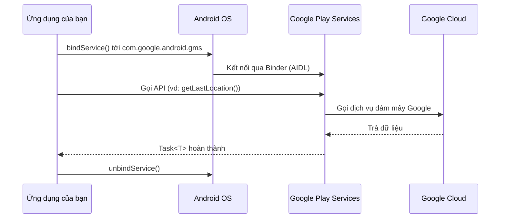
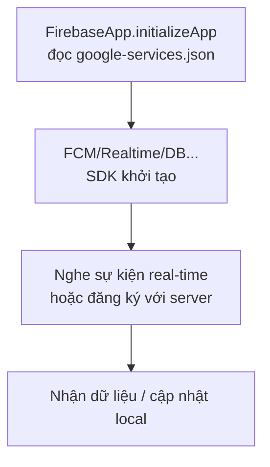
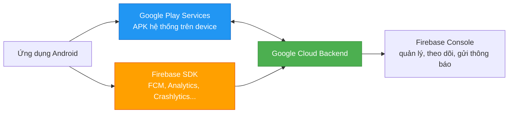
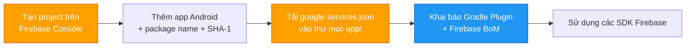
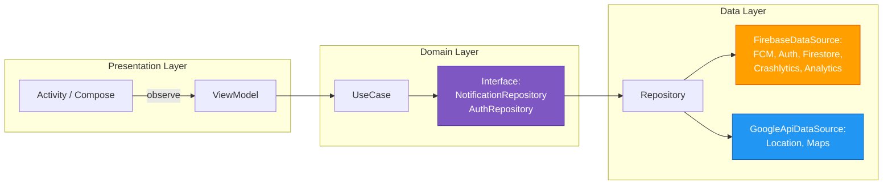
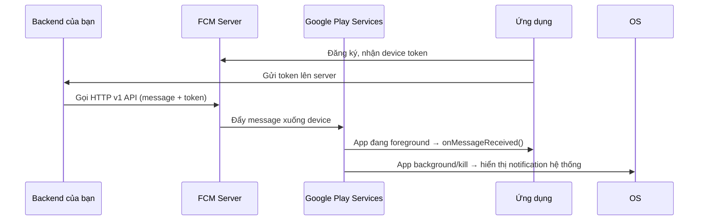
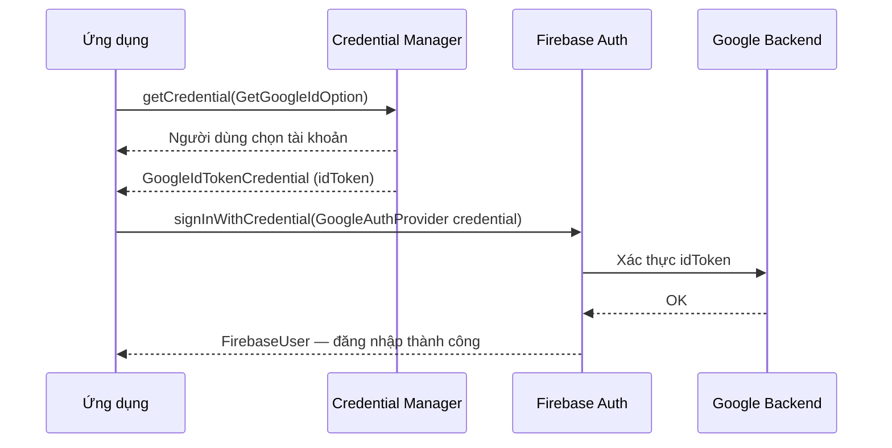
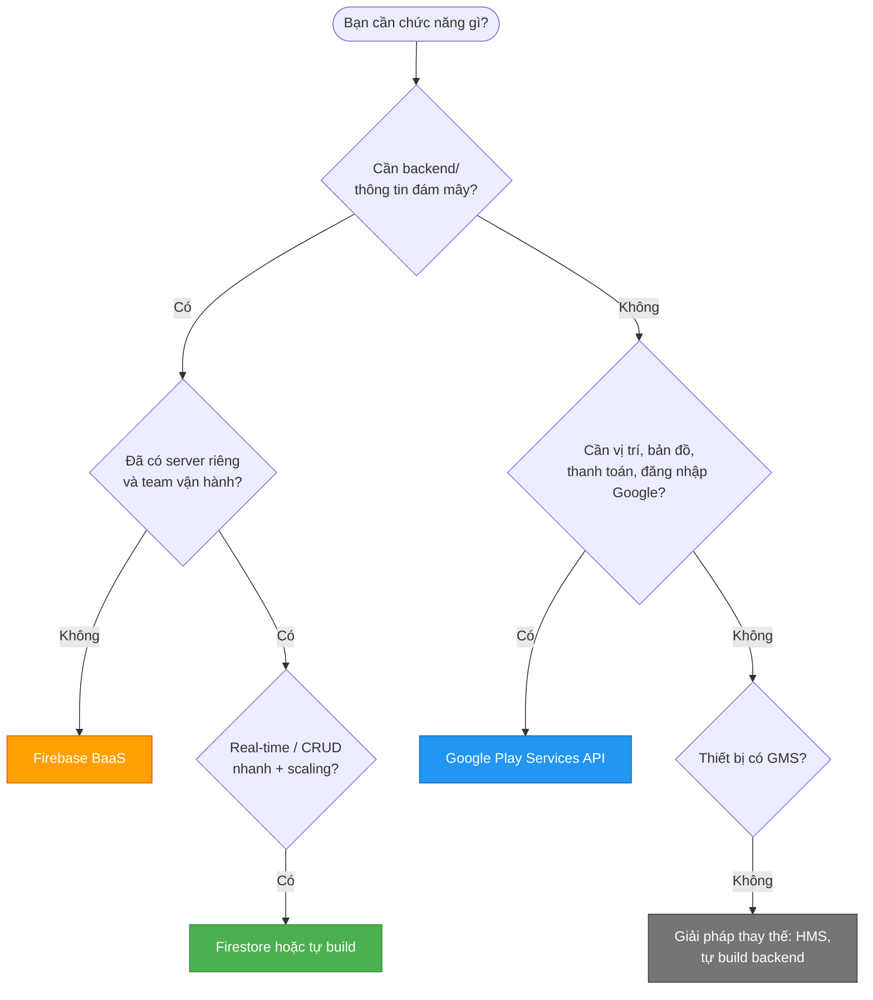

# Google Service

## Vấn đề cần giải quyết

### Android thuần (AOSP) thiếu gì?

Android mã nguồn mở (AOSP) chỉ cung cấp cơ chế lõi: Activity, Service, Broadcast... Nó **không có** dịch vụ vị trí chính xác, bản đồ, danh bạ đám mây, hay hạ tầng push notification đa nền tảng.

Nếu mỗi nhà sản xuất tự làm một bộ dịch vụ riêng, ứng dụng sẽ chạy khác nhau trên từng máy. GMS ra đời để:

- **Thống nhất API** — nhà phát triển viết một lần, chạy trên mọi máy có GMS.
- **Tự cập nhật** — Google cập nhật dịch vụ nền qua Play Store, không cần chờ OEM phát hành bản vá hệ điều hành.
- **Là điều kiện để có Play Store** — các OEM muốn cài Google Play Store bắt buộc phải đi kèm GMS.

### Firebase giải quyết nỗi đau backend

Trước Firebase, mọi app muốn có push notification, analytics, hay crash report đều phải **tự xây backend**: viết server, quản lý socket, mở rộng hạ tầng. Firebase loại bỏ toàn bộ phần đó:

- Không phải quản lý server.
- Tự mở rộng quy mô.
- Client SDK đã được tối ưu sẵn cho Android.

## Sau khi học xong

- Phân biệt được Google Play Services và Firebase, và nhận biết SDK Firebase nào bắt buộc thiết bị có GMS.
- Áp dụng được Firebase BoM và google-services.json để tích hợp Firebase vào project chuẩn.
- Triển khai được FCM push notification (token, notification channel, POST_NOTIFICATIONS) và xử lý đúng foreground/background.
- Triển khai được Analytics, Crashlytics, Remote Config và Firebase Auth với Sign in with Google qua Credential Manager.
- Nhận diện được các lỗi tích hợp phổ biến như version mismatch, thiếu google-services.json, API Key sai.

## Google Service là gì?

**Google Service** trên Android là hai tầng dịch vụ của Google mà app dùng: **Google Play Services (GMS)**, một framework hệ thống cài sẵn trên thiết bị mà app gọi tới qua Binder IPC, và **Firebase**, một nền tảng Backend-as-a-Service (BaaS) mà app dùng qua các SDK chạy ngay trong process của app.

Mental model: GMS là **dịch vụ nằm ngoài app**, Firebase SDK là **thư viện nằm trong app**. Thứ nằm ngoài app do máy người dùng quyết định: máy có thể không có GMS, và version GMS tự cập nhật theo Play Store chứ không theo APK của bạn. Thứ nằm trong app do bạn quyết định qua Gradle (BoM, plugin, `google-services.json`). Hầu hết câu hỏi "vì sao chạy máy này mà crash máy kia" trong bài đều trả lời được bằng câu hỏi: tính năng đó nằm ngoài hay trong app?

## Cách hoạt động

### Google Play Services (GMS)

**Google Play Services** là một **framework hệ thống cài sẵn trên thiết bị** (một APK riêng, thường tên gói `com.google.android.gms`). Nó cung cấp các API nền cho vô số tính năng của Google:

- Google Maps
- Location (vị trí)
- Google Sign-In / OAuth
- In-app Billing (thanh toán trong app)
- **Nền tảng cho một số Firebase SDK** (vd FCM)

GMS **không phải phần của AOSP** (Android mã nguồn mở). Nó là phần mềm độc quyền của Google, được cấp phép cho các nhà sản xuất (OEM) và tự cập nhật qua Google Play Store — không cần người dùng nâng cấp hệ điều hành.

#### Một "system app" giao tiếp qua IPC

GMS được cài như một **application component hệ thống**. Khi app của bạn gọi API của GMS (các API hiện tại trả về `Task`; `GoogleApiClient` cũ đã deprecated), thực chất app **bind tới Service của GMS** qua Binder IPC (giống Bound Service trong bài [Android Service](./android_service.md)), và GMS thực thi tác vụ rồi trả kết quả về.


<!-- dd: gg-bind -->

Vì GMS tự cập nhật, **version GMS trên máy có thể mới hơn hoặc cũ hơn** so với version mà app bạn biên dịch. Đây là nguồn gốc của lỗi `Google Play services is not compatible with your app` nếu bạn không xử lý đúng.

### Firebase

**Firebase** là một **Backend-as-a-Service (BaaS)** của Google. Phía client là các **SDK** (thư viện) bạn thêm vào project, phía server là hạ tầng đám mây Google đã quản lý sẵn.

| Sản phẩm Firebase | Vai trò |
|---|---|
| Firebase Cloud Messaging (FCM) | Gửi push notification |
| Firebase Analytics | Theo dõi hành vi người dùng |
| Firebase Crashlytics | Báo cáo crash |
| Firebase Authentication | Đăng nhập (email, Google, phone...) |
| Cloud Firestore | Database NoSQL real-time |
| Firebase Storage | Lưu trữ file |
| Firebase Remote Config | Cấu hình app từ xa |
| Firebase App Distribution | Phân phối build test |

#### Firebase SDK: client kết nối backend Google

Firebase SDK chạy **trong chính process app** của bạn. Nó dùng file `google-services.json` để biết app thuộc project Firebase nào, sau đó mở kết nối (REST/WebSocket) tới backend:


<!-- dd: gg-init -->

Khi app bị kill, FCM vẫn có thể hiển thị notification nhờ **cơ chế của hệ điều hành** (qua Google Play Services) — không cần app chạy. Đây là điểm khác biệt cốt lõi so với tự mở socket.

### Mối quan hệ GMS ↔ Firebase

> Firebase SDK và GMS là hai thứ khác nhau, được cấu hình chung qua một file `google-services.json`. Chỉ một số Firebase SDK **bắt buộc thiết bị có GMS**: FCM, Phone Number Verification, App Check với provider Play Integrity. Analytics được khuyến nghị có GMS (thiếu GMS vẫn gửi được event nhưng mất một số tính năng). Nhiều SDK khác như Firestore, Crashlytics, Authentication, Remote Config, Cloud Storage **không cần GMS**.


<!-- dd: gg-eco -->

### Tích hợp vào project (Setup chuẩn)

#### Luồng tích hợp


<!-- dd: gg-setup -->

#### Bước 1 — Tạo project trên Firebase Console

Vào [console.firebase.google.com](https://console.firebase.google.com), tạo project, thêm app Android với:

- **Package name** khớp 100% với `applicationId` trong `build.gradle`.
- **SHA-1** của keystore (dùng cho Google Sign-In và một số tính năng).

Package name không khớp hoặc thiếu file làm build lỗi, xem mục 2 của "Sai lầm thường gặp".

#### Bước 2 — Thêm plugin vào Gradle

**Project-level `build.gradle.kts` (hoặc `settings.gradle.kts`):**
```kotlin
plugins {
    id("com.google.gms.google-services") version "4.4.2" apply false
}
```

**App-level `build.gradle.kts`:**
```kotlin
plugins {
    id("com.android.application")
    id("org.jetbrains.kotlin.android")
    id("com.google.gms.google-services")   // Đọc google-services.json, sinh resource cấu hình
}
```

> [!NOTE]
> Plugin `com.google.gms.google-services` đọc `google-services.json` và **sinh resource** cấu hình (`google_app_id`, `default_web_client_id`...). Việc khởi tạo `FirebaseApp` do `FirebaseInitProvider`, một ContentProvider của Firebase, tự làm khi process khởi động (ContentProvider chạy `onCreate` trước `Application.onCreate`; thứ tự khởi động này được giải thích ở [Content Provider](../content_provider.md), mục "Cơ chế hoạt động bên trong (IPC Binder)"). Vì vậy bạn không cần gọi `FirebaseApp.initializeApp()` trong code.

#### Bước 3 — Thêm dependency với Firebase BoM

**Firebase BoM (Bill of Materials)** giúp tất cả SDK Firebase **cùng một version** — tránh lỗi xung đột version (conflict):

```kotlin
dependencies {
    // BoM: quản lý version tập trung
    implementation(platform("com.google.firebase:firebase-bom:35.1.0"))

    // Các SDK — KHÔNG ghi version
    implementation("com.google.firebase:firebase-analytics")
    implementation("com.google.firebase:firebase-messaging")
    implementation("com.google.firebase:firebase-crashlytics")
    implementation("com.google.firebase:firebase-auth")
    implementation("com.google.firebase:firebase-firestore")
    implementation("com.google.firebase:firebase-storage")
    implementation("com.google.firebase:firebase-config")
    implementation("com.google.android.gms:play-services-location:21.3.0")
    implementation("com.google.android.gms:play-services-maps:19.0.0")
    implementation("com.google.android.libraries.places:places:3.5.0")
}
```

> [!TIP]
> Không ghi version riêng cho từng SDK Firebase khi đã dùng BoM. BoM sẽ chọn version tương thích với nhau, hạn chế tối đa `Dependency conflict` khi build.

> [!WARNING]
> Từ **BoM 34.0.0** (07/2025), các module `-ktx` (vd `firebase-config-ktx`, `firebase-auth-ktx`) đã bị bỏ khỏi BoM. Kotlin API nay nằm sẵn trong module chính, nên chỉ cần khai báo `firebase-config`, `firebase-auth`...

#### Bước 4 — Đảm bảo minSdk

Từ **BoM 35.0.0** (10/2026), Firebase Android SDK yêu cầu **minSdk ≥ 24** (Android 7.0); các BoM cũ hơn có mức thấp hơn. Kiểm tra trong `build.gradle.kts`:
```kotlin
defaultConfig {
    minSdk = 24
}
```

### Vị trí trong Clean Architecture / MVVM

> [!NOTE]
> Kiến thức dùng trước: nguyên tắc chia tầng (Presentation, Domain, Data; Domain chỉ biết interface) học ở mục 7.2.5 Clean Architecture (chưa có bài). Ở đây chỉ cần biết Google Service nằm ở đâu trong các tầng đó.

Google Play Services và Firebase là SDK bên ngoài, nên nằm ở **Data Layer**, bên trong các `*DataSource`: một DataSource cho Firebase (FCM, Auth, Firestore, Crashlytics, Analytics), một cho API của GMS (Location, Maps).


<!-- dd: gg-arch -->

**Riêng với Google Service:**
- `DataSource` bọc mọi API của Firebase/GMS (`Task`, `RemoteMessage`, `FirebaseUser`...) và trả về **model thuần** của app, nên tầng trên không import `com.google.*`.
- Máy không có GMS (Huawei, thị trường Trung Quốc) thì thay bằng HMS chỉ cần viết thêm một `DataSource` và đổi DI binding, UI/Domain không đổi.
- Cùng cách đặt tầng cho quảng cáo: [Ads trong kiến trúc app](advertisements/ads_architecture.md).

## Ví dụ thực tế

Bài toán chính là push notification bằng FCM, viết đầy đủ kèm luồng chạy. Các bài toán còn lại là cách dùng thường gặp của từng sản phẩm Firebase và API của GMS.

### Thực chiến Firebase

#### FCM — Push Notification

**Tình huống:** Gửi thông báo đơn hàng mới tới người dùng, hiển thị notification cả khi app đang mở lẫn bị kill.

> [!NOTE]
> Kiến thức dùng trước: hàm `showNotification()` bên dưới dùng notification channel, quyền `POST_NOTIFICATIONS` và `NotificationCompat`, học ở mục 8.5.5 Message (Toast, Snackbar, Notification) (chưa có bài). Ở đây chỉ cần biết: khi app ở foreground, FCM giao message cho `onMessageReceived()` và app tự dựng notification.

Luồng chạy:

1. App đăng ký với FCM và nhận **device token**: `onNewToken()` được gọi khi token được tạo hoặc đổi; lúc khác lấy token hiện tại bằng `FirebaseMessaging.getInstance().token`.
2. App gửi token lên backend của bạn để backend biết gửi tới máy nào.
3. Backend gọi FCM HTTP v1 API với nội dung message và token.
4. FCM đẩy message xuống device qua Google Play Services (dịch vụ nằm ngoài app, nên app không cần đang chạy).
5. App đang foreground: GMS giao message cho `onMessageReceived()`, app tự dựng notification (kiểm tra `POST_NOTIFICATIONS`, tạo channel).
6. App ở background hoặc bị kill: GMS tự hiển thị notification hệ thống từ payload `notification`, `onMessageReceived()` không được gọi.

Sơ đồ dưới vẽ đúng các bước trên theo thứ tự mũi tên: (1) là `Đăng ký, nhận device token`, (2) là `Gửi token lên server`, (3) là `Gọi HTTP v1 API`, (4) là `Đẩy message xuống device`, (5) và (6) là hai mũi tên cuối đi ra từ GMS.


<!-- dd: gg-fcm -->

**FirebaseMessagingService** — nhận message:

```kotlin
class OrderMessagingService : FirebaseMessagingService() {

    override fun onNewToken(token: String) {
        // (1) Gọi khi token được tạo lần đầu và mỗi khi token đổi
        // (khôi phục app sang máy mới, gỡ rồi cài lại app, xoá dữ liệu app)
        // (2) Gửi lên server: apiService.uploadFcmToken(token)
    }

    override fun onMessageReceived(remoteMessage: RemoteMessage) {
        // (5) Khi app ĐANG foreground — notification hệ thống KHÔNG tự hiện
        val title = remoteMessage.notification?.title ?: "Thông báo"
        val body = remoteMessage.notification?.body ?: remoteMessage.data["body"] ?: ""
        showNotification(title, body)
    }

    private fun showNotification(title: String, body: String) {
        // Android 13+: chưa được cấp POST_NOTIFICATIONS thì không hiện được notification
        if (Build.VERSION.SDK_INT >= Build.VERSION_CODES.TIRAMISU &&
            ContextCompat.checkSelfPermission(this, Manifest.permission.POST_NOTIFICATIONS)
                != PackageManager.PERMISSION_GRANTED
        ) return

        val manager = NotificationManagerCompat.from(this)
        // Android 8+: notification phải thuộc một channel (tạo lại nhiều lần không sao)
        manager.createNotificationChannel(
            NotificationChannelCompat.Builder(CHANNEL_ORDERS, NotificationManagerCompat.IMPORTANCE_HIGH)
                .setName("Đơn hàng")
                .build()
        )
        val notification = NotificationCompat.Builder(this, CHANNEL_ORDERS)
            .setSmallIcon(R.drawable.ic_notification)
            .setContentTitle(title)
            .setContentText(body)
            .setAutoCancel(true)
            .build()
        manager.notify(System.currentTimeMillis().toInt(), notification)
    }

    companion object {
        const val CHANNEL_ORDERS = "orders"
    }
}
```

**Lấy token hiện tại** (vd sau khi người dùng đăng nhập; `onNewToken` chỉ được gọi khi token được tạo hoặc thay đổi):
```kotlin
FirebaseMessaging.getInstance().token.addOnSuccessListener { token ->
    // (2) apiService.uploadFcmToken(token)
}
```

> [!IMPORTANT]
> - **Android 13+:** FCM SDK (23.0.6+) đã khai báo `POST_NOTIFICATIONS` trong manifest, nhưng app phải **xin runtime permission**; chưa được cấp thì không notification nào hiện ra, kể cả notification do hệ thống tự hiển thị khi app ở background.
> - **Notification channel (Android 8+):** notification message không chỉ định channel sẽ dùng channel mặc định khai báo bằng meta-data `com.google.firebase.messaging.default_notification_channel_id`.
> - Tài liệu FCM mới đánh dấu cách lấy token là deprecated, chuyển dần sang đăng ký bằng Firebase Installation ID (meta-data `firebase_messaging_installation_id_enabled` và callback `onRegistered(installationId)`). Cách dùng token ở trên vẫn chạy được.

**Khai báo trong AndroidManifest.xml:**
```xml
<service
    android:name=".data.notification.OrderMessagingService"
    android:exported="false">
    <intent-filter>
        <action android:name="com.google.firebase.MESSAGING_EVENT" />
    </intent-filter>
</service>
```

> [!WARNING]
> **Foreground vs Background:** Khi app ở foreground, `onMessageReceived()` được gọi và bạn **tự hiển thị notification**. Khi app ở background hoặc bị kill, GMS **tự hiển thị** notification từ payload `notification` — `onMessageReceived()` **không được gọi**. Muốn luôn nhận data ở background, gửi **data message** (không có field `notification`) và để client xử lý trong `onMessageReceived()`.

**Kết quả:** khi app đang mở, notification do `showNotification()` dựng hiện ra (bước 5); khi app ở background hoặc bị kill, notification do hệ thống hiển thị (bước 6). Kiểm chứng bằng cách log token ở bước (1), rồi gửi test message tới token đó từ Firebase Console lần lượt khi app foreground và background.

#### Firebase Analytics & Event Log

**Tình huống:** Theo dõi sự kiện "add_to_cart" để đo hiệu quả chiến dịch.

**Gửi sự kiện:**
```kotlin
// FirebaseAnalytics là Singleton — lấy qua Application context
private val analytics: FirebaseAnalytics =
    FirebaseAnalytics.getInstance(applicationContext)

fun trackAddToCart(productId: String, price: Double, currency: String) {
    val bundle = Bundle().apply {
        putString(FirebaseAnalytics.Param.ITEM_ID, productId)
        putDouble(FirebaseAnalytics.Param.PRICE, price)
        putString(FirebaseAnalytics.Param.CURRENCY, currency)
    }
    analytics.logEvent(FirebaseAnalytics.Event.ADD_TO_CART, bundle)
}
```

**User property** (thuộc tính người dùng, dùng để phân khúc):
```kotlin
analytics.setUserProperty("user_tier", "premium")
```

**Xem Event Log trong quá trình debug:**
- Bật **DebugView** trên Firebase Console.
- Xem trực tiếp trong logcat bằng filter:
  ```bash
  adb shell setprop debug.firebase.analytics.app <package_name>
  ```
  Khi đó trong logcat hiện các dòng: `I/FA: Event received...` với đầy đủ tên sự kiện và tham số.

> [!NOTE]
> Event log của Analytics là **chìa khóa debug**. Nếu sự kiện bạn gửi không xuất hiện, kiểm tra: đã tắt **data saver**? đã set prop `debug.firebase.analytics.app`? đã gửi đúng package name khi set prop?

#### Crashlytics — Báo cáo crash

**Tình huống:** Bắt crash tự động, kèm log và thông tin người dùng để fix nhanh.

**Cấu hình:** Plugin `com.google.firebase.crashlytics` trong Gradle (thêm dòng `id("com.google.firebase.crashlytics")` vào `plugins`).

**Tùy biến crash log trong code:**
```kotlin
// Crashlytics TỰ cài handler bắt crash (uncaught exception) khi app khởi động.
// KHÔNG ghi đè Thread.setDefaultUncaughtExceptionHandler: làm vậy sẽ thay mất handler
// của Crashlytics, crash bị báo thành non-fatal và app không kết thúc đúng cách.

fun submitOrder(order: Order) {
    try {
        orderApi.submit(order)
    } catch (e: IOException) {
        // Lỗi đã được xử lý (non-fatal): recordException chỉ dùng trong catch
        FirebaseCrashlytics.getInstance().recordException(e)
        showRetryMessage()
    }
}

fun reportUserAction(userId: String) {
    val crashlytics = FirebaseCrashlytics.getInstance()
    crashlytics.setUserId(userId)            // Ai gặp crash
    crashlytics.setCustomKey("last_screen", "checkout") // Đang ở màn nào
    crashlytics.log("User bấm nút 'Thanh toán'")        // Log trước crash
    // → Khi crash xảy ra, các dòng log() này hiện trong báo cáo
}
```

> [!TIP]
> Bật **Crashlytics NDK** và **Crashlytics debug** để xem crash ngay trên máy test: trong logcat filter `Crashlytics`. Bản build debug thường hiện log đầy đủ hơn.

#### Firebase Auth + Google Sign-In

**Tình huống:** Người dùng đăng nhập bằng tài khoản Google.

> [!NOTE]
> API `GoogleSignInClient` (thư viện `play-services-auth`) đã deprecated. Cách hiện tại là **Credential Manager** kết hợp **Sign in with Google** (`GetGoogleIdOption`): lấy ID token của Google, rồi đổi sang phiên đăng nhập Firebase bằng `GoogleAuthProvider`.


<!-- dd: gg-auth -->

> [!NOTE]
> Kiến thức dùng trước: `suspend`, `await()` và `lifecycleScope.launch` là coroutine của Kotlin, học ở mục 8.4.3 Coroutines (chưa có bài). Ở đây chỉ cần biết `await()` chờ `Task` của Firebase/GMS hoàn thành mà không chặn main thread.

**Code trong ViewModel + Activity (luồng thực chiến):**

```kotlin
// --- data/remote/GoogleAuthDataSource.kt ---
class GoogleAuthDataSource(
    private val firebaseAuth: FirebaseAuth
) {
    fun currentUser(): String? = firebaseAuth.currentUser?.uid

    suspend fun signInWithGoogle(idToken: String): Result<String> = runCatching {
        val credential = GoogleAuthProvider.getCredential(idToken, null)
        firebaseAuth.signInWithCredential(credential).await()
        firebaseAuth.currentUser?.uid ?: throw IllegalStateException("Login failed")
    }

    fun signOut() = firebaseAuth.signOut()
}

// --- UI: Activity gọi Credential Manager + Sign in with Google ---
// Dependencies: androidx.credentials:credentials, androidx.credentials:credentials-play-services-auth,
//               com.google.android.libraries.identity.googleid:googleid
private val credentialManager by lazy { CredentialManager.create(this) }

fun startGoogleSignIn() {
    val googleIdOption = GetGoogleIdOption.Builder()
        .setServerClientId(getString(R.string.default_web_client_id)) // Web client ID, từ google-services.json
        .setFilterByAuthorizedAccounts(false) // cho chọn cả tài khoản chưa từng đăng nhập app
        .build()
    val request = GetCredentialRequest.Builder()
        .addCredentialOption(googleIdOption)
        .build()

    lifecycleScope.launch {
        try {
            val credential = credentialManager.getCredential(this@LoginActivity, request).credential
            if (credential is CustomCredential &&
                credential.type == GoogleIdTokenCredential.TYPE_GOOGLE_ID_TOKEN_CREDENTIAL
            ) {
                val idToken = GoogleIdTokenCredential.createFrom(credential.data).idToken
                viewModel.signInWithGoogle(idToken)   // gọi data layer, lưu session
            }
        } catch (e: GetCredentialException) {
            // Người dùng huỷ hoặc máy không có tài khoản Google: báo lỗi trên UI, không crash
        }
    }
}

// Khi đăng xuất: firebaseAuth.signOut() rồi
// credentialManager.clearCredentialState(ClearCredentialStateRequest())
```

`R.string.default_web_client_id` chỉ tồn tại khi plugin `google-services` đã được apply, xem mục 2 của "Sai lầm thường gặp".

#### Remote Config — Cấu hình từ xa

**Tình huống:** Bật/tắt tính năng "gợi ý bạn bè" cho một phần người dùng mà không cần phát hành bản update.

```kotlin
// Domain: giao diện đọc config
interface FeatureFlags {
    val showFriendSuggestion: Boolean
}

// Data: RemoteConfigDataSource
class RemoteConfigDataSource : FeatureFlags {
    private val remoteConfig = FirebaseRemoteConfig.getInstance()

    override val showFriendSuggestion: Boolean
        get() = remoteConfig.getBoolean(KEY_SHOW_FRIEND_SUGGESTION)

    suspend fun fetchAndActivate() {
        remoteConfig.setDefaultsAsync(
            mapOf(KEY_SHOW_FRIEND_SUGGESTION to false) // giá trị mặc định local
        )
        val settings = FirebaseRemoteConfigSettings.Builder()
            .setMinimumFetchIntervalInSeconds(3600) // fetch tối đa 1h/lần
            .build()
        remoteConfig.setConfigSettingsAsync(settings)
        // fetch + activate: áp dụng giá trị mới từ server
        remoteConfig.fetchAndActivate().await()
    }

    companion object {
        const val KEY_SHOW_FRIEND_SUGGESTION = "show_friend_suggestion"
    }
}
```

> [!NOTE]
> Luôn khai báo **default value local** (`setDefaultsAsync`) để app không bị null/crash khi chưa kịp fetch hoặc mất mạng.

#### Firestore & Storage — Tổng quan

**Tình huống:** Lưu giỏ hàng real-time, đồng bộ offline khi mất mạng.

**Firestore (database NoSQL real-time):**
```kotlin
// Structure: users/{userId}/cart/{itemId}
data class CartItem(val productId: String, val qty: Int)

// Ghi dữ liệu
val docRef = FirebaseFirestore.getInstance()
    .collection("users")
    .document(userId)
    .collection("cart")
    .document(itemId)

docRef.set(CartItem(productId, qty))

// Lắng nghe real-time + tự động offline persistence
docRef.addSnapshotListener { snapshot, error ->
    if (error != null) return@addSnapshotListener
    // snapshot.toObject(CartItem::class.java) → cập nhật UI
}
```

**Storage (lưu file, ảnh):**
```kotlin
// Upload ảnh avatar
val ref = FirebaseStorage.getInstance().reference
    .child("avatars/$userId.jpg")

ref.putFile(uri)
    .addOnSuccessListener { task ->
        // Lấy URL để lưu vào Firestore
    }
    .addOnFailureListener { /* xử lý lỗi */ }
```

Security Rules cho Firestore/Storage: xem mục 6 của "Sai lầm thường gặp".

#### App Distribution & Emulator Suite

**Firebase App Distribution** phân phối build test (`.apk`/`.aab`) tới tester nhanh, không cần qua Play Console:

- Upload qua **Gradle plugin** (`com.google.firebase.appdistribution`) hoặc CLI.
- Tester nhận link cài, gửi **feedback** (screenshot, crash log) ngay trong app.
- Quản lý tester theo nhóm (QA, team leader, khách hàng demo...).

**Khác biệt so với Play Console:**

| Tiêu chí | App Distribution | Play Console (Internal/Closed testing) |
|---|---|---|
| Mục đích | Phân phối build test nhanh | Phê duyệt trước khi public |
| Tốc độ | Giây, không cần review | Cần review của Google |
| Feedback từ tester | Có (screenshot, crash) | Không |
| Phiên bản lưu giữ | Mặc định giữ gần đây | Không giới hạn |

**Firebase Emulator Suite** — chạy toàn bộ Firebase (Auth, Firestore, Storage, Functions...) **trên máy local** trong lúc phát triển:

```bash
firebase emulators:start   # khởi động emulators từ thư mục dự án
```

```kotlin
// Khởi tạo app dùng emulator khi debug
if (BuildConfig.DEBUG) {
    FirebaseFirestore.getInstance()
        .useEmulator("10.0.2.2", 8080)   // 10.0.2.2 = host machine từ emulator Android
}
```

> [!TIP]
> Dùng Emulator Suite trong quá trình phát triển để **không tốn quota thật** và không làm bẩn dữ liệu production. Chỉ chuyển sang dữ liệu thật khi test tích hợp với backend thật.

### Thực chiến Google Play Services

#### Location — FusedLocationProvider

**Tình huống:** Lấy vị trí hiện tại một lần (nhất) để hiển thị trên màn hình chính.

**Cấu hình Manifest:**
```xml
<uses-permission android:name="android.permission.ACCESS_COARSE_LOCATION" />
<uses-permission android:name="android.permission.ACCESS_FINE_LOCATION" />
```

**Kotlin:**
```kotlin
class LocationDataSource(
    private val fusedLocation: FusedLocationProviderClient
) {
    suspend fun getCurrentLocation(): Location? {
        return try {
            // getCurrentLocation: lấy 1 lần, không cần location listener.
            // Overload hợp lệ: (priority, token) hoặc (CurrentLocationRequest, token)
            fusedLocation.getCurrentLocation(
                Priority.PRIORITY_HIGH_ACCURACY,
                CancellationTokenSource().token
            ).await()
        } catch (e: SecurityException) {
            null // Chưa có quyền — UI phải request permission trước
        }
    }
}
```

Thiếu permission là lỗi hay gặp nhất của API vị trí, xem mục 4 của "Sai lầm thường gặp".

#### Google Maps — Hiển thị bản đồ

**Tình huống:** Hiển thị vị trí cửa hàng trên bản đồ.

**Bước 1 — Tạo API Key** trên [Google Cloud Console](https://console.cloud.google.com), enable **Maps SDK for Android**, giới hạn key theo **package name + SHA-1** (best practice).

**Bước 2 — Khai báo trong Manifest:**
```xml
<meta-data
    android:name="com.google.android.geo.API_KEY"
    android:value="AIza...YOUR_KEY" />
```

**Bước 3 — Hiển thị MapFragment trong Compose hoặc Fragment truyền thống:**
```kotlin
// XML: <fragment class="com.google.android.gms.maps.SupportMapFragment" />

override fun onMapReady(map: GoogleMap) {
    map.uiSettings.isZoomControlsEnabled = true
    map.addMarker(
        MarkerOptions()
            .position(LatLng(21.0285, 105.8542))
            .title("Hà Nội")
    )
    map.moveCamera(
        CameraUpdateFactory.newLatLngZoom(LatLng(21.0285, 105.8542), 15f)
    )
}
```

Giới hạn API Key để không bị trục lợi: xem mục 3 của "Sai lầm thường gặp".

#### AdMob — Quảng cáo (dẫn dắt)

AdMob hiển thị quảng cáo (banner, interstitial, rewarded) qua Google Mobile Ads SDK. Đây là chủ đề riêng có nhiều quy định của Google (policy quảng cáo, consent), trình bày ở 4.2.3.3 Advertisements, bắt đầu từ [AdMob Overview](advertisements/overview.md).

## Khi nào nên và không nên dùng

### Bản đồ quyết định


<!-- dd: gg-choose-a -->
<!-- dd: gg-choose-b -->

### Nên dùng

| Tình huống | Giải pháp |
|---|---|
| Gửi push notification tới hàng triệu user | FCM |
| Theo dõi crash, session, hành vi user | Crashlytics + Analytics |
| Xác thực đăng nhập nhanh, không tự build OAuth | Firebase Auth / Google Sign-In |
| App cần real-time dữ liệu, tối ưu thời gian phát triển | Cloud Firestore |
| Bản đồ, định vị, thanh toán trong app | Google Play Services |

### Không nên dùng

- **Thiết bị không có GMS** (Huawei mới, một số máy Trung Quốc): FCM, Maps, Location của Google **không hoạt động**. Cần dùng Huawei HMS hoặc tự build giải pháp thay thế.
- **Yêu cầu kiểm soát dữ liệu chặt chẽ** (GDPR, dữ liệu nhạy cảm nội bộ): Firebase lưu dữ liệu trên cloud của Google, không thể tự host.
- **Đã có backend team mạnh + nhu cầu tùy biến sâu**: tự build có thể rẻ và linh hoạt hơn về lâu dài.
- **Chỉ cần 1 chức năng đơn giản**: đừng kéo cả Firebase vào, mỗi SDK đều tăng dung lượng APK và số lượng dependency.

## Sai lầm thường gặp

### 1. Version mismatch / Dependency conflict

Khi dùng nhiều SDK Firebase với version khác nhau → build lỗi `Dependency conflict` hoặc crash runtime.

**Giải pháp:** Luôn dùng **Firebase BoM** và không ghi version riêng lẻ.

### 2. Thiếu `google-services.json`, sai package name hoặc quên apply plugin

**Package name phải khớp chính xác.** Nếu thiếu file hoặc package name không khớp, plugin `google-services` làm **build lỗi** (vd *"File google-services.json is missing"*, *"No matching client found for package name"*). Nếu quên apply plugin, app build được nhưng khi chạy báo *"Default FirebaseApp is not initialized in this process"*.

`R.string.default_web_client_id` được **tự sinh bởi plugin** `google-services` từ `google-services.json`. Nếu bạn xóa `google-services.json` hoặc không apply plugin, resource này không tồn tại → build lỗi ngay.

**Giải pháp:** Đặt đúng file vào `app/`, khớp `package name` giữa Console và `applicationId`.

### 3. API Key sai hoặc không giới hạn

Maps/Places trả về lỗi "API key not authorized" hoặc bị trục lợi.

**API Key lộ trong source = rủi ro lớn.** Nếu không giới hạn key theo package + SHA-1, kẻ khác có thể trích xuất key từ APK (dễ dàng bằng các công cụ decompile) và sử dụng trục lợi → key bị khóa, chi phí tăng. Luôn giới hạn key trong Cloud Console.

**Giải pháp:** Restrict key theo package name + SHA-1 trong Cloud Console.

### 4. Quên permission runtime

Location, Camera, Microphone... không request quyền → `SecurityException`.

Bắt buộc **request runtime permission** (`ACCESS_FINE_LOCATION`) trước khi gọi API, và **khai báo cả hai permission** trong Manifest. Nếu thiếu, app sẽ ném `SecurityException`.

**Giải pháp:** Dùng thư viện permission (vd Accompanist) và kiểm tra `checkSelfPermission` trước mỗi call.

### 5. minSdk thấp hơn yêu cầu của BoM

Firebase SDK từ BoM 35.0.0 yêu cầu minSdk 24 trở lên, build sẽ fail (manifest merger báo lỗi minSdk).

**Giải pháp:** Set `minSdk = 24` trong `build.gradle.kts`, hoặc giữ BoM cũ nếu bắt buộc hỗ trợ máy cũ.

### 6. Mở Security Rules cho tất cả

**Security Rules là bắt buộc.** Mặc định Firestore/Storage chặn toàn bộ truy cập (đúng, an toàn). Khi deploy rules, đừng mở kiểu `if true` (cho phép tất cả) — đó là lỗ hổng bảo mật nghiêm trọng, hacker có thể đọc/xóa toàn bộ dữ liệu của bạn.

**Giải pháp (best practice về dữ liệu):** Luôn giới hạn Security Rules; không gửi dữ liệu nhạy cảm (password, token) lên Analytics/Crashlytics; bật **App Check** cho dữ liệu nhạy cảm.

> [!TIP]
> **Debug nhanh:** Bật `debug.firebase.analytics.app` để xem event log; filter `Crashlytics` trong logcat để xem crash chi tiết; dùng **Firebase Emulator** khi phát triển để không đụng dữ liệu thật.

## Trade-offs

| Khía cạnh | Lợi ích | Đánh đổi / Lưu ý |
|---|---|---|
| **Tốc độ phát triển** | Không phải tự build backend, SDK sẵn sàng | Phụ thuộc Google, ít kiểm soát |
| **Chi phí** | Gói miễn phí hào phóng (Spark/Blaze) | Vượt quota → tốn phí theo usage (Firestore reads/writes, Storage, Functions) |
| **Khả năng mở rộng** | Tự scale, không cần quản lý server | Khó chuyển provider khi dữ liệu lớn |
| **Security** | Auth + Security Rules có sẵn | Rules cấu hình sai = lộ dữ liệu; dữ liệu trên cloud Google |
| **Độ phụ thuộc GMS** | GMS phổ biến trên thiết bị có Play Store | Máy không có GMS (Huawei, Trung Quốc) → cần HMS/thay thế |
| **Dung lượng APK** | — | Mỗi SDK Firebase tăng vài trăm KB → cân nhắc chỉ thêm cần thiết |

> [!NOTE]
> **Chi phí dự đoán:** Firestore tính tiền theo số lượt đọc/ghi — một app chat có thể đọc/ghi rất nhiều. Theo dõi **Usage** trên Firebase Console thường xuyên để tránh hóa đơn bất ngờ.

## Lịch sử phát triển

- **Android 8.0 (API 26):** thêm `NotificationChannel`. App target API 26 trở lên phải gắn mỗi notification vào một channel, nên FCM cần meta-data `default_notification_channel_id` cho notification message không chỉ định channel.
- **Android 13 (API 33):** thêm runtime permission `POST_NOTIFICATIONS`; app cài mới trên Android 13+ mặc định bị tắt notification cho tới khi người dùng cấp quyền. FCM SDK từ 23.0.6 khai báo sẵn permission này trong manifest, app vẫn phải tự xin quyền lúc chạy.
- **09/2024:** Android Developers Blog (11/09/2024) công bố Credential Manager thay thế các API đăng nhập cũ và xếp Google Sign-In for Android vào nhóm deprecated. Hướng dẫn migrate của Android Developers ghi rõ Google Sign-In for Android (`play-services-auth`) đã deprecated và sẽ bị gỡ khỏi Google Play services Auth SDK trong một bản phát hành sau; đây là lý do ví dụ đăng nhập dùng Credential Manager với `GetGoogleIdOption`.
- **Firebase BoM 34.0.0 (21/07/2025):** bỏ các module `-ktx` khỏi BoM, Kotlin API nằm trong module chính.
- **Firebase BoM 35.0.0 (07/10/2026):** nâng `minSdkVersion` của các thư viện Firebase lên API 24 (breaking change).

## Kết nối hệ thống

- **Tiên quyết:** [Android Service](android_service.md): Bound Service và Binder IPC, cơ chế app dùng để gọi tới GMS.
- **Liên quan:**
  - [Content Provider](../content_provider.md): `FirebaseInitProvider` khởi tạo `FirebaseApp` trước `Application.onCreate`.
  - [Plugin](../../android_manifest/package_build_gradle/plugin.md): Gradle plugin, như `com.google.gms.google-services` và `com.google.firebase.crashlytics`.
  - [Manifest Tags](../../android_manifest/tags.md): khai báo `<service>`, `<uses-permission>`, `<meta-data>` dùng trong bài.
- **Học tiếp:**
  - 4.2.3.3 Advertisements, bắt đầu từ [AdMob Overview](advertisements/overview.md): Google Mobile Ads SDK; cách đặt tầng cho quảng cáo ở [Ads trong kiến trúc app](advertisements/ads_architecture.md).
  - 8.5.5 Message (Toast, Snackbar, Notification) (chưa có bài): notification channel, `POST_NOTIFICATIONS`, `NotificationCompat` dùng trong ví dụ FCM.
  - 8.4.3 Coroutines (chưa có bài): `suspend`, `await()`, `lifecycleScope` dùng trong các ví dụ Auth, Remote Config, Location.
  - 7.2.5 Clean Architecture (chưa có bài) và 7.1.5.3 Hilt (chưa có bài): chia tầng và DI binding để thay DataSource GMS bằng HMS.

## Nguồn tham khảo

- [Google Play Services overview — Android Developers](https://developer.android.com/develop/connectivity/play-services)
- [Firebase Documentation](https://firebase.google.com/docs)
- [Firebase Cloud Messaging — Android](https://firebase.google.com/docs/cloud-messaging/android/client)
- [Firebase Analytics — Android](https://firebase.google.com/docs/analytics/get-started)
- [Firebase Crashlytics — Android](https://firebase.google.com/docs/crashlytics/get-started?platform=android)
- [Firebase Authentication — Google Sign-In](https://firebase.google.com/docs/auth/android/google-signin)
- [Firebase Remote Config — Android](https://firebase.google.com/docs/remote-config/get-started?platform=android)
- [Cloud Firestore — Android](https://firebase.google.com/docs/firestore/quickstart)
- [Firebase App Distribution](https://firebase.google.com/docs/app-distribution)
- [Firebase Emulator Suite](https://firebase.google.com/docs/emulator-suite)
- [Google Play services — get current location](https://developer.android.com/develop/sensors-and-location/location/current-location)
- [Google Maps SDK for Android](https://developers.google.com/maps/documentation/android-sdk/start)
- [Firebase Android release notes (BoM 34: bỏ KTX, BoM 35: minSdk 24)](https://firebase.google.com/support/release-notes/android)
- [Dependencies of Firebase Android SDKs on Google Play services](https://firebase.google.com/docs/android/android-play-services)
- [Customize Crashlytics crash reports](https://firebase.google.com/docs/crashlytics/android/customize-crash-reports)
- [Migrate from legacy Google Sign-In to Credential Manager](https://developer.android.com/identity/sign-in/legacy-gsi-migration)
- [FusedLocationProviderClient reference](https://developers.google.com/android/reference/com/google/android/gms/location/FusedLocationProviderClient)
- [NotificationChannel (Added in API level 26) — Android Developers Reference](https://developer.android.com/reference/android/app/NotificationChannel)
- [Create and manage notification channels — Android Developers](https://developer.android.com/develop/ui/views/notifications/channels)
- [Notification runtime permission (Android 13) — Android Developers](https://developer.android.com/develop/ui/views/notifications/notification-permission)
- [Streamlining Android authentication: Credential Manager replaces legacy APIs — Android Developers Blog (09/2024)](https://android-developers.googleblog.com/2024/09/streamlining-android-authentication-credential-manager-replaces-legacy-apis.html)
