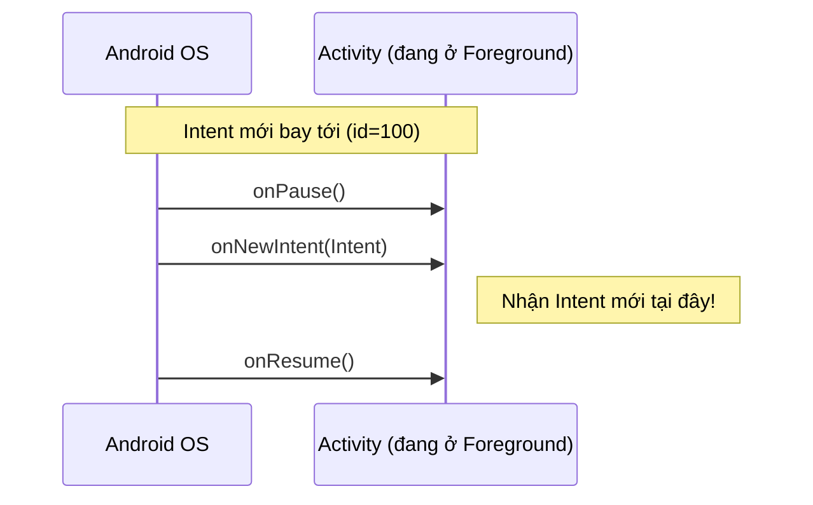
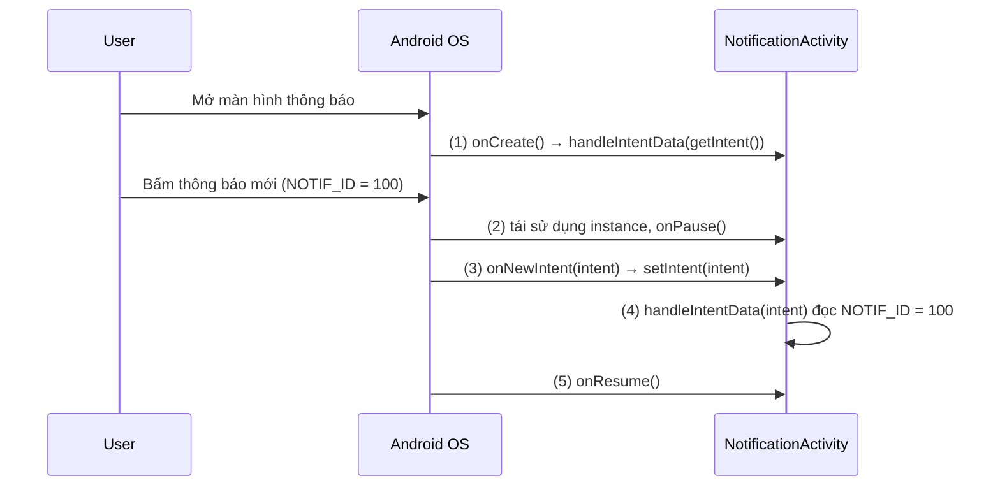

# Xử lý Intent và onNewIntent

## Vấn đề cần giải quyết

Khi một Component (Activity/Fragment) được khởi chạy bởi một Intent, nó cần làm 2 việc chính:
1. Đọc dữ liệu (Data/Extras) mà người gọi gửi đến.
2. (Tùy chọn) Gửi trả lại kết quả (Result) cho người gọi khi nó làm xong việc.

Đặc biệt, nếu Activity **đang chạy sẵn** và bất ngờ nhận thêm một Intent mới (thay vì bị tạo mới hoàn toàn), chuyện gì sẽ xảy ra? Đó là lúc `onNewIntent()` xuất hiện và thường gây ra rất nhiều lỗi khó hiểu (bug logic) cho các lập trình viên.

## Sau khi học xong

- Triển khai được việc đọc extras (primitive, Parcelable) từ Intent theo cách tương thích mọi phiên bản Android.
- Áp dụng được Activity Result API (registerForActivityResult, rememberLauncherForActivityResult) để nhận kết quả trả về trong View và Compose.
- Giải thích được khi nào hệ thống gọi onNewIntent() thay vì onCreate() (Activity được tái sử dụng do launch mode hoặc Intent flag).
- Xử lý được Intent mới trong onNewIntent() và cập nhật getIntent() bằng setIntent() khi cần.

## Xử lý Intent là gì?

**Xử lý Intent** là phần việc của component đích với Intent gửi tới nó: đọc dữ liệu mà Intent khởi chạy mang tới, trả kết quả về cho người gọi khi cần (Activity Result API), và nhận Intent mới qua `onNewIntent()` khi chính instance đang sống được tái sử dụng thay vì tạo mới.

Mental model: luồng dữ liệu có **hai cửa vào và một cửa ra**. Cửa vào thứ nhất là `onCreate()` (Intent khởi chạy, đọc bằng `getIntent()`); cửa vào thứ hai là `onNewIntent()` (Intent đến sau, khi instance đã sống sẵn); cửa ra là Activity Result API. Hiểu luồng dữ liệu đi qua ba cửa này là cốt lõi để làm chủ ứng dụng Android.

## Cách hoạt động

### Đọc dữ liệu từ Intent

Trong `onCreate()` của Activity, bạn dùng biến `intent` (tương đương `getIntent()`) để lấy dữ liệu.

#### Ví dụ: màn hình chi tiết đọc sản phẩm được gửi tới

```kotlin
override fun onCreate(savedInstanceState: Bundle?) {
    super.onCreate(savedInstanceState)
    
    // Đọc Primitive Type
    val productId = intent.getIntExtra("PRODUCT_ID", -1) // -1 là giá trị mặc định nếu ko tìm thấy key
    val productName = intent.getStringExtra("PRODUCT_NAME")
    
    // Đọc Object (Parcelable) - API mới (API 33+) cần truyền Class type.
    // IntentCompat (androidx.core) tự chọn API đúng theo phiên bản, khỏi tự viết if/else.
    val product = IntentCompat.getParcelableExtra(intent, "EXTRA_PRODUCT", Product::class.java)
}
```

`Product` phải là Parcelable; cách viết Parcelable và vì sao extras phải được serialize ở [Parcelables & Bundle](../components/activity/parcelables_and_bundle.md).

### Nhận kết quả trả về (Activity Result API)

Ngày xưa, chúng ta dùng `startActivityForResult()` và `onActivityResult()`. Cách này hiện đã bị **Deprecated** vì nó khiến code lộn xộn và dễ gây crash khi Activity bị recreate (System kill).

Chuẩn mới hiện nay là **Activity Result API**.

#### Ví dụ: đổi ảnh đại diện trong môi trường View (XML / Fragment)

Quy trình chuẩn: Đăng ký một "hợp đồng" (Contract) **trước khi** Activity được STARTED.

```kotlin
class ProfileActivity : AppCompatActivity() {

    // 1. Đăng ký Contract: mở Photo Picker của hệ thống và đợi ảnh được chọn
    private val pickAvatarLauncher = registerForActivityResult(
        ActivityResultContracts.PickVisualMedia()
    ) { imageUri: Uri? ->
        if (imageUri != null) {
            // Cập nhật UI với imageUri
        }
    }

    override fun onCreate(savedInstanceState: Bundle?) {
        super.onCreate(savedInstanceState)
        setContentView(R.layout.activity_profile)

        val btnChangeAvatar = findViewById<Button>(R.id.btnChangeAvatar)
        btnChangeAvatar.setOnClickListener {
            // 2. Kích hoạt launcher: chỉ cho chọn ảnh
            pickAvatarLauncher.launch(
                PickVisualMediaRequest(ActivityResultContracts.PickVisualMedia.ImageOnly)
            )
        }
    }
}
```

> [!NOTE]
> Chọn ảnh dùng contract `PickVisualMedia` (Photo Picker): không cần quyền đọc bộ nhớ và kết quả trả thẳng `Uri?`. Cách cũ `ACTION_PICK` + `StartActivityForResult` vẫn chạy nhưng phải tự đọc `result.data?.data`. `StartActivityForResult` dành cho trường hợp mở một Activity (thường của chính app) rồi nhận `resultCode` + `Intent` mà Activity đó trả về bằng `setResult(RESULT_OK, data)` trước khi `finish()`.

#### Ví dụ: đổi ảnh đại diện trong môi trường Jetpack Compose

Composable và state của Compose (`remember`, `mutableStateOf`) là kiến thức dùng trước, học ở [Jetpack Compose Overview](../../jetpack_compose_ui/overview.md) và 9.2 State and State Hoisting (chưa có bài); ở đây chỉ cần biết `avatarUri` là state giữ ảnh vừa chọn.

Compose cung cấp hàm `rememberLauncherForActivityResult` vô cùng tiện lợi:

```kotlin
@Composable
fun AvatarPicker() {
    val context = LocalContext.current
    var avatarUri by remember { mutableStateOf<Uri?>(null) }

    // 1. Đăng ký Launcher
    val launcher = rememberLauncherForActivityResult(
        contract = ActivityResultContracts.PickVisualMedia()
    ) { uri: Uri? ->
        if (uri != null) {
            avatarUri = uri
        }
    }

    Button(onClick = {
        // 2. Kích hoạt
        launcher.launch(PickVisualMediaRequest(ActivityResultContracts.PickVisualMedia.ImageOnly))
    }) {
        Text("Chọn Ảnh")
    }
}
```

### onNewIntent() và Launch Modes

#### Khi nào hệ thống gọi onNewIntent() thay vì onCreate()

Khi Activity đích **được tái sử dụng** thay vì tạo mới, hệ điều hành **KHÔNG tạo ra instance mới** (không gọi `onCreate()`). Thay vào đó, nó chuyển Intent mới vào hàm `onNewIntent(intent)` của instance đang sống. Activity được tái sử dụng khi launch mode trong Manifest (`singleTop`, `singleTask`, `singleInstance`, `singleInstancePerTask`) hoặc Intent flag lúc gọi (`FLAG_ACTIVITY_SINGLE_TOP`, `FLAG_ACTIVITY_CLEAR_TOP` kết hợp `SINGLE_TOP`) cho phép, và instance phù hợp đã tồn tại. Mỗi launch mode và flag quyết định "khi nào tái sử dụng" ra sao được giải thích ở [Task and Back Stack](../components/activity/task_and_backstack.md), mục "Cách hoạt động — 5 Launch Modes" và "Cách hoạt động — Intent Flags".


<!-- dd: intent-newintent -->

Sơ đồ vẽ trường hợp Activity đang ở foreground (`RESUMED`): Activity không bao giờ nhận Intent mới khi đang `RESUMED`, nên nó bị pause trước, nhận `onNewIntent()`, rồi `onResume()`. Nếu Activity không ở trạng thái `RESUMED`, Intent mới có thể được giao ngay, còn `onResume()` được gọi sau, khi Activity active trở lại.

#### Launch mode nào dẫn tới onNewIntent?

Với `standard` (mặc định) và không có flag tái sử dụng, mỗi Intent tạo instance mới và đi qua `onCreate()`, nên không cần `onNewIntent()`. Các launch mode và flag còn lại có thể tái sử dụng instance cũ; bảng "onNewIntent?" cho từng mode ở [Task and Back Stack](../components/activity/task_and_backstack.md), mục "Cách hoạt động — 5 Launch Modes". Activity nào có thể được tái sử dụng thì phải override `onNewIntent()` như ví dụ ở mục "Ví dụ thực tế".

#### Cái bẫy của getIntent()

Khi `onNewIntent(intent)` được gọi, biến `intent` gốc của Activity (được trả về bởi hàm `getIntent()`) **KHÔNG tự động cập nhật**. Nó vẫn trỏ vào cái Intent khai sinh ra Activity từ lúc `onCreate()`.

**Cách xử lý ĐÚNG CHUẨN:**
Xử lý trực tiếp tham số `intent` của `onNewIntent`. Nếu về sau code còn đọc `getIntent()` (ví dụ trong `onResume()`, hoặc ViewModel lấy lại intent), hãy gọi `setIntent(intent)` để `getIntent()` trả về Intent mới nhất.

> [!IMPORTANT]
> Luôn nhớ nguyên tắc vàng: **Nếu dùng Launch Mode để tái sử dụng Activity, bạn phải override `onNewIntent()` để xử lý Intent mới, và gọi `setIntent(intent)` nếu về sau còn đọc `getIntent()`.**

## Ví dụ thực tế

### Mở màn hình thông báo khi màn hình đó đang hiển thị

Giả sử bạn có màn hình `NotificationActivity`. Khi người dùng đang mở app và đứng sẵn ở màn hình này, có một thông báo Push Notification bắn tới. Họ bấm vào thông báo (chứa Intent đẩy data id=100) -> OS điều hướng họ đến `NotificationActivity`.

`NotificationActivity` được khai báo launch mode (hoặc được mở bằng Intent flag) cho phép tái sử dụng instance, ví dụ `singleTop`. Luồng chạy:

1. Lần đầu mở màn hình: hệ thống tạo instance mới, `onCreate()` đọc Intent gốc (`getIntent()`) và hiển thị thông báo tương ứng.
2. Người dùng bấm thông báo mới (`NOTIF_ID` = 100) khi `NotificationActivity` đang ở foreground: hệ thống tái sử dụng instance đang sống, không gọi `onCreate()`, và pause Activity trước.
3. Hệ thống gọi `onNewIntent(intent)` với Intent mới; Activity gọi `setIntent(intent)` để `getIntent()` về sau trả về Intent này.
4. Activity xử lý dữ liệu của Intent mới (đọc `NOTIF_ID` = 100, load nội dung).
5. Hệ thống gọi `onResume()`, màn hình hiện nội dung của thông báo mới.



```kotlin
class NotificationActivity : AppCompatActivity() {

    override fun onCreate(savedInstanceState: Bundle?) {
        super.onCreate(savedInstanceState)
        // (1) Lần đầu tạo Activity, đọc Intent gốc
        handleIntentData(intent)
    }

    // Hàm này CHỈ gọi khi Activity ĐANG SỐNG và nhận Intent mới.
    // ComponentActivity (androidx.activity, cha của AppCompatActivity) khai báo
    // onNewIntent(@NonNull Intent intent), nên trong Kotlin tham số là Intent non-null.
    // Code cũ viết Intent? (từ thời tham số còn là platform type) báo lỗi
    // "'onNewIntent' overrides nothing" khi nâng androidx.activity lên 1.9.0+.
    override fun onNewIntent(intent: Intent) {
        super.onNewIntent(intent)

        // (3) Cập nhật Intent gốc để getIntent() về sau trả về Intent mới
        setIntent(intent)

        // (4) Xử lý dữ liệu mới
        handleIntentData(intent)
    }

    private fun handleIntentData(intent: Intent) {
        val notifId = intent.getIntExtra("NOTIF_ID", -1)
        // Load data từ API hoặc hiển thị ra UI theo notifId
    }
}
```

**Kết quả:** bấm thông báo mới khi đang đứng ở `NotificationActivity`, màn hình hiện nội dung của id=100 thay vì nội dung cũ; kiểm tra bằng cách log `notifId` trong `handleIntentData()` và log `getIntent().getIntExtra("NOTIF_ID", -1)` trong `onResume()`: cả hai đều ra 100.

### Nhận kết quả từ màn hình khác

Hai ví dụ chọn ảnh đại diện ở mục "Nhận kết quả trả về (Activity Result API)" là bài toán nhận kết quả từ app khác (Photo Picker). Khi màn hình trả kết quả là Activity của chính app (ví dụ màn hình chọn địa chỉ), dùng contract `StartActivityForResult`: màn hình đích gọi `setResult(RESULT_OK, data)` trước khi `finish()`, như ghi chú ở mục đó.

## Sai lầm thường gặp

### 1. Không override onNewIntent(): màn hình hiển thị dữ liệu cũ

**Lỗi:** Bạn debug và thấy màn hình không cập nhật nội dung của id=100. Nó vẫn hiển thị nội dung cũ. Khi bạn gọi `intent.getIntExtra("id", -1)`, nó vẫn trả về ID của thông báo cũ từ hôm qua!

Nguyên nhân: Activity được tái sử dụng nên không đi qua `onCreate()`, và `getIntent()` vẫn trả về Intent khai sinh ra Activity.

**Cách sửa:** override `onNewIntent()`, xử lý tham số `intent` của nó, và gọi `setIntent(intent)` nếu về sau còn đọc `getIntent()` (code ở mục "Ví dụ thực tế").

### 2. Khai báo tham số onNewIntent() là `Intent?`

Code cũ viết `override fun onNewIntent(intent: Intent?)` báo lỗi "'onNewIntent' overrides nothing" khi nâng androidx.activity lên 1.9.0+, vì `ComponentActivity` khai báo `onNewIntent(@NonNull Intent intent)`.

**Cách sửa:** khai báo `override fun onNewIntent(intent: Intent)` (non-null).

### 3. Vẫn dùng startActivityForResult()/onActivityResult() hoặc ACTION_PICK để chọn ảnh

Hai API này đã bị deprecated trên `ComponentActivity`. Chọn ảnh bằng `ACTION_PICK` vẫn chạy nhưng phải tự đọc `result.data?.data`.

**Cách sửa:** đăng ký launcher bằng `registerForActivityResult()` (View) hoặc `rememberLauncherForActivityResult()` (Compose); chọn ảnh dùng contract `PickVisualMedia`.

### 4. Đọc Parcelable sai cách giữa các phiên bản API

Từ API 33, `getParcelableExtra()` cần truyền Class type; tự viết `if/else` theo `Build.VERSION.SDK_INT` dễ sót nhánh.

**Cách sửa:** dùng `IntentCompat.getParcelableExtra(intent, key, Product::class.java)` của androidx.core, như ví dụ ở mục "Đọc dữ liệu từ Intent".

## Lịch sử phát triển

- **API 1:** `Activity.getIntent()`, `setIntent()`, `onNewIntent(Intent)` và cặp `startActivityForResult()`/`onActivityResult()` có từ API level đầu tiên.
- **AndroidX Activity 1.2.0-alpha04 (04/2020):** `startActivityForResult()`/`onActivityResult()` trên `ComponentActivity` bị deprecated, chuyển sang Activity Result API.
- **AndroidX Activity 1.2.0 (02/2021):** Activity Result API stable: `ComponentActivity` cung cấp `ActivityResultRegistry`, xử lý các luồng `startActivityForResult()` + `onActivityResult()` qua `ActivityResultContract` thay vì override method.
- **Activity Compose 1.3.0 (07/2021):** artifact `activity-compose` stable, có `rememberLauncherForActivityResult()` (đổi tên từ `registerForActivityResult()` dạng Composable ở 1.3.0-alpha06).
- **AndroidX Activity 1.6.0 (09/2022):** thêm contract `PickVisualMedia`, dùng Photo Picker khi máy có sẵn và chuyển sang `ACTION_OPEN_DOCUMENT` khi không có.
- **Android 13 (API 33):** thêm overload `getParcelableExtra(String, Class)`; overload không có `Class` bị deprecated.
- **AndroidX Core 1.10.0 (04/2023):** thêm `IntentCompat.getParcelableExtra(Intent, String, Class)` cho mọi API level.
- **AndroidX Activity 1.9.0 (04/2024):** `ComponentActivity` được viết lại bằng Kotlin (từ 1.9.0-alpha01); `onNewIntent()` nhận `Intent` non-null nên override bằng `Intent?` không còn biên dịch được.

## Kết nối hệ thống

- **Tiên quyết:** [Explicit Intents](explicit_intents.md) (cách gửi Intent tới một Activity cụ thể) và [Activity Lifecycle](../components/activity/lifecycle.md) (`onCreate`, `onPause`, `onResume` quanh `onNewIntent()`).
- **Liên quan:**
  - [Task and Back Stack](../components/activity/task_and_backstack.md): launch mode và Intent flag quyết định khi nào Activity được tái sử dụng.
  - [Parcelables & Bundle](../components/activity/parcelables_and_bundle.md): vì sao extras phải serialize và cách viết Parcelable.
  - [Intent Filters](intent_filters.md): Activity nhận deep link xử lý cả cold start (`onCreate()`) và warm start (`onNewIntent()`).
  - [Push data and send event via Intent](push_data_event.md): phía gửi đưa dữ liệu vào Intent.
- **Học tiếp:** [Pending Intent](pending_intent.md): tạo Intent cho thông báo, nguồn của tình huống `onNewIntent()` trong bài.

## Nguồn tham khảo

- Android Developers — [Get a result from an activity (Activity Result API)](https://developer.android.com/training/basics/intents/result)
- Android Developers — [Photo picker](https://developer.android.com/training/data-storage/shared/photopicker)
- Android Developers — [ComponentActivity reference (`onNewIntent(@NonNull Intent)`)](https://developer.android.com/reference/androidx/activity/ComponentActivity)
- Android Developers — [Activity release notes (1.2.0 Activity Result API, 1.3.0 activity-compose, 1.6.0 PickVisualMedia, 1.9.0: ComponentActivity viết lại bằng Kotlin)](https://developer.android.com/jetpack/androidx/releases/activity)
- Android Developers — [Activity reference (`onNewIntent`, `getIntent`, `setIntent`: API 1)](https://developer.android.com/reference/android/app/Activity)
- Android Developers — [Intent reference (`getParcelableExtra` kèm `Class` từ API 33)](https://developer.android.com/reference/android/content/Intent)
- Android Developers — [Core release notes (1.10.0: IntentCompat)](https://developer.android.com/jetpack/androidx/releases/core)
- Android Developers — [Activity launch modes](https://developer.android.com/guide/components/activities/launch-mode)
