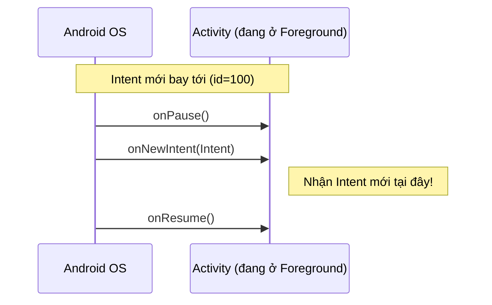

# Xử lý Intent và onNewIntent

## Vấn đề cần giải quyết

Khi một Component (Activity/Fragment) được khởi chạy bởi một Intent, nó cần làm 2 việc chính:
1. Đọc dữ liệu (Data/Extras) mà người gọi gửi đến.
2. (Tùy chọn) Gửi trả lại kết quả (Result) cho người gọi khi nó làm xong việc.

Đặc biệt, nếu Activity **đang chạy sẵn** và bất ngờ nhận thêm một Intent mới (thay vì bị tạo mới hoàn toàn), chuyện gì sẽ xảy ra? Đó là lúc `onNewIntent()` xuất hiện và thường gây ra rất nhiều lỗi khó hiểu (bug logic) cho các lập trình viên.

## 1. Đọc dữ liệu từ Intent

Trong `onCreate()` của Activity, bạn dùng biến `intent` (tương đương `getIntent()`) để lấy dữ liệu.

```kotlin
override fun onCreate(savedInstanceState: Bundle?) {
    super.onCreate(savedInstanceState)
    
    // Đọc Primitive Type
    val productId = intent.getIntExtra("PRODUCT_ID", -1) // -1 là giá trị mặc định nếu ko tìm thấy key
    val productName = intent.getStringExtra("PRODUCT_NAME")
    
    // Đọc Object (Parcelable) - API mới (API 33+) cần truyền Class type.
    // IntentCompat (androidx.core) tự chọn API đúng theo phiên bản, khỏi tự viết if/else.
    val product = IntentCompat.getParcelableExtra(intent, "EXTRA_PRODUCT", Product::class.java)
}
```

## 2. Nhận kết quả trả về (Activity Result API)

Ngày xưa, chúng ta dùng `startActivityForResult()` và `onActivityResult()`. Cách này hiện đã bị **Deprecated** vì nó khiến code lộn xộn và dễ gây crash khi Activity bị recreate (System kill).

Chuẩn mới hiện nay là **Activity Result API**.

### Trong môi trường View (XML / Fragment)

Quy trình chuẩn: Đăng ký một "hợp đồng" (Contract) **trước khi** Activity được STARTED.

```kotlin
class ProfileActivity : AppCompatActivity() {

    // 1. Đăng ký Contract: mở Photo Picker của hệ thống và đợi ảnh được chọn
    private val pickAvatarLauncher = registerForActivityResult(
        ActivityResultContracts.PickVisualMedia()
    ) { imageUri: Uri? ->
        if (imageUri != null) {
            // Cập nhật UI với imageUri
        }
    }

    override fun onCreate(savedInstanceState: Bundle?) {
        super.onCreate(savedInstanceState)
        setContentView(R.layout.activity_profile)

        val btnChangeAvatar = findViewById<Button>(R.id.btnChangeAvatar)
        btnChangeAvatar.setOnClickListener {
            // 2. Kích hoạt launcher: chỉ cho chọn ảnh
            pickAvatarLauncher.launch(
                PickVisualMediaRequest(ActivityResultContracts.PickVisualMedia.ImageOnly)
            )
        }
    }
}
```

> [!NOTE]
> Chọn ảnh dùng contract `PickVisualMedia` (Photo Picker): không cần quyền đọc bộ nhớ và kết quả trả thẳng `Uri?`. Cách cũ `ACTION_PICK` + `StartActivityForResult` vẫn chạy nhưng phải tự đọc `result.data?.data`. `StartActivityForResult` dành cho trường hợp mở một Activity (thường của chính app) rồi nhận `resultCode` + `Intent` mà Activity đó trả về bằng `setResult(RESULT_OK, data)` trước khi `finish()`.

### Trong môi trường Jetpack Compose

Compose cung cấp hàm `rememberLauncherForActivityResult` vô cùng tiện lợi:

```kotlin
@Composable
fun AvatarPicker() {
    val context = LocalContext.current
    var avatarUri by remember { mutableStateOf<Uri?>(null) }

    // 1. Đăng ký Launcher
    val launcher = rememberLauncherForActivityResult(
        contract = ActivityResultContracts.PickVisualMedia()
    ) { uri: Uri? ->
        if (uri != null) {
            avatarUri = uri
        }
    }

    Button(onClick = {
        // 2. Kích hoạt
        launcher.launch(PickVisualMediaRequest(ActivityResultContracts.PickVisualMedia.ImageOnly))
    }) {
        Text("Chọn Ảnh")
    }
}
```

---

## 3. Bí ẩn của onNewIntent() và Launch Modes

### Sự cố thường gặp
Giả sử bạn có màn hình `NotificationActivity`. Khi người dùng đang mở app và đứng sẵn ở màn hình này, có một thông báo Push Notification bắn tới. Họ bấm vào thông báo (chứa Intent đẩy data id=100) -> OS điều hướng họ đến `NotificationActivity`.

**Lỗi:** Bạn debug và thấy màn hình không cập nhật nội dung của id=100. Nó vẫn hiển thị nội dung cũ. Khi bạn gọi `intent.getIntExtra("id", -1)`, nó vẫn trả về ID của thông báo cũ từ hôm qua!

### Tại sao lại như vậy?

Khi Activity đích **được tái sử dụng** thay vì tạo mới, hệ điều hành **KHÔNG tạo ra instance mới** (không gọi `onCreate()`). Thay vào đó, nó chuyển Intent mới vào hàm `onNewIntent(intent)` của instance đang sống. Activity được tái sử dụng khi launch mode trong Manifest (`singleTop`, `singleTask`, `singleInstance`, `singleInstancePerTask`) hoặc Intent flag lúc gọi (`FLAG_ACTIVITY_SINGLE_TOP`, `FLAG_ACTIVITY_CLEAR_TOP` kết hợp `SINGLE_TOP`) cho phép, và instance phù hợp đã tồn tại. Mỗi launch mode và flag quyết định "khi nào tái sử dụng" ra sao được giải thích ở [Task and Back Stack](../components/activity/task_and_backstack.md), mục "Cách hoạt động — 5 Launch Modes" và "Cách hoạt động — Intent Flags".


<!-- dd: intent-newintent -->

### Cái bẫy của getIntent()

Khi `onNewIntent(intent)` được gọi, biến `intent` gốc của Activity (được trả về bởi hàm `getIntent()`) **KHÔNG tự động cập nhật**. Nó vẫn trỏ vào cái Intent khai sinh ra Activity từ lúc `onCreate()`.

**Cách xử lý ĐÚNG CHUẨN:**
Xử lý trực tiếp tham số `intent` của `onNewIntent`. Nếu về sau code còn đọc `getIntent()` (ví dụ trong `onResume()`, hoặc ViewModel lấy lại intent), hãy gọi `setIntent(intent)` để `getIntent()` trả về Intent mới nhất.

```kotlin
class NotificationActivity : AppCompatActivity() {

    override fun onCreate(savedInstanceState: Bundle?) {
        super.onCreate(savedInstanceState)
        // Lần đầu tạo Activity, đọc Intent gốc
        handleIntentData(intent)
    }

    // Hàm này CHỈ gọi khi Activity ĐANG SỐNG và nhận Intent mới.
    // ComponentActivity (androidx.activity, cha của AppCompatActivity) khai báo
    // onNewIntent(@NonNull Intent intent), nên trong Kotlin tham số là Intent non-null.
    // Code cũ viết Intent? (từ thời tham số còn là platform type) báo lỗi
    // "'onNewIntent' overrides nothing" khi nâng androidx.activity lên 1.9.0+.
    override fun onNewIntent(intent: Intent) {
        super.onNewIntent(intent)

        // 1. Cập nhật Intent gốc để getIntent() về sau trả về Intent mới
        setIntent(intent)

        // 2. Xử lý dữ liệu mới
        handleIntentData(intent)
    }

    private fun handleIntentData(intent: Intent) {
        val notifId = intent.getIntExtra("NOTIF_ID", -1)
        // Load data từ API hoặc hiển thị ra UI theo notifId
    }
}
```

### Launch mode nào dẫn tới onNewIntent?

Với `standard` (mặc định) và không có flag tái sử dụng, mỗi Intent tạo instance mới và đi qua `onCreate()`, nên không cần `onNewIntent()`. Các launch mode và flag còn lại có thể tái sử dụng instance cũ; bảng "onNewIntent?" cho từng mode ở [Task and Back Stack](../components/activity/task_and_backstack.md), mục "Cách hoạt động — 5 Launch Modes". Activity nào có thể được tái sử dụng thì phải override `onNewIntent()` như ví dụ trên.

## Tổng kết

Việc hiểu luồng dữ liệu (vào qua `onCreate` hoặc `onNewIntent`, ra qua `Activity Result API`) là cốt lõi để làm chủ ứng dụng Android. Luôn nhớ nguyên tắc vàng: **Nếu dùng Launch Mode để tái sử dụng Activity, bạn phải override `onNewIntent()` để xử lý Intent mới, và gọi `setIntent(intent)` nếu về sau còn đọc `getIntent()`.**

## Nguồn tham khảo

- Android Developers — [Get a result from an activity (Activity Result API)](https://developer.android.com/training/basics/intents/result)
- Android Developers — [Photo picker](https://developer.android.com/training/data-storage/shared/photopicker)
- Android Developers — [ComponentActivity reference (`onNewIntent(@NonNull Intent)`)](https://developer.android.com/reference/androidx/activity/ComponentActivity)
- Android Developers — [Activity release notes (1.9.0: ComponentActivity viết lại bằng Kotlin)](https://developer.android.com/jetpack/androidx/releases/activity)
- Android Developers — [Activity launch modes](https://developer.android.com/guide/components/activities/launch-mode)
