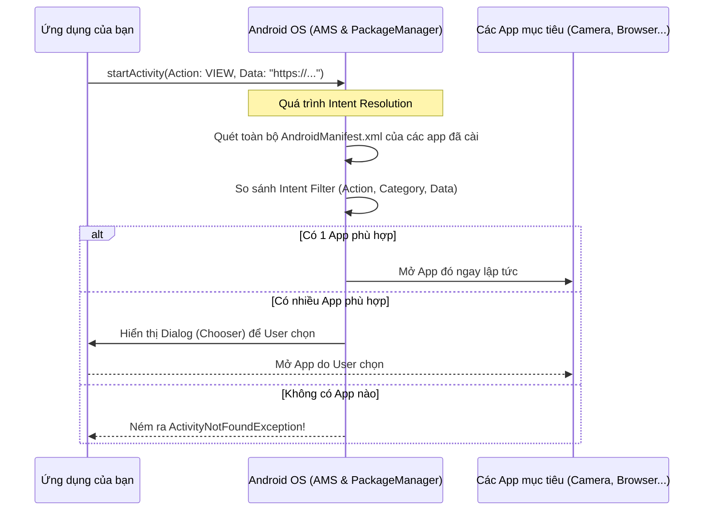
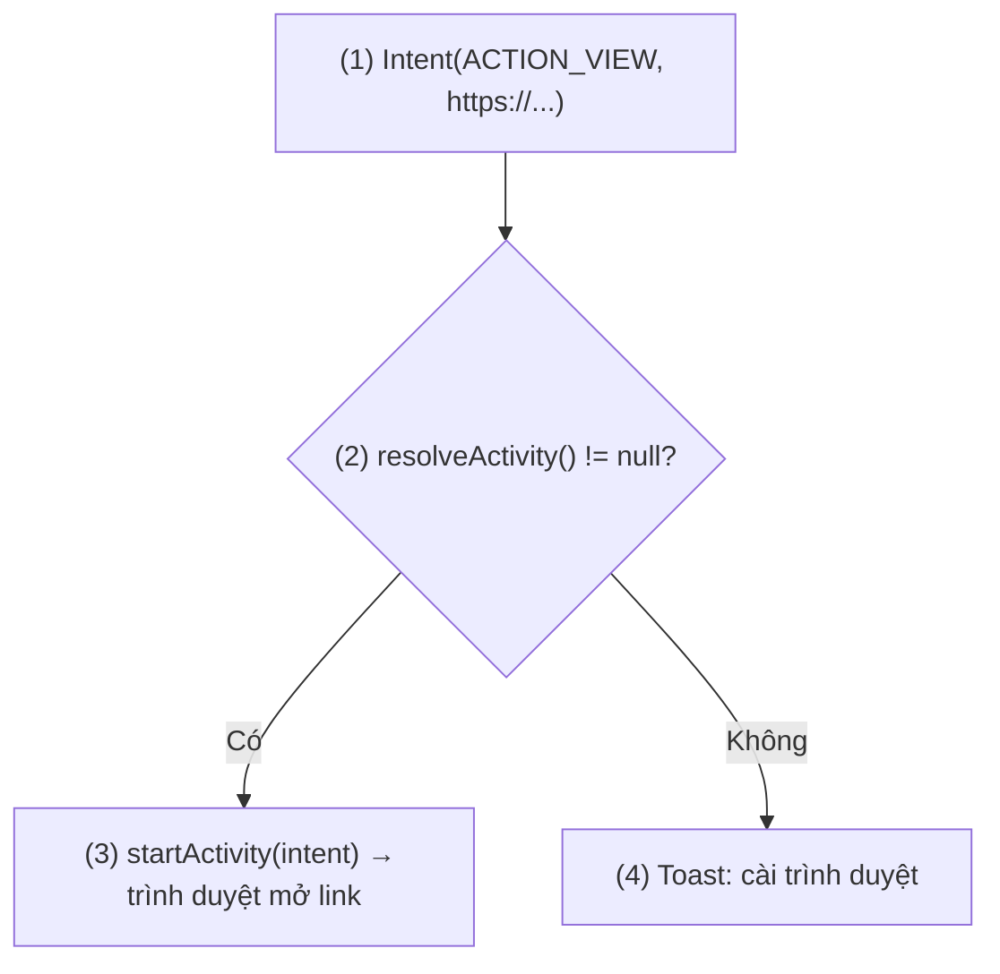

# Implicit Intents

## Vấn đề cần giải quyết

Giả sử ứng dụng của bạn cần chụp một bức ảnh để làm avatar người dùng. Bạn có hai lựa chọn:
1. Tự viết toàn bộ giao diện Camera, tự giao tiếp với phần cứng Camera, tự xử lý lưu file. (Quá tốn thời gian, dễ sinh bug).
2. "Nhờ" một ứng dụng Camera đã có sẵn trong máy chụp ảnh giùm và trả kết quả về.

Nhưng làm sao bạn biết thiết bị của người dùng đang cài app Camera nào? (Họ dùng app mặc định của Samsung, Xiaomi, hay tải B612 từ Store?). Bạn không thể biết **tên class** của app đích để dùng Explicit Intent.

**Implicit Intent (Intent không tường minh)** ra đời để giải quyết vấn đề: **"Tôi cần một ai đó thực hiện việc này (chụp ảnh), tôi không quan tâm ai làm, miễn là làm được."**

## Sau khi học xong

- Giải thích được Implicit Intent là gì và cách hệ điều hành phân giải (resolve) nó qua Action, Data, Category.
- Phân biệt được Implicit Intent với Explicit Intent và biết khi nào dùng loại nào.
- Triển khai được Implicit Intent cho các bài toán mở web, chia sẻ text, gửi email.
- Xử lý được trường hợp không có app nào nhận Intent (ActivityNotFoundException) và giới hạn Package Visibility từ Android 11.

## Implicit Intent là gì?

**Implicit Intent** là loại Intent mà bạn không truyền tên Component (Class) cụ thể, thay vào đó, bạn khai báo một **Hành động (Action)** và loại **Dữ liệu (Data)** mà hành động đó cần thực thi.

Mental model: Implicit Intent là một **yêu cầu đăng lên cho cả hệ thống**, "tôi cần ai đó làm việc này, ai làm cũng được". Hệ điều hành là người nhận yêu cầu và tìm người làm: app nào đã khai báo (bằng intent-filter) rằng mình làm được đúng việc đó với đúng loại dữ liệu đó thì được chọn.

## Cách hoạt động

### Intent Resolution: hệ điều hành tìm app nhận Intent

Hệ điều hành Android (cụ thể là `PackageManager` và `ActivityManagerService`) sẽ đứng ra làm trung gian: tra danh sách intent-filter mà `PackageManager` đã parse từ manifest của các app lúc cài đặt, xem app nào có khả năng xử lý hành động này, và đưa ra danh sách cho người dùng chọn (hoặc mở ngay nếu chỉ có 1 app xử lý được).

Khi bạn gọi `startActivity(implicitIntent)`, quá trình sau sẽ diễn ra dưới hệ thống:


<!-- dd: intent-resolve-a -->
<!-- dd: intent-resolve-b -->

Đây gọi là quá trình **Intent Resolution** (Phân giải Intent). Hệ thống so sánh 3 thành phần chính:
1. **Action:** (VD: `ACTION_VIEW`, `ACTION_SEND`, `ACTION_DIAL`).
2. **Data (URI & MIME Type):** (VD: URL web `https://...`, số điện thoại `tel:123`, kiểu file `image/jpeg`).
3. **Category:** (Thường mặc định là `CATEGORY_DEFAULT`).

Sơ đồ ghi "Quét toàn bộ AndroidManifest.xml" cho dễ hình dung; thực tế hệ thống tra danh sách intent-filter mà `PackageManager` đã parse sẵn lúc cài đặt, như đoạn đầu mục này. Quy tắc khớp chi tiết của từng thành phần (test Action, Category, Data) ở [Intent Filters](intent_filters.md).

### Chỉ component exported mới nhận implicit intent (Android 14+)

> [!NOTE]
> Từ Android 14 (app target API 34+), implicit intent **chỉ được giao tới component `exported="true"`**. Component nội bộ (`exported="false"`) dù có `<intent-filter>` khớp cũng không nhận được implicit intent (với `startActivity` sẽ ném `ActivityNotFoundException`); muốn mở nó phải dùng Explicit Intent hoặc `setPackage(context.packageName)`.

## Ví dụ thực tế

### Mở trang điều khoản sử dụng trên trình duyệt

**Vấn đề:** Ứng dụng muốn mở link điều khoản sử dụng.

Luồng chạy:

1. Tạo Intent với `ACTION_VIEW` và Data là URL `https://...`; không chỉ định app nào.
2. Gọi `resolveActivity()` để hỏi `PackageManager` có Activity nào khớp Intent không. Trên app target Android 11 (API 30) trở lên, kết quả chỉ tính các app mà app của bạn được phép nhìn thấy, nên cần khai báo `<queries>` (mục "Sai lầm thường gặp").
3. Có app khớp: gọi `startActivity()`, hệ thống mở trình duyệt (hoặc hiện hộp thoại chọn app nếu có nhiều app khớp).
4. Không có app khớp: không gọi `startActivity()`, báo người dùng cài trình duyệt.



```kotlin
fun openWebPage(url: String, context: Context) {
    // (1) Implicit Intent: chỉ có Action + Data
    val webpage: Uri = Uri.parse(url)
    val intent = Intent(Intent.ACTION_VIEW, webpage)
    
    // RẤT QUAN TRỌNG: Luôn kiểm tra xem có app nào xử lý được không trước khi start
    // Từ Android 11 (API 30), cần khai báo <queries> trong Manifest để check resolveActivity
    if (intent.resolveActivity(context.packageManager) != null) { // (2)
        context.startActivity(intent) // (3)
    } else {
        // (4) Hiển thị Toast thông báo người dùng cài trình duyệt
    }
}
```

**Kết quả:** trên máy có trình duyệt (và manifest có `<queries>` cho `https`), link mở trong trình duyệt; trên máy không có app nào mở được link, app hiện Toast thay vì crash.

### Chia sẻ mã giới thiệu (Share Action)

**Vấn đề:** Muốn người dùng chia sẻ một đoạn văn bản (mã giới thiệu) qua Zalo, Messenger, Email...

```kotlin
fun shareText(textToShare: String, context: Context) {
    val sendIntent = Intent().apply {
        action = Intent.ACTION_SEND
        putExtra(Intent.EXTRA_TEXT, textToShare)
        type = "text/plain" // Rất quan trọng để OS biết loại dữ liệu
    }

    // Luôn luôn tạo một "Chooser" để hiển thị danh sách app đẹp mắt, 
    // thay vì tin tưởng vào app mặc định của người dùng.
    val shareIntent = Intent.createChooser(sendIntent, "Chia sẻ mã qua...")
    context.startActivity(shareIntent)
}
```

> [!NOTE]
> `createChooser()` khác hộp thoại chọn app mặc định của hệ thống. Khi nhiều app khớp mà người dùng chưa đặt app mặc định, hệ thống hiện **disambiguation dialog** có nút "Luôn dùng"/"Chỉ một lần"; nếu người dùng đã chọn "Luôn dùng" thì lần sau mở thẳng app đó, không hỏi nữa. `createChooser()` thì **luôn** hiện Sharesheet và không cho đặt mặc định, nên hợp với hành động chia sẻ, nơi mỗi lần người dùng có thể muốn chọn app khác.

### Gửi Email

```kotlin
fun composeEmail(addresses: Array<String>, subject: String, context: Context) {
    val intent = Intent(Intent.ACTION_SENDTO).apply {
        data = Uri.parse("mailto:") // Chỉ các app email mới xử lý được
        putExtra(Intent.EXTRA_EMAIL, addresses)
        putExtra(Intent.EXTRA_SUBJECT, subject)
    }
    // Không dùng resolveActivity() ở đây: trên Android 11+ nó trả về null nếu manifest
    // không khai báo <queries> cho mailto, và email bị bỏ qua mà không báo gì.
    // Gọi thẳng startActivity và bắt lỗi khi máy không có app email.
    try {
        context.startActivity(intent)
    } catch (e: ActivityNotFoundException) {
        // Báo người dùng chưa có app email
    }
}
```

## Khi nào nên và không nên dùng

- **Nên dùng** khi cần nhờ một app khác làm việc (mở web, chia sẻ, gửi email, chụp ảnh) mà bạn không biết, hoặc không cần biết, app nào trên máy sẽ làm: chỉ mô tả việc cần làm bằng Action và Data.
- **Không nên dùng** để mở component nội bộ của chính app: dùng [Explicit Intent](explicit_intents.md) (hoặc `setPackage(context.packageName)`), vì từ Android 14 implicit intent không tới được component `exported="false"` (mục "Chỉ component exported mới nhận implicit intent (Android 14+)").

Implicit Intent giúp hệ sinh thái Android trở nên linh hoạt và liên kết mạnh mẽ giữa các ứng dụng với nhau. Khi sử dụng, hãy chú ý cung cấp đúng Action và Data/MIME Type, đồng thời luôn có phương án fallback (xử lý lỗi) trong trường hợp thiết bị người dùng không có ứng dụng phù hợp.

## Sai lầm thường gặp

### 1. Crash `ActivityNotFoundException`

Lỗi phổ biến nhất khi dùng Implicit Intent là app bị văng khi không có ứng dụng nào trên thiết bị xử lý được Intent đó (Ví dụ: gọi `ACTION_DIAL` trên máy tính bảng không có tính năng nghe gọi).

**Cách sửa:** **Luôn bọc trong try-catch hoặc dùng `resolveActivity` trước khi gọi `startActivity`.**

### 2. `resolveActivity()` trả về `null` vì thiếu `<queries>` (Package Visibility, Android 11+)

Từ Android 11 (API level 30), Google siết chặt quyền riêng tư. Với app target API 30 trở lên, hàm `resolveActivity()` sẽ trả về `null` khi app đích không hiển thị với app của bạn, trừ khi bạn khai báo những package hoặc intent mà bạn muốn "nhìn thấy" trong file `AndroidManifest.xml` qua thẻ `<queries>`. Hậu quả: hành động bị bỏ qua mà không báo gì, dù máy có app phù hợp.

**Cách sửa:** khai báo `<queries>` cho đúng intent cần kiểm tra. `startActivity()` thì không cần package visibility, nên cách gọi thẳng `startActivity()` trong `try-catch` (ví dụ Gửi Email) không cần khối này.

**Ví dụ sửa lỗi Package Visibility:**
Trong `AndroidManifest.xml`:
```xml
<queries>
    <!-- Cho phép dò tìm các app có khả năng mở URL web -->
    <intent>
        <action android:name="android.intent.action.VIEW" />
        <data android:scheme="https" />
    </intent>
    <!-- Cần nếu muốn dùng resolveActivity() cho intent gửi email (mailto:) -->
    <intent>
        <action android:name="android.intent.action.SENDTO" />
        <data android:scheme="mailto" />
    </intent>
</queries>
```

### 3. Dùng implicit intent để mở component nội bộ không exported

Khi app target Android 14 (API 34) trở lên, implicit intent tới Activity `exported="false"` của chính app ném `ActivityNotFoundException`, dù `<intent-filter>` khớp.

**Cách sửa:** dùng Explicit Intent hoặc `setPackage(context.packageName)` (mục "Chỉ component exported mới nhận implicit intent (Android 14+)").

## Lịch sử phát triển

- **API 1:** `Intent` cùng `ACTION_VIEW`, `ACTION_SEND`, `ACTION_SENDTO`, `resolveActivity()`, `createChooser(Intent, CharSequence)` và `ActivityNotFoundException` có từ API level đầu tiên.
- **API 4 (Android 1.6):** thêm `Intent.setPackage()`, giới hạn Intent chỉ phân giải vào component của một package.
- **Android 11 (API 30):** Package Visibility: với app target API 30+, thông tin về app khác (`resolveActivity()`, `queryIntentActivities()`...) bị lọc mặc định; app khai báo app/intent cần thấy bằng `<queries>`. `startActivity()` không bị ảnh hưởng.
- **Android 14 (API 34):** với app target API 34+, implicit intent chỉ được giao tới component exported; component không exported phải mở bằng Explicit Intent.

## Kết nối hệ thống

- **Tiên quyết:** [Explicit Intents](explicit_intents.md): Intent chỉ định thẳng component đích, đối lập với Implicit Intent.
- **Học tiếp:** [Intent Filters](intent_filters.md): phía nhận khai báo `<intent-filter>` và quy tắc khớp Action, Category, Data mà Intent Resolution dùng.
- **Liên quan:**
  - [Manifest Tags](../android_manifest/tags.md): nơi khai báo `<intent-filter>` và quy tắc `android:exported`.
  - [Handle Intent](handle_intent.md): nhận kết quả trả về từ app khác bằng Activity Result API (ví dụ chọn ảnh).

## Nguồn tham khảo

- Android Developers — [Intents and intent filters](https://developer.android.com/guide/components/intents-filters)
- Android Developers — [Intent reference (`ACTION_VIEW`, `ACTION_SEND`, `ACTION_SENDTO`, `resolveActivity`, `createChooser`: API 1; `setPackage`: API 4)](https://developer.android.com/reference/android/content/Intent)
- Android Developers — [ActivityNotFoundException reference](https://developer.android.com/reference/android/content/ActivityNotFoundException)
- Android Developers — [Package visibility filtering on Android](https://developer.android.com/training/package-visibility)
- Android Developers — [Fulfill common use cases while having limited package visibility](https://developer.android.com/training/package-visibility/use-cases)
- Android Developers — [Android 14 behavior changes: Restrictions to implicit and pending intents](https://developer.android.com/about/versions/14/behavior-changes-14)
