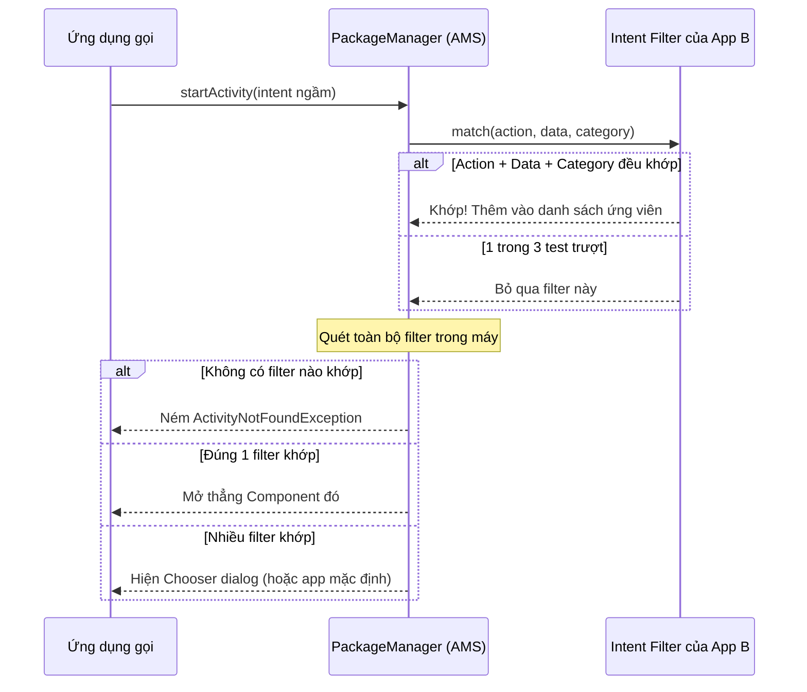
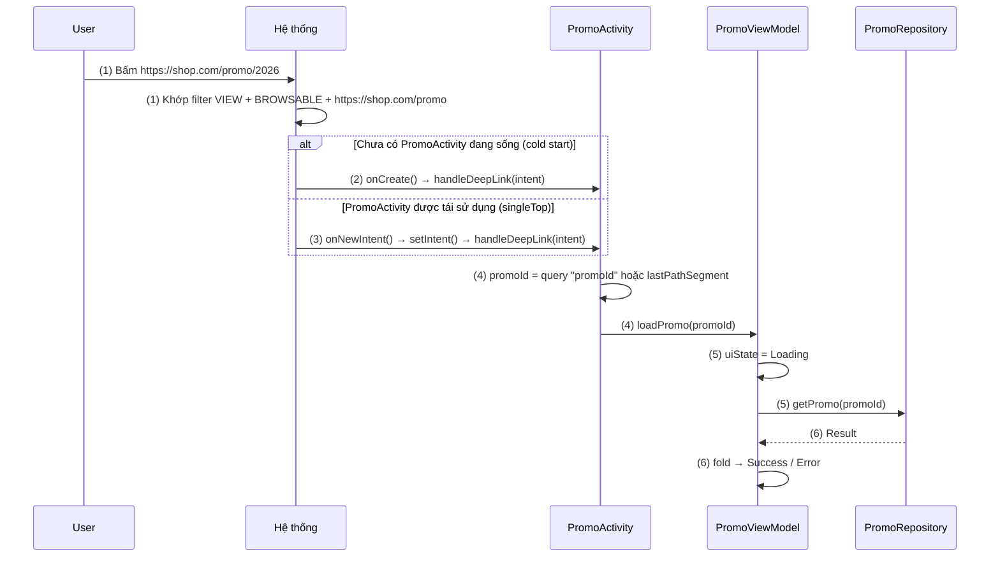

# Intent Filters (Matching Rules Deep-dive)

## Vấn đề cần giải quyết

Ở bài trước ([Implicit Intents](implicit_intents.md)), hệ điều hành có thể dò tìm app nào "đủ khả năng" xử lý một Intent ngầm (mở link, share text, quét mã...). Câu hỏi đặt ra là: **Làm sao OS biết được app của bạn có khả năng làm những việc đó?**

Giả sử bạn làm app thương mại điện tử, user bấm vào link `https://shop.com/promo/2026` từ tin nhắn Zalo. Ai sẽ mở link này?

- Nếu app của bạn **không khai báo gì** → trình duyệt mặc định mở, app bạn biến mất.
- Nếu app của bạn **khai báo Intent Filter đúng** nhưng **chưa xác minh domain** (App Links) → từ Android 12, link web vẫn mở bằng trình duyệt mặc định; app bạn chỉ được mở khi user tự bật "Mở link được hỗ trợ" trong cài đặt app. (Android 11 trở xuống thì OS hiện hộp thoại cho user chọn giữa app bạn và trình duyệt.)
- Nếu app của bạn **khai báo filter + xác minh domain** (App Links) → link mở thẳng vào app.

**Intent Filter (Bộ lọc Intent)** chính là "tấm biển quảng cáo" bạn treo trước mỗi Component để nói với OS: *"Tôi có thể xử lý dạng việc này!"* Hiểu sâu cơ chế khớp (matching) của nó quyết định app của bạn có **được liệt kê đúng chỗ** hay **hiện ra lung tung gây khó chịu** cho user.

## Sau khi học xong

- Giải thích được cấu trúc của intent-filter (action, category, data) và 3 bài test khớp Action, Data, Category cùng luật riêng của từng loại.
- Phân biệt được Deep Link với App Links và cách hệ điều hành chọn app khi nhiều filter cùng khớp.
- Triển khai được Share Target, Deep Link và App Links (assetlinks.json) cho Activity.
- Áp dụng được luồng dữ liệu Intent vào ViewModel theo mô hình MVVM (onCreate và onNewIntent).
- Debug được intent filter bằng adb và tránh được các lỗi thường gặp.

## Intent Filter là gì?

**Intent Filter** là thẻ `<intent-filter>` khai báo **bên trong** các Component (`<activity>`, `<service>`, `<receiver>`) trong file `AndroidManifest.xml`. Nó quy định tập hợp các **Implicit Intent** mà Component đó chấp nhận.

Mental model: filter là **tấm biển quảng cáo** treo trước Component. Biển ghi ba dòng: **Action** (làm gì), **Category** (trong ngữ cảnh nào), **Data** (trên dữ liệu gì). Khi có Implicit Intent, hệ thống đọc biển của mọi Component trong máy và chỉ chọn những Component có biển khớp cả ba dòng.

> [!NOTE]
> Component **không** khai báo Intent Filter (chỉ có tên class) thì **chỉ có thể** được gọi bằng Explicit Intent (gọi đích danh class).

## Cách hoạt động

Nắm vững 3 bài test — đặc biệt 4 luật Data test và việc so khớp case-sensitive — giúp bạn khai báo filter **đủ hẹp để đúng chỗ, đủ rộng để không sót**, và biết khi nào dùng Deep Link hay nâng cấp lên App Links để trải nghiệm mượt mà hơn.

### Cấu trúc Intent Filter

Một `<intent-filter>` chứa 3 nhóm thành phần + thuộc tính priority:

| Thành phần | Mô tả | Ví dụ |
| --- | --- | --- |
| `<action>` | Hành động Component thực hiện được | `android.intent.action.VIEW`, `android.intent.action.SEND` |
| `<category>` | Ngữ cảnh bổ sung | `android.intent.category.DEFAULT`, `BROWSABLE` |
| `<data>` | Định dạng dữ liệu chấp nhận | scheme `https`, host `shop.com`, mimeType `text/plain` |
| `android:priority` | Thứ tự gọi receiver của ordered broadcast; với activity, giá trị > 0 của app thường (không phải privileged app) bị hệ thống hạ về `0` | Số nguyên, mặc định `0` |

### Cơ chế khớp (Matching Rules)

Để một Implicit Intent kích hoạt được Component, nó phải vượt qua **CẢ 3 bài test** của filter: **Action → Data → Category** (đúng thứ tự kiểm tra trong `IntentFilter.match()`).


<!-- dd: intent-match -->

#### 1. Test Action

Filter khai báo **0 hoặc nhiều** `<action>`. Luật:

- **Action trong Intent phải nằm trong danh sách action của filter** thì mới qua.
- ⚠️ **Edge case:** Filter **không khai báo action nào** → mọi Intent (có action) đều trượt bài test này. Đây là lỗi "filter chết" cổ điển.
- ⚠️ **Edge case ngược:** Intent **không mang action** → vẫn qua được test action **miễn là filter có ít nhất 1 action**.

```xml
<intent-filter>
    <action android:name="android.intent.action.VIEW" />
    <action android:name="android.intent.action.EDIT" />
</intent-filter>
```

#### 2. Test Category

Luật ngược với action:

- **MỌI category trong Intent phải nằm trong filter.** Filter có thể khai báo **nhiều category hơn** Intent, nhưng **không được thiếu** cái nào Intent có.
- Intent **không có category nào** → luôn pass, bất kể filter khai báo gì.

> [!IMPORTANT]
> Hệ thống **tự động thêm** `android.intent.category.DEFAULT` vào mọi Implicit Intent gửi qua `startActivity()`/`startActivityForResult()`. Vì vậy filter muốn nhận implicit intent **BẮT BUỘC** phải khai báo `android.intent.category.DEFAULT`. Ngoại lệ duy nhất là Launcher Activity (màn hình chính) dùng `CATEGORY_LAUNCHER`.

#### 3. Test Data (phức tạp nhất)

`<data>` có thể chứa: `scheme`, `host`, `port`, `path` / `pathPrefix` / `pathPattern`, `mimeType`, `ssp` (scheme specific part). Có hai mặt: **so khớp URI** và **so khớp MIME type**.

**So khớp URI** — chỉ so sánh đúng phần filter khai báo:

| Filter khai báo | Intent khớp khi |
| --- | --- |
| Chỉ `scheme` | URI có cùng scheme (bất kể host/path) |
| `scheme` + `host` | URI cùng scheme + host (bất kể path) |
| `scheme` + `host` + `path` | URI khớp cả 3 (`path` so khớp nguyên văn; muốn dùng wildcard `*` phải dùng `pathPattern`) |

**So khớp MIME type** — hỗ trợ wildcard subtype: `text/*` khớp `text/plain`, `text/html`; `*/*` khớp mọi loại.

> [!WARNING]
> Scheme, host và MIME type đều so khớp **CASE-SENSITIVE** (khác với chuẩn RFC); path cũng phân biệt hoa thường. Luôn dùng **chữ thường**: `https`, `shop.com`, `text/plain`. Dùng chữ hoa là lỗi tinh vi khó debug.

**4 luật chính thức quyết định match/trượt** (từ Official Docs):

1. Intent **không URI, không MIME** → pass **chỉ khi** filter cũng không khai báo URI/MIME nào.
2. Intent **có URI, không MIME** → pass **chỉ khi** URI khớp filter **VÀ** filter **không** khai báo MIME type.
3. Intent **có MIME, không URI** → pass **chỉ khi** filter khai báo đúng MIME đó **VÀ không** khai báo URI format.
4. Intent **có cả URI + MIME** → phần MIME phải khớp type trong filter; phần URI khớp khi: URI khớp URI trong filter, **HOẶC** URI là `content:`/`file:` và filter chỉ khai báo MIME (hệ thống mặc định cho rằng Component hỗ trợ `content:`/`file:` khi filter chỉ có MIME).

> [!TIP]
> **Hệ quả thực tế:** Nếu bạn muốn app mở được cả 2 loại dữ liệu "link web" và "file cục bộ", đừng dồn chung một filter. Tạo **nhiều filter riêng** — mỗi filter một bộ (action + category + data) khác nhau. Một filter với nhiều `<data>` nghĩa là "nhận **bất kỳ tổ hợp nào**" của chúng.

### Priority & Resolution

Khi **nhiều filter** cùng khớp, kết quả như sau. `android:priority` **không** giúp app thường chen lên trước: với activity của app không phải privileged app, mọi giá trị > 0 bị hạ về `0`; priority chủ yếu có ý nghĩa cho thứ tự nhận **ordered broadcast**.

- **0 filter khớp** → `ActivityNotFoundException`.
- **1 filter khớp** → mở thẳng Component.
- **n filter khớp** → hiện hộp thoại chọn app (hoặc mở thẳng app mặc định nếu user đã chọn "Luôn luôn"). Riêng link web `http`/`https` từ Android 12: chỉ app đã xác minh App Links (hoặc được user cho phép) mới được mở, còn lại link mở bằng trình duyệt.

## Ví dụ thực tế

### Bài toán 1: Nhận "Chia sẻ Text" (Share Target)

App ghi chú muốn hiện ra khi user Share văn bản từ Chrome/Zalo.

**Manifest:**

```xml
<activity
    android:name=".CreateNoteActivity"
    android:exported="true">

    <intent-filter>
        <action android:name="android.intent.action.SEND" />
        <category android:name="android.intent.category.DEFAULT" />
        <data android:mimeType="text/plain" />
    </intent-filter>
</activity>
```

`android:exported="true"` phải khai báo tường minh vì Component có `<intent-filter>`, xem "Sai lầm thường gặp", mục 2.

**Xử lý trong Activity (theo luật Data rule 3):**

```kotlin
class CreateNoteActivity : AppCompatActivity() {

    override fun onCreate(savedInstanceState: Bundle?) {
        super.onCreate(savedInstanceState)
        handleSharedText(intent)
    }

    private fun handleSharedText(intent: Intent?) {
        if (intent?.action != Intent.ACTION_SEND) return
        val sharedText = intent.getStringExtra(Intent.EXTRA_TEXT)
        if (sharedText.isNullOrBlank()) {
            showError()
            return
        }
        viewModel.saveNote(sharedText)
    }
}
```

### Bài toán 2: Deep Link — mở App từ URL

User bấm `https://shop.com/promo/2026` → mở thẳng màn hình khuyến mãi của app.

**Manifest:**

```xml
<activity
    android:name=".PromoActivity"
    android:exported="true">
    <intent-filter>
        <action android:name="android.intent.action.VIEW" />
        <category android:name="android.intent.category.DEFAULT" />
        <category android:name="android.intent.category.BROWSABLE" />
        <data
            android:scheme="https"
            android:host="shop.com"
            android:pathPrefix="/promo" />
    </intent-filter>
</activity>
```

`BROWSABLE` cho phép intent đến từ trình duyệt web. Lưu ý luật URI: filter khai báo đủ scheme + host + pathPrefix nên chỉ URL `https://shop.com/promo/...` mới khớp.

### Bài toán 3: App Links — mở thẳng, không hiện chooser

Deep Link `https` chưa xác minh: Android 6–11 hiện hộp thoại "Chọn app hay Browser", từ Android 12 thì mở thẳng trình duyệt. **App Links** (Android 6.0+) giải quyết cả hai bằng cách **xác minh quyền sở hữu domain**, để link mở thẳng vào app.

**Bước 1 — Manifest bật autoVerify:**

```xml
<activity android:name=".PromoActivity" android:exported="true">
    <intent-filter android:autoVerify="true">
        <action android:name="android.intent.action.VIEW" />
        <category android:name="android.intent.category.DEFAULT" />
        <category android:name="android.intent.category.BROWSABLE" />
        <data android:scheme="https" android:host="shop.com" />
    </intent-filter>
</activity>
```

> [!NOTE]
> Chỉ có **`https` (và `http`)** mới được auto-verify. `autoVerify` đặt trên **mỗi** `<intent-filter>` muốn xác minh.

**Bước 2 — Host file `assetlinks.json` trên server** tại `https://shop.com/.well-known/assetlinks.json`:

```json
[
  {
    "relation": ["delegate_permission/common.handle_all_urls"],
    "target": {
      "namespace": "android_app",
      "package_name": "com.yourshop.app",
      "sha256_cert_fingerprints": [
        "14:6D:E9:83:C5:73:06:50:D8:EE:B9:95:2F:34:FC:64:AD:A6:92:4B:AD:5E:10:0C:7A:98:3C:CD:1A:8D:2F:7B"
      ]
    }
  }
]
```

Lấy `sha256_cert_fingerprints` (SHA-256 của **chứng chỉ ký app mà người dùng thực sự cài**, không phải SHA-1). Nếu app phát hành qua Google Play với **Play App Signing**, Google ký lại APK bằng khoá của Google, nên phải lấy SHA-256 trong **Play Console → App integrity → App signing key certificate** (Play Console cũng sinh sẵn đoạn `assetlinks.json`). Lệnh `keytool` chỉ cho fingerprint của khoá upload / bản tự ký:

```bash
keytool -list -v -keystore release.jks -alias your_alias
```

Sau khi cài app, kiểm tra trạng thái xác minh bằng `adb shell pm get-app-links com.yourshop.app` (domain đạt sẽ hiện `verified`). Sau khi verify thành công, link mở thẳng vào app. Nếu server chưa có file hoặc fingerprint sai → link được xử lý như Deep Link thường: từ Android 12 mở bằng trình duyệt, Android 11 trở xuống hiện hộp thoại chọn app.

### Bài toán 4: Tích hợp MVVM + Deep Link vào project thực tế

**Luồng dữ liệu:** Deep Link → Activity (Presentation) → ViewModel (UI State) → Repository (Data).

> [!NOTE]
> Kiến thức dùng trước: `@AndroidEntryPoint`/`@HiltViewModel` là annotation của Hilt (thư viện Dependency Injection), học ở [Hilt](../../session_07/design_pattern/di/hilt.md); `ViewModel` và `viewModelScope` (coroutine scope gắn với ViewModel) học ở [ViewModel](../../session_06/viewmodel.md); `StateFlow` là luồng trạng thái quan sát được, học ở [Flow](../../session_07/design_pattern/observer/flow.md).

**Activity xử lý cả 2 đường (cold start + warm start):** cold start đọc Intent trong `onCreate()`, warm start nhận Intent mới qua `onNewIntent()`. Khi nào hệ thống gọi `onNewIntent()` và vì sao cần `setIntent()` được giải thích ở [Handle Intent](handle_intent.md), mục "onNewIntent() và Launch Modes".

Luồng khi user bấm link khuyến mãi:

1. User bấm `https://shop.com/promo/2026`; hệ thống chạy 3 bài test và đưa intent tới `PromoActivity` nhờ filter ở Bài toán 2 (từ Android 12, link `https` cần domain đã xác minh như Bài toán 3 hoặc được user cho phép).
2. Cold start: chưa có `PromoActivity` đang sống → `onCreate()` đọc `intent` và gọi `handleDeepLink()`.
3. Warm start: `PromoActivity` đang sống được tái sử dụng (vd `launchMode="singleTop"`) → `onNewIntent()` gọi `setIntent()` rồi `handleDeepLink()` với intent mới.
4. `handleDeepLink()` lấy `promoId` từ query `promoId`, không có thì lấy `lastPathSegment`, rồi gọi `viewModel.loadPromo(promoId)`.
5. ViewModel đặt `uiState` về `Loading` và gọi `repository.getPromo(promoId)`.
6. Kết quả (`Result`) được `fold` thành `PromoUiState.Success` hoặc `PromoUiState.Error`.



```kotlin
@AndroidEntryPoint // Hilt cung cấp PromoViewModel (có tham số repository) cho by viewModels()
class PromoActivity : AppCompatActivity() {

    private val viewModel: PromoViewModel by viewModels()

    override fun onCreate(savedInstanceState: Bundle?) {
        super.onCreate(savedInstanceState)
        // (2) Lần đầu tạo: đọc từ onCreate
        handleDeepLink(intent)
    }

    // (3) Chỉ được gọi khi PromoActivity đang sống được tái sử dụng (vd launchMode="singleTop"
    // hoặc FLAG_ACTIVITY_SINGLE_TOP); với launchMode standard mỗi link tạo instance mới qua onCreate
    override fun onNewIntent(intent: Intent) {
        super.onNewIntent(intent)
        // setIntent để code về sau còn đọc getIntent() (vd trong onResume) nhận intent mới nhất
        setIntent(intent)
        handleDeepLink(intent)
    }

    private fun handleDeepLink(intent: Intent?) {
        // (4) Ưu tiên query "promoId", không có thì lấy đoạn cuối của path
        val promoId = intent?.data?.getQueryParameter("promoId")
            ?: intent?.data?.lastPathSegment
        if (promoId != null) viewModel.loadPromo(promoId)
    }
}
```

```kotlin
@HiltViewModel
class PromoViewModel @Inject constructor(
    private val repository: PromoRepository
) : ViewModel() {

    private val _uiState = MutableStateFlow<PromoUiState>(PromoUiState.Loading)
    val uiState: StateFlow<PromoUiState> = _uiState

    fun loadPromo(promoId: String) {
        viewModelScope.launch {
            _uiState.value = PromoUiState.Loading // (5)
            _uiState.value = repository.getPromo(promoId) // (5)
                .fold( // (6)
                    onSuccess = { PromoUiState.Success(it) },
                    onFailure = { PromoUiState.Error(it.message) }
                )
        }
    }
}
```

**Kết quả:** dù link mở app lần đầu (`onCreate`) hay tới lúc `PromoActivity` đang được tái sử dụng (`onNewIntent`), dữ liệu đều đi qua một đường duy nhất `handleDeepLink()` → `loadPromo()`, và màn hình hiển thị theo `uiState`. Kiểm chứng bằng lệnh `adb shell am start` ở mục "Testing Intent Filter" ngay dưới.

### Testing Intent Filter

```bash
# 1. Test Deep Link: giả lập user bấm link
adb shell am start -a android.intent.action.VIEW \
    -d "https://shop.com/promo/2026" com.yourshop.app

# 2. Test Share Target: gửi text như app khác
adb shell am start -a android.intent.action.SEND \
    --es android.intent.extra.TEXT "Xin chào" -t "text/plain" \
    com.yourshop.app

# 3. Kiểm tra trạng thái xác minh App Links (Android 12+)
adb shell pm get-app-links com.yourshop.app

# 3b. Xem danh sách filter của package
adb shell dumpsys package com.yourshop.app | grep -A 20 "Intent Filter"

# 4. Hỏi hệ thống app nào nhận một intent cụ thể
adb shell cmd package query-activities \
    -a android.intent.action.VIEW -d "https://shop.com/promo/1"
```

**Unit test filter** (không cần thiết bị, nhưng phải chạy bằng **Robolectric**: trên JVM thuần, `IntentFilter`/`Intent` của android.jar chỉ là stub và test fail với lỗi *"Method ... not mocked"*):

```kotlin
@RunWith(RobolectricTestRunner::class)
class ShareFilterTest {
    @Test
    fun filterMatchesShareTextIntent() {
        val filter = IntentFilter(Intent.ACTION_SEND).apply {
            addCategory(Intent.CATEGORY_DEFAULT)
            addDataType("text/plain")
        }
        val intent = Intent(Intent.ACTION_SEND).setType("text/plain")

        // Mỗi thành phần phải match: matchAction trả Boolean, matchData trả số >= 0 khi khớp
        assertTrue(filter.matchAction(intent.action))
        assertTrue(filter.matchData(intent.type, intent.scheme, intent.data) >= 0)
        assertTrue(filter.matchCategories(intent.categories) == null)
    }
}
```

Cách viết unit test nói chung ở [Unit Testing](../../coding_analyst_and_testing/unit_testing.md).

> [!NOTE]
> Với app gọi target **Android 11 (API 30)** trở lên, để `resolveActivity()`/`queryIntentActivities()` nhìn thấy filter của app khác, phải khai báo `<queries>` trong manifest của app gọi. Đây là cơ chế Package Visibility.

## Khi nào nên và không nên dùng

| Tình huống | Dùng Intent Filter? |
| --- | --- |
| App nhận dữ liệu từ app khác/hệ thống (Share, View file/link, Scan QR, Dial...) | ✅ Nên |
| App đăng ký thành handler mặc định cho một loại link (Deep Link / App Links) | ✅ Nên |
| Điều hướng nội bộ trong app (màn hình A → màn hình B) | ❌ Không — dùng Explicit Intent hoặc Navigation Component |
| Nhận dữ liệu nhạy cảm / riêng tư | ❌ Không — dùng Explicit Intent + Signature Permission |
| "Tôi muốn app hiện ra mọi lúc" | ❌ Không — filter càng rộng càng gây rác UX và rủi ro bảo mật |

## Sai lầm thường gặp

### 1. Quên `CATEGORY_DEFAULT`

**Quên `CATEGORY_DEFAULT`** — Filter có đủ action + data chuẩn nhưng `startActivity()` vẫn ném `ActivityNotFoundException`. Hệ thống luôn nhét ngầm `CATEGORY_DEFAULT` vào implicit intent, filter thiếu nó là trượt test category.

**Cách sửa:** thêm `<category android:name="android.intent.category.DEFAULT" />` vào mọi filter của Activity muốn nhận implicit intent (xem mục "2. Test Category").

### 2. Thiếu `android:exported` khi targetSdk 31+

Với targetSdk 31+ (Android 12), Component có `<intent-filter>` phải khai báo **`android:exported`** tường minh (`"true"` nếu muốn app khác gọi được); thiếu thì build lỗi ở bước manifest merger, APK dựng bằng công cụ cũ thì không cài được, chi tiết ở [Manifest Tags](../android_manifest/tags.md), mục "android:exported — quy tắc quan trọng nhất từ Android 12".

**Cách sửa:** khai báo `android:exported` trên mọi `<activity>`, `<service>`, `<receiver>` có `<intent-filter>`, như manifest ở Bài toán 1.

### 3. Khai báo `mimeType="*/*"`

**Khai báo `mimeType="*/*"`** — App hiện ra ở **mọi** hộp thoại Share của máy, gây rác trải nghiệm. Càng tệ hơn, app nhận cả video/ảnh mà bạn không code xử lý → crash lúc runtime.

**Cách sửa:** chỉ khai báo MIME type mà Component thực sự xử lý được, như `text/plain` ở Bài toán 1.

### 4. Filter quá rộng

**Filter quá rộng** — Khai `scheme="http"` trần (không host) nghĩa là app bạn xuất hiện khi mở **mọi** link http trên máy. Luôn kèm `host` (và lý tưởng là `pathPrefix`).

**Cách sửa:** khai báo đủ scheme + host + pathPrefix như filter ở Bài toán 2.

### 5. Nhầm Deep Link với App Links

**Nhầm Deep Link với App Links** — Không có `autoVerify` + `assetlinks.json` thì từ Android 12 link web mở bằng trình duyệt (Android 11 trở xuống thì hiện hộp thoại chọn app); user phải tự bật "Mở link được hỗ trợ" trong cài đặt app.

**Cách sửa:** làm đủ hai bước của Bài toán 3 và kiểm tra bằng `adb shell pm get-app-links`.

### 6. Dồn link web và file cục bộ vào một filter

**MIME chỉ `text/plain` thì đừng mong mở file cục bộ** — Theo rule 4, filter chỉ có MIME mới ngầm hỗ trợ `content:`/`file:`. Nếu muốn nhận link https + file PDF, tách **2 filter riêng**.

**Cách sửa:** mỗi loại dữ liệu một `<intent-filter>` riêng (xem TIP "Hệ quả thực tế" ở mục "3. Test Data").

### 7. Coi Intent Filter là tường lửa bảo mật

Intent Filter **KHÔNG phải tường lửa bảo mật**. Nó chỉ giới hạn Implicit Intent. App khác vẫn có thể dùng Explicit Intent để khởi chạy Component **exported** của bạn nếu biết tên package + class.

**Cách sửa:** Component không cần cho app khác gọi thì để `android:exported="false"` (xem [Manifest Tags](../android_manifest/tags.md)); dữ liệu nhạy cảm thì dùng Explicit Intent + Signature Permission thay vì Intent Filter (bảng ở mục "Khi nào nên và không nên dùng"). Từ Android 13, app target 33+ chỉ nhận intent từ app ngoài khi intent khớp action và category của một filter (xem Lịch sử phát triển), nhưng app khác vẫn tự tạo được intent khớp filter đó.

## Lịch sử phát triển

- **API level 1:** `<intent-filter>`, `<data>` và class `IntentFilter` có từ phiên bản đầu tiên; luật khớp Action, Category, Data là nền móng của Implicit Intent.
- **Android 6.0 (API 23):** Android App Links. Khi một filter có `android:autoVerify="true"`, hệ thống tự xác minh các host qua `https://<host>/.well-known/assetlinks.json` lúc cài app.
- **Android 11 (API 30):** Package Visibility. App target 30+ chỉ thấy app khác qua `queryIntentActivities()`/`resolveActivity()` khi khai báo `<queries>`.
- **Android 12 (API 31):**
  - Web intent resolution (áp dụng cho mọi app chạy trên Android 12): link web chung chỉ mở vào app đã được duyệt cho domain đó (xác minh App Links hoặc user cho phép), còn lại mở bằng trình duyệt mặc định.
  - App target 31+ phải khai báo `android:exported` cho Component có `<intent-filter>`.
  - Có lệnh `adb shell pm verify-app-links` / `pm get-app-links` để xác minh và xem trạng thái App Links thủ công.
- **Android 13 (API 33):** app target 33+ chỉ nhận intent từ app ngoài vào Component exported khi intent khớp action và category của một `<intent-filter>` (Component không khai báo filter thì không áp dụng); app gửi tới app target 33+ mà không khớp thì bị `ActivityNotFoundException`.

## Kết nối hệ thống

### Vị trí trong kiến trúc MVVM

Intent Filter nằm ở **tầng Manifest / Presentation** của kiến trúc — nó chỉ là "cửa ngõ" nhận Intent, **không** chứa logic nghiệp vụ. Pattern chuẩn trong project MVVM / Single-Activity:

1. **Manifest:** khai báo filter (cửa ngõ đón implicit intent).
2. **Activity:** tối giản — chỉ trích xuất dữ liệu từ `intent.data`/extras và đẩy xuống ViewModel (`onCreate` + `onNewIntent` + `setIntent`).
3. **ViewModel:** biến dữ liệu thô thành UI State; chịu trách nhiệm gọi Repository.
4. **Repository/Data:** nguồn dữ liệu thật sự (API, Room...).

Giữ filter hẹp, Activity mỏng, logic nghiệp vụ ở ViewModel/Repository — đây là điểm khác biệt giữa code "chạy được" và code "dễ bảo trì".

### Topic liên quan

- **Tiên quyết:** [Implicit Intents](implicit_intents.md) (Intent ngầm mà filter đón nhận) và [Manifest Tags](../android_manifest/tags.md) (nơi khai báo `<intent-filter>` và quy tắc `android:exported`).
- **Liên quan:**
  - [Explicit Intents](explicit_intents.md): gọi đích danh class, không đi qua Intent Filter.
  - [Task and Backstack](../components/activity/task_and_backstack.md): `launchMode="singleTop"` và `FLAG_ACTIVITY_SINGLE_TOP` quyết định khi nào Deep Link đi vào `onNewIntent()`.
  - [Broadcast Receiver](../components/broadcast/broadcast_receiver.md): nơi `android:priority` của filter có ý nghĩa (ordered broadcast).
- **Học tiếp:**
  - [Handle Intent](handle_intent.md): đọc dữ liệu từ Intent, `onNewIntent()` và Launch Modes.
  - [Push data and send event via Intent](push_data_event.md): truyền dữ liệu và sự kiện qua Intent.
  - [MVVM](../../session_07/architecture/mvvm.md), [ViewModel](../../session_06/viewmodel.md), [Hilt](../../session_07/design_pattern/di/hilt.md): kiến trúc và công cụ mà Bài toán 4 dựa vào.

## Nguồn tham khảo

- Android Developers — [Intents and intent filters](https://developer.android.com/guide/components/intents-filters)
- Android Developers — [IntentFilter API reference](https://developer.android.com/reference/android/content/IntentFilter)
- Android Developers — [data element (case-sensitive scheme/host/MIME)](https://developer.android.com/guide/topics/manifest/data-element)
- Android Developers — [Handle Android app links](https://developer.android.com/training/app-links)
- Android Developers — [Verify Android App Links](https://developer.android.com/training/app-links/verify-android-applinks)
- Android Developers — [intent-filter element (android:priority)](https://developer.android.com/guide/topics/manifest/intent-filter-element)
- Android Developers — [Package visibility filtering (Android 11)](https://developer.android.com/training/package-visibility)
- Android Developers — [Behavior changes: Android 12 (exported, web intent resolution)](https://developer.android.com/about/versions/12/behavior-changes-12)
- Android Developers — [Behavior changes: all apps on Android 12 (web intent resolution)](https://developer.android.com/about/versions/12/behavior-changes-all)
