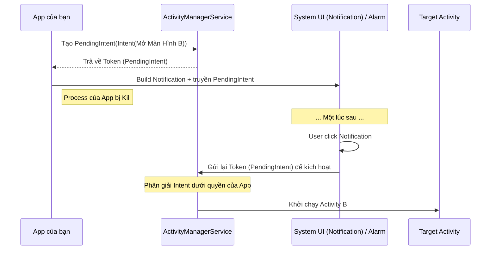

# Pending Intent: Cơ chế Ủy quyền (Delegation)

## Vấn đề cần giải quyết

Khi bạn hiển thị một thông báo (Notification) lên thanh trạng thái của điện thoại, và người dùng bấm vào đó, bạn muốn mở một màn hình trong app của mình.

**Câu hỏi:** Ai là người lắng nghe sự kiện click đó và kích hoạt Intent? Có phải app của bạn không?

**Trả lời:** KHÔNG. Ứng dụng của bạn có thể đã bị hệ thống kill (tắt hoàn toàn) từ đời nào rồi. Thanh thông báo (Status Bar) thuộc quyền quản lý của **System UI** (Một process riêng biệt của Hệ điều hành).

Vậy làm sao một process của OS (System UI) có thể gọi một Intent mở Activity của app bạn, **dưới tư cách và quyền hạn của chính app bạn** (ngay cả khi app đang không chạy)?

Đó là lý do **PendingIntent** ra đời.

## PendingIntent là gì?

**PendingIntent** thực chất là một "tờ giấy ủy quyền".

Bạn đóng gói một Intent bình thường vào trong PendingIntent, sau đó đưa nó cho một ứng dụng khác (thường là System OS). Bạn bảo hệ thống rằng: *"Hãy cầm tờ giấy ủy quyền này. Khi nào sự kiện X xảy ra (user bấm thông báo, hoặc đến đúng 7h sáng), hãy thực thi cái Intent bên trong tờ giấy này. Và quan trọng nhất: Hãy thực thi nó bằng **chính danh tính và quyền (permissions)** của tôi, chứ không phải của anh."*

## Cơ chế hoạt động


<!-- dd: intent-pending -->

### PendingIntent nào là "cùng một" PendingIntent?

Hệ thống không tạo token mới mỗi lần bạn gọi `getActivity()`. Nó coi hai PendingIntent là **một** nếu cùng loại (activity/broadcast/service), cùng **`requestCode`** và hai Intent bên trong bằng nhau theo **`Intent.filterEquals()`** (so action, data, type, identifier, component/class, package, categories). **Extras không được tính.** Vì vậy nhiều thông báo chỉ khác `putExtra("NOTIF_ID", ...)` mà dùng chung `requestCode` sẽ trỏ về **cùng một** PendingIntent; muốn chúng tồn tại song song, hãy cho mỗi cái một `requestCode` riêng (hoặc một `data` URI riêng).

## Khi nào phải dùng PendingIntent?

1. **Notification:** Khi người dùng click vào thông báo (System UI process).
2. **AlarmManager:** Hẹn giờ chạy một tác vụ trong tương lai (ví dụ báo thức). OS sẽ giữ PendingIntent và kích hoạt nó khi đồng hồ điểm.
3. **AppWidget (Home Screen Widget):** Khi người dùng tương tác với widget trên màn hình chính (Launcher process).

## Hướng dẫn triển khai (Ví dụ Notification)

```kotlin
// 1. Tạo Intent bình thường muốn kích hoạt
val notifId = 100 // id riêng của từng thông báo (ví dụ id tin nhắn: 100, 101...)
val intent = Intent(context, NotificationDetailActivity::class.java).apply {
    putExtra("NOTIF_ID", notifId)
    // NEW_TASK | CLEAR_TASK: xoá task hiện có của app rồi mở màn hình này làm gốc task mới
    // (bấm Back sẽ thoát app). Muốn giữ màn hình cha trong back stack thì dùng TaskStackBuilder.
    flags = Intent.FLAG_ACTIVITY_NEW_TASK or Intent.FLAG_ACTIVITY_CLEAR_TASK
}

// 2. Đóng gói vào PendingIntent
// requestCode RIÊNG cho từng thông báo: nếu mọi thông báo dùng chung requestCode = 0
// thì chúng là CÙNG một PendingIntent (extras không được tính), và FLAG_UPDATE_CURRENT
// ghi đè extras → bấm thông báo cũ cũng mở nội dung của thông báo mới nhất.
val pendingIntent: PendingIntent = PendingIntent.getActivity(
    context,
    notifId, // requestCode
    intent,
    PendingIntent.FLAG_IMMUTABLE or PendingIntent.FLAG_UPDATE_CURRENT
)

// 3. Đưa PendingIntent cho System UI qua NotificationCompat
val builder = NotificationCompat.Builder(context, CHANNEL_ID)
    .setSmallIcon(R.drawable.ic_notification)
    .setContentTitle("Tin nhắn mới")
    .setContentText("Bạn có 1 tin nhắn chưa đọc.")
    .setPriority(NotificationCompat.PRIORITY_DEFAULT)
    // Ủy quyền cho System UI kích hoạt pendingIntent khi click
    .setContentIntent(pendingIntent) 
    .setAutoCancel(true)

// 4. Hiện thông báo (Android 13+ cần quyền POST_NOTIFICATIONS đã được cấp, và CHANNEL_ID đã được tạo)
NotificationManagerCompat.from(context).notify(notifId, builder.build())
```

## Bảo mật và Flags (Cực kỳ quan trọng từ Android 12)

Với app **target Android 12 (API 31) trở lên**, Google **BẮT BUỘC** bạn phải khai báo rõ ràng một PendingIntent là **MUTABLE** (có thể bị sửa đổi) hay **IMMUTABLE** (bất biến). Nếu quên, lời gọi tạo PendingIntent ném `IllegalArgumentException` và app crash.

### Tại sao lại quan trọng? (Vấn đề bảo mật)
App nhận PendingIntent **không** lấy được Intent bên trong ra để sửa. Với PendingIntent **mutable**, nó chỉ có thể truyền một Intent bổ sung khi gọi `send()`, và hệ thống gộp vào theo luật `Intent.fillIn()`: chỉ **điền các trường còn trống** (action, data, component, package... chưa được set), còn extras được gộp thêm; trường đã set thì không bị ghi đè, trừ khi chính bạn cho phép bằng cờ `FILL_IN_*` lúc tạo.

Rủi ro thật nằm ở **mutable PendingIntent bọc implicit intent** (chưa set component/package): app nhận có thể điền component/package để chuyển hướng Intent tới component tuỳ ý, chạy dưới danh tính và quyền của app bạn. Vì vậy với app target **Android 14 (API 34)+**, tạo mutable PendingIntent bọc Intent không chỉ định component hoặc package sẽ **ném exception** (trừ khi dùng cờ `FLAG_ALLOW_UNSAFE_IMPLICIT_INTENT`). Cách an toàn: dùng `FLAG_IMMUTABLE`, hoặc nếu bắt buộc mutable thì dùng explicit intent.

### 1. `PendingIntent.FLAG_IMMUTABLE` (Nên dùng 99% các trường hợp)
- **Ý nghĩa:** Intent bên trong bị "đóng băng". Không ai có quyền thêm, bớt, sửa đổi data (`extras`) của nó trước khi nó được kích hoạt.
- **Sử dụng:** Cho Notification mở màn hình bình thường, AlarmManager chạy Service.

### 2. `PendingIntent.FLAG_MUTABLE` (Chỉ dùng khi bắt buộc)
- **Ý nghĩa:** Cho phép app nhận PendingIntent có quyền "nhét thêm" dữ liệu vào trước khi kích hoạt.
- **Ví dụ bắt buộc dùng:** Chức năng **Direct Reply Notification** (Trả lời tin nhắn trực tiếp ngay trên thanh thông báo). System UI cần nhét cái đoạn text người dùng vừa gõ vào Intent của bạn trước khi bắn về app của bạn. Nếu bạn đặt `IMMUTABLE`, System UI không thể nhét text vào được.

### 3. Cờ cập nhật
Thường dùng kèm với IMMUTABLE/MUTABLE:
- `FLAG_UPDATE_CURRENT`: Nếu đã có PendingIntent **cùng danh tính** (cùng `requestCode` + Intent `filterEquals`), hãy giữ nguyên nó nhưng thay `extras` bên trong bằng cái mới nhất. Hợp khi cập nhật **cùng một** thông báo; với nhiều thông báo song song thì mỗi cái phải có `requestCode` riêng, nếu không chúng ghi đè extras của nhau.
- `FLAG_ONE_SHOT`: PendingIntent chỉ dùng được **một lần**, sau đó tự huỷ.
- `FLAG_CANCEL_CURRENT`: Huỷ PendingIntent cũ cùng danh tính rồi tạo cái mới; nơi nào còn giữ token cũ sẽ không gửi được nữa.
- `FLAG_NO_CREATE`: Không tạo mới; chỉ trả về PendingIntent đang tồn tại, hoặc `null` nếu chưa có. Hay dùng để kiểm tra một alarm đã được đặt chưa.

### 4. Các loại PendingIntent
- `PendingIntent.getActivity()`: mở Activity (Notification, Widget).
- `PendingIntent.getBroadcast()`: gửi broadcast tới `BroadcastReceiver` (AlarmManager, nút action trên Notification).
- `PendingIntent.getService()` / `getForegroundService()`: start Service.

## Tổng kết

Nhắc đến PendingIntent, hãy nhớ ngay từ khóa **"Ủy quyền"**. Nó là cầu nối an toàn giúp các tiến trình hệ thống (OS, Launcher) có thể thực thi các hành động giùm ứng dụng của bạn ngay cả khi ứng dụng không còn tồn tại trên RAM. Hãy luôn tuân thủ nguyên tắc bảo mật: Mặc định luôn sử dụng `FLAG_IMMUTABLE` trừ khi có lý do thực sự chính đáng, và cho mỗi PendingIntent cần tồn tại song song một `requestCode` riêng.
