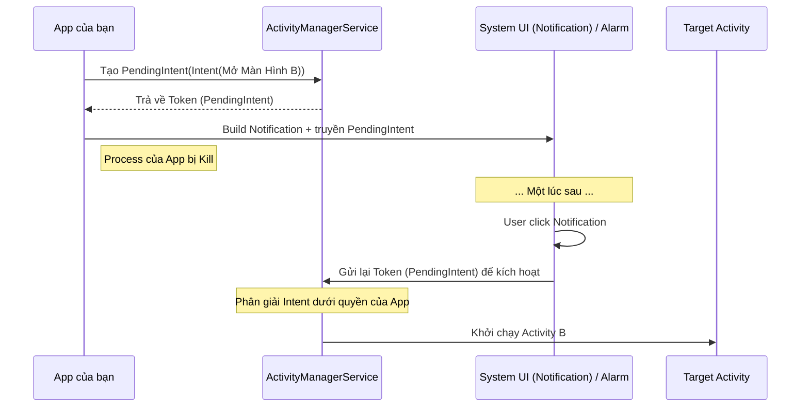
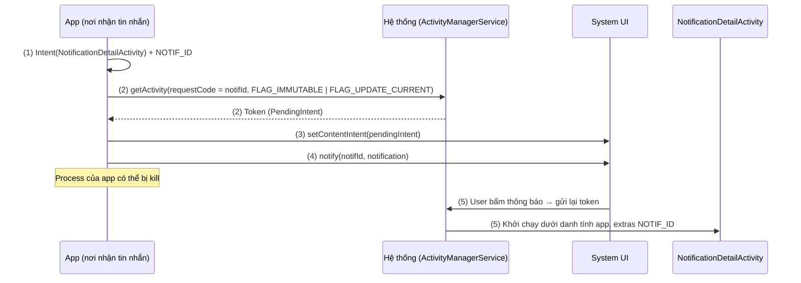

# Pending Intent: Cơ chế Ủy quyền (Delegation)

## Vấn đề cần giải quyết

Khi bạn hiển thị một thông báo (Notification) lên thanh trạng thái của điện thoại, và người dùng bấm vào đó, bạn muốn mở một màn hình trong app của mình.

**Câu hỏi:** Ai là người lắng nghe sự kiện click đó và kích hoạt Intent? Có phải app của bạn không?

**Trả lời:** KHÔNG. Ứng dụng của bạn có thể đã bị hệ thống kill (tắt hoàn toàn) từ đời nào rồi. Thanh thông báo (Status Bar) thuộc quyền quản lý của **System UI** (Một process riêng biệt của Hệ điều hành).

Vậy làm sao một process của OS (System UI) có thể gọi một Intent mở Activity của app bạn, **dưới tư cách và quyền hạn của chính app bạn** (ngay cả khi app đang không chạy)?

Đó là lý do **PendingIntent** ra đời.

## Sau khi học xong

- Giải thích được PendingIntent là gì và vì sao Notification, AlarmManager, AppWidget phải dùng nó.
- Phân biệt được FLAG_IMMUTABLE và FLAG_MUTABLE cùng rủi ro bảo mật của mutable PendingIntent bọc implicit intent.
- Xử lý được việc nhiều PendingIntent ghi đè nhau bằng cách hiểu danh tính PendingIntent (requestCode + Intent.filterEquals).
- Triển khai được PendingIntent mở màn hình chi tiết từ Notification với requestCode riêng cho từng thông báo.

## PendingIntent là gì?

**PendingIntent** là một token do hệ thống giữ, bọc một Intent cùng hành động cần làm với nó (mở Activity, gửi broadcast, start Service), để app khác (thường là tiến trình hệ thống) kích hoạt Intent đó về sau **dưới danh tính và quyền của app tạo ra nó**, kể cả khi process của app đã bị kill.

Mental model: **PendingIntent** thực chất là một "tờ giấy ủy quyền".

Bạn đóng gói một Intent bình thường vào trong PendingIntent, sau đó đưa nó cho một ứng dụng khác (thường là System OS). Bạn bảo hệ thống rằng: *"Hãy cầm tờ giấy ủy quyền này. Khi nào sự kiện X xảy ra (user bấm thông báo, hoặc đến đúng 7h sáng), hãy thực thi cái Intent bên trong tờ giấy này. Và quan trọng nhất: Hãy thực thi nó bằng **chính danh tính và quyền (permissions)** của tôi, chứ không phải của anh."*

Nhắc đến PendingIntent, hãy nhớ ngay từ khóa **"Ủy quyền"**. Nó là cầu nối an toàn giúp các tiến trình hệ thống (OS, Launcher) có thể thực thi các hành động giùm ứng dụng của bạn ngay cả khi ứng dụng không còn tồn tại trên RAM.

## Cách hoạt động

### Tạo, trao và kích hoạt tờ ủy quyền

App tạo PendingIntent qua hệ thống (`ActivityManagerService`) và nhận về một token; token này được trao cho bên giữ hộ (System UI, AlarmManager). Process của app có thể bị kill sau đó mà token vẫn dùng được, vì nó do hệ thống giữ. Khi sự kiện xảy ra, bên giữ hộ gửi token lại cho hệ thống, và hệ thống phân giải Intent bên trong dưới quyền của app để khởi chạy component đích.


<!-- dd: intent-pending -->

### Các loại PendingIntent

Hành động bọc trong tờ ủy quyền được chọn bằng hàm tạo:

- `PendingIntent.getActivity()`: mở Activity (Notification, Widget).
- `PendingIntent.getBroadcast()`: gửi broadcast tới `BroadcastReceiver` (AlarmManager, nút action trên Notification).
- `PendingIntent.getService()` / `getForegroundService()`: start Service.

### PendingIntent nào là "cùng một" PendingIntent?

Hệ thống không tạo token mới mỗi lần bạn gọi `getActivity()`. Nó coi hai PendingIntent là **một** nếu cùng loại (activity/broadcast/service), cùng **`requestCode`** và hai Intent bên trong bằng nhau theo **`Intent.filterEquals()`** (so action, data, type, identifier, component/class, package, categories). **Extras không được tính.** Vì vậy nhiều thông báo chỉ khác `putExtra("NOTIF_ID", ...)` mà dùng chung `requestCode` sẽ trỏ về **cùng một** PendingIntent; muốn chúng tồn tại song song, hãy cho mỗi cái một `requestCode` riêng (hoặc một `data` URI riêng).

### Mutability: FLAG_IMMUTABLE và FLAG_MUTABLE (Cực kỳ quan trọng từ Android 12)

Với app **target Android 12 (API 31) trở lên**, Google **BẮT BUỘC** bạn phải khai báo rõ ràng một PendingIntent là **MUTABLE** (có thể bị sửa đổi) hay **IMMUTABLE** (bất biến). Nếu quên, lời gọi tạo PendingIntent ném `IllegalArgumentException` và app crash.

#### Tại sao lại quan trọng? (Vấn đề bảo mật)

App nhận PendingIntent **không** lấy được Intent bên trong ra để sửa. Với PendingIntent **mutable**, nó chỉ có thể truyền một Intent bổ sung khi gọi `send()`, và hệ thống gộp vào theo luật `Intent.fillIn()`: chỉ **điền các trường còn trống** (action, data, component, package... chưa được set), còn extras được gộp thêm; trường đã set thì không bị ghi đè, trừ khi chính bạn cho phép bằng cờ `FILL_IN_*` lúc tạo.

Rủi ro thật nằm ở **mutable PendingIntent bọc implicit intent** (chưa set component/package): app nhận có thể điền component/package để chuyển hướng Intent tới component tuỳ ý, chạy dưới danh tính và quyền của app bạn. Vì vậy với app target **Android 14 (API 34)+**, tạo mutable PendingIntent bọc Intent không chỉ định component hoặc package sẽ **ném exception** (trừ khi dùng cờ `FLAG_ALLOW_UNSAFE_IMPLICIT_INTENT`). Cách an toàn: dùng `FLAG_IMMUTABLE`, hoặc nếu bắt buộc mutable thì dùng explicit intent.

#### `PendingIntent.FLAG_IMMUTABLE` (Nên dùng 99% các trường hợp)

- **Ý nghĩa:** Intent bên trong bị "đóng băng". App giữ PendingIntent (bên gọi `send()`) không thể thêm, bớt, sửa đổi data (`extras`) của nó trước khi nó được kích hoạt; chỉ app tạo ra nó vẫn cập nhật được bằng `FLAG_UPDATE_CURRENT`.
- **Sử dụng:** Cho Notification mở màn hình bình thường, AlarmManager chạy Service.

#### `PendingIntent.FLAG_MUTABLE` (Chỉ dùng khi bắt buộc)

- **Ý nghĩa:** Cho phép app nhận PendingIntent có quyền "nhét thêm" dữ liệu vào trước khi kích hoạt.
- **Ví dụ bắt buộc dùng:** Chức năng **Direct Reply Notification** (Trả lời tin nhắn trực tiếp ngay trên thanh thông báo). System UI cần nhét cái đoạn text người dùng vừa gõ vào Intent của bạn trước khi bắn về app của bạn. Nếu bạn đặt `IMMUTABLE`, System UI không thể nhét text vào được.

### Cờ cập nhật

Thường dùng kèm với IMMUTABLE/MUTABLE:

- `FLAG_UPDATE_CURRENT`: Nếu đã có PendingIntent **cùng danh tính** (cùng `requestCode` + Intent `filterEquals`), hãy giữ nguyên nó nhưng thay `extras` bên trong bằng cái mới nhất. Hợp khi cập nhật **cùng một** thông báo; với nhiều thông báo song song thì mỗi cái phải có `requestCode` riêng, nếu không chúng ghi đè extras của nhau.
- `FLAG_ONE_SHOT`: PendingIntent chỉ dùng được **một lần**, sau đó tự huỷ.
- `FLAG_CANCEL_CURRENT`: Huỷ PendingIntent cũ cùng danh tính rồi tạo cái mới; nơi nào còn giữ token cũ sẽ không gửi được nữa.
- `FLAG_NO_CREATE`: Không tạo mới; chỉ trả về PendingIntent đang tồn tại, hoặc `null` nếu chưa có. Hay dùng để kiểm tra một alarm đã được đặt chưa.

## Ví dụ thực tế

### Mở màn hình chi tiết từ thông báo tin nhắn

Mỗi tin nhắn mới hiện một thông báo riêng; bấm vào thông báo nào thì mở đúng nội dung của thông báo đó, kể cả khi app đã bị kill. Luồng chạy:

1. Tạo Intent explicit tới `NotificationDetailActivity`, mang `NOTIF_ID` trong extras; cờ `NEW_TASK | CLEAR_TASK` cho màn hình này làm gốc task mới.
2. Đóng gói Intent vào PendingIntent bằng `getActivity()`, với `requestCode` riêng cho từng thông báo và `FLAG_IMMUTABLE | FLAG_UPDATE_CURRENT`; hệ thống trả về token.
3. Đưa PendingIntent cho System UI qua `setContentIntent()` của `NotificationCompat.Builder`.
4. Hiện thông báo bằng `NotificationManagerCompat.notify()`.
5. User bấm thông báo: System UI gửi token lại cho hệ thống, hệ thống khởi chạy `NotificationDetailActivity` dưới danh tính app; Activity đọc `NOTIF_ID` từ extras (cách đọc ở [Handle Intent](handle_intent.md)).



```kotlin
// (1) Tạo Intent bình thường muốn kích hoạt
val notifId = 100 // id riêng của từng thông báo (ví dụ id tin nhắn: 100, 101...)
val intent = Intent(context, NotificationDetailActivity::class.java).apply {
    putExtra("NOTIF_ID", notifId)
    // NEW_TASK | CLEAR_TASK: xoá task hiện có của app rồi mở màn hình này làm gốc task mới
    // (bấm Back sẽ thoát app). Muốn giữ màn hình cha trong back stack thì dùng TaskStackBuilder.
    flags = Intent.FLAG_ACTIVITY_NEW_TASK or Intent.FLAG_ACTIVITY_CLEAR_TASK
}

// (2) Đóng gói vào PendingIntent
// requestCode RIÊNG cho từng thông báo: nếu mọi thông báo dùng chung requestCode = 0
// thì chúng là CÙNG một PendingIntent (extras không được tính), và FLAG_UPDATE_CURRENT
// ghi đè extras → bấm thông báo cũ cũng mở nội dung của thông báo mới nhất.
val pendingIntent: PendingIntent = PendingIntent.getActivity(
    context,
    notifId, // requestCode
    intent,
    PendingIntent.FLAG_IMMUTABLE or PendingIntent.FLAG_UPDATE_CURRENT
)

// (3) Đưa PendingIntent cho System UI qua NotificationCompat
val builder = NotificationCompat.Builder(context, CHANNEL_ID)
    .setSmallIcon(R.drawable.ic_notification)
    .setContentTitle("Tin nhắn mới")
    .setContentText("Bạn có 1 tin nhắn chưa đọc.")
    .setPriority(NotificationCompat.PRIORITY_DEFAULT)
    // Ủy quyền cho System UI kích hoạt pendingIntent khi click
    .setContentIntent(pendingIntent) 
    .setAutoCancel(true)

// (4) Hiện thông báo (Android 13+ cần quyền POST_NOTIFICATIONS đã được cấp, và CHANNEL_ID đã được tạo)
NotificationManagerCompat.from(context).notify(notifId, builder.build())
```

**Kết quả:** với hai tin nhắn 100 và 101, bấm thông báo nào cũng mở đúng `NOTIF_ID` của thông báo đó; nếu đổi `requestCode` về chung một giá trị, bấm thông báo cũ sẽ mở nội dung của thông báo mới nhất.

### Các bài toán khác

- **Hẹn giờ bằng AlarmManager:** OS giữ PendingIntent (thường tạo bằng `getBroadcast()`, cờ `FLAG_IMMUTABLE`) và kích hoạt nó khi đồng hồ điểm; muốn biết alarm đã được đặt chưa thì gọi lại hàm tạo với `FLAG_NO_CREATE` và kiểm tra `null`.
- **Direct Reply trên thông báo:** PendingIntent phải là `FLAG_MUTABLE` để System UI nhét text người dùng gõ vào Intent, và Intent bên trong phải là explicit intent (xem mục "Mutability: FLAG_IMMUTABLE và FLAG_MUTABLE").

## Khi nào nên và không nên dùng

Phải dùng PendingIntent khi một process khác thay app kích hoạt Intent:

1. **Notification:** Khi người dùng click vào thông báo (System UI process).
2. **AlarmManager:** Hẹn giờ chạy một tác vụ trong tương lai (ví dụ báo thức). OS sẽ giữ PendingIntent và kích hoạt nó khi đồng hồ điểm.
3. **AppWidget (Home Screen Widget):** Khi người dùng tương tác với widget trên màn hình chính (Launcher process).

Không cần PendingIntent khi chính app đang chạy và tự kích hoạt Intent ngay (`startActivity`, `sendBroadcast`): khi đó không có bên nào cần được ủy quyền.

Hãy luôn tuân thủ nguyên tắc bảo mật: Mặc định luôn sử dụng `FLAG_IMMUTABLE` trừ khi có lý do thực sự chính đáng, và cho mỗi PendingIntent cần tồn tại song song một `requestCode` riêng.

## Sai lầm thường gặp

### 1. Không khai báo mutability khi target Android 12+

Tạo PendingIntent chỉ với `FLAG_UPDATE_CURRENT` (không có `FLAG_IMMUTABLE` hay `FLAG_MUTABLE`) trong app target API 31+ thì lời gọi tạo ném `IllegalArgumentException` và app crash.

**Cách sửa:** luôn kết hợp một cờ mutability, mặc định `FLAG_IMMUTABLE` (xem mục "Mutability: FLAG_IMMUTABLE và FLAG_MUTABLE").

### 2. Nhiều thông báo dùng chung `requestCode`, chỉ khác extras

Extras không thuộc danh tính PendingIntent, nên các thông báo này trỏ về cùng một PendingIntent; với `FLAG_UPDATE_CURRENT`, extras bị ghi đè và bấm thông báo cũ cũng mở nội dung của thông báo mới nhất.

**Cách sửa:** cho mỗi thông báo một `requestCode` riêng (hoặc một `data` URI riêng), như ví dụ ở mục "Ví dụ thực tế".

### 3. Mutable PendingIntent bọc implicit intent

App nhận có thể điền component/package để chuyển hướng Intent tới component tuỳ ý, chạy dưới danh tính và quyền của app bạn. Với app target Android 14+, lời gọi tạo ném exception.

**Cách sửa:** dùng `FLAG_IMMUTABLE`; nếu bắt buộc mutable thì dùng explicit intent. Không dùng `FLAG_ALLOW_UNSAFE_IMPLICIT_INTENT` để lách kiểm tra.

### 4. Đặt `FLAG_IMMUTABLE` cho Direct Reply

System UI không thể nhét text người dùng vừa gõ vào Intent, nên app không nhận được câu trả lời.

**Cách sửa:** chỉ trường hợp cần bên giữ hộ điền dữ liệu như Direct Reply mới dùng `FLAG_MUTABLE`, kèm explicit intent.

## Lịch sử phát triển

- **API 1 (Android 1.0):** `PendingIntent` cùng `getActivity()`, `getBroadcast()`, `getService()` và các cờ `FLAG_ONE_SHOT`, `FLAG_NO_CREATE`, `FLAG_CANCEL_CURRENT` có từ API level đầu tiên.
- **API 3 (Android 1.5):** thêm `FLAG_UPDATE_CURRENT`.
- **Android 6.0 (API 23):** thêm `FLAG_IMMUTABLE`.
- **Android 8.0 (API 26):** thêm `getForegroundService()`.
- **Android 12 (API 31):** thêm `FLAG_MUTABLE`. Trước đó PendingIntent mặc định là mutable nếu không set `FLAG_IMMUTABLE`; app target API 31+ phải chỉ định rõ một trong hai cờ, thiếu thì ném `IllegalArgumentException`.
- **Android 14 (API 34):** app target API 34+ tạo mutable PendingIntent bọc implicit intent sẽ ném `IllegalArgumentException`; thêm `FLAG_ALLOW_UNSAFE_IMPLICIT_INTENT` để bỏ qua kiểm tra này (docs khuyên không dùng).

## Kết nối hệ thống

- **Tiên quyết:** [Explicit Intents](explicit_intents.md) và [Implicit Intents](implicit_intents.md): rủi ro bảo mật của PendingIntent phụ thuộc Intent bên trong là explicit hay implicit.
- **Liên quan:**
  - [Handle Intent](handle_intent.md): Activity đích đọc extras của Intent được PendingIntent kích hoạt.
  - [Push data and send event via Intent](push_data_event.md): đặt dữ liệu vào extras của Intent trước khi bọc vào PendingIntent.
  - [Broadcast Receiver](../components/broadcast/broadcast_receiver.md): nơi nhận PendingIntent tạo bằng `getBroadcast()` (AlarmManager, nút action trên Notification).
  - [Android Service](../components/services/android_service.md): PendingIntent tạo bằng `getService()` cho nút điều khiển trên thông báo của foreground service.
  - [Task and Backstack](../components/activity/task_and_backstack.md), mục "Bước 1: Notification mở Activity với đúng Back Stack": dùng `TaskStackBuilder` để thông báo mở màn hình mà vẫn giữ màn hình cha trong back stack.
- **Học tiếp:** [8.5.5 Message (Toast, Snackbar, Notification)](../../session_08/view_layout/message.md).

## Nguồn tham khảo

- [PendingIntent (API level của các hàm và cờ, danh tính PendingIntent) — Android Developers Reference](https://developer.android.com/reference/android/app/PendingIntent)
- [Intents and intent filters: Using a pending intent, Specify mutability — Android Developers](https://developer.android.com/guide/components/intents-filters)
- [Intent (filterEquals, fillIn) — Android Developers Reference](https://developer.android.com/reference/android/content/Intent)
- [Behavior changes: Android 12 (Pending intents mutability) — Android Developers](https://developer.android.com/about/versions/12/behavior-changes-12)
- [Behavior changes: Android 14 (Restrictions to implicit and pending intents) — Android Developers](https://developer.android.com/about/versions/14/behavior-changes-14)
