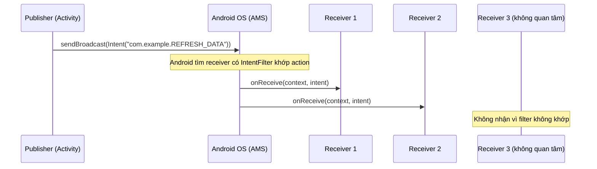
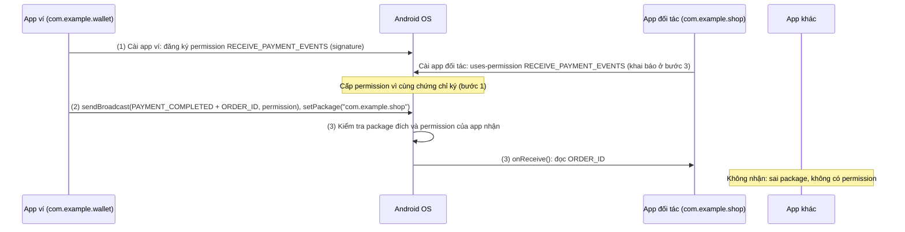

# Truyền dữ liệu và gửi sự kiện qua Intent

## Vấn đề cần giải quyết

Intent trong Android làm hai nhiệm vụ quan trọng:

1. **Push Data** — Chở dữ liệu từ Component A (Activity/Fragment/Service) sang Component B.
2. **Send Event** — Gửi tín hiệu báo "một sự kiện đã xảy ra" đến các Component quan tâm, để chúng phản ứng.

Hai nhiệm vụ này có bản chất khác nhau:

- **Push Data** hướng tới một đối tượng cụ thể (`startActivity`, `startService`). Bạn biết *ai* sẽ nhận.
- **Send Event** hướng tới một nhóm không xác định (broadcast). Bạn gửi đi một tín hiệu, và bất kỳ ai đang lắng nghe kênh đó đều nhận được. Sender không cần biết *ai* sẽ nhận.

Nếu bạn nhầm lẫn hai mục đích này, bạn sẽ viết code đúng cú pháp nhưng sai về thiết kế: dùng `startActivity` để "gửi sự kiện" cho cả hệ thống, hoặc dùng broadcast để "chở một object lớn" từ màn hình này sang màn hình kia.

## Sau khi học xong

- Phân biệt được Push Data (điểm-điểm qua Bundle) với Send Event (một-nhiều qua Broadcast Intent).
- Triển khai được việc truyền primitive và object @Parcelize qua Intent extras.
- Biết khi nào chỉ truyền ID qua extras thay vì cả object, để tránh TransactionTooLargeException.
- Triển khai được sendBroadcast an toàn (explicit broadcast bằng setPackage, broadcast có permission, không chở dữ liệu nhạy cảm).
- Biết khi nào dùng Flow/SharedFlow thay cho broadcast để giao tiếp trong cùng app.

## Truyền dữ liệu và gửi sự kiện qua Intent là gì?

**Truyền dữ liệu (Push Data)** và **gửi sự kiện (Send Event)** qua Intent là hai cách dùng Intent làm phương tiện giao tiếp giữa các Component: Push Data đặt dữ liệu vào Bundle extras của một Intent gửi **điểm-điểm** tới một component xác định (`startActivity`, `startService`); Send Event phát một **Broadcast Intent** mang action báo "sự kiện X đã xảy ra" tới **mọi** receiver đang lắng nghe action đó (một-nhiều).

Mental model: Push Data là **gửi bưu kiện ghi rõ người nhận**: dữ liệu nằm trong kiện hàng (Bundle), chỉ đúng một địa chỉ nhận. Send Event là **phát loa trên một kênh**: người phát không biết ai nghe, ai đang dò đúng kênh (IntentFilter khớp action) thì nhận được thông báo. Loa không dùng để chở hàng nặng, và nội dung phát loa thì ai trên kênh cũng nghe được.

## Cách hoạt động

### 1. Push Data — Truyền dữ liệu qua Bundle

#### 1.1 Bản chất: Intent + Bundle

Dữ liệu gửi qua Intent không nằm trực tiếp trên Intent. Nó được chứa trong một đối tượng **Bundle**, một container key-value mà Intent mang theo. Bundle là bản sao được serialize để đi qua Binder IPC sang component đích; bản chất này được giải thích ở [Parcelables and Bundle](../components/activity/parcelables_and_bundle.md), mục "Bundle và Parcelable là gì?".

Khi bạn gọi `intent.putExtra(key, value)`, Intent sẽ tự động đẩy cặp key-value này vào Bundle bên trong nó:

```kotlin
val intent = Intent(context, ProductDetailActivity::class.java)
intent.putExtra("PRODUCT_ID", 101)     // → Bundle: { "PRODUCT_ID" : 101 }
intent.putExtra("PRODUCT_NAME", "MacBook Pro")  // → Bundle: { ..., "PRODUCT_NAME" : "MacBook Pro" }
startActivity(intent)
```

Ở phía nhận, màn hình B lấy dữ liệu ra bằng `getIntExtra(key, defaultValue)`, `getStringExtra(key)`, v.v.

#### 1.2 Truyền Primitive Types

Int, Long, Float, Boolean, String, Char, Double... được hệ thống hỗ trợ mặc định, không cần bất kỳ khai báo nào:

```kotlin
// Sender — Activity A
val intent = Intent(this, ProductDetailActivity::class.java).apply {
    putExtra("PRODUCT_ID", 101)
    putExtra("PRODUCT_NAME", "MacBook Pro")
    putExtra("PRICE", 4299.99)
    putExtra("IS_DISCOUNTED", true)
}
startActivity(intent)
```

```kotlin
// Receiver — Activity B
val id = intent.getIntExtra("PRODUCT_ID", -1)        // -1 nếu không tìm thấy
val name = intent.getStringExtra("PRODUCT_NAME")      // null nếu không tìm thấy
val price = intent.getDoubleExtra("PRICE", 0.0)
val isDiscounted = intent.getBooleanExtra("IS_DISCOUNTED", false)
```

**Best Practice:** Khi truyền giá trị cần giá trị mặc định an toàn (ví dụ `-1`, `null`, `0`) để tránh crash khi key không tồn tại hoặc Intent rỗng.

#### 1.3 Truyền Object qua extras

Object muốn đặt vào extras phải serialize được: implement `Parcelable` (chuẩn trên Android, viết gọn bằng `@Parcelize` của plugin `kotlin-parcelize`) hoặc `Serializable` (chậm hơn, không khuyên dùng để truyền giữa component). Vì sao phải serialize, so sánh Parcelable với Serializable và cách viết `@Parcelize` ở [Parcelables and Bundle](../components/activity/parcelables_and_bundle.md), mục "Parcelable: object tự đóng gói vào Parcel" và "Parcelable vs Serializable".

Ở góc độ Intent, việc đặt và lấy object chỉ gồm hai bước:

```kotlin
// Sender — Activity A: Product là @Parcelize data class
val intent = Intent(context, ProductDetailActivity::class.java).apply {
    putExtra("EXTRA_PRODUCT", product)
}
startActivity(intent)
```

```kotlin
// Receiver — Activity B: lấy đúng giao thức đã gửi (Parcelable)
// IntentCompat tự chọn API đúng theo phiên bản (API 33+ cần truyền Class)
val product = IntentCompat.getParcelableExtra(intent, "EXTRA_PRODUCT", Product::class.java)
```

#### 1.4 Chỉ đặt dữ liệu nhỏ vào extras

Extras đi qua Binder transaction buffer, vùng đệm khoảng 1MB dùng chung cho mọi transaction đang chạy của process; vượt ngưỡng thì hệ thống ném `TransactionTooLargeException`. Vì vậy chỉ truyền ID, flag hoặc object nhỏ (docs khuyến nghị vài KB), còn màn hình đích tự load dữ liệu đầy đủ từ Repository/Room. Ba con số giới hạn và bảng cách fix ở [Parcelables and Bundle](../components/activity/parcelables_and_bundle.md), mục "Giới hạn kích thước — Binder Transaction Buffer".

### 2. Send Event — Gửi sự kiện qua Broadcast Intent

#### 2.1 Bản chất: Mô hình Pub/Sub

**Send Event via Intent** nghĩa là gửi một **Broadcast Intent** — tín hiệu báo "sự kiện X đã xảy ra" — để tất cả các Component đang lắng nghe hành động đó (action) được thông báo và phản ứng.

Đây là mô hình **Publish/Subscribe (Pub/Sub)**:

- **Publisher** gọi `sendBroadcast(intent)` — không biết ai sẽ nhận, không đợi phản hồi.
- **Subscriber** đăng ký lắng nghe qua `BroadcastReceiver` với một `IntentFilter` chứa action cụ thể.


<!-- dd: intent-fanout -->

> [!NOTE]
> **Phân biệt với Push Data:** Push Data dùng `startActivity`/`startService` (điểm-điểm, một receiver duy nhất). Send Event dùng `sendBroadcast` (một-nhiều, mọi receiver đăng ký đều nhận).

#### 2.2 Triển khai: sendBroadcast + BroadcastReceiver

*Sender — phát sự kiện:*

```kotlin
// Định nghĩa action (đặt trong companion object để tái sử dụng)
const val ACTION_REFRESH_DATA = "com.example.ACTION_REFRESH_DATA"

// Phát sự kiện (có thể kèm data)
val intent = Intent(ACTION_REFRESH_DATA).apply {
    setPackage(packageName)      // Chỉ gửi trong app (explicit to app) — chống lộ ra ngoài
    putExtra("SOURCE", "MainActivity")
}
context.sendBroadcast(intent)
```

*Receiver — lắng nghe sự kiện:*

```kotlin
class DataReceiver : BroadcastReceiver() {
    override fun onReceive(context: Context, intent: Intent) {
        if (intent.action != ACTION_REFRESH_DATA) return
        val source = intent.getStringExtra("SOURCE")
        // Phản ứng với sự kiện: reload data, cập nhật UI...
    }
}
```

Receiver chỉ nhận được sự kiện khi đã được đăng ký: động trong code bằng `ContextCompat.registerReceiver()` (action tự định nghĩa thì truyền `RECEIVER_NOT_EXPORTED`, và `unregisterReceiver()` ở lifecycle đối ứng) hoặc tĩnh trong Manifest. Cách đăng ký, cờ export của Android 14 và giới hạn của receiver tĩnh ở [Broadcast Receiver](../components/broadcast/broadcast_receiver.md), mục "Static Receiver vs Dynamic Receiver".

#### 2.3 Explicit Broadcast vs Implicit Broadcast

| Tiêu chí | Implicit Broadcast | Explicit Broadcast |
|---|---|---|
| Cách khai báo | Chỉ định `action` | Chỉ định `action` + `setPackage()`/ComponentName |
| Ai nhận được | Bất kỳ app nào đăng ký action | Chỉ app có package (hoặc component) đã chỉ định, thường là chính app của bạn |
| Static receiver (Android 8+) | **Bị chặn** | Vẫn hoạt động |
| Dùng khi | Sự kiện hệ thống (BOOT_COMPLETED, CONNECTIVITY) | Sự kiện nội bộ app |
| Rủi ro bảo mật | Cao — app khác có thể nhận | Thấp |

> [!WARNING]
> Từ Android 8.0 (API 26), receiver khai báo trong Manifest của app target API 26+ không nhận được hầu hết implicit broadcast. Vì vậy sự kiện gửi cho receiver tĩnh phải là **explicit broadcast** (`setPackage()` hoặc ComponentName). Danh sách broadcast được miễn và các lựa chọn phía nhận ở [Broadcast Receiver](../components/broadcast/broadcast_receiver.md), mục "Giới hạn của Android 8+ (API 26) — Implicit Broadcast Restrictions".

#### 2.4 Ordered Broadcast — Gửi sự kiện theo thứ tự

Khi bạn cần các receiver xử lý lần lượt (receiver trước có thể truyền kết quả cho receiver sau hoặc chặn sự kiện), gửi bằng `sendOrderedBroadcast()` thay cho `sendBroadcast()`:

```kotlin
context.sendOrderedBroadcast(intent, null)  // null = không yêu cầu permission phía nhận
```

Thứ tự nhận theo `android:priority`, cách receiver đọc/ghi kết quả và `abortBroadcast()` ở [Broadcast Receiver](../components/broadcast/broadcast_receiver.md), mục "Normal broadcast và Ordered broadcast".

#### 2.5 Gửi broadcast có permission

`setPackage()` giới hạn broadcast theo **package**. Khi sự kiện cần tới nhiều app nhưng chỉ những app được tin cậy, bên gửi truyền thêm một permission: `sendBroadcast(intent, receiverPermission)`. Chỉ receiver thuộc app đã khai báo `<uses-permission>` cho permission đó mới nhận được; nếu là dangerous permission thì app nhận còn phải được người dùng cấp.

Ví dụ đầy đủ (permission mức `signature` giữa hai app cùng công ty) ở mục "Ví dụ thực tế" bên dưới.

#### 2.6 Khi cần nhận lại kết quả: Activity Result API

Nếu "gửi sự kiện" thực chất là mở một màn hình rồi chờ kết quả (chọn ảnh, nhập địa chỉ), đó không phải broadcast mà là **Activity Result API**: đăng ký launcher bằng `registerForActivityResult()` với một contract, gọi `launch()`, kết quả về qua callback. Chi tiết ở [Handle Intent](handle_intent.md), mục "Nhận kết quả trả về (Activity Result API)".

## Ví dụ thực tế

### App ví báo "thanh toán xong" cho app đối tác cùng công ty

App ví cần báo sự kiện thanh toán thành công cho app bán hàng của cùng công ty, nhưng không app nào khác được nghe sự kiện này. Đây là Send Event cross-app có giới hạn người nhận bằng permission (mục 2.5). Luồng chạy:

1. App ví định nghĩa một permission mức `signature`: chỉ app ký cùng chứng chỉ mới được cấp.
2. App ví gửi broadcast kèm permission đó, và `setPackage()` tới app đối tác để broadcast là explicit (receiver tĩnh của app đối tác vẫn nhận được trên Android 8+).
3. App đối tác khai báo `<uses-permission>`; hệ thống chỉ giao broadcast cho receiver của app đã được cấp permission.



```xml
<!-- (1) Manifest của app ví -->
<permission
    android:name="com.example.wallet.permission.RECEIVE_PAYMENT_EVENTS"
    android:protectionLevel="signature" />
```

```kotlin
// (2) App ví gửi sự kiện: chỉ kèm ID, không kèm token hay dữ liệu thẻ
const val ACTION_PAYMENT_COMPLETED = "com.example.wallet.action.PAYMENT_COMPLETED"

val intent = Intent(ACTION_PAYMENT_COMPLETED).apply {
    setPackage("com.example.shop")
    putExtra("ORDER_ID", orderId)
}
context.sendBroadcast(intent, "com.example.wallet.permission.RECEIVE_PAYMENT_EVENTS")
```

```xml
<!-- (3) Manifest của app đối tác -->
<uses-permission android:name="com.example.wallet.permission.RECEIVE_PAYMENT_EVENTS" />
```

**Kết quả:** chỉ receiver của app đối tác (cùng chứng chỉ ký, đã khai báo `<uses-permission>`) nhận được `ORDER_ID`; app khác đăng ký cùng action không nhận được sự kiện.

> [!NOTE]
> Permission tự định nghĩa được đăng ký lúc cài app định nghĩa nó, nên app định nghĩa (app ví) phải được cài **trước** app dùng permission đó. Cách khai báo `<permission>` và các `protectionLevel` ở [Manifest Tags](../android_manifest/tags.md), mục "<permission> — tự định nghĩa quyền". Chiều ngược lại, receiver giới hạn **ai được gửi** vào nó bằng `android:permission` trên `<receiver>` (xem [Broadcast Receiver](../components/broadcast/broadcast_receiver.md), mục "Permission — Hạn chế ai được gửi broadcast đến receiver của bạn").

### Các bài toán khác

- **Mở màn hình chi tiết sản phẩm từ danh sách (Push Data):** chỉ đặt `PRODUCT_ID` vào extras (mục 1.2), màn hình đích tự load dữ liệu đầy đủ từ Repository/Room (mục 1.4). Code đầy đủ ở [Parcelables and Bundle](../components/activity/parcelables_and_bundle.md), mục "Mở màn hình chi tiết sản phẩm từ danh sách".
- **Báo các màn hình trong cùng app tải lại dữ liệu:** đây là giao tiếp trong cùng process, nên dùng `SharedFlow` thay cho broadcast (xem mục "Khi nào nên và không nên dùng").

## Khi nào nên và không nên dùng

| Nhu cầu | Giải pháp | Ghi chú |
|---|---|---|
| Chuyển màn hình, mang theo vài ID/flag | `startActivity` + `putExtra` (primitive) | Nhanh, đơn giản |
| Chuyển màn hình, mang theo object | `@Parcelize` + `putExtra` (Parcelable) | Chuẩn, hiệu năng tốt |
| Gửi sự kiện cho 1 Component cụ thể (biết rõ ai) | Explicit Intent (startActivity/startService) | Điểm-điểm |
| Gửi sự kiện cho nhiều Component (không biết ai) | `sendBroadcast` + Dynamic Receiver | Pub/Sub |
| Cần nhận kết quả trả về | Activity Result API | Contract-based |
| Giao tiếp nội bộ type-safe, reactive | **Flow / SharedFlow / LiveData** (không qua Intent) | Khuyến nghị hiện đại |

> [!TIP]
> **Quy tắc vàng:** Đừng dùng Broadcast Intent để giao tiếp giữa các thành phần *trong cùng một app và cùng một process*. `LocalBroadcastManager` đã deprecated; thay bằng `SharedFlow` như ở [Broadcast Receiver](../components/broadcast/broadcast_receiver.md), mục "LocalBroadcastManager — Deprecated và thay thế". Broadcast chỉ nên dùng cho **sự kiện hệ thống** hoặc **giao tiếp cross-app**.

Hãy nhớ sự khác biệt cốt lõi:

- **Push Data:** `startActivity` + `putExtra` (Bundle). Dữ liệu nhỏ, primitive hoặc `@Parcelize`. Không chở quá 1MB.
- **Send Event:** `sendBroadcast` + `BroadcastReceiver`. Tín hiệu một-nhiều. Giới hạn người nhận bằng `setPackage` hoặc permission, không nhét dữ liệu nhạy cảm.
- Nếu giao tiếp trong cùng process và cần type-safe → **Flow/SharedFlow** thay vì broadcast.

Luôn ưu tiên giải pháp đơn giản nhất: primitive types hoặc ID qua Intent, Parcelable khi buộc phải truyền object, và không bao giờ dùng Intent để chở dữ liệu lớn.

## Sai lầm thường gặp

### 1. Quên `setPackage()` khi gửi broadcast nội bộ

```kotlin
// ❌ App khác cũng có thể lắng nghe action này
context.sendBroadcast(Intent(ACTION_REFRESH_DATA))

// ✅ Chỉ app của mình nhận
context.sendBroadcast(Intent(ACTION_REFRESH_DATA).apply { setPackage(packageName) })
```

**Cách sửa:** broadcast nội bộ luôn `setPackage(packageName)` để thành explicit broadcast (mục 2.3).

### 2. Dùng broadcast để chở object/dữ liệu lớn

```kotlin
// ❌ Tốn kém + không type-safe + có thể crash
context.sendBroadcast(Intent(ACTION_UPDATE).apply {
    putExtra("BIG_LIST", hugeList)   // Vượt 1MB → TransactionTooLargeException
})
```

**Cách sửa:** broadcast chỉ báo hiệu sự kiện, kèm ID nếu cần; bên nhận tự load dữ liệu đầy đủ từ Repository/Room (mục 1.4).

### 3. Quên `unregisterReceiver` ở phía nhận

Receiver đăng ký động mà không huỷ ở lifecycle đối ứng sẽ giữ Context và gây memory leak. Cách đăng ký/huỷ đúng cặp lifecycle ở [Broadcast Receiver](../components/broadcast/broadcast_receiver.md), mục "Ví dụ: Đăng ký và hủy đăng ký đúng cách".

### 4. Đọc extras sai giao thức

Sender đặt `Parcelable` nhưng receiver đọc bằng `getSerializableExtra` (hoặc ngược lại) thì nhận về `null` kèm cảnh báo trong logcat, không crash. Hai bên phải dùng cùng giao thức, xem [Parcelables and Bundle](../components/activity/parcelables_and_bundle.md), mục "7. Đọc extra bằng sai giao thức".

### 5. Đặt dữ liệu nhạy cảm trong broadcast

```kotlin
// ❌ Token/SECRET bị app khác intercept (nếu implicit)
context.sendBroadcast(Intent(ACTION_LOGIN).apply {
    putExtra("token", jwtToken)
})
// ✅ Chỉ báo hiệu sự kiện; giới hạn người nhận bằng setPackage hoặc permission (mục 2.5),
// dữ liệu nhạy cảm lấy qua kênh an toàn
```

## Lịch sử phát triển

- **API 1 (Android 1.0):** Intent extras (`putExtra`, kể cả `Parcelable`), `sendBroadcast(Intent)`, `sendBroadcast(Intent, receiverPermission)` và `sendOrderedBroadcast(Intent, receiverPermission)` có từ API level đầu tiên.
- **API 4 (Android 1.6):** thêm `Intent.setPackage()`, cách giới hạn Intent về một package dùng cho explicit broadcast trong bài.
- **Android 8.0 (API 26):** app target API 26+ không đăng ký được receiver trong Manifest cho implicit broadcast (trừ danh sách được miễn); explicit broadcast và broadcast yêu cầu signature permission vẫn tới được receiver tĩnh.
- **12/2018 (LocalBroadcastManager 1.1.0-alpha01):** `LocalBroadcastManager` bắt đầu bị deprecated; bản 1.1.0 (01/2022) deprecated hoàn toàn, docs khuyên thay bằng LiveData hoặc reactive stream.
- **Android 13 (API 33):** thêm overload type-safe `getParcelableExtra(String, Class)` / `getSerializableExtra(String, Class)` ở phía nhận, và cờ `RECEIVER_NOT_EXPORTED` cho receiver đăng ký động.
- **Android 14 (API 34):** app target API 34+ đăng ký receiver động phải chỉ định `RECEIVER_EXPORTED` hoặc `RECEIVER_NOT_EXPORTED` (trừ receiver chỉ nhận system broadcast).

## Kết nối hệ thống

> [!NOTE]
> **Vị trí trong Knowledge Graph:** Topic này nằm giữa **4.2.6.4 Handle Intent** (đọc dữ liệu + nhận kết quả) và **4.2.6.6 Pending Intent** (ủy quyền kích hoạt). Phần Send Event liên quan trực tiếp đến **Broadcast Receiver** (4.2.4.1).

```text
UiEvent (navigate, show snackbar)  →  SharedFlow   (trong app)
        ↕
Intent Push Data                    →  startActivity + Bundle (điểm-điểm)
        ↕
Intent Send Event                   →  sendBroadcast  (một-nhiều)
        ↕
PendingIntent                       →  4.2.6.6 (ủy quyền cho OS/Notification kích hoạt)
        ↕
System Event (BOOT_COMPLETED...)    →  Broadcast Receiver  (4.2.4.1)
```
<!-- dd: intent-taxonomy -->

- **Push Data** là cơ chế vận chuyển dữ liệu điểm-điểm (Intent + Bundle).
- **Send Event** là cơ chế thông báo sự kiện một-nhiều (Broadcast Intent).
- Khi cần bên thứ ba (OS, System UI, Launcher) thay bạn kích hoạt Intent trong tương lai → **PendingIntent**.

Các Topic:

- **Tiên quyết:** [Explicit Intents](explicit_intents.md) (Intent điểm-điểm mà Push Data dùng) và [Handle Intent](handle_intent.md) (phía nhận đọc extras và nhận kết quả).
- **Liên quan:**
  - [Parcelables and Bundle](../components/activity/parcelables_and_bundle.md): Bundle, Parcelable và giới hạn kích thước extras.
  - [Broadcast Receiver](../components/broadcast/broadcast_receiver.md): phía nhận broadcast (đăng ký, export, giới hạn Android 8+, ordered broadcast).
  - [Manifest Tags](../android_manifest/tags.md): khai báo `<permission>` và `<uses-permission>` cho broadcast có permission.
- **Học tiếp:** [Pending Intent](pending_intent.md): khi Intent không do app gửi ngay mà được ủy quyền cho OS/System UI kích hoạt về sau. Thay broadcast nội bộ bằng `SharedFlow` ở 7.1.4.2 Flow (chưa có bài).

## Nguồn tham khảo

- Android Developers — [Intent](https://developer.android.com/guide/components/intents-filters)
- Android Developers — [Pass data between screens](https://developer.android.com/training/basics/intents/result)
- Android Developers — [Broadcasts overview](https://developer.android.com/guide/components/broadcasts)
- Android Developers — [Broadcast Receiver](https://developer.android.com/reference/android/content/BroadcastReceiver)
- Android Developers — [Implicit Broadcast Exceptions (Android 8+)](https://developer.android.com/guide/components/broadcast-exceptions)
- Android Developers — [LocalBroadcastManager (deprecated)](https://developer.android.com/reference/androidx/localbroadcastmanager/content/LocalBroadcastManager)
- Android Developers — [Parcelable / Parcelize](https://developer.android.com/kotlin/parcelize)
- Android Developers — [TransactionTooLargeException](https://developer.android.com/reference/android/os/TransactionTooLargeException)
- Android Developers — [Behavior changes: Android 14 (runtime-registered receivers)](https://developer.android.com/about/versions/14/behavior-changes-14)
- Android Developers — [Broadcasts: send broadcasts with permissions](https://developer.android.com/develop/background-work/background-tasks/broadcasts#restrict-broadcasts-permissions)
- Android Developers — [Intent reference (putExtra API 1, setPackage API 4, getParcelableExtra(String, Class) API 33)](https://developer.android.com/reference/android/content/Intent)
- Android Developers — [Context reference (sendBroadcast, sendOrderedBroadcast API 1; RECEIVER_NOT_EXPORTED API 33)](https://developer.android.com/reference/android/content/Context)
- Android Developers — [Background Execution Limits: Broadcast Limitations (Android 8.0)](https://developer.android.com/about/versions/oreo/background#broadcasts)
- Android Developers — [LocalBroadcastManager release notes (1.1.0-alpha01, 1.1.0)](https://developer.android.com/jetpack/androidx/releases/localbroadcastmanager)
