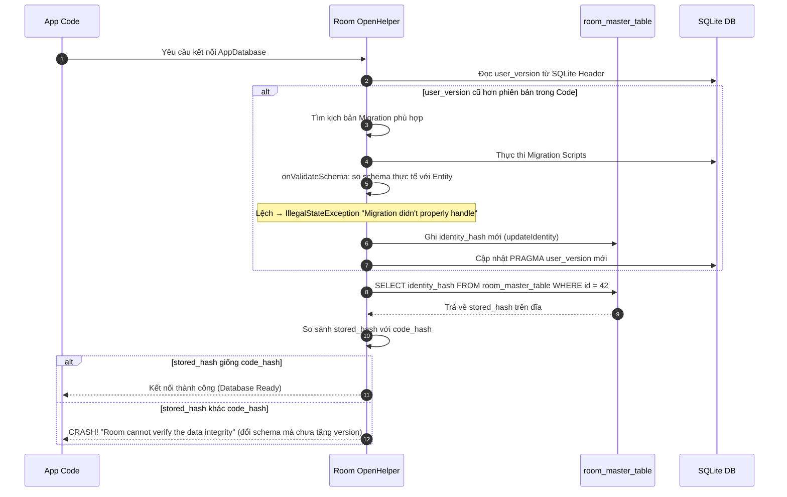
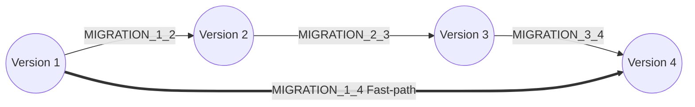
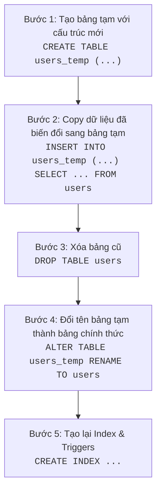
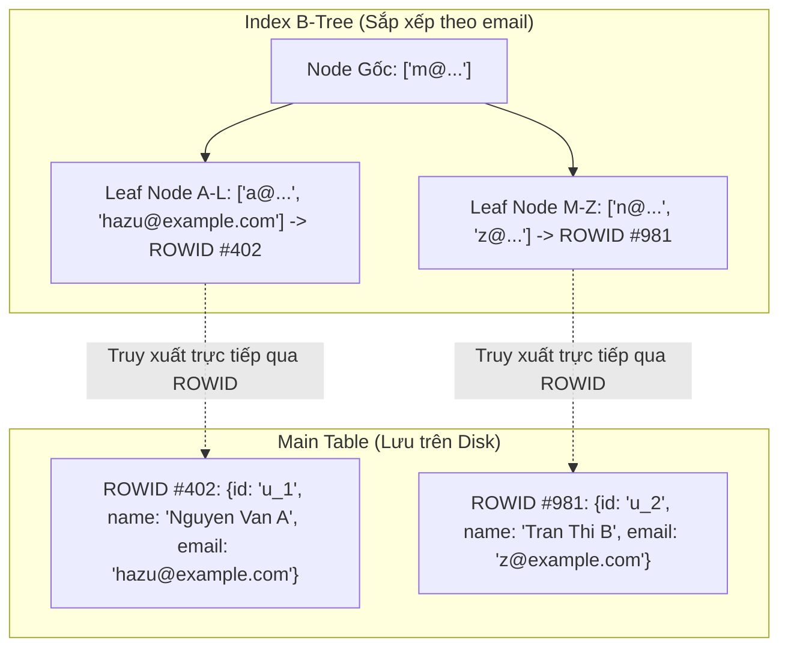
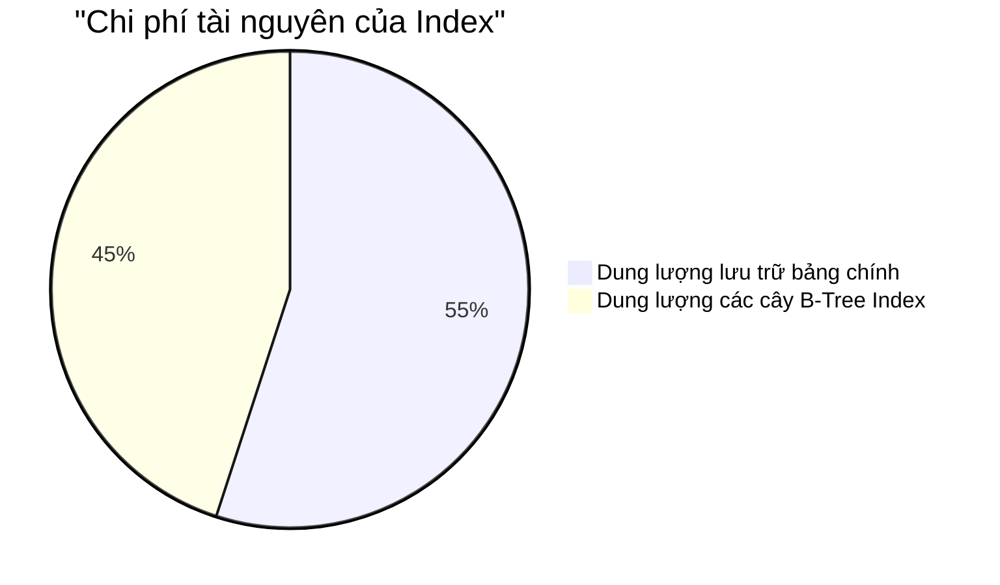
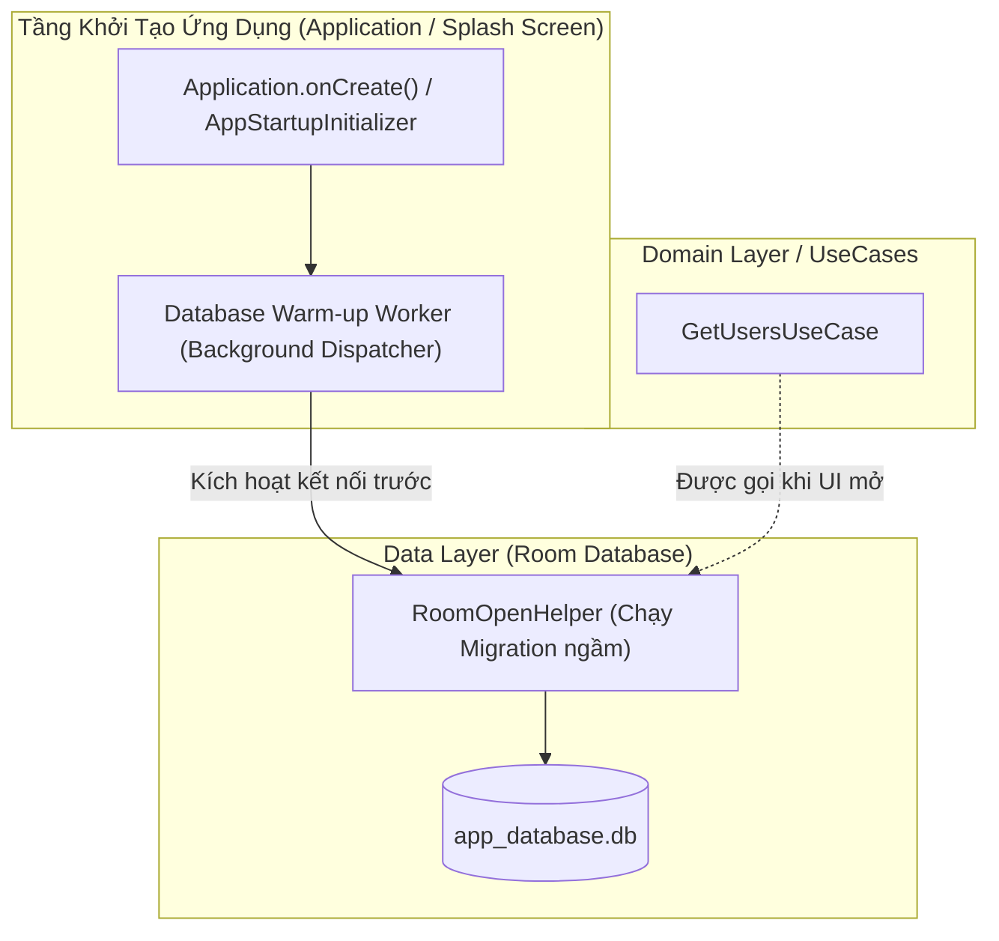

# Advanced Room: Migration Toàn Diện & Indexing Hiệu Năng Cao

Trong các ứng dụng Android thực tế ở quy mô Production, cơ sở dữ liệu không bao giờ đứng yên. Yêu cầu nghiệp vụ liên tục thay đổi buộc cấu trúc bảng phải tiến hóa: thêm cột, đổi kiểu dữ liệu, tách bảng quan hệ. Đồng thời, khi lượng dữ liệu tích lũy lên hàng trăm ngàn hay hàng triệu bản ghi, các câu truy vấn ngây thơ sẽ khiến ứng dụng bị giật lag, đơ giao diện (ANR) hoặc tiêu tốn bộ nhớ.

Tài liệu này tập trung giải quyết triệt để hai bài toán sống còn của tầng Database trong Android:
1. **Migration (Bảo toàn dữ liệu):** Nâng cấp lược đồ cơ sở dữ liệu an toàn 100%, không làm mất một dòng dữ liệu nào của người dùng và không làm crash ứng dụng.
2. **Indexing (Tối ưu hiệu năng):** Làm chủ cấu trúc B-Tree bên dưới SQLite, thiết kế Composite Index theo quy tắc tiền tố và đo lường truy vấn chính xác bằng `EXPLAIN QUERY PLAN`.

---

## 1. Bản chất & Cơ chế xác thực tính toàn vẹn (Room Internals)

Để viết migration chuẩn xác và tự tin trả lời phỏng vấn Senior, bạn cần hiểu chính xác Room làm gì khi khởi tạo kết nối cơ sở dữ liệu.

### Bảng bí mật `room_master_table` & `identity_hash`

Khi bạn khai báo `@Database(entities = [UserEntity::class], version = 2)`, Room Compiler (KSP) thực hiện các bước sau tại thời điểm build:
1. Thu thập toàn bộ định nghĩa bảng: tên bảng, tên cột, kiểu dữ liệu, ràng buộc `NOT NULL`, Primary Key, Foreign Key, Indices.
2. Tạo ra một chuỗi đại diện (Schema Definition String) và tính toán mã băm **Identity Hash** (chuỗi MD5/SHA-256).
3. Nhúng mã băm này trực tiếp vào mã nguồn sinh tự động `AppDatabase_Impl.kt`.

Bên dưới SQLite, Room tự động tạo một bảng hệ thống đặc biệt có tên là **`room_master_table`**:

```sql
CREATE TABLE IF NOT EXISTS room_master_table (
    id INTEGER PRIMARY KEY,
    identity_hash TEXT
);
```

Khi ứng dụng mở database lần đầu:



Room phát hiện lệch schema ở **hai chỗ khác nhau**, với hai thông báo lỗi khác nhau:

1. **Migration viết sai** (SQL tạo ra bảng khác với `@Entity`: thiếu cột, sai kiểu, sai nullability, thiếu index, sai default value): ngay sau khi chạy migration, Room gọi `onValidateSchema` và ném `IllegalStateException: Migration didn't properly handle: <tên bảng>` kèm hai khối `Expected:` / `Found:` để bạn so từng cột. Thứ tự cột không được so.
2. **Đổi schema mà quên tăng `version`**: không có migration nào chạy, Room so `identity_hash` lưu trong `room_master_table` với hash trong code và ném lỗi dưới đây. Sau một migration thành công, Room tự ghi hash mới (`updateIdentity`), nên migration sai không rơi vào lỗi này.

```text
java.lang.IllegalStateException: Room cannot verify the data integrity. 
Looks like you've changed schema but forgot to update the version number. 
You can simply fix this by increasing the version number.
Expected identity hash: 8f3d4... Found: a1b2c...
```

> [!IMPORTANT]
> **Bản chất của hai lỗi trên:** Không phải Room bị lỗi. Hoặc migration bạn viết đã tạo ra cấu trúc bảng khác với định nghĩa `@Entity` (lỗi `Migration didn't properly handle`), hoặc schema trong code đã đổi mà `version` chưa tăng (lỗi `Room cannot verify the data integrity`). Trong cả hai trường hợp Room chủ động dừng để ngăn hỏng dữ liệu âm thầm (silent data corruption).

---

### Cảnh báo về `fallbackToDestructiveMigration()`

Có một lỗi thứ ba, xảy ra trước cả hai lỗi trên: tăng `version` (ví dụ lên 2) nhưng không đăng ký migration nào dẫn từ version đang có trên máy. Room không tìm được đường nâng cấp và ném ngay khi mở database, nên app crash ở lần mở đầu tiên sau khi cập nhật:

```text
java.lang.IllegalStateException: A migration from 1 to 2 was required but not found.
Please provide the necessary Migration path via RoomDatabase.Builder.addMigration(Migration ...)
```

Khi gặp lỗi integrity hoặc quên viết migration, nhiều lập trình viên sử dụng giải pháp "tiện tay":

```kotlin
// ⚠️ NGUY HIỂM CHÍ MẠNG TRÊN PRODUCTION!
Room.databaseBuilder(context, AppDatabase::class.java, "app.db")
    .fallbackToDestructiveMigration()
    .build()
```

#### Cơ chế hoạt động của Destructive Migration
Khi Room phát hiện phiên bản database tăng lên nhưng không tìm thấy kịch bản `Migration` phù hợp:
1. Room chạy lệnh `DROP TABLE` cho **TOÀN BỘ** các bảng trong cơ sở dữ liệu.
2. Tạo lại các bảng mới từ đầu (trắng trơn).
3. Đặt lại `identity_hash` mới.

#### Hậu quả trên Production
Toàn bộ dữ liệu của người dùng lưu trữ offline (ghi chú, tin nhắn chưa đồng bộ, lịch sử giao dịch, token định danh, cài đặt cá nhân) bị **XÓA SẠCH VĨNH VIỄN**.

#### Khi nào được phép dùng?
- **App thuần Cache:** 100% dữ liệu có thể tải lại từ Server ngay khi người dùng mở mạng (ví dụ: Feed mạng xã hội chỉ lưu tạm).
- **Môi trường Debug / Develop nội bộ:** Tiết kiệm thời gian khi đang trong giai đoạn thiết kế tính năng mới.

#### Giải pháp kiểm soát an toàn:
Nếu buộc phải xóa sạch một số phiên bản thử nghiệm cũ mà vẫn bảo vệ phiên bản chính thức:
```kotlin
// Chỉ xóa dữ liệu nếu người dùng nâng cấp từ version 1 hoặc 2 (bản Beta nội bộ).
// Từ version 3 trở đi, bắt buộc phải chạy Migration an toàn!
Room.databaseBuilder(context, AppDatabase::class.java, "app.db")
    .fallbackToDestructiveMigrationFrom(1, 2)
    .addMigrations(MIGRATION_3_4, MIGRATION_4_5)
    .build()
```

---

### Kịch bản "Nhảy cóc phiên bản" (Skip-Version Migrations)

Một vấn đề phổ biến ở môi trường thực tế: Người dùng cài App Version 1.0 (Database Version 1). Họ không cập nhật app trong 6 tháng. Khi họ tải bản cập nhật mới nhất, Database Version trong app đã là 4.

Room sẽ xử lý thế nào nếu bạn đã đăng ký:
- `MIGRATION_1_2`
- `MIGRATION_2_3`
- `MIGRATION_3_4`



1. **Thuật toán tham lam (greedy), không phải BFS:**
   Room coi các phiên bản là các đỉnh (Node) và các kịch bản `Migration(start, end)` là các cạnh (Edge) có hướng. Ở mỗi bước, từ version hiện tại Room chọn migration **nhảy xa nhất** mà không vượt quá version đích, và không quay lui. Hệ quả: nếu có `1→3`, `1→2`, `2→4` và cần đi `1→4`, Room chọn `1→3` rồi bế tắc ở 3 (không có `3→4`), trả về "không tìm thấy migration" dù đường `1→2→4` có tồn tại.
2. **Ưu tiên Migration trực tiếp:**
   - Nếu bạn cung cấp `Migration(1, 4)`, Room sẽ chọn ngay kịch bản này để nhảy từ 1 lên 4 trong 1 bước duy nhất.
   - Nếu không có `Migration(1, 4)`, Room sẽ tìm đường đi tuần tự: `1 -> 2 -> 3 -> 4` và lần lượt thực thi từng hàm `migrate()`.

> [!TIP]
> **Best Practice cho Skip-Version:**
> Thông thường, bạn chỉ cần duy trì các Migration tuần tự (`1->2`, `2->3`, `3->4`). Chỉ viết migration trực tiếp (`1->4`) khi kịch bản tuần tự tốn quá nhiều thời gian xử lý dữ liệu nặng (I/O) gây chậm trễ cho lần mở app đầu tiên của người dùng cũ.

---

## 2. AutoMigration vs Manual Migration Thực Chiến

Từ phiên bản Room 2.4.0+, Google bổ sung tính năng **AutoMigration** nhằm giảm bớt boilerplate cho các thay đổi đơn giản. Tuy nhiên, lập trình viên cần nắm vững ranh giới giữa AutoMigration và Manual Migration.

> **Chuỗi schema dùng xuyên suốt các ví dụ migration trong bài** (mỗi bước chỉ đăng ký một cách: hoặc `autoMigrations`, hoặc `addMigrations`; nếu đăng ký cả hai cho cùng một bước, Room dùng migration viết tay):
>
> | Version | Thay đổi | Cách thực hiện |
> | :--- | :--- | :--- |
> | v1 | `users(id, name, email UNIQUE, phone, fax, company_name, company_tax_code)`; `orders(id, user_id, status, amount, created_at INTEGER)` | — |
> | v2 | `users` thêm `is_verified INTEGER NOT NULL DEFAULT 0` | `AutoMigration(1, 2)` hoặc `MIGRATION_1_2` viết tay (Case Study 1) |
> | v3 | `users` đổi `phone` → `phone_number`, xoá `fax` | `AutoMigration(2, 3)` + `MigrationSpec2To3` |
> | v4 | `orders.created_at` từ `INTEGER` sang `TEXT` ISO-8601 | `MIGRATION_3_4` (Case Study 2) |
> | v5 | Tách thông tin công ty khỏi `users` sang bảng `companies` | `MIGRATION_4_5` (Case Study 3) |

### Cấu hình Gradle bắt buộc cho AutoMigration

AutoMigration phụ thuộc vào việc so sánh các file Schema JSON qua từng phiên bản. Bạn phải cấu hình KSP để xuất Schema:

```kotlin
// build.gradle.kts (Module: app)
plugins {
    alias(libs.plugins.ksp)
}

ksp {
    arg("room.schemaLocation", "$projectDir/schemas")
}

android {
    sourceSets {
        // Cần đưa schemas vào sourceSet để phục vụ testing
        getByName("androidTest").assets.srcDirs("$projectDir/schemas")
    }
}
```

Mỗi khi bạn tăng `version` trong `@Database` và compile, Room sẽ tự động sinh ra file `schemas/com.example.app.AppDatabase/1.json`, `2.json`.

---

### Sử dụng AutoMigration khi thay đổi cấu trúc cơ bản

Nếu bạn chỉ **thêm cột mới** hoặc **thêm bảng mới**, Room tự động so sánh `1.json` và `2.json` để sinh mã SQL tương ứng mà bạn không cần viết bất kỳ câu lệnh SQL nào:

```kotlin
// v2: UserEntity thêm @ColumnInfo(name = "is_verified", defaultValue = "0") val isVerified: Boolean = false
@Database(
    entities = [UserEntity::class, OrderEntity::class],
    version = 2,
    autoMigrations = [
        AutoMigration(from = 1, to = 2)
    ]
)
abstract class AppDatabase : RoomDatabase() {
    abstract fun userDao(): UserDao
}
```

---

### Khi nào bắt buộc dùng `AutoMigrationSpec`?

Khi bạn **đổi tên cột**, **xóa cột**, **đổi tên bảng**, hoặc **xóa bảng**, Room Compiler không thể tự đoán biết được: bạn muốn đổi tên cột cũ sang cột mới hay muốn xóa cột cũ đi và thêm một cột hoàn toàn mới?

Lúc này, KSP sẽ báo lỗi biên dịch và yêu cầu một `AutoMigrationSpec`:

```kotlin
// Giả sử Version 2 -> 3:
// 1. Đổi tên cột `phone` thành `phone_number`
// 2. Xóa cột thừa `fax`
@RenameColumn(tableName = "users", fromColumnName = "phone", toColumnName = "phone_number")
@DeleteColumn(tableName = "users", columnName = "fax")
class MigrationSpec2To3 : AutoMigrationSpec {
    override fun onPostMigrate(db: SupportSQLiteDatabase) {
        // Hook được gọi sau khi AutoMigration chạy xong.
        // Bạn có thể update dữ liệu bổ sung tại đây nếu cần.
    }
}

@Database(
    entities = [UserEntity::class, OrderEntity::class],
    version = 3,
    autoMigrations = [
        AutoMigration(from = 1, to = 2),
        AutoMigration(from = 2, to = 3, spec = MigrationSpec2To3::class)
    ]
)
abstract class AppDatabase : RoomDatabase() { ... }
```

---

### Bảng so sánh lựa chọn: AutoMigration vs Manual Migration

| Nghiệp vụ thay đổi | Phương pháp đề xuất | Lý do kỹ thuật |
| :--- | :--- | :--- |
| **Thêm bảng mới** | `AutoMigration` | Room tự tạo `CREATE TABLE` chính xác tuyệt đối. |
| **Thêm cột mới (có Default Value hoặc Nullable)** | `AutoMigration` | Room tự sinh `ALTER TABLE ... ADD COLUMN`. |
| **Đổi tên cột / Xóa cột đơn giản** | `AutoMigration` với `AutoMigrationSpec` | An toàn, không cần viết SQL tay. |
| **Đổi kiểu dữ liệu cột** (vd: `Int` -> `String`) | **Manual Migration** | Bắt buộc phải chuyển đổi dữ liệu đang có, AutoMigration không thể đoán logic ép kiểu. |
| **Tách 1 bảng thành 2 bảng quan hệ** | **Manual Migration** | Cần truy vấn INSERT chọn lọc dữ liệu từ bảng cũ sang bảng mới. |
| **Thay đổi Primary Key / Ràng buộc Foreign Key** | **Manual Migration** | SQLite không hỗ trợ sửa PK trực tiếp qua `ALTER TABLE`. |

---

## 3. Các Ca Migration Khó: Dựng Lại Bảng 5 Bước (Table Recreation Pattern)

### Hạn chế lịch sử của SQLite
Trước phiên bản SQLite 3.35.0, SQLite **không hỗ trợ** cú pháp `ALTER TABLE DROP COLUMN`; đến nay SQLite vẫn không hỗ trợ đổi kiểu dữ liệu của cột hay thay đổi khóa chính (Primary Key) bằng `ALTER TABLE`. Theo bảng phiên bản của Android, API 31–33 (Android 12–13) đi kèm SQLite 3.32, API 34 (Android 14) mới lên 3.39; `RENAME COLUMN` (SQLite 3.25) chỉ có từ API 30 (Android 11, SQLite 3.28). Nhà sản xuất có thể đóng gói phiên bản khác, nên kiểm tra bằng `select sqlite_version()` khi cần.

Nếu ứng dụng của bạn hỗ trợ các thiết bị từ Android 7 đến Android 13, bất kỳ nỗ lực chạy lệnh `ALTER TABLE DROP COLUMN` bằng SQL thuần đều sẽ ném ngoại lệ:
```text
android.database.sqlite.SQLiteException: near "DROP": syntax error
```

### Quy trình 5 bước dựng lại bảng

Để giải quyết các bài toán nâng cấp mà `ALTER TABLE` không làm được (đổi kiểu cột, đổi khoá chính, xoá cột trên SQLite cũ), ta dựng lại bảng theo **Table Recreation Pattern**. Đây là bản rút gọn của quy trình 12 bước trong tài liệu SQLite (mục "Making Other Kinds Of Table Schema Changes"), gồm 5 bước. Bước 5 hay bị quên nhất: `DROP TABLE` xoá luôn các index của bảng cũ, thiếu một index đã khai báo trong `@Entity` là bước kiểm tra schema sau migration báo `Migration didn't properly handle`.



---

### Case Study 1: Thêm cột `NOT NULL` vào bảng có hàng triệu dòng

#### Tình huống
Bảng `users` đang có 1 triệu bản ghi. Version 2 yêu cầu thêm cột `is_verified: Boolean` (không được null, mặc định là false `0`).

#### Giải pháp an toàn

```kotlin
val MIGRATION_1_2 = object : Migration(1, 2) {
    override fun migrate(db: SupportSQLiteDatabase) {
        // Với SQLite, khi thêm cột NOT NULL vào bảng đã có dữ liệu,
        // BẮT BUỘC phải cung cấp giá trị DEFAULT.
        // Boolean trong SQLite được lưu trữ dưới dạng INTEGER (0 hoặc 1).
        db.execSQL("ALTER TABLE users ADD COLUMN is_verified INTEGER NOT NULL DEFAULT 0")
    }
}
```

> [!WARNING]
> Nếu bạn viết `"ALTER TABLE users ADD COLUMN is_verified INTEGER NOT NULL"` mà quên `DEFAULT 0`, SQLite sẽ ném lỗi crash ngay lập tức vì không biết điền giá trị gì cho 1 triệu dòng dữ liệu cũ!

---

### Case Study 2: Đổi kiểu dữ liệu của cột

#### Tình huống
Ở v3, bảng `orders` đang lưu cột `created_at` dưới dạng số Unix Timestamp miliseconds (`INTEGER`). 
Ở phiên bản mới, team quyết định đổi sang chuỗi chuẩn ISO-8601 UTC (`TEXT`, ví dụ: `"2026-09-21T15:30:00Z"`).

#### Triển khai kịch bản Migration:

```kotlin
val MIGRATION_3_4 = object : Migration(3, 4) {
    override fun migrate(db: SupportSQLiteDatabase) {
        // Bước 1: Tạo bảng tạm với cấu trúc mong đợi mới (giữ đủ mọi cột của orders)
        db.execSQL("""
            CREATE TABLE IF NOT EXISTS `orders_temp` (
                `id` TEXT NOT NULL PRIMARY KEY,
                `user_id` TEXT NOT NULL,
                `status` TEXT NOT NULL,
                `amount` REAL NOT NULL,
                `created_at` TEXT NOT NULL
            )
        """.trimIndent())

        // Bước 2: Copy dữ liệu và chuyển đổi kiểu dữ liệu trực tiếp bằng SQLite Date/Time functions
        // strftime('%Y-%m-%dT%H:%M:%SZ', ...) cho ra ISO-8601 dạng "2026-09-21T15:30:00Z"
        // (datetime() cho ra "2026-09-21 15:30:00" — có dấu cách, không có chữ T)
        db.execSQL("""
            INSERT INTO `orders_temp` (`id`, `user_id`, `status`, `amount`, `created_at`)
            SELECT 
                `id`, 
                `user_id`, 
                `status`, 
                `amount`, 
                strftime('%Y-%m-%dT%H:%M:%SZ', `created_at` / 1000, 'unixepoch') AS `created_at`
            FROM `orders`
        """.trimIndent())

        // Bước 3: Xóa bảng cũ
        db.execSQL("DROP TABLE `orders`")

        // Bước 4: Đổi tên bảng tạm thành bảng chính
        db.execSQL("ALTER TABLE `orders_temp` RENAME TO `orders`")

        // Bước 5: Tạo lại composite index đã khai báo trong OrderEntity (mục 4)
        db.execSQL("CREATE INDEX IF NOT EXISTS `index_orders_user_id_status_created_at` ON `orders` (`user_id`, `status`, `created_at`)")
    }
}
```

---

### Case Study 3: Tách 1 Entity thành 2 Entity có quan hệ (1 - N)

#### Tình huống
Bảng `users` ở v4 chứa cả thông tin cá nhân và thông tin công ty:
`users (id, name, email, phone_number, is_verified, company_name, company_tax_code)`.
Ở version 5, kiến trúc chuẩn hóa CSDL (Normalization) yêu cầu tách thành 2 bảng riêng:
- `users (id, name, email, phone_number, is_verified)`
- `companies (id, user_id, name, tax_code)`

#### Triển khai kịch bản Migration:

```kotlin
val MIGRATION_4_5 = object : Migration(4, 5) {
    override fun migrate(db: SupportSQLiteDatabase) {
        // Bước 1: Tạo bảng mới `companies`
        db.execSQL("""
            CREATE TABLE IF NOT EXISTS `companies` (
                `id` TEXT NOT NULL PRIMARY KEY,
                `user_id` TEXT NOT NULL,
                `name` TEXT NOT NULL,
                `tax_code` TEXT NOT NULL,
                FOREIGN KEY(`user_id`) REFERENCES `users`(`id`) ON DELETE CASCADE
            )
        """.trimIndent())

        // Bước 2: Tạo Index cho Foreign Key của bảng mới để tối ưu JOIN
        db.execSQL("CREATE INDEX IF NOT EXISTS `index_companies_user_id` ON `companies` (`user_id`)")

        // Bước 3: Đẩy dữ liệu công ty từ bảng users cũ sang bảng companies mới
        // Sinh id mới cho company bằng cách ghép chuỗi hoặc dùng hàm hex(randomblob(16))
        db.execSQL("""
            INSERT INTO `companies` (`id`, `user_id`, `name`, `tax_code`)
            SELECT 
                'comp_' || `id` AS `id`,
                `id` AS `user_id`,
                `company_name` AS `name`,
                COALESCE(`company_tax_code`, 'N/A') AS `tax_code`
            FROM `users`
            WHERE `company_name` IS NOT NULL
        """.trimIndent())

        // Bước 4: Tái tạo bảng `users` để loại bỏ 2 cột thừa (company_name, company_tax_code)
        db.execSQL("""
            CREATE TABLE IF NOT EXISTS `users_new` (
                `id` TEXT NOT NULL PRIMARY KEY,
                `name` TEXT NOT NULL,
                `email` TEXT NOT NULL,
                `phone_number` TEXT,
                `is_verified` INTEGER NOT NULL DEFAULT 0
            )
        """.trimIndent())

        // Giữ lại các cột đã thêm ở v2, v3 — bỏ sót là mất dữ liệu và validate fail
        db.execSQL("""
            INSERT INTO `users_new` (`id`, `name`, `email`, `phone_number`, `is_verified`)
            SELECT `id`, `name`, `email`, `phone_number`, `is_verified` FROM `users`
        """.trimIndent())

        db.execSQL("DROP TABLE `users`")
        db.execSQL("ALTER TABLE `users_new` RENAME TO `users`")
        
        // Đảm bảo tạo lại Index email cho bảng users
        db.execSQL("CREATE UNIQUE INDEX IF NOT EXISTS `index_users_email` ON `users` (`email`)")
    }
}
```

---

## 4. Indexing, B-Tree & Tối Ưu Hóa Truy Vấn CSDL Lớn

Khi ứng dụng quản lý tập dữ liệu lớn, hiệu năng đọc là tiêu chí sống còn. Hiểu rõ cấu trúc Index sẽ giúp bạn tránh các quyết định tối ưu hóa sai lầm.

### Bản chất của Index bên dưới đĩa cứng: Cấu trúc B-Tree

Trong SQLite, bảng dữ liệu mặc định được tổ chức dưới dạng **B-Tree bảng (Table B-Tree)** được đánh địa chỉ bằng một số nguyên 64-bit gọi là `ROWID`.
- Khi bạn chạy câu truy vấn: `SELECT * FROM users WHERE email = 'hazu@example.com'`
- Nếu cột `email` **chưa được đánh Index**, SQLite buộc phải thực hiện **Full Table Scan**: Đọc tuần tự từng trang đĩa từ đầu đến cuối bảng, so sánh từng chuỗi ký tự. Độ phức tạp là $O(N)$. Với bảng 500.000 dòng, thao tác này có thể mất từ 200ms - 1500ms, gây freeze UI ngay tức khắc!

Khi bạn đánh Index cho cột `email`:
```kotlin
@Entity(
    tableName = "users",
    indices = [Index(value = ["email"], unique = true)]
)
data class UserEntity(
    @PrimaryKey val id: String,
    val name: String,
    val email: String
)
```

SQLite sẽ cấp phát một **Index B-Tree** riêng biệt trên đĩa cứng:



Quá trình tìm kiếm chỉ tốn $O(\log N)$ bước duyệt cây để tìm thấy `ROWID`, sau đó nhảy thẳng đến vị trí bản ghi trên đĩa. Tốc độ tìm kiếm tăng từ hàng giây xuống còn **dưới 2 mili-giây**!

---

### Composite Index & Quy tắc "Leftmost Prefix" (Tiền tố bên trái)

Trong thực tế, bạn thường xuyên phải lọc theo nhiều điều kiện đồng thời, ví dụ màn hình danh sách đơn hàng:
`SELECT * FROM orders WHERE user_id = :userId AND status = :status ORDER BY created_at DESC`

Nếu bạn đánh 3 Index đơn lẻ (`user_id`, `status`, `created_at`), SQLite chỉ có thể chọn **1 Index duy nhất** tốt nhất để duyệt, hai cột còn lại vẫn phải lọc thủ công trong bộ nhớ.

Giải pháp là **Composite Index (Chỉ mục kết hợp nhiều cột)**:
```kotlin
@Entity(
    tableName = "orders",
    indices = [
        Index(value = ["user_id", "status", "created_at"])
    ]
)
data class OrderEntity(...)
```

#### Quy tắc vàng: "Leftmost Prefix"
Thứ tự khai báo các cột trong `value = ["colA", "colB", "colC"]` mang tính quyết định:

| Câu lệnh truy vấn | Index có được sử dụng không? | Giải thích |
| :--- | :---: | :--- |
| `WHERE colA = ?` | **CÓ** | Khớp tiền tố bên trái nhất (`colA`). |
| `WHERE colA = ? AND colB = ?` | **CÓ** | Khớp tiền tố 2 cột đầu (`colA`, `colB`). |
| `WHERE colA = ? AND colB = ? AND colC = ?` | **CÓ (Tối ưu tuyệt đối)** | Sử dụng trọn vẹn cả 3 cột của B-Tree. |
| `WHERE colB = ?` | **KHÔNG** | Bỏ qua `colA`. SQLite không thể nhảy vào giữa cây B-Tree mà không qua gốc `colA`! |
| `WHERE colB = ? AND colC = ?` | **KHÔNG** | Bỏ qua tiền tố bên trái nhất. Bắt buộc phải Full Table Scan! |
| `WHERE colA = ? AND colC = ?` | **MỘT PHẦN** | Chỉ dùng index cho `colA`. Cột `colC` phải scan thủ công. |

> [!TIP]
> **Thứ tự sắp xếp cột chuẩn trong Composite Index:**
> 1. **Cột so sánh bằng (`=`) có độ chọn lọc cao nhất:** Đặt lên đầu tiên (ví dụ `user_id`).
> 2. **Cột so sánh bằng bổ sung:** Đặt ở giữa (ví dụ `status`).
> 3. **Cột so sánh khoảng (`<`, `>`, `BETWEEN`) hoặc sắp xếp (`ORDER BY`):** Bắt buộc phải đặt ở **cuối cùng** của Composite Index. Nếu đặt cột so sánh khoảng lên trước, SQLite sẽ ngừng sử dụng Index cho các cột phía sau!

---

### Chi phí đánh đổi (Trade-off) & Khi nào KHÔNG ĐƯỢC đánh Index?

Index là một con dao hai lưỡi. Một Senior Android Developer phải biết từ chối đánh index khi không cần thiết.



#### 1. Hình phạt ghi dữ liệu (The Write Penalty)
Mỗi khi bạn thực hiện một thao tác ghi (`INSERT`, `UPDATE` các cột có index, hoặc `DELETE`):
- SQLite không chỉ cập nhật bản ghi trong bảng chính.
- SQLite phải duyệt và tái cân bằng (Rebalance / Split Node) lại **tất cả** các cây B-Tree Index gắn liền với bảng đó.
- Nếu một bảng có 5 Index, tốc độ `INSERT` có thể bị **chậm đi từ 3x đến 8x** so với bảng không có Index!

#### 2. Dung lượng file `.db` phình to
Mỗi Index là một bản sao thu nhỏ của dữ liệu. Việc tạo quá nhiều Index trên bảng lớn có thể khiến kích thước file Database trên máy người dùng tăng gấp đôi, dễ dẫn đến lỗi `SQLiteFullException` (hết bộ nhớ trong).

#### Khi nào NÊN đánh Index?
1. **Cột nằm trong `WHERE` của các query chạy thường xuyên** (lọc theo `user_id`, `status`, `sync_status`...).
2. **Cột khoá ngoại (Foreign Key) và cột dùng để `JOIN`:** SQLite không tự đánh index cho cột khoá ngoại. Thiếu index, mỗi lần xoá/sửa hàng ở bảng cha (nhất là với `ON DELETE CASCADE`) và mỗi lần `JOIN` đều phải quét cả bảng con. Room cũng in cảnh báo lúc build khi cột khoá ngoại chưa nằm trong index nào.
3. **Cột dùng trong `ORDER BY`** (ví dụ `created_at`), đặt ở cuối Composite Index như mục trên.

#### Khi nào KHÔNG NÊN đánh Index?
1. **Cột có độ chọn lọc thấp (Low Selectivity / Low Cardinality):**
   Ví dụ cột cờ boolean (`is_deleted`, `is_active`) hoặc giới tính (`gender`). Khi một giá trị chiếm tới 50% tổng số bản ghi trong bảng, SQLite Engine phân tích chi phí và nhận thấy việc tra cứu Index B-Tree rồi nhảy về đĩa tìm `ROWID` (Random I/O) còn tốn thời gian hơn việc đọc tuần tự toàn bộ bảng (Sequential I/O). Index lúc này trở nên vô dụng!
2. **Bảng có kích thước nhỏ:** Các bảng danh mục, cấu hình chỉ có vài chục đến vài trăm dòng. Quét toàn bộ bảng trong bộ nhớ RAM chỉ tốn một phần nhỏ của mili-giây.
3. **Bảng ghi nhiều hơn đọc (Write-heavy tables):** Ví dụ bảng `analytics_events`, `log_records`. Dữ liệu liên tục được chèn vào nhưng rất hiếm khi được truy vấn trực tiếp trên thiết bị.

---

### Đo lường chính xác bằng `EXPLAIN QUERY PLAN`

Đừng bao giờ đoán mò xem câu truy vấn có đang chạy nhanh hay không. Hãy để SQLite chỉ rõ đường đi nước bước thông qua lệnh `EXPLAIN QUERY PLAN`.

Bạn có thể kiểm tra trực tiếp trong Room DAO hoặc Database Inspector của Android Studio:

```kotlin
@Dao
interface OrderDao {
    // Câu truy vấn kiểm tra kế hoạch thực thi
    @Query("EXPLAIN QUERY PLAN SELECT * FROM orders WHERE user_id = :userId AND status = :status")
    suspend fun explainOrderQuery(userId: String, status: String): List<QueryPlanItem>
}

data class QueryPlanItem(
    val id: Int,
    val parent: Int,
    val notused: Int,
    val detail: String // Chứa thông tin kế hoạch
)
```

#### Phân tích kết quả thực tế từ `detail`:

1. **Trường hợp nguy hiểm (Full Table Scan):**
   ```text
   detail: "SCAN TABLE orders"
   ```
   👉 SQLite đang phải duyệt qua toàn bộ bảng từ dòng đầu đến dòng cuối. Bạn cần xem lại cấu trúc Index ngay lập tức!

2. **Trường hợp tối ưu (Index Search):**
   ```text
   detail: "SEARCH TABLE orders USING INDEX index_orders_user_id_status_created_at (user_id=? AND status=?)"
   ```
   👉 Tuyệt vời! SQLite đã sử dụng chính xác Composite Index bạn tạo để tìm kiếm.

3. **Cảnh giới cao nhất: Covering Index:**
   ```text
   detail: "SEARCH TABLE orders USING COVERING INDEX index_orders_user_id_status_amount"
   ```
   👉 **Covering Index:** Tất cả các cột nằm trong mệnh đề `SELECT`, `WHERE`, và `ORDER BY` đều nằm trọn vẹn bên trong cây B-Tree của Index. SQLite **không cần phải đọc bảng chính một lần nào**. Đây là mức hiệu năng truy vấn nhanh nhất có thể đạt được trong hệ thống CSDL quan hệ!

---

## 5. Testing Migration với `MigrationTestHelper`

Quy tắc vàng số 1 của Production Database: **Không bao giờ đẩy migration lên production nếu chưa có Unit Test tự động chứng minh nó chạy thành công 100%.**

Thư viện Room cung cấp công cụ `MigrationTestHelper` (nằm trong artifact `androidx.room:room-testing`) cho phép mô phỏng việc tạo CSDL ở phiên bản cũ, chèn dữ liệu thực tế, chạy migration, và kiểm tra tính toàn vẹn dữ liệu.

### 1. Khai báo dependency

```kotlin
// build.gradle.kts
dependencies {
    // Test bên dưới dùng InstrumentationRegistry và đọc schema JSON từ assets của androidTest
    // (sourceSets ở mục 2), nên là instrumented test: đặt trong src/androidTest
    androidTestImplementation(libs.androidx.room.testing)
    androidTestImplementation(libs.androidx.test.ext.junit)
    androidTestImplementation(libs.androidx.test.runner)
}
```

### 2. Viết Test Case kiểm chứng Migration 1 lên 2

```kotlin
package com.example.app.data.local

import androidx.room.testing.MigrationTestHelper
import androidx.test.ext.junit.runners.AndroidJUnit4
import androidx.test.platform.app.InstrumentationRegistry
import org.junit.Assert.assertEquals
import org.junit.Assert.assertTrue
import org.junit.Rule
import org.junit.Test
import org.junit.runner.RunWith
import java.io.IOException

@RunWith(AndroidJUnit4::class)
class AppDatabaseMigrationTest {

    private val TEST_DB = "migration-test.db"

    // Dùng constructor nhận class của Database. Constructor cũ nhận tên assets
    // (canonicalName + FrameworkSQLiteOpenHelperFactory) đã deprecated từ Room 2.4
    // và không chạy được AutoMigration (bước v2 → v3 của chuỗi schema).
    @get:Rule
    val helper: MigrationTestHelper = MigrationTestHelper(
        InstrumentationRegistry.getInstrumentation(),
        AppDatabase::class.java
    )

    @Test
    @Throws(IOException::class)
    fun migrate1To2_containsCorrectDataAndNewColumnDefault() {
        // GIAI ĐOẠN 1: Tạo database ở Version 1 và chèn dữ liệu mẫu
        var db = helper.createDatabase(TEST_DB, 1).apply {
            // Chèn bản ghi theo cấu trúc của Version 1 (chưa có cột is_verified; các cột khác cho phép null)
            execSQL("INSERT INTO users (id, name, email) VALUES ('u1', 'Hazu Nguyen', 'hazu@example.com')")
            close()
        }

        // GIAI ĐOẠN 2: Thực thi migration lên Version 2
        // helper.runMigrationsAndValidate sẽ tự động:
        // 1. Chạy MIGRATION_1_2
        // 2. So sánh Identity Hash và Schema thực tế với schemas/2.json
        db = helper.runMigrationsAndValidate(TEST_DB, 2, true, MIGRATION_1_2)

        // GIAI ĐOẠN 3: Kiểm tra tính toàn vẹn của dữ liệu sau khi migrate
        val cursor = db.query("SELECT id, name, email, is_verified FROM users WHERE id = 'u1'")
        assertTrue("Bản ghi người dùng cũ phải còn tồn tại", cursor.moveToFirst())

        val name = cursor.getString(cursor.getColumnIndexOrThrow("name"))
        val email = cursor.getString(cursor.getColumnIndexOrThrow("email"))
        val isVerified = cursor.getInt(cursor.getColumnIndexOrThrow("is_verified"))

        // Xác nhận dữ liệu cũ không bị mất hoặc sai lệch
        assertEquals("Hazu Nguyen", name)
        assertEquals("hazu@example.com", email)
        // Xác nhận cột mới có giá trị default chính xác (0 tương ứng false)
        assertEquals(0, isVerified)

        cursor.close()
        db.close()
    }
}
```

> [!TIP]
> Tích hợp bài test này vào luồng **CI/CD (GitHub Actions / GitLab CI)**. Mỗi khi có Pull Request thay đổi Entity hoặc Database Version, CI sẽ tự động kích hoạt test. Nếu ai đó quên viết Migration hoặc viết sai câu lệnh SQL, bản build sẽ bị chặn ngay lập tức, triệt tiêu 100% nguy cơ crash database trên máy khách hàng.

---

## 6. Tư Duy Hệ Thống (System Thinking): Vị Trí Của Migration Trong Clean Architecture

Trong một kiến trúc phần mềm hoàn chỉnh, Migration và Indexing không chỉ đơn thuần là kỹ thuật viết SQL, mà là một phần thiết yếu của chiến lược quản trị dữ liệu:



1. **Khởi tạo và Migration trên Background Thread:**
   Bước `OpenHelper.onUpgrade()` (nơi chạy kịch bản Migration) diễn ra vào đúng thời điểm **kết nối Database đầu tiên được mở**, trên thread đang mở kết nối đó. Với DAO `suspend`/`Flow`, đó là thread của query executor nên UI không bị chặn, nhưng mọi truy vấn phải chờ migration xong: một migration nặng trên bảng triệu dòng khiến màn hình đầu tiên trống hoặc quay loading rất lâu. Chỉ khi mở DB trên main thread (ví dụ `allowMainThreadQueries()`) thì migration nặng mới gây ANR.
   - **Giải pháp:** Sử dụng AndroidX Startup hoặc khởi tạo sớm kết nối ở Splash Screen trên `Dispatchers.IO` để hoàn tất Migration trước khi đưa người dùng vào màn hình chính.
2. **Chiến lược Phục hồi Thảm họa (Graceful Degradation & Backup):**
   Đối với dữ liệu tài chính hoặc dữ liệu ngoại tuyến tối quan trọng: Trước khi thực hiện một kịch bản Migration phức tạp từ phiên bản rất cũ, hãy sao chép tệp `app_database.db` sang tệp tạm `app_database.db.bak`. Nếu quá trình migrate ném ngoại lệ không mong muốn, ứng dụng có thể khôi phục lại bản backup và gửi log chi tiết về Crashlytics thay vì khiến người dùng mất trắng dữ liệu.

---

## 7. Tổng Kết & Câu Hỏi Phỏng Vấn Senior (Cheat Sheet)

### Tóm tắt cốt lõi
1. **`room_master_table` & `identity_hash`:** Chiếc khóa bảo vệ tính toàn vẹn giữa Entity Kotlin và Table SQLite. Sai lệch cấu trúc bị chặn ngay lúc mở DB: sau migration bằng `onValidateSchema` (lỗi `Migration didn't properly handle`), còn khi đổi schema mà quên tăng version thì bằng so khớp hash (lỗi `Room cannot verify the data integrity`).
2. **Table Recreation 5 bước** (tạo bảng mới → copy dữ liệu → xoá bảng cũ → đổi tên → tạo lại index): cách xử lý các migration mà `ALTER TABLE` không làm được (đổi kiểu dữ liệu, tách bảng, đổi Primary Key), chạy được trên mọi phiên bản SQLite đi kèm Android.
3. **Leftmost Prefix:** Chỉ mục kết hợp `(A, B, C)` chỉ hoạt động khi mệnh đề lọc bắt đầu bằng `A`.
4. **Write Penalty:** Đánh Index giúp `SELECT` tăng tốc $O(\log N)$, nhưng làm chậm các lệnh `INSERT/UPDATE/DELETE`. Chỉ đánh index cho các cột có Selectivity cao và thường xuyên xuất hiện trong `WHERE`/`ORDER BY`.
5. **Testing First:** Luôn kiểm thử migration bằng `MigrationTestHelper` trước khi release.

---

### Top 5 Câu Hỏi Phỏng Vấn Thường Gặp

#### Q1: Khi nào Room ném ra lỗi `IllegalStateException: Room cannot verify the data integrity`? Cách khắc phục chuẩn là gì?
> **Trả lời:** Lỗi này xảy ra khi mã băm `identity_hash` mà Room tính toán từ các class `@Entity` tại thời điểm biên dịch không trùng khớp với chuỗi `identity_hash` được lưu trong bảng `room_master_table` trên thiết bị. Nguyên nhân là lập trình viên đã thay đổi cấu trúc Entity nhưng chưa tăng `version` của Database, nên không migration nào chạy. Cách khắc phục là tăng database version và viết `Migration` hoặc `AutoMigration`. Lưu ý phân biệt: nếu migration **có chạy** nhưng tạo ra bảng sai (sai kiểu dữ liệu, thiếu default value, thiếu index hoặc sai nullability), lỗi sẽ là `Migration didn't properly handle: …` kèm `Expected/Found`, không phải lỗi này.

#### Q2: Sự khác nhau giữa AutoMigration và Manual Migration là gì? Khi nào bắt buộc phải dùng Manual Migration?
> **Trả lời:** AutoMigration (từ Room 2.4+) cho phép Room tự động suy diễn câu lệnh SQL nâng cấp bằng cách so sánh hai file Schema JSON xuất ra bởi KSP, hỗ trợ tốt cho việc thêm cột, thêm bảng hoặc đổi tên/xóa cột thông qua `AutoMigrationSpec`. Tuy nhiên, bắt buộc phải dùng Manual Migration khi:
> 1. Thay đổi kiểu dữ liệu của cột cần logic convert dữ liệu cũ.
> 2. Tách hoặc gộp dữ liệu giữa các bảng (quan hệ 1-1, 1-N).
> 3. Thay đổi khóa chính (Primary Key) hoặc các ràng buộc Foreign Key phức tạp.

#### Q3: Tại sao gọi `fallbackToDestructiveMigration()` là nguy hiểm trên Production?
> **Trả lời:** Vì khi phát hiện sự chênh lệch version mà không có migration script tương ứng, Room sẽ thực thi `DROP TABLE` cho toàn bộ các bảng, xóa sạch toàn bộ dữ liệu offline của người dùng mà không thể phục hồi. Phương thức này chỉ được chấp nhận đối với dữ liệu thuần cache từ remote server hoặc trong môi trường phát triển nội bộ.

#### Q4: Cấu trúc bên dưới của Index trong SQLite là gì? Tại sao không nên đánh Index cho mọi cột?
> **Trả lời:** Index trong SQLite được tổ chức dưới dạng cấu trúc cây cân bằng **B-Tree**, lưu trữ giá trị của các cột được index kèm theo con trỏ `ROWID` trỏ đến bản ghi trong bảng chính. Không nên đánh index cho mọi cột vì:
> 1. **Hình phạt ghi (Write Penalty):** Mỗi thao tác `INSERT`, `UPDATE`, `DELETE` đều buộc SQLite phải duyệt và tái cân bằng lại tất cả các cây B-Tree Index, làm giảm nghiêm trọng hiệu năng ghi của ứng dụng.
> 2. **Dung lượng lưu trữ:** Mỗi cây B-Tree tốn thêm bộ nhớ trên đĩa.
> 3. **Độ chọn lọc thấp (Low Selectivity):** Các cột có ít giá trị phân biệt (như cờ Boolean) thì Index hoàn toàn không phát huy tác dụng do chi phí Random I/O duyệt index còn lớn hơn Sequential Scan bảng chính.

#### Q5: Quy tắc "Leftmost Prefix" trong Composite Index hoạt động như thế nào?
> **Trả lời:** Một Composite Index trên các cột `(A, B, C)` chỉ được SQLite sử dụng nếu câu truy vấn lọc theo thứ tự bắt đầu từ cột ngoài cùng bên trái (`A`). Cụ thể: query theo `A`, theo `A AND B`, hoặc theo `A AND B AND C` đều được tối ưu. Nhưng nếu câu query chỉ tìm theo `B` hoặc `B AND C` (bỏ qua `A`), SQLite sẽ không thể sử dụng Index này và buộc phải quét tuần tự toàn bộ bảng (Full Table Scan). Do đó, các cột so sánh bằng (`=`) và có độ chọn lọc cao nhất phải luôn được ưu tiên đặt ở vị trí ngoài cùng bên trái của Composite Index.

---

## 8. Nguồn Tham Khảo Chính Thức (References)

1. [Android Developers — Migrate Room databases](https://developer.android.com/training/data-storage/room/migrating-db-versions)
2. [Android Developers — Testing your Room migrations](https://developer.android.com/training/data-storage/room/testing-db#test-migrations)
3. [Android Developers — Defining data using Room entities (Indices)](https://developer.android.com/training/data-storage/room/defining-data#indices)
4. [SQLite Documentation — The SQLite Query Optimizer & EXPLAIN QUERY PLAN](https://www.sqlite.org/eqp.html)
5. [SQLite Documentation — Making Other Kinds Of Table Schema Changes (Table Recreation Pattern)](https://www.sqlite.org/lang_altertable.html#otheralter)
6. [SQLite Documentation — Query Planning & B-Tree Structure](https://www.sqlite.org/queryplanner.html)
7. [Android Developers — android.database.sqlite (SQLite version theo API level)](https://developer.android.com/reference/android/database/sqlite/package-summary)
8. [SQLite Documentation — ALTER TABLE (DROP COLUMN từ 3.35.0, RENAME COLUMN từ 3.25.0)](https://www.sqlite.org/lang_altertable.html)
9. [SQLite Documentation — Date And Time Functions (strftime)](https://www.sqlite.org/lang_datefunc.html)
10. [Android Developers — RoomDatabase.MigrationContainer](https://developer.android.com/reference/androidx/room/RoomDatabase.MigrationContainer)
