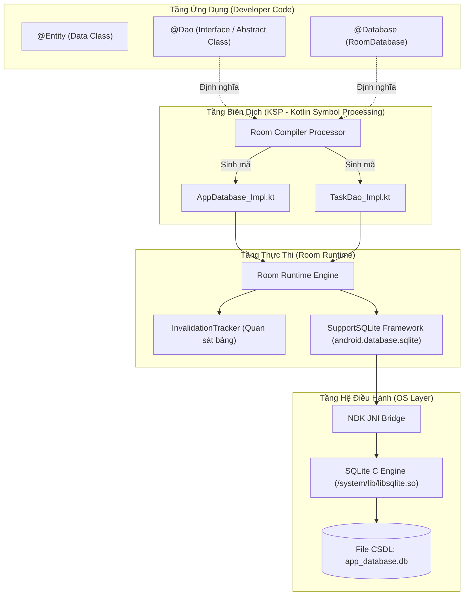
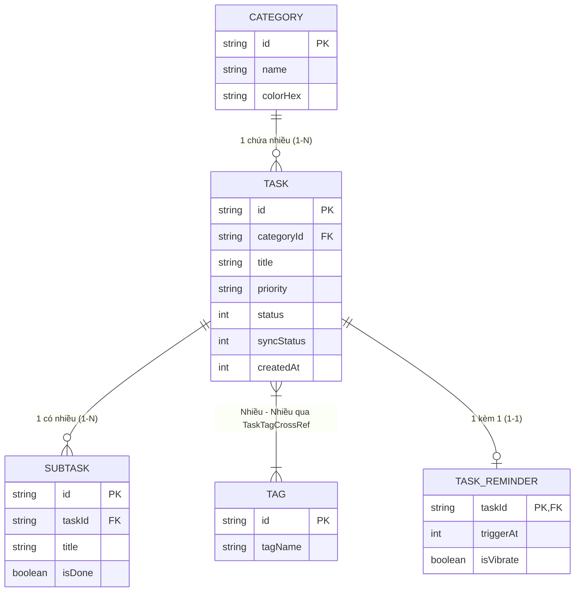
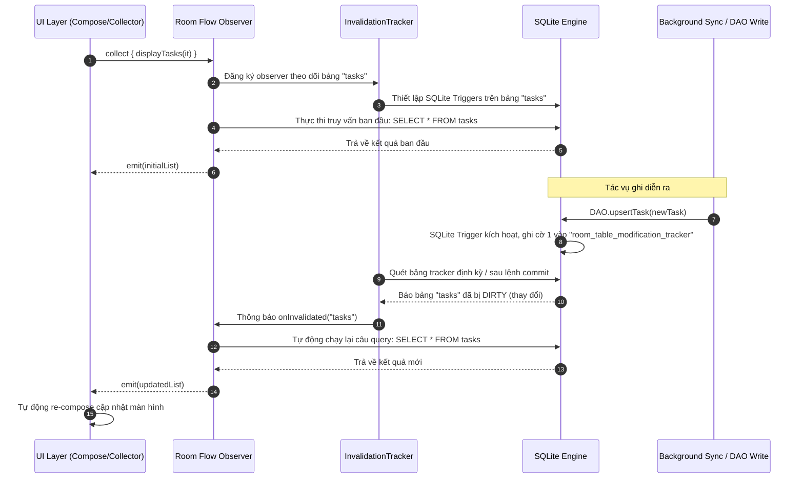
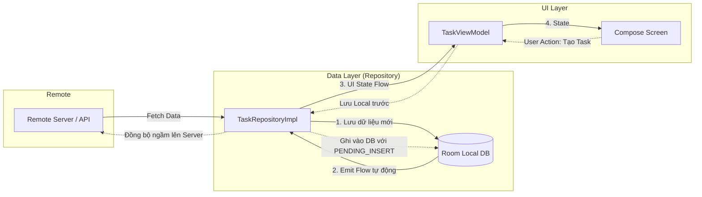
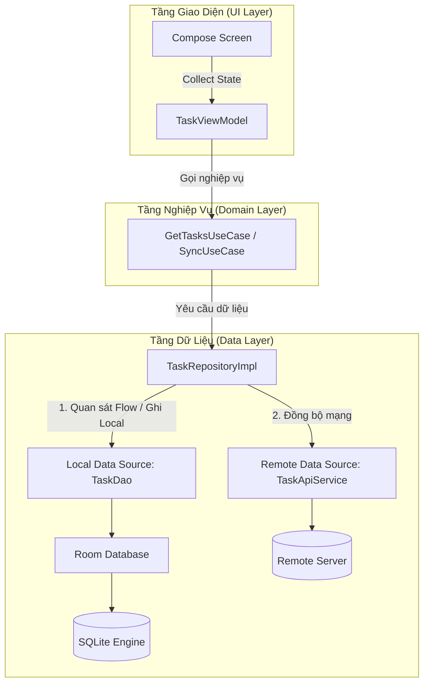

# Relational Database: Kiến Trúc & Thực Chiến Room

## 1. Bản chất & Sự ra đời của Room Database

### Vấn đề cốt lõi của SQLite thuần
Hệ điều hành Android từ phiên bản 1.0 đã tích hợp sẵn cơ sở dữ liệu quan hệ **SQLite** (viết bằng ngôn ngữ C) trực tiếp vào nhân hệ thống. Ở giai đoạn đầu, các lập trình viên Android phải làm việc với SQLite thông qua `SQLiteOpenHelper` và `SQLiteDatabase`. 

Cách tiếp cận truyền thống này bộc lộ những nhược điểm chí mạng:
1. **Truy vấn String không an toàn (Raw SQL Strings):** Mọi câu lệnh SQL đều được viết dưới dạng chuỗi ký tự (`"SELECT * FROM tasks WHERE status = 1"`). Trình biên dịch Java/Kotlin hoàn toàn "mù" trước nội dung này. Nếu bạn gõ nhầm tên cột (`stauts` thay vì `status`) hoặc sai kiểu dữ liệu, lỗi chỉ xuất hiện khi người dùng mở ứng dụng và kích hoạt tính năng đó (Runtime Exception / Crash).
2. **Boilerplate Mapping thủ công qua `Cursor`:** Bạn phải tự quản lý con trỏ `Cursor`, đọc từng chỉ mục cột (`cursor.getColumnIndexOrThrow("title")`), ép kiểu dữ liệu thủ công, duyệt vòng lặp `while (cursor.moveToNext())` và bắt buộc phải nhớ đóng `cursor.close()` để tránh rò rỉ bộ nhớ (memory leak). Hàng trăm dòng code lặp đi lặp lại chỉ để biến dữ liệu dạng bảng thành một danh sách đối tượng (Object List).
3. **Thiếu khả năng phản ứng (Lack of Observability):** SQLite thuần là một hệ thống thụ động (pull-based). Khi dữ liệu dưới bảng thay đổi, giao diện người dùng (UI) không có cách nào tự động biết được trừ khi bạn tự viết logic broadcast hoặc thủ công gọi truy vấn lại từ đầu.
4. **Nguy cơ Block Main Thread:** Việc quản lý đa luồng thủ công khi đọc/ghi SQLite rất dễ dẫn đến lỗi ANR (Application Not Responding) hoặc xung đột tài nguyên (Database Locking).

### Room Database thực chất là gì?
Google giới thiệu **Room Persistence Library** tại Google I/O 2017 như một phần của Android Architecture Components (Jetpack).

> **Bản chất kỹ thuật:** Room **KHÔNG PHẢI** là một database engine mới. Room là một **Lớp Trừu Tượng (Abstraction Layer)** hay một **Object-Relational Mapping (ORM)** mỏng, mạnh mẽ và an toàn kiểu (type-safe) được xây dựng bọc lấy SQLite.

Dữ liệu cuối cùng trong ứng dụng Android của bạn vẫn được lưu trữ trong các tệp nhị phân `.db` do engine SQLite C bên dưới quản lý. Nhưng với Room:
- SQL được kiểm tra tính hợp lệ ngay tại thời điểm biên dịch (**Compile-Time Verification**).
- Dữ liệu dạng bảng được tự động chuyển đổi hai chiều với Data Class của Kotlin.
- Hỗ trợ trực tiếp các luồng dữ liệu phản ứng bất đồng bộ (**Kotlin Coroutines & Flow**).

| Tiêu chí | SQLite thuần (`SQLiteOpenHelper`) | Room Persistence Library |
| :--- | :--- | :--- |
| **Kiểm tra cú pháp SQL** | Lúc chạy (Runtime - Dễ crash production) | Lúc build (Compile-time via KSP - An toàn tuyệt đối) |
| **Data Mapping** | Thủ công qua `Cursor` (Boilerplate cực lớn) | Tự động sinh mã mapping sang Kotlin Data Class |
| **Hỗ trợ Reactive** | Không (Phải tự xây dựng Notification/ContentObserver) | Native First-Class (Kotlin `Flow`, LiveData, RxJava) |
| **Migration** | Tự viết script SQL thô, khó kiểm thử | Hỗ trợ `AutoMigration` và `MigrationTestHelper` |
| **Xử lý Threading** | Thủ công quản lý Thread/Executor | Tự động chạy trên background dispatcher với `suspend` & `Flow` |

---

## 2. Kiến trúc nội tại & Cơ chế hoạt động (Under the Hood)

Để trở thành một Senior Android Engineer, bạn không thể chỉ dừng lại ở các annotation `@Entity` hay `@Dao`. Bạn cần hiểu Room thực sự hoạt động như thế nào bên dưới nắp ca-pô.

### Mô hình phân tầng kiến trúc
Room được chia thành các tầng kiến trúc rõ ràng, nối liền từ mã nguồn Kotlin của bạn xuống thư viện C của Android OS:



### Bí mật của KSP (Kotlin Symbol Processing) và các file `_Impl`
Khi bạn bấm nút Build trong Android Studio, Room Compiler (chạy thông qua KSP) sẽ phân tích các Annotation:
1. **Xác thực Schema:** Room lấy câu lệnh bên trong `@Query("SELECT * FROM tasks WHERE id = :id")`, phân tích cú pháp SQL (SQL Lexer/Parser) đối chiếu với bảng `tasks` được khai báo trong `@Entity`. Nếu tên cột không tồn tại, KSP sẽ ngắt quá trình build ngay lập tức và ném lỗi rõ ràng.
2. **Sinh mã thực thi (`_Impl`):**
   - Với interface `TaskDao`, Room sinh ra class `TaskDao_Impl.kt`.
   - Với abstract class `AppDatabase`, Room sinh ra `AppDatabase_Impl.kt`.

Hãy nhìn vào đoạn mã mô phỏng cách `TaskDao_Impl` do Room sinh ra xử lý câu truy vấn:

```kotlin
// [Code sinh tự động bởi Room KSP - TaskDao_Impl]
public class TaskDao_Impl(private val __db: RoomDatabase) : TaskDao {
    private val __insertionAdapterOfTaskEntity: EntityInsertionAdapter<TaskEntity>
    
    init {
        this.__insertionAdapterOfTaskEntity = object : EntityInsertionAdapter<TaskEntity>(__db) {
            override fun createQuery(): String {
                // Tự động dịch Entity thành câu lệnh PreparedStatement
                return "INSERT OR REPLACE INTO `tasks` (`id`,`title`,`status`) VALUES (?,?,?)"
            }
            override fun bind(statement: SupportSQLiteStatement, entity: TaskEntity) {
                statement.bindString(1, entity.id)
                statement.bindString(2, entity.title)
                statement.bindLong(3, if (entity.isCompleted) 1L else 0L)
            }
        }
    }

    override suspend fun getTaskById(id: String): TaskEntity? {
        val _sql = "SELECT * FROM tasks WHERE id = ?"
        val _statement = RoomSQLiteQuery.acquire(_sql, 1)
        _statement.bindString(1, id)
        
        // Room tự động chuyển execution sang Background Dispatcher
        return CoroutinesRoom.execute(__db, false, null) {
            val _cursor = DBUtil.query(__db, _statement, false, null)
            try {
                val _cursorIndexOfId = CursorUtil.getColumnIndexOrThrow(_cursor, "id")
                val _cursorIndexOfTitle = CursorUtil.getColumnIndexOrThrow(_cursor, "title")
                val _cursorIndexOfStatus = CursorUtil.getColumnIndexOrThrow(_cursor, "status")
                
                if (_cursor.moveToFirst()) {
                    TaskEntity(
                        id = _cursor.getString(_cursorIndexOfId),
                        title = _cursor.getString(_cursorIndexOfTitle),
                        isCompleted = _cursor.getLong(_cursorIndexOfStatus) != 0L
                    )
                } else null
            } finally {
                _cursor.close()
                _statement.release()
            }
        }
    }
}
```

> **Bài học rút ra:** Room không dùng Reflection (vốn rất chậm trên Android Runtime). Room sinh mã thuần túy bằng code Java/Kotlin hiệu năng cao tương đương với code mà một kỹ sư tỉ mỉ nhất tự tay viết, nhưng không có nguy cơ sai sót.

---

## 3. Bộ Ba Cốt Lõi Trong Bối Cảnh Smart Task Manager

Để áp dụng chuẩn mực, chúng ta xây dựng hệ thống lưu trữ cho ứng dụng **Smart Task & Project Manager** bao gồm các thực thể: `Category` (Danh mục dự án), `Task` (Nhiệm vụ), `Subtask` (Nhiệm vụ con), và `Tag` (Nhãn dán).



### 3.1. Thiết kế Entity chuẩn mực (`@Entity`)
Khi thiết kế Entity trong Room, có 4 quy tắc bắt buộc:
1. **Primary Key có chủ đích:** Với ứng dụng cần đồng bộ dữ liệu (Offline-first), tránh dùng `autoGenerate = true` dạng `Int/Long` tự tăng nếu bảng đó sẽ đồng bộ lên Server. Hãy dùng `UUID` dạng `String` làm khóa chính do Client sinh ra để tránh xung đột định danh khi tạo dữ liệu offline.
2. **Khai báo Index cho Foreign Key:** SQLite không tự động đánh Index cho cột Foreign Key. Nếu bạn không khai báo `@Index`, các thao tác `JOIN` hoặc xóa bảng cha có ràng buộc `CASCADE` sẽ quét toàn bộ bảng (Table Scan), gây suy giảm nghiêm trọng hiệu năng.
3. **Ràng buộc toàn vẹn dữ liệu (ForeignKey Cascading):** Khi một `Category` bị xóa, các `Task` thuộc danh mục đó sẽ được xử lý ra sao? `ForeignKey.CASCADE` giúp tự động dọn dẹp dữ liệu con.

```kotlin
package com.example.taskmanager.data.local.entity

import androidx.room.ColumnInfo
import androidx.room.Entity
import androidx.room.ForeignKey
import androidx.room.Index
import androidx.room.PrimaryKey

@Entity(tableName = "categories")
data class CategoryEntity(
    @PrimaryKey
    @ColumnInfo(name = "id")
    val id: String,
    
    @ColumnInfo(name = "name")
    val name: String,
    
    @ColumnInfo(name = "color_hex")
    val colorHex: String
)

@Entity(
    tableName = "tasks",
    foreignKeys = [
        ForeignKey(
            entity = CategoryEntity::class,
            parentColumns = ["id"],
            childColumns = ["category_id"],
            onDelete = ForeignKey.CASCADE // Xóa Category -> Tự xóa sạch Task liên quan
        )
    ],
    indices = [
        Index(value = ["category_id"]), // BẮT BUỘC để tối ưu Foreign Key
        Index(value = ["created_at"]),   // Tối ưu sắp xếp theo thời gian
        Index(value = ["sync_status"])   // Tối ưu lọc dữ liệu chưa đồng bộ
    ]
)
data class TaskEntity(
    @PrimaryKey
    @ColumnInfo(name = "id")
    val id: String,

    @ColumnInfo(name = "category_id")
    val categoryId: String,

    @ColumnInfo(name = "title")
    val title: String,

    @ColumnInfo(name = "priority")
    val priority: PriorityLevel, // Cần TypeConverter

    @ColumnInfo(name = "status")
    val status: TaskStatus,

    @ColumnInfo(name = "sync_status", defaultValue = "0")
    val syncStatus: SyncStatus,

    @ColumnInfo(name = "created_at")
    val createdAt: Long = System.currentTimeMillis()
)

enum class PriorityLevel { LOW, MEDIUM, HIGH, URGENT }
enum class TaskStatus { TODO, IN_PROGRESS, COMPLETED }
enum class SyncStatus { SYNCED, PENDING_INSERT, PENDING_UPDATE, PENDING_DELETE }
```

### 3.2. Thiết kế DAO (`@Dao`)
Data Access Object là nơi định nghĩa toàn bộ "hợp đồng" truy vấn dữ liệu:
- **Thao tác Đọc (Read):** Trả về `Flow<T>` để UI liên tục nhận dữ liệu mới khi database thay đổi. Hàm trả về `Flow` **KHÔNG** được thêm từ khóa `suspend` vì bản thân `Flow` đã là luồng bất đồng bộ.
- **Thao tác Ghi (CUD - Create/Update/Delete):** Bắt buộc sử dụng `suspend fun` để đảm bảo thực thi trên Background Thread mà không làm đứng giao diện.

```kotlin
package com.example.taskmanager.data.local.dao

import androidx.room.Dao
import androidx.room.Insert
import androidx.room.OnConflictStrategy
import androidx.room.Query
import androidx.room.Update
import com.example.taskmanager.data.local.entity.SyncStatus
import com.example.taskmanager.data.local.entity.TaskEntity
import kotlinx.coroutines.flow.Flow

@Dao
interface TaskDao {
    // 1. Reactive Read: Bất cứ khi nào bảng tasks thay đổi, Flow này tự emit danh sách mới
    @Query("SELECT * FROM tasks WHERE category_id = :categoryId ORDER BY created_at DESC")
    fun getTasksByCategory(categoryId: String): Flow<List<TaskEntity>>

    @Query("SELECT * FROM tasks WHERE id = :taskId LIMIT 1")
    suspend fun getTaskById(taskId: String): TaskEntity?

    @Query("SELECT * FROM tasks WHERE sync_status != :syncedStatus")
    suspend fun getPendingSyncTasks(syncedStatus: SyncStatus = SyncStatus.SYNCED): List<TaskEntity>

    // 2. Write Operations: Luôn dùng suspend
    @Insert(onConflict = OnConflictStrategy.REPLACE)
    suspend fun upsertTask(task: TaskEntity)

    @Insert(onConflict = OnConflictStrategy.REPLACE)
    suspend fun upsertTasks(tasks: List<TaskEntity>)

    @Update
    suspend fun updateTask(task: TaskEntity)

    @Query("DELETE FROM tasks WHERE id = :taskId")
    suspend fun deleteTaskById(taskId: String)

    @Query("UPDATE tasks SET sync_status = :status WHERE id = :taskId")
    suspend fun updateSyncStatus(taskId: String, status: SyncStatus)
}
```

### 3.3. Cấu hình Database (`@Database`)
```kotlin
package com.example.taskmanager.data.local

import androidx.room.Database
import androidx.room.RoomDatabase
import androidx.room.TypeConverters
import com.example.taskmanager.data.local.converter.AppTypeConverters
import com.example.taskmanager.data.local.dao.TaskDao
import com.example.taskmanager.data.local.entity.CategoryEntity
import com.example.taskmanager.data.local.entity.SubtaskEntity
import com.example.taskmanager.data.local.entity.TagEntity
import com.example.taskmanager.data.local.entity.TaskEntity
import com.example.taskmanager.data.local.entity.TaskReminderEntity
import com.example.taskmanager.data.local.entity.TaskTagCrossRef

@Database(
    entities = [
        CategoryEntity::class,
        TaskEntity::class,
        SubtaskEntity::class,
        TagEntity::class,
        TaskTagCrossRef::class,
        TaskReminderEntity::class
    ],
    version = 1,
    exportSchema = true // Luôn bật exportSchema = true để phục vụ Migration & Testing
)
@TypeConverters(AppTypeConverters::class)
abstract class TaskManagerDatabase : RoomDatabase() {
    abstract fun taskDao(): TaskDao
}
```

---

## 4. Mô Hình Hóa Quan Hệ Trong Room (Relationships)

### Tại sao Room cấm Entity chứa trực tiếp Entity khác?
Nhiều lập trình viên từ các nền tảng Backend (như Hibernate / JPA) sang Android thường thắc mắc: *Tại sao không thể viết `data class Task(val subtasks: List<Subtask>)`?*

> **Nguyên nhân cốt lõi:** Các ORM truyền thống dùng kỹ thuật **Lazy Loading** (khi truy cập `task.subtasks`, ORM sẽ âm thầm chạy thêm một câu query xuống DB). Trên Android, nếu code UI tình cờ truy cập thuộc tính này trên Main Thread, một truy vấn đĩa bất ngờ sẽ xảy ra, làm rớt khung hình (drop frames) hoặc gây crash ANR. Do đó, Room **cấm hoàn toàn** việc nhúng thực thể con trực tiếp vào thực thể cha để triệt tiêu nguy cơ giật lag UI.

Thay vào đó, Room cung cấp các class POJO trung gian kết hợp annotation `@Relation` và `@Embedded`.

### 4.1. Quan hệ 1 - 1 (Task & TaskReminder)
Mỗi Task chỉ có tối đa 1 nhắc nhở (Reminder).

```kotlin
// 1. Entity Reminder
@Entity(
    tableName = "task_reminders",
    foreignKeys = [
        ForeignKey(
            entity = TaskEntity::class,
            parentColumns = ["id"],
            childColumns = ["task_id"],
            onDelete = ForeignKey.CASCADE
        )
    ]
)
data class TaskReminderEntity(
    @PrimaryKey
    @ColumnInfo(name = "task_id")
    val taskId: String,
    @ColumnInfo(name = "trigger_at")
    val triggerAt: Long,
    @ColumnInfo(name = "is_vibrate")
    val isVibrate: Boolean
)

// 2. Data Class kết hợp (POJO)
data class TaskWithReminder(
    @Embedded val task: TaskEntity,
    @Relation(
        parentColumn = "id",
        entityColumn = "task_id"
    )
    val reminder: TaskReminderEntity?
)
```

### 4.2. Quan hệ 1 - N (Category & Tasks, Task & Subtasks)
Một Category chứa nhiều Task:

```kotlin
// Data class gom nhóm 1 Category và danh sách Tasks thuộc về nó
data class CategoryWithTasks(
    @Embedded val category: CategoryEntity,
    @Relation(
        parentColumn = "id",
        entityColumn = "category_id"
    )
    val tasks: List<TaskEntity>
)
```

### 4.3. Quan hệ N - N (Task & Tag qua Junction Table)
Một Task có thể gắn nhiều Tag, và một Tag có thể gắn cho nhiều Task. Ta tạo bảng chéo `TaskTagCrossRef`:

```kotlin
// 1. Entity Tag
@Entity(tableName = "tags")
data class TagEntity(
    @PrimaryKey
    val id: String,
    @ColumnInfo(name = "tag_name")
    val tagName: String
)

// 2. Bảng liên kết trung gian (Junction Table)
@Entity(
    tableName = "task_tag_cross_ref",
    primaryKeys = ["task_id", "tag_id"],
    indices = [
        Index(value = ["tag_id"]) // Cần thiết để query ngược từ Tag ra Task
    ],
    foreignKeys = [
        ForeignKey(entity = TaskEntity::class, parentColumns = ["id"], childColumns = ["task_id"], onDelete = ForeignKey.CASCADE),
        ForeignKey(entity = TagEntity::class, parentColumns = ["id"], childColumns = ["tag_id"], onDelete = ForeignKey.CASCADE)
    ]
)
data class TaskTagCrossRef(
    @ColumnInfo(name = "task_id") val taskId: String,
    @ColumnInfo(name = "tag_id") val tagId: String
)

// 3. POJO lấy Task kèm danh sách Tag
data class TaskWithTags(
    @Embedded val task: TaskEntity,
    @Relation(
        parentColumn = "id",
        entityColumn = "id",
        associateBy = androidx.room.Junction(
            value = TaskTagCrossRef::class,
            parentColumn = "task_id",
            entityColumn = "tag_id"
        )
    )
    val tags: List<TagEntity>
)
```

### Quy tắc sống còn: Luôn dùng `@Transaction` khi truy vấn `@Relation`
Khi Room thực hiện truy vấn một class có chứa `@Relation`, bên dưới nó phải chạy **ít nhất 2 câu lệnh SQL riêng biệt**:
1. `SELECT * FROM tasks WHERE id = ?`
2. `SELECT * FROM tags INNER JOIN task_tag_cross_ref ...`

Nếu không bọc trong một Transaction, dữ liệu giữa 2 câu query có thể bị biến đổi bởi một tác vụ ghi khác xen ngang, dẫn đến dữ liệu trả về bị mâu thuẫn (Inconsistent State).

```kotlin
@Dao
interface TaskRelationDao {
    // BẮT BUỘC PHẢI CÓ @Transaction
    @androidx.room.Transaction
    @Query("SELECT * FROM tasks WHERE id = :taskId")
    fun getTaskWithTags(taskId: String): Flow<TaskWithTags>

    @androidx.room.Transaction
    @Query("SELECT * FROM categories")
    fun getCategoriesWithTasks(): Flow<List<CategoryWithTasks>>
}
```

---

## 5. TypeConverter: Vũ Khí Hai Lưỡi

### Bản chất của TypeConverter
SQLite trong nhân Android chỉ hỗ trợ tự nhiên 5 kiểu dữ liệu lưu trữ:
- `NULL`
- `INTEGER` (1, 2, 3, 4, 6, 8 bytes)
- `REAL` (số thực 8-byte floating point)
- `TEXT` (chuỗi ký tự mã hóa UTF-8 hoặc UTF-16)
- `BLOB` (dữ liệu nhị phân nguyên bản)

Kotlin có rất nhiều kiểu dữ liệu phong phú như `Enum`, `Instant`, `UUID`, `BigDecimal`. Room cung cấp `@TypeConverter` để lập trình viên định nghĩa quy tắc hoán chuyển 2 chiều giữa kiểu dữ liệu Kotlin và kiểu dữ liệu SQLite hỗ trợ.

```kotlin
package com.example.taskmanager.data.local.converter

import androidx.room.TypeConverter
import com.example.taskmanager.data.local.entity.PriorityLevel
import com.example.taskmanager.data.local.entity.SyncStatus
import com.example.taskmanager.data.local.entity.TaskStatus

class AppTypeConverters {
    // 1. Chuyển Enum sang String và ngược lại
    @TypeConverter
    fun fromPriority(priority: PriorityLevel): String = priority.name

    @TypeConverter
    fun toPriority(value: String): PriorityLevel = 
        runCatching { PriorityLevel.valueOf(value) }.getOrDefault(PriorityLevel.MEDIUM)

    @TypeConverter
    fun fromTaskStatus(status: TaskStatus): Int = status.ordinal

    @TypeConverter
    fun toTaskStatus(value: Int): TaskStatus = 
        TaskStatus.entries.getOrElse(value) { TaskStatus.TODO }

    @TypeConverter
    fun fromSyncStatus(status: SyncStatus): Int = status.ordinal

    @TypeConverter
    fun toSyncStatus(value: Int): SyncStatus = 
        SyncStatus.entries.getOrElse(value) { SyncStatus.SYNCED }
}
```

### Khi nào TypeConverter trở thành Anti-Pattern?
> ⚠️ **Cảnh báo Anti-Pattern (Json in Column):** Rất nhiều lập trình viên lười tạo bảng quan hệ đã dùng Gson/Moshi viết một `@TypeConverter` để biến `List<Subtask>` thành một chuỗi JSON String và nhét vào 1 cột `TEXT` trong bảng `tasks`.

**Hậu quả khôn lường:**
1. **Phá vỡ chuẩn hóa 1NF (First Normal Form):** Dữ liệu không còn tính nguyên tử.
2. **Không thể Index và Query:** Bạn không thể viết SQL: `SELECT * FROM tasks WHERE subtasks.isDone = false`.
3. **Hiệu năng suy giảm:** Mỗi lần đọc một `TaskEntity`, Room phải khởi tạo JSON parser để parse toàn bộ chuỗi string thành danh sách object trong RAM, gây lãng phí chu kỳ CPU và ép Garbage Collector (GC) làm việc liên tục.

**Quy tắc:** Chỉ dùng TypeConverter cho các giá trị **đơn lẻ** (Single Scalar Values) như Date/Timestamp, UUID, hoặc Enum. Với tập hợp danh sách dữ liệu con, luôn tạo bảng riêng và dùng `@Relation`.

---

## 6. Reactive Database & Cơ Chế InvalidationTracker

Khi bạn khai báo một hàm trong DAO trả về `Flow<List<TaskEntity>>`, làm thế nào Room biết khi nào bảng `tasks` bị thay đổi để tự động phát ra (emit) danh sách mới?

### Nguyên lý hoạt động của `InvalidationTracker`
Bí mật nằm ở **`InvalidationTracker`** - thành phần cốt lõi của Room Runtime Engine:



### Cơ chế kỹ thuật bên dưới:
1. **Tạo Trigger ẩn:** Khi database mở, Room tự động tạo các Trigger SQLite nội bộ trên các bảng được theo dõi:
   ```sql
   CREATE TEMP TRIGGER IF NOT EXISTS room_table_modification_trigger_tasks_INSERT
   AFTER INSERT ON tasks BEGIN
       UPDATE room_table_modification_tracker SET invalidated = 1 WHERE table_id = 1 AND invalidated = 0;
   END;
   ```
2. **Bảng tạm theo dõi:** Room duy trì một bảng trong bộ nhớ có tên `room_table_modification_tracker` lưu trạng thái `invalidated` của từng bảng.
3. **Phát hiện Dirty Table:** Khi bất kỳ câu lệnh `INSERT`, `UPDATE`, hoặc `DELETE` nào được thực thi trên bảng `tasks`, Trigger SQLite sẽ đánh dấu bảng đó là "dirty" (`invalidated = 1`).
4. **Tái kích hoạt luồng Flow:** `InvalidationTracker` phát hiện bảng bị dirty, chuyển việc re-query sang background dispatcher của Room, lấy dữ liệu mới nhất và phát ra qua `Flow`.

> 💡 **Điểm cần lưu ý:** Room theo dõi thay đổi ở **CẤP ĐỘ BẢNG (Table level)** chứ không phải từng hàng (Row level). Nghĩa là bất cứ thao tác ghi nào trên bảng `tasks` cũng sẽ khiến toàn bộ các câu truy vấn `Flow` đang lắng nghe trên bảng đó chạy lại. Do đó, hãy giữ các câu query trong DAO càng tinh gọn càng tốt.

---

## 7. Threading, Executor & An Toàn Concurrency

### Cấm tuyệt đối `allowMainThreadQueries()` trên Production
SQLite thực hiện các thao tác đọc và ghi trực tiếp lên ổ cứng Flash (Disk I/O). Tốc độ đọc/ghi Flash Disk phụ thuộc vào trạng thái chip nhớ, dung lượng file DB và tải của hệ thống. Một câu query SQL tưởng chừng đơn giản có thể mất từ vài mili-giây đến vài trăm mili-giây nếu bị phân mảnh đĩa.

- Nếu chạy trên **Main Thread (UI Thread)**: Mỗi khung hình Android phải render trong vòng **16.6ms** (60fps) hoặc **8.3ms** (120fps). Bất kỳ độ trễ I/O nào vượt quá ngưỡng này sẽ gây rớt khung hình (Jank) và nếu vượt quá 5 giây sẽ lập tức xuất hiện hộp thoại **ANR (Application Not Responding)**.
- Vì lý do này, Room mặc định **ném ngoại lệ `IllegalStateException`** nếu phát hiện bất kỳ câu truy vấn nào kích hoạt trên Main Thread.
- Bạn chỉ được phép bật `.allowMainThreadQueries()` trong các bài kiểm thử đơn giản (Unit Test), tuyệt đối không bao giờ dùng trong code Production.

### Cơ chế phân bổ Thread Pool của Room
Room quản lý 2 Thread Pool riêng biệt:
1. **Query Executor:** Dùng cho các câu lệnh đọc dữ liệu (`SELECT`). Mặc định sử dụng một pool gồm nhiều luồng để cho phép đọc song song.
2. **Transaction Executor:** Dùng cho các câu lệnh bọc `@Transaction` hoặc các thao tác ghi tuần tự. Executor này hoạt động theo cơ chế **Single Thread (Tuần tự)** để đảm bảo thứ tự các giao dịch ghi không bị tranh chấp lẫn nhau.

### Write-Ahead Logging (WAL Mode) - Bí quyết tối ưu đọc ghi đồng thời
Mặc định ở các phiên bản Android cũ, SQLite sử dụng chế độ **Rollback Journal**:
- Khi có một tác vụ Ghi (Write), toàn bộ file database bị khóa độc quyền (Exclusive Lock).
- Mọi tác vụ Đọc (Read) khác phải đứng chờ cho đến khi tác vụ ghi hoàn tất. Điều này làm nghẽn UI nếu đang có tiến trình đồng bộ dữ liệu ngầm từ API.

Từ Android 9.0+, Room mặc định kích hoạt chế độ **Write-Ahead Logging (WAL)**:
- Thay vì ghi trực tiếp vào file chính `app_database.db`, các lệnh ghi mới sẽ được lưu tạm vào một file nhật ký riêng: `app_database.db-wal`.
- File gốc vẫn giữ nguyên để các tác vụ Đọc truy cập song song.
- **Kết quả:** Reader không block Writer, và Writer không block Reader! Tốc độ truy vấn của ứng dụng tăng lên gấp nhiều lần. Định kỳ, Room sẽ chạy thao tác "Checkpoint" để gom dữ liệu từ file WAL về lại file DB chính.

---

## 8. Triển Khai Kiến Trúc Single Source of Truth (SSOT) & Offline-First

Trong ứng dụng hiện đại, Room đóng vai trò là **Nguồn Chân Lý Duy Nhất (Single Source of Truth)**.



### Quy tắc triển khai Offline-First:
1. **Giao diện người dùng (UI) KHÔNG BAO GIỜ chờ API mạng.** UI chỉ quan sát duy nhất `Flow` phát ra từ Room.
2. Khi người dùng tạo một Task mới:
   - Lưu ngay lập tức vào Room với trạng thái `SyncStatus.PENDING_INSERT`.
   - UI cập nhật tức thì (Độ trễ = 0ms).
   - Khởi chạy một Coroutine ngầm gửi dữ liệu lên Server. Nếu thành công, cập nhật trạng thái trong Room thành `SyncStatus.SYNCED`. Nếu mất mạng, dữ liệu vẫn an toàn trong Room và sẽ được sync lại khi có mạng.

### Triển khai Code Thực Chiến `TaskRepositoryImpl`

```kotlin
package com.example.taskmanager.data.repository

import com.example.taskmanager.data.local.dao.TaskDao
import com.example.taskmanager.data.local.entity.SyncStatus
import com.example.taskmanager.data.local.entity.TaskEntity
import com.example.taskmanager.data.remote.TaskApiService
import com.example.taskmanager.data.remote.dto.TaskDto
import kotlinx.coroutines.flow.Flow
import kotlinx.coroutines.flow.map
import javax.inject.Inject
import javax.inject.Singleton

interface TaskRepository {
    fun getTasksByCategory(categoryId: String): Flow<List<TaskEntity>>
    suspend fun createTask(categoryId: String, title: String): Result<Unit>
    suspend fun syncPendingTasks(): Result<Unit>
}

@Singleton
class TaskRepositoryImpl @Inject constructor(
    private val taskDao: TaskDao,
    private val apiService: TaskApiService
) : TaskRepository {

    // 1. UI chỉ lắng nghe luồng này
    override fun getTasksByCategory(categoryId: String): Flow<List<TaskEntity>> {
        return taskDao.getTasksByCategory(categoryId)
    }

    // 2. Tạo task: Lưu Local trước (Optimistic UI Update)
    override suspend fun createTask(categoryId: String, title: String): Result<Unit> {
        val localTask = TaskEntity(
            id = java.util.UUID.randomUUID().toString(),
            categoryId = categoryId,
            title = title,
            priority = com.example.taskmanager.data.local.entity.PriorityLevel.MEDIUM,
            status = com.example.taskmanager.data.local.entity.TaskStatus.TODO,
            syncStatus = SyncStatus.PENDING_INSERT
        )

        // Lưu vào Room -> UI lập tức hiển thị task mới nhờ Flow
        taskDao.upsertTask(localTask)

        // Thử đồng bộ lên Server
        return try {
            val response = apiService.createTask(
                TaskDto(
                    id = localTask.id,
                    categoryId = localTask.categoryId,
                    title = localTask.title
                )
            )
            if (response.isSuccessful) {
                // Đánh dấu đã sync thành công
                taskDao.updateSyncStatus(localTask.id, SyncStatus.SYNCED)
            }
            Result.success(Unit)
        } catch (e: Exception) {
            // Mất mạng: Không sao cả, task vẫn ở trạng thái PENDING_INSERT để sync sau
            Result.success(Unit)
        }
    }

    // 3. Tiến trình đồng bộ dữ liệu ngầm (Chạy qua WorkManager hoặc khi có mạng lại)
    override suspend fun syncPendingTasks(): Result<Unit> {
        return try {
            val pendingTasks = taskDao.getPendingSyncTasks()
            for (task in pendingTasks) {
                when (task.syncStatus) {
                    SyncStatus.PENDING_INSERT -> {
                        val res = apiService.createTask(TaskDto(task.id, task.categoryId, task.title))
                        if (res.isSuccessful) taskDao.updateSyncStatus(task.id, SyncStatus.SYNCED)
                    }
                    SyncStatus.PENDING_UPDATE -> {
                        val res = apiService.updateTask(task.id, TaskDto(task.id, task.categoryId, task.title))
                        if (res.isSuccessful) taskDao.updateSyncStatus(task.id, SyncStatus.SYNCED)
                    }
                    SyncStatus.PENDING_DELETE -> {
                        val res = apiService.deleteTask(task.id)
                        if (res.isSuccessful) taskDao.deleteTaskById(task.id)
                    }
                    SyncStatus.SYNCED -> Unit
                }
            }
            Result.success(Unit)
        } catch (e: Exception) {
            Result.failure(e)
        }
    }
}
```

---

## 9. Database Migration: Sống Còn Trong Môi Trường Production

Khi ứng dụng của bạn đã có hàng ngàn người dùng tải về máy, bạn không thể xóa database và cài lại mỗi khi cần thêm một cột mới. Nếu bạn tăng `version = 2` trong `@Database` mà không cung cấp quy trình Migration, Room sẽ ném ngoại lệ:

```text
java.lang.IllegalStateException: A migration from 1 to 2 was required but not found. 
Please provide the necessary Migration path via RoomDatabase.Builder.addMigration(Migration ...)
```
Và ứng dụng của người dùng sẽ **bị crash ngay lập tức khi mở app**.

### 9.1. AutoMigration (Khuyên dùng từ Room 2.4+)
Với các thay đổi đơn giản (thêm bảng mới, thêm cột có giá trị mặc định hoặc cho phép null), Room có thể tự động phân tích 2 file JSON schema được xuất ra và tự sinh code migration:

```kotlin
@Database(
    entities = [TaskEntity::class, CategoryEntity::class],
    version = 2,
    autoMigrations = [
        AutoMigration(from = 1, to = 2)
    ],
    exportSchema = true
)
abstract class TaskManagerDatabase : RoomDatabase()
```

Nếu bạn đổi tên cột hoặc xóa một cột, bạn phải cung cấp thêm chỉ dẫn `@DeleteColumn` hoặc `@RenameColumn` thông qua `AutoMigrationSpec`:

```kotlin
@Database(
    entities = [TaskEntity::class],
    version = 3,
    autoMigrations = [
        AutoMigration(from = 2, to = 3, spec = TaskManagerDatabase.Migration2To3Spec::class)
    ],
    exportSchema = true
)
abstract class TaskManagerDatabase : RoomDatabase() {
    @RenameColumn(tableName = "tasks", fromColumnName = "desc", toColumnName = "description")
    class Migration2To3Spec : AutoMigrationSpec
}
```

### 9.2. Manual Migration (Khi logic phức tạp)
Khi bạn cần thay đổi kiểu dữ liệu của một cột, gộp 2 bảng lại, hoặc tách dữ liệu phức tạp, bạn phải viết Manual Migration bằng câu lệnh SQL thô.

> **Quy trình 5 bước chuẩn của SQLite khi sửa đổi cấu trúc bảng (Table Alteration):**
> SQLite không hỗ trợ lệnh `ALTER TABLE ALTER COLUMN`. Do đó quy trình chuẩn luôn là:
> 1. Tạo bảng tạm với cấu trúc mới (`tasks_new`).
> 2. Copy dữ liệu từ bảng cũ sang bảng tạm (`INSERT INTO tasks_new SELECT ...`).
> 3. Xóa bảng cũ (`DROP TABLE tasks`).
> 4. Đổi tên bảng tạm thành tên bảng chính (`ALTER TABLE tasks_new RENAME TO tasks`).
> 5. Tạo lại các Index.

```kotlin
val MIGRATION_1_2 = object : Migration(1, 2) {
    override fun migrate(database: SupportSQLiteDatabase) {
        // Ví dụ: Thêm cột priority dạng TEXT với giá trị mặc định 'MEDIUM'
        database.execSQL(
            "ALTER TABLE tasks ADD COLUMN priority TEXT NOT NULL DEFAULT 'MEDIUM'"
        )
    }
}

val MIGRATION_2_3 = object : Migration(2, 3) {
    override fun migrate(database: SupportSQLiteDatabase) {
        // 1. Tạo bảng tạm
        database.execSQL("""
            CREATE TABLE IF NOT EXISTS `tasks_new` (
                `id` TEXT NOT NULL PRIMARY KEY,
                `category_id` TEXT NOT NULL,
                `title` TEXT NOT NULL,
                `priority` TEXT NOT NULL,
                `status` INTEGER NOT NULL,
                `sync_status` INTEGER NOT NULL,
                `created_at` INTEGER NOT NULL,
                FOREIGN KEY(`category_id`) REFERENCES `categories`(`id`) ON DELETE CASCADE
            )
        """.trimIndent())

        // 2. Sao chép dữ liệu cũ
        database.execSQL("""
            INSERT INTO `tasks_new` (`id`, `category_id`, `title`, `priority`, `status`, `sync_status`, `created_at`)
            SELECT `id`, `category_id`, `title`, `priority`, 0, 0, 1600000000000 FROM `tasks`
        """.trimIndent())

        // 3. Drop bảng cũ
        database.execSQL("DROP TABLE `tasks`")

        // 4. Đổi tên bảng
        database.execSQL("ALTER TABLE `tasks_new` RENAME TO `tasks`")

        // 5. Tái tạo Index
        database.execSQL("CREATE INDEX IF NOT EXISTS `index_tasks_category_id` ON `tasks` (`category_id`)")
    }
}
```

Cấu hình vào Database Builder:
```kotlin
Room.databaseBuilder(context, TaskManagerDatabase::class.java, "task_manager.db")
    .addMigrations(MIGRATION_1_2, MIGRATION_2_3)
    // .fallbackToDestructiveMigration() // TUYỆT ĐỐI KHÔNG BẬT Ở RELEASE VÌ SẼ XÓA TOÀN BỘ DATA CỦA USER!
    .build()
```

---

## 10. Tối Ưu Hiệu Năng & Indexing (@Index)

### Bản chất của Index trong CSDL quan hệ
Mặc định nếu một cột không được đánh Index, khi bạn thực hiện câu lệnh:
```sql
SELECT * FROM tasks WHERE category_id = 'cat_123'
```
SQLite buộc phải thực hiện thao tác **Full Table Scan**: Duyệt qua từng bản ghi từ đầu đến cuối bảng trên ổ đĩa để so sánh chuỗi. Nếu bảng có 50,000 bản ghi, thao tác này sẽ cực kỳ chậm (`O(N)`).

Khi bạn thêm annotation `indices = [Index(value = ["category_id"])]`, Room yêu cầu SQLite xây dựng một cấu trúc cây cân bằng **B-Tree** riêng cho cột đó.
- Khi tìm kiếm: Độ phức tạp giảm từ `O(N)` xuống `O(log N)`. Thay vì quét 50,000 hàng, SQLite chỉ cần thực hiện khoảng 15 phép so sánh trên B-Tree.

### Đánh đổi (Trade-offs) của Indexing
Index không phải là "miễn phí". Mọi Index đều đi kèm chi phí:
1. **Dung lượng lưu trữ tăng lên:** Tệp `.db` sẽ phình to hơn vì phải lưu trữ thêm các cấu trúc cây B-Tree.
2. **Làm chậm thao tác Ghi (`INSERT`, `UPDATE`, `DELETE`):** Mỗi khi có một hàng mới được thêm vào, SQLite không chỉ ghi dữ liệu vào bảng chính mà còn phải duyệt và tái cân bằng lại toàn bộ các cây Index liên quan.

> **Quy tắc vàng:** Chỉ đánh Index trên các cột:
> - Nằm trong mệnh đề `WHERE` được gọi thường xuyên.
> - Cột dùng để `JOIN` (đặc biệt là Foreign Keys).
> - Cột dùng trong mệnh đề `ORDER BY` (ví dụ `created_at`).
> Tránh đánh Index trên các cột có độ phân tán thấp (ví dụ: cột `Boolean` chỉ có 2 giá trị true/false).

---

## 11. Sai Lầm Phổ Biến (Pitfalls & Anti-patterns) Thực Tế

> [!WARNING]
> **Anti-pattern 1: N+1 Query Problem với vòng lặp DAO**
> ```kotlin
> // SAI LẦM: Làm treo UI vì gọi hàng trăm câu query liên tục
> val tasks = taskDao.getAllTasks()
> for (task in tasks) {
>     val tags = tagDao.getTagsForTask(task.id) // N câu query bổ sung!
> }
> ```
> **Khắc phục:** Sử dụng `@Relation` hoặc viết một câu lệnh `JOIN` duy nhất trong DAO để SQLite xử lý gom nhóm trong 1 lần truy vấn.

> [!WARNING]
> **Anti-pattern 2: Đặt tên bảng hoặc cột trùng từ khóa SQL**
> Đặt tên cột là `order`, `group`, `index`, `where`, `desc` mà không bọc trong dấu backtick (\`) sẽ khiến Room sinh mã SQL lỗi cú pháp hoặc gây ra các bug tiềm ẩn cực kỳ khó debug.

> [!WARNING]
> **Anti-pattern 3: Quên `@Transaction` trên các phương thức DAO tổng hợp**
> Nếu một hàm DAO thực hiện nhiều câu lệnh (ví dụ: Xóa dữ liệu cũ -> Chèn dữ liệu mới từ API), bạn bắt buộc phải gắn `@Transaction`. Nếu không gắn, lỡ app bị tắt đột ngột giữa chừng, database sẽ rơi vào trạng thái "dở dang" (dữ liệu cũ đã bị xóa sạch nhưng dữ liệu mới chưa kịp chèn vào).

> [!CAUTION]
> **Anti-pattern 4: Lạm dụng `fallbackToDestructiveMigration()`**
> Nhiều lập trình viên thường gắn `.fallbackToDestructiveMigration()` vào Builder để "tiện" khi test app. Khi đẩy phiên bản này lên Google Play, mọi người dùng cập nhật app sẽ **bị xóa sạch toàn bộ dữ liệu offline cá nhân**. Chỉ dùng phương thức này trong môi trường Debug hoặc cho bảng Cache tạm thời!

---

## 12. Kiểm Thử Cơ Sở Dữ Liệu (Testing Strategy)

### 12.1. Kiểm thử DAO với In-Memory Database
Để đảm bảo Unit Test chạy nhanh, độc lập và không để lại rác trên ổ cứng sau mỗi lần test, hãy sử dụng `Room.inMemoryDatabaseBuilder`. Database này chỉ tồn tại trong RAM của tiến trình test và sẽ tự động biến mất khi hoàn thành.

```kotlin
package com.example.taskmanager.data.local

import android.content.Context
import androidx.room.Room
import androidx.test.core.app.ApplicationProvider
import androidx.test.ext.junit.runners.AndroidJUnit4
import com.example.taskmanager.data.local.dao.TaskDao
import com.example.taskmanager.data.local.entity.CategoryEntity
import com.example.taskmanager.data.local.entity.PriorityLevel
import com.example.taskmanager.data.local.entity.SyncStatus
import com.example.taskmanager.data.local.entity.TaskEntity
import com.example.taskmanager.data.local.entity.TaskStatus
import kotlinx.coroutines.flow.first
import kotlinx.coroutines.test.runTest
import org.junit.After
import org.junit.Assert.assertEquals
import org.junit.Assert.assertNotNull
import org.junit.Before
import org.junit.Test
import org.junit.runner.RunWith
import java.io.IOException

@RunWith(AndroidJUnit4::class)
class TaskDaoTest {

    private lateinit var db: TaskManagerDatabase
    private lateinit var taskDao: TaskDao

    @Before
    fun createDb() {
        val context = ApplicationProvider.getApplicationContext<Context>()
        // Khởi tạo Database trong RAM, cho phép main thread để phục vụ test nhanh
        db = Room.inMemoryDatabaseBuilder(context, TaskManagerDatabase::class.java)
            .allowMainThreadQueries()
            .build()
        taskDao = db.taskDao()
    }

    @After
    @Throws(IOException::class)
    fun closeDb() {
        db.close()
    }

    @Test
    fun insertAndReadTaskSuccess() = runTest {
        // Given: Chuẩn bị Category và Task
        val category = CategoryEntity(id = "cat_1", name = "Công việc", colorHex = "#FF0000")
        db.openHelper.writableDatabase.execSQL(
            "INSERT INTO categories (id, name, color_hex) VALUES ('${category.id}', '${category.name}', '${category.colorHex}')"
        )

        val task = TaskEntity(
            id = "task_1",
            categoryId = "cat_1",
            title = "Hoàn thành tài liệu Room Architecture",
            priority = PriorityLevel.URGENT,
            status = TaskStatus.IN_PROGRESS,
            syncStatus = SyncStatus.SYNCED
        )

        // When: Ghi vào DB
        taskDao.upsertTask(task)

        // Then: Đọc từ Flow
        val tasks = taskDao.getTasksByCategory("cat_1").first()
        assertEquals(1, tasks.size)
        assertEquals("Hoàn thành tài liệu Room Architecture", tasks[0].title)
        assertEquals(PriorityLevel.URGENT, tasks[0].priority)
    }

    @Test
    fun cascadeDelete_whenCategoryDeleted_tasksShouldBeRemoved() = runTest {
        // Given: Tạo Category và 2 Task thuộc category đó
        db.openHelper.writableDatabase.execSQL(
            "INSERT INTO categories (id, name, color_hex) VALUES ('cat_test', 'Test', '#00FF00')"
        )
        taskDao.upsertTask(TaskEntity("t1", "cat_test", "Task 1", PriorityLevel.LOW, TaskStatus.TODO, SyncStatus.SYNCED))
        taskDao.upsertTask(TaskEntity("t2", "cat_test", "Task 2", PriorityLevel.LOW, TaskStatus.TODO, SyncStatus.SYNCED))

        // When: Xóa Category cha
        db.openHelper.writableDatabase.execSQL("DELETE FROM categories WHERE id = 'cat_test'")

        // Then: Ràng buộc CASCADE tự động dọn sạch 2 Task con
        val remainingTasks = taskDao.getTasksByCategory("cat_test").first()
        assertEquals(0, remainingTasks.size)
    }
}
```

### 12.2. Kiểm thử Migration an toàn với `MigrationTestHelper`
Không có gì tồi tệ hơn việc phát hành bản cập nhật app và khiến người dùng mất toàn bộ dữ liệu vì câu lệnh SQL migration bị lỗi cú pháp. Thư viện `androidx.room:room-testing` cung cấp `MigrationTestHelper` để giả lập mở phiên bản DB cũ (Version 1), chèn dữ liệu thực, thực hiện migration lên Version 2 và đối chiếu schema tự động:

```kotlin
@RunWith(AndroidJUnit4::class)
class MigrationTest {
    private val TEST_DB = "migration-test"

    @get:Rule
    val helper: MigrationTestHelper = MigrationTestHelper(
        InstrumentationRegistry.getInstrumentation(),
        TaskManagerDatabase::class.java
    )

    @Test
    fun migrate1To2_containsAllData() {
        // 1. Tạo Database ở Version 1 và chèn dữ liệu cũ
        var db = helper.createDatabase(TEST_DB, 1).apply {
            execSQL("INSERT INTO categories (id, name, color_hex) VALUES ('c1', 'Work', '#FFFFFF')")
            execSQL("INSERT INTO tasks (id, category_id, title, status, sync_status, created_at) VALUES ('t1', 'c1', 'Old Task', 0, 0, 1000)")
            close()
        }

        // 2. Chạy Migration lên Version 2 và tự động kiểm tra Schema
        db = helper.runMigrationsAndValidate(TEST_DB, 2, true, MIGRATION_1_2)

        // 3. Kiểm tra dữ liệu cũ vẫn nguyên vẹn và cột mới có giá trị default
        val cursor = db.query("SELECT * FROM tasks WHERE id = 't1'")
        cursor.moveToFirst()
        val priorityIndex = cursor.getColumnIndex("priority")
        assertEquals("MEDIUM", cursor.getString(priorityIndex))
        cursor.close()
    }
}
```

---

## 13. Khi Nào Dùng vs Không Nên Dùng Room (Trade-Off Matrix)

Để đưa ra quyết định kiến trúc chuẩn xác khi phỏng vấn hoặc thiết kế dự án, hãy tham chiếu bảng phân loại nhu cầu lưu trữ:

| Công nghệ | Loại dữ liệu phù hợp | Ưu điểm cốt lõi | Nhược điểm / Hạn chế | Khi nào NÊN dùng? |
| :--- | :--- | :--- | :--- | :--- |
| **Preferences DataStore** | Dữ liệu Key-Value đơn giản (Cấu hình app, cờ đăng nhập, Dark mode) | Nhẹ, an toàn luồng, không cần schema phức tạp | Không hỗ trợ quan hệ bảng, không hỗ trợ truy vấn lọc phức tạp | Thiết lập cấu hình người dùng, Token xác thực |
| **Proto DataStore** | Dữ liệu đối tượng có cấu trúc nhỏ (Typed Objects) | An toàn kiểu dữ liệu, bảo đảm tính bất biến | Phải định nghĩa Protobuf schema, không query lọc được | Lưu UserProfile nhỏ gọn, cấu hình đa tham số |
| **Room Database** | Dữ liệu quan hệ, số lượng lớn (Hàng chục ngàn dòng), cần lọc, sort | RDBMS hoàn chỉnh, Compile-time safety, Reactive Flow, Offline-first | Tốn dung lượng app hơn, cần viết schema và quản lý migration | Ứng dụng Quản lý công việc, Thương mại điện tử, Chat offline |
| **NoSQL (Realm / ObjectBox)** | Đồ thị đối tượng phức tạp (Complex Object Graphs) | Tốc độ ghi cực nhanh, làm việc trực tiếp với Live Object | Không chuẩn hóa SQL, tăng dung lượng file APK lớn, khó migrate | App yêu cầu hiệu năng đọc/ghi siêu tốc độ cao |

---

## 14. Tư Duy Hệ Thống & Vị Trí Trong Clean Architecture

Trong mô hình kiến trúc chuẩn của Android (Guide to App Architecture):
- **Tầng UI (UI Layer):** Bao gồm Composable functions hoặc Activities/Fragments kết hợp với `ViewModel`. UI không bao giờ biết đến sự tồn tại của Room. UI chỉ hiển thị dữ liệu nhận được từ StateFlow.
- **Tầng Domain (Domain Layer - UseCases):** Chứa các luật nghiệp vụ (Business Rules). Ví dụ: `GetPendingTasksUseCase`, `CreateTaskUseCase`.
- **Tầng Dữ Liệu (Data Layer):**
  - **Local Data Source:** Chính là Room Database (`TaskDao`).
  - **Remote Data Source:** Retrofit / Ktor Client.
  - **Repository (`TaskRepositoryImpl`):** Đứng làm nhạc trưởng điều phối. Repository quyết định khi nào đọc từ Room, khi nào gọi API lên Remote và khi nào kích hoạt tiến trình đồng bộ dữ liệu.



---

## 15. Câu Hỏi Phỏng Vấn Kinh Điển (Interview Cheat Sheet)

1. **Câu hỏi:** *Room khác gì so với SQLite thuần?*
   - **Trả lời:** Room là lớp ORM trừu tượng trên SQLite. Room mang lại 3 ưu điểm vượt trội: Compile-time query verification (kiểm tra lỗi SQL lúc build bằng KSP), loại bỏ boilerplate mapping từ Cursor sang Kotlin object, và hỗ trợ trực tiếp Kotlin Coroutines & Flow để xây dựng Reactive UI.
2. **Câu hỏi:** *Tại sao Room cấm thực thi truy vấn trên Main Thread?*
   - **Trả lời:** Thao tác đọc/ghi cơ sở dữ liệu là Disk I/O, thời gian phản hồi không thể đoán trước. Nếu chạy trên Main Thread, nó sẽ chặn luồng giao diện, gây rớt khung hình (Jank) và dẫn đến lỗi ANR (Application Not Responding).
3. **Câu hỏi:** *Cơ chế hoạt động của `Flow` trong Room như thế nào?*
   - **Trả lời:** Dựa trên `InvalidationTracker`. Room tạo các trigger SQLite ngầm trên các bảng được theo dõi. Khi có thao tác INSERT/UPDATE/DELETE, trigger kích hoạt và đánh dấu bảng bị dirty. `InvalidationTracker` phát hiện bảng dirty sẽ tự động kích hoạt truy vấn lại ngầm trên background dispatcher và emit danh sách mới qua `Flow`.
4. **Câu hỏi:** *Khi nào nên dùng `@Transaction`?*
   - **Trả lời:** Bắt buộc dùng `@Transaction` khi một hàm DAO gọi các câu truy vấn quan hệ chứa `@Relation` (vì Room phải chạy nhiều câu SQL riêng biệt) hoặc khi thực hiện một chuỗi thao tác CUD liên tiếp cần tính nguyên tử (Atomic - hoặc tất cả cùng thành công hoặc rollback toàn bộ khi có lỗi).
5. **Câu hỏi:** *Sự khác nhau giữa `AutoMigration` và `Manual Migration`?*
   - **Trả lời:** `AutoMigration` (từ Room 2.4+) tự động phân tích schema JSON để sinh mã cho các thay đổi đơn giản (thêm cột, thêm bảng). `Manual Migration` đòi hỏi lập trình viên tự viết các lệnh SQL thô bằng `Migration(from, to)`, bắt buộc phải dùng khi cần đổi kiểu dữ liệu cột, chia tách hoặc gộp bảng phức tạp.

---

## Tài Liệu Tham Khảo (References)

1. [Android Developers — Save data in a local database using Room](https://developer.android.com/training/data-storage/room)
2. [Android Developers — Defining data using Room entities](https://developer.android.com/training/data-storage/room/defining-data)
3. [Android Developers — Accessing data using Room DAOs](https://developer.android.com/training/data-storage/room/accessing-data)
4. [Android Developers — Migrating Room databases](https://developer.android.com/training/data-storage/room/migrating-db)
5. [Android Developers — Testing and debugging your database](https://developer.android.com/training/data-storage/room/testing-db)
6. [Android Developers — Guide to app architecture (Offline-first)](https://developer.android.com/topic/architecture/data-layer/offline-first)
7. [SQLite Official Documentation — Write-Ahead Logging (WAL)](https://www.sqlite.org/wal.html)
