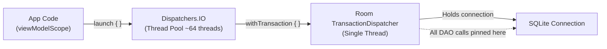
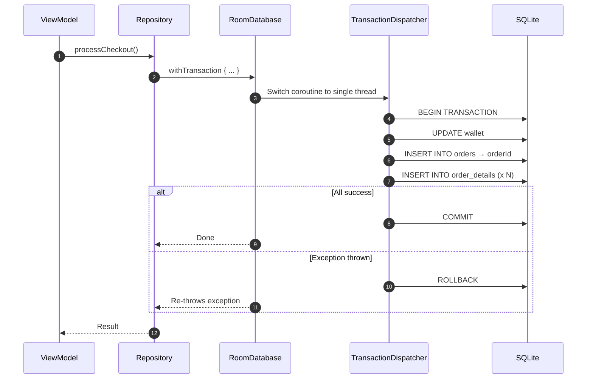
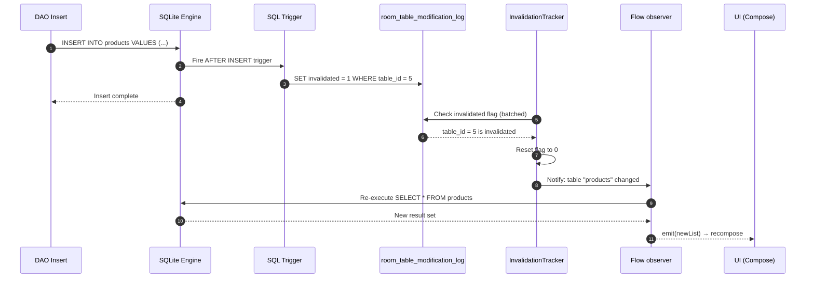
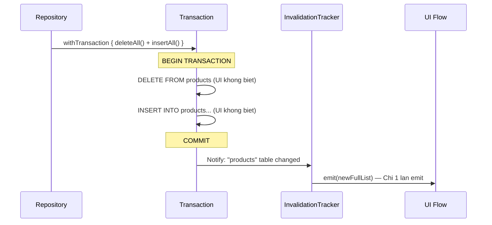
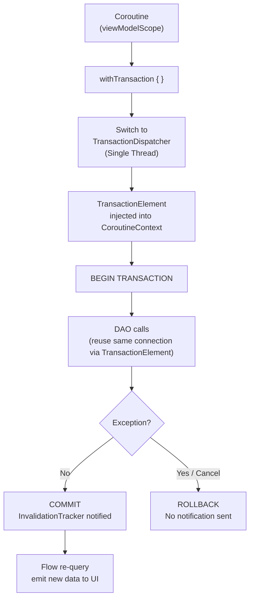

# Room Database: Async Transactions & Flow — Tu Nguyen Ly den Thuc Chien

Khi ban viet `dao.insertUser(user)` ben trong mot `suspend fun`, truc giac bao ban do la mot thao tac don gian. Nhung ben duoi, mot chuoi su kien phuc tap xay ra: Coroutine phai nhay sang dung thread co SQLite connection, Room phai giu connection do suot vong doi transaction, va Flow phai biet chinh xac khi nao can re-query ma khong lam UI recompose thua.

Tai lieu nay boc tach tung tang cua co che do — tu `ThreadLocal` cua SQLite, den `TransactionElement` trong `CoroutineContext`, den trigger noi bo cua `InvalidationTracker` — de ban hieu **tai sao** no hoat dong, **khi nao** no sai, va **cach** viet code production-grade.

---

## 1. Van de nen tang: Tai sao SQLite lai "nguy hiem" voi Coroutines?

### 1.1 SQLite connection la ThreadLocal

SQLite khong phai la thread-safe theo cach ban nghi. Moi ket noi SQLite (`SQLiteDatabase`) trong Android duoc rang buoc voi **thread da mo no** thong qua co che `ThreadLocal`.

```
Thread A mo connection → Thread A co SQLite session
Thread B co dung connection cua Thread A → SQLite bao loi: "database locked"
```

Truoc khi co Coroutines, day khong phai van de: ban mo 1 thread, chay query, dong. Tuan tu, don gian.

Nhung Coroutines thay doi luat choi hoan toan.

### 1.2 Coroutine suspension — ke pha vo rang buoc Thread

Khi mot Coroutine `suspend`, no nhuong thread hien tai. Khi duoc resume, no co the tiep tuc tren **mot thread khac** trong pool. Xet tinh huong:

```kotlin
// NGUY HIEM — dung bao gio lam the nay
suspend fun badTransaction() {
    db.beginTransaction()           // Thread A mo transaction
    val result = networkCall()      // suspend → Thread A duoc tra ve pool
                                    // resume tren Thread B
    dao.insertData(result)          // Thread B dung connection cua Thread A → CRASH!
    db.setTransactionSuccessful()
    db.endTransaction()
}
```

`IllegalStateException: Cannot perform this operation because there is no current transaction` — day la loi ban nhan duoc. Khong phai vi code logic sai, ma vi thread sai.

### 1.3 Room giai quyet bang TransactionDispatcher

Room tao ra mot **single-thread executor** rieng biet danh cho transaction, goi la `TransactionDispatcher`. Day la `CoroutineDispatcher` chi co dung **1 thread**, duoc dat ten theo pattern `room-X-trans`.



Khi ban goi `db.withTransaction { ... }`, Room lam 3 viec:
1. **Switch** Coroutine sang `TransactionDispatcher` (single thread).
2. **Mo** SQLite connection va goi `beginTransaction()`.
3. **Cai** `TransactionElement` vao `CoroutineContext` hien tai — day la "the nhan dien" de moi DAO call ben trong biet minh dang o trong transaction va phai dung chinh connection do.

```kotlin
// Cau truc noi bo Room (simplified)
internal class TransactionElement(
    private val transactionThreadControlJob: Job,
    val transactionDispatcher: CancellableContinuation<Unit>
) : CoroutineContext.Element {
    companion object Key : CoroutineContext.Key<TransactionElement>
    override val key = Key
}
```

Bat ky `suspend fun` DAO nao goi ben trong block `withTransaction { }` deu tim thay `TransactionElement` trong `CoroutineContext` va tu dong dung connection da mo, thay vi tao connection moi.

### 1.4 Tai sao Single Thread lai quan trong?

Single thread trong `TransactionDispatcher` dam bao khong co suspend giua chung lam nhay thread. Toan bo cac buoc cua transaction chay tuan tu tren cung 1 thread — cung 1 SQLite connection. Day chinh la dieu ACID yeu cau.

> **Interview insight:** Khi hoi "Room xu ly concurrency trong Coroutines the nao?", cau tra loi cot loi la: `TransactionDispatcher` la single-thread executor duoc pin vao `CoroutineContext` thong qua `TransactionElement`. Day la co che dam bao connection khong bi share giua cac thread trong suot vong doi transaction.

---

## 2. `@Transaction` vs `withTransaction` — Hai cong cu, hai tang kien truc

### 2.1 `@Transaction` tren DAO

`@Transaction` la annotation tai tang DAO. Khi Room Compiler thay annotation nay, no sinh code trong `*_Impl` xap xi nhu sau:

```kotlin
// Room-generated code (AppDatabase_Impl.kt — simplified)
override suspend fun processCheckout(
    wallet: WalletEntity,
    order: OrderEntity,
    details: List<OrderDetailEntity>
) {
    __db.assertNotSuspendingTransaction()
    __db.beginTransactionAsync()           // Chuyen sang TransactionDispatcher
    try {
        __originalImpl.processCheckout(wallet, order, details)
        __db.setTransactionSuccessful()
    } finally {
        __db.endTransactionAsync()         // Luon duoc goi du thanh cong hay loi
    }
}
```

**Gioi han cua `@Transaction` tren DAO:**
- Scope cua transaction bi gioi han trong **noi bo DAO**.
- Khong kiem soat duoc logic truoc/sau (vi du: validate business rule o Repository).
- Kho test vi logic transaction bi an sau annotation.

### 2.2 `withTransaction { }` tren RoomDatabase

`withTransaction` la extension function trong `room-ktx`, cho phep mo transaction o **bat ky tang nao** — thuong la Repository:

```kotlin
// Cach Google khuyen nghi — transaction o tang Repository
class OrderRepository(
    private val db: AppDatabase,
    private val orderDao: OrderDao
) {
    suspend fun processCheckout(
        wallet: WalletEntity,
        order: OrderEntity,
        items: List<CartItem>
    ) {
        db.withTransaction {
            // Toan bo block nay la 1 atomic operation
            orderDao.updateWallet(wallet)
            val orderId = orderDao.insertOrder(order)
            val details = items.map { OrderDetailEntity(orderId = orderId, ...) }
            orderDao.insertOrderDetails(details)
        }
    }
}
```



### 2.3 Khi nao dung cai nao?

| Tieu chi | `@Transaction` tren DAO | `withTransaction { }` o Repository |
|---|---|---|
| **Scope kiem soat** | Chi trong DAO method | Toan bo block, bat ky tang nao |
| **Business logic** | Khong nen co | Co the ket hop validate, compute |
| **Ket hop nhieu DAO** | Khong truc tiep | De dang: `dao1.x()`, `dao2.y()` |
| **Error handling** | It linh hoat | Full control voi try-catch |
| **Testability** | Kho test rieng | De mock, test tung buoc |
| **Dung khi nao** | `@Relation` query, simple grouped write | Multi-DAO write, Data Sync, Checkout |

**Nguyen tac:** `@Transaction` la annotation convenience cho truong hop don gian. Moi nghiep vu phuc tap (multi-DAO, validation, error handling) deu nen dung `withTransaction { }` o Repository.

### 2.4 Nested Transaction — Dieu gi thuc su xay ra?

SQLite chi ho tro **1 level transaction thuc su**. Room xu ly dieu nay mot cach thong minh: neu Coroutine hien tai da co `TransactionElement` trong `CoroutineContext` (tuc la dang trong transaction), goi `withTransaction { }` lan thu 2 se **khong** mo transaction moi — no chi reuse connection hien tai.

```kotlin
db.withTransaction {                    // Outer: BEGIN TRANSACTION
    dao.insertA()
    db.withTransaction {               // Inner: khong lam gi them — reuse connection
        dao.insertB()
        // Neu throw exception o day → ROLLBACK toan bo outer transaction
    }
    dao.insertC()
}                                       // COMMIT (neu khong co exception)
```

> **Canh bao:** Day la diem khac biet voi cac DB khac (nhu PostgreSQL ho tro true nested transaction voi `SAVEPOINT`). Trong Room, khong co cach de rollback inner transaction ma giu outer transaction tiep tuc.

---

## 3. Rollback va CancellationException — Bay it ai biet

### 3.1 Rollback tu dong

Room rollback khi **bat ky `Throwable` nao** duoc nem ra trong block `withTransaction { }`, bao gom:
- `Exception` va moi subclass
- `Error` (OutOfMemoryError, StackOverflowError)
- `CancellationException` — **day la bay quan trong nhat**

### 3.2 CancellationException va Coroutine Cancellation

Khi nguoi dung thoat man hinh, `viewModelScope` bi cancel. Dieu nay nem `CancellationException` vao moi Coroutine dang chay.

```kotlin
viewModelScope.launch {
    db.withTransaction {
        dao.updateWallet(wallet)        // Thanh cong
        dao.insertOrder(order)          // Thanh cong
        // User thoat man hinh → CancellationException duoc nem
        dao.insertOrderDetails(details) // Khong bao gio chay
        // Room nhan CancellationException → ROLLBACK toan bo
    }
}
```

**Room dam bao Rollback ngay ca khi bi cancel.** Co che: `withTransaction { }` su dung `try-finally` de goi `endTransaction()` trong moi tinh huong.

### 3.3 Chien luoc xu ly dung

Neu ban co operation critical (khong duoc cancel do chung), tach no khoi lifecycle-bound scope:

```kotlin
class OrderRepository(
    private val db: AppDatabase,
    private val dao: OrderDao,
    // ApplicationScope — khong bi cancel khi screen dong
    private val externalScope: CoroutineScope
) {
    suspend fun submitOrder(order: OrderEntity, items: List<CartItem>) {
        externalScope.launch {
            db.withTransaction {
                dao.insertOrder(order)
                dao.insertOrderDetails(items.map { it.toEntity() })
            }
        }.join()
    }
}
```

---

## 4. Flow tu Room — Co che InvalidationTracker

### 4.1 Flow khong phai la polling

Khi ban viet:
```kotlin
@Query("SELECT * FROM products")
fun getAllProducts(): Flow<List<ProductEntity>>
```

Room **khong** dung polling (cu moi X giay query lai). Thay vao do, Room dung **SQLite trigger** de biet khi nao data thay doi. Day la `InvalidationTracker`.

### 4.2 Co che SQLite Trigger cua InvalidationTracker

Khi Room khoi tao database, no tu dong tao:
1. Mot bang an ten `room_table_modification_log`.
2. Voi moi bang duoc track, Room tao 3 trigger (`INSERT`, `UPDATE`, `DELETE`):

```sql
-- Vi du Room tao ngam cho bang "products"
CREATE TEMP TRIGGER IF NOT EXISTS
  room_table_modification_trigger_products_INSERT
AFTER INSERT ON products BEGIN
    UPDATE room_table_modification_log
    SET invalidated = 1
    WHERE table_id = 5 AND invalidated = 0;
END;
-- Tuong tu cho UPDATE va DELETE
```

### 4.3 Chuoi su kien tu Write den Flow emit



> **Quan trong:** `InvalidationTracker` su dung batched polling, khong phai real-time listen. No check `room_table_modification_log` theo tung batch sau moi write operation. Vi vay, co the co do tre rat nho (vai milliseconds) giua write va Flow emit.

### 4.4 Table-level invalidation — Van de over-emission

`InvalidationTracker` hoat dong o **table-level**, khong phai row-level. Nghia la neu bang `products` co 10,000 dong va ban chi update 1 dong, `Flow<List<ProductEntity>>` van re-emit toan bo danh sach 10,000 dong.

**Kich ban nguy hiem:**
```kotlin
// Man hinh hien thi danh sach san pham
val products: StateFlow<List<ProductEntity>> = dao.getAllProducts()
    .stateIn(viewModelScope, SharingStarted.Lazily, emptyList())

// Man hinh khac update stock count cua 1 san pham duy nhat
dao.updateStock(productId = 5, newStock = 99)
// → TOAN BO danh sach duoc re-query va re-emit → UI recompose!
```

### 4.5 Giai phap: `distinctUntilChanged()` va query co scope

```kotlin
// Choi emit neu data thuc su khong thay doi
fun getProducts(): Flow<List<ProductEntity>> =
    dao.getAllProducts()
        .distinctUntilChanged()  // Chan neu list moi == list cu (theo equals)

// Tot hon: query hep hon
@Query("SELECT id, name, price FROM products WHERE category = :category")
fun getProductsByCategory(category: String): Flow<List<ProductSummary>>
```

> `distinctUntilChanged()` so sanh bang `equals()` — voi List lon, day van la O(N) comparison. Giai phap uu tien la **query hep hon** va chi lay cac field UI can.

### 4.6 `Flow<List<T>>` vs `Flow<T?>` — Interview trap

```kotlin
@Query("SELECT * FROM products")
fun getAllProducts(): Flow<List<ProductEntity>>
// Neu bang empty → emit emptyList() NGAY LAP TUC khi collect

@Query("SELECT * FROM products WHERE id = :id")
fun getProductById(id: Long): Flow<ProductEntity?>
// Neu khong tim thay → emit null NGAY LAP TUC khi collect
```

Cau hoi phong van: *"Flow<T?> co emit ngay lap tuc khi subscribe khong?"*

**Co.** Room emit gia tri dau tien ngay khi Flow duoc collect bang cach chay query ngay. Dieu nay khac voi `SharedFlow` (khong emit gi cho subscriber moi den tre tru khi co replay buffer).

---

## 5. `@Relation` — N+1 Query Problem va cach Room xu ly

### 5.1 `@Relation` khong dung JOIN

Day la hieu lam pho bien nhat. Room **khong** sinh ra SQL `JOIN`. Thay vao do, Room chay **N+1 queries**:

```kotlin
data class OrderWithDetails(
    @Embedded val order: OrderEntity,
    @Relation(
        parentColumn = "id",
        entityColumn = "orderId"
    )
    val details: List<OrderDetailEntity>
)

@Transaction
@Query("SELECT * FROM orders")
fun getAllOrdersWithDetails(): Flow<List<OrderWithDetails>>
```

Room sinh code tuong duong:
```kotlin
// Simplified Room-generated code
val orders = query("SELECT * FROM orders")         // Query 1: lay tat ca orders
val detailsMap = orders.associate { order ->
    order.id to query(                             // Query 2..N: 1 query per order
        "SELECT * FROM order_details WHERE orderId = ?", order.id
    )
}
return orders.map { order ->
    OrderWithDetails(order, detailsMap[order.id] ?: emptyList())
}
```

Voi 100 orders → 101 queries. Voi 1000 orders → 1001 queries. Day la **N+1 Query Problem**.

### 5.2 Tai sao bat buoc phai co `@Transaction`?

Gia su khong co `@Transaction`:
```
t=0: Query orders → ket qua: [Order A, Order B, Order C]
t=1: Coroutine suspend giua chung (scheduler)
t=2: Thread khac DELETE order_details cua Order B
t=3: Query details cua Order A → OK
t=4: Query details cua Order B → emptyList (da bi xoa!)
t=5: Ket qua: OrderWithDetails(B, emptyList) — DU LIEU KHONG NHAT QUAN!
```

`@Transaction` dam bao toan bo chuoi N+1 queries chay trong 1 SQLite read snapshot — du lieu nhat quan tai 1 thoi diem.

### 5.3 Giai phap thay the khi N+1 la van de

```kotlin
data class OrderSummary(
    val orderId: Long,
    val orderTotal: Double,
    val itemCount: Int  // Tinh tu JOIN, khong can @Relation
)

@Query("""
    SELECT o.id AS orderId, o.total AS orderTotal, COUNT(d.id) AS itemCount
    FROM orders o
    LEFT JOIN order_details d ON o.id = d.orderId
    GROUP BY o.id
""")
fun getOrderSummaries(): Flow<List<OrderSummary>>
```

1 query duy nhat, khong can `@Transaction`, khong N+1.

---

## 6. Pattern thuc chien

### 6.1 Data Sync — Khong de UI thay man hinh trong

Van de: khi sync, ban xoa cache cu roi insert moi. Giua 2 buoc, UI se thay danh sach trong (empty flash).

```kotlin
// SAI — gay empty flash
suspend fun syncProducts(serverData: List<ProductDto>) {
    dao.deleteAll()          // UI thay emptyList()
    dao.insertAll(serverData.map { it.toEntity() })  // UI thay data moi
}

// DUNG — atomic, UI chi thay trang thai cuoi
suspend fun syncProducts(serverData: List<ProductDto>) {
    db.withTransaction {
        dao.deleteAll()
        dao.insertAll(serverData.map { it.toEntity() })
        // Flow chi emit 1 lan SAU KHI ca 2 buoc hoan thanh
    }
}
```

`withTransaction { }` chan duoc empty flash vi `InvalidationTracker` chi notify Flow sau khi transaction `COMMIT`. Trong suot thoi gian transaction dang chay, Flow khong nhan duoc notification nao.



### 6.2 E-commerce Checkout — Multi-table atomic write

```kotlin
class CheckoutRepository(
    private val db: AppDatabase,
    private val walletDao: WalletDao,
    private val orderDao: OrderDao,
    private val inventoryDao: InventoryDao
) {
    suspend fun checkout(
        userId: Long,
        cartItems: List<CartItem>
    ): Result<Long> = runCatching {
        db.withTransaction {
            // Buoc 1: Kiem tra & tru vi
            val wallet = walletDao.getWallet(userId)
                ?: error("Wallet not found")
            val total = cartItems.sumOf { it.price * it.quantity }
            check(wallet.balance >= total) { throw InsufficientFundsException() }
            walletDao.deductBalance(userId, total)

            // Buoc 2: Kiem tra ton kho
            cartItems.forEach { item ->
                val stock = inventoryDao.getStock(item.productId)
                if (stock < item.quantity) throw OutOfStockException(item.productId)
                inventoryDao.reduceStock(item.productId, item.quantity)
            }

            // Buoc 3: Tao order va details
            val orderId = orderDao.insertOrder(
                OrderEntity(userId = userId, total = total, status = "PENDING")
            )
            orderDao.insertOrderDetails(
                cartItems.map { OrderDetailEntity(orderId = orderId, productId = it.productId) }
            )
            orderId  // Tra ve orderId de ViewModel navigate
        }
        // Neu BAT KY buoc nao throw → ROLLBACK toan bo
    }
}
```

**Trong ViewModel:**
```kotlin
fun checkout(cartItems: List<CartItem>) {
    viewModelScope.launch {
        _uiState.value = CheckoutState.Loading
        checkoutRepo.checkout(userId, cartItems)
            .onSuccess { orderId ->
                _uiState.value = CheckoutState.Success(orderId)
            }
            .onFailure { error ->
                _uiState.value = when (error) {
                    is InsufficientFundsException -> CheckoutState.InsufficientFunds
                    is OutOfStockException -> CheckoutState.OutOfStock(error.productId)
                    else -> CheckoutState.Error(error.message)
                }
            }
    }
}
```

### 6.3 Banking Transfer — Ordering de tranh Deadlock

SQLite voi WAL mode chi cho phep 1 writer tai 1 thoi diem (Room TransactionDispatcher la single thread), nen thuc te trong 1 Room instance khong co 2 write transaction dong thoi. Nhung nen ap dung canonical ordering de san sang cho moi truong multi-process:

```kotlin
suspend fun transfer(fromId: Long, toId: Long, amount: Double) {
    // Luon lock account co ID nho hon truoc (canonical ordering)
    val (firstId, secondId) = if (fromId < toId) fromId to toId else toId to fromId

    db.withTransaction {
        val first = accountDao.getById(firstId) ?: error("Account not found")
        val second = accountDao.getById(secondId) ?: error("Account not found")

        val (from, to) = if (fromId == firstId) first to second else second to first
        if (from.balance < amount) throw InsufficientFundsException()

        accountDao.updateBalance(from.id, from.balance - amount)
        accountDao.updateBalance(to.id, to.balance + amount)
    }
}
```

### 6.4 WAL Mode — Tai sao Room bat theo mac dinh

Room tu dong bat **Write-Ahead Logging (WAL)** tu phien ban 2.0+.

**Co che WAL:**
- **Journal mode cu:** Writer phai cho tat ca Readers xong (va nguoc lai) → bottleneck.
- **WAL mode:** Writer ghi vao file WAL rieng biet. Readers doc tu DB chinh. Readers va Writer khong block lan nhau.

```
Journal Mode:  Reader1 — wait — wait — Writer — wait — Reader2
WAL Mode:      Reader1 ─────────────────────────────────────
               Reader2 ─────────────────────────────────────
               Writer  ─── WAL file ─────────────────────────
```

Ket qua thuc te: `Flow<List<T>>` (reader) va `dao.insert()` (writer) khong block nhau, UI luon muot ma.

---

## 7. Testing — Transaction va Flow

### 7.1 Setup In-memory Database

```kotlin
@RunWith(AndroidJUnit4::class)
class CheckoutRepositoryTest {

    private lateinit var db: AppDatabase
    private lateinit var repo: CheckoutRepository

    @Before
    fun setup() {
        val context = ApplicationProvider.getApplicationContext<Context>()
        db = Room.inMemoryDatabaseBuilder(context, AppDatabase::class.java)
            .allowMainThreadQueries()
            .build()
        repo = CheckoutRepository(db, db.walletDao(), db.orderDao(), db.inventoryDao())
    }

    @After
    fun teardown() { db.close() }
}
```

### 7.2 Test Transaction Rollback

```kotlin
@Test
fun `checkout voi insufficient funds phai rollback toan bo`() = runTest {
    db.walletDao().insert(WalletEntity(userId = 1, balance = 50.0))
    val cartItems = listOf(CartItem(productId = 1, price = 100.0, quantity = 1))

    val result = repo.checkout(userId = 1, cartItems = cartItems)

    assertTrue(result.isFailure)
    assertIs<InsufficientFundsException>(result.exceptionOrNull())

    // Verify rollback: vi van con nguyen 50
    assertEquals(50.0, db.walletDao().getWallet(1)!!.balance, 0.001)
    // Verify: khong co order nao duoc tao
    assertTrue(db.orderDao().getAllOrders().isEmpty())
}
```

### 7.3 Test Flow voi Turbine

```kotlin
// build.gradle.kts
testImplementation("app.cash.turbine:turbine:1.1.0")
```

```kotlin
@Test
fun `flow emit updated list sau khi insert`() = runTest {
    db.productDao().insertAll(listOf(ProductEntity(id = 1, name = "Laptop")))

    db.productDao().getAllProducts().test {
        // Emission dau tien: data ban dau
        assertEquals(1, awaitItem().size)

        // Insert them san pham
        db.productDao().insert(ProductEntity(id = 2, name = "Phone"))

        // Emission thu 2: list moi voi 2 items
        assertEquals(2, awaitItem().size)

        cancelAndIgnoreRemainingEvents()
    }
}
```

### 7.4 Test Empty Flash Prevention

```kotlin
@Test
fun `sync phai emit chi 1 lan voi data moi, khong co empty flash`() = runTest {
    db.productDao().insertAll(listOf(ProductEntity(id = 1, name = "Old Product")))

    db.productDao().getAllProducts().test {
        awaitItem()  // Consume initial emission

        db.withTransaction {
            db.productDao().deleteAll()
            db.productDao().insertAll(listOf(
                ProductEntity(id = 2, name = "New A"),
                ProductEntity(id = 3, name = "New B"),
            ))
        }

        // Phai nhan dung 1 emission voi 2 items — khong co emptyList() o giua
        val result = awaitItem()
        assertEquals(2, result.size)
        assertTrue(result.none { it.name == "Old Product" })

        cancelAndIgnoreRemainingEvents()
    }
}
```

---

## 8. Tong ket — Mental Model



| Khai niem | Cot loi can nho |
|---|---|
| **TransactionDispatcher** | Single-thread executor, pin SQLite connection vao 1 thread |
| **TransactionElement** | "Passport" trong CoroutineContext, giup DAO calls reuse connection |
| **`@Transaction` vs `withTransaction`** | DAO-level vs Repository-level; `withTransaction` linh hoat hon |
| **Nested Transaction** | Room reuse connection, khong mo transaction moi |
| **Rollback** | Trigger boi bat ky Throwable, ke ca CancellationException |
| **InvalidationTracker** | SQLite trigger → room_table_modification_log → Flow emit |
| **Table-level invalidation** | Ca table re-emit du chi 1 row thay doi → dung `distinctUntilChanged()` |
| **`@Relation` N+1** | Room chay N+1 queries, can `@Transaction` de dam bao consistency |
| **WAL mode** | Reader/Writer khong block nhau → Flow va Insert song song |
| **Empty flash prevention** | `withTransaction { delete + insert }` → chi emit sau COMMIT |

---

## Tham khao

1. [Write asynchronous DAO queries — Android Developers](https://developer.android.com/training/data-storage/room/async-queries)
2. [RoomDatabase.withTransaction — AndroidX Room KTX](https://developer.android.com/reference/kotlin/androidx/room/package-summary#(androidx.room.RoomDatabase).withTransaction(kotlin.coroutines.SuspendFunction1))
3. [Room @Transaction annotation — Android Reference](https://developer.android.com/reference/androidx/room/Transaction)
4. [InvalidationTracker — Android Reference](https://developer.android.com/reference/androidx/room/InvalidationTracker)
5. [Define relationships between objects — Android Developers](https://developer.android.com/training/data-storage/room/relationships)
6. [SQLite Write-Ahead Logging — sqlite.org](https://www.sqlite.org/wal.html)
7. [Turbine — Testing Kotlin Flows (Square)](https://github.com/cashapp/turbine)
8. [Test your Room database — Android Developers](https://developer.android.com/training/data-storage/room/testing-db)
