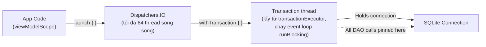
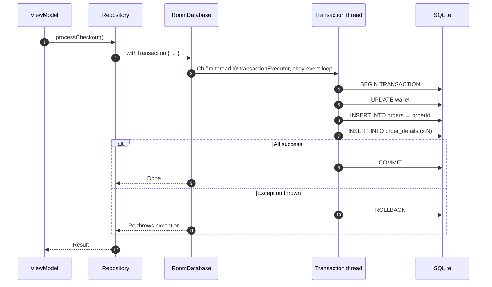
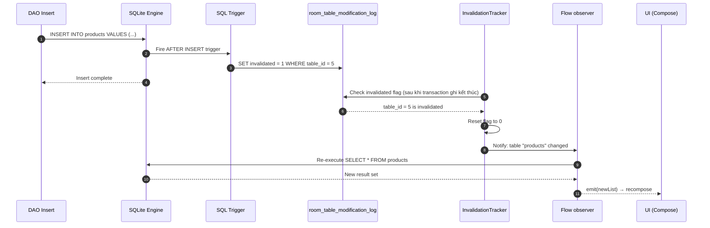
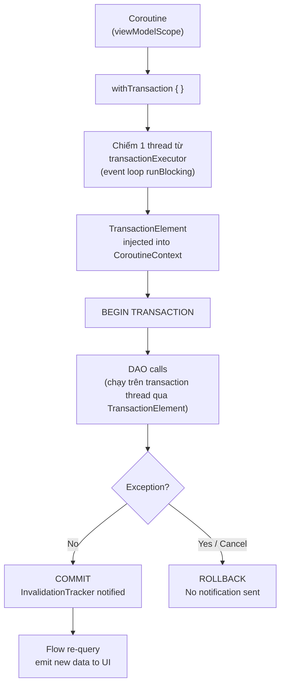

# Room Database: Async Transactions & Flow — Từ Nguyên Lý đến Thực Chiến

Khi bạn viết `dao.insertUser(user)` bên trong một `suspend fun`, trực giác bảo bạn đó là một thao tác đơn giản. Nhưng bên dưới, một chuỗi sự kiện phức tạp xảy ra: Coroutine phải nhảy sang đúng thread đang giữ transaction, Room phải giữ thread đó suốt vòng đời transaction, và Flow phải biết chính xác khi nào cần re-query mà không làm UI recompose thừa.

Tài liệu này bóc tách từng tầng của cơ chế đó — từ cách SQLite gắn transaction với thread, đến `TransactionElement` trong `CoroutineContext`, đến trigger nội bộ của `InvalidationTracker` — để bạn hiểu **tại sao** nó hoạt động, **khi nào** nó sai, và **cách** viết code production-grade.

---

## 1. Vấn đề nền tảng: Tại sao SQLite lại "nguy hiểm" với Coroutines?

### 1.1 SQLite connection là ThreadLocal

Transaction trong SQLite của Android **gắn với thread**, không gắn với đối tượng `SQLiteDatabase`. Bên trong, `SQLiteDatabase` giữ cho mỗi thread một `SQLiteSession` riêng (qua `ThreadLocal`); transaction mở trên thread A chỉ tồn tại trong session của thread A.

```text
Thread A gọi beginTransaction() → session của A giữ connection ghi + transaction
Thread B không thấy transaction của A:
  - lệnh ghi của B phải chờ A trả connection ghi (hoặc báo SQLiteDatabaseLockedException nếu chờ quá lâu)
  - setTransactionSuccessful()/endTransaction() gọi trên B báo lỗi "no current transaction"
```

Trước khi có Coroutines, đây không phải vấn đề: bạn mở 1 thread, chạy query, đóng. Tuần tự, đơn giản.

Nhưng Coroutines thay đổi luật chơi hoàn toàn.

### 1.2 Coroutine suspension — kẻ phá vỡ ràng buộc Thread

Khi một Coroutine `suspend`, nó nhường thread hiện tại. Khi được resume, nó có thể tiếp tục trên **một thread khác** trong pool. Xét tình huống:

```kotlin
// NGUY HIỂM — đừng bao giờ làm thế này
suspend fun badTransaction() {
    db.beginTransaction()           // Thread A mở transaction
    val result = networkCall()      // suspend → Thread A được trả về pool
                                    // resume trên Thread B
    dao.insertData(result)          // Thread B không nằm trong transaction của Thread A
    db.setTransactionSuccessful()   // → lỗi trên Thread B
    db.endTransaction()
}
```

`IllegalStateException: Cannot perform this operation because there is no current transaction` — đây là lỗi bạn nhận được. Không phải vì code logic sai, mà vì thread sai.

### 1.3 Room giải quyết bằng TransactionDispatcher

`withTransaction` (room-ktx) giải quyết bằng cách **giữ riêng một thread cho cả transaction**. Trong mã nguồn Room 2.6, nó làm như sau:

1. **Lấy một thread** từ `transactionExecutor` của database (mặc định là lớp bọc tuần tự trên IO executor của Architecture Components, nên mỗi lúc chỉ một transaction được chạy).
2. Trên thread đó, chạy `runBlocking { ... }`: thread bị chiếm trọn và có một **event loop** riêng. Dispatcher của event loop này chính là "transaction dispatcher".
3. **Cài** `TransactionElement` (giữ dispatcher đó) vào `CoroutineContext`, rồi gọi `beginTransaction()` và chạy block của bạn trong context này.

Vì block luôn resume về event loop của cùng một thread, dù block có `suspend` giữa chừng thì mọi lệnh SQL vẫn chạy trên thread đang giữ transaction.



Khi bạn gọi `db.withTransaction { ... }`, Room làm 3 việc:
1. **Chiếm** một thread từ `transactionExecutor` và chạy event loop trên thread đó.
2. **Mở** transaction bằng `beginTransaction()` trên chính thread đó.
3. **Cài** `TransactionElement` vào `CoroutineContext` hiện tại — đây là "thẻ nhận diện" để mọi DAO call bên trong biết mình đang ở trong transaction và phải chạy trên đúng thread đó.

```kotlin
// Cấu trúc nội bộ Room 2.6 (room-ktx, simplified)
internal class TransactionElement(
    internal val transactionDispatcher: ContinuationInterceptor // dispatcher của event loop
) : CoroutineContext.Element {
    companion object Key : CoroutineContext.Key<TransactionElement>
    override val key get() = TransactionElement
    // Đếm số transaction lồng nhau dùng element này (acquire/release)
}
```

Bất kỳ `suspend fun` DAO nào gọi bên trong block `withTransaction { }` đều tìm thấy `TransactionElement` trong `CoroutineContext` và chuyển việc sang `transactionDispatcher` của nó, thay vì sang query executor bình thường.

### 1.4 Tại sao Single Thread lại quan trọng?

Event loop trên một thread duy nhất đảm bảo: dù block có suspend giữa chừng, khi resume nó vẫn quay về đúng thread đang giữ transaction. Toàn bộ các bước của transaction chạy tuần tự trên cùng 1 thread — cùng 1 SQLite session. Đây chính là điều ACID yêu cầu.

> **Interview insight:** Khi hỏi "Room xử lý concurrency trong Coroutines thế nào?", câu trả lời cốt lõi là: `withTransaction` chiếm một thread từ `transactionExecutor`, chạy event loop trên thread đó, và ghim dispatcher của event loop vào `CoroutineContext` thông qua `TransactionElement`. Đây là cơ chế đảm bảo transaction không bị chia giữa các thread trong suốt vòng đời của nó.

---

## 2. `@Transaction` vs `withTransaction` — Hai công cụ, hai tầng kiến trúc

### 2.1 `@Transaction` trên DAO

`@Transaction` là annotation tại tầng DAO. Với một hàm `suspend` có thân trong abstract DAO, Room Compiler sinh code trong `*_Impl` xấp xỉ như sau:

```kotlin
// Room-generated code (OrderDao_Impl.kt — simplified, Room 2.6)
override suspend fun processCheckout(
    wallet: WalletEntity,
    order: OrderEntity,
    details: List<OrderDetailEntity>
) {
    // Bọc thân hàm bạn viết trong withTransaction — cùng cơ chế ở mục 1.3
    __db.withTransaction {
        super.processCheckout(wallet, order, details)
    }
}
```

**Giới hạn của `@Transaction` trên DAO:**
- Scope của transaction bị giới hạn trong **nội bộ DAO**.
- Không kiểm soát được logic trước/sau (ví dụ: validate business rule ở Repository).
- Khó test vì logic transaction bị ẩn sau annotation.

### 2.2 `withTransaction { }` trên RoomDatabase

`withTransaction` là extension function trong `room-ktx`, cho phép mở transaction ở **bất kỳ tầng nào** — thường là Repository:

```kotlin
// Cách Google khuyến nghị — transaction ở tầng Repository
class OrderRepository(
    private val db: AppDatabase,
    private val orderDao: OrderDao
) {
    suspend fun processCheckout(
        wallet: WalletEntity,
        order: OrderEntity,
        items: List<CartItem>
    ) {
        db.withTransaction {
            // Toàn bộ block này là 1 atomic operation
            orderDao.updateWallet(wallet)
            val orderId = orderDao.insertOrder(order)
            val details = items.map { OrderDetailEntity(orderId = orderId, ...) }
            orderDao.insertOrderDetails(details)
        }
    }
}
```



### 2.3 Khi nào dùng cái nào?

| Tiêu chí | `@Transaction` trên DAO | `withTransaction { }` ở Repository |
|---|---|---|
| **Scope kiểm soát** | Chỉ trong DAO method | Toàn bộ block, bất kỳ tầng nào |
| **Business logic** | Không nên có | Có thể kết hợp validate, compute |
| **Kết hợp nhiều DAO** | Không trực tiếp | Dễ dàng: `dao1.x()`, `dao2.y()` |
| **Error handling** | Ít linh hoạt | Full control với try-catch |
| **Testability** | Khó test riêng | Dễ mock, test từng bước |
| **Dùng khi nào** | `@Relation` query, simple grouped write | Multi-DAO write, Data Sync, Checkout |

**Nguyên tắc:** `@Transaction` là annotation convenience cho trường hợp đơn giản. Mọi nghiệp vụ phức tạp (multi-DAO, validation, error handling) đều nên dùng `withTransaction { }` ở Repository.

### 2.4 Nested Transaction — Điều gì thực sự xảy ra?

SQLite chỉ hỗ trợ **1 level transaction thực sự**. Nếu Coroutine hiện tại đã có `TransactionElement` trong `CoroutineContext` (tức là đang trong transaction), gọi `withTransaction { }` lần thứ 2 sẽ chạy trên cùng transaction thread và gọi lại `beginTransaction()`. Android ghép lần gọi này vào transaction ngoài (nested transaction của `SQLiteDatabase`): chỉ khi transaction ngoài kết thúc thì toàn bộ mới được commit hoặc rollback.

```kotlin
db.withTransaction {                    // Outer: BEGIN TRANSACTION
    dao.insertA()
    db.withTransaction {               // Inner: beginTransaction() lồng, ghép vào outer
        dao.insertB()
        // Nếu throw exception ở đây → ROLLBACK toàn bộ outer transaction
    }
    dao.insertC()
}                                       // COMMIT (nếu không có exception)
```

> **Cảnh báo:** Đây là điểm khác biệt với các DB khác (như PostgreSQL hỗ trợ true nested transaction với `SAVEPOINT`). Trong Room, không có cách để rollback inner transaction mà giữ outer transaction tiếp tục.

---

## 3. Rollback và CancellationException — Bẫy ít ai biết

### 3.1 Rollback tự động

Room rollback khi **bất kỳ `Throwable` nào** được ném ra trong block `withTransaction { }`, bao gồm:
- `Exception` và mọi subclass
- `Error` (OutOfMemoryError, StackOverflowError)
- `CancellationException` — **đây là bẫy quan trọng nhất**

### 3.2 CancellationException và Coroutine Cancellation

Khi người dùng thoát màn hình, `viewModelScope` bị cancel. Điều này ném `CancellationException` vào mọi Coroutine đang chạy.

```kotlin
viewModelScope.launch {
    db.withTransaction {
        dao.updateWallet(wallet)        // Thành công
        dao.insertOrder(order)          // Thành công
        // User thoát màn hình → CancellationException được ném
        dao.insertOrderDetails(details) // Không bao giờ chạy
        // Room nhận CancellationException → ROLLBACK toàn bộ
    }
}
```

**Room đảm bảo Rollback ngay cả khi bị cancel.** Cơ chế: `withTransaction { }` sử dụng `try-finally` để gọi `endTransaction()` trong mọi tình huống.

### 3.3 Chiến lược xử lý đúng

Nếu bạn có operation critical (không được cancel dở chừng), tách nó khỏi lifecycle-bound scope:

```kotlin
class OrderRepository(
    private val db: AppDatabase,
    private val dao: OrderDao,
    // ApplicationScope — không bị cancel khi screen đóng
    private val externalScope: CoroutineScope
) {
    suspend fun submitOrder(order: OrderEntity, items: List<CartItem>) {
        externalScope.launch {
            db.withTransaction {
                dao.insertOrder(order)
                dao.insertOrderDetails(items.map { it.toEntity() })
            }
        }.join()
    }
}
```

---

## 4. Flow từ Room — Cơ chế InvalidationTracker

### 4.1 Flow không phải là polling

Khi bạn viết:
```kotlin
@Query("SELECT * FROM products")
fun getAllProducts(): Flow<List<ProductEntity>>
```

Room **không** dùng polling (cứ mỗi X giây query lại). Thay vào đó, Room dùng **SQLite trigger** để biết khi nào data thay đổi. Đây là `InvalidationTracker`.

### 4.2 Cơ chế SQLite Trigger của InvalidationTracker

Khi Room khởi tạo database, nó tự động tạo:
1. Một bảng ẩn tên `room_table_modification_log`.
2. Với mỗi bảng được track, Room tạo 3 trigger (`INSERT`, `UPDATE`, `DELETE`):

```sql
-- Ví dụ Room tạo ngầm cho bảng "products"
CREATE TEMP TRIGGER IF NOT EXISTS
  room_table_modification_trigger_products_INSERT
AFTER INSERT ON products BEGIN
    UPDATE room_table_modification_log
    SET invalidated = 1
    WHERE table_id = 5 AND invalidated = 0;
END;
-- Tương tự cho UPDATE và DELETE
```

### 4.3 Chuỗi sự kiện từ Write đến Flow emit



> **Quan trọng:** `InvalidationTracker` không polling theo chu kỳ. Mỗi khi một transaction ghi kết thúc, Room lên lịch **một lần** đọc `room_table_modification_log` trên background thread để tìm bảng bị đánh dấu. Vì việc đọc này chạy bất đồng bộ sau commit, có thể có độ trễ rất nhỏ (vài milliseconds) giữa write và Flow emit.

### 4.4 Table-level invalidation — Vấn đề over-emission

`InvalidationTracker` hoạt động ở **table-level**, không phải row-level. Nghĩa là nếu bảng `products` có 10,000 dòng và bạn chỉ update 1 dòng, `Flow<List<ProductEntity>>` vẫn re-emit toàn bộ danh sách 10,000 dòng.

**Kịch bản nguy hiểm:**
```kotlin
// Màn hình hiển thị danh sách sản phẩm
val products: StateFlow<List<ProductEntity>> = dao.getAllProducts()
    .stateIn(viewModelScope, SharingStarted.Lazily, emptyList())

// Màn hình khác update stock count của 1 sản phẩm duy nhất
dao.updateStock(productId = 5, newStock = 99)
// → TOÀN BỘ danh sách được re-query và re-emit → UI recompose!
```

### 4.5 Giải pháp: `distinctUntilChanged()` và query có scope

```kotlin
// Chỉ emit nếu data thực sự thay đổi
fun getProducts(): Flow<List<ProductEntity>> =
    dao.getAllProducts()
        .distinctUntilChanged()  // Chặn nếu list mới == list cũ (theo equals)

// Tốt hơn: query hẹp hơn
@Query("SELECT id, name, price FROM products WHERE category = :category")
fun getProductsByCategory(category: String): Flow<List<ProductSummary>>
```

> `distinctUntilChanged()` so sánh bằng `equals()` — với List lớn, đây vẫn là O(N) comparison. Giải pháp ưu tiên là **query hẹp hơn** và chỉ lấy các field UI cần.

### 4.6 `Flow<List<T>>` vs `Flow<T?>` — Interview trap

```kotlin
@Query("SELECT * FROM products")
fun getAllProducts(): Flow<List<ProductEntity>>
// Nếu bảng empty → emit emptyList() NGAY LẬP TỨC khi collect

@Query("SELECT * FROM products WHERE id = :id")
fun getProductById(id: Long): Flow<ProductEntity?>
// Nếu không tìm thấy → emit null NGAY LẬP TỨC khi collect
```

Câu hỏi phỏng vấn: *"Flow<T?> có emit ngay lập tức khi subscribe không?"*

**Có.** Room emit giá trị đầu tiên ngay khi Flow được collect bằng cách chạy query ngay. Điều này khác với `SharedFlow` (không emit gì cho subscriber mới đến trễ trừ khi có replay buffer).

---

## 5. `@Relation` — N+1 Query Problem và cách Room xử lý

### 5.1 `@Relation` không dùng JOIN

Đây là hiểu lầm phổ biến: Room **không** sinh ra SQL `JOIN` cho `@Relation`. Nhưng Room cũng **không** chạy N+1 queries. Room chạy **1 query cho danh sách cha + 1 query cho mỗi quan hệ**, query thứ hai lấy toàn bộ con của mọi cha bằng `WHERE ... IN (...)` rồi ghép trong bộ nhớ:

```kotlin
data class OrderWithDetails(
    @Embedded val order: OrderEntity,
    @Relation(
        parentColumn = "id",
        entityColumn = "orderId"
    )
    val details: List<OrderDetailEntity>
)

@Transaction
@Query("SELECT * FROM orders")
fun getAllOrdersWithDetails(): Flow<List<OrderWithDetails>>
```

Room sinh code tương đương:
```kotlin
// Simplified Room-generated code
val orders = query("SELECT * FROM orders")              // Query 1: lấy tất cả orders
val orderIds = orders.map { it.id }
val details = query(                                     // Query 2: một query cho MỌI order
    "SELECT * FROM order_details WHERE orderId IN (?, ?, ...)", orderIds
)                                                        // (Room chia lô 999 tham số nếu danh sách quá dài)
val detailsMap = details.groupBy { it.orderId }          // Ghép trong bộ nhớ
return orders.map { order ->
    OrderWithDetails(order, detailsMap[order.id] ?: emptyList())
}
```

Với 100 orders hay 1000 orders, vẫn chỉ là **2 queries** (thêm vài query nếu vượt 999 tham số). N+1 chỉ xảy ra khi bạn **tự** lặp và gọi DAO cho từng cha (xem anti-pattern N+1 ở bài Room Architecture).

### 5.2 Tại sao bắt buộc phải có `@Transaction`?

Giả sử không có `@Transaction`:
```text
t=0: Query orders → kết quả: [Order A, Order B, Order C]
t=1: Room chưa kịp chạy query thứ hai
t=2: Thread khác DELETE order_details của Order B
t=3: Query details của A, B, C → B không còn detail nào (đã bị xoá!)
t=4: Kết quả: OrderWithDetails(B, emptyList) — DỮ LIỆU KHÔNG NHẤT QUÁN!
```

`@Transaction` đảm bảo cả 2 query chạy trong 1 SQLite read snapshot — dữ liệu nhất quán tại 1 thời điểm.

### 5.3 Giải pháp thay thế khi N+1 là vấn đề

```kotlin
data class OrderSummary(
    val orderId: Long,
    val orderTotal: Double,
    val itemCount: Int  // Tính từ JOIN, không cần @Relation
)

@Query("""
    SELECT o.id AS orderId, o.total AS orderTotal, COUNT(d.id) AS itemCount
    FROM orders o
    LEFT JOIN order_details d ON o.id = d.orderId
    GROUP BY o.id
""")
fun getOrderSummaries(): Flow<List<OrderSummary>>
```

1 query duy nhất, không cần `@Transaction`, không phải tải toàn bộ detail lên bộ nhớ khi UI chỉ cần số lượng.

---

## 6. Pattern thực chiến

### 6.1 Data Sync — Không để UI thấy màn hình trống

Vấn đề: khi sync, bạn xoá cache cũ rồi insert mới. Giữa 2 bước, UI sẽ thấy danh sách trống (empty flash).

```kotlin
// SAI — gây empty flash
suspend fun syncProducts(serverData: List<ProductDto>) {
    dao.deleteAll()          // UI thấy emptyList()
    dao.insertAll(serverData.map { it.toEntity() })  // UI thấy data mới
}

// ĐÚNG — atomic, UI chỉ thấy trạng thái cuối
suspend fun syncProducts(serverData: List<ProductDto>) {
    db.withTransaction {
        dao.deleteAll()
        dao.insertAll(serverData.map { it.toEntity() })
        // Flow chỉ emit 1 lần SAU KHI cả 2 bước hoàn thành
    }
}
```

`withTransaction { }` chặn được empty flash vì `InvalidationTracker` chỉ notify Flow sau khi transaction `COMMIT`. Trong suốt thời gian transaction đang chạy, Flow không nhận được notification nào.


### 6.2 E-commerce Checkout — Multi-table atomic write

```kotlin
class CheckoutRepository(
    private val db: AppDatabase,
    private val walletDao: WalletDao,
    private val orderDao: OrderDao,
    private val inventoryDao: InventoryDao
) {
    suspend fun checkout(
        userId: Long,
        cartItems: List<CartItem>
    ): Result<Long> = try {
        val orderId = db.withTransaction {
            // Bước 1: Kiểm tra & trừ ví
            val wallet = walletDao.getWallet(userId)
                ?: error("Wallet not found")
            val total = cartItems.sumOf { it.price * it.quantity }
            if (wallet.balance < total) throw InsufficientFundsException()
            walletDao.deductBalance(userId, total)

            // Bước 2: Kiểm tra tồn kho
            cartItems.forEach { item ->
                val stock = inventoryDao.getStock(item.productId)
                if (stock < item.quantity) throw OutOfStockException(item.productId)
                inventoryDao.reduceStock(item.productId, item.quantity)
            }

            // Bước 3: Tạo order và details
            val newOrderId = orderDao.insertOrder(
                OrderEntity(userId = userId, total = total, status = "PENDING")
            )
            orderDao.insertOrderDetails(
                cartItems.map { OrderDetailEntity(orderId = newOrderId, productId = it.productId) }
            )
            newOrderId  // Trả về orderId để ViewModel navigate
        }
        // Nếu BẤT KỲ bước nào throw → ROLLBACK toàn bộ
        Result.success(orderId)
    } catch (e: CancellationException) {
        throw e // Không bọc cancellation vào Result (runCatching sẽ nuốt mất nó)
    } catch (e: Exception) {
        Result.failure(e)
    }
}
```

> `runCatching { }` bắt mọi `Throwable`, kể cả `CancellationException`. Nếu dùng nó ở đây, khi màn hình bị huỷ giữa checkout, coroutine không dừng mà tiếp tục chạy `onFailure` như một lỗi nghiệp vụ. Vì vậy bắt `CancellationException` riêng và ném lại.

**Trong ViewModel:**
```kotlin
fun checkout(cartItems: List<CartItem>) {
    viewModelScope.launch {
        _uiState.value = CheckoutState.Loading
        checkoutRepo.checkout(userId, cartItems)
            .onSuccess { orderId ->
                _uiState.value = CheckoutState.Success(orderId)
            }
            .onFailure { error ->
                _uiState.value = when (error) {
                    is InsufficientFundsException -> CheckoutState.InsufficientFunds
                    is OutOfStockException -> CheckoutState.OutOfStock(error.productId)
                    else -> CheckoutState.Error(error.message)
                }
            }
    }
}
```

### 6.3 Banking Transfer — Ordering để tránh Deadlock

Câu hỏi hay gặp: có cần khoá hai tài khoản theo thứ tự cố định (lock ordering) như trong database server không? Với SQLite thì **không**: SQLite không khoá theo hàng hay theo tài khoản mà khoá **cả file database** khi ghi, và mỗi lúc chỉ có một writer (kể cả ở WAL mode). Hai transaction chuyển tiền không thể giữ "khoá A chờ khoá B", nên không có deadlock kiểu lock ordering. Điều cần làm là đặt **cả đọc số dư lẫn ghi** vào cùng một transaction để không ai xen vào giữa:

```kotlin
suspend fun transfer(fromId: Long, toId: Long, amount: Long) { // tiền lưu theo đơn vị nhỏ nhất (đồng/xu), không dùng Double
    db.withTransaction {
        // Đọc và ghi trong cùng transaction: không writer nào khác chen vào giữa
        val from = accountDao.getById(fromId) ?: error("Account not found")
        val to = accountDao.getById(toId) ?: error("Account not found")
        if (from.balance < amount) throw InsufficientFundsException()

        accountDao.updateBalance(from.id, from.balance - amount)
        accountDao.updateBalance(to.id, to.balance + amount)
    }
}
```

### 6.4 WAL Mode — Tại sao Room bật theo mặc định

Room mặc định dùng `JournalMode.AUTOMATIC`: chọn **Write-Ahead Logging (WAL)** trừ khi thiết bị là low-RAM device (khi đó dùng `TRUNCATE`). Bạn có thể ép chế độ bằng `setJournalMode(...)` khi build database.

**Cơ chế WAL:**
- **Journal mode cũ:** Writer phải chờ tất cả Readers xong (và ngược lại) → bottleneck.
- **WAL mode:** Writer ghi vào file WAL riêng biệt. Readers đọc từ DB chính. Readers và Writer không block lẫn nhau.

```text
Journal Mode:  Reader1 — wait — wait — Writer — wait — Reader2
WAL Mode:      Reader1 ─────────────────────────────────────
               Reader2 ─────────────────────────────────────
               Writer  ─── WAL file ─────────────────────────
```

Kết quả thực tế: `Flow<List<T>>` (reader) và `dao.insert()` (writer) không block nhau, UI luôn mượt mà.

---

## 7. Testing — Transaction và Flow

### 7.1 Setup In-memory Database

```kotlin
@RunWith(AndroidJUnit4::class)
class CheckoutRepositoryTest {

    private lateinit var db: AppDatabase
    private lateinit var repo: CheckoutRepository

    @Before
    fun setup() {
        val context = ApplicationProvider.getApplicationContext<Context>()
        db = Room.inMemoryDatabaseBuilder(context, AppDatabase::class.java)
            .allowMainThreadQueries()
            .build()
        repo = CheckoutRepository(db, db.walletDao(), db.orderDao(), db.inventoryDao())
    }

    @After
    fun teardown() { db.close() }
}
```

### 7.2 Test Transaction Rollback

```kotlin
@Test
fun `checkout voi insufficient funds phai rollback toan bo`() = runTest {
    db.walletDao().insert(WalletEntity(userId = 1, balance = 50.0))
    val cartItems = listOf(CartItem(productId = 1, price = 100.0, quantity = 1))

    val result = repo.checkout(userId = 1, cartItems = cartItems)

    assertTrue(result.isFailure)
    assertIs<InsufficientFundsException>(result.exceptionOrNull())

    // Verify rollback: ví vẫn còn nguyên 50
    assertEquals(50.0, db.walletDao().getWallet(1)!!.balance, 0.001)
    // Verify: không có order nào được tạo
    assertTrue(db.orderDao().getAllOrders().isEmpty())
}
```

### 7.3 Test Flow với Turbine

```kotlin
// build.gradle.kts
testImplementation("app.cash.turbine:turbine:1.1.0")
```

```kotlin
@Test
fun `flow emit updated list sau khi insert`() = runTest {
    db.productDao().insertAll(listOf(ProductEntity(id = 1, name = "Laptop")))

    db.productDao().getAllProducts().test {
        // Emission đầu tiên: data ban đầu
        assertEquals(1, awaitItem().size)

        // Insert thêm sản phẩm
        db.productDao().insert(ProductEntity(id = 2, name = "Phone"))

        // Emission thứ 2: list mới với 2 items
        assertEquals(2, awaitItem().size)

        cancelAndIgnoreRemainingEvents()
    }
}
```

### 7.4 Test Empty Flash Prevention

```kotlin
@Test
fun `sync phai emit chi 1 lan voi data moi, khong co empty flash`() = runTest {
    db.productDao().insertAll(listOf(ProductEntity(id = 1, name = "Old Product")))

    db.productDao().getAllProducts().test {
        awaitItem()  // Consume initial emission

        db.withTransaction {
            db.productDao().deleteAll()
            db.productDao().insertAll(listOf(
                ProductEntity(id = 2, name = "New A"),
                ProductEntity(id = 3, name = "New B"),
            ))
        }

        // Phải nhận đúng 1 emission với 2 items — không có emptyList() ở giữa
        val result = awaitItem()
        assertEquals(2, result.size)
        assertTrue(result.none { it.name == "Old Product" })

        cancelAndIgnoreRemainingEvents()
    }
}
```

---

## 8. Tổng kết — Mental Model



| Khái niệm | Cốt lõi cần nhớ |
|---|---|
| **Transaction thread** | `withTransaction` chiếm 1 thread từ `transactionExecutor`, chạy event loop, giữ cả transaction trên thread đó |
| **TransactionElement** | "Passport" trong CoroutineContext, giữ dispatcher của transaction thread để DAO calls chạy đúng chỗ |
| **`@Transaction` vs `withTransaction`** | DAO-level vs Repository-level; `withTransaction` linh hoạt hơn |
| **Nested Transaction** | `beginTransaction()` lồng, ghép vào transaction ngoài; rollback là rollback cả khối |
| **Rollback** | Trigger bởi bất kỳ Throwable, kể cả CancellationException |
| **InvalidationTracker** | SQLite trigger → room_table_modification_log → Flow emit |
| **Table-level invalidation** | Cả table re-emit dù chỉ 1 row thay đổi → dùng `distinctUntilChanged()` |
| **`@Relation`** | Room chạy 2 queries (cha + `IN (...)` cho con), không phải N+1; cần `@Transaction` để đảm bảo consistency |
| **WAL mode** | `AUTOMATIC` chọn WAL trừ low-RAM device; Reader/Writer không block nhau → Flow và Insert song song |
| **Empty flash prevention** | `withTransaction { delete + insert }` → chỉ emit sau COMMIT |

---

## Tham khảo

1. [Write asynchronous DAO queries — Android Developers](https://developer.android.com/training/data-storage/room/async-queries)
2. [RoomDatabase.withTransaction — AndroidX Room KTX](https://developer.android.com/reference/kotlin/androidx/room/package-summary#(androidx.room.RoomDatabase).withTransaction(kotlin.coroutines.SuspendFunction1))
3. [Room @Transaction annotation — Android Reference](https://developer.android.com/reference/androidx/room/Transaction)
4. [InvalidationTracker — Android Reference](https://developer.android.com/reference/androidx/room/InvalidationTracker)
5. [Define relationships between objects — Android Developers](https://developer.android.com/training/data-storage/room/relationships)
6. [SQLite Write-Ahead Logging — sqlite.org](https://www.sqlite.org/wal.html)
7. [Turbine — Testing Kotlin Flows (Square)](https://github.com/cashapp/turbine)
8. [Test your Room database — Android Developers](https://developer.android.com/training/data-storage/room/testing-db)
9. [Define one-to-many relationships ("requires Room to run two queries") — Android Developers](https://developer.android.com/training/data-storage/room/relationships/one-to-many)
10. [RoomDatabase.JournalMode — Android Reference](https://developer.android.com/reference/androidx/room/RoomDatabase.JournalMode)
11. [SQLiteDatabase.beginTransaction (nested transactions) — Android Reference](https://developer.android.com/reference/android/database/sqlite/SQLiteDatabase#beginTransaction())
12. [File Locking And Concurrency In SQLite — sqlite.org](https://www.sqlite.org/lockingv3.html)
