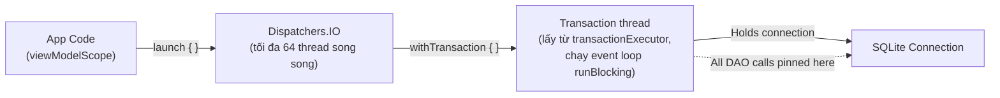
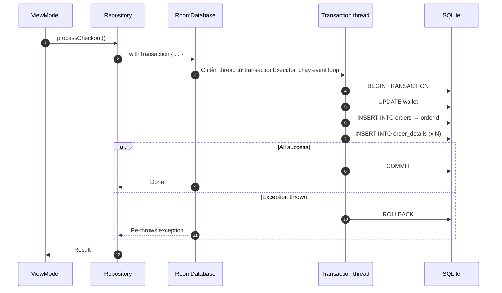
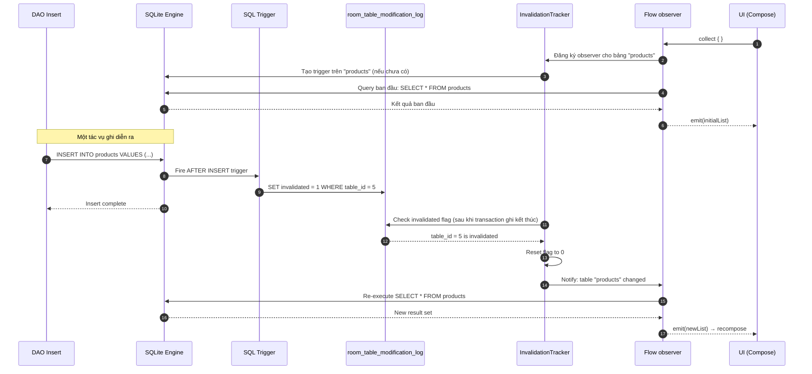
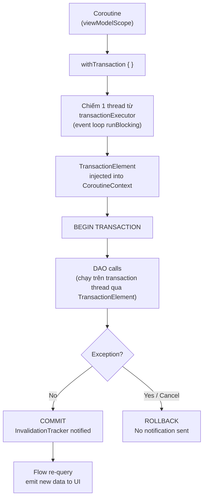
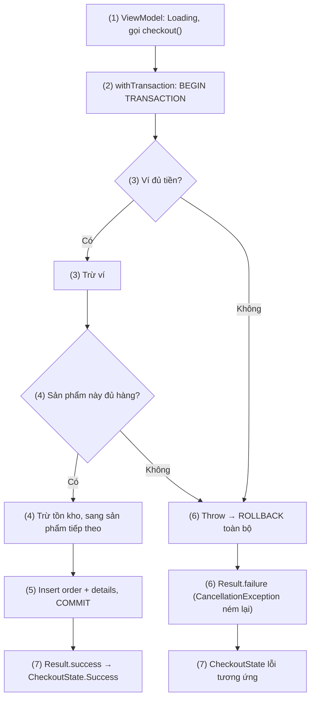

# Async Transactions & Flow

## Vấn đề cần giải quyết

Khi bạn viết `dao.insertUser(user)` bên trong một `suspend fun`, trực giác bảo bạn đó là một thao tác đơn giản. Nhưng bên dưới, một chuỗi sự kiện phức tạp xảy ra: Coroutine phải nhảy sang đúng thread đang giữ transaction, Room phải giữ thread đó suốt vòng đời transaction, và Flow phải biết chính xác khi nào cần re-query mà không làm UI recompose thừa.

> [!NOTE]
> **Kiến thức dùng trước.** Bài dùng coroutine (đoạn code có thể tạm dừng bằng `suspend` rồi chạy tiếp, có thể trên thread khác) và `Flow` (luồng dữ liệu bất đồng bộ phát nhiều giá trị theo thời gian) ở mức tối thiểu: hàm `suspend`, `launch`, `collect`. Coroutine được học ở [8.4.3 Coroutines](../../session_08/async_threads/coroutines.md); Flow được học ở 7.1.4.2 Flow (chưa có bài).

### Transaction của SQLite gắn với thread

Transaction trong SQLite của Android **gắn với thread**, không gắn với đối tượng `SQLiteDatabase`. Bên trong, `SQLiteDatabase` giữ cho mỗi thread một `SQLiteSession` riêng (qua `ThreadLocal`); transaction mở trên thread A chỉ tồn tại trong session của thread A.

```text
Thread A gọi beginTransaction() → session của A giữ connection ghi + transaction
Thread B không thấy transaction của A:
  - lệnh ghi của B phải chờ A trả connection ghi (hoặc báo SQLiteDatabaseLockedException nếu chờ quá lâu)
  - setTransactionSuccessful()/endTransaction() gọi trên B báo lỗi "no current transaction"
```

Trước khi có Coroutines, đây không phải vấn đề: bạn mở 1 thread, chạy query, đóng. Tuần tự, đơn giản.

Nhưng Coroutines thay đổi luật chơi hoàn toàn.

### Coroutine suspension — kẻ phá vỡ ràng buộc Thread

Khi một Coroutine `suspend`, nó nhường thread hiện tại. Khi được resume, nó có thể tiếp tục trên **một thread khác** trong pool. Xét tình huống:

```kotlin
// NGUY HIỂM — đừng bao giờ làm thế này
suspend fun badTransaction() {
    db.beginTransaction()           // Thread A mở transaction
    val result = networkCall()      // suspend → Thread A được trả về pool
                                    // resume trên Thread B
    dao.insertData(result)          // Thread B không nằm trong transaction của Thread A
    db.setTransactionSuccessful()   // → lỗi trên Thread B
    db.endTransaction()
}
```

`IllegalStateException: Cannot perform this operation because there is no current transaction` — đây là lỗi bạn nhận được. Không phải vì code logic sai, mà vì thread sai.

Tài liệu này bóc tách từng tầng của cơ chế đó — từ cách SQLite gắn transaction với thread, đến `TransactionElement` trong `CoroutineContext`, đến trigger nội bộ của `InvalidationTracker` — để bạn hiểu **tại sao** nó hoạt động, **khi nào** nó sai, và **cách** viết code production-grade.

## Sau khi học xong

- Giải thích được vì sao transaction gắn với thread là vấn đề khi dùng Coroutines và cách withTransaction giữ cả transaction trên một thread.
- Phân biệt được @Transaction (DAO-level) và withTransaction (Repository-level).
- Giải thích được cơ chế InvalidationTracker - SQLite trigger, bảng room_table_modification_log và Flow emit.
- Áp dụng được các pattern Data Sync không empty flash, Checkout nhiều bảng và cách đọc @Relation hiệu quả (2 query hoặc JOIN thủ công).
- Triển khai được Unit Test cho transaction rollback và Flow emission bằng Turbine.

## Async Transactions & Flow là gì?

**Async Transactions & Flow** là hai cơ chế Room dùng để làm việc với coroutine: `withTransaction` giữ toàn bộ một transaction trên **một thread riêng** lấy từ `transactionExecutor` dù block có `suspend` giữa chừng, còn `InvalidationTracker` dùng **SQLite trigger** đánh dấu bảng vừa bị ghi để các `Flow` đang đọc bảng đó chạy lại query sau khi transaction ghi kết thúc.

Mental model: `TransactionElement` là **thẻ nhận diện** của transaction mà coroutine mang theo trong `CoroutineContext`. Lời gọi DAO nào bên trong `withTransaction { }` thấy thẻ này thì được dẫn về đúng thread đang giữ transaction; lời gọi không có thẻ thì đi sang executor bình thường của Room.

## Cách hoạt động

### Room chạy query trên thread nào?

Đọc ghi database là Disk I/O, thời gian không đoán trước được: một query có thể mất vài mili-giây đến vài trăm mili-giây tuỳ kích thước file và tải của máy. Chạy trên main thread thì vượt ngân sách một frame và có thể dẫn tới ANR (xem [Working with Thread](../working_with_thread.md), mục "Main Thread (UI Thread) trong Android"). Vì vậy:

- **Room chặn query trên main thread.** Gọi một hàm DAO thường (không `suspend`, không trả `Flow`) trên main thread sẽ bị `IllegalStateException: Cannot access database on the main thread since it may potentially lock the UI for a long period of time.` Builder có `allowMainThreadQueries()` để tắt kiểm tra này; chỉ dùng trong test, không dùng trong code production.
- **Hàm `suspend` và hàm trả `Flow` là main-safe:** Room tự chuyển việc sang executor của nó, nên gọi từ `viewModelScope` (đang ở main thread) vẫn an toàn.
- **Hai vai trò executor:**
  - **Query executor** chạy các lệnh đọc (`SELECT` của hàm `suspend`, query của `Flow`), cho phép nhiều lệnh đọc song song.
  - **Transaction executor** chạy các lệnh ghi `suspend` và `withTransaction` (mục "`withTransaction` giữ cả transaction trên một thread" ngay sau đây), **tuần tự từng việc một** để các transaction ghi không tranh nhau.
  - Mặc định cả hai cùng dùng IO executor của Architecture Components; transaction executor chỉ là lớp bọc tuần tự trên executor đó. Muốn đổi thì dùng `setQueryExecutor(...)` / `setTransactionExecutor(...)` khi build database.

### `withTransaction` giữ cả transaction trên một thread

`withTransaction` (room-ktx) giải quyết bằng cách **giữ riêng một thread cho cả transaction**. Trong mã nguồn Room 2.6, nó làm như sau:

1. **Lấy một thread** từ `transactionExecutor` của database (mặc định là lớp bọc tuần tự trên IO executor của Architecture Components, nên mỗi lúc chỉ một transaction được chạy).
2. Trên thread đó, chạy `runBlocking { ... }`: thread bị chiếm trọn và có một **event loop** riêng. Dispatcher của event loop này chính là "transaction dispatcher".
3. **Cài** `TransactionElement` (giữ dispatcher đó) vào `CoroutineContext`, rồi gọi `beginTransaction()` và chạy block của bạn trong context này.

Vì block luôn resume về event loop của cùng một thread, dù block có `suspend` giữa chừng thì mọi lệnh SQL vẫn chạy trên thread đang giữ transaction.



Khi bạn gọi `db.withTransaction { ... }`, Room làm 3 việc:
1. **Chiếm** một thread từ `transactionExecutor` và chạy event loop trên thread đó.
2. **Mở** transaction bằng `beginTransaction()` trên chính thread đó.
3. **Cài** `TransactionElement` vào `CoroutineContext` hiện tại — đây là "thẻ nhận diện" để mọi DAO call bên trong biết mình đang ở trong transaction và phải chạy trên đúng thread đó.

```kotlin
// Cấu trúc nội bộ Room 2.6 (room-ktx, simplified)
internal class TransactionElement(
    internal val transactionDispatcher: ContinuationInterceptor // dispatcher của event loop
) : CoroutineContext.Element {
    companion object Key : CoroutineContext.Key<TransactionElement>
    override val key get() = TransactionElement
    // Đếm số transaction lồng nhau dùng element này (acquire/release)
}
```

Bất kỳ `suspend fun` DAO nào gọi bên trong block `withTransaction { }` đều tìm thấy `TransactionElement` trong `CoroutineContext` và chuyển việc sang `transactionDispatcher` của nó, thay vì sang query executor bình thường.

#### Tại sao Single Thread lại quan trọng?

Event loop trên một thread duy nhất đảm bảo: dù block có suspend giữa chừng, khi resume nó vẫn quay về đúng thread đang giữ transaction. Toàn bộ các bước của transaction chạy tuần tự trên cùng 1 thread — cùng 1 SQLite session. Đây chính là điều ACID yêu cầu.

> [!TIP]
> **Interview insight:** Khi hỏi "Room xử lý concurrency trong Coroutines thế nào?", câu trả lời cốt lõi là: `withTransaction` chiếm một thread từ `transactionExecutor`, chạy event loop trên thread đó, và ghim dispatcher của event loop vào `CoroutineContext` thông qua `TransactionElement`. Đây là cơ chế đảm bảo transaction không bị chia giữa các thread trong suốt vòng đời của nó.

### `@Transaction` trên DAO

`@Transaction` là annotation tại tầng DAO. Với một hàm `suspend` có thân trong abstract DAO, Room Compiler sinh code trong `*_Impl` xấp xỉ như sau:

```kotlin
// Room-generated code (OrderDao_Impl.kt — simplified, Room 2.6)
override suspend fun processCheckout(
    wallet: WalletEntity,
    order: OrderEntity,
    details: List<OrderDetailEntity>
) {
    // Bọc thân hàm bạn viết trong withTransaction — cùng cơ chế ở mục "withTransaction giữ cả transaction trên một thread"
    __db.withTransaction {
        super.processCheckout(wallet, order, details)
    }
}
```

**Giới hạn của `@Transaction` trên DAO:**
- Scope của transaction bị giới hạn trong **nội bộ DAO**.
- Không kiểm soát được logic trước/sau (ví dụ: validate business rule ở Repository).
- Khó test vì logic transaction bị ẩn sau annotation.

### `withTransaction { }` trên RoomDatabase

`withTransaction` là extension function trong `room-ktx`, cho phép mở transaction ở **bất kỳ tầng nào** — thường là Repository:

```kotlin
// Cách Google khuyến nghị — transaction ở tầng Repository
class OrderRepository(
    private val db: AppDatabase,
    private val orderDao: OrderDao
) {
    suspend fun processCheckout(
        wallet: WalletEntity,
        order: OrderEntity,
        items: List<CartItem>
    ) {
        db.withTransaction {
            // Toàn bộ block này là 1 atomic operation
            orderDao.updateWallet(wallet)
            val orderId = orderDao.insertOrder(order)
            val details = items.map { OrderDetailEntity(orderId = orderId, ...) }
            orderDao.insertOrderDetails(details)
        }
    }
}
```



Khi nào chọn `@Transaction`, khi nào chọn `withTransaction`: xem mục "Khi nào nên và không nên dùng".

### Nested Transaction — Điều gì thực sự xảy ra?

SQLite chỉ hỗ trợ **1 level transaction thực sự**. Nếu Coroutine hiện tại đã có `TransactionElement` trong `CoroutineContext` (tức là đang trong transaction), gọi `withTransaction { }` lần thứ 2 sẽ chạy trên cùng transaction thread và gọi lại `beginTransaction()`. Android ghép lần gọi này vào transaction ngoài (nested transaction của `SQLiteDatabase`): chỉ khi transaction ngoài kết thúc thì toàn bộ mới được commit hoặc rollback.

```kotlin
db.withTransaction {                    // Outer: BEGIN TRANSACTION
    dao.insertA()
    db.withTransaction {               // Inner: beginTransaction() lồng, ghép vào outer
        dao.insertB()
        // Nếu throw exception ở đây → ROLLBACK toàn bộ outer transaction
    }
    dao.insertC()
}                                       // COMMIT (nếu không có exception)
```

### Rollback và CancellationException

#### Rollback tự động

Room rollback khi **bất kỳ `Throwable` nào** được ném ra trong block `withTransaction { }`, bao gồm:
- `Exception` và mọi subclass
- `Error` (OutOfMemoryError, StackOverflowError)
- `CancellationException` — **đây là bẫy quan trọng nhất**

Tài liệu của `withTransaction` ghi rõ: transaction chỉ được đánh dấu thành công khi block không ném exception **và** coroutine không bị cancel.

#### CancellationException và Coroutine Cancellation

Khi người dùng thoát màn hình, `viewModelScope` bị cancel. Điều này ném `CancellationException` vào mọi Coroutine đang chạy.

```kotlin
viewModelScope.launch {
    db.withTransaction {
        dao.updateWallet(wallet)        // Thành công
        dao.insertOrder(order)          // Thành công
        // User thoát màn hình → CancellationException được ném
        dao.insertOrderDetails(details) // Không bao giờ chạy
        // Room nhận CancellationException → ROLLBACK toàn bộ
    }
}
```

**Room đảm bảo Rollback ngay cả khi bị cancel.** Cơ chế: `withTransaction { }` sử dụng `try-finally` để gọi `endTransaction()` trong mọi tình huống.

Rollback giữ dữ liệu nhất quán, nhưng thao tác ghi bị bỏ dở. Thao tác nào không được phép bỏ dở khi màn hình đóng thì phải chạy ngoài scope của màn hình: xem mục "Sai lầm thường gặp", phần "3. Chạy thao tác ghi quan trọng trong scope gắn với màn hình".

### Flow từ Room — Cơ chế InvalidationTracker

#### Flow không phải là polling

Khi bạn viết:
```kotlin
@Query("SELECT * FROM products")
fun getAllProducts(): Flow<List<ProductEntity>>
```

Hàm DAO trả `Flow` là hàm thường, **không** có `suspend`: gọi hàm chỉ tạo ra `Flow`, query chỉ chạy khi có người `collect`, và chạy lại mỗi khi bảng nó đọc thay đổi.

Room **không** dùng polling (cứ mỗi X giây query lại). Thay vào đó, Room dùng **SQLite trigger** để biết khi nào data thay đổi. Đây là `InvalidationTracker`.

#### Cơ chế SQLite Trigger của InvalidationTracker

`InvalidationTracker` dựa vào hai thứ Room tạo ngầm:
1. **Bảng `room_table_modification_log`**: một bảng tạm (`TEMP TABLE`, Room đặt `temp_store = MEMORY`), tạo khi database mở. Bảng không nằm trong file `.db`; mỗi hàng ứng với một bảng được theo dõi (`table_id`) và một cờ `invalidated`.
2. **Trigger trên bảng được theo dõi**: khi một bảng có observer đầu tiên (ví dụ một `Flow` bắt đầu được collect), Room tạo 3 trigger (`INSERT`, `UPDATE`, `DELETE`) cho bảng đó; khi không còn observer nào, Room gỡ trigger đi:

```sql
-- Ví dụ Room tạo ngầm cho bảng "products"
CREATE TEMP TRIGGER IF NOT EXISTS
  room_table_modification_trigger_products_INSERT
AFTER INSERT ON products BEGIN
    UPDATE room_table_modification_log
    SET invalidated = 1
    WHERE table_id = 5 AND invalidated = 0;
END;
-- Tương tự cho UPDATE và DELETE
```

#### Chuỗi sự kiện từ collect, Write đến Flow emit



> [!IMPORTANT]
> `InvalidationTracker` không polling theo chu kỳ. Mỗi khi một transaction ghi kết thúc, Room lên lịch **một lần** đọc `room_table_modification_log` trên background thread để tìm bảng bị đánh dấu. Vì việc đọc này chạy bất đồng bộ sau commit, có thể có độ trễ rất nhỏ (vài milliseconds) giữa write và Flow emit.

#### Table-level invalidation — Vấn đề over-emission

`InvalidationTracker` hoạt động ở **table-level**, không phải row-level. Nghĩa là nếu bảng `products` có 10,000 dòng và bạn chỉ update 1 dòng, `Flow<List<ProductEntity>>` vẫn re-emit toàn bộ danh sách 10,000 dòng.

Kịch bản lộ ra vấn đề này và cách giảm số lần emit thừa ở mục "Sai lầm thường gặp", phần "6. Observe cả bảng lớn rồi để Flow re-emit toàn bộ khi chỉ một dòng đổi".

#### `Flow<List<T>>` vs `Flow<T?>` — Giá trị đầu tiên khi collect

```kotlin
@Query("SELECT * FROM products")
fun getAllProducts(): Flow<List<ProductEntity>>
// Nếu bảng empty → emit emptyList() NGAY LẬP TỨC khi collect

@Query("SELECT * FROM products WHERE id = :id")
fun getProductById(id: Long): Flow<ProductEntity?>
// Nếu không tìm thấy → emit null NGAY LẬP TỨC khi collect
```

Câu hỏi phỏng vấn: *"Flow<T?> có emit ngay lập tức khi subscribe không?"*

**Có.** Room emit giá trị đầu tiên ngay khi Flow được collect bằng cách chạy query ngay. Điều này khác với `SharedFlow` (không emit gì cho subscriber mới đến trễ trừ khi có replay buffer).

### `@Relation` — N+1 Query Problem và cách Room xử lý

#### `@Relation` không dùng JOIN

Đây là hiểu lầm phổ biến: Room **không** sinh ra SQL `JOIN` cho `@Relation`. Nhưng Room cũng **không** chạy N+1 queries. Room chạy **1 query cho danh sách cha + 1 query cho mỗi quan hệ**, query thứ hai lấy toàn bộ con của mọi cha bằng `WHERE ... IN (...)` rồi ghép trong bộ nhớ:

```kotlin
data class OrderWithDetails(
    @Embedded val order: OrderEntity,
    @Relation(
        parentColumn = "id",
        entityColumn = "orderId"
    )
    val details: List<OrderDetailEntity>
)

@Transaction
@Query("SELECT * FROM orders")
fun getAllOrdersWithDetails(): Flow<List<OrderWithDetails>>
```

Room sinh code tương đương:
```kotlin
// Simplified Room-generated code
val orders = query("SELECT * FROM orders")              // Query 1: lấy tất cả orders
val orderIds = orders.map { it.id }
val details = query(                                     // Query 2: một query cho MỌI order
    "SELECT * FROM order_details WHERE orderId IN (?, ?, ...)", orderIds
)                                                        // (Room chia lô 999 tham số nếu danh sách quá dài)
val detailsMap = details.groupBy { it.orderId }          // Ghép trong bộ nhớ
return orders.map { order ->
    OrderWithDetails(order, detailsMap[order.id] ?: emptyList())
}
```

Với 100 orders hay 1000 orders, vẫn chỉ là **2 queries** (thêm vài query nếu vượt 999 tham số). N+1 chỉ xảy ra khi bạn **tự** lặp và gọi DAO cho từng cha (xem [Room Architecture](room_architecture.md), mục "Sai lầm thường gặp", phần "1. N+1 Query Problem với vòng lặp DAO").

#### Tại sao bắt buộc phải có `@Transaction`?

Giả sử không có `@Transaction`:
```text
t=0: Query orders → kết quả: [Order A, Order B, Order C]
t=1: Room chưa kịp chạy query thứ hai
t=2: Thread khác DELETE order_details của Order B
t=3: Query details của A, B, C → B không còn detail nào (đã bị xoá!)
t=4: Kết quả: OrderWithDetails(B, emptyList) — DỮ LIỆU KHÔNG NHẤT QUÁN!
```

`@Transaction` đảm bảo cả 2 query chạy trong 1 SQLite read snapshot — dữ liệu nhất quán tại 1 thời điểm.

#### Thay `@Relation` bằng JOIN khi UI chỉ cần số liệu gộp

```kotlin
data class OrderSummary(
    val orderId: Long,
    val orderTotal: Double,
    val itemCount: Int  // Tính từ JOIN, không cần @Relation
)

@Query("""
    SELECT o.id AS orderId, o.total AS orderTotal, COUNT(d.id) AS itemCount
    FROM orders o
    LEFT JOIN order_details d ON o.id = d.orderId
    GROUP BY o.id
""")
fun getOrderSummaries(): Flow<List<OrderSummary>>
```

1 query duy nhất, không cần `@Transaction`, không phải tải toàn bộ detail lên bộ nhớ khi UI chỉ cần số lượng.

### WAL Mode — Tại sao Room bật theo mặc định

Room mặc định dùng `JournalMode.AUTOMATIC`. Theo tài liệu `RoomDatabase.JournalMode`, chế độ thực tế là `TRUNCATE` khi thiết bị chạy API dưới 16 **hoặc** là thiết bị low-RAM (`ActivityManager.isLowRamDevice()`), còn lại là **Write-Ahead Logging (WAL)**. Mốc này gắn với cấu hình thiết bị, không gắn với một phiên bản Android hay phiên bản Room cụ thể. Bạn có thể ép chế độ bằng `setJournalMode(...)` khi build database.

**Cơ chế WAL:**
- **Rollback journal (ví dụ `TRUNCATE`):** khi ghi, SQLite khoá độc quyền cả file database. Writer phải chờ các Reader đang đọc xong, và Reader mới phải chờ Writer ghi xong. Đang có sync ngầm ghi nhiều dữ liệu thì màn hình đọc database bị nghẽn theo.
- **WAL mode:** thay vì sửa trực tiếp file chính (ví dụ `app_database.db`), lệnh ghi được nối vào một file nhật ký riêng `app_database.db-wal` (kèm file chỉ mục `-shm`). Reader vẫn đọc file chính cộng phần đã commit trong WAL, nên Reader không block Writer và Writer không block Reader. Mỗi lúc vẫn chỉ có **một** Writer, vì chỉ có một file WAL.
- **Checkpoint:** định kỳ, nội dung file WAL được gom về file chính. SQLite tự chạy checkpoint khi file WAL vượt ngưỡng (mặc định của SQLite là 1000 page; nền tảng có thể cấu hình ngưỡng khác), Room không phải làm gì.

```text
Journal Mode:  Reader1 — wait — wait — Writer — wait — Reader2
WAL Mode:      Reader1 ─────────────────────────────────────
               Reader2 ─────────────────────────────────────
               Writer  ─── WAL file ─────────────────────────
```

Kết quả thực tế: `Flow<List<T>>` (reader) và `dao.insert()` (writer) không block nhau, UI luôn mượt mà.

### Tổng kết cơ chế



| Khái niệm | Cốt lõi cần nhớ |
|---|---|
| **Transaction thread** | `withTransaction` chiếm 1 thread từ `transactionExecutor`, chạy event loop, giữ cả transaction trên thread đó |
| **TransactionElement** | "Thẻ nhận diện" trong CoroutineContext, giữ dispatcher của transaction thread để DAO calls chạy đúng chỗ |
| **`@Transaction` vs `withTransaction`** | DAO-level vs Repository-level; `withTransaction` linh hoạt hơn |
| **Nested Transaction** | `beginTransaction()` lồng, ghép vào transaction ngoài; rollback là rollback cả khối |
| **Rollback** | Trigger bởi bất kỳ Throwable, kể cả CancellationException |
| **InvalidationTracker** | SQLite trigger → room_table_modification_log → Flow emit |
| **Table-level invalidation** | Cả table re-emit dù chỉ 1 row thay đổi → dùng `distinctUntilChanged()` |
| **`@Relation`** | Room chạy 2 queries (cha + `IN (...)` cho con), không phải N+1; cần `@Transaction` để đảm bảo consistency |
| **WAL mode** | `AUTOMATIC` chọn WAL, trừ API < 16 hoặc thiết bị low-RAM (dùng `TRUNCATE`); Reader/Writer không block nhau → Flow và Insert song song |
| **Empty flash prevention** | `withTransaction { delete + insert }` → chỉ emit sau COMMIT |

## Ví dụ thực tế

### E-commerce Checkout — Multi-table atomic write

Đặt hàng phải trừ ví, trừ tồn kho và tạo đơn cùng lúc: hoặc tất cả thành công, hoặc không bảng nào thay đổi. Luồng chạy:

1. ViewModel đặt `CheckoutState.Loading` và gọi `checkoutRepo.checkout(userId, cartItems)` trong `viewModelScope`.
2. Repository mở `db.withTransaction { }`: Room chiếm transaction thread và `BEGIN TRANSACTION`.
3. Đọc ví và tính tổng tiền; không đủ tiền thì ném `InsufficientFundsException`, đủ thì trừ ví.
4. Với từng sản phẩm trong giỏ: thiếu hàng thì ném `OutOfStockException`, đủ thì trừ tồn kho.
5. Tạo order và order details; block trả `newOrderId`, Room `COMMIT`.
6. Nếu bất kỳ bước (3)–(5) ném exception, Room `ROLLBACK` toàn bộ; Repository bọc lỗi nghiệp vụ thành `Result.failure`, còn `CancellationException` được ném lại.
7. ViewModel đổi `Result` thành `CheckoutState` tương ứng để UI hiển thị.



```kotlin
class CheckoutRepository(
    private val db: AppDatabase,
    private val walletDao: WalletDao,
    private val orderDao: OrderDao,
    private val inventoryDao: InventoryDao
) {
    suspend fun checkout(
        userId: Long,
        cartItems: List<CartItem>
    ): Result<Long> = try {
        val orderId = db.withTransaction { // (2) BEGIN TRANSACTION trên transaction thread
            // (3) Kiểm tra & trừ ví
            val wallet = walletDao.getWallet(userId)
                ?: error("Wallet not found")
            val total = cartItems.sumOf { it.price * it.quantity }
            if (wallet.balance < total) throw InsufficientFundsException()
            walletDao.deductBalance(userId, total)

            // (4) Kiểm tra tồn kho
            cartItems.forEach { item ->
                val stock = inventoryDao.getStock(item.productId)
                if (stock < item.quantity) throw OutOfStockException(item.productId)
                inventoryDao.reduceStock(item.productId, item.quantity)
            }

            // (5) Tạo order và details
            val newOrderId = orderDao.insertOrder(
                OrderEntity(userId = userId, total = total, status = "PENDING")
            )
            orderDao.insertOrderDetails(
                cartItems.map { OrderDetailEntity(orderId = newOrderId, productId = it.productId) }
            )
            newOrderId  // Trả về orderId để ViewModel navigate
        }
        // (6) Nếu BẤT KỲ bước nào throw → ROLLBACK toàn bộ
        Result.success(orderId)
    } catch (e: CancellationException) {
        throw e // (6) Không bọc cancellation vào Result (runCatching sẽ nuốt mất nó)
    } catch (e: Exception) {
        Result.failure(e)
    }
}
```

**Trong ViewModel:**
```kotlin
fun checkout(cartItems: List<CartItem>) {
    viewModelScope.launch {
        _uiState.value = CheckoutState.Loading // (1)
        checkoutRepo.checkout(userId, cartItems)
            .onSuccess { orderId ->
                _uiState.value = CheckoutState.Success(orderId) // (7)
            }
            .onFailure { error ->
                _uiState.value = when (error) { // (7)
                    is InsufficientFundsException -> CheckoutState.InsufficientFunds
                    is OutOfStockException -> CheckoutState.OutOfStock(error.productId)
                    else -> CheckoutState.Error(error.message)
                }
            }
    }
}
```

**Kết quả:** thiếu tiền hoặc hết hàng ở bất kỳ bước nào thì ví, tồn kho và bảng `orders` giữ nguyên như trước khi checkout; test "Test Transaction Rollback" ở phần "Kiểm thử transaction và Flow" bên dưới kiểm chứng điều này cho trường hợp thiếu tiền.

### Data Sync — Không để UI thấy màn hình trống

Vấn đề: khi sync, bạn xoá cache cũ rồi insert mới. Giữa 2 bước, UI sẽ thấy danh sách trống (empty flash). Cách viết sai (hai bước tách rời) ở mục "Sai lầm thường gặp", phần "5. Xoá rồi insert lại ngoài transaction khi sync".

```kotlin
// ĐÚNG — atomic, UI chỉ thấy trạng thái cuối
suspend fun syncProducts(serverData: List<ProductDto>) {
    db.withTransaction {
        dao.deleteAll()
        dao.insertAll(serverData.map { it.toEntity() })
        // Flow chỉ emit 1 lần SAU KHI cả 2 bước hoàn thành
    }
}
```

`withTransaction { }` chặn được empty flash vì `InvalidationTracker` chỉ notify Flow sau khi transaction `COMMIT`. Trong suốt thời gian transaction đang chạy, Flow không nhận được notification nào.


### Banking Transfer — Đọc và ghi số dư trong cùng transaction

Câu hỏi hay gặp: có cần khoá hai tài khoản theo thứ tự cố định (lock ordering) như trong database server không? Với SQLite thì **không**: SQLite không khoá theo hàng hay theo tài khoản mà khoá **cả file database** khi ghi, và mỗi lúc chỉ có một writer (kể cả ở WAL mode). Hai transaction chuyển tiền không thể giữ "khoá A chờ khoá B", nên không có deadlock kiểu lock ordering. Điều cần làm là đặt **cả đọc số dư lẫn ghi** vào cùng một transaction để không ai xen vào giữa:

```kotlin
suspend fun transfer(fromId: Long, toId: Long, amount: Long) { // tiền lưu theo đơn vị nhỏ nhất (đồng/xu), không dùng Double
    db.withTransaction {
        // Đọc và ghi trong cùng transaction: không writer nào khác chen vào giữa
        val from = accountDao.getById(fromId) ?: error("Account not found")
        val to = accountDao.getById(toId) ?: error("Account not found")
        if (from.balance < amount) throw InsufficientFundsException()

        accountDao.updateBalance(from.id, from.balance - amount)
        accountDao.updateBalance(to.id, to.balance + amount)
    }
}
```

### Kiểm thử transaction và Flow

#### Setup In-memory Database

```kotlin
@RunWith(AndroidJUnit4::class)
class CheckoutRepositoryTest {

    private lateinit var db: AppDatabase
    private lateinit var repo: CheckoutRepository

    @Before
    fun setup() {
        val context = ApplicationProvider.getApplicationContext<Context>()
        db = Room.inMemoryDatabaseBuilder(context, AppDatabase::class.java)
            .allowMainThreadQueries()
            .build()
        repo = CheckoutRepository(db, db.walletDao(), db.orderDao(), db.inventoryDao())
    }

    @After
    fun teardown() { db.close() }
}
```

#### Test Transaction Rollback

```kotlin
@Test
fun `checkout voi insufficient funds phai rollback toan bo`() = runTest {
    db.walletDao().insert(WalletEntity(userId = 1, balance = 50.0))
    val cartItems = listOf(CartItem(productId = 1, price = 100.0, quantity = 1))

    val result = repo.checkout(userId = 1, cartItems = cartItems)

    assertTrue(result.isFailure)
    assertIs<InsufficientFundsException>(result.exceptionOrNull())

    // Verify rollback: ví vẫn còn nguyên 50
    assertEquals(50.0, db.walletDao().getWallet(1)!!.balance, 0.001)
    // Verify: không có order nào được tạo
    assertTrue(db.orderDao().getAllOrders().isEmpty())
}
```

#### Test Flow với Turbine

```kotlin
// build.gradle.kts
testImplementation("app.cash.turbine:turbine:1.1.0")
```

```kotlin
@Test
fun `flow emit updated list sau khi insert`() = runTest {
    db.productDao().insertAll(listOf(ProductEntity(id = 1, name = "Laptop")))

    db.productDao().getAllProducts().test {
        // Emission đầu tiên: data ban đầu
        assertEquals(1, awaitItem().size)

        // Insert thêm sản phẩm
        db.productDao().insert(ProductEntity(id = 2, name = "Phone"))

        // Emission thứ 2: list mới với 2 items
        assertEquals(2, awaitItem().size)

        cancelAndIgnoreRemainingEvents()
    }
}
```

#### Test Empty Flash Prevention

```kotlin
@Test
fun `sync phai emit chi 1 lan voi data moi, khong co empty flash`() = runTest {
    db.productDao().insertAll(listOf(ProductEntity(id = 1, name = "Old Product")))

    db.productDao().getAllProducts().test {
        awaitItem()  // Consume initial emission

        db.withTransaction {
            db.productDao().deleteAll()
            db.productDao().insertAll(listOf(
                ProductEntity(id = 2, name = "New A"),
                ProductEntity(id = 3, name = "New B"),
            ))
        }

        // Phải nhận đúng 1 emission với 2 items — không có emptyList() ở giữa
        val result = awaitItem()
        assertEquals(2, result.size)
        assertTrue(result.none { it.name == "Old Product" })

        cancelAndIgnoreRemainingEvents()
    }
}
```

## Khi nào nên và không nên dùng

Chọn giữa `@Transaction` trên DAO và `withTransaction { }` ở Repository:

| Tiêu chí | `@Transaction` trên DAO | `withTransaction { }` ở Repository |
|---|---|---|
| **Scope kiểm soát** | Chỉ trong DAO method | Toàn bộ block, bất kỳ tầng nào |
| **Business logic** | Không nên có | Có thể kết hợp validate, compute |
| **Kết hợp nhiều DAO** | Không trực tiếp | Dễ dàng: `dao1.x()`, `dao2.y()` |
| **Error handling** | Ít linh hoạt | Full control với try-catch |
| **Testability** | Khó test riêng | Dễ mock, test từng bước |
| **Dùng khi nào** | `@Relation` query, simple grouped write | Multi-DAO write, Data Sync, Checkout |

**Nguyên tắc:** `@Transaction` là annotation convenience cho trường hợp đơn giản. Mọi nghiệp vụ phức tạp (multi-DAO, validation, error handling) đều nên dùng `withTransaction { }` ở Repository.

## Sai lầm thường gặp

### 1. Tự mở transaction bằng `beginTransaction()` quanh một lời gọi `suspend`

Đoạn `badTransaction()` ở mục "Vấn đề cần giải quyết" mở transaction trên thread A, `suspend` giữa chừng rồi resume trên thread B. Lỗi lộ ra là `IllegalStateException: ... no current transaction` khi gọi `setTransactionSuccessful()`/`endTransaction()` trên thread B.

**Cách sửa:** dùng `db.withTransaction { }` (hoặc `@Transaction` trên hàm DAO `suspend`) để Room giữ cả transaction trên một thread. `beginTransaction()`, `setTransactionSuccessful()` và `endTransaction()` của `RoomDatabase` đã deprecated từ Room 2.1.0.

### 2. Gọi hàm DAO thường trên main thread, hoặc bật `allowMainThreadQueries()` trong production

Hàm DAO không `suspend`, không trả `Flow` mà chạy trên main thread thì Room ném `IllegalStateException: Cannot access database on the main thread...`. Tắt kiểm tra bằng `allowMainThreadQueries()` chỉ che lỗi: query vẫn chặn main thread và có thể gây ANR.

**Cách sửa:** khai báo hàm DAO là `suspend` hoặc trả `Flow` để Room tự chuyển sang executor của nó (mục "Room chạy query trên thread nào?"); chỉ dùng `allowMainThreadQueries()` trong test.

### 3. Chạy thao tác ghi quan trọng trong scope gắn với màn hình

Transaction chạy trong `viewModelScope` bị rollback khi người dùng thoát màn hình giữa chừng (mục "Rollback và CancellationException"). Dữ liệu vẫn nhất quán, nhưng đơn hàng người dùng đã bấm gửi thì không được ghi.

**Cách sửa:** Nếu bạn có operation critical (không được cancel dở chừng), tách nó khỏi lifecycle-bound scope:

```kotlin
class OrderRepository(
    private val db: AppDatabase,
    private val dao: OrderDao,
    // ApplicationScope — không bị cancel khi screen đóng
    private val externalScope: CoroutineScope
) {
    suspend fun submitOrder(order: OrderEntity, items: List<CartItem>) {
        externalScope.launch {
            db.withTransaction {
                dao.insertOrder(order)
                dao.insertOrderDetails(items.map { it.toEntity() })
            }
        }.join()
    }
}
```

### 4. Bọc `withTransaction` trong `runCatching { }`

`runCatching { }` bắt mọi `Throwable`, kể cả `CancellationException`. Nếu dùng nó ở đây, khi màn hình bị huỷ giữa checkout, coroutine không dừng mà tiếp tục chạy `onFailure` như một lỗi nghiệp vụ.

**Cách sửa:** Vì vậy bắt `CancellationException` riêng và ném lại, như `CheckoutRepository` ở mục "Ví dụ thực tế".

### 5. Xoá rồi insert lại ngoài transaction khi sync

Hai lệnh ghi tách rời là hai transaction, mỗi lần commit đều có thể làm `Flow` emit, nên UI có thể thấy danh sách trống ở giữa (empty flash):

```kotlin
// SAI — gây empty flash
suspend fun syncProducts(serverData: List<ProductDto>) {
    dao.deleteAll()          // UI thấy emptyList()
    dao.insertAll(serverData.map { it.toEntity() })  // UI thấy data mới
}
```

**Cách sửa:** bọc cả hai bước trong `db.withTransaction { }` như ví dụ "Data Sync — Không để UI thấy màn hình trống".

### 6. Observe cả bảng lớn rồi để Flow re-emit toàn bộ khi chỉ một dòng đổi

Vì invalidation theo bảng (mục "Table-level invalidation — Vấn đề over-emission"), một lần ghi nhỏ cũng làm cả danh sách được query lại.

**Kịch bản nguy hiểm:**
```kotlin
// Màn hình hiển thị danh sách sản phẩm
val products: StateFlow<List<ProductEntity>> = dao.getAllProducts()
    .stateIn(viewModelScope, SharingStarted.Lazily, emptyList())

// Màn hình khác update stock count của 1 sản phẩm duy nhất
dao.updateStock(productId = 5, newStock = 99)
// → TOÀN BỘ danh sách được re-query và re-emit → UI recompose!
```

**Cách sửa:** `distinctUntilChanged()` và query có scope.

```kotlin
// Chỉ emit nếu data thực sự thay đổi
fun getProducts(): Flow<List<ProductEntity>> =
    dao.getAllProducts()
        .distinctUntilChanged()  // Chặn nếu list mới == list cũ (theo equals)

// Tốt hơn: query hẹp hơn
@Query("SELECT id, name, price FROM products WHERE category = :category")
fun getProductsByCategory(category: String): Flow<List<ProductSummary>>
```

> [!NOTE]
> `distinctUntilChanged()` so sánh bằng `equals()` — với List lớn, đây vẫn là O(N) comparison. Giải pháp ưu tiên là **query hẹp hơn** và chỉ lấy các field UI cần.

### 7. Trông chờ rollback riêng transaction lồng bên trong

`withTransaction` lồng không tạo transaction con độc lập (mục "Nested Transaction — Điều gì thực sự xảy ra?"). Đây là điểm khác biệt với các DB khác (như PostgreSQL hỗ trợ true nested transaction với `SAVEPOINT`). Trong Room, không có cách để rollback inner transaction mà giữ outer transaction tiếp tục.

**Cách sửa:** thiết kế mỗi transaction là một khối "tất cả hoặc không có gì"; bước nào được phép thất bại riêng thì đặt ngoài khối đó, trong một transaction riêng.

## Lịch sử phát triển

- **SQLite 3.7.0 (07/2010):** thêm chế độ Write-Ahead Log (WAL), nền của việc Reader và Writer không block nhau.
- **Room 2.0.0 (10/2018):** `androidx.room` có `RoomDatabase.Builder.setQueryExecutor()` (thêm từ 2.0.0-beta01, 07/2018) để đổi executor chạy query.
- **Room 2.1.0 (06/2019):** hàm DAO được khai báo `suspend`, và `room-ktx` có `RoomDatabase.withTransaction` để chạy transaction trong coroutine (thêm từ 2.1.0-alpha05, 03/2019). Cùng đợt này:
  - Hàm `@Transaction` có thân (non-abstract) được phép là `suspend`; trả kiểu async như `Single`, `LiveData` thì báo lỗi, vì transaction gắn với thread nên Room không thể mở và đóng transaction quanh code chạy trên nhiều thread (2.1.0-alpha04).
  - Transaction async được tuần tự hoá, Room không dùng quá một thread để chạy transaction, và thêm `setTransactionExecutor(Executor)` (2.1.0-alpha06).
  - `beginTransaction()`, `setTransactionSuccessful()`, `endTransaction()` của `RoomDatabase` bị deprecated, thay bằng `runInTransaction` và `withTransaction`.
- **Room 2.2.0 (10/2019):** hàm `@Query` của DAO trả được `Flow<T>`; `Flow` emit lại khi bảng mà query quan sát bị invalidate.
- **Room 2.6.0 (10/2023):** Room KSP có tuỳ chọn sinh code Kotlin (Kotlin CodeGen); code `*_Impl` minh hoạ trong bài theo Room 2.6.
- **Room 2.7.0 (04/2025):** Room thành thư viện Kotlin Multiplatform và cấu hình được với `SQLiteDriver`; thêm `useReaderConnection` / `useWriterConnection`. Khi database dùng `SQLiteDriver`, tài liệu khuyên dùng `useWriterConnection` cùng `immediateTransaction` cho thao tác transaction, và các hàm transaction thủ công như `beginTransaction()` ném `IllegalStateException`. Cơ chế transaction thread mô tả trong bài là của Room 2.6 trên Android.

## Kết nối hệ thống

- **Tiên quyết:**
  - [Relational Database (Room Architecture)](room_architecture.md): Entity, DAO, `@Relation`, và vai trò của `InvalidationTracker` trong kiến trúc Room mà bài này đi sâu.
  - [Advanced Room (Migration & Indexing)](room_advanced.md): index giúp các query hẹp (giải pháp cho table-level invalidation) chạy nhanh.
- **Kiến thức dùng trước:** [8.4.3 Coroutines](../../session_08/async_threads/coroutines.md) cho `suspend`, `launch`, cancellation; 7.1.4.2 Flow (chưa có bài) cho `collect`, `stateIn`, `distinctUntilChanged`.
- **Liên quan:**
  - [Working with Thread](../working_with_thread.md): main thread, ANR và thread pool, nền của việc Room chặn query trên main thread và dùng executor riêng.
  - [ViewModel](../../session_06/viewmodel.md): `viewModelScope` mà các ví dụ dùng và việc nó bị cancel khi màn hình đóng.
- **Học tiếp:** [Networking](../networking.md): lấy dữ liệu từ server rồi ghi vào Room, nơi pattern Data Sync trong bài được dùng.

## Nguồn tham khảo

1. [Write asynchronous DAO queries — Android Developers](https://developer.android.com/training/data-storage/room/async-queries)
2. [RoomDatabase.withTransaction — AndroidX Room KTX](https://developer.android.com/reference/kotlin/androidx/room/package-summary#(androidx.room.RoomDatabase).withTransaction(kotlin.coroutines.SuspendFunction1))
3. [Room @Transaction annotation — Android Reference](https://developer.android.com/reference/androidx/room/Transaction)
4. [InvalidationTracker — Android Reference](https://developer.android.com/reference/androidx/room/InvalidationTracker)
5. [Define relationships between objects — Android Developers](https://developer.android.com/training/data-storage/room/relationships)
6. [SQLite Write-Ahead Logging — sqlite.org](https://www.sqlite.org/wal.html)
7. [Turbine — Testing Kotlin Flows (Square)](https://github.com/cashapp/turbine)
8. [Test your Room database — Android Developers](https://developer.android.com/training/data-storage/room/testing-db)
9. [Define one-to-many relationships ("requires Room to run two queries") — Android Developers](https://developer.android.com/training/data-storage/room/relationships/one-to-many)
10. [RoomDatabase.JournalMode — Android Reference](https://developer.android.com/reference/androidx/room/RoomDatabase.JournalMode)
11. [SQLiteDatabase.beginTransaction (nested transactions) — Android Reference](https://developer.android.com/reference/android/database/sqlite/SQLiteDatabase#beginTransaction())
12. [File Locking And Concurrency In SQLite — sqlite.org](https://www.sqlite.org/lockingv3.html)
13. [RoomDatabase.Builder (allowMainThreadQueries, setQueryExecutor, setTransactionExecutor, setJournalMode) — Android Reference](https://developer.android.com/reference/androidx/room/RoomDatabase.Builder)
14. [RoomDatabase (withTransaction: thành công trừ khi có exception hoặc bị cancel; beginTransaction deprecated từ 2.1.0; useWriterConnection) — Android Reference](https://developer.android.com/reference/kotlin/androidx/room/RoomDatabase)
15. [Room release notes (2.0.0, 2.1.0, 2.2.0, 2.6.0, 2.7.0) — Android Developers](https://developer.android.com/jetpack/androidx/releases/room)
