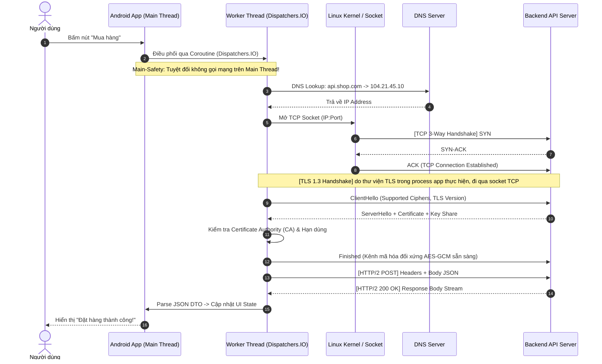
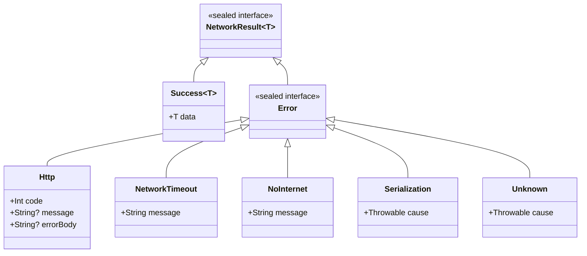
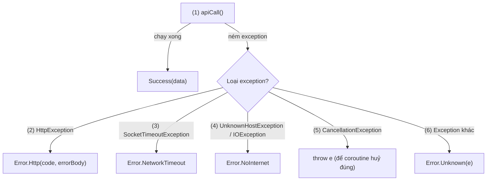
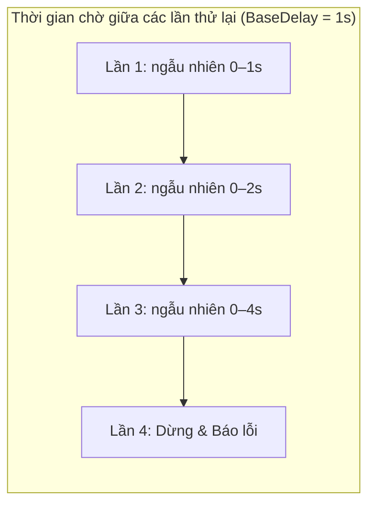
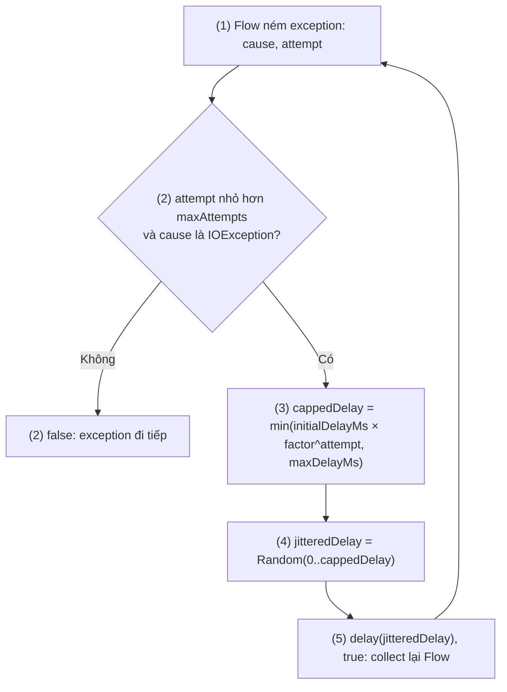
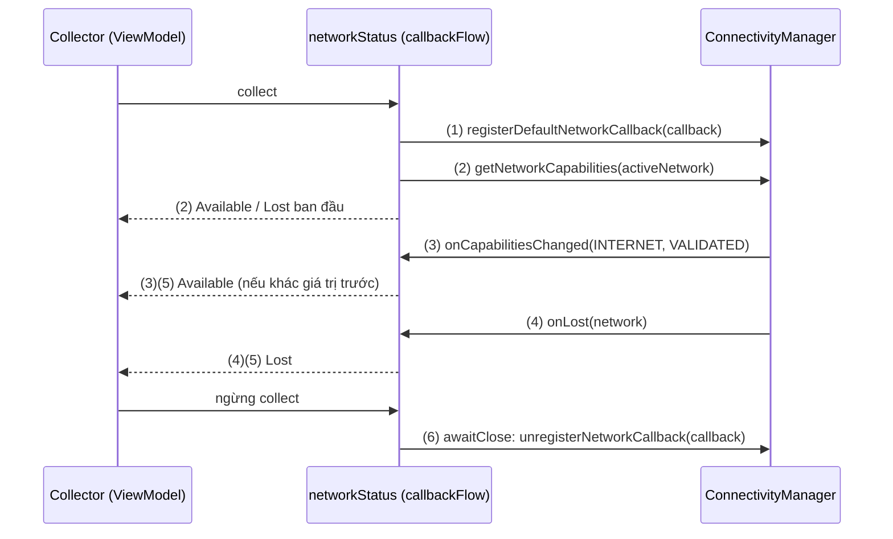
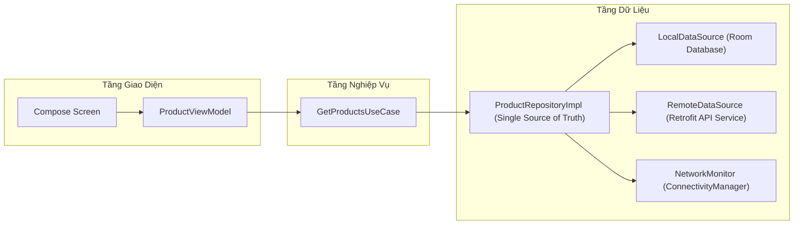
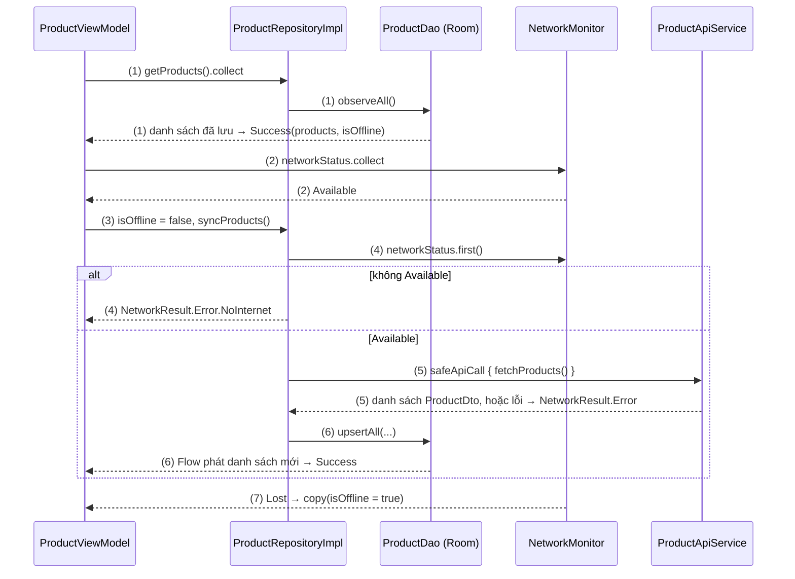

# Networking: Request API, lỗi mạng và trạng thái kết nối

## Vấn đề cần giải quyết

Trong bất kỳ ứng dụng di động hiện đại nào, mạng (Networking) là huyết mạch kết nối người dùng với hệ thống backend đám mây. Dù là tải bảng tin mạng xã hội, thực hiện giao dịch chuyển khoản ngân hàng hay đồng bộ giỏ hàng thương mại điện tử, mọi trải nghiệm mượt mà đều bắt nguồn từ một tầng mạng ổn định, an toàn và tối ưu.

Tuy nhiên, môi trường mạng di động vốn dĩ không ổn định: thiết bị di chuyển liên tục qua các trạm BTS sóng yếu, chuyển đổi đột ngột giữa Wi-Fi và 4G/5G, đi vào thang máy hoặc kết nối vào các điểm Wi-Fi công cộng (Captive Portal) không có Internet thực sự. Một ứng dụng xử lý mạng cẩu thả sẽ nhanh chóng bộc lộ các lỗi nghiêm trọng:

- **Treo ứng dụng (ANR) hoặc văng app (Crash):** gọi mạng trên Main Thread (`NetworkOnMainThreadException`), hoặc để ngoại lệ mạng cấp thấp rò lên tầng UI mà không được bắt.
- **Tràn bộ nhớ (`OutOfMemoryError`):** đọc toàn bộ file dung lượng lớn vào mảng byte trong RAM khi upload multipart (cách stream file: [8.1.4 Okio](../session_08/networks/okio.md)).
- **Văng đăng nhập hàng loạt:** khi Access Token hết hạn, nhiều request đồng thời cùng nhận lỗi `401` và cùng gọi refresh token, các lần refresh xung đột nhau làm vô hiệu hoá session (cách xử lý: [8.1.3 OkHttp](../session_08/networks/okhttp.md)).
- **Lộ lọt thông tin người dùng (MITM Attack):** kẻ tấn công đứng giữa qua proxy độc hại để đọc trộm, sửa dữ liệu tài chính và thông tin cá nhân.
- **Lãng phí băng thông và cạn pin:** không tái sử dụng kết nối (Connection Pooling) và không có HTTP Cache hợp lý, nên mỗi lần gọi đều phải bắt tay lại và tải lại dữ liệu.

Bài này đi từ bản chất một request mạng (Socket, TLS) tới ba việc mọi app phải làm ở tầng mạng: gọi API an toàn và phân loại lỗi, xử lý sự cố mạng (retry, bảo mật kênh truyền, cache), và theo dõi trạng thái kết nối. Kiến thức riêng của từng thư viện (OkHttp, Okio, Retrofit, Ktor) nằm ở Session 08, mục 8.1 Networks.

## Sau khi học xong

- Giải thích được bản chất Socket, DNS, TCP Handshake, TLS 1.3 và lý do Android cấm gọi mạng trên Main Thread (NetworkOnMainThreadException).
- Thiết kế được Error Handling và Result Pattern phân tầng, kèm Retry với Exponential Backoff & Jitter, không nuốt CancellationException.
- Áp dụng được Network Security Config, Certificate Pinning có backup pin và các mặc định bảo mật của nền tảng (cleartext, CA người dùng cài).
- Triển khai được NetworkMonitor theo dõi mạng mặc định bằng ConnectivityManager, NetworkCapabilities và Kotlin Flow.
- Phân biệt được vai trò của OkHttp, Okio, Retrofit và Ktor Client trong tầng mạng của app.

## Networking là gì?

**Networking** (tầng mạng) của app Android là phần code chuyển dữ liệu giữa app và server qua một kết nối TCP (thường được bọc TLS) mà hệ điều hành mở cho app. Nó gồm ba việc đúng theo tiêu đề mục 5.3: **Request API** (gửi request, nhận response mà không chặn Main Thread), **Handle event network** (biến mọi kết quả, kể cả lỗi và sự cố mạng, thành dữ liệu app xử lý được) và **Handle connection state** (biết app hiện có đường ra Internet thật hay không).

Mental model: mạng là một **đường ống không tin cậy** nối app với server. Mở đường ống tốn phí (DNS, TCP, TLS) nên phải tái dùng; dữ liệu chảy qua có thể tắc giữa chừng nên mọi lần gửi phải tính trước kết quả thất bại; và đường ống có thể đứt, hoặc chỉ nối tới một ngõ cụt (Wi-Fi chưa ra Internet), nên phải có người canh trạng thái của nó.

## Cách hoạt động

Ba việc trong định nghĩa ứng với các phần dưới đây:

- **Request API:** một request đi qua những bước nào (mở đường ống), và thư viện nào làm phần việc đó.
- **Handle event network:** phân loại lỗi bằng Result Pattern, retry khi đường ống tắc, bảo mật kênh truyền, chiến lược cache.
- **Handle connection state:** theo dõi đường ống còn thông ra Internet hay không bằng `ConnectivityManager`.

### Bản chất tầng mạng: Từ Click nút UI đến Kernel Socket & TLS Handshake

Để làm chủ việc gọi API, trước hết một kỹ sư cần hiểu điều gì thực sự diễn ra bên dưới hệ điều hành khi ứng dụng gửi đi một HTTP Request.

Khi người dùng bấm một nút để gửi dữ liệu, hệ điều hành và phần cứng mạng phối hợp qua 5 giai đoạn:

1. **Main-Safety:** lời gọi API được điều phối sang background thread (`Dispatchers.IO`). Nếu chạy trên Main Thread, Android ném ngay `NetworkOnMainThreadException` để bảo vệ chu kỳ vẽ màn hình (mỗi khung hình chỉ có khoảng 16.6 ms ở 60 Hz, 8.3 ms ở 120 Hz).
2. **DNS Lookup:** phân giải domain (ví dụ `api.example.com`) thành địa chỉ IP (IPv4 hoặc IPv6).
3. **TCP 3-Way Handshake:** gửi `SYN`, nhận `SYN-ACK`, gửi `ACK` để thiết lập kênh truyền tin cậy. Tốn 1 RTT (Round Trip Time).
4. **TLS 1.3 Handshake:** gửi `ClientHello`, nhận `ServerHello` kèm chứng chỉ số và key share; hai bên từ đó tự tính ra khoá phiên đối xứng (ví dụ AES-GCM) mà không truyền khoá đó qua mạng. Tốn thêm 1 RTT.
5. **HTTP Request & Response:** gửi header, body và nhận stream dữ liệu phản hồi từ máy chủ.

Kernel chỉ lo phần socket và TCP; TLS handshake do thư viện TLS chạy ngay trong process của app thực hiện (trên Android là Conscrypt), dữ liệu đi qua socket TCP đã mở. Sơ đồ dưới đây chi tiết hoá 5 giai đoạn trên cho một lần bấm nút "Mua hàng":



#### Vấn đề NetworkOnMainThreadException

Từ phiên bản Android 3.0 (Honeycomb), với app target API 11 trở lên, hệ điều hành áp dụng cơ chế giám sát nghiêm ngặt: **Mọi thao tác liên quan đến Socket I/O đều bị cấm trên Main Thread**.
Nếu bạn cố tình thực hiện một lời gọi mạng đồng bộ trên Main Thread:

```kotlin
// SAI LẦM: Làm đơ giao diện người dùng
val url = URL("https://api.example.com/data")
val connection = url.openConnection() as HttpURLConnection
val data = connection.inputStream.bufferedReader().readText() // CRASH!
```

Hệ điều hành sẽ lập tức ném ra ngoại lệ:

```text
android.os.NetworkOnMainThreadException
    at android.os.StrictMode$AndroidBlockGuardPolicy.onNetwork(StrictMode.java:1605)
```

**Bản chất:** Network I/O có độ trễ không thể dự đoán (Latency từ vài trăm millisecond đến vài giây). Nếu Main Thread bị chặn (block), hệ thống không thể xử lý các thông điệp vẽ màn hình (Choreographer VSYNC), dẫn đến việc người dùng thấy ứng dụng bị đóng băng và hộp thoại **ANR (Application Not Responding)** xuất hiện sau 5 giây.

#### Chi phí thiết lập kết nối (Connection Overhead)

Mỗi lần mở một kết nối HTTPS mới, thiết bị phải trả giá rất đắt:

1. **DNS Resolution (Hỏi IP):** Tốn từ 50ms - 250ms trên sóng di động 3G/4G.
2. **TCP 3-Way Handshake:** Tốn 1 RTT (Round Trip Time) để gửi gói tin SYN, nhận SYN-ACK và gửi ACK.
3. **TLS Handshake (HTTPS):**
   - TLS 1.2: Tốn thêm 2 RTT để trao đổi chứng chỉ và thống nhất khóa mã hóa.
   - TLS 1.3: Cải tiến còn 1 RTT (hoặc 0-RTT nếu hỗ trợ phục hồi phiên - Session Resumption).
4. **Tổng độ trễ:** Có thể lên tới **300ms - 800ms** trước khi byte dữ liệu đầu tiên của API được truyền đi!

> [!IMPORTANT]
> **Nhận thức cốt lõi:** Nếu ứng dụng của bạn tạo mới một kết nối Socket cho mỗi request HTTP, trải nghiệm người dùng sẽ cực kỳ chậm chạp và hao pin. Đây chính là lý do bạn bắt buộc phải sử dụng các thư viện có cơ chế **Connection Pooling** và **HTTP/2 Multiplexing** như OkHttp (xem [8.1.3 OkHttp](../session_08/networks/okhttp.md)).

### Thư viện tầng mạng: OkHttp, Okio, Retrofit, Ktor

App Android hiếm khi tự mở socket. Phần việc dưới đây do thư viện đảm nhận, mỗi thư viện có Topic riêng ở Session 08:

| Thư viện | Vai trò trong tầng mạng | Học ở |
| :--- | :--- | :--- |
| **OkHttp** | HTTP client: Interceptor Chain, Connection Pool (mặc định giữ 5 kết nối nhàn rỗi trong 5 phút), interceptor tuỳ biến, `Authenticator` xử lý nhiều request cùng nhận `401`, `CertificatePinner`, HTTP Cache. | [8.1.3 OkHttp](../session_08/networks/okhttp.md) |
| **Okio** | I/O theo từng đoạn bên dưới OkHttp: upload file lớn không `OutOfMemoryError`, đếm byte để báo tiến độ. | [8.1.4 Okio](../session_08/networks/okio.md) |
| **Retrofit** | Biến interface Kotlin (`@GET`, `suspend fun`) thành lời gọi HTTP chạy trên OkHttp. | [8.1.1 Retrofit](../session_08/networks/retrofit.md) |
| **Ktor Client** | HTTP client thuần Kotlin, chạy được trên Kotlin Multiplatform; lựa chọn thay Retrofit. | [8.1.5 Ktor and Apollo Android](../session_08/networks/ktor_apollo.md) |

Test tầng mạng bằng MockWebServer (server HTTP thật trên localhost) nằm ở [10.2 Unit Testing](../coding_analyst_and_testing/unit_testing.md).

> [!NOTE]
> Kiến thức dùng trước: các ví dụ trong bài dùng tối thiểu Retrofit (`retrofit2.HttpException`, interface `@GET`) và Kotlin Coroutines, Flow (`suspend`, `retryWhen`, `callbackFlow`); Retrofit học ở [8.1.1 Retrofit](../session_08/networks/retrofit.md), Coroutines ở [8.4.3 Coroutines](../session_08/async_threads/coroutines.md).

### Chuẩn hóa Error Handling & Result Pattern trong Clean Architecture

Đường ống có thể tắc ở bất kỳ bước nào, nên mọi lời gọi API phải trả về một kết quả mà app xử lý được, kể cả khi thất bại.

Trong Clean Architecture, tầng UI (Compose hoặc Activity) **tuyệt đối không được phép biết đến các ngoại lệ mạng cấp thấp** như `SocketTimeoutException`, `UnknownHostException` hay `HttpException`. Nếu để lộ các exception này lên UI, mã nguồn UI sẽ tràn ngập các khối `try-catch`, khó kiểm thử và dễ bị crash nếu sót exception.

#### Phân cấp lỗi mạng chuẩn

Một hệ thống xử lý lỗi mạng hoàn chỉnh cần phân loại lỗi thành các nhóm rõ rệt (5 loại `Error` dưới đây, tên khớp với code ở ví dụ ngay sau):



#### Ví dụ: bọc mọi lời gọi API bằng `safeApiCall`

Bài toán: mọi Repository gọi API qua một hàm duy nhất, hàm này không bao giờ ném exception ra ngoài mà trả về `NetworkResult`. Luồng chạy:

1. Gọi `apiCall()`; chạy xong thì trả `Success`.
2. Server trả mã lỗi HTTP (Retrofit ném `HttpException`): trả `Error.Http` kèm `code` và `errorBody`.
3. Quá thời gian chờ (`SocketTimeoutException`): trả `Error.NetworkTimeout`.
4. Không phân giải được domain (`UnknownHostException`) hoặc lỗi I/O khác của mạng: trả `Error.NoInternet`.
5. Coroutine bị huỷ (`CancellationException`): ném lại, không biến thành lỗi mạng.
6. Mọi exception còn lại: trả `Error.Unknown`.



Thứ tự `catch` quan trọng: `SocketTimeoutException` và `UnknownHostException` đều là `IOException`, nên phải bắt trước nhánh `IOException`.

```kotlin
import java.io.IOException
import java.net.SocketTimeoutException
import java.net.UnknownHostException
import kotlinx.coroutines.CancellationException
import retrofit2.HttpException

sealed interface NetworkResult<out T> {
    data class Success<out T>(val data: T) : NetworkResult<T>
    
    sealed interface Error : NetworkResult<Nothing> {
        data class Http(val code: Int, val message: String?, val errorBody: String?) : Error
        data class NetworkTimeout(val message: String = "Kết nối quá thời gian quy định") : Error
        data class NoInternet(val message: String = "Không có kết nối Internet") : Error
        data class Serialization(val cause: Throwable) : Error
        data class Unknown(val cause: Throwable) : Error
    }
}

/**
 * Hàm bao bọc an toàn tuyệt đối cho mọi lời gọi API.
 * Đảm bảo hàm suspend không bao giờ ném Exception ra ngoài.
 */
suspend fun <T> safeApiCall(apiCall: suspend () -> T): NetworkResult<T> {
    return try {
        // (1)
        NetworkResult.Success(apiCall())
    } catch (e: HttpException) {
        // (2)
        val code = e.code()
        val errorBody = e.response()?.errorBody()?.string()
        NetworkResult.Error.Http(code = code, message = e.message(), errorBody = errorBody)
    } catch (e: SocketTimeoutException) {
        // (3)
        NetworkResult.Error.NetworkTimeout()
    } catch (e: UnknownHostException) {
        // (4)
        NetworkResult.Error.NoInternet()
    } catch (e: IOException) {
        // (4) Các lỗi I/O khác của mạng (ví dụ đứt cáp đột ngột)
        NetworkResult.Error.NoInternet(e.localizedMessage ?: "Lỗi kết nối mạng")
    } catch (e: CancellationException) {
        // (5) Coroutine bị huỷ (thoát màn hình...): ném lại, không biến thành lỗi mạng
        throw e
    } catch (e: Exception) {
        // (6) Lỗi parse JSON hoặc lỗi logic bất ngờ
        NetworkResult.Error.Unknown(e)
    }
}
```

**Kết quả:** tầng UI chỉ cần `when` trên `NetworkResult` để hiện dữ liệu hoặc thông báo lỗi thân thiện, không còn `try-catch` nào. Bản `safeApiCall` này gộp lỗi parse JSON vào `Unknown`; loại `Serialization` dành cho khi muốn tách riêng exception của converter JSON đang dùng.

### Retry Policy với Exponential Backoff & Jitter

Khi mạng chập chờn, việc tự động gửi lại request (Retry) giúp người dùng không phải bấm lại bằng tay. Tuy nhiên, nếu áp dụng cơ chế **Retry tức thì (Immediate Retry)** hoặc **khoảng cách cố định (Fixed Delay)**, bạn sẽ gây ra hiện tượng **Thundering Herd**:
Khi hàng triệu thiết bị cùng mất kết nối trong 10 giây rồi cùng đồng loạt bắn request retry ngay khi vừa có mạng, server backend sẽ lập tức quá tải và sập nguồn!

#### Công thức Exponential Backoff kết hợp Full Jitter

Chuẩn kỹ nghệ (được khuyến nghị bởi AWS và Google Cloud Architecture) sử dụng thuật toán:

$$\text{Delay} = \text{Random}(0, \min(\text{MaxDelay}, \text{BaseDelay} \times 2^{\text{attempt}}))$$

Trần thời gian chờ tăng gấp đôi sau mỗi lần thử; thời gian chờ thật là một giá trị ngẫu nhiên từ 0 tới trần đó, nên các thiết bị không gửi lại cùng một lúc:



#### Ví dụ: tự gửi lại request khi mạng chập chờn

Bài toán: một Flow gọi API (tải bảng tin, đồng bộ giỏ hàng) cần tự thử lại khi gặp lỗi mạng, nhưng không được dồn dập. Luồng chạy của `retryWithExponentialBackoff`:

1. Flow phía trên ném exception; `retryWhen` nhận `cause` và số lần đã thử `attempt` (bắt đầu từ 0).
2. Nếu đã hết lượt (`attempt >= maxAttempts`) hoặc lỗi không phải `IOException` (ví dụ lỗi 4xx): trả `false`, exception đi tiếp xuống tầng sau.
3. Tính trần thời gian chờ `initialDelayMs * factor^attempt`, chặn trên bằng `maxDelayMs`.
4. Chọn thời gian chờ ngẫu nhiên từ 0 tới trần (Full Jitter).
5. `delay` rồi trả `true`: Flow phía trên được collect lại từ đầu, tức là request được gửi lại.



```kotlin
import kotlinx.coroutines.delay
import kotlinx.coroutines.flow.Flow
import kotlinx.coroutines.flow.retryWhen
import java.io.IOException
import kotlin.math.min
import kotlin.math.pow
import kotlin.random.Random

fun <T> Flow<T>.retryWithExponentialBackoff(
    maxAttempts: Int = 3,
    initialDelayMs: Long = 1000L,
    maxDelayMs: Long = 10000L,
    factor: Double = 2.0
): Flow<T> {
    // (1)
    return this.retryWhen { cause, attempt ->
        // (2)
        if (attempt < maxAttempts && cause is IOException) {
            // Chỉ retry khi gặp lỗi mạng (I/O, Timeout). Không retry lỗi 4xx Client Error!
            // (3)
            val exponentialDelay = (initialDelayMs * factor.pow(attempt.toDouble())).toLong()
            val cappedDelay = min(exponentialDelay, maxDelayMs)
            // (4) Thêm Full Jitter ngẫu nhiên từ 0 đến cappedDelay để tránh các thiết bị đồng nhịp
            val jitteredDelay = Random.nextLong(0, cappedDelay + 1)
            
            // (5)
            delay(jitteredDelay)
            true // Tiếp tục thử lại
        } else {
            false // Ngừng thử lại, đẩy exception cho tầng tiếp theo xử lý
        }
    }
}
```

**Kết quả:** với mặc định `maxAttempts = 3`, request được gửi tối đa 4 lần (1 lần đầu và 3 lần thử lại, chờ ngẫu nhiên trong 0–1s, 0–2s, 0–4s); lỗi không phải `IOException` đi thẳng xuống tầng sau mà không chờ.

### Bảo mật cao cấp: SSL / Certificate Pinning & Phòng thủ MITM

Mặc định, Android tin tưởng các Chứng chỉ số (Certificate Authority - CA) được cài đặt sẵn trong hệ thống (như DigiCert, Let's Encrypt). 
Tuy nhiên, tin tặc có thể thực hiện tấn công **Man-in-the-Middle (MITM)** bằng cách:

1. Đưa một Root CA độc hại vào kho CA **hệ thống** của thiết bị (cần máy đã Root), hoặc nhắm vào app vẫn tin CA do người dùng cài.
2. Thiết lập proxy (như Charles Proxy, Burp Suite) đứng giữa ứng dụng và máy chủ.
3. Proxy này giải mã toàn bộ dữ liệu HTTPS mà ứng dụng không hề hay biết!

Lưu ý mặc định của nền tảng: từ Android 7.0 (API 24), app **không** tin CA do người dùng tự cài trừ khi khai báo `<certificates src="user" />` trong Network Security Config (app target API 23 trở xuống vẫn tin). Từ Android 9 (API 28), với app target API 28 trở lên, **cleartext HTTP bị tắt mặc định**: gọi `http://` sẽ lỗi (OkHttp báo `UnknownServiceException: CLEARTEXT communication ... not permitted by network security policy`) trừ khi bật `cleartextTrafficPermitted="true"` cho domain cụ thể.

#### Certificate Pinning là gì?

**Certificate Pinning (Ghim chứng chỉ)** là kỹ thuật **thêm một điều kiện** vào việc kiểm tra chứng chỉ: chuỗi chứng chỉ vẫn phải hợp lệ với các Root CA được tin như bình thường, **và** phải chứa ít nhất một khóa công khai (Public Key - SPKI) có mã băm nằm trong danh sách ghim của app (khóa của máy chủ, của intermediate CA hoặc của CA). Nếu không có khóa nào khớp, kết nối sẽ bị hủy ngay lập tức.

#### Ghim chứng chỉ bằng code

Ngoài cấu hình XML ở mục "Triển khai qua Network Security Config" bên dưới, có thể ghim chứng chỉ bằng code qua `CertificatePinner` của OkHttp (xem [8.1.3 OkHttp](../session_08/networks/okhttp.md)). Quy tắc backup pin ở cảnh báo dưới đây áp dụng cho cả hai cách.

#### Triển khai qua Network Security Config (Chuẩn Declarative của Android)

Từ Android 7.0, Google khuyến nghị cấu hình bảo mật thông qua file XML:

Tạo file `res/xml/network_security_config.xml`:

```xml
<?xml version="1.0" encoding="utf-8"?>
<network-security-config>
    <domain-config>
        <domain includeSubdomains="true">api.example.com</domain>
        <pin-set expiration="2027-12-31">
            <!-- Khóa công khai chính -->
            <pin digest="SHA-256">AAAAAAAAAAAAAAAAAAAAAAAAAAAAAAAAAAAAAAAAAAA=</pin>
            <!-- Khóa công khai dự phòng (Backup) -->
            <pin digest="SHA-256">BBBBBBBBBBBBBBBBBBBBBBBBBBBBBBBBBBBBBBBBBBB=</pin>
        </pin-set>
    </domain-config>
</network-security-config>
```

Đăng ký trong `AndroidManifest.xml`:

```xml
<application
    android:networkSecurityConfig="@xml/network_security_config"
    ... >
</application>
```

> [!CAUTION]
> **Hiểm họa "Gạch App" (App Bricking Risk):**
> Nếu bạn chỉ ghim 1 mã Pin duy nhất và chứng chỉ trên server bị hết hạn hoặc bị tấn công phải đổi mới khẩn cấp, người dùng toàn cầu sẽ **không thể mở được app** cho đến khi bạn release một bản cập nhật mới lên Google Play Store.
> **Quy tắc bất di bất dịch:** Luôn luôn ghim khóa công khai của **Backup Intermediate CA** hoặc **Backup Key**, kèm theo cơ chế Remote Config để cập nhật mã pin động nếu cần.

### Chiến lược Caching: HTTP Cache (OkHttp) vs Local Database (Room)

Khi thiết kế ứng dụng hỗ trợ Offline, nhiều người phân vân giữa việc dùng OkHttp Cache hay lưu trữ vào SQLite qua Room Database.

| Tiêu chí | OkHttp HTTP Cache | Local Database (Room / SQLite) |
| :--- | :--- | :--- |
| **Bản chất** | Cache mức byte nguyên thủy trên ổ cứng theo chuẩn HTTP Headers. | Lưu trữ có cấu trúc (Relational), hỗ trợ bảng biểu, quan hệ khóa ngoại. |
| **Cơ chế điều khiển** | Hoàn toàn dựa vào Header server (`Cache-Control`, `max-age`, `ETag`). | Hoàn toàn do lập trình viên Android chủ động truy vấn, thêm, xóa, sửa. |
| **Khả năng tìm kiếm** | **Không thể**: Chỉ tìm kiếm chính xác bằng URL endpoint (`Key = URL`). | **Rất mạnh**: Hỗ trợ SQL `WHERE`, `LIKE`, `JOIN`, sắp xếp `ORDER BY`. |
| **Phản ứng thay đổi** | Thụ động. Không thể lắng nghe khi có dữ liệu mới. | **Reactive**: Hỗ trợ trả về `Flow<List<Item>>`, tự động cập nhật UI khi DB đổi. |
| **Trường hợp sử dụng** | Tệp tĩnh cấu hình, ảnh qua Picasso (Glide và Coil có disk cache riêng, xem [8.2.1 Glide](../session_08/loading_image/glide.md)), API tin tức đơn giản. | Dữ liệu nghiệp vụ lõi: Giỏ hàng, Danh sách bài viết, Profile offline, Chat. |

#### HTTP Cache của OkHttp

Cấu hình `Cache` và một interceptor buộc đọc cache khi offline (`only-if-cached, max-stale`) nằm ở [8.1.3 OkHttp](../session_08/networks/okhttp.md).

### Quản lý trạng thái kết nối ở tầng OS: ConnectivityManager & NetworkCallback

Phần này là "người canh đường ống" trong mental model: app cần biết đường ống còn thông ra Internet hay không để quyết định gọi API, đồng bộ lại, hay báo người dùng đang offline.

Trước Android 7.0 (Nougat), lập trình viên thường dùng `BroadcastReceiver` lắng nghe `android.net.conn.CONNECTIVITY_ACTION`. Tuy nhiên, cơ chế này làm thức giấc hàng chục tiến trình app cùng lúc khi mạng thay đổi, gây giật lag hệ thống và cạn pin. Từ Android 7.0, app target API 24+ không còn nhận `CONNECTIVITY_ACTION` qua receiver khai báo trong manifest (receiver đăng ký bằng code vẫn nhận), và action này bị deprecate từ API 28. Google khuyến nghị chuyển sang **`ConnectivityManager.NetworkCallback`**.

> [!IMPORTANT]
> **Quyền và cleartext cần khai báo trước khi gọi mạng:**
> - `android.permission.INTERNET`: thiếu quyền này thì mọi kết nối socket của app đều thất bại.
> - `android.permission.ACCESS_NETWORK_STATE`: bắt buộc để dùng `ConnectivityManager` (`activeNetwork`, `getNetworkCapabilities`, `register...NetworkCallback`); thiếu thì ném `SecurityException`.
> - Cả hai đều là normal permission: khai báo trong `AndroidManifest.xml` là đủ, không cần xin lúc chạy.
>
> ```xml
> <uses-permission android:name="android.permission.INTERNET" />
> <uses-permission android:name="android.permission.ACCESS_NETWORK_STATE" />
> ```

#### Phân biệt NET_CAPABILITY_INTERNET vs NET_CAPABILITY_VALIDATED

Đây là điểm khác biệt cốt tử mà nhiều developer không phân biệt được:

- **`NET_CAPABILITY_INTERNET`:** Thiết bị đã kết nối vào một mạng hỗ trợ truyền thông IP (ví dụ kết nối vào router Wi-Fi hoặc trạm 4G). Nhưng mạng này hoàn toàn có thể **chưa có Internet** (dây cáp quang bị đứt, gói cước hết tiền, hoặc mạng Wi-Fi bắt nhập mã voucher tại quán cafe/khách sạn).
- **`NET_CAPABILITY_VALIDATED`:** Hệ điều hành Android đã âm thầm gửi một HTTP probe (thường là `https://clients3.google.com/generate_204`) và nhận về đúng mã trạng thái `204 No Content`. Điều này chứng minh **thiết bị thực sự đi được ra thế giới Internet bên ngoài**!

> [!IMPORTANT]
> **Quy tắc bắt buộc:** Luôn luôn kiểm tra cờ `NET_CAPABILITY_VALIDATED` thay vì chỉ kiểm tra `NET_CAPABILITY_INTERNET`.

#### Ví dụ: NetworkMonitor phát trạng thái mạng bằng `callbackFlow`

Bài toán: nhiều màn hình cần biết app có đang online không (hiện banner "Đang offline", tự đồng bộ khi có mạng lại). `NetworkMonitor` biến các callback của `ConnectivityManager` thành một `Flow<NetworkStatus>`. Luồng chạy:

1. Khi Flow bắt đầu được collect, đăng ký callback cho **mạng mặc định** (mạng app thực sự dùng) bằng `registerDefaultNetworkCallback`.
2. Phát ngay trạng thái ban đầu, đọc từ `activeNetwork`.
3. Khi capability của mạng mặc định đổi (`onCapabilitiesChanged`): có cả `INTERNET` và `VALIDATED` thì phát `Available`, ngược lại phát `Lost`.
4. Khi mạng mặc định mất mà không có mạng thay thế (`onLost`): phát `Lost`.
5. `distinctUntilChanged()` bỏ các giá trị lặp, collector chỉ nhận khi trạng thái thực sự đổi.
6. Khi collector ngừng collect, `awaitClose` huỷ đăng ký callback.



```kotlin
import android.content.Context
import android.net.ConnectivityManager
import android.net.Network
import android.net.NetworkCapabilities
import kotlinx.coroutines.channels.awaitClose
import kotlinx.coroutines.flow.Flow
import kotlinx.coroutines.flow.callbackFlow
import kotlinx.coroutines.flow.distinctUntilChanged

sealed interface NetworkStatus {
    object Available : NetworkStatus
    object Lost : NetworkStatus
    object Unavailable : NetworkStatus
}

interface NetworkMonitor {
    val networkStatus: Flow<NetworkStatus>
}

class ConnectivityManagerNetworkMonitor(
    context: Context
) : NetworkMonitor {

    private val connectivityManager = 
        context.getSystemService(Context.CONNECTIVITY_SERVICE) as ConnectivityManager

    override val networkStatus: Flow<NetworkStatus> = callbackFlow {
        val callback = object : ConnectivityManager.NetworkCallback() {
            override fun onAvailable(network: Network) {
                // Mạng vật lý vừa kết nối, nhưng chưa chắc có Internet thực sự
            }

            override fun onCapabilitiesChanged(
                network: Network,
                networkCapabilities: NetworkCapabilities
            ) {
                // (3) Kiểm tra xem mạng đã được VALIDATED chưa
                val hasInternet = networkCapabilities.hasCapability(NetworkCapabilities.NET_CAPABILITY_INTERNET)
                val isValidated = networkCapabilities.hasCapability(NetworkCapabilities.NET_CAPABILITY_VALIDATED)

                if (hasInternet && isValidated) {
                    trySend(NetworkStatus.Available)
                } else {
                    trySend(NetworkStatus.Lost)
                }
            }

            override fun onLost(network: Network) {
                // (4) Với default callback, onLost nghĩa là mạng mặc định mất và chưa có mạng thay thế
                trySend(NetworkStatus.Lost)
            }
            // Không override onUnavailable(): callback này chỉ được gọi cho requestNetwork(...),
            // không bao giờ được gọi khi dùng registerDefaultNetworkCallback / registerNetworkCallback
        }

        // (1) Theo dõi MẠNG MẶC ĐỊNH (mạng app thực sự dùng). registerNetworkCallback với nhiều transport
        // sẽ báo onLost cho từng mạng: tắt Wi-Fi trong khi 4G vẫn còn cũng phát Lost — sai trạng thái.
        // Cần quyền ACCESS_NETWORK_STATE, nếu thiếu sẽ ném SecurityException.
        connectivityManager.registerDefaultNetworkCallback(callback)

        // (2) Phát trạng thái ban đầu ngay khi bắt đầu lắng nghe
        val currentCapabilities = connectivityManager.getNetworkCapabilities(connectivityManager.activeNetwork)
        val isInitiallyValid = currentCapabilities?.hasCapability(NetworkCapabilities.NET_CAPABILITY_VALIDATED) == true
        trySend(if (isInitiallyValid) NetworkStatus.Available else NetworkStatus.Lost)

        // (6) Hủy đăng ký callback khi Flow ngừng collect để chống rò rỉ bộ nhớ (Memory Leak)
        awaitClose {
            connectivityManager.unregisterNetworkCallback(callback)
        }
    }.distinctUntilChanged() // (5)
}
```

**Kết quả:** bật chế độ máy bay thì collector nhận `Lost`; tắt Wi-Fi trong khi 4G vẫn còn thì mạng mặc định chuyển sang 4G và collector vẫn ở `Available` sau khi 4G được validated; khi mạng mặc định là một Wi-Fi chưa `VALIDATED` (ví dụ Wi-Fi quán cafe chưa đăng nhập, không có 4G) thì nhận `Lost`.

## Ví dụ thực tế

### Tích hợp Clean Architecture: End-to-End E-Commerce Example

Hãy xâu chuỗi các thành phần đã học vào một kiến trúc hoàn chỉnh theo chuẩn **Clean Architecture** (Retrofit chỉ dùng một interface `@GET`, xem mục "Thư viện tầng mạng" ở trên):
`UI (Compose) -> ViewModel -> UseCase -> Repository (SSOT) -> RemoteDataSource (Retrofit) & LocalDataSource (Room)`.

Mô hình ở đây là **Single Source of Truth (SSOT)**: UI chỉ quan sát Room Database qua `Flow`, không bao giờ đọc thẳng kết quả API. Repository đồng bộ API khi có mạng và ghi kết quả vào Room; Flow của DAO tự phát dữ liệu mới lên UI.



Bài toán: màn hình danh sách sản phẩm phải hiện ngay dữ liệu đã lưu, tự đồng bộ khi có mạng, và báo đang offline khi mất mạng mà không xoá dữ liệu đang hiển thị. Ba việc của Networking gặp nhau ở đây: Request API (`ProductApiService`), Handle event network (`safeApiCall`), Handle connection state (`NetworkMonitor`). Luồng chạy:

1. ViewModel collect `repository.getProducts()`; Repository đọc từ Room qua `observeAll()`, danh sách đã lưu hiện ngay (`Success`, `isOffline` lấy theo trạng thái mạng gần nhất mà ViewModel ghi nhận).
2. ViewModel collect `networkMonitor.networkStatus`.
3. Khi nhận `Available`, ViewModel ghi nhận đang online (`isOffline = false`) rồi gọi `repository.syncProducts()`.
4. Repository đọc trạng thái mạng hiện tại bằng `networkStatus.first()`; không `Available` thì trả ngay `NetworkResult.Error.NoInternet()`.
5. Có mạng: gọi API trong `safeApiCall`; mọi lỗi mạng thành `NetworkResult.Error`, ViewModel xử lý mà không làm mất dữ liệu offline đang hiển thị.
6. Gọi thành công: `upsertAll` ghi vào Room; Flow của DAO tự phát danh sách mới, collector ở bước (1) cập nhật UI.
7. Khi nhận `Lost` (hoặc `Unavailable`), ViewModel giữ danh sách đang có và đặt `isOffline = true`. Trạng thái này được nhớ lại, nên lần Room phát danh sách tiếp theo ở bước (1) không ghi đè nó về `false`.



#### Data Layer: Remote DataSource & Repository

```kotlin
import androidx.room.Dao
import androidx.room.Entity
import androidx.room.PrimaryKey
import androidx.room.Query
import androidx.room.Upsert
import kotlinx.coroutines.flow.Flow
import kotlinx.coroutines.flow.first
import kotlinx.coroutines.flow.map
import retrofit2.http.GET

// Retrofit API Definition
interface ProductApiService {
    @GET("/api/v1/products")
    suspend fun fetchProducts(): List<ProductDto>
}

// Data Transfer Object
data class ProductDto(val id: Long, val name: String, val price: Double)

// Domain Model
data class Product(val id: Long, val name: String, val price: Double)

// Repository Interface
interface ProductRepository {
    fun getProducts(): Flow<List<Product>>
    suspend fun syncProducts(): NetworkResult<Unit>
}

// Local DataSource: Room DAO — Flow tự phát lại mỗi khi bảng products thay đổi
@Entity(tableName = "products")
data class ProductEntity(@PrimaryKey val id: Long, val name: String, val price: Double)

@Dao
interface ProductDao {
    @Query("SELECT * FROM products")
    fun observeAll(): Flow<List<ProductEntity>>

    @Upsert
    suspend fun upsertAll(items: List<ProductEntity>)
}

// Repository Implementation (Offline-First Single Source of Truth)
class ProductRepositoryImpl(
    private val apiService: ProductApiService,
    private val productDao: ProductDao,
    private val networkMonitor: NetworkMonitor
) : ProductRepository {

    // (1) Luôn đọc từ Room: sau mỗi lần sync ghi vào bảng, Flow của DAO tự emit danh sách mới
    override fun getProducts(): Flow<List<Product>> =
        productDao.observeAll().map { rows -> rows.map { Product(it.id, it.name, it.price) } }

    override suspend fun syncProducts(): NetworkResult<Unit> {
        // (4)
        val status = networkMonitor.networkStatus.first()
        if (status !is NetworkStatus.Available) {
            return NetworkResult.Error.NoInternet()
        }

        // (5)
        return safeApiCall {
            val remoteProducts = apiService.fetchProducts()
            // (6) Cập nhật lại vào cơ sở dữ liệu nội bộ -> getProducts() tự nhận dữ liệu mới
            productDao.upsertAll(remoteProducts.map { ProductEntity(it.id, it.name, it.price) })
        }
    }
}
```

#### Presentation Layer: ViewModel điều phối UI State

```kotlin
import androidx.lifecycle.ViewModel
import androidx.lifecycle.viewModelScope
import kotlinx.coroutines.flow.MutableStateFlow
import kotlinx.coroutines.flow.StateFlow
import kotlinx.coroutines.flow.asStateFlow
import kotlinx.coroutines.flow.update
import kotlinx.coroutines.launch

sealed interface ProductUiState {
    object Loading : ProductUiState
    data class Success(val products: List<Product>, val isOffline: Boolean) : ProductUiState
    data class Error(val message: String) : ProductUiState
}

class ProductViewModel(
    private val repository: ProductRepository,
    private val networkMonitor: NetworkMonitor
) : ViewModel() {

    private val _uiState = MutableStateFlow<ProductUiState>(ProductUiState.Loading)
    val uiState: StateFlow<ProductUiState> = _uiState.asStateFlow()

    // Trạng thái mạng gần nhất; cả hai coroutine dưới đây chạy trên Main Thread (viewModelScope)
    // nên đọc ghi trực tiếp được. Nhờ biến này, Room phát danh sách mới không ghi đè isOffline.
    private var isOffline = false

    init {
        observeNetworkAndLoadData()
    }

    private fun observeNetworkAndLoadData() {
        // (1) Tải dữ liệu offline hiển thị ngay cho người dùng
        viewModelScope.launch {
            repository.getProducts().collect { localProducts ->
                _uiState.update { 
                    ProductUiState.Success(products = localProducts, isOffline = isOffline) 
                }
            }
        }

        // (2) Tự động đồng bộ dữ liệu mới khi có kết nối Internet
        viewModelScope.launch {
            networkMonitor.networkStatus.collect { status ->
                when (status) {
                    is NetworkStatus.Available -> {
                        // (3)
                        isOffline = false
                        _uiState.update { current ->
                            if (current is ProductUiState.Success) {
                                current.copy(isOffline = false)
                            } else current
                        }
                        val result = repository.syncProducts()
                        if (result is NetworkResult.Error) {
                            // Xử lý lỗi nhưng không làm mất dữ liệu offline đang hiển thị
                        }
                    }
                    is NetworkStatus.Lost, is NetworkStatus.Unavailable -> {
                        // (7)
                        isOffline = true
                        _uiState.update { current ->
                            if (current is ProductUiState.Success) {
                                current.copy(isOffline = true)
                            } else current
                        }
                    }
                }
            }
        }
    }
}
```

**Kết quả:** mở màn hình khi đang ở chế độ máy bay thì danh sách đã lưu trong Room vẫn hiện và `isOffline = true`, dù Room phát danh sách trước hay sau trạng thái `Lost`; tắt chế độ máy bay, khi mạng mặc định được validated thì `syncProducts()` chạy, Room nhận dữ liệu mới và danh sách tự cập nhật qua Flow của DAO mà UI không phải gọi lại gì.

### Các bài toán khác dùng cùng các phần trên

- **Upload ảnh hoặc file lớn kèm tiến độ:** request vẫn đi qua `safeApiCall` và retry như trên, còn phần stream file theo từng đoạn để tránh `OutOfMemoryError` nằm ở [8.1.4 Okio](../session_08/networks/okio.md).
- **Access Token hết hạn khi nhiều request chạy song song:** lỗi `401` được phân loại thành `Error.Http`, còn việc chỉ refresh token một lần cho tất cả request dùng `Authenticator` của [8.1.3 OkHttp](../session_08/networks/okhttp.md).

## Sai lầm thường gặp

### 1. Gọi mạng trên Main Thread

Lời gọi mạng đồng bộ trên Main Thread làm app ném `NetworkOnMainThreadException` (xem mục "Vấn đề NetworkOnMainThreadException"), hoặc làm đơ UI tới mức ANR.

**Cách sửa (Main-Safety):** Mọi hàm API trong tầng Data phải là `suspend` và tự động chuyển sang `Dispatchers.IO` hoặc để Retrofit/Ktor tự xử lý luồng nền.

### 2. Khởi tạo OkHttpClient mới trong mỗi Repository

Làm vô hiệu hóa hoàn toàn Connection Pool và HTTP Cache, gây cạn kiệt File Descriptor (FD Leak). Mỗi request lại phải trả lại toàn bộ chi phí DNS, TCP, TLS ở mục "Chi phí thiết lập kết nối (Connection Overhead)".

**Cách sửa (Singleton OkHttpClient):** Chỉ khởi tạo **DUY NHẤT MỘT** `OkHttpClient` instance trong suốt vòng đời ứng dụng để tối ưu `ConnectionPool` và `DiskCache`. Nếu cần cấu hình riêng cho một số endpoint, hãy sử dụng `okHttpClient.newBuilder()`.

### 3. Nuốt Exception (Catch & Empty)

Bắt exception nhưng không thông báo cho người dùng, làm UI ở trạng thái Loading mãi mãi.

**Cách sửa:** bọc lời gọi API bằng `safeApiCall` để mọi lỗi thành một nhánh `NetworkResult.Error`, và để UI hiển thị nhánh đó thay vì bỏ qua.

### 4. Biến `CancellationException` thành lỗi mạng

Một `catch (e: Exception)` chung cũng bắt `CancellationException` khi coroutine bị huỷ (ví dụ người dùng thoát màn hình), biến việc huỷ thành một "lỗi mạng" và coroutine không dừng đúng.

**Cách sửa:** như nhánh (5) trong `safeApiCall`, bắt `CancellationException` trước nhánh `Exception` và ném lại (`throw e`).

### 5. Retry tức thì hoặc với khoảng cách cố định

Mọi thiết bị cùng gửi lại ngay khi có mạng gây ra Thundering Herd và làm server quá tải (xem mục "Retry Policy với Exponential Backoff & Jitter").

**Cách sửa:** dùng Exponential Backoff kết hợp Full Jitter, chỉ retry khi gặp lỗi mạng (`IOException`), không retry lỗi 4xx.

### 6. Đọc toàn bộ File vào byte array để Upload

Gây crash `OutOfMemoryError` khi người dùng upload file nặng trên các thiết bị RAM thấp.

**Cách sửa:** stream file theo từng đoạn bằng Okio (xem [8.1.4 Okio](../session_08/networks/okio.md)).

### 7. Chỉ ghim 1 mã SSL Pin duy nhất

Nguy cơ biến toàn bộ ứng dụng thành "cục gạch" khi server renew chứng chỉ SSL mới.

**Cách sửa:** luôn có backup pin, theo cảnh báo "Gạch App" ở mục "Triển khai qua Network Security Config".

### 8. Chỉ kiểm tra `NET_CAPABILITY_INTERNET`

Mạng có `INTERNET` vẫn có thể chưa ra được Internet (Captive Portal, hết gói cước), nên app tưởng đang online rồi gọi API thất bại.

**Cách sửa (Phân biệt Capability):** Luôn kiểm tra `NET_CAPABILITY_VALIDATED` thay vì chỉ kiểm tra `NET_CAPABILITY_INTERNET`.

### 9. Theo dõi mạng bằng `registerNetworkCallback` cho nhiều transport

Callback nhận `onLost` cho từng mạng, nên tắt Wi-Fi trong khi 4G vẫn còn cũng phát `Lost`, app báo offline sai.

**Cách sửa:** theo dõi mạng mặc định bằng `registerDefaultNetworkCallback`, như trong ví dụ `NetworkMonitor`.

### 10. Lạm dụng BroadcastReceiver cho mạng

Lắng nghe `CONNECTIVITY_ACTION` gây lãng phí tài nguyên CPU và pin của thiết bị, và receiver khai báo trong manifest không còn nhận action này với app target API 24+.

**Cách sửa:** dùng `ConnectivityManager.NetworkCallback`.

### 11. Để timeout mặc định

Không đặt timeout thì người dùng có thể phải chờ rất lâu trước một màn hình trắng.

**Cách sửa (Timeouts hợp lý):** Luôn thiết lập timeout rõ ràng (`connectTimeout`, `readTimeout`, `writeTimeout`), không để mặc định quá lâu làm người dùng phải chờ đợi màn hình trắng.

### 12. Log thông tin nhạy cảm

Log request và response đầy đủ làm lộ dữ liệu người dùng qua Logcat.

**Cách sửa (Che giấu PII trong Log):** Tuyệt đối không log thông tin nhạy cảm (mật khẩu, mã OTP, số thẻ, Authorization Header) ra ngoài Logcat.

## Lịch sử phát triển

- **Android 3.0 (API 11):** thêm `NetworkOnMainThreadException`; exception này chỉ được ném cho app target API 11 trở lên.
- **Android 5.0 (API 21):** thêm `ConnectivityManager.NetworkCallback`, `NetworkCapabilities` và `NET_CAPABILITY_INTERNET`, mở đường cho việc theo dõi mạng bằng callback thay cho broadcast.
- **Android 6.0 (API 23):** thêm `NET_CAPABILITY_VALIDATED` và `getActiveNetwork()`.
- **Android 7.0 (API 24):** thêm `registerDefaultNetworkCallback()`; app target API 24+ không còn nhận `CONNECTIVITY_ACTION` qua receiver khai báo trong manifest; cấu hình mặc định của Network Security Config cho app target API 24+ không còn tin CA do người dùng cài.
- **08/2018:** IETF công bố TLS 1.3 (RFC 8446), rút handshake còn 1 RTT.
- **Android 8.0 (API 26):** `onAvailable()` luôn được theo sau ngay bởi `onCapabilitiesChanged()`, nên `NetworkMonitor` có thể đọc trạng thái `VALIDATED` từ `onCapabilitiesChanged()`; thêm `onUnavailable()`.
- **Android 9 (API 28):** `CONNECTIVITY_ACTION` bị deprecated; cleartext HTTP bị tắt mặc định với app target API 28+.
- **Android 10 (API 29):** TLS 1.3 được bật mặc định cho mọi kết nối TLS của nền tảng (không hỗ trợ chế độ 0-RTT).

## Kết nối hệ thống

- **Tiên quyết:**
  - [Working with Thread](working_with_thread.md): vì sao việc IO như gọi mạng phải rời Main Thread, và Main Thread bị chặn thì gây ANR thế nào.
  - [Session 05 Overview](overview.md): vị trí của Networking sau Data Store và Thread trong luồng dữ liệu của app.
- **Liên quan:**
  - [Async Transactions & Flow](data_store/room_transactions.md): Flow của Room tự phát lại khi bảng đổi, cơ chế mà ví dụ offline-first dựa vào.
  - [Relational Database (Room Architecture)](data_store/room_architecture.md): Entity, DAO và database dùng làm Single Source of Truth.
  - [Broadcast Receiver](../session_04/components/broadcast/broadcast_receiver.md): cách cũ theo dõi mạng bằng `CONNECTIVITY_ACTION` và giới hạn của nó.
- **Học tiếp:**
  - [8.1.1 Retrofit](../session_08/networks/retrofit.md) và [8.1.2 Gson](../session_08/networks/gson.md): biến interface thành lời gọi HTTP và parse JSON thành DTO.
  - [8.1.3 OkHttp](../session_08/networks/okhttp.md): Connection Pool, Interceptor, `Authenticator`, `CertificatePinner`, HTTP Cache.
  - [8.1.4 Okio](../session_08/networks/okio.md): stream file lớn khi upload, báo tiến độ.
  - [8.1.5 Ktor and Apollo Android](../session_08/networks/ktor_apollo.md): HTTP client thuần Kotlin thay Retrofit.
  - 7.1.4.2 Flow (chưa có bài) và [8.4.3 Coroutines](../session_08/async_threads/coroutines.md): `suspend`, `retryWhen`, `callbackFlow` dùng trong bài.
  - 7.2.5 Clean Architecture (chưa có bài): kiến trúc tầng của ví dụ thực tế.
  - [10.2 Unit Testing](../coding_analyst_and_testing/unit_testing.md): test `safeApiCall` và tầng mạng bằng MockWebServer.

## Nguồn tham khảo

1. [Android Developers — Connect to the network](https://developer.android.com/training/basics/network-ops/connecting)
2. [Android Developers — Monitor connectivity status and connection metering](https://developer.android.com/training/monitoring-device-state/connectivity-status-type)
3. [Square Open Source — OkHttp Official Documentation & Recipes](https://square.github.io/okhttp/)
4. [Square Open Source — Retrofit Architecture Guide](https://square.github.io/retrofit/)
5. [JetBrains — Ktor Client Official Documentation](https://ktor.io/docs/client-create-new-application.html)
6. [IETF RFC 9110 — HTTP Semantics & Status Codes](https://www.rfc-editor.org/rfc/rfc9110.html)
7. [IETF RFC 8446 — The Transport Layer Security (TLS) Protocol Version 1.3](https://www.rfc-editor.org/rfc/rfc8446.html)
8. [AWS Architecture Blog — Exponential Backoff And Jitter](https://aws.amazon.com/blogs/architecture/exponential-backoff-and-jitter/)
9. [Android Developers — Network security configuration (user CA từ API 24, cleartext từ API 28, pin-set)](https://developer.android.com/privacy-and-security/security-config)
10. [Android Developers — ConnectivityManager.registerDefaultNetworkCallback](https://developer.android.com/reference/android/net/ConnectivityManager#registerDefaultNetworkCallback(android.net.ConnectivityManager.NetworkCallback))
11. [Android Developers — Background optimizations (CONNECTIVITY_ACTION)](https://developer.android.com/topic/performance/background-optimization)
12. [Kotlin — Cancellation and timeouts](https://kotlinlang.org/docs/cancellation-and-timeouts.html)
13. [Android Developers — NetworkOnMainThreadException (API 11, chỉ ném cho app target Honeycomb trở lên)](https://developer.android.com/reference/android/os/NetworkOnMainThreadException)
14. [Android Developers — ConnectivityManager.NetworkCallback (API 21; onAvailable, onLost, onUnavailable)](https://developer.android.com/reference/android/net/ConnectivityManager.NetworkCallback)
15. [Android Developers — NetworkCapabilities (NET_CAPABILITY_INTERNET API 21, NET_CAPABILITY_VALIDATED API 23)](https://developer.android.com/reference/android/net/NetworkCapabilities)
16. [Android Developers — ConnectivityManager (getActiveNetwork API 23, CONNECTIVITY_ACTION deprecated API 28)](https://developer.android.com/reference/android/net/ConnectivityManager)
17. [Android Developers — Android 10 behavior changes: TLS 1.3 enabled by default](https://developer.android.com/about/versions/10/behavior-changes-all)
