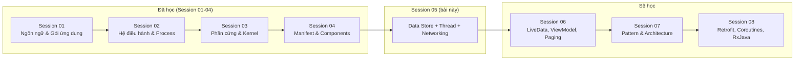
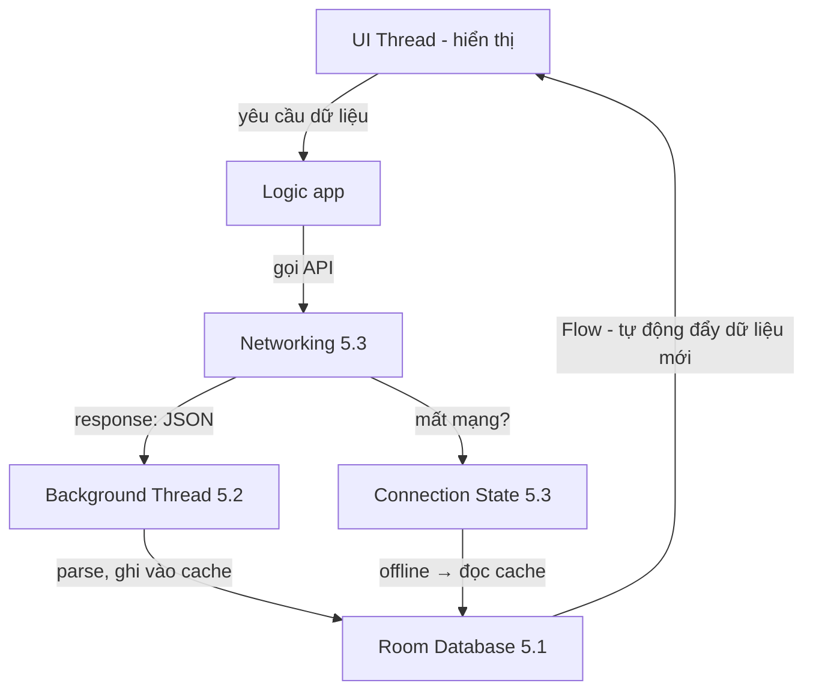
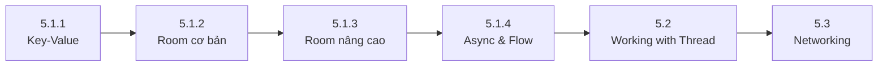

# Session 05 Overview

## Vấn đề cần giải quyết

Sau Session 01-04, bạn đã biết viết một app có UI (Activity, Fragment), khai báo nó trong Manifest và giao tiếp giữa các màn hình bằng Intent. Nhưng app mới chỉ là **vỏ bọc**: màn hình chạy được nhưng chưa có gì để làm.

Một app Android thực tế xoay quanh ba câu hỏi lớn:

1. **Dữ liệu ở đâu?** — Đăng nhập xong, token lưu ở đâu? Danh sách sản phẩm tải về rồi, lần sau mở app có cần tải lại không? Đó là bài toán **Data Store**.
2. **Việc nặng chạy ở đâu?** — Ghi 1.000 dòng vào database, parse JSON lớn, nén ảnh... chạy trên UI thread sẽ đóng băng app. Đó là bài toán **Working with Thread**.
3. **Dữ liệu lấy từ đâu?** — App không thể tự biết giá mới nhất, tin tức mới nhất. Phải gọi lên server qua HTTP. Đó là bài toán **Networking**.

Session 05 trả lời cả ba câu hỏi này. Nó là **trái tim kỹ thuật** của mọi app thương mại thực tế — không có session này, bạn chỉ viết được demo, không viết được product.

```text
Session 05 = Dữ liệu (Data Store) + Xử lý (Thread) + Truyền tải (Networking)
```

Nếu bỏ qua session này, bạn sẽ gặp những lỗi kinh điển của lập trình viên mới: app crash vì chạy việc nặng trên UI thread, mất dữ liệu khi user tắt app, đọc ghi database sai cách làm app chậm dần, và mù mờ về luồng request API.

## Vị trí Session 05 trong lộ trình


<!-- dd: s05-roadmap -->

Vai trò của Session 05 trong lộ trình:

- **Kế thừa**: dùng Kotlin (Session 01), hiểu app chạy trong process/quyền (Session 02), biết Activity/Fragment là gì (Session 04).
- **Bắc cầu**: đây là session đầu tiên làm việc với **dữ liệu thật** và **tác vụ bất đồng bộ** — hai khái niệm mà mọi session sau (LiveData, ViewModel, Paging, Retrofit, Coroutines, RxJava) đều xây dựng lên trên.
- **Khởi động tư duy async**: lần đầu bạn đối mặt với callback, background thread, và câu hỏi "kết quả trả về khi nào?". Ngay trong 5.1 bạn đã dùng `suspend`/`Flow` ở mức cơ bản (xem ghi chú bên dưới).

> [!NOTE]
> **Kiến thức dùng trước: coroutine và Flow.** Các bài của Session 05 dùng coroutine và Flow ở mức tối thiểu để ví dụ chạy được: gọi một hàm `suspend` bên trong `viewModelScope.launch { }`, nhận dữ liệu bằng `Flow.collect`. Coroutine là cách viết code bất đồng bộ theo kiểu tuần tự, tạm dừng được mà không chặn thread; cơ chế của nó được học ở 8.4.3 Coroutines (chưa có bài). Flow là một luồng giá trị bất đồng bộ phát ra theo thời gian; cơ chế của nó được học ở [Flow](../session_07/design_pattern/observer/flow.md). Session 05 không giải thích cơ chế bên dưới của hai kiến thức này.

## Session 05 học những gì?

Mỗi Topic dưới đây chỉ được tóm tắt: vấn đề nó giải quyết và khi nào dùng. Cơ chế, code và sai lầm thường gặp nằm trong bài của từng Topic.

| Phần | Topic | Câu hỏi trả lời |
|---|---|---|
| 5.1 Data Store | [Key-Value Storage](data_store/key_value.md) | Lưu dữ liệu nhỏ dạng cặp key-value bằng gì? |
| 5.1 Data Store | [Relational Database (Room)](data_store/room_architecture.md) | Lưu dữ liệu có cấu trúc, quan hệ, truy vấn phức tạp bằng gì? |
| 5.1 Data Store | [Advanced Room](data_store/room_advanced.md) | App đã phát hành mà thay đổi database thì sao? Truy vấn nhanh hơn thế nào? |
| 5.1 Data Store | [Async Transactions & Flow](data_store/room_transactions.md) | Đọc ghi database trong thread nào cho đúng, và theo dõi dữ liệu tự động như thế nào? |
| 5.2 Working with Thread | [Working with Thread](working_with_thread.md) | Việc nặng (IO, tính toán) chạy ở đâu để UI không đóng băng? |
| 5.3 Networking | [Networking](networking.md) | Gọi API như thế nào, xử lý mất mạng, và theo dõi trạng thái kết nối ra sao? |

### 5.1 Data Store — Dữ liệu ở đâu?

Đây là phần lớn nhất và quan trọng nhất của Session 05, gồm 4 topic đi từ đơn giản đến phức tạp:

- **[5.1.1 Key-Value Storage](data_store/key_value.md)** (SharedPreferences & DataStore): lưu một lượng nhỏ dữ liệu đơn giản dạng key-value như token đăng nhập, cờ "đã xem hướng dẫn lần đầu", theme đã chọn. Toàn bộ các cặp key-value nằm trong một file được đọc vào bộ nhớ, nên không dùng cho dữ liệu lớn, cần tìm kiếm/sắp xếp hay có quan hệ.
- **[5.1.2 Relational Database (Room)](data_store/room_architecture.md)**: Room là lớp trừu tượng bọc trên SQLite (Entity, DAO, Database), kiểm tra lỗi truy vấn ngay lúc biên dịch. Dùng cho dữ liệu có cấu trúc, số lượng lớn, cần truy vấn (WHERE, JOIN, ORDER BY) và app offline-first.
- **[5.1.3 Advanced Room](data_store/room_advanced.md)** (Migration & Indexing): migration dạy Room chuyển database của user từ version cũ sang mới mà giữ nguyên dữ liệu, thiếu nó thì app crash khi schema đổi; index cho cột hay dùng trong WHERE/JOIN để truy vấn không quét toàn bộ bảng.
- **[5.1.4 Async Transactions & Flow](data_store/room_transactions.md)**: hàm DAO `suspend` và DAO trả `Flow` tự chạy truy vấn ngoài main thread (hàm DAO thường thì chặn thread gọi nó); `Flow` phát lại dữ liệu mỗi khi bảng thay đổi để UI tự cập nhật; transaction gom nhiều bước ghi thành một, một bước lỗi thì rollback toàn bộ.

### 5.2 Working with Thread — Việc nặng chạy ở đâu?

UI thread vẽ màn hình; bận quá lâu trong một frame (khoảng 16ms ở 60Hz) thì app giật, bị chặn khoảng 5 giây thì gặp ANR. Việc IO và tính toán nặng (database, gọi API, đọc file, parse JSON, nén ảnh) phải chạy trên background thread, còn cập nhật View thì luôn ở UI thread. Bài [Working with Thread](working_with_thread.md) dạy cách chuyển việc sang thread pool dùng chung và trả kết quả về UI thread; Session 08 thay cách này bằng Coroutines.

### 5.3 Networking — Dữ liệu lấy từ đâu?

App cần dữ liệu từ server, trong khi mạng không phải lúc nào cũng có. Bài [Networking](networking.md) gồm đúng 3 mảng của tiêu đề nav:

1. **Request API**: gửi HTTP request, nhận response, theo nguyên lý request-response (thư viện Retrofit/OkHttp được học sâu ở Session 08).
2. **Handle event network**: xử lý thành công/thất bại, retry, timeout, hiển thị lỗi thân thiện.
3. **Handle connection state**: theo dõi trạng thái mạng qua `ConnectivityManager` và phản hồi UI tương ứng (ví dụ: báo đang offline).

## Mối liên hệ giữa ba phần

Ba phần không tồn tại độc lập — chúng kết hợp thành luồng dữ liệu chuẩn của một app:


<!-- dd: s05-dataflow -->

Ví dụ thực tế — app thương mại điện tử:

1. User mở app, mạng có → **Networking (5.3)** gọi API lấy danh sách sản phẩm.
2. Response JSON được parse trên **background thread (5.2)** — không block UI.
3. Dữ liệu được lưu vào **Room (5.1)** làm cache offline.
4. UI lắng nghe **Flow từ Room (5.1.4)** — tự cập nhật mỗi khi có dữ liệu mới, kể cả khi đang offline.

## Điều kiện tiên quyết từ Session 01-04

Trước khi bắt đầu Session 05, bạn cần nắm:

- **Kotlin căn bản** (Session 01): class, data class, interface, lambda, extension function. Room và code networking đều viết bằng Kotlin.
- **Manifest & Activity** (Session 04): hiểu được Activity/Fragment là gì — vì bạn sẽ đọc ghi database ngay trong các thành phần này. Đặc biệt nắm lifecycle (onCreate/onDestroy) để biết thời điểm khởi tạo/hủy tài nguyên.
- **Process & app chạy thế nào** (Session 02): hữu ích để hiểu vì sao app bị giết khi ở background — liên quan trực tiếp đến việc dữ liệu có bị mất hay không.

Nếu chưa vững Kotlin, hãy ôn lại [Kotlin](../session_01/languages/kotlin.md) trước — toàn bộ session này là Kotlin.

## Sau khi học xong Session 05, bạn làm được gì?

- Giải thích được vị trí của Session 05 trong lộ trình và vai trò bắc cầu của nó sang Session 06-08.
- Phân biệt được khi nào dùng DataStore (key-value) và khi nào dùng Room (dữ liệu có cấu trúc).
- Giải thích được vì sao không được chạy việc nặng trên UI thread và cách chuyển việc sang background thread.
- Giải thích được nguyên lý gọi API, xử lý lỗi mạng và theo dõi trạng thái kết nối.
- Áp dụng được thứ tự học 5.1 Data Store → 5.2 Thread → 5.3 Networking dựa trên mối liên hệ giữa ba phần.

## Nền tảng cho các session tiếp theo

Session 05 là nền tảng bắt buộc cho những thứ bạn sẽ học sau:

| Session sau | Phụ thuộc vào Session 05 như thế nào |
|---|---|
| Session 06 — LiveData, ViewModel, Paging | Paging tải dữ liệu từ Room từng trang; ViewModel là nơi điều phối đọc ghi. |
| Session 07 — Pattern & Architecture | MVVM/Clean Architecture tổ chức Data Layer — mà Room/DataStore/Network là Data Layer thật sự. |
| Session 08 — Retrofit, Coroutines, RxJava | Retrofit thay lớp Networking thô bằng thư viện chuẩn; Coroutines thay thread thủ công bằng cơ chế hiện đại — khái niệm async đã quen từ 5.2. |

## Thứ tự học đề xuất


<!-- dd: s05-path -->

Lý do thứ tự này:

1. **5.1.1 → 5.1.2**: đi từ lưu trữ đơn giản đến database thật sự — hiểu vì sao cần Room sau khi chạm trần giới hạn của Key-Value.
2. **5.1.2 → 5.1.3 → 5.1.4**: trong Room, học cách dùng cơ bản trước, rồi mới tới migration/index, cuối cùng là async/Flow — vì 5.1.4 giả định bạn đã biết DAO là gì.
3. **5.1 → 5.2**: hiểu database chậm → mới hiểu vì sao cần thread.
4. **5.2 → 5.3**: networking luôn cần chạy trên background thread — 5.2 cho bạn công cụ đó.

## Lưu ý quan trọng

> **Đừng học thuộc API.** Session 05 có nhiều class, annotation (Entity, Dao, Query, Migration, Index...). Mục tiêu không phải nhớ hết — mục tiêu là hiểu **bản chất**: dữ liệu nên nằm ở đâu, việc nặng chạy ở đâu, dữ liệu đến từ đâu. Cú pháp cụ thể tra cứu khi cần.

> **Đừng bỏ qua phần Thread.** Nhiều người học vội nhảy thẳng vào Room/Networking rồi dính ANR, crash, bug dữ liệu lẫn lộn vì không hiểu thread. 5.2 tuy ngắn nhưng là gốc của mọi vấn đề async sau này.

## Nguồn tham khảo

- [Data and file storage overview — Android Developers](https://developer.android.com/training/data-storage)
- [DataStore — Android Developers](https://developer.android.com/topic/libraries/architecture/datastore)
- [Room persistence library — Android Developers](https://developer.android.com/training/data-storage/room)
- [Room migrations — Android Developers](https://developer.android.com/training/data-storage/room/migrating-db-versions)
- [Processes and threads overview — Android Developers](https://developer.android.com/guide/components/processes-and-threads)
- [ConnectivityManager — Android Developers](https://developer.android.com/reference/android/net/ConnectivityManager)
- [Support for coroutines in Room — Android Developers](https://developer.android.com/training/data-storage/room/async-query)
