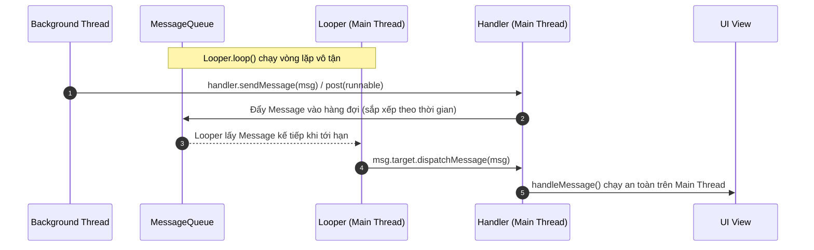
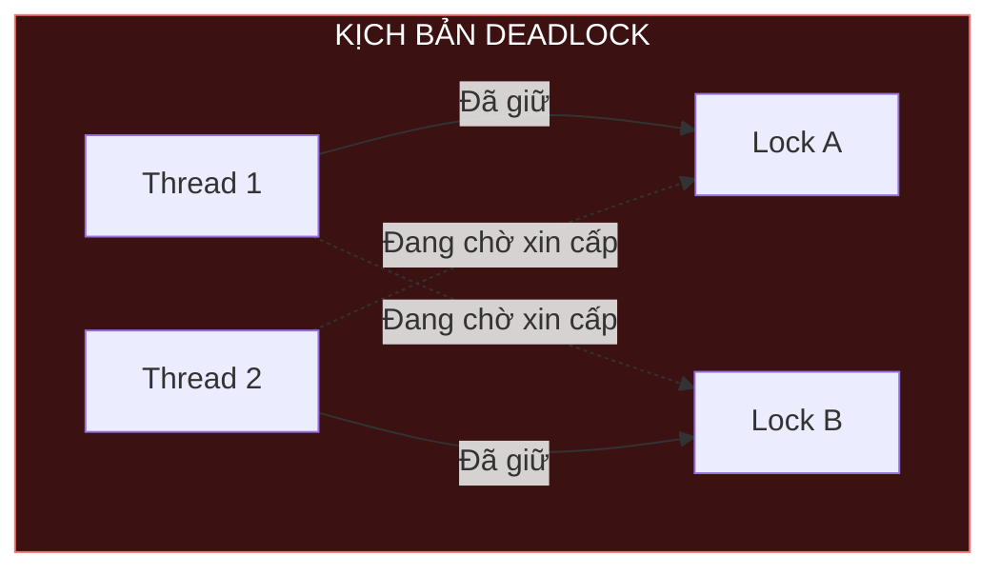

# Working with Thread in Android: Từ Bản Chất Đến Thực Chiến

Trong phát triển ứng dụng Android, mọi trải nghiệm mượt mà của người dùng — từ thao tác vuốt chạm 120 FPS không giật lag, tải dữ liệu nền êm ái đến việc nén ảnh không làm đóng băng màn hình — đều phụ thuộc trực tiếp vào cách bạn làm việc với **Thread (Luồng)**.

Nhiều lập trình viên hiện đại bắt đầu ngay với Kotlin Coroutines mà bỏ qua việc tìm hiểu Thread. Tuy nhiên, Coroutines không thay thế Thread; Coroutines **chạy trên nền tảng các Thread**. Nếu không hiểu bản chất của hệ điều hành, cơ chế Message Loop, mô hình phân chia bộ nhớ và các cạm bẫy tranh chấp tài nguyên (Concurrency Pitfalls), bạn sẽ sớm đối mặt với những lỗi quái đản trong môi trường production: **ANR (Application Not Responding)**, **Memory Leak**, **Race Condition** hay **Deadlock**.

Tài liệu này dẫn dắt bạn đi từ con số 0 đến cấp độ kỹ sư cấp cao: hiểu bản chất hệ điều hành, làm chủ cơ chế giao tiếp của Android Framework, thiết kế Thread Pool tối ưu và xây dựng một **Pipeline xử lý đa luồng thực tế bằng Kotlin**.

---

## 1. Bản chất cốt lõi: Process vs Thread dưới lăng kính Hệ điều hành & ART

Để hiểu đa luồng, trước hết phải hiểu đơn vị vận hành của hệ điều hành.

```
+-----------------------------------------------------------------------+
| LINUX PROCESS (App Sandbox - UID riêng)                                |
|                                                                       |
|  +-----------------------------------------------------------------+  |
|  | HEAP MEMORY DÙNG CHUNG (Objects, Bitmaps, Static Variables)     |  |
|  +-----------------------------------------------------------------+  |
|                                                                       |
|  +-------------------+  +-------------------+  +-------------------+  |
|  | THREAD 1 (Main)   |  | THREAD 2 (Worker) |  | THREAD 3 (Worker) |  |
|  | - Call Stack (1MB)|  | - Call Stack (1MB)|  | - Call Stack (1MB)|  |
|  | - Program Counter |  | - Program Counter |  | - Program Counter |  |
|  | - CPU Registers   |  | - CPU Registers   |  | - CPU Registers   |  |
|  +-------------------+  +-------------------+  +-------------------+  |
+-----------------------------------------------------------------------+
```

### 1.1 Process (Tiến trình) là gì?
- Khi người dùng chạm vào biểu tượng app để mở, hệ thống Linux sẽ fork ra một **Process** mới độc lập thông qua `Zygote`.
- Mỗi Process có một không gian địa chỉ bộ nhớ ảo (Virtual Address Space) hoàn toàn cô lập, được gán một **Linux User ID (UID)** riêng biệt để đảm bảo tính bảo mật (Sandbox).
- Hai Process khác nhau không thể trực tiếp đọc hay ghi vào vùng nhớ của nhau (nếu muốn chia sẻ dữ liệu thì bắt buộc phải dùng IPC - Inter-Process Communication như Binder, AIDL, Messenger, Socket).

### 1.2 Thread (Luồng) là gì?
- **Thread** là đơn vị thực thi nhỏ nhất được hệ điều hành (CPU Scheduler) phân bổ thời gian CPU để xử lý lệnh.
- Một Process luôn có ít nhất một Thread (gọi là **Main Thread** trong Android). Một Process có thể sinh ra nhiều Thread con (Worker Threads).
- **Vùng nhớ dùng chung (Shared Memory):** Tất cả các Thread trong cùng một Process đều dùng chung **Heap Memory**, các biến static, và các vùng nhớ tài nguyên của Process đó.
- **Vùng nhớ riêng biệt (Thread-local Memory):** Mỗi Thread sở hữu riêng:
  - **Call Stack:** Chứa các biến cục bộ nguyên thủy (primitive local variables), con trỏ tham chiếu hàm và stack frames khi thực hiện lời gọi hàm.
  - **Program Counter (PC):** Con trỏ lưu vị trí lệnh máy tiếp theo cần thực thi.
  - **Registers:** Tập hợp các thanh ghi CPU lưu trạng thái tính toán tạm thời.

### 1.3 Chi phí thực sự khi tạo một Thread
Một sai lầm kinh điển của người mới là nghĩ rằng Thread rất "nhẹ":
1. **Chi phí bộ nhớ (Memory Footprint):** Mỗi Thread trong Android Runtime (ART) khi khởi tạo ngầm cấp phát một vùng Call Stack cố định (thường từ **1MB đến 2MB** trong không gian bộ nhớ ảo). Tạo 100 Thread đồng nghĩa giữ chỗ 100MB - 200MB **không gian địa chỉ ảo** cho Stack. RAM vật lý chỉ được cấp cho phần stack thực sự dùng tới, nên con số RAM thật nhỏ hơn nhiều, nhưng mỗi Thread vẫn tốn bộ nhớ kernel, thời gian tạo và chi phí lập lịch.
2. **Chi phí chuyển ngữ cảnh (Context Switching):** CPU chỉ có một số lượng nhân vật lý hữu hạn (ví dụ: chip 8 nhân). Khi có hàng trăm Thread cùng đòi chạy, CPU phải liên tục dừng luồng này, lưu trạng thái thanh ghi/stack pointer ra RAM, rồi tải trạng thái của luồng khác vào thanh ghi. Hiện tượng này làm tiêu tốn chu kỳ CPU vô ích, gây nóng máy và tụt pin trầm trọng.
3. **Kernel System Call Overhead:** Lệnh tạo Thread (`pthread_create` trong C/Linux) phải gọi xuống Kernel space, tốn hàng trăm microsecond đến millisecond.

> [!IMPORTANT]
> **Quy tắc vàng 1:** Tuyệt đối không tự do gọi `Thread { ... }.start()` một cách vô tội vạ. Hãy luôn quản lý luồng thông qua **Thread Pool** có kiểm soát kích thước.

---

## 2. Main Thread (UI Thread) trong Android: Trọng trách, Giới hạn và ANR

### 2.1 Tại sao Android áp dụng mô hình "Single-Threaded UI Model"?
Hầu hết các hệ điều hành đồ họa (Android, iOS, Swing, Web DOM) đều thiết kế UI framework theo mô hình **Đơn Luồng (Single-Threaded)**.

Giả sử nếu hai Thread khác nhau cùng được phép chỉnh sửa một nút bấm (`Button`):
- Thread A đang tính toán đổi kích thước của Button (`measure()` & `layout()`).
- Thread B nhảy vào xóa Button đó khỏi ViewGroup.
- Hệ quả: Giao diện sẽ rơi vào trạng thái không nhất quán (Corrupted UI State) hoặc crash ngay lập tức vì xung đột bộ nhớ.

Để giải quyết, Android quy định: **Chỉ có một Thread duy nhất được phép khởi tạo, đo đạc, vẽ và tương tác với cây giao diện (View Hierarchy) — đó chính là Main Thread (còn gọi là UI Thread).**

Nếu bạn cố tình cập nhật View từ một Background Thread:
```kotlin
thread {
    // CRASH NGAY LẬP TỨC!
    textView.text = "Hello World"
}
```
Hệ thống sẽ ném ra ngoại lệ nổi tiếng:
```
android.view.ViewRootImpl$CalledFromWrongThreadException: 
Only the original thread that created a view hierarchy can touch its views.
```
Cơ chế kiểm tra nằm trong hàm nội bộ của Android Framework:
```java
// Mã nguồn nội bộ của ViewRootImpl.java trong AOSP
void checkThread() {
    if (mThread != Thread.currentThread()) {
        throw new CalledFromWrongThreadException(
            "Only the original thread that created a view hierarchy can touch its views.");
    }
}
```

### 2.2 Vòng lặp Frame 16.6ms / 8.3ms và sự hình thành của Lag
Màn hình thiết bị Android làm mới (refresh) theo tần số quét:
- Màn hình **60Hz**: Cứ sau **16.6ms**, phần cứng GPU/Choreographer sẽ gửi tín hiệu **Vsync**. Main Thread phải hoàn thành việc đo (`measure`), sắp xếp (`layout`) và vẽ (`draw`) toàn bộ cây View trong chưa đầy 16.6ms.
- Màn hình **120Hz**: Thời gian giới hạn chỉ còn **8.3ms**.

Nếu Main Thread bận thực hiện một phép tính toán nặng (ví dụ: giải mã file JSON 5MB mất 100ms), nó sẽ bỏ lỡ (drop) nhiều khung hình Vsync. Người dùng sẽ thấy màn hình bị giật cục (Jank/Stutter).

### 2.3 ANR (Application Not Responding)
Khi Main Thread bị chặn (block) quá lâu và không thể tiếp nhận tương tác người dùng, hệ điều hành sẽ kích hoạt hộp thoại **ANR**:

```
+-------------------------------------------------------------+
| App isn't responding                                        |
| Do you want to close it?                                    |
|                   [ Wait ]      [ OK ]                      |
+-------------------------------------------------------------+
```

| Thành phần | Ngưỡng thời gian gây ANR | Hành động kích hoạt |
| :--- | :--- | :--- |
| **Input Event** | **5 giây** | Người dùng chạm vào màn hình hoặc bấm phím cứng nhưng Main Thread không phản hồi. |
| **BroadcastReceiver** | **10 giây (Foreground) / 60 giây (Background)** | Hàm `onReceive()` chạy quá thời gian cho phép. |
| **Service** | **20 giây (Foreground) / 200 giây (Background)** | Các hàm lifecycle (`onCreate`, `onStartCommand`) của Service chặn Main Thread. |

> [!CAUTION]
> Bất kỳ thao tác nào liên quan đến **Disk I/O** (đọc ghi file, SQLite), **Network I/O** (gọi API HTTP, Socket), hoặc **CPU-bound calculation** (nén ảnh, giải mã mã hóa) đều **BẮT BUỘC PHẢI CHUYỂN SANG BACKGROUND THREAD**.

Android thậm chí còn cài sẵn chốt chặn: Nếu bạn cố tình gọi HTTP Request trên Main Thread, framework sẽ ném ngay lỗi `android.os.NetworkOnMainThreadException`.

---

## 3. Tạo và khởi chạy Thread cơ bản trong Kotlin

Trong Kotlin / Java, có 3 cách cơ bản để khởi tạo và chạy một Thread:

### Cách 1: Sử dụng Kotlin DSL `thread { ... }`
Cách ngắn gọn và phổ biến nhất khi bạn chỉ muốn chạy nhanh một đoạn code ngầm độc lập:
```kotlin
import kotlin.concurrent.thread

fun runTask() {
    thread(start = true, name = "MySimpleWorker") {
        println("Đang chạy trên luồng: ${Thread.currentThread().name}")
        // Thực hiện tính toán nặng...
    }
}
```

### Cách 2: Triển khai interface `Runnable` (Khuyến khích hơn kế thừa Thread)
Tách rời công việc cần làm (`Runnable`) khỏi phương tiện thực thi (`Thread`):
```kotlin
class HeavyCalculationTask(private val data: List<Int>) : Runnable {
    override fun run() {
        val result = data.sumOf { it * 2 }
        println("Kết quả tính toán: $result trên luồng ${Thread.currentThread().name}")
    }
}

// Khởi chạy
val task = HeavyCalculationTask(listOf(1, 2, 3, 4, 5))
val workerThread = Thread(task, "CalculationWorker")
workerThread.start()
```

### Vì sao không nên kế thừa trực tiếp từ `class MyThread : Thread()`?
1. Java và Kotlin chỉ hỗ trợ đơn kế thừa. Kế thừa `Thread` làm bạn mất khả năng kế thừa từ class cha khác.
2. Vi phạm nguyên lý Single Responsibility Principle (SRP): Trộn lẫn logic công việc với cơ chế quản lý vòng đời luồng.
3. Không thể tái sử dụng logic đó cho các kiến trúc hiện đại như `ExecutorService` hay `ThreadPool`.

---

## 4. Trái tim giao tiếp bất đồng bộ của Android: Looper, MessageQueue và Handler

Đây là kiến trúc cốt lõi nhất của toàn bộ Android OS. Mọi tương tác chạm, hiển thị, lifecycle của Activity hay Coroutines `Dispatchers.Main` đều chạy trên nền tảng của bộ ba này.



### 4.1 Mổ xẻ từng thành phần

1. **`Message`**: Đối tượng dữ liệu mang thông điệp cần chuyển giao giữa các luồng.
   - `what`: Mã định danh kiểu sự kiện (Int).
   - `arg1`, `arg2`: Hai số nguyên dung lượng nhẹ (tiết kiệm bộ nhớ).
   - `obj`: Con trỏ tham chiếu đến đối tượng dữ liệu bất kỳ (String, Data Class, Bitmap...).
   - `target`: Con trỏ lưu Handler nào chịu trách nhiệm xử lý Message này khi nó được lấy ra khỏi hàng đợi.
   
   > [!TIP]
   > Luôn dùng `handler.obtainMessage()` hoặc `Message.obtain()` thay vì `new Message()`. Android duy trì một **Object Pool** chứa sẵn các Message rỗng để tái sử dụng, giúp tránh kích hoạt Garbage Collection (GC) liên tục.

2. **`MessageQueue`**: Hàng đợi liên kết đơn (Linked List) chứa các `Message` cần xử lý.
   - Các Message được sắp xếp theo thời gian kích hoạt (`when`). Nếu gọi `sendMessageDelayed(msg, 1000)`, Message sẽ nằm chờ trong Queue và chỉ được lấy ra khi đủ 1000ms.
   - Nó sử dụng cơ chế `epoll` của nhân Linux: Khi hàng đợi rỗng hoặc chưa tới giờ xử lý tin nhắn tiếp theo, Thread sẽ rơi vào trạng thái ngủ sâu (sleep) mà không hề tiêu tốn 1% CPU nào.

3. **`Looper`**: "Động cơ vĩnh cửu" giữ cho Thread luôn sống và liên tục bơm việc:
   ```java
   // Logic tối giản của Looper.loop() trong AOSP
   public static void loop() {
       final Looper me = myLooper();
       final MessageQueue queue = me.mQueue;
       for (;;) { // Vòng lặp vô tận
           Message msg = queue.next(); // Chặn chờ tin nhắn tới
           if (msg == null) return;
           msg.target.dispatchMessage(msg); // Gọi lại Handler
           msg.recycleUnchecked();          // Trả Message về Pool
       }
   }
   ```
   Main Thread của Android đã được hệ thống gọi sẵn `Looper.prepareMainLooper()` và `Looper.loop()` ngay từ hàm `ActivityThread.main()`.

4. **`Handler`**: Bộ điều phối hai chiều:
   - **Chiều gửi (Producer):** Cung cấp các hàm `post()`, `postDelayed()`, `sendMessage()` để bất kỳ Thread nào cũng có thể đẩy tin nhắn vào `MessageQueue`.
   - **Chiều nhận (Consumer):** Cài đặt hàm `handleMessage(msg: Message)` để nhận và xử lý tin nhắn khi Looper phân phối tới. Handler gắn liền với Thread nào thì `handleMessage` sẽ chạy trên Thread đó!

### 4.2 Code thực tế: Giao tiếp Background Thread -> Main Thread qua Handler
```kotlin
import android.os.Handler
import android.os.Looper
import android.os.Message
import kotlin.concurrent.thread

class DataFetcher(private val onResult: (String) -> Unit) {

    // 1. Tạo Handler gắn chặt với Main Looper
    private val mainHandler = object : Handler(Looper.getMainLooper()) {
        override fun handleMessage(msg: Message) {
            when (msg.what) {
                MSG_SUCCESS -> {
                    val data = msg.obj as String
                    onResult(data) // Chạy an toàn 100% trên Main Thread!
                }
                MSG_ERROR -> {
                    // Xử lý lỗi UI
                }
            }
        }
    }

    companion object {
        const val MSG_SUCCESS = 1
        const val MSG_ERROR = 2
    }

    fun fetchDataAsync() {
        // 2. Chạy tác vụ trên Background Thread
        thread(name = "NetworkFetcher") {
            try {
                // Giả lập đọc mạng/file mất 2 giây
                Thread.sleep(2000)
                val responseData = "Dữ liệu máy chủ: { id: 100, name: 'Knowledge OS' }"

                // 3. Tái sử dụng Message từ Pool và gửi về Main Thread
                val msg = mainHandler.obtainMessage(MSG_SUCCESS, responseData)
                mainHandler.sendMessage(msg)
            } catch (e: Exception) {
                mainHandler.sendEmptyMessage(MSG_ERROR)
            }
        }
    }
}
```

### 4.3 `HandlerThread`: Background Thread sở hữu riêng một Looper
Thông thường, một Background Thread mới tạo chỉ chạy hết hàm `run()` rồi lập tức kết thúc. Nếu bạn muốn một Background Thread sống lâu dài, có hàng đợi công việc riêng để xử lý tuần tự từng task ngầm (ví dụ: tuần tự ghi log vào file, hoặc kết nối Bluetooth Serial):
👉 Sử dụng **`HandlerThread`**.

```kotlin
import android.os.Handler
import android.os.HandlerThread

class SequentialBackgroundWorker {
    private val handlerThread = HandlerThread("FileWriterThread").apply { start() }
    
    // Tạo Handler gắn với Looper của HandlerThread vừa tạo
    private val backgroundHandler = Handler(handlerThread.looper)

    fun postTask(taskName: String) {
        backgroundHandler.post {
            println("Đang ghi: $taskName trên ${Thread.currentThread().name}")
            Thread.sleep(500) // Tác vụ nặng tuần tự
        }
    }

    fun stop() {
        // Luôn giải phóng thread khi không còn dùng để tránh leak!
        handlerThread.quitSafely()
    }
}
```

---

## 5. Quản lý luồng công nghiệp: ThreadPoolExecutor & ExecutorService

Khi xây dựng ứng dụng quy mô lớn, việc tạo Thread thủ công bị nghiêm cấm. Bạn phải dùng **Thread Pool**.

### 5.1 Kiến trúc ThreadPoolExecutor
Thread Pool duy trì sẵn một nhóm luồng thường trực để nhận công việc. Khi làm xong, luồng không bị hủy mà quay trở lại hàng ngũ chờ nhiệm vụ tiếp theo.

```
                  +----------------------------------------------+
                  |               Incoming Tasks                 |
                  +----------------------------------------------+
                                         |
                                         v
               +----------------------------------------------------+
               | Số lượng Thread hiện tại < corePoolSize?           |
               +----------------------------------------------------+
                                /                  \
                            [Có]                    [Không]
                            /                          \
         +--------------------------+    +----------------------------------+
         | Tạo Worker Thread mới    |    | Hàng đợi workQueue còn chỗ?      |
         +--------------------------+    +----------------------------------+
                                                       /             \
                                                   [Có]               [Không]
                                                   /                     \
                                    +--------------------+   +-------------------------------+
                                    | Đưa vào workQueue  |   | Số Thread < maximumPoolSize?  |
                                    +--------------------+   +-------------------------------+
                                                                    /             \
                                                                [Có]               [Không]
                                                                /                     \
                                             +-------------------------+   +-------------------------+
                                             | Tạo Thread tạm thời mới |   | Kích hoạt RejectedPolicy|
                                             +-------------------------+   +-------------------------+
```

### 5.2 Công thức tính toán kích thước Thread Pool tối ưu

Không có một con số cố định cho mọi bài toán. Kích thước pool phụ thuộc vào tính chất của tác vụ:

#### Nhóm 1: Tác vụ nặng tính toán (CPU-bound)
*Ví dụ:* Nén ảnh Bitmap, mã hóa dữ liệu AES, thuật toán đồ thị, giải nén ZIP.
- Luồng chạy liên tục và ép CPU đạt 100% công suất. Nếu tạo số Thread vượt quá số nhân CPU, máy chỉ tốn thêm thời gian context switch.
- **Công thức:**
  $$\text{Pool Size} = N_{\text{cpu}} + 1$$
  *(Cộng thêm 1 để phòng ngừa trường hợp hiếm hoi 1 luồng bị page fault hoặc tạm ngừng ngắn).*
- Trong cả hai công thức, $N_{\text{cpu}}$ là số nhân CPU của thiết bị, đọc lúc chạy bằng `Runtime.getRuntime().availableProcessors()`.

#### Nhóm 2: Tác vụ chờ vào/ra dữ liệu (I/O-bound)
*Ví dụ:* Tải file qua mạng HTTP, đọc/ghi SQLite, đọc file từ thẻ nhớ, gọi Web Service.
- Hầu hết thời gian luồng không dùng CPU mà chỉ nằm im chờ kết nối mạng hoặc chờ đĩa từ phản hồi. Vì vậy, CPU có thể phục vụ nhiều luồng khác cùng lúc.
- **Công thức:**
  $$\text{Pool Size} = N_{\text{cpu}} \times \left(1 + \frac{\text{Wait Time}}{\text{Compute Time}}\right)$$
  *(Trong thực tế Android, I/O Pool thường được cấu hình từ **4 đến 64 threads** tùy nhu cầu).*

### 5.3 Triển khai `AppExecutors` Singleton chuẩn kiến trúc Android
```kotlin
import android.os.Handler
import android.os.Looper
import java.util.concurrent.*
import java.util.concurrent.atomic.AtomicInteger

object AppExecutors {

    // Số nhân CPU của thiết bị hiện tại
    private val NUMBER_OF_CORES = Runtime.getRuntime().availableProcessors()

    // 1. Pool chuyên dụng cho CPU-bound: Nén ảnh, parse thuật toán
    val cpuExecutor: ExecutorService = ThreadPoolExecutor(
        NUMBER_OF_CORES,                          // corePoolSize
        NUMBER_OF_CORES * 2,                      // maximumPoolSize
        30L, TimeUnit.SECONDS,                    // keepAliveTime
        LinkedBlockingQueue<Runnable>(128),       // workQueue giới hạn tránh tràn RAM
        NamedThreadFactory("CPU-Worker")
    )

    // 2. Pool chuyên dụng cho Network & Storage I/O
    val ioExecutor: ExecutorService = ThreadPoolExecutor(
        4,                                        // corePoolSize tối thiểu 4 luồng
        32,                                       // co giãn tối đa 32 luồng khi tải nặng
        60L, TimeUnit.SECONDS,
        LinkedBlockingQueue<Runnable>(256),
        NamedThreadFactory("IO-Worker")
    )

    // 3. Executor điều phối về Main Thread
    val mainThread = MainThreadExecutor()

    class MainThreadExecutor : Executor {
        private val handler = Handler(Looper.getMainLooper())
        override fun execute(command: Runnable) {
            handler.post(command)
        }
    }

    // Factory đặt tên Thread để debug trong Profiler dễ dàng
    private class NamedThreadFactory(private val prefix: String) : ThreadFactory {
        private val count = AtomicInteger(0) // newThread() có thể được gọi từ nhiều luồng
        override fun newThread(r: Runnable): Thread {
            return Thread(r, "$prefix-${count.incrementAndGet()}")
        }
    }
}
```

---

## 6. Hiểm họa đa luồng: Race Condition, Deadlock & Memory Leak

Lập trình đa luồng rất mạnh mẽ nhưng đi kèm những cạm bẫy cực kỳ nguy hiểm.

### 6.1 Race Condition (Xung đột dữ liệu)
Xảy ra khi nhiều Thread cùng đọc và ghi vào một vùng dữ liệu chung mà không có cơ chế đồng bộ hóa.

Xét bài toán: Tăng biến đếm lượt tải ảnh `downloadCount++`:
Phép toán `count++` thực chất gồm **3 bước máy tính riêng biệt**:
1. Đọc giá trị hiện tại của `count` từ RAM vào thanh ghi CPU.
2. Cộng 1 vào thanh ghi CPU.
3. Ghi giá trị mới từ thanh ghi CPU trở lại RAM.

Nếu Thread A và Thread B cùng chạy song song:
```
Thread A: Đọc count (0)
Thread B: Đọc count (0)
Thread A: Tăng lên 1 -> Ghi 1 vào RAM
Thread B: Tăng lên 1 -> Ghi 1 vào RAM
-> Kết quả thực tế là 1, trong khi đúng ra phải là 2!
```

#### Các giải pháp bảo vệ dữ liệu:

1. **`AtomicInteger` / `AtomicBoolean` / `AtomicReference` (Tối ưu nhất cho biến đơn lẻ):**
   Sử dụng lệnh phần cứng chuyên dụng **CAS (Compare-And-Swap)** của CPU, không cần khóa luồng (lock-free), hiệu năng cực cao.
   ```kotlin
   import java.util.concurrent.atomic.AtomicInteger

   val downloadCount = AtomicInteger(0)
   downloadCount.incrementAndGet() // An toàn 100% trên mọi luồng
   ```

2. **`@Volatile` (Chỉ đảm bảo tính hiển thị - Visibility, KHÔNG đảm bảo tính nguyên tử - Atomicity):**
   Mỗi CPU core có bộ nhớ đệm (L1/L2 Cache) riêng. Khi một luồng thay đổi giá trị, luồng khác có thể vẫn đang đọc giá trị cũ từ Cache của nó. `@Volatile` tạo quan hệ **happens-before** theo Java Memory Model: mọi lần ghi vào biến volatile được đảm bảo nhìn thấy bởi các lần đọc diễn ra sau đó ở luồng khác (đừng hình dung là "đọc thẳng RAM"; phần cứng tự lo tính nhất quán cache).
   ```kotlin
   @Volatile 
   var isServiceRunning: Boolean = true // Mọi luồng luôn thấy giá trị mới nhất lập tức
   ```

3. **`synchronized` Block (Dành cho cụm logic phức tạp):**
   Đảm bảo tại một thời điểm chỉ có duy nhất một luồng được bước vào khối lệnh.
   ```kotlin
   private val lock = Any()
   private val userCart = mutableListOf<String>()

   fun addItem(item: String) {
       synchronized(lock) {
           userCart.add(item) // An toàn
       }
   }
   ```

#### So sánh nhanh: chọn giải pháp nào?

| Giải pháp | Cơ chế | Khi nào nên dùng |
| :--- | :--- | :--- |
| `AtomicInteger` / `AtomicReference` | Lệnh phần cứng CAS (Compare-And-Swap), lock-free | Biến đếm, cờ trạng thái, một tham chiếu đơn lẻ (tối ưu nhất) |
| `@Volatile` | Đảm bảo visibility qua quan hệ happens-before: lần ghi được các lần đọc sau ở luồng khác nhìn thấy | Cờ boolean để dừng luồng. **Không** đảm bảo atomicity cho `count++` |
| `synchronized` / `ReentrantLock` | Khóa loại trừ tương hỗ (Mutual Exclusion) | Cụm logic nhiều bước, chỉnh sửa cấu trúc dữ liệu như `List`/`Map` |

### 6.2 Deadlock (Khóa chết)
Deadlock xảy ra khi hai hay nhiều luồng bị đóng băng vĩnh viễn vì luồng này chờ tài nguyên đang bị luồng kia giữ và ngược lại.



```kotlin
// NGUY HIỂM: Kịch bản sinh Deadlock
val lockA = Any()
val lockB = Any()

// Thread 1
thread {
    synchronized(lockA) {
        Thread.sleep(50)
        synchronized(lockB) { /* Làm gì đó */ }
    }
}

// Thread 2
thread {
    synchronized(lockB) {
        Thread.sleep(50)
        synchronized(lockA) { /* Làm gì đó */ } // CẢ HAI LUỒNG TREO VĨNH VIỄN!
    }
}
```

#### Nguyên tắc phòng chống Deadlock:
- **Khóa theo thứ tự cố định (Lock Ordering):** Mọi luồng trong toàn bộ ứng dụng nếu cần cả `lockA` và `lockB` thì bắt buộc phải xin `lockA` trước rồi mới tới `lockB`.
- **Sử dụng `ReentrantLock` với Timeout:** Thay vì `synchronized`, dùng `lock.tryLock(1000, TimeUnit.MILLISECONDS)`. Nếu quá 1 giây không lấy được khóa thì hủy bỏ và thử lại sau.

### 6.3 Hiểm họa Memory Leak khi dùng Thread trong Android
Trong Java/Kotlin, một **Non-static Inner Class** hoặc **Anonymous Class** (bao gồm cả lambda) luôn ngầm giữ một tham chiếu mạnh (`Strong Reference`) đến đối tượng chứa nó (Outer Class - ví dụ: `Activity`).

```kotlin
class ProfileActivity : AppCompatActivity() {

    override fun onCreate(savedInstanceState: Bundle?) {
        super.onCreate(savedInstanceState)

        // RÒ RỈ BỘ NHỚ NGUY HIỂM!
        Thread {
            Thread.sleep(60_000) // Chạy ngầm 60 giây
            // Lambda này ngầm giữ tham chiếu đến ProfileActivity
            runOnUiThread { updateUI() }
        }.start()
    }
}
```
**Điều gì xảy ra khi người dùng bấm nút Back sau 2 giây?**
1. Hệ thống gọi `ProfileActivity.onDestroy()`.
2. Lẽ ra Activity phải được Garbage Collection (GC) thu hồi hàng chục MB (ảnh, View, Layout).
3. Nhưng Thread ngầm vẫn đang chạy 58 giây tiếp theo và đang giữ chặt tham chiếu đến `ProfileActivity`.
4. Toàn bộ Activity và cây View của nó bị kẹt lại trong Heap RAM -> **Memory Leak**.

#### Cách khắc phục:
1. Sử dụng **`WeakReference`** nếu bắt buộc phải giữ tham chiếu đến UI.
2. Hủy bỏ (Cancel/Interrupt) tác vụ ngầm ngay khi Activity bị hủy:
```kotlin
class SafeActivity : AppCompatActivity() {
    private var workerFuture: Future<*>? = null

    override fun onCreate(savedInstanceState: Bundle?) {
        super.onCreate(savedInstanceState)
        workerFuture = AppExecutors.ioExecutor.submit {
            if (!Thread.currentThread().isInterrupted) {
                // Làm việc an toàn...
            }
        }
    }

    override fun onDestroy() {
        super.onDestroy()
        workerFuture?.cancel(true) // Gửi interrupt: tác vụ chỉ dừng khi nó tự kiểm tra cờ hoặc đang chờ ở hàm chặn
    }
}
```

---

## 7. Bản đồ 5 Use Cases thực chiến trong ứng dụng Android

Dưới đây là 5 bài toán mà bất kỳ lập trình viên Android nào cũng sẽ gặp trong các dự án thực tế:

| Use Case | Đặc trưng tài nguyên | Loại Thread Pool phù hợp | Cơ chế điều phối |
| :--- | :--- | :--- | :--- |
| **1. File Downloader & Storage Writer** | I/O-bound (chờ mạng và đĩa) | `ioExecutor` (10-20 threads) | Báo cáo byte đã tải về Main Handler theo từng đoạn (chunk) |
| **2. Image Processing & Filters** | CPU-bound (thuật toán ma trận pixel) | `cpuExecutor` ($N_{cpu}$ threads) | Chia nhỏ ảnh hoặc xử lý từng ảnh một cách độc lập |
| **3. Large JSON Bulk Import** | Hỗn hợp (CPU parse + I/O SQLite) | `SingleThreadExecutor` hoặc `ioExecutor` | Thực hiện Transaction trọn gói trong 1 luồng ngầm duy nhất |
| **4. Realtime Socket / Bluetooth** | Liên tục, kết nối duy trì lâu | `Dedicated Thread` (`HandlerThread`) | Lắng nghe liên tục trên vòng lặp `while (isConnected)` ngầm |
| **5. Periodic Polling / Heartbeat** | Định kỳ, thời gian ngắn | `ScheduledThreadPoolExecutor` | `scheduleAtFixedRate()` gửi ping định kỳ |

---

## 8. Cầu nối thế hệ: Từ Thread thuần đến Kotlin Coroutines & WorkManager

Trong phát triển Android hiện đại (2024-2026), bạn sẽ chủ yếu làm việc với **Kotlin Coroutines** và **WorkManager**. Nhưng hãy nhìn cách chúng ánh xạ trực tiếp vào kiến trúc Thread bên dưới:

### 8.1 Coroutine Dispatchers thực chất là gì?
Coroutine không phải là một luồng ma thuật. Nó là những đoạn mã có khả năng tạm ngừng (suspension) được điều phối chạy trên các Thread có sẵn. `Dispatchers.Default` và `Dispatchers.IO` **không phải `ThreadPoolExecutor`**: cả hai dùng chung một scheduler riêng của kotlinx.coroutines, nên `withContext(Dispatchers.IO)` khi đang ở Default thường không đổi thread thật.

```
+---------------------------+-------------------------------------------------------+
| Coroutine Dispatcher      | Bản chất Thread Pool bên dưới                          |
+---------------------------+-------------------------------------------------------+
| Dispatchers.Main          | Chạy trực tiếp qua MainLooper Handler của Android     |
| Dispatchers.IO            | Dùng chung thread với Default; tối đa 64 tác vụ chặn song song (hoặc số nhân CPU nếu lớn hơn) |
| Dispatchers.Default       | Pool dùng chung; tối đa số thread = số nhân CPU, tối thiểu 2 |
| Dispatchers.Unconfined    | Không đổi luồng (chạy tiếp trên luồng vừa gọi)        |
+---------------------------+-------------------------------------------------------+
```

### 8.2 Khi nào dùng công nghệ nào? Bảng quyết định kỹ thuật

```
                     Bạn cần thực hiện tác vụ gì?
                                 |
         +-----------------------+-----------------------+
         |                                               |
Tác vụ cần chạy ngay lập tức?           Tác vụ cần chạy cả khi app đã tắt?
         |                                               |
  (In-Memory Work)                             (Guaranteed Execution)
         |                                               |
+------------------------+                     +-----------------------+
| Dùng Kotlin Coroutines |                     |   Dùng WorkManager    |
| (lifecycleScope/       |                     | (Đồng bộ ngầm, upload |
|  viewModelScope)       |                     |  ảnh hàng loạt)       |
+------------------------+                     +-----------------------+
```

1. **Kotlin Coroutines:** Lựa chọn mặc định số 1 cho 95% các tác vụ trong ứng dụng hiện nay (gọi API, đọc database, cập nhật State).
2. **ThreadPool / HandlerThread thuần:** Dùng khi phát triển các **Core C/C++ NDK Library**, **Audio/Video Engine thời gian thực**, hoặc các SDK chuyên dụng độc lập không muốn phụ thuộc vào thư viện bên thứ ba.
3. **WorkManager:** Dùng cho các tác vụ bắt buộc phải hoàn thành ngay cả khi người dùng vuốt thoát app hoặc khởi động lại máy (đồng bộ dữ liệu, sao lưu ngầm).

---

## 9. Mini-Project thực chiến: Concurrent Image Processing Pipeline

Chúng ta sẽ xây dựng một **Hệ thống tải và lọc ảnh song song (Pipeline)** bằng Kotlin thuần kết hợp `ThreadPoolExecutor` và `Handler`, tuân thủ 100% Best Practices:
- Quản lý kích thước luồng chặt chẽ.
- Báo cáo % tiến độ và kết quả về Main Thread.
- Tự động hủy luồng khi màn hình bị đóng để ngăn chặn Memory Leak.

### 9.1 Thiết kế cấu trúc các thành phần

```
[UI Layer: Activity / Screen]
         | 1. Yêu cầu xử lý danh sách ảnh
         v
[ImagePipelineManager]
         | 2. Phân tách tác vụ
         v
[IO ThreadPool] -----(Tải byte ảnh)-----> [CPU ThreadPool] -----(Bộ lọc Grayscale)
                                                                       |
         <----- 3. Báo cáo % & Bitmap hoàn chỉnh (Main Handler) --------+
```

### 9.2 Triển khai mã nguồn hoàn chỉnh

#### Bước 1: Khai báo Contract và Data Model
```kotlin
package com.knowledge.threading.pipeline

import android.graphics.Bitmap

// Trạng thái của từng tác vụ ảnh
sealed class PipelineState {
    data class Progress(val imageUrl: String, val percent: Int) : PipelineState()
    data class Success(val imageUrl: String, val resultBitmap: Bitmap) : PipelineState()
    data class Error(val imageUrl: String, val throwable: Throwable) : PipelineState()
}

// Callback giao tiếp an toàn về UI
interface PipelineCallback {
    fun onStateUpdate(state: PipelineState)
}
```

#### Bước 2: Xây dựng Bộ xử lý ImagePipelineManager
```kotlin
package com.knowledge.threading.pipeline

import android.graphics.*
import android.os.Handler
import android.os.Looper
import java.io.InputStream
import java.lang.ref.WeakReference
import java.net.HttpURLConnection
import java.net.URL
import java.util.concurrent.*

class ImagePipelineManager(callback: PipelineCallback) {

    // Tránh Memory Leak bằng WeakReference
    private val callbackRef = WeakReference(callback)

    // Handler đảm bảo mọi callback đều bắn về Main UI Thread
    private val mainHandler = Handler(Looper.getMainLooper())

    // 1. Thread Pool cho việc tải ảnh qua mạng (I/O)
    // Queue không giới hạn thì pool không bao giờ vượt corePoolSize (maximumPoolSize bị bỏ qua),
    // nên đặt core = max = 4 và cho thread rảnh tự hủy sau 30 giây.
    private val downloadExecutor = ThreadPoolExecutor(
        4, 4, 30L, TimeUnit.SECONDS,
        LinkedBlockingQueue<Runnable>()
    ).apply { allowCoreThreadTimeOut(true) }

    // 2. Thread Pool cho việc biến đổi điểm ảnh CPU (CPU-bound)
    private val filterExecutor = ThreadPoolExecutor(
        Runtime.getRuntime().availableProcessors(),
        Runtime.getRuntime().availableProcessors(),
        0L, TimeUnit.MILLISECONDS,
        LinkedBlockingQueue<Runnable>()
    )

    // Danh sách theo dõi các Task đang chạy để có thể cancel khi cần
    private val runningFutures = CopyOnWriteArrayList<Future<*>>()

    fun processImage(imageUrl: String) {
        val future = downloadExecutor.submit {
            try {
                // Giai đoạn 1: Tải ảnh (I/O)
                notifyState(PipelineState.Progress(imageUrl, 20))
                val rawBitmap = downloadBitmap(imageUrl)

                notifyState(PipelineState.Progress(imageUrl, 60))

                // Giai đoạn 2: Đẩy sang CPU Pool để áp bộ lọc Grayscale
                filterExecutor.execute {
                    try {
                        val filteredBitmap = applyGrayscaleFilter(rawBitmap)
                        notifyState(PipelineState.Progress(imageUrl, 100))
                        notifyState(PipelineState.Success(imageUrl, filteredBitmap))
                    } catch (e: Throwable) {
                        notifyState(PipelineState.Error(imageUrl, e))
                    }
                }
            } catch (e: Throwable) {
                notifyState(PipelineState.Error(imageUrl, e))
            }
        }
        runningFutures.add(future)
    }

    private fun downloadBitmap(urlString: String): Bitmap {
        val url = URL(urlString)
        val connection = url.openConnection() as HttpURLConnection
        connection.doInput = true
        connection.connectTimeout = 5000
        connection.readTimeout = 5000
        connection.connect()

        val input: InputStream = connection.inputStream
        val bitmap = BitmapFactory.decodeStream(input)
            ?: throw IllegalStateException("Không thể decode dữ liệu ảnh")
        input.close()
        connection.disconnect()
        return bitmap
    }

    // Thuật toán CPU-bound: Chuyển đổi màu ảnh sang Grayscale
    private fun applyGrayscaleFilter(src: Bitmap): Bitmap {
        val width = src.width
        val height = src.height
        val dest = Bitmap.createBitmap(width, height, Bitmap.Config.ARGB_8888)

        val canvas = Canvas(dest)
        val paint = Paint()
        val colorMatrix = ColorMatrix().apply {
            setSaturation(0f) // Triệt tiêu độ bão hòa màu -> trắng đen
        }
        paint.colorFilter = ColorMatrixColorFilter(colorMatrix)
        canvas.drawBitmap(src, 0f, 0f, paint)
        return dest
    }

    private fun notifyState(state: PipelineState) {
        mainHandler.post {
            callbackRef.get()?.onStateUpdate(state)
        }
    }

    // Dọn dẹp tài nguyên và ngắt toàn bộ luồng khi màn hình đóng
    fun release() {
        for (future in runningFutures) {
            future.cancel(true) // Gửi tín hiệu ngắt interrupt
        }
        runningFutures.clear()
        downloadExecutor.shutdownNow()
        filterExecutor.shutdownNow()
    }
}
```

#### Bước 3: Tích hợp vào Activity an toàn với Vòng đời
```kotlin
package com.knowledge.threading.pipeline

import android.os.Bundle
import android.widget.ProgressBar
import android.widget.TextView
import androidx.appcompat.app.AppCompatActivity

class ImageProcessingActivity : AppCompatActivity(), PipelineCallback {

    private lateinit var progressBar: ProgressBar
    private lateinit var statusText: TextView
    private var pipelineManager: ImagePipelineManager? = null

    override fun onCreate(savedInstanceState: Bundle?) {
        super.onCreate(savedInstanceState)
        // Khởi tạo views...

        pipelineManager = ImagePipelineManager(this)
        
        // Bắt đầu xử lý ảnh ngầm
        pipelineManager?.processImage("https://example.com/large-wallpaper.jpg")
    }

    override fun onStateUpdate(state: PipelineState) {
        // Đã được bảo đảm 100% chạy trên Main Thread qua Handler
        when (state) {
            is PipelineState.Progress -> {
                progressBar.progress = state.percent
                statusText.text = "Đang xử lý: ${state.percent}%"
            }
            is PipelineState.Success -> {
                statusText.text = "Hoàn tất!"
                // imageView.setImageBitmap(state.resultBitmap)
            }
            is PipelineState.Error -> {
                statusText.text = "Lỗi: ${state.throwable.localizedMessage}"
            }
        }
    }

    override fun onDestroy() {
        super.onDestroy()
        // Triệt tiêu nguy cơ Memory Leak ngay khi Activity bị hủy
        pipelineManager?.release()
        pipelineManager = null
    }
}
```

---

## 10. Giám sát & Debugging Đa luồng chuyên nghiệp

Lập trình viên giỏi khác lập trình viên trung bình ở khả năng **quan sát và chẩn đoán luồng**.

### 10.1 Khám phá Android Studio Profiler (CPU Profiler)
1. Kết nối máy thật hoặc máy ảo -> Mở tab **Profiler** ở đáy Android Studio.
2. Bấm vào biểu đồ **CPU** -> Chọn cấu hình **System Trace** hoặc **Java/Kotlin Method Trace** -> Bấm **Record**.
3. Thao tác trên app -> Bấm **Stop Recording**.
4. Quan sát danh sách Threads:
   - **Màu xanh lá cây (Running):** Luồng đang thực thi lệnh trên CPU.
   - **Màu xanh da trời (Sleeping):** Luồng đang nghỉ (`Thread.sleep()` hoặc chờ MessageQueue).
   - **Màu vàng (Waiting):** Luồng đang đợi tài nguyên/khóa (`Object.wait()`).
   - **Màu đỏ (Blocked):** CẢNH BÁO NGUY HIỂM! Luồng đang bị chặn bởi `synchronized` hoặc Lock khác. Nếu Main Thread có vạch màu đỏ kéo dài -> Nguy cơ ANR trực tiếp!

### 10.2 Bật StrictMode phát hiện vi phạm luồng trong lúc Debug
Thêm đoạn code này vào hàm `Application.onCreate()` để ứng dụng tự động cảnh báo (hoặc chớp đỏ màn hình/crash) khi vô tình thực hiện Disk/Network I/O trên Main Thread:

```kotlin
class MyApplication : Application() {
    override fun onCreate() {
        super.onCreate()
        if (BuildConfig.DEBUG) {
            StrictMode.setThreadPolicy(
                StrictMode.ThreadPolicy.Builder()
                    .detectDiskReads()
                    .detectDiskWrites()
                    .detectNetwork()
                    .penaltyLog()
                    .penaltyFlashScreen()
                    .build()
            )
        }
    }
}
```

---

## 11. Tư duy hệ thống (System Thinking): Vị trí của Threading trong Clean Architecture

Trong một kiến trúc phần mềm tiêu chuẩn (Clean Architecture / MVVM), việc điều phối luồng không nằm rải rác tùy tiện mà tuân thủ ranh giới rõ ràng:

```
[ UI Layer (Activity / Compose) ] 
       | (Luôn chạy trên MAIN THREAD - Thụ động hiển thị UI State)
       v
[ ViewModel / Presenter ]
       | (Chuyển tiếp lệnh, điều phối luồng thông qua Scopes)
       v
[ Domain Layer (UseCases) ]
       | (Thực thi Business Logic - Luôn là Thread-Safe)
       v
[ Data Layer (Repository / DataSource) ]
       | (CHỦ ĐỘNG chuyển sang BACKGROUND THREAD: I/O Pool hoặc Dispatchers.IO)
       v
[ SQLite Database / Remote Network ]
```

**Nguyên tắc "Main-Safety":** Một Repository hoặc UseCase chuẩn mực phải **Main-Safe**. Nghĩa là bất kể ai gọi nó từ Main Thread, nó phải tự chịu trách nhiệm chuyển sang Background Thread để xử lý và trả kết quả về an toàn mà không làm treo UI của người gọi.

---

## 12. Checklist Best Practices khi làm việc với Thread

> [!TIP]
> Hãy in bảng kiểm này và kiểm tra code của bạn trước mỗi đợt Release:

- [ ] **Không `new Thread()` tùy tiện:** Toàn bộ tác vụ nền phải đi qua `ThreadPoolExecutor` hoặc Coroutines.
- [ ] **Đặt tên cho Thread:** Luôn sử dụng `ThreadFactory` để đặt tên rõ ràng (ví dụ: `Image-IO-1`, `Audio-CPU-2`) giúp việc đọc Logcat và Profiler dễ dàng.
- [ ] **Main-Safety:** Tuyệt đối không để rò rỉ thao tác I/O hoặc tính toán nặng lên Main Thread.
- [ ] **Chống Memory Leak:** Không bao giờ giữ tham chiếu trực tiếp đến `Activity`, `Fragment` hay `View` bên trong Worker Thread hoặc Handler. Luôn hủy tác vụ trong `onDestroy()`.
- [ ] **Tái sử dụng Message:** Dùng `Message.obtain()` hoặc `handler.obtainMessage()` thay vì khởi tạo `Message()`.
- [ ] **Xử lý ngắt luồng (Cancellation):** Trong các vòng lặp nặng của Thread, hãy thường xuyên kiểm tra cờ `Thread.currentThread().isInterrupted` để dừng sớm khi bị hủy.
- [ ] **Phòng chống Deadlock:** Khóa tài nguyên theo một thứ tự duy nhất trên toàn hệ thống. Ưu tiên các cấu trúc dữ liệu `java.util.concurrent.*` thay vì tự viết `synchronized`.

---

## 13. Nguồn tham khảo (References)

1. [Processes and threads overview — Android Developers Official](https://developer.android.com/guide/components/processes-and-threads)
2. [Keep your app responsive (ANR prevention) — Android Developers](https://developer.android.com/topic/performance/vitals/anr)
3. [Handler and Looper source code — Android Open Source Project (AOSP)](https://cs.android.com/android/platform/superproject/+/master:frameworks/base/core/java/android/os/Looper.java)
4. [Java Concurrency in Practice — Brian Goetz](https://jcip.net/)
5. [Kotlin Coroutines on Android: Background Work Best Practices](https://developer.android.com/kotlin/coroutines)
6. [Dispatchers.Default — kotlinx.coroutines API](https://kotlinlang.org/api/kotlinx.coroutines/kotlinx-coroutines-core/kotlinx.coroutines/-dispatchers/-default.html)
7. [Dispatchers.IO — kotlinx.coroutines API](https://kotlinlang.org/api/kotlinx.coroutines/kotlinx-coroutines-core/kotlinx.coroutines/-dispatchers/-i-o.html)
8. [ThreadPoolExecutor — Android Developers](https://developer.android.com/reference/java/util/concurrent/ThreadPoolExecutor)
