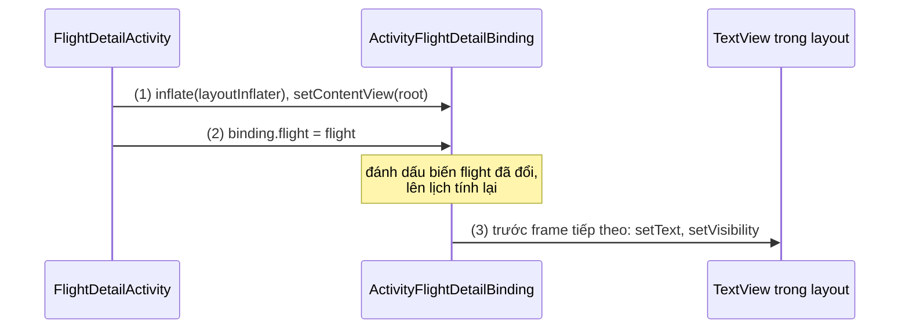
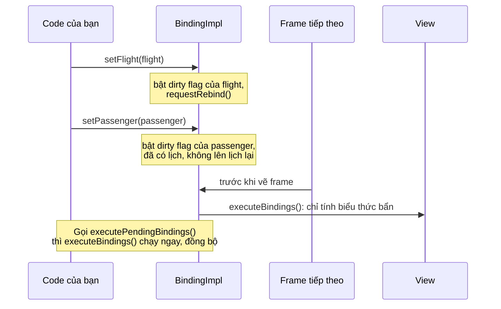
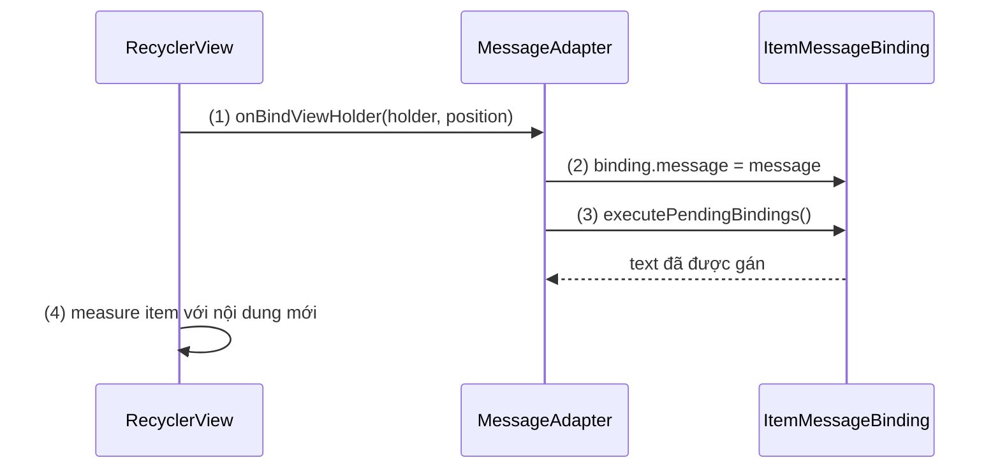
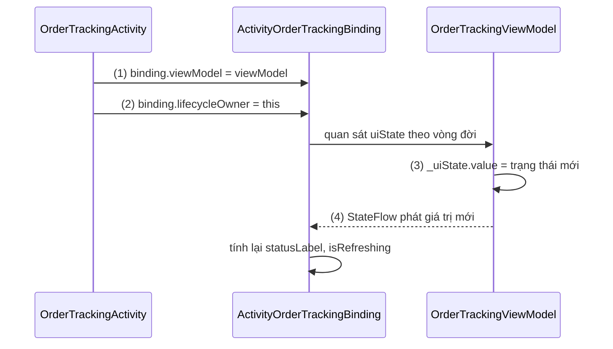
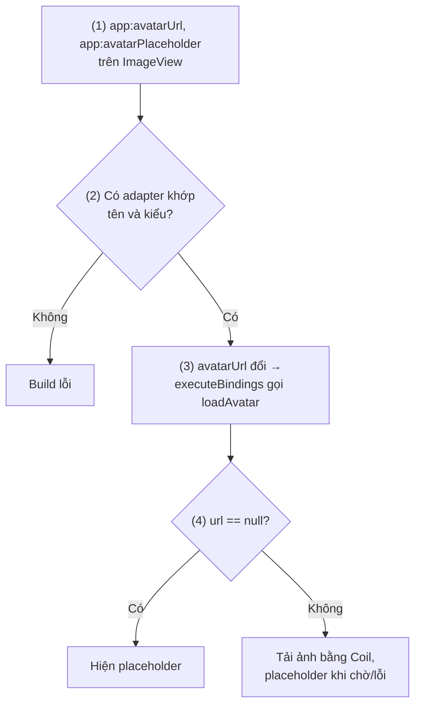
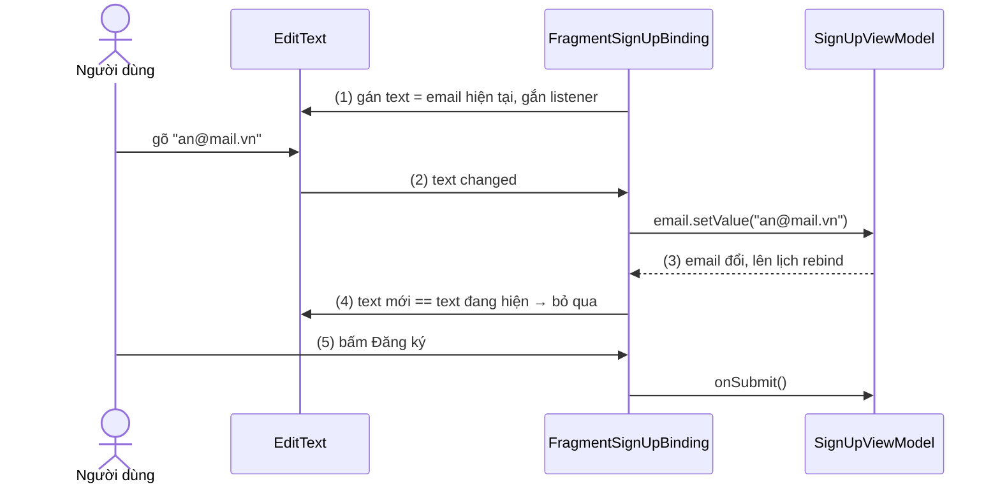
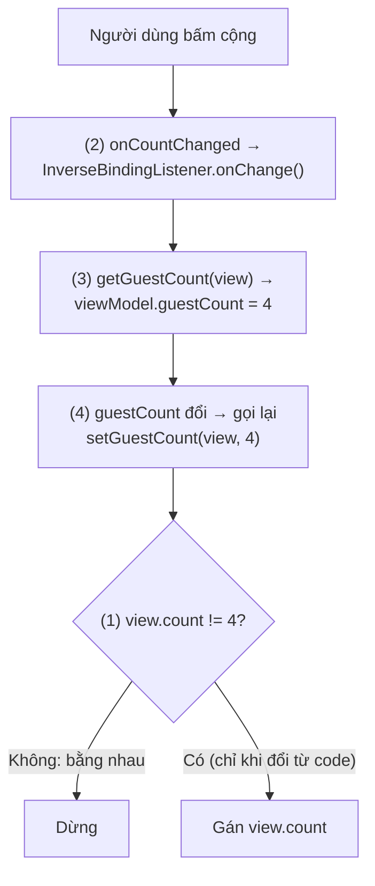
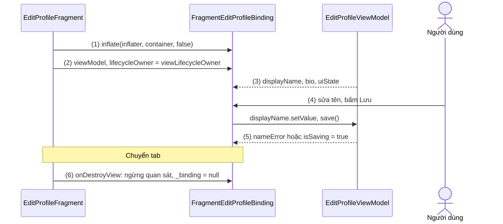

# Data Binding

## Vấn đề cần giải quyết

Với [View Binding](view_binding.md), code đã lấy được tham chiếu tới View một cách an toàn. Nhưng việc **đưa dữ liệu vào View** vẫn là code tay, lặp lại ở mọi nơi dữ liệu đổi:

```kotlin
// Mỗi lần trạng thái đơn hàng đổi, phải tự gọi lại toàn bộ đoạn này
binding.statusText.text = order.statusLabel
binding.etaText.text = getString(R.string.eta_format, order.etaMinutes)
binding.progress.visibility = if (order.isLoading) View.VISIBLE else View.GONE
binding.cancelButton.isEnabled = order.canCancel
```

Đoạn code này có ba vấn đề:

- **Dễ quên cập nhật:** dữ liệu đổi ở nhiều chỗ (tải lần đầu, làm mới, thông báo đẩy) thì chỗ nào cũng phải gọi lại đoạn gán. Quên một chỗ là UI lệch dữ liệu.
- **Quan hệ dữ liệu–View nằm rải rác:** đọc layout không biết `statusText` hiển thị trường nào.
- **Form phải nối hai chiều bằng tay:** đổ giá trị vào `EditText`, gắn `TextWatcher` đọc giá trị về, và tránh để hai chiều gọi nhau mãi.

Vấn đề cần giải quyết là: **khai báo một lần "View này hiển thị dữ liệu nào", rồi để hệ thống tự giữ View khớp với dữ liệu**, kể cả chiều ngược lại khi người dùng nhập.

## Sau khi học xong

- Giải thích được cách Data Binding biến layout có biến và biểu thức @{} thành class binding lúc build, và vì sao View được cập nhật trước frame tiếp theo chứ không ngay khi dữ liệu đổi.
- Triển khai được binding expression, nguồn dữ liệu quan sát được (ObservableField, LiveData, StateFlow) cùng lifecycleOwner, và xử lý sự kiện bằng method reference hoặc listener binding.
- Áp dụng được @BindingAdapter và two-way binding @={}, kể cả @InverseBindingAdapter cho thuộc tính tự định nghĩa, mà không tạo vòng lặp cập nhật vô hạn.
- Xử lý được Data Binding trong Fragment bằng viewLifecycleOwner và dọn binding theo vòng đời của View.
- Biết khi nào chọn Data Binding, View Binding hay Compose dựa trên chi phí build (kapt) và tình trạng bảo trì của thư viện.

## Data Binding là gì?

**Data Binding (liên kết dữ liệu)** là thư viện Jetpack đi kèm Android Gradle Plugin (AGP): layout XML bọc trong thẻ `<layout>` khai báo **biến** và **biểu thức `@{}`** gắn vào thuộc tính của View; lúc build, annotation processor sinh ra class binding chứa sẵn code gán giá trị biểu thức vào View, và khi biến hoặc nguồn dữ liệu quan sát được thay đổi, binding tự tính lại biểu thức và cập nhật View.

Mental model: layout Data Binding là **một bảng tính**. Biến trong `<data>` là ô nhập liệu, mỗi thuộc tính `@{}` là ô công thức tham chiếu tới chúng; ô nhập liệu đổi thì ô công thức phụ thuộc tự tính lại. Two-way binding là ô vừa hiện kết quả vừa cho người dùng gõ đè, giá trị gõ vào được ghi ngược về ô nhập liệu.

Class binding ở đây là cùng khái niệm với [View Binding](view_binding.md), mục "View Binding là gì?" (tên theo layout, field cho View có id, `inflate()`/`bind()`); Data Binding thêm setter cho từng biến và code tính biểu thức.

## Cách hoạt động

### Bật Data Binding và cấu trúc layout `<layout>`

Data Binding bật theo module. Khác View Binding, nó chạy một **annotation processor** để sinh code từ biểu thức, nên module viết bằng Kotlin phải bật **kapt** (công cụ chạy annotation processor của Java trên code Kotlin, xem [Kotlin](../session_01/languages/kotlin.md), mục "Annotation Processing: KAPT và KSP"):

```kotlin
// app/build.gradle.kts (AGP 8.x, plugin Kotlin khai báo riêng)
plugins {
    id("com.android.application")
    id("org.jetbrains.kotlin.android")
    id("org.jetbrains.kotlin.kapt") // Data Binding cần kapt trong module dùng nó
}

android {
    buildFeatures {
        dataBinding = true
    }
}
```

Từ AGP 9.0 (Kotlin tích hợp sẵn trong AGP), plugin `org.jetbrains.kotlin.kapt` không tương thích nữa; docs hướng dẫn thay bằng `com.android.legacy-kapt`. Data Binding **không có bản KSP** và docs ghi không có kế hoạch làm, nên module dùng Data Binding không bỏ được kapt. Đây là chi phí chính của Data Binding: kapt phải sinh Java stub từ code Kotlin mỗi lần build, và docs gợi ý cô lập Data Binding vào module riêng để giới hạn ảnh hưởng.

Một layout dùng Data Binding có ba phần:

1. Thẻ gốc `<layout>`: đánh dấu layout Data Binding. Layout không có `<layout>` thì không có biến hay biểu thức (bật thêm `viewBinding` thì nó vẫn có class View Binding).
2. Phần `<data>`: `<variable name="…" type="…"/>` (ô nhập liệu của bảng tính) và `<import type="…"/>` để dùng tên class ngắn như `View.GONE`.
3. View gốc thật của màn hình; thuộc tính cần dữ liệu thì viết `@{biểu thức}`.

Module app phải bật `dataBinding` nếu phụ thuộc vào thư viện dùng Data Binding, kể cả khi bản thân nó không dùng.

#### Ví dụ: thẻ thông tin chuyến bay

**Bài toán:** màn chi tiết vé máy bay hiển thị mã chuyến, hành trình, cửa ra (có thể chưa có) và dòng báo trễ chỉ hiện khi trễ. Dữ liệu đọc một lần, không đổi, nên chỉ cần binding một chiều.

**Luồng chạy:**

1. Inflate `ActivityFlightDetailBinding` và hiển thị `binding.root`, như View Binding.
2. Gán `binding.flight = flight`: setter sinh ra ghi nhận biến đã đổi và lên lịch tính lại.
3. Trước frame tiếp theo, binding tính các biểu thức phụ thuộc `flight` và gọi `setText`, `setVisibility` trên View.



```xml
<!-- res/layout/activity_flight_detail.xml -->
<layout xmlns:android="http://schemas.android.com/apk/res/android">

    <data>
        <import type="android.view.View" />
        <variable
            name="flight"
            type="com.example.booking.Flight" />
    </data>

    <LinearLayout
        android:layout_width="match_parent"
        android:layout_height="match_parent"
        android:orientation="vertical"
        android:padding="24dp">

        <TextView
            android:layout_width="wrap_content"
            android:layout_height="wrap_content"
            android:text="@{flight.code}" />

        <TextView
            android:layout_width="wrap_content"
            android:layout_height="wrap_content"
            android:text="@{@string/route_format(flight.origin, flight.destination)}" />

        <TextView
            android:layout_width="wrap_content"
            android:layout_height="wrap_content"
            android:text="@{flight.gate ?? @string/gate_not_assigned}" />

        <TextView
            android:layout_width="wrap_content"
            android:layout_height="wrap_content"
            android:text="@{@plurals/delay_minutes(flight.delayMinutes, flight.delayMinutes)}"
            android:visibility="@{flight.delayMinutes > 0 ? View.VISIBLE : View.GONE}" />
    </LinearLayout>
</layout>
```

```kotlin
// Flight.kt (@Parcelize cần plugin kotlin-parcelize)
@Parcelize
data class Flight(
    val code: String,
    val origin: String,
    val destination: String,
    val gate: String?,
    val delayMinutes: Int
) : Parcelable

// FlightDetailActivity.kt
class FlightDetailActivity : AppCompatActivity() {

    private lateinit var binding: ActivityFlightDetailBinding

    override fun onCreate(savedInstanceState: Bundle?) {
        super.onCreate(savedInstanceState)
        binding = ActivityFlightDetailBinding.inflate(layoutInflater) // (1)
        setContentView(binding.root)

        val flight = IntentCompat.getParcelableExtra(intent, EXTRA_FLIGHT, Flight::class.java)
            ?: return finish()
        binding.flight = flight                                        // (2) gán ô nhập liệu
        // (3) không có dòng setText nào: binding tự gán trước frame tiếp theo
    }

    companion object {
        const val EXTRA_FLIGHT = "extra_flight"
    }
}
```

**Kết quả:** `gate = null` thì dòng cửa ra hiện chuỗi `gate_not_assigned`; `delayMinutes = 0` thì dòng báo trễ ẩn. Activity không có dòng `setText` nào; "View nào hiển thị trường nào" đọc được ngay trong layout.

### Binding expression `@{}`: viết được gì và nên viết gì

Biểu thức trong `@{}` là một ngôn ngữ nhỏ giống Java, kiểm tra kiểu **lúc build**:

| Nhóm | Viết được |
|---|---|
| Toán tử | `+ - * / %`, nối chuỗi `+`, `&& \|\|`, `!`, so sánh `== > < >= <=` (dấu `<` phải viết `&lt;` vì đang nằm trong XML), ternary `?:`, `instanceof`, ép kiểu, gọi method, truy cập field, `[]` cho list/map/array |
| Null coalescing | `a ?? b`: lấy `a` nếu khác `null`, ngược lại lấy `b` |
| Resource | `@string/x`, `@dimen/x`, chuỗi có tham số `@string/fmt(a, b)`, số nhiều `@plurals/x(count, count)` |
| Tham chiếu View khác | Theo id dạng camelCase, ví dụ `@{promoCodeInput.text}` |
| Không có | `this`, `super`, `new`, gọi generic tường minh |

**Null safety của biểu thức:** code sinh ra tự kiểm tra `null`. Với `@{user.name}`, nếu `user` là `null` thì biểu thức nhận giá trị mặc định của kiểu (`null`, `0`, `false`) thay vì ném `NullPointerException`. Màn hình không crash khi biến chưa gán, nhưng biến quên gán chỉ hiện thành ô trống, không lỗi nào báo.

`@{user.firstName}` dùng được cho field, getter Java và property Kotlin. Biến `context` có sẵn (từ `root.getContext()`).

> [!IMPORTANT]
> Docs khuyên giữ biểu thức **nhỏ và đơn giản** vì chúng không unit test được và IDE hỗ trợ hạn chế. Biểu thức chỉ nên là "lấy trường nào, định dạng thế nào"; quy tắc nghiệp vụ nằm ở ViewModel hoặc lớp dưới, layout chỉ đọc kết quả, ví dụ `@{order.canCancel}`.

### Từ layout đến class binding: build-time và thời điểm cập nhật

Khi build, Data Binding đi qua các bước sau cho mỗi layout có `<layout>`:

1. AGP tách `<data>` và biểu thức khỏi layout, đóng gói phần layout còn lại như layout thường; View mang biểu thức được gắn tag nội bộ để binding tìm lại.
2. AGP sinh class binding (`ActivityFlightDetailBinding`, kế thừa `ViewDataBinding`) với field cho View có id và setter cho từng biến, **trước** khi biên dịch code Kotlin/Java.
3. Annotation processor (qua kapt) sinh class hiện thực, thường mang hậu tố `Impl`, chứa `executeBindings()`: mọi biểu thức đã được biên dịch thành Java thường, kèm các câu kiểm tra `null`. Nó cũng sinh class `BR` chứa id của các biến (và của property quan sát được ở mục sau), tương tự `R`.
4. Biểu thức sai (property không tồn tại, sai kiểu) làm **build lỗi**, không đợi tới runtime.

Lúc chạy, cập nhật **không** diễn ra ngay khi gán biến. Docs mô tả: khi biến hoặc đối tượng quan sát được thay đổi, binding được **lên lịch** cập nhật trước frame tiếp theo. Setter chỉ đánh dấu phần "bẩn" (dirty flag) rồi yêu cầu rebind; gán ba biến liên tiếp chỉ dẫn tới **một** lần `executeBindings()`, và chỉ biểu thức phụ thuộc phần bẩn được tính lại. Khi cần View đổi **ngay**, gọi `executePendingBindings()` để chạy phần đang chờ một cách đồng bộ.



#### Ví dụ: danh sách tin nhắn có chiều cao khác nhau

**Bài toán:** item tin nhắn dùng layout Data Binding với biến `message`, chiều cao theo độ dài tin. `RecyclerView` gọi `onBindViewHolder()` rồi **đo item ngay** trong cùng lượt layout; nếu binding chỉ được lên lịch cho frame sau, item bị đo với nội dung cũ rồi đo lại ở frame sau, nên danh sách giật khi cuộn. `RecyclerView`/`ViewHolder` là kiến thức dùng trước, học ở 7.1.2 ViewHolder Pattern (chưa có bài).

**Luồng chạy:**

1. `RecyclerView` gọi `onBindViewHolder()` với item ở vị trí cần hiển thị.
2. Gán `binding.message = message`: binding mới chỉ đánh dấu bẩn.
3. Gọi `binding.executePendingBindings()`: text được gán ngay, đồng bộ.
4. `RecyclerView` đo item với đúng nội dung mới, nên không có frame nào hiện sai chiều cao.



```kotlin
// MessageAdapter.kt
class MessageAdapter : ListAdapter<Message, MessageAdapter.MessageViewHolder>(MessageDiff) {

    class MessageViewHolder(val binding: ItemMessageBinding) :
        RecyclerView.ViewHolder(binding.root)

    override fun onCreateViewHolder(parent: ViewGroup, viewType: Int): MessageViewHolder =
        MessageViewHolder(
            ItemMessageBinding.inflate(LayoutInflater.from(parent.context), parent, false)
        )

    override fun onBindViewHolder(holder: MessageViewHolder, position: Int) { // (1)
        holder.binding.message = getItem(position)                           // (2) chỉ đánh dấu bẩn
        holder.binding.executePendingBindings()                              // (3) gán ngay
    }                                                                        // (4) RecyclerView đo item sau đó

    object MessageDiff : DiffUtil.ItemCallback<Message>() {
        override fun areItemsTheSame(old: Message, new: Message) = old.id == new.id
        override fun areContentsTheSame(old: Message, new: Message) = old == new
    }
}
```

**Kết quả:** bỏ `executePendingBindings()` rồi cuộn nhanh danh sách có tin dài ngắn xen kẽ: item nhấp nháy nội dung cũ và nhảy chiều cao; thêm lại thì hết. Docs dùng đúng mẫu này cho adapter (`setVariable(BR.item, item)` rồi `executePendingBindings()`).

### Nguồn dữ liệu quan sát được và `lifecycleOwner`

Gán một object thường cho biến chỉ cập nhật UI **lúc gán**. Muốn ô công thức tự tính lại khi dữ liệu đổi, dữ liệu phải **quan sát được**, tức tự báo cho binding mỗi lần đổi. Có hai nhóm nguồn.

**Nhóm 1: observable của chính Data Binding** (không biết vòng đời): `ObservableField<T>` và bản nguyên thuỷ (`ObservableInt`...), class kế thừa `BaseObservable` tự gọi `notifyPropertyChanged(BR.tenProperty)` trong setter của property `@Bindable`, và `ObservableArrayList`/`ObservableArrayMap`.

```kotlin
// UploadProgressPresenter.kt: ObservableInt tự báo cho binding khi set()
class UploadProgressPresenter {
    val percent = ObservableInt(0)
    fun onProgress(value: Int) = percent.set(value)
}
```

**Nhóm 2: nguồn lifecycle-aware**: `LiveData` và `StateFlow`, thường do ViewModel (lớp giữ dữ liệu UI sống qua xoay màn hình, học ở [ViewModel](viewmodel.md)) phơi ra. Đây là lựa chọn thường dùng hiện nay.

- `LiveData`: holder dữ liệu quan sát được, biết vòng đời, học ở [LiveData](livedata.md).
- `StateFlow`: dòng dữ liệu luôn có giá trị hiện tại của Kotlin coroutines, học ở 7.1.4.2 Flow (chưa có bài). Module Kotlin dùng AndroidX được thêm hỗ trợ `StateFlow` tự động (tắt bằng `dataBinding { addKtx = false }`).

Điều kiện bắt buộc với nhóm 2: **gán `binding.lifecycleOwner`**. Binding dùng owner này để quan sát `LiveData`/`StateFlow`; không có owner, binding chỉ đọc giá trị hiện tại lúc tính biểu thức và **không đăng ký nhận thay đổi**. Activity dùng chính nó; Fragment dùng `viewLifecycleOwner` (mục "Data Binding trong Fragment").

#### Ví dụ: theo dõi trạng thái đơn giao đồ ăn

**Bài toán:** màn theo dõi đơn hiển thị trạng thái ("Đang chuẩn bị", "Đang giao") và vòng tải khi làm mới; trạng thái đổi theo server, UI phải tự đổi theo.

**Luồng chạy:**

1. Activity lấy `OrderTrackingViewModel`, inflate binding, gán `binding.viewModel`.
2. Gán `binding.lifecycleOwner = this`: binding bắt đầu quan sát `viewModel.uiState` khi Activity ở trạng thái đang hiển thị.
3. ViewModel nhận trạng thái mới từ repository và gán `_uiState.value = …`.
4. `StateFlow` phát giá trị mới; binding đánh dấu bẩn và tính lại các biểu thức đọc `uiState` trước frame tiếp theo.



```xml
<!-- res/layout/activity_order_tracking.xml -->
<layout xmlns:android="http://schemas.android.com/apk/res/android">

    <data>
        <import type="android.view.View" />
        <variable
            name="viewModel"
            type="com.example.delivery.OrderTrackingViewModel" />
    </data>

    <LinearLayout
        android:layout_width="match_parent"
        android:layout_height="match_parent"
        android:orientation="vertical">

        <TextView
            android:layout_width="wrap_content"
            android:layout_height="wrap_content"
            android:text="@{viewModel.uiState.statusLabel}" />

        <ProgressBar
            android:layout_width="wrap_content"
            android:layout_height="wrap_content"
            android:visibility="@{viewModel.uiState.isRefreshing ? View.VISIBLE : View.GONE}" />
    </LinearLayout>
</layout>
```

```kotlin
// OrderTrackingViewModel.kt
data class OrderTrackingUiState(
    val statusLabel: String = "",
    val isRefreshing: Boolean = false
)

class OrderTrackingViewModel(private val repository: OrderRepository) : ViewModel() {

    private val _uiState = MutableStateFlow(OrderTrackingUiState())
    val uiState: StateFlow<OrderTrackingUiState> = _uiState.asStateFlow()

    fun refresh(orderId: String) {
        viewModelScope.launch {
            _uiState.value = _uiState.value.copy(isRefreshing = true)
            val status = repository.fetchStatus(orderId)
            _uiState.value = OrderTrackingUiState(statusLabel = status.label) // (3)
        }
    }
}

// OrderTrackingActivity.kt
class OrderTrackingActivity : AppCompatActivity() {

    private val viewModel: OrderTrackingViewModel by viewModels { OrderTrackingViewModel.Factory }
    private lateinit var binding: ActivityOrderTrackingBinding

    override fun onCreate(savedInstanceState: Bundle?) {
        super.onCreate(savedInstanceState)
        binding = ActivityOrderTrackingBinding.inflate(layoutInflater)
        setContentView(binding.root)
        binding.viewModel = viewModel   // (1)
        binding.lifecycleOwner = this   // (2) thiếu dòng này thì (4) không xảy ra
        viewModel.refresh(intent.getStringExtra(EXTRA_ORDER_ID).orEmpty())
    }

    companion object {
        const val EXTRA_ORDER_ID = "extra_order_id"
    }
}
```

`viewModelScope`, `by viewModels` và `Factory` là phần tối thiểu để có ViewModel, được giải thích ở [ViewModel](viewmodel.md).

**Kết quả:** trạng thái đổi theo server mà Activity không có dòng `setText` nào. Xoá `binding.lifecycleOwner = this`: màn chỉ hiện trạng thái rỗng ban đầu rồi đứng yên dù ViewModel đã có dữ liệu mới.

### Xử lý sự kiện: method reference và listener binding

Thuộc tính sự kiện như `android:onClick` cũng nhận biểu thức. Có hai cách viết, khác nhau ở **lúc nào biểu thức được tính**:

| | Method reference | Listener binding |
|---|---|---|
| Cú pháp | `@{handler::onShareClick}` | `@{() -> handler.onEnrollClick(course)}` |
| Chữ ký method | Phải khớp **đúng** chữ ký listener (`onClick(View)` → `fun onShareClick(view: View)`) | Chỉ kiểu trả về phải khớp; tham số tuỳ ý, lấy từ biến của layout |
| Listener được tạo khi | Lúc **bind dữ liệu** (biểu thức `handler` bằng `null` thì gán listener `null`) | Luôn tạo listener; biểu thức lambda được tính **khi sự kiện xảy ra** |
| Hợp khi | Handler có sẵn method đúng chữ ký | Cần truyền dữ liệu của layout (item, giá trị đang nhập) vào handler |

Cả hai đều được kiểm tra lúc build. Docs khuyên lambda chỉ chuyển dữ liệu có sẵn từ UI sang method của handler; logic nằm trong method đó.

Ví dụ trên trang chi tiết khoá học: nút "Đăng ký" cần biết đang đăng ký khoá nào (listener binding), nút "Chia sẻ" chỉ cần View được bấm (method reference):

```xml
<!-- res/layout/activity_course_detail.xml (trích) -->
<data>
    <variable name="course" type="com.example.learning.Course" />
    <variable name="handler" type="com.example.learning.CourseDetailHandler" />
</data>
...
<Button
    android:layout_width="wrap_content"
    android:layout_height="wrap_content"
    android:text="@string/enroll"
    android:enabled="@{!course.isEnrolled}"
    android:onClick="@{() -> handler.onEnrollClick(course)}" />

<ImageButton
    android:layout_width="48dp"
    android:layout_height="48dp"
    android:contentDescription="@string/share"
    android:src="@drawable/ic_share"
    android:onClick="@{handler::onShareClick}" />
```

```kotlin
// CourseDetailHandler.kt
interface CourseDetailHandler {
    fun onEnrollClick(course: Course) // listener binding: tính lúc bấm, tham số tuỳ ý
    fun onShareClick(view: View)      // method reference: phải khớp onClick(View)
}
```

Đổi `onShareClick(view: View)` thành `onShareClick()` thì build báo lỗi ở layout; muốn bỏ tham số thì chuyển sang listener binding `@{() -> handler.onShareClick()}`.

### `@BindingAdapter`: dạy binding cách gán một thuộc tính

Mỗi thuộc tính có biểu thức cần một đoạn code gán giá trị vào View; docs gọi đó là **binding adapter**. Binding chọn adapter theo thứ tự:

1. **Tự tìm setter:** thuộc tính `x` thì tìm `setX(arg)` nhận đúng kiểu của biểu thức. Namespace (`android:`, `app:`) **bị bỏ qua**, chỉ tên và kiểu được dùng; nhờ vậy `app:error="@{…}"` trên `TextInputLayout` tự gọi `setError(CharSequence)`.
2. **`@BindingMethods`:** nối thuộc tính với setter khác tên (docs: `android:tint` → `setImageTintList`).
3. **`@BindingAdapter`:** hàm static tự viết khi cần logic riêng. Tham số đầu là kiểu View, các tham số sau là giá trị từng thuộc tính. Adapter của app **ghi đè** adapter mặc định khi trùng.

Adapter nhiều thuộc tính mặc định `requireAll = true`, tức chỉ được dùng khi **mọi** thuộc tính đều có biểu thức; đặt `requireAll = false` (tham số nullable) để thuộc tính là tuỳ chọn. Trong Kotlin, viết adapter là **hàm top-level**; đặt trong `object` thì phải thêm `@JvmStatic`.

#### Ví dụ: ảnh đại diện tải từ URL

**Bài toán:** ảnh đại diện xuất hiện ở nhiều layout (hồ sơ, bình luận, danh sách bạn bè), URL có thể `null`. Một adapter dùng chung thay cho code tải ảnh lặp ở mọi màn.

**Luồng chạy:**

1. Layout gắn `app:avatarUrl` và `app:avatarPlaceholder` cho `ImageView`.
2. Lúc build, Data Binding tìm adapter nhận `ImageView` với hai thuộc tính đó, đúng kiểu `String?`, `Drawable?`; không có thì build lỗi.
3. Lúc chạy, mỗi khi `avatarUrl` đổi, `executeBindings()` gọi `loadAvatar()`.
4. URL `null` thì hiện placeholder; ngược lại giao cho thư viện tải ảnh.



```kotlin
// AvatarBindingAdapters.kt (hàm top-level = static)
import coil3.load
import coil3.request.error
import coil3.request.placeholder
import coil3.request.transformations
import coil3.transform.CircleCropTransformation

@BindingAdapter(value = ["avatarUrl", "avatarPlaceholder"], requireAll = false) // (2)
fun loadAvatar(view: ImageView, url: String?, placeholder: Drawable?) {        // (3)
    if (url == null) {                                                         // (4)
        view.setImageDrawable(placeholder)
        return
    }
    view.load(url) {
        placeholder(placeholder)
        error(placeholder)
        transformations(CircleCropTransformation())
    }
}
```

```xml
<!-- Trong bất kỳ layout Data Binding nào có biến user -->
<ImageView
    android:layout_width="56dp"
    android:layout_height="56dp"
    android:contentDescription="@string/avatar"
    app:avatarUrl="@{user.avatarUrl}"
    app:avatarPlaceholder="@{@drawable/avatar_placeholder}" />
```

Coil là thư viện tải ảnh, học ở 8.2.4 Coil (chưa có bài); ở đây chỉ cần biết `view.load(url) { … }` tải ảnh vào `ImageView`.

**Kết quả:** mọi layout dùng `app:avatarUrl` hiện ảnh tròn, người chưa có ảnh thấy placeholder. Gõ nhầm `app:avatarUrI` thì build lỗi "Cannot find a setter".

### Two-way binding `@={}`

**Two-way binding** viết `@={}` (có dấu `=`): vừa gán dữ liệu vào View, vừa nghe người dùng đổi View và ghi giá trị mới ngược về property. Thư viện có sẵn two-way cho `android:text`, `android:checked` (CheckBox, Switch), `android:progress` (SeekBar), `android:rating`, `android:selectedItemPosition`, ngày giờ của `DatePicker`/`TimePicker`... Property đích phải **ghi được**: `MutableLiveData`, `ObservableField`, hoặc property `@Bindable` có setter.

Mấu chốt là **chặn vòng lặp**: người dùng gõ → ghi property → property đổi → binding gán lại View → View báo đổi → ghi property... Adapter có sẵn tự chặn bằng cách bỏ qua khi giá trị mới bằng giá trị đang hiển thị; adapter tự viết phải làm điều này.

#### Ví dụ: form đăng ký tài khoản

**Bài toán:** form đăng ký có họ tên, email và ô "Đồng ý điều khoản". ViewModel cần giá trị hiện tại để kiểm tra khi bấm "Đăng ký", và form phải giữ nội dung khi xoay màn hình.

**Luồng chạy:**

1. Khi bind, `@={viewModel.email}` gán giá trị hiện tại vào `EditText` và gắn listener nghe text thay đổi.
2. Người dùng gõ: listener đọc text mới và gọi `viewModel.email.setValue(…)`.
3. `email` đổi nên binding lên lịch gán lại `android:text`.
4. Adapter `android:text` thấy text mới bằng text đang hiện nên **không** gán lại: vòng lặp dừng, con trỏ không nhảy.
5. Bấm "Đăng ký": `viewModel.onSubmit()` đọc thẳng giá trị từ các `MutableLiveData`.



```xml
<!-- res/layout/fragment_sign_up.xml (trích) -->
<data>
    <variable name="viewModel" type="com.example.account.SignUpViewModel" />
</data>
...
<EditText
    android:layout_width="match_parent"
    android:layout_height="wrap_content"
    android:hint="@string/full_name"
    android:text="@={viewModel.fullName}" />

<EditText
    android:layout_width="match_parent"
    android:layout_height="wrap_content"
    android:hint="@string/email"
    android:inputType="textEmailAddress"
    android:text="@={viewModel.email}" />

<CheckBox
    android:layout_width="wrap_content"
    android:layout_height="wrap_content"
    android:text="@string/accept_terms"
    android:checked="@={viewModel.acceptedTerms}" />

<Button
    android:layout_width="match_parent"
    android:layout_height="wrap_content"
    android:text="@string/sign_up"
    android:onClick="@{() -> viewModel.onSubmit()}" />
```

```kotlin
// SignUpViewModel.kt
class SignUpViewModel : ViewModel() {

    val fullName = MutableLiveData("")       // (1)(2) đích ghi được của @={}
    val email = MutableLiveData("")
    val acceptedTerms = MutableLiveData(false)

    private val _submitError = MutableLiveData<Int?>(null)
    val submitError: LiveData<Int?> = _submitError

    fun onSubmit() {                         // (5) logic kiểm tra nằm ở đây, không ở XML
        val emailValue = email.value.orEmpty().trim()
        _submitError.value = when {
            fullName.value.isNullOrBlank() -> R.string.error_name_required
            !Patterns.EMAIL_ADDRESS.matcher(emailValue).matches() -> R.string.error_email_invalid
            acceptedTerms.value != true -> R.string.error_terms_required
            else -> null
        }
        if (_submitError.value == null) {
            // gọi repository đăng ký...
        }
    }
}
```

Two-way binding cần đích **ghi được**, nên ba `MutableLiveData` này buộc phải public, khác quy tắc thường lệ "chỉ đưa ra bản read-only" ở [ViewModel](viewmodel.md), mục "Sai lầm thường gặp". Bù lại, chỉ đưa ra những ô form người dùng được sửa; kết quả kiểm tra (`submitError`) vẫn là `LiveData` read-only, và logic kiểm tra nằm trong `onSubmit()`.

**Kết quả:** gõ email rồi xoay màn hình: nội dung còn nguyên vì ViewModel giữ `email` và binding mới đổ lại vào `EditText` mới. Breakpoint ở `email.setValue` dừng đúng một lần mỗi phím gõ.

#### Ví dụ: ô chọn số khách khi đặt bàn (thuộc tính tự định nghĩa)

**Bài toán:** màn đặt bàn dùng custom view `GuestCountStepper` (trừ, số khách, cộng). Để viết `app:guestCount="@={viewModel.guestCount}"`, Data Binding cần biết cách gán vào View (`@BindingAdapter`), cách đọc từ View (`@InverseBindingAdapter`) và **khi nào** View đổi (sự kiện tổng hợp `guestCountAttrChanged`).

**Luồng chạy:**

1. `@BindingAdapter("guestCount")`: gán số khách vào View, **chỉ khi khác giá trị đang hiển thị**.
2. `@BindingAdapter("guestCountAttrChanged")`: nhận `InverseBindingListener` và gọi `onChange()` khi người dùng bấm cộng/trừ.
3. `@InverseBindingAdapter(attribute = "guestCount")`: khi có `onChange()`, binding đọc số khách từ View và ghi vào `viewModel.guestCount`.
4. `guestCount` đổi, binding gọi lại (1); giá trị bằng giá trị đang hiển thị nên dừng.



```kotlin
// GuestCountBindingAdapters.kt
@BindingAdapter("guestCount")
fun setGuestCount(view: GuestCountStepper, count: Int) {
    if (view.count != count) {          // (1) so sánh để chặn vòng lặp
        view.count = count
    }
}

@BindingAdapter("guestCountAttrChanged")
fun setGuestCountListener(view: GuestCountStepper, listener: InverseBindingListener?) {
    view.onCountChanged = { listener?.onChange() } // (2) báo binding: View đã đổi
}

@InverseBindingAdapter(attribute = "guestCount")
fun getGuestCount(view: GuestCountStepper): Int = view.count // (3) đọc giá trị từ View
```

```xml
<!-- res/layout/fragment_reservation.xml (trích) -->
<com.example.reservation.GuestCountStepper
    android:layout_width="wrap_content"
    android:layout_height="wrap_content"
    app:guestCount="@={viewModel.guestCount}" />
```

`viewModel.guestCount` là `MutableLiveData<Int>`; `GuestCountStepper` gọi `onCountChanged` mỗi lần `count` được gán, kể cả khi gán từ code.

**Kết quả:** bấm cộng thì `viewModel.guestCount` tăng đúng 1. Bỏ điều kiện ở (1) thì sinh vòng lặp vô hạn, xem "Sai lầm thường gặp", phần 4.

### Data Binding trong Fragment

Fragment instance sống lâu hơn View của nó ([Fragment Lifecycle](../session_04/components/fragment/lifecycle.md), mục "View Lifecycle: vòng đời thứ hai trong Fragment"). Binding giữ cả cây View **và** các đăng ký quan sát dữ liệu, nên phải bám vòng đời View theo hai quy tắc:

- **`binding.lifecycleOwner = viewLifecycleOwner`**, không phải `this`. Binding quan sát `LiveData`/`StateFlow` bằng owner này; với `viewLifecycleOwner`, việc quan sát dừng ở `onDestroyView()` cùng với View. Với `this` (Fragment), owner vẫn sống khi Fragment nằm trong backstack, nên binding của cây View đã huỷ vẫn còn đăng ký nhận dữ liệu và tiếp tục tính lại biểu thức cho những View không còn hiển thị.
- **Dọn tham chiếu binding ở `onDestroyView()`** bằng mẫu `_binding` nullable, giống hệt [View Binding](view_binding.md), mục "View Binding trong Fragment: binding sống theo View".

```kotlin
// Khung chuẩn của Fragment dùng Data Binding
override fun onCreateView(inflater: LayoutInflater, container: ViewGroup?, savedInstanceState: Bundle?): View {
    _binding = FragmentSignUpBinding.inflate(inflater, container, false)
    return binding.root
}

override fun onViewCreated(view: View, savedInstanceState: Bundle?) {
    super.onViewCreated(view, savedInstanceState)
    binding.viewModel = viewModel
    binding.lifecycleOwner = viewLifecycleOwner // vòng đời của View, không phải this
}

override fun onDestroyView() {
    super.onDestroyView()
    _binding = null
}
```

Ví dụ đầy đủ nằm ở "Ví dụ thực tế".

## Ví dụ thực tế

Ba bài toán hay gặp với Data Binding:

1. **Màn chỉnh sửa hồ sơ trong Fragment** (bài toán chính, code bên dưới): state từ `StateFlow`, ảnh qua `@BindingAdapter`, ô nhập two-way, hiển thị lỗi, `viewLifecycleOwner`.
2. **Item danh sách:** gán biến rồi `executePendingBindings()` trong `onBindViewHolder()`, như ví dụ tin nhắn ở trên.
3. **Thu hẹp Data Binding trong dự án cũ:** layout không có biểu thức nào thì bỏ `<layout>` và dùng View Binding; layout còn biểu thức thì gom vào module riêng để module khác chuyển được sang KSP; màn mới viết bằng Compose.

### Màn chỉnh sửa hồ sơ

**Bài toán:** Fragment sửa tên hiển thị và giới thiệu, hiện ảnh đại diện, báo lỗi dưới ô tên khi để trống, khoá nút "Lưu" và hiện vòng tải khi đang gửi. Fragment nằm trong app nhiều tab nên View bị huỷ và tạo lại nhiều lần.

**Luồng chạy:**

1. `onCreateView()`: inflate `FragmentEditProfileBinding` vào `_binding`.
2. `onViewCreated()`: gán `viewModel` và `lifecycleOwner = viewLifecycleOwner`; binding bắt đầu quan sát.
3. ViewModel tải hồ sơ vào `displayName`/`bio` (two-way) và `uiState` (ảnh, lỗi, đang lưu).
4. Người dùng sửa tên (two-way ghi vào `displayName`), bấm "Lưu" gọi `viewModel.save()`.
5. `save()` kiểm tra tên: trống thì đặt `nameError` và adapter `errorRes` hiện lỗi; hợp lệ thì `isSaving = true` và gửi đi.
6. Chuyển tab: `onDestroyView()` làm binding ngừng quan sát và `_binding = null`. Quay lại: lặp từ (1) với binding mới, dữ liệu vẫn trong ViewModel.



```xml
<!-- res/layout/fragment_edit_profile.xml -->
<layout xmlns:android="http://schemas.android.com/apk/res/android"
    xmlns:app="http://schemas.android.com/apk/res-auto">

    <data>
        <import type="android.view.View" />
        <variable
            name="viewModel"
            type="com.example.profile.EditProfileViewModel" />
    </data>

    <LinearLayout
        android:layout_width="match_parent"
        android:layout_height="match_parent"
        android:orientation="vertical"
        android:padding="24dp">

        <ImageView
            android:layout_width="96dp"
            android:layout_height="96dp"
            android:contentDescription="@string/avatar"
            app:avatarUrl="@{viewModel.uiState.avatarUrl}"
            app:avatarPlaceholder="@{@drawable/avatar_placeholder}" />

        <com.google.android.material.textfield.TextInputLayout
            android:layout_width="match_parent"
            android:layout_height="wrap_content"
            android:hint="@string/display_name"
            app:errorRes="@{viewModel.uiState.nameError}">

            <com.google.android.material.textfield.TextInputEditText
                android:layout_width="match_parent"
                android:layout_height="wrap_content"
                android:text="@={viewModel.displayName}" />
        </com.google.android.material.textfield.TextInputLayout>

        <com.google.android.material.textfield.TextInputLayout
            android:layout_width="match_parent"
            android:layout_height="wrap_content"
            android:hint="@string/bio">

            <com.google.android.material.textfield.TextInputEditText
                android:layout_width="match_parent"
                android:layout_height="wrap_content"
                android:text="@={viewModel.bio}" />
        </com.google.android.material.textfield.TextInputLayout>

        <Button
            android:layout_width="match_parent"
            android:layout_height="wrap_content"
            android:text="@string/save"
            android:enabled="@{!viewModel.uiState.isSaving}"
            android:onClick="@{() -> viewModel.save()}" />

        <ProgressBar
            android:layout_width="wrap_content"
            android:layout_height="wrap_content"
            android:visibility="@{viewModel.uiState.isSaving ? View.VISIBLE : View.GONE}" />
    </LinearLayout>
</layout>
```

```kotlin
// ErrorBindingAdapters.kt
@BindingAdapter("errorRes")
fun setErrorRes(layout: TextInputLayout, @StringRes errorRes: Int?) {
    layout.error = errorRes?.let { layout.context.getString(it) } // null = xoá lỗi
}

// EditProfileViewModel.kt
data class EditProfileUiState(
    val avatarUrl: String? = null,
    @StringRes val nameError: Int? = null,
    val isSaving: Boolean = false
)

class EditProfileViewModel(private val repository: ProfileRepository) : ViewModel() {

    val displayName = MutableLiveData("")   // two-way
    val bio = MutableLiveData("")           // two-way

    private val _uiState = MutableStateFlow(EditProfileUiState())
    val uiState: StateFlow<EditProfileUiState> = _uiState

    init {
        viewModelScope.launch {             // (3) tải hồ sơ một lần cho ViewModel
            val profile = repository.loadProfile()
            displayName.value = profile.displayName
            bio.value = profile.bio
            _uiState.value = _uiState.value.copy(avatarUrl = profile.avatarUrl)
        }
    }

    fun save() {                            // (5) quy tắc nằm ở đây, không ở XML
        val name = displayName.value.orEmpty().trim()
        if (name.isEmpty()) {
            _uiState.value = _uiState.value.copy(nameError = R.string.error_name_required)
            return
        }
        _uiState.value = _uiState.value.copy(nameError = null, isSaving = true)
        viewModelScope.launch {
            repository.updateProfile(name, bio.value.orEmpty())
            _uiState.value = _uiState.value.copy(isSaving = false)
        }
    }
}

// EditProfileFragment.kt
class EditProfileFragment : Fragment() {

    private val viewModel: EditProfileViewModel by viewModels { EditProfileViewModel.Factory }

    private var _binding: FragmentEditProfileBinding? = null
    private val binding get() = _binding!!

    override fun onCreateView(
        inflater: LayoutInflater,
        container: ViewGroup?,
        savedInstanceState: Bundle?
    ): View {
        _binding = FragmentEditProfileBinding.inflate(inflater, container, false) // (1)
        return binding.root
    }

    override fun onViewCreated(view: View, savedInstanceState: Bundle?) {
        super.onViewCreated(view, savedInstanceState)
        binding.viewModel = viewModel                                           // (2)
        binding.lifecycleOwner = viewLifecycleOwner
    }

    override fun onDestroyView() {
        super.onDestroyView()
        _binding = null                                                         // (6)
    }
}
```

`ProfileRepository` gọi server như ở [Networking](../session_05/networking.md). Lỗi ở dạng `@StringRes Int?` để ViewModel không cần `Context`; adapter `errorRes` đổi nó thành chuỗi.

**Kết quả:** để trống tên rồi bấm "Lưu" thì lỗi hiện dưới ô tên; có tên thì nút bị khoá và vòng tải hiện tới khi server trả lời. Fragment không có dòng `setText`, `setError` hay `setOnClickListener` nào. Bỏ `_binding = null` thì LeakCanary báo cây View cũ bị `EditProfileFragment._binding` giữ, như với View Binding.

## So sánh với các cách tiếp cận khác

| | View Binding | Data Binding | Jetpack Compose |
|---|---|---|---|
| Bản chất | Class binding giữ tham chiếu tới View có id | Class binding + biến, biểu thức và cập nhật tự động trong XML | UI là hàm Kotlin, không có XML |
| Đổ dữ liệu vào View | Code Kotlin tự gán | Khai báo `@{}` trong XML | Hàm composable đọc state |
| Cập nhật khi dữ liệu đổi | Tự gọi lại code gán | Tự động qua observable/`LiveData`/`StateFlow` + `lifecycleOwner` | Tự động qua recomposition |
| Two-way cho form | Tự viết `TextWatcher` | `@={}` | `value` + `onValueChange` |
| Chi phí build | Thấp, không annotation processing | Cao hơn: annotation processor qua kapt, không có KSP | Compose compiler plugin |
| Tình trạng | Khuyên dùng cho UI XML | Chế độ bảo trì, chỉ nhận bản sửa lỗi quan trọng | Hướng chính cho UI mới |

Hai loại binding dùng chung được trong một module: layout có `<layout>` do Data Binding xử lý, layout thường do View Binding. Docs ghi: nếu chỉ dùng Data Binding để thay `findViewById`, hãy dùng View Binding. Compose: xem [Jetpack Compose Overview](../jetpack_compose_ui/overview.md).

## Khi nào nên và không nên dùng

- **Nên dùng** khi bảo trì dự án View/XML theo MVVM đã dùng Data Binding: layout đọc thẳng `LiveData`/`StateFlow` của ViewModel, Fragment gần như không còn code gán UI.
- **Nên dùng** cho form nhiều ô nhập trong dự án XML, nơi two-way binding bỏ được nhiều `TextWatcher` viết tay; và `@BindingAdapter` cho thao tác lặp ở nhiều layout (tải ảnh, hiện lỗi).
- **Không nên** bật chỉ để thay `findViewById`: View Binding làm việc đó với build nhanh hơn.
- **Không nên** chọn cho UI mới: thư viện ở chế độ bảo trì, Google khuyên dùng Compose, vốn đã có sẵn "UI tự cập nhật theo state".
- **Không nên** dùng trong module muốn bỏ hẳn kapt: Data Binding giữ kapt lại.

## Sai lầm thường gặp

### 1. Quên `lifecycleOwner`: UI chỉ hiện giá trị đầu tiên

```kotlin
// Sai: có ViewModel, có LiveData/StateFlow, nhưng không có owner
binding = ActivityOrderTrackingBinding.inflate(layoutInflater)
setContentView(binding.root)
binding.viewModel = viewModel
```

**Lỗi lộ ra thế nào:** màn hiện giá trị ban đầu (thường rỗng) rồi đứng yên, dù log trong ViewModel cho thấy dữ liệu mới đã về. Không lỗi build, không crash, nên dễ mất nhiều giờ tìm lỗi ở repository.

**Cách sửa:** gán `binding.lifecycleOwner` (Activity: `this`, Fragment: `viewLifecycleOwner`).

### 2. `lifecycleOwner = this` trong Fragment

```kotlin
// Sai: owner là Fragment instance, sống lâu hơn View
binding.lifecycleOwner = this
```

**Lỗi lộ ra thế nào:** khi Fragment vào backstack, View bị huỷ nhưng owner (Fragment) vẫn sống, nên binding cũ vẫn nhận dữ liệu và tính lại biểu thức cho cây View đã huỷ; quay lại Fragment, binding mới đăng ký thêm. Breakpoint trong một `@BindingAdapter` sẽ dừng cả cho View cũ.

**Cách sửa:** dùng `viewLifecycleOwner`, cùng nguyên tắc với observe `LiveData` trong [Fragment Lifecycle](../session_04/components/fragment/lifecycle.md), mục "Sai lầm thường gặp", phần 1 "Observe bằng `this` thay vì `viewLifecycleOwner`".

### 3. Logic nghiệp vụ trong biểu thức XML

```xml
<!-- Sai: quy tắc huỷ đơn nằm trong layout -->
<Button
    android:enabled="@{order.status == 1 &amp;&amp; order.createdMinutesAgo &lt; 5 &amp;&amp; !order.isPaidOnline}" />
```

**Lỗi lộ ra thế nào:** quy tắc "huỷ được trong 5 phút, chưa thanh toán online" không unit test được, khó đọc khi review vì đầy `&amp;`/`&lt;`, và màn khác cần cùng quy tắc sẽ chép lại.

**Cách sửa:** tính trong ViewModel hoặc domain (`val canCancel: Boolean`), layout chỉ đọc `@{order.canCancel}`.

### 4. BindingAdapter của thuộc tính tự định nghĩa không so sánh giá trị cũ

```kotlin
// Sai: luôn gán, kể cả khi giá trị không đổi
@BindingAdapter("guestCount")
fun setGuestCount(view: GuestCountStepper, count: Int) {
    view.count = count
}
```

**Lỗi lộ ra thế nào:** gán `view.count` gọi `onCountChanged`, binding ghi lại vào `MutableLiveData`, mà `setValue` luôn phát kể cả khi giá trị không đổi, nên adapter bị gọi lại ở mọi frame: log trong adapter in liên tục, CPU luôn bận dù không ai chạm. Với `EditText` tự viết adapter, gán lại text còn làm con trỏ nhảy về đầu ô.

**Cách sửa:** so sánh trước khi gán (`if (view.count != count)`), như docs yêu cầu ở mục "Infinite loops using two-way data binding". Thuộc tính có sẵn như `android:text` đã được adapter của thư viện so sánh.

### 5. BindingAdapter không được gọi hoặc gọi nhầm

```kotlin
// Sai 1: thiếu requireAll = false, layout chỉ dùng app:avatarUrl
@BindingAdapter("avatarUrl", "avatarPlaceholder")
fun loadAvatar(view: ImageView, url: String?, placeholder: Drawable?) { /* ... */ }

// Sai 2: adapter trong object nhưng thiếu @JvmStatic
object ImageAdapters {
    @BindingAdapter("avatarUrl")
    fun loadAvatar(view: ImageView, url: String?) { /* ... */ }
}

// Sai 3: đặt tên thuộc tính trùng setter có sẵn, nghĩ namespace sẽ tách ra
@BindingAdapter("app:text")
fun setPriceText(view: TextView, amount: Long) { /* ... */ }
```

**Lỗi lộ ra thế nào:**

- Sai 1: build lỗi "Cannot find a setter for `<ImageView app:avatarUrl>`" vì adapter đòi đủ hai thuộc tính.
- Sai 2: build lỗi, vì method không static nên binding không biết lấy instance `ImageAdapters` ở đâu.
- Sai 3: namespace bị bỏ qua nên `app:text` chính là `text`; adapter này chạy cho **mọi** `android:text="@{…}"` trả về `Long` trong module, kể cả chỗ không phải giá tiền.

**Cách sửa:** `requireAll = false` cho thuộc tính tuỳ chọn; adapter là hàm top-level (hoặc `@JvmStatic`); tên thuộc tính đủ cụ thể (`priceVnd`, `avatarUrl`).

## Lịch sử phát triển

- **Google I/O (05/2015):** Data Binding Library ra mắt bản beta với `<layout>`, biến và `@{}`; docs ghi hỗ trợ từ Android 4.0 (API 14) và AGP 1.5.0.
- **AGP 2.0 (2016):** listener binding (lambda cho sự kiện); two-way binding `@={}` ra đời cùng giai đoạn.
- **Android Studio 3.1 (03/2018):** `LiveData` làm được nguồn dữ liệu, `ViewDataBinding` có `setLifecycleOwner()`; xem trước Data Binding Compiler V2 (AGP sinh class binding trước khi biên dịch Java, thư viện giữ class binding thay vì sinh lại), giúp build nhanh hơn với dự án nhiều module.
- **Android Studio 3.2 (09/2018):** Data Binding V2 bật mặc định; thư viện có bản AndroidX (`androidx.databinding`).
- **AGP 3.6 (02/2020):** View Binding ra mắt cho nhu cầu chỉ thay `findViewById`.
- **AGP 4.0.0 (04/2020):** `dataBinding.enabled` bị deprecated, thay bằng `buildFeatures { dataBinding = true }`.
- **AGP 7.0 (2021):** `StateFlow` làm được nguồn dữ liệu (docs: từ 7.0.0-alpha04), tắt được bằng `addKtx`.
- **Thời kỳ KSP và Compose:** kapt vào chế độ bảo trì, Google khuyên chuyển sang KSP; Data Binding không có và không có kế hoạch có bản KSP. Trang release ghi Data Binding ở chế độ bảo trì, chỉ nhận bản sửa lỗi quan trọng, và khuyên dùng Compose.
- **AGP 9.0:** Kotlin tích hợp sẵn trong AGP; module dùng Data Binding thay `kotlin-kapt` bằng `com.android.legacy-kapt`.

## Kết nối hệ thống

- **Tiên quyết:**
  - [View Binding](view_binding.md): class binding, `inflate()`/`bind()` và mẫu `_binding` trong Fragment mà Data Binding dùng lại.
  - [Fragment Lifecycle](../session_04/components/fragment/lifecycle.md): vì sao `lifecycleOwner` của binding trong Fragment phải là `viewLifecycleOwner`.
- **Liên quan:**
  - [Kotlin](../session_01/languages/kotlin.md): KAPT và KSP, lý do Data Binding làm build chậm hơn.
  - [Plugin](../session_04/android_manifest/package_build_gradle/plugin.md): AGP là bên bật `buildFeatures` và sinh class binding.
  - [Jetpack Compose Overview](../jetpack_compose_ui/overview.md): hướng UI thay thế cho UI mới.
- **Học tiếp:**
  - [LiveData](livedata.md): nguồn dữ liệu lifecycle-aware mà binding quan sát.
  - [ViewModel](viewmodel.md): nơi giữ dữ liệu mà layout đọc qua biến `viewModel`.
  - 7.1.4.2 Flow (chưa có bài): `StateFlow` làm nguồn dữ liệu cho binding.
  - 7.1.2 ViewHolder Pattern (chưa có bài): Data Binding trong item của danh sách.
  - 7.2.3 MVVM (chưa có bài): kiến trúc mà Data Binding được thiết kế để phục vụ.
  - 8.2.4 Coil (chưa có bài): thư viện tải ảnh dùng trong `@BindingAdapter` ví dụ.

## Tham khảo

- [Data Binding Library - Android Developers](https://developer.android.com/topic/libraries/data-binding)
- [Get started with data binding - Android Developers](https://developer.android.com/topic/libraries/data-binding/start)
- [Layouts and binding expressions - Android Developers](https://developer.android.com/topic/libraries/data-binding/expressions)
- [Work with observable data objects - Android Developers](https://developer.android.com/topic/libraries/data-binding/observability)
- [Generated binding classes - Android Developers](https://developer.android.com/topic/libraries/data-binding/generated-binding)
- [Binding adapters - Android Developers](https://developer.android.com/topic/libraries/data-binding/binding-adapters)
- [Bind layout views to Architecture Components - Android Developers](https://developer.android.com/topic/libraries/data-binding/architecture)
- [Two-way data binding - Android Developers](https://developer.android.com/topic/libraries/data-binding/two-way)
- [Data Binding release notes (maintenance mode) - Android Developers](https://developer.android.com/jetpack/androidx/releases/databinding)
- [Migrate from kapt to KSP (Data Binding không hỗ trợ KSP) - Android Developers](https://developer.android.com/build/migrate-to-ksp)
- [Migrate to built-in Kotlin (legacy-kapt) - Android Developers](https://developer.android.com/build/migrate-to-built-in-kotlin)
- [Android Studio 3.1 release notes - Android Developers](https://developer.android.com/studio/releases/past-releases/as-3-1-0-release-notes)
- [Android Studio 3.2 release notes - Android Developers](https://developer.android.com/studio/releases/past-releases/as-3-2-0-release-notes)
- [Android Gradle Plugin 4.0.0 release notes (buildFeatures) - Android Developers](https://developer.android.com/build/releases/past-releases/agp-4-0-0-release-notes)
- [View binding (so sánh với data binding) - Android Developers](https://developer.android.com/topic/libraries/view-binding)
