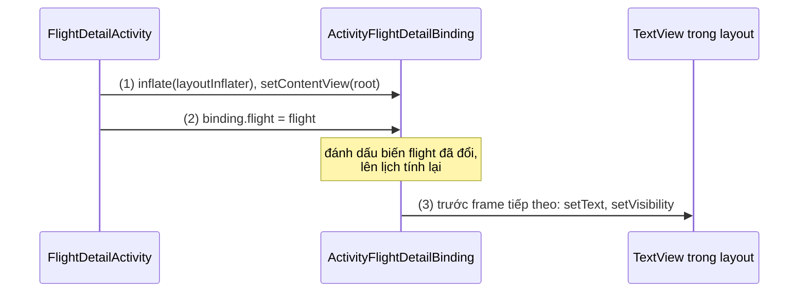
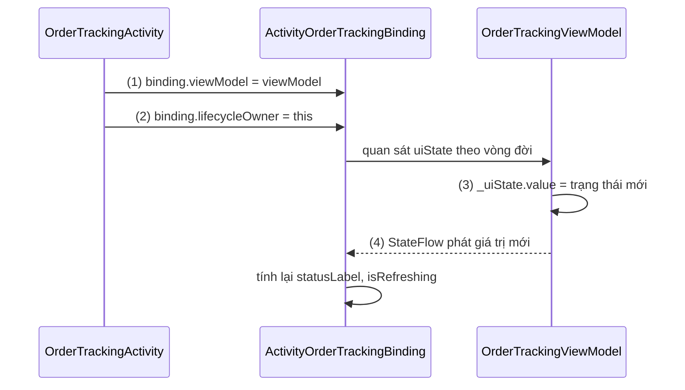
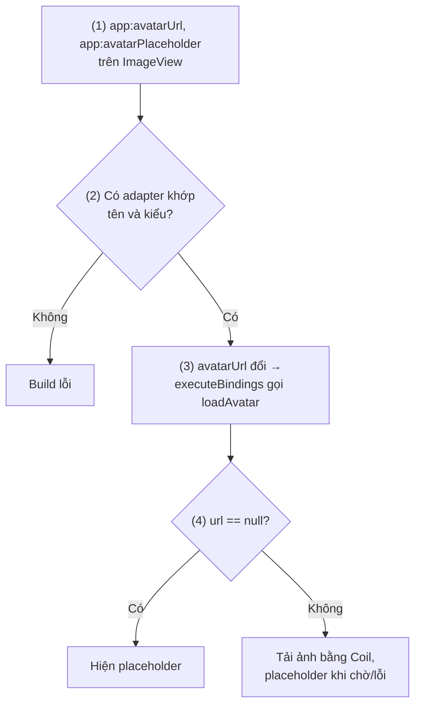
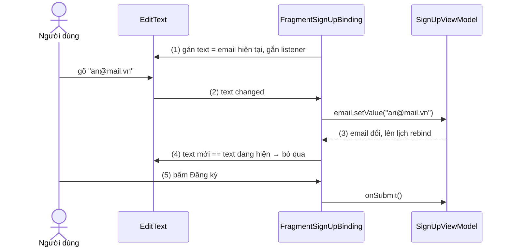
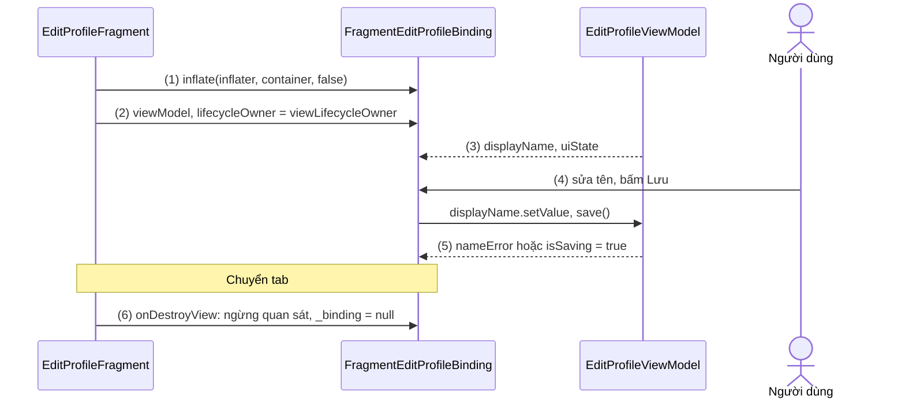

# Data Binding

## Vấn đề cần giải quyết

Với [View Binding](view_binding.md), code đã lấy được tham chiếu tới View một cách an toàn. Nhưng việc **đưa dữ liệu vào View** vẫn là code tay, lặp lại ở mọi nơi dữ liệu đổi:

```kotlin
// Mỗi lần trạng thái đơn hàng đổi, phải tự gọi lại toàn bộ đoạn này
binding.statusText.text = order.statusLabel
binding.progress.visibility = if (order.isLoading) View.VISIBLE else View.GONE
binding.cancelButton.isEnabled = order.canCancel
```

Ba vấn đề: dữ liệu đổi ở nhiều chỗ (tải lần đầu, làm mới, thông báo đẩy) thì chỗ nào cũng phải gọi lại đoạn gán, quên một chỗ là UI lệch dữ liệu; đọc layout không biết `statusText` hiển thị trường nào; và form phải nối hai chiều bằng tay (đổ giá trị vào `EditText`, gắn `TextWatcher` đọc về, tránh để hai chiều gọi nhau mãi).

Cần: **khai báo một lần "View này hiển thị dữ liệu nào", rồi để hệ thống tự giữ View khớp với dữ liệu**, kể cả chiều ngược lại khi người dùng nhập.

## Sau khi học xong

- Giải thích được cách Data Binding sinh class binding từ layout có biểu thức @{}, và vì sao View cập nhật trước frame tiếp theo chứ không ngay khi dữ liệu đổi.
- Triển khai được binding expression, nguồn dữ liệu quan sát được cùng lifecycleOwner, và sự kiện bằng method reference hoặc listener binding.
- Áp dụng được @BindingAdapter và two-way binding @={}, kể cả cho thuộc tính tự định nghĩa, mà không tạo vòng lặp cập nhật vô hạn.
- Xử lý được Data Binding trong Fragment bằng viewLifecycleOwner và dọn binding theo vòng đời của View.
- Biết khi nào chọn Data Binding, View Binding hay Compose dựa trên chi phí build (kapt) và tình trạng bảo trì.

## Data Binding là gì?

**Data Binding (liên kết dữ liệu)** là thư viện Jetpack đi kèm Android Gradle Plugin (AGP): layout XML bọc trong thẻ `<layout>` khai báo **biến** và **biểu thức `@{}`** gắn vào thuộc tính của View; lúc build, annotation processor sinh ra class binding chứa sẵn code gán giá trị biểu thức vào View, và khi biến hoặc nguồn dữ liệu quan sát được thay đổi, binding tự tính lại biểu thức và cập nhật View.

Mental model: layout Data Binding là **một bảng tính**. Biến trong `<data>` là ô nhập liệu, mỗi thuộc tính `@{}` là ô công thức tham chiếu tới chúng; ô nhập liệu đổi thì ô công thức phụ thuộc tự tính lại. Two-way binding là ô vừa hiện kết quả vừa cho người dùng gõ đè, giá trị gõ vào được ghi ngược về ô nhập liệu.

Class binding là cùng khái niệm với [View Binding](view_binding.md), mục "View Binding là gì?"; Data Binding thêm setter cho từng biến và code tính biểu thức.

## Cách hoạt động

### Bật Data Binding và cấu trúc layout `<layout>`

Data Binding bật theo module. Khác View Binding, nó chạy một **annotation processor** để sinh code từ biểu thức, nên module viết bằng Kotlin phải bật **kapt** (công cụ chạy annotation processor của Java trên code Kotlin, xem [Kotlin](../session_01/languages/kotlin.md), mục "Annotation Processing: KAPT và KSP"):

```kotlin
// app/build.gradle.kts (AGP 8.x, plugin Kotlin khai báo riêng)
plugins {
    id("com.android.application")
    id("org.jetbrains.kotlin.android")
    id("org.jetbrains.kotlin.kapt") // Data Binding cần kapt trong module dùng nó
}

android {
    buildFeatures {
        dataBinding = true
    }
}
```

Từ AGP 9.0 (Kotlin tích hợp sẵn trong AGP), plugin `org.jetbrains.kotlin.kapt` không tương thích nữa; docs hướng dẫn thay bằng `com.android.legacy-kapt`. Data Binding **không có bản KSP** và docs ghi không có kế hoạch làm, nên module dùng Data Binding không bỏ được kapt. Đây là chi phí chính của Data Binding: kapt phải sinh Java stub từ code Kotlin mỗi lần build, và docs gợi ý cô lập Data Binding vào module riêng để giới hạn ảnh hưởng.

Một layout dùng Data Binding có ba phần: thẻ gốc `<layout>`; phần `<data>` gồm `<variable>` (ô nhập liệu của bảng tính) và `<import>` để dùng tên class ngắn như `View.GONE`; và View gốc thật của màn hình, thuộc tính cần dữ liệu thì viết `@{biểu thức}`. Module app phải bật `dataBinding` nếu phụ thuộc vào thư viện dùng Data Binding, kể cả khi bản thân nó không dùng.

#### Ví dụ: thẻ thông tin chuyến bay

**Bài toán:** màn chi tiết vé máy bay hiển thị mã chuyến, cửa ra (có thể chưa có) và dòng báo trễ chỉ hiện khi trễ. Dữ liệu không đổi, chỉ cần binding một chiều.

**Luồng chạy:**

1. Inflate `ActivityFlightDetailBinding` và hiển thị `binding.root`, như View Binding.
2. Gán `binding.flight = flight`: setter sinh ra ghi nhận biến đã đổi và lên lịch tính lại.
3. Trước frame tiếp theo, binding tính các biểu thức phụ thuộc `flight` và gọi `setText`, `setVisibility` trên View.



```xml
<!-- res/layout/activity_flight_detail.xml (lược layout_width/height) -->
<layout xmlns:android="http://schemas.android.com/apk/res/android">

    <data>
        <import type="android.view.View" />
        <variable
            name="flight"
            type="com.example.booking.Flight" />
    </data>

    <LinearLayout android:orientation="vertical">

        <TextView android:text="@{flight.code}" />

        <TextView android:text="@{flight.gate ?? @string/gate_not_assigned}" />

        <TextView
            android:text="@{@plurals/delay_minutes(flight.delayMinutes, flight.delayMinutes)}"
            android:visibility="@{flight.delayMinutes > 0 ? View.VISIBLE : View.GONE}" />
    </LinearLayout>
</layout>
```

```kotlin
// Flight.kt (@Parcelize cần plugin kotlin-parcelize)
@Parcelize
data class Flight(val code: String, val gate: String?, val delayMinutes: Int) : Parcelable

// FlightDetailActivity.kt
class FlightDetailActivity : AppCompatActivity() {

    private lateinit var binding: ActivityFlightDetailBinding

    override fun onCreate(savedInstanceState: Bundle?) {
        super.onCreate(savedInstanceState)
        binding = ActivityFlightDetailBinding.inflate(layoutInflater) // (1)
        setContentView(binding.root)

        val flight = IntentCompat.getParcelableExtra(intent, EXTRA_FLIGHT, Flight::class.java)
            ?: return finish()
        binding.flight = flight                                        // (2) gán ô nhập liệu
        // (3) không có dòng setText nào: binding tự gán trước frame tiếp theo
    }
    // ... companion object chứa EXTRA_FLIGHT
}
```

**Kết quả:** `gate = null` thì dòng cửa ra hiện chuỗi `gate_not_assigned`; `delayMinutes = 0` thì dòng báo trễ ẩn. "View nào hiển thị trường nào" đọc được ngay trong layout.

### Binding expression `@{}`: viết được gì và nên viết gì

Biểu thức trong `@{}` là một ngôn ngữ nhỏ giống Java, kiểm tra kiểu **lúc build**. Viết được toán tử số học, logic, so sánh (dấu `<` phải viết `&lt;` trong XML), ternary `?:`, gọi method, `[]`; null coalescing `a ?? b` (lấy `a` nếu khác `null`, ngược lại `b`); resource như `@string/fmt(a, b)`; tham chiếu View khác theo id camelCase. Không có `this`, `super`, `new`. `@{user.firstName}` dùng được cho field, getter Java và property Kotlin.

**Null safety của biểu thức:** code sinh ra tự kiểm tra `null`. Với `@{user.name}`, nếu `user` là `null` thì biểu thức nhận giá trị mặc định của kiểu (`null`, `0`, `false`) thay vì ném `NullPointerException`. Không crash, nhưng biến quên gán chỉ hiện thành ô trống, không lỗi nào báo.

> [!IMPORTANT]
> Docs khuyên giữ biểu thức **nhỏ và đơn giản** vì chúng không unit test được và IDE hỗ trợ hạn chế. Quy tắc nghiệp vụ nằm ở ViewModel hoặc lớp dưới, layout chỉ đọc kết quả, ví dụ `@{order.canCancel}`.

### Từ layout đến class binding: build-time và thời điểm cập nhật

Khi build, với mỗi layout có `<layout>`:

1. AGP tách `<data>` và biểu thức khỏi layout, đóng gói phần còn lại như layout thường (View mang biểu thức được gắn tag nội bộ), rồi sinh class binding (`ActivityFlightDetailBinding`, kế thừa `ViewDataBinding`) với field cho View có id và setter cho từng biến, **trước** khi biên dịch code Kotlin/Java.
2. Annotation processor (qua kapt) sinh class hiện thực, thường mang hậu tố `Impl`, chứa `executeBindings()`: mọi biểu thức đã được biên dịch thành Java thường, kèm các câu kiểm tra `null`. Nó cũng sinh class `BR` chứa id của các biến (và của property quan sát được ở mục sau), tương tự `R`.
3. Biểu thức sai (property không tồn tại, sai kiểu) làm **build lỗi**, không đợi tới runtime.

Lúc chạy, cập nhật **không** diễn ra ngay khi gán biến. Docs mô tả: khi biến hoặc đối tượng quan sát được thay đổi, binding được **lên lịch** cập nhật trước frame tiếp theo. Setter chỉ đánh dấu phần "bẩn" (dirty flag) rồi yêu cầu rebind, nên gán nhiều biến liên tiếp chỉ dẫn tới **một** lần `executeBindings()`. Khi cần View đổi **ngay**, gọi `executePendingBindings()` để chạy phần đang chờ một cách đồng bộ.

**Trường hợp điển hình: item của danh sách** (`RecyclerView` học ở [ViewHolder Pattern](../session_07/design_pattern/viewholder_pattern.md)). `RecyclerView` **đo item ngay** sau `onBindViewHolder()`; nếu binding chỉ được lên lịch cho frame sau, item (ví dụ tin nhắn dài ngắn xen kẽ) bị đo với nội dung cũ rồi đo lại, nên danh sách giật. Docs dùng mẫu:

```kotlin
// MessageAdapter.kt (trích)
override fun onBindViewHolder(holder: MessageViewHolder, position: Int) {
    holder.binding.message = getItem(position) // chỉ đánh dấu bẩn
    holder.binding.executePendingBindings()    // gán ngay, trước khi RecyclerView đo item
}
```

### Nguồn dữ liệu quan sát được và `lifecycleOwner`

Gán một object thường cho biến chỉ cập nhật UI **lúc gán**. Muốn ô công thức tự tính lại, dữ liệu phải **quan sát được**, tức tự báo cho binding mỗi lần đổi. Có hai nhóm:

- **Observable của chính Data Binding** (không biết vòng đời): `ObservableField<T>` và bản nguyên thuỷ (`ObservableInt`...), class kế thừa `BaseObservable` tự gọi `notifyPropertyChanged(BR.tenProperty)` trong setter của property `@Bindable`, và `ObservableArrayList`/`ObservableArrayMap`.
- **Nguồn lifecycle-aware**, lựa chọn thường dùng hiện nay, thường do ViewModel (lớp giữ dữ liệu UI sống qua xoay màn hình, học ở [ViewModel](viewmodel.md)) phơi ra: [LiveData](livedata.md) và `StateFlow` (dòng dữ liệu luôn có giá trị hiện tại của Kotlin coroutines, học ở [Flow](../session_07/design_pattern/observer/flow.md)). Module Kotlin dùng AndroidX được thêm hỗ trợ `StateFlow` tự động (tắt bằng `dataBinding { addKtx = false }`).

Điều kiện bắt buộc với nhóm sau: **gán `binding.lifecycleOwner`**. Binding dùng owner này để quan sát `LiveData`/`StateFlow`; không có owner, binding chỉ đọc giá trị hiện tại lúc tính biểu thức và **không đăng ký nhận thay đổi**. Activity dùng chính nó; Fragment dùng `viewLifecycleOwner` (mục "Data Binding trong Fragment").

#### Ví dụ: theo dõi trạng thái đơn giao đồ ăn

**Bài toán:** màn theo dõi đơn hiển thị trạng thái ("Đang chuẩn bị", "Đang giao") và vòng tải khi làm mới; trạng thái đổi theo server, UI phải tự đổi theo.

**Luồng chạy:**

1. Activity lấy `OrderTrackingViewModel`, inflate binding, gán `binding.viewModel`.
2. Gán `binding.lifecycleOwner = this`: binding bắt đầu quan sát `viewModel.uiState`.
3. ViewModel nhận trạng thái mới từ repository và gán `_uiState.value`.
4. `StateFlow` phát giá trị mới; binding tính lại các biểu thức đọc `uiState` trước frame tiếp theo.



```xml
<!-- res/layout/activity_order_tracking.xml (trích, biến viewModel: OrderTrackingViewModel) -->
<TextView android:text="@{viewModel.uiState.statusLabel}" />

<ProgressBar
    android:visibility="@{viewModel.uiState.isRefreshing ? View.VISIBLE : View.GONE}" />
```

```kotlin
// OrderTrackingViewModel.kt
data class OrderTrackingUiState(val statusLabel: String = "", val isRefreshing: Boolean = false)

class OrderTrackingViewModel(private val repository: OrderRepository) : ViewModel() {

    private val _uiState = MutableStateFlow(OrderTrackingUiState())
    val uiState: StateFlow<OrderTrackingUiState> = _uiState.asStateFlow()

    fun refresh(orderId: String) {
        viewModelScope.launch {
            _uiState.value = _uiState.value.copy(isRefreshing = true)
            _uiState.value = OrderTrackingUiState(repository.fetchStatus(orderId).label) // (3)
        }
    }
}

// OrderTrackingActivity.kt
class OrderTrackingActivity : AppCompatActivity() {

    private val viewModel: OrderTrackingViewModel by viewModels { OrderTrackingViewModel.Factory }
    private lateinit var binding: ActivityOrderTrackingBinding

    override fun onCreate(savedInstanceState: Bundle?) {
        super.onCreate(savedInstanceState)
        binding = ActivityOrderTrackingBinding.inflate(layoutInflater)
        setContentView(binding.root)
        binding.viewModel = viewModel   // (1)
        binding.lifecycleOwner = this   // (2) thiếu dòng này thì (4) không xảy ra
        viewModel.refresh(intent.getStringExtra(EXTRA_ORDER_ID).orEmpty())
    }
    // ... companion object chứa EXTRA_ORDER_ID
}
```

**Kết quả:** trạng thái đổi theo server mà Activity không có dòng `setText` nào (`viewModelScope`, `by viewModels`, `Factory` giải thích ở [ViewModel](viewmodel.md)). Xoá `binding.lifecycleOwner = this`: màn chỉ hiện trạng thái rỗng ban đầu rồi đứng yên dù ViewModel đã có dữ liệu mới.

### Xử lý sự kiện: method reference và listener binding

Thuộc tính sự kiện như `android:onClick` cũng nhận biểu thức. Có hai cách viết, khác nhau ở **lúc nào biểu thức được tính**:

| | Method reference | Listener binding |
|---|---|---|
| Cú pháp | `@{handler::onShareClick}` | `@{() -> handler.onEnrollClick(course)}` |
| Chữ ký method | Phải khớp **đúng** chữ ký listener (`onClick(View)`) | Chỉ kiểu trả về phải khớp; tham số tuỳ ý |
| Listener được tạo khi | Lúc **bind dữ liệu** (biểu thức `handler` bằng `null` thì gán listener `null`) | Luôn tạo listener; biểu thức lambda được tính **khi sự kiện xảy ra** |

Cả hai đều được kiểm tra lúc build; docs khuyên lambda chỉ chuyển dữ liệu từ UI sang method của handler. Ví dụ trang khoá học: nút "Đăng ký" cần biết khoá nào (listener binding), nút "Chia sẻ" chỉ cần View được bấm (method reference):

```xml
<!-- res/layout/activity_course_detail.xml (trích, biến course và handler: CourseDetailHandler) -->
<Button
    android:text="@string/enroll"
    android:enabled="@{!course.isEnrolled}"
    android:onClick="@{() -> handler.onEnrollClick(course)}" />

<ImageButton
    android:contentDescription="@string/share"
    android:onClick="@{handler::onShareClick}" />
```

```kotlin
// CourseDetailHandler.kt
interface CourseDetailHandler {
    fun onEnrollClick(course: Course) // listener binding: tính lúc bấm, tham số tuỳ ý
    fun onShareClick(view: View)      // method reference: phải khớp onClick(View)
}
```

Đổi thành `onShareClick()` thì build báo lỗi ở layout; muốn bỏ tham số thì dùng listener binding `@{() -> handler.onShareClick()}`.

### `@BindingAdapter`: dạy binding cách gán một thuộc tính

Đoạn code gán giá trị một thuộc tính vào View gọi là **binding adapter**. Binding chọn theo thứ tự:

1. **Tự tìm setter:** thuộc tính `x` thì tìm `setX(arg)` đúng kiểu. Namespace (`android:`, `app:`) **bị bỏ qua**; nhờ vậy `app:error="@{…}"` trên `TextInputLayout` tự gọi `setError(CharSequence)`.
2. **`@BindingMethods`:** nối thuộc tính với setter khác tên (docs: `android:tint` → `setImageTintList`).
3. **`@BindingAdapter`:** hàm static tự viết khi cần logic riêng; tham số đầu là View, các tham số sau là giá trị từng thuộc tính. Adapter của app **ghi đè** adapter mặc định khi trùng.

Adapter nhiều thuộc tính mặc định `requireAll = true`, tức chỉ được dùng khi **mọi** thuộc tính đều có biểu thức; đặt `requireAll = false` (tham số nullable) để thuộc tính là tuỳ chọn. Trong Kotlin, viết adapter là **hàm top-level**; đặt trong `object` thì phải thêm `@JvmStatic`.

#### Ví dụ: ảnh đại diện tải từ URL

**Bài toán:** ảnh đại diện xuất hiện ở nhiều layout (hồ sơ, bình luận), URL có thể `null`. Một adapter dùng chung thay code tải ảnh lặp ở mọi màn.

**Luồng chạy:**

1. Layout gắn `app:avatarUrl` và `app:avatarPlaceholder` cho `ImageView`.
2. Lúc build, Data Binding tìm adapter nhận `ImageView` với hai thuộc tính đó, đúng kiểu `String?`, `Drawable?`; không có thì build lỗi.
3. Lúc chạy, mỗi khi `avatarUrl` đổi, `executeBindings()` gọi `loadAvatar()`.
4. URL `null` thì hiện placeholder; ngược lại giao cho thư viện tải ảnh.



```kotlin
// AvatarBindingAdapters.kt (hàm top-level = static; import Coil lược bớt)
@BindingAdapter(value = ["avatarUrl", "avatarPlaceholder"], requireAll = false) // (2)
fun loadAvatar(view: ImageView, url: String?, placeholder: Drawable?) {        // (3)
    if (url == null) {                                                         // (4)
        view.setImageDrawable(placeholder)
        return
    }
    view.load(url) {
        placeholder(placeholder)
        error(placeholder)
        transformations(CircleCropTransformation())
    }
}
```

```xml
<!-- Trong bất kỳ layout Data Binding nào có biến user -->
<ImageView
    android:contentDescription="@string/avatar"
    app:avatarUrl="@{user.avatarUrl}"
    app:avatarPlaceholder="@{@drawable/avatar_placeholder}" />
```

Coil học ở [8.2.4 Coil](../session_08/loading_image/coil.md); ở đây chỉ cần biết `view.load(url) { … }` tải ảnh vào `ImageView`.

**Kết quả:** mọi layout dùng `app:avatarUrl` hiện ảnh tròn hoặc placeholder. Gõ nhầm `app:avatarUrI` thì build lỗi "Cannot find a setter".

### Two-way binding `@={}`

**Two-way binding** viết `@={}` (có dấu `=`): vừa gán dữ liệu vào View, vừa nghe người dùng đổi View và ghi giá trị mới ngược về property. Thư viện có sẵn two-way cho `android:text`, `android:checked`, `android:progress`, `android:rating`, `DatePicker`/`TimePicker`... Property đích phải **ghi được**: `MutableLiveData`, `ObservableField`, hoặc property `@Bindable` có setter.

Mấu chốt là **chặn vòng lặp**: gõ → ghi property → binding gán lại View → View báo đổi → ghi property... Adapter có sẵn tự chặn bằng cách bỏ qua khi giá trị mới bằng giá trị đang hiển thị; adapter tự viết phải làm điều này.

#### Ví dụ: form đăng ký tài khoản

**Bài toán:** form đăng ký có email và ô "Đồng ý điều khoản". ViewModel cần giá trị hiện tại để kiểm tra khi bấm "Đăng ký", và form phải giữ nội dung khi xoay màn hình.

**Luồng chạy:**

1. Khi bind, `@={viewModel.email}` gán giá trị hiện tại vào `EditText` và gắn listener nghe text thay đổi.
2. Người dùng gõ: listener đọc text mới và gọi `viewModel.email.setValue(…)`.
3. `email` đổi nên binding lên lịch gán lại `android:text`.
4. Adapter `android:text` thấy text mới bằng text đang hiện nên **không** gán lại: vòng lặp dừng, con trỏ không nhảy.
5. Bấm "Đăng ký": `viewModel.onSubmit()` đọc thẳng giá trị từ các `MutableLiveData`.



```xml
<!-- res/layout/fragment_sign_up.xml (trích, biến viewModel: SignUpViewModel) -->
<EditText
    android:hint="@string/email"
    android:inputType="textEmailAddress"
    android:text="@={viewModel.email}" />

<CheckBox
    android:text="@string/accept_terms"
    android:checked="@={viewModel.acceptedTerms}" />

<Button
    android:text="@string/sign_up"
    android:onClick="@{() -> viewModel.onSubmit()}" />
```

```kotlin
// SignUpViewModel.kt
class SignUpViewModel : ViewModel() {

    val email = MutableLiveData("")          // (1)(2) đích ghi được của @={}
    val acceptedTerms = MutableLiveData(false)

    private val _submitError = MutableLiveData<Int?>(null)
    val submitError: LiveData<Int?> = _submitError

    fun onSubmit() {                         // (5) logic kiểm tra nằm ở đây, không ở XML
        val emailValue = email.value.orEmpty().trim()
        _submitError.value = when {
            !Patterns.EMAIL_ADDRESS.matcher(emailValue).matches() -> R.string.error_email_invalid
            acceptedTerms.value != true -> R.string.error_terms_required
            else -> null
        }
        // không lỗi thì gọi repository đăng ký...
    }
}
```

Two-way binding cần đích **ghi được**, nên các `MutableLiveData` này buộc phải public, khác quy tắc thường lệ "chỉ đưa ra bản read-only" ở [ViewModel](viewmodel.md), mục "Sai lầm thường gặp". Bù lại, chỉ đưa ra những ô form người dùng được sửa; kết quả kiểm tra (`submitError`) vẫn là `LiveData` read-only.

**Kết quả:** gõ email rồi xoay màn hình, nội dung còn nguyên vì ViewModel giữ `email` và binding mới đổ lại vào `EditText`.

**Two-way cho thuộc tính tự định nghĩa.** Với custom view `GuestCountStepper` (chọn số khách khi đặt bàn), để viết `app:guestCount="@={viewModel.guestCount}"` (`MutableLiveData<Int>`), Data Binding cần ba adapter: gán vào View (**chỉ khi khác giá trị đang hiển thị**), báo **khi nào** View đổi (sự kiện tổng hợp `guestCountAttrChanged` gọi `InverseBindingListener.onChange()`), và đọc từ View (`@InverseBindingAdapter`). Sau `onChange()`, binding đọc giá trị, ghi vào ViewModel, rồi gọi lại adapter gán; giá trị bằng nhau nên dừng.

```kotlin
// GuestCountBindingAdapters.kt
@BindingAdapter("guestCount")
fun setGuestCount(view: GuestCountStepper, count: Int) {
    if (view.count != count) view.count = count // so sánh để chặn vòng lặp
}

@BindingAdapter("guestCountAttrChanged")
fun setGuestCountListener(view: GuestCountStepper, listener: InverseBindingListener?) {
    view.onCountChanged = { listener?.onChange() } // báo binding: View đã đổi
}

@InverseBindingAdapter(attribute = "guestCount")
fun getGuestCount(view: GuestCountStepper): Int = view.count // đọc giá trị từ View
```

`onCountChanged` chạy mỗi lần `count` được gán, kể cả từ code, nên bỏ điều kiện so sánh thì sinh vòng lặp vô hạn ("Sai lầm thường gặp", phần 3).

### Data Binding trong Fragment

Fragment instance sống lâu hơn View của nó ([Fragment Lifecycle](../session_04/components/fragment/lifecycle.md), mục "View Lifecycle: vòng đời thứ hai trong Fragment"). Binding giữ cả cây View **và** các đăng ký quan sát dữ liệu, nên:

- **`binding.lifecycleOwner = viewLifecycleOwner`**, không phải `this`. Với `viewLifecycleOwner`, việc quan sát `LiveData`/`StateFlow` dừng ở `onDestroyView()` cùng với View. Với `this`, owner vẫn sống khi Fragment nằm trong backstack, nên binding của cây View đã huỷ vẫn nhận dữ liệu và tính lại biểu thức.
- **Dọn tham chiếu binding ở `onDestroyView()`** bằng mẫu `_binding` nullable, giống hệt [View Binding](view_binding.md), mục "View Binding trong Fragment: binding sống theo View". Code đầy đủ ở "Ví dụ thực tế".

## Ví dụ thực tế

Ba bài toán hay gặp với Data Binding:

1. **Màn chỉnh sửa hồ sơ trong Fragment** (bài toán chính, code bên dưới).
2. **Item danh sách:** `executePendingBindings()` trong `onBindViewHolder()`, như mục "Từ layout đến class binding".
3. **Thu hẹp Data Binding trong dự án cũ:** layout không còn biểu thức thì chuyển sang View Binding, layout còn biểu thức gom vào module riêng để module khác sang được KSP, màn mới viết bằng Compose.

### Màn chỉnh sửa hồ sơ

**Bài toán:** Fragment sửa tên hiển thị, báo lỗi dưới ô tên khi để trống, khoá nút "Lưu" và hiện vòng tải khi đang gửi. Fragment ở app nhiều tab nên View bị huỷ, tạo lại nhiều lần.

**Luồng chạy:**

1. `onCreateView()`: inflate `FragmentEditProfileBinding` vào `_binding`.
2. `onViewCreated()`: gán `viewModel` và `lifecycleOwner = viewLifecycleOwner`; binding bắt đầu quan sát.
3. ViewModel tải hồ sơ vào `displayName` (two-way) và giữ `uiState` (lỗi, đang lưu).
4. Người dùng sửa tên (two-way ghi vào `displayName`), bấm "Lưu" gọi `viewModel.save()`.
5. `save()` kiểm tra tên: trống thì đặt `nameError` và adapter `errorRes` hiện lỗi; hợp lệ thì `isSaving = true` và gửi đi.
6. Chuyển tab: `onDestroyView()` ngừng quan sát và `_binding = null`. Quay lại thì lặp từ (1), dữ liệu vẫn trong ViewModel.



```xml
<!-- res/layout/fragment_edit_profile.xml (trích, biến viewModel: EditProfileViewModel) -->
<com.google.android.material.textfield.TextInputLayout
    android:hint="@string/display_name"
    app:errorRes="@{viewModel.uiState.nameError}">

    <com.google.android.material.textfield.TextInputEditText
        android:text="@={viewModel.displayName}" />
</com.google.android.material.textfield.TextInputLayout>

<Button
    android:text="@string/save"
    android:enabled="@{!viewModel.uiState.isSaving}"
    android:onClick="@{() -> viewModel.save()}" />

<ProgressBar
    android:visibility="@{viewModel.uiState.isSaving ? View.VISIBLE : View.GONE}" />
```

```kotlin
// ErrorBindingAdapters.kt
@BindingAdapter("errorRes")
fun setErrorRes(layout: TextInputLayout, @StringRes errorRes: Int?) {
    layout.error = errorRes?.let { layout.context.getString(it) } // null = xoá lỗi
}

// EditProfileViewModel.kt
data class EditProfileUiState(@StringRes val nameError: Int? = null, val isSaving: Boolean = false)

class EditProfileViewModel(private val repository: ProfileRepository) : ViewModel() {

    val displayName = MutableLiveData("")   // two-way

    private val _uiState = MutableStateFlow(EditProfileUiState())
    val uiState: StateFlow<EditProfileUiState> = _uiState

    init {                                  // (3) tải hồ sơ một lần cho ViewModel
        viewModelScope.launch { displayName.value = repository.loadProfile().displayName }
    }

    fun save() {                            // (5) quy tắc nằm ở đây, không ở XML
        val name = displayName.value.orEmpty().trim()
        if (name.isEmpty()) {
            _uiState.value = _uiState.value.copy(nameError = R.string.error_name_required)
            return
        }
        _uiState.value = _uiState.value.copy(nameError = null, isSaving = true)
        viewModelScope.launch {
            repository.updateDisplayName(name)
            _uiState.value = _uiState.value.copy(isSaving = false)
        }
    }
}

// EditProfileFragment.kt
class EditProfileFragment : Fragment() {

    private val viewModel: EditProfileViewModel by viewModels { EditProfileViewModel.Factory }

    private var _binding: FragmentEditProfileBinding? = null
    private val binding get() = _binding!!

    override fun onCreateView(inflater: LayoutInflater, container: ViewGroup?, savedInstanceState: Bundle?): View {
        _binding = FragmentEditProfileBinding.inflate(inflater, container, false) // (1)
        return binding.root
    }

    override fun onViewCreated(view: View, savedInstanceState: Bundle?) {
        super.onViewCreated(view, savedInstanceState)
        binding.viewModel = viewModel                                           // (2)
        binding.lifecycleOwner = viewLifecycleOwner // vòng đời của View, không phải this
    }

    override fun onDestroyView() {
        super.onDestroyView()
        _binding = null                                                         // (6)
    }
}
```

Lỗi ở dạng `@StringRes Int?` để ViewModel không cần `Context`; adapter `errorRes` đổi nó thành chuỗi (`ProfileRepository` gọi server như ở [Networking](../session_05/networking.md)).

**Kết quả:** để trống tên rồi bấm "Lưu" thì lỗi hiện dưới ô tên; có tên thì nút khoá và vòng tải hiện tới khi server trả lời. Bỏ `_binding = null` thì LeakCanary báo cây View cũ bị `EditProfileFragment._binding` giữ, như với View Binding.

## Khi nào nên và không nên dùng

| | View Binding | Data Binding | Jetpack Compose |
|---|---|---|---|
| Đổ dữ liệu, cập nhật khi đổi | Code Kotlin tự gán, tự gọi lại | `@{}` trong XML, tự động qua observable/`LiveData`/`StateFlow` + `lifecycleOwner` | Hàm composable đọc state, tự recomposition |
| Chi phí build | Thấp, không annotation processing | Cao hơn: annotation processor qua kapt, không có KSP | Compose compiler plugin |
| Tình trạng | Khuyên dùng cho UI XML | Chế độ bảo trì, chỉ nhận bản sửa lỗi quan trọng | Hướng chính cho UI mới |

- **Nên dùng** khi bảo trì dự án View/XML theo MVVM đã dùng Data Binding, nhất là form nhiều ô nhập (two-way bỏ được nhiều `TextWatcher`) và thao tác lặp ở nhiều layout (`@BindingAdapter` tải ảnh, hiện lỗi).
- **Không nên** bật chỉ để thay `findViewById`: docs ghi trường hợp này hãy dùng View Binding. Hai loại binding dùng chung được trong một module.
- **Không nên** chọn cho UI mới: thư viện ở chế độ bảo trì, Google khuyên dùng Compose ([Jetpack Compose Overview](../jetpack_compose_ui/overview.md)).
- **Không nên** dùng trong module muốn bỏ hẳn kapt.

## Sai lầm thường gặp

### 1. Quên `lifecycleOwner`: UI chỉ hiện giá trị đầu tiên

```kotlin
// Sai: có ViewModel, có LiveData/StateFlow, nhưng không có owner
binding.viewModel = viewModel
```

**Lỗi lộ ra thế nào:** màn hiện giá trị ban đầu rồi đứng yên, dù log trong ViewModel cho thấy dữ liệu mới đã về. Không lỗi build, không crash.

**Cách sửa:** gán `binding.lifecycleOwner` (Activity: `this`, Fragment: `viewLifecycleOwner`).

### 2. `lifecycleOwner = this` trong Fragment

```kotlin
// Sai: owner là Fragment instance, sống lâu hơn View
binding.lifecycleOwner = this
```

**Lỗi lộ ra thế nào:** khi Fragment vào backstack, binding cũ vẫn nhận dữ liệu và tính lại biểu thức cho cây View đã huỷ; breakpoint trong `@BindingAdapter` dừng cả cho View cũ.

**Cách sửa:** dùng `viewLifecycleOwner`, cùng nguyên tắc với observe `LiveData` trong [Fragment Lifecycle](../session_04/components/fragment/lifecycle.md), mục "Sai lầm thường gặp", phần 1.

### 3. BindingAdapter của thuộc tính tự định nghĩa không so sánh giá trị cũ

```kotlin
// Sai: luôn gán, kể cả khi giá trị không đổi
@BindingAdapter("guestCount")
fun setGuestCount(view: GuestCountStepper, count: Int) {
    view.count = count
}
```

**Lỗi lộ ra thế nào:** gán `view.count` gọi `onCountChanged`, binding ghi lại vào `MutableLiveData`, mà `setValue` luôn phát kể cả khi giá trị không đổi, nên adapter bị gọi lại ở mọi frame, CPU luôn bận dù không ai chạm.

**Cách sửa:** so sánh trước khi gán (`if (view.count != count)`), như docs yêu cầu ở mục "Infinite loops using two-way data binding".

### 4. BindingAdapter không được gọi hoặc gọi nhầm

```kotlin
// Sai: thiếu requireAll = false, layout chỉ dùng app:avatarUrl
@BindingAdapter("avatarUrl", "avatarPlaceholder")
fun loadAvatar(view: ImageView, url: String?, placeholder: Drawable?) { /* ... */ }
```

**Lỗi lộ ra thế nào:** build lỗi "Cannot find a setter" vì adapter đòi đủ hai thuộc tính. Adapter trong `object` thiếu `@JvmStatic` cũng build lỗi; còn adapter tên `app:text` chạy cho **mọi** `android:text="@{…}"` cùng kiểu vì namespace bị bỏ qua.

**Cách sửa:** `requireAll = false` cho thuộc tính tuỳ chọn; adapter là hàm top-level (hoặc `@JvmStatic`); tên thuộc tính đủ cụ thể.

## Lịch sử phát triển

- **05/2015 (Google I/O):** ra mắt bản beta; hỗ trợ từ Android 4.0 (API 14) và AGP 1.5.0.
- **AGP 2.0 (2016):** listener binding; two-way binding `@={}` ra đời cùng giai đoạn.
- **Android Studio 3.1 (03/2018):** `LiveData` làm nguồn dữ liệu, có `setLifecycleOwner()`; xem trước Compiler V2.
- **Android Studio 3.2 (09/2018):** V2 bật mặc định; có bản AndroidX.
- **AGP 3.6 (02/2020):** View Binding ra mắt.
- **AGP 4.0.0 (04/2020):** `dataBinding.enabled` deprecated, thay bằng `buildFeatures { dataBinding = true }`.
- **AGP 7.0 (2021):** `StateFlow` làm nguồn dữ liệu (docs: từ 7.0.0-alpha04).
- **Thời kỳ KSP và Compose:** Data Binding không có và không có kế hoạch có bản KSP; trang release ghi thư viện ở chế độ bảo trì, chỉ nhận bản sửa lỗi quan trọng, và khuyên dùng Compose.
- **AGP 9.0:** module dùng Data Binding thay `kotlin-kapt` bằng `com.android.legacy-kapt`.

## Kết nối hệ thống

- **Tiên quyết:**
  - [View Binding](view_binding.md): class binding và mẫu `_binding` trong Fragment.
  - [Fragment Lifecycle](../session_04/components/fragment/lifecycle.md): vì sao dùng `viewLifecycleOwner`.
- **Liên quan:**
  - [Kotlin](../session_01/languages/kotlin.md): KAPT và KSP, lý do Data Binding làm build chậm hơn.
  - [Plugin](../session_04/android_manifest/package_build_gradle/plugin.md): AGP sinh class binding.
  - [Jetpack Compose Overview](../jetpack_compose_ui/overview.md): hướng UI thay thế cho UI mới.
- **Học tiếp:**
  - [LiveData](livedata.md), [ViewModel](viewmodel.md): nguồn dữ liệu và nơi giữ dữ liệu mà layout đọc.
  - [Flow](../session_07/design_pattern/observer/flow.md): `StateFlow`; [ViewHolder Pattern](../session_07/design_pattern/viewholder_pattern.md): item danh sách; [8.2.4 Coil](../session_08/loading_image/coil.md): thư viện tải ảnh; [MVVM](../session_07/architecture/mvvm.md): kiến trúc Data Binding phục vụ.

## Tham khảo

- [Data Binding Library - Android Developers](https://developer.android.com/topic/libraries/data-binding)
- [Get started with data binding - Android Developers](https://developer.android.com/topic/libraries/data-binding/start)
- [Layouts and binding expressions - Android Developers](https://developer.android.com/topic/libraries/data-binding/expressions)
- [Work with observable data objects - Android Developers](https://developer.android.com/topic/libraries/data-binding/observability)
- [Generated binding classes - Android Developers](https://developer.android.com/topic/libraries/data-binding/generated-binding)
- [Binding adapters - Android Developers](https://developer.android.com/topic/libraries/data-binding/binding-adapters)
- [Bind layout views to Architecture Components - Android Developers](https://developer.android.com/topic/libraries/data-binding/architecture)
- [Two-way data binding - Android Developers](https://developer.android.com/topic/libraries/data-binding/two-way)
- [Data Binding release notes (maintenance mode) - Android Developers](https://developer.android.com/jetpack/androidx/releases/databinding)
- [Migrate from kapt to KSP (Data Binding không hỗ trợ KSP) - Android Developers](https://developer.android.com/build/migrate-to-ksp)
- [Migrate to built-in Kotlin (legacy-kapt) - Android Developers](https://developer.android.com/build/migrate-to-built-in-kotlin)
- [Android Studio 3.1 release notes - Android Developers](https://developer.android.com/studio/releases/past-releases/as-3-1-0-release-notes)
- [Android Studio 3.2 release notes - Android Developers](https://developer.android.com/studio/releases/past-releases/as-3-2-0-release-notes)
- [Android Gradle Plugin 4.0.0 release notes (buildFeatures) - Android Developers](https://developer.android.com/build/releases/past-releases/agp-4-0-0-release-notes)
- [View binding (so sánh với data binding) - Android Developers](https://developer.android.com/topic/libraries/view-binding)
