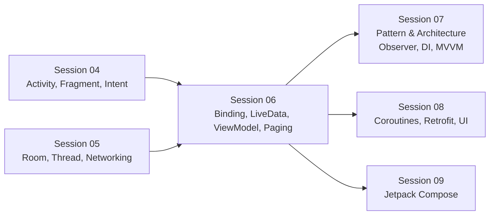
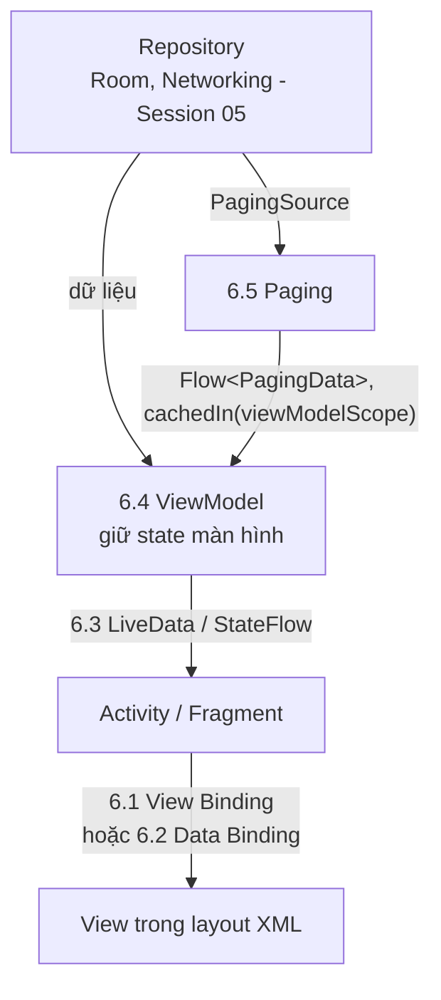
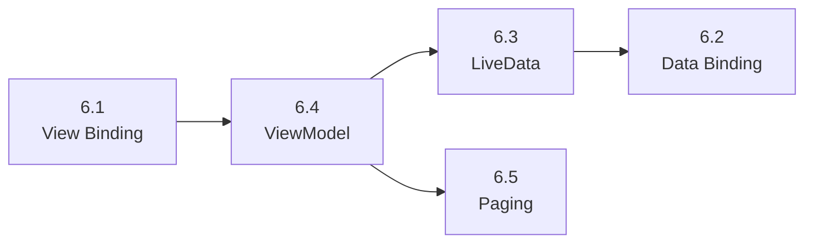

# Session 06 Overview

## Vấn đề cần giải quyết

Sau Session 04 và 05, bạn có màn hình (Activity, Fragment) và có dữ liệu (Room, DataStore, Networking). Câu hỏi còn lại là **nối hai thứ đó với nhau cho đúng**:

1. **Code chạm vào View thế nào cho an toàn?** `findViewById` dễ trỏ sai id hoặc sai kiểu và chỉ lỗi lúc chạy.
2. **Dữ liệu của màn hình nằm ở đâu?** Activity bị tạo lại mỗi lần xoay màn hình; dữ liệu và request trong đó mất theo.
3. **UI nhận dữ liệu mới thế nào mà không leak, không crash?** Cập nhật View sau khi nó đã bị huỷ, hay quên huỷ đăng ký listener, là lỗi kinh điển.
4. **Danh sách hàng nghìn phần tử tải thế nào?** Tải hết một lần thì tốn bộ nhớ và mạng; tự viết cuộn vô tận thì dễ tải lặp, dễ sai trạng thái lỗi.

Session 06 trả lời bốn câu này bằng các Architecture Components của Jetpack.

## Vị trí Session 06 trong lộ trình

- **Kế thừa:** vòng đời Activity và Fragment (Session 04) là nền của mọi thứ "lifecycle-aware" trong session này; Room và Networking (Session 05) là nguồn dữ liệu mà ViewModel và Paging đọc.
- **Bắc cầu:** Session 07 nhìn lại LiveData như một hiện thực của Observer Pattern (7.1.4.3) và đặt ViewModel vào kiến trúc MVVM (7.2.3); Session 08 học Coroutines và Flow, hai thứ các bài ở đây đã dùng tối thiểu.

## Session 06 học những gì?

Mỗi Topic dưới đây chỉ được tóm tắt: vấn đề nó giải quyết và khi nào dùng. Cơ chế, code và sai lầm thường gặp nằm trong bài của từng Topic.

| Topic | Câu hỏi trả lời |
|---|---|
| [6.1 View Binding](view_binding.md) | Code truy cập View trong layout XML thế nào để lệch layout là lỗi build, không phải crash? |
| [6.2 Data Binding](data_binding.md) | Khai báo dữ liệu và sự kiện ngay trong layout XML thế nào, và khi nào đáng làm vậy? |
| [6.3 LiveData](livedata.md) | Đưa dữ liệu thay đổi ra UI thế nào để UI chỉ nhận khi đang hiển thị và tự gỡ khi bị huỷ? |
| [6.4 ViewModel](viewmodel.md) | State và logic của màn hình nằm ở đâu để sống qua xoay màn hình? |
| [6.5 Paging](paging.md) | Tải và hiển thị danh sách lớn từng trang, kèm trạng thái tải và lỗi, thế nào? |

- **[6.1 View Binding](view_binding.md):** AGP sinh cho mỗi layout một class binding giữ sẵn tham chiếu có kiểu tới các View có id. Dùng cho mọi màn hình còn viết bằng XML; trong Fragment, binding phải sống theo vòng đời View.
- **[6.2 Data Binding](data_binding.md):** mở rộng class binding với biến, biểu thức, binding adapter và two-way binding khai báo trong XML. Mạnh hơn View Binding nhưng tốn thời gian build và dễ đẩy logic vào XML; dùng khi cần binding trong layout.
- **[6.3 LiveData](livedata.md):** holder dữ liệu quan sát được và biết lifecycle: observer chỉ nhận giá trị khi owner đang `STARTED` trở lên và tự bị gỡ khi owner bị huỷ. Phổ biến trong code View/XML; code mới thường dùng `StateFlow`.
- **[6.4 ViewModel](viewmodel.md):** object giữ state và logic của một màn hình, cất trong `ViewModelStore` của owner nên sống qua configuration change, mất khi process chết. Là nơi giữ LiveData/StateFlow mà UI quan sát.
- **[6.5 Paging](paging.md):** thư viện tải dữ liệu từng trang từ mạng hoặc Room, đưa ra `PagingData` để adapter hiển thị dần, kèm trạng thái tải, lỗi và thử lại.

## Mối liên hệ giữa các Topic

Năm Topic ghép thành một luồng dữ liệu của màn hình viết bằng View/XML:

1. Repository (Session 05) cung cấp dữ liệu; với danh sách lớn, Paging lấy dữ liệu từ đó từng trang.
2. ViewModel giữ state của màn hình và luồng `PagingData`, sống qua xoay màn hình.
3. ViewModel đưa state ra bằng LiveData (hoặc `StateFlow`); UI quan sát theo lifecycle.
4. UI vẽ state lên View qua View Binding, hoặc để Data Binding tự gán từ XML.

## Điều kiện tiên quyết

- [Activity Lifecycle](../session_04/components/activity/lifecycle.md) và [Fragment Lifecycle](../session_04/components/fragment/lifecycle.md): LiveData, ViewModel và binding trong Fragment đều dựa vào lifecycle, đặc biệt là `viewLifecycleOwner`.
- [Activity State Changes](../session_04/components/activity/state_changes.md): configuration change và process death, hai tình huống ViewModel và `SavedStateHandle` phân chia nhau xử lý.
- Session 05, nhất là [Room](../session_05/data_store/room_architecture.md) và [Networking](../session_05/networking.md): nguồn dữ liệu cho ViewModel và Paging.

## Sau khi học xong Session 06, bạn làm được gì?

- Giải thích được vị trí của Session 06 trong lộ trình và vai trò của từng Architecture Component trong một màn hình viết bằng View/XML.
- Phân biệt được View Binding với Data Binding, và LiveData với ViewModel, theo việc mỗi thứ giải quyết.
- Áp dụng được thứ tự học 6.1 → 6.4 → 6.3 → 6.2 → 6.5 dựa trên phụ thuộc giữa các Topic.

## Thứ tự học đề xuất

1. **6.1 trước tiên:** mọi ví dụ sau đều truy cập View qua binding.
2. **6.4 trước 6.3:** LiveData thường nằm trong ViewModel; hiểu ViewModel sống bao lâu thì mới hiểu vì sao LiveData giữ giá trị cuối và phát lại cho observer mới.
3. **6.3 trước 6.2:** Data Binding cập nhật UI tự động khi biến là LiveData (hoặc `StateFlow`) và binding có `lifecycleOwner`.
4. **6.5 cuối cùng:** Paging dùng ViewModel (`cachedIn(viewModelScope)`), Flow và Room cùng lúc.

Thứ tự này khác số thứ tự trong mục lục; mục lục giữ nguyên, đây chỉ là gợi ý đọc.

## Nguồn tham khảo

- [Guide to app architecture — Android Developers](https://developer.android.com/topic/architecture)
- [View binding — Android Developers](https://developer.android.com/topic/libraries/view-binding)
- [Data Binding Library — Android Developers](https://developer.android.com/topic/libraries/data-binding)
- [LiveData overview — Android Developers](https://developer.android.com/topic/libraries/architecture/livedata)
- [ViewModel overview — Android Developers](https://developer.android.com/topic/libraries/architecture/viewmodel)
- [Paging library overview — Android Developers](https://developer.android.com/topic/libraries/architecture/paging/v3-overview)
