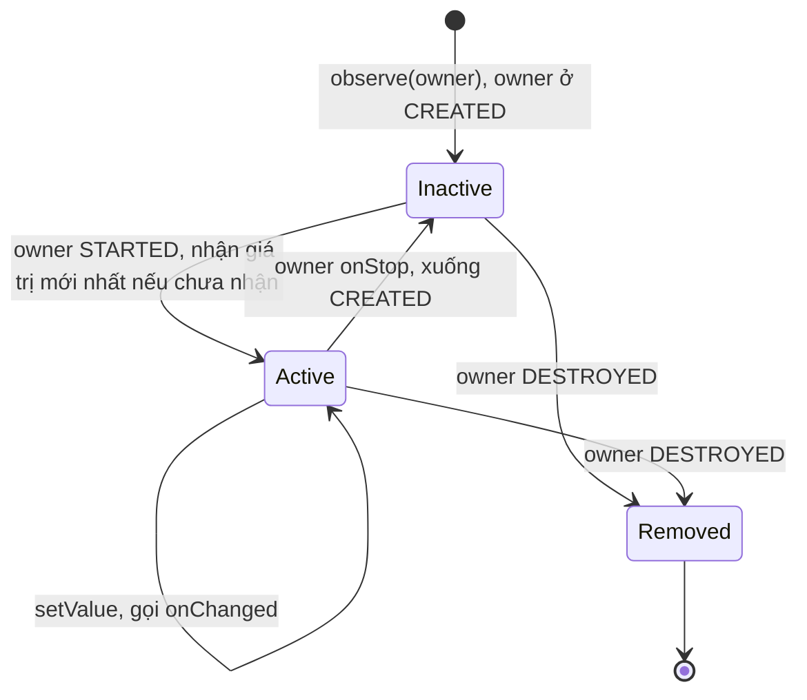
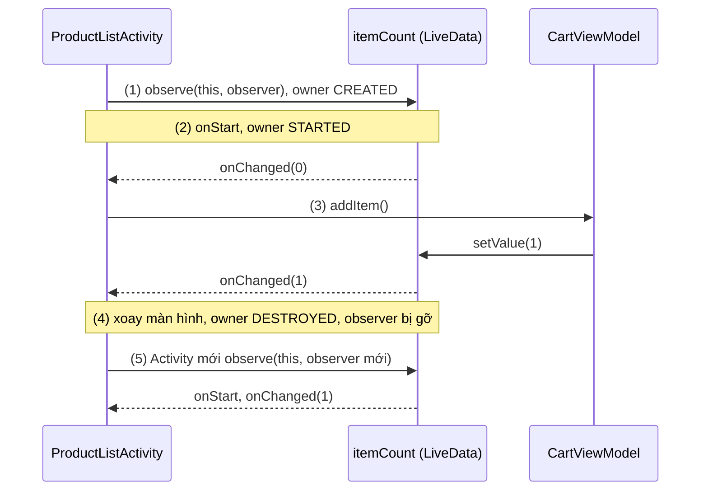
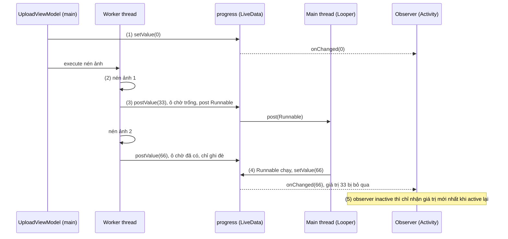
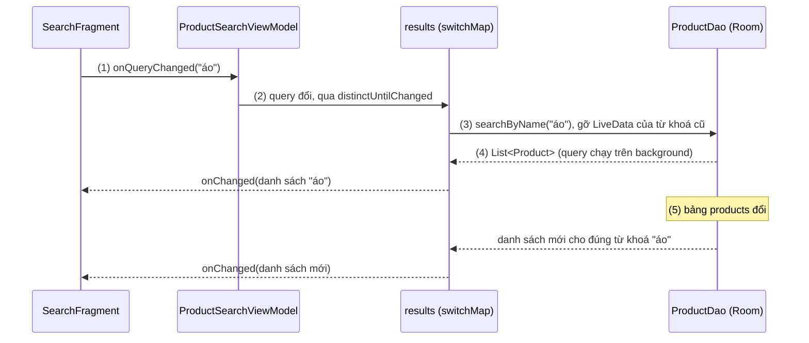
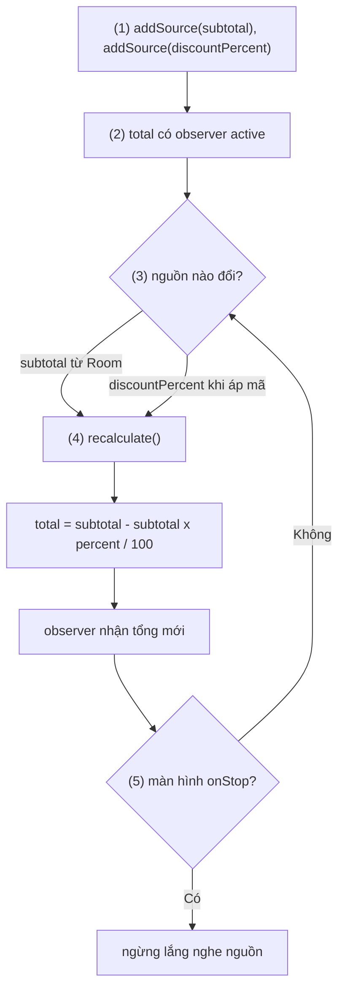
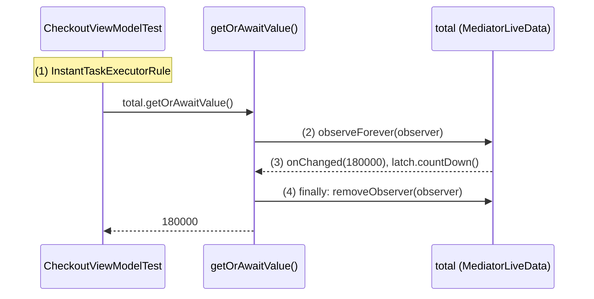
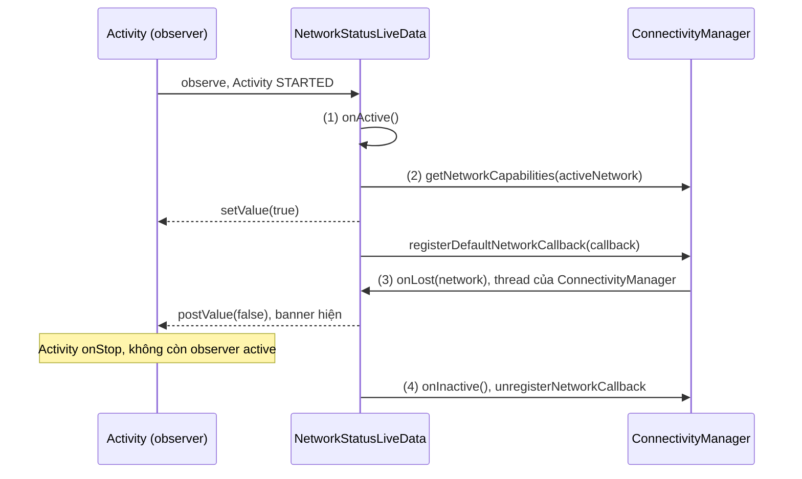
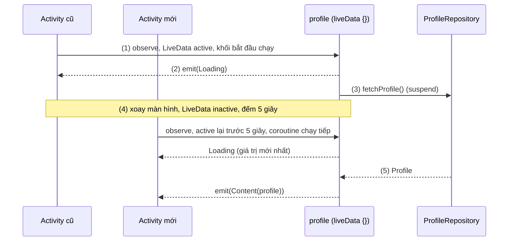
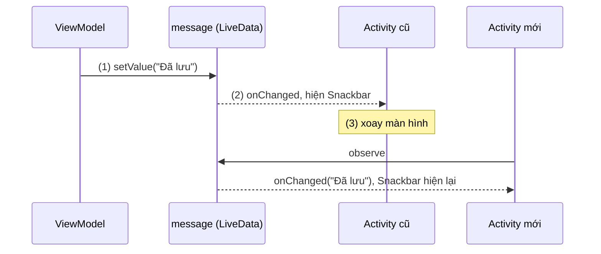
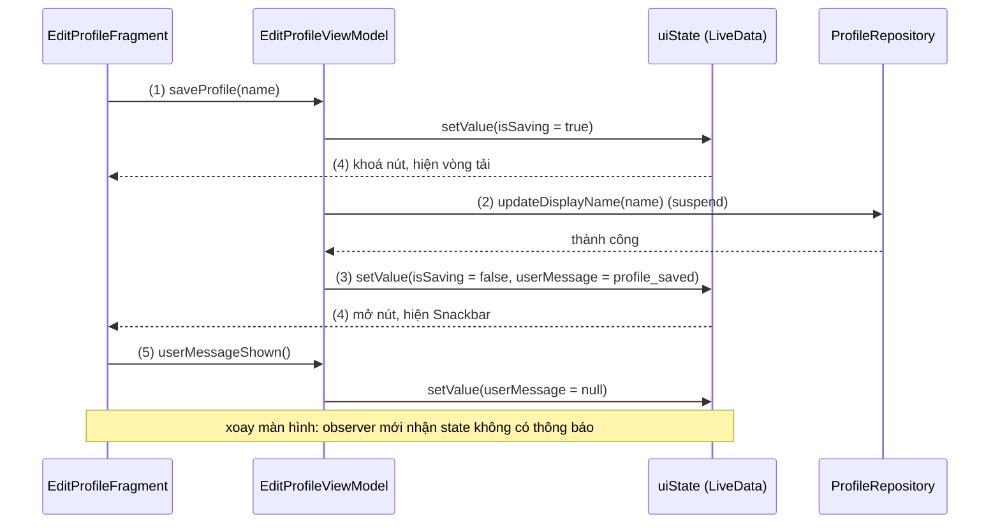

# LiveData

## Vấn đề cần giải quyết

UI cần hiển thị dữ liệu thay đổi theo thời gian: số lượng trong giỏ hàng, kết quả tìm kiếm, trạng thái mạng, tiến độ tải lên. Dữ liệu đó thường đến **bất đồng bộ**, từ database, network hoặc một service của hệ thống, trong khi màn hình nhận nó có vòng đời riêng: bị đưa xuống background, bị huỷ rồi tạo lại khi xoay màn hình.

Cách gốc là để nơi giữ dữ liệu gọi thẳng callback vào màn hình:

```kotlin
// ProductListActivity.kt (cách làm có vấn đề)
override fun onCreate(savedInstanceState: Bundle?) {
    super.onCreate(savedInstanceState)
    cartManager.addListener { count ->       // listener giữ tham chiếu tới Activity
        cartBadge.text = count.toString()    // có thể chạy khi Activity đã bị huỷ
    }
}
```

Cách này có bốn điểm yếu:

- **Leak:** `cartManager` sống lâu hơn Activity và giữ listener, listener giữ Activity; mỗi lần xoay màn hình thêm một Activity cũ không được thu hồi.
- **Crash hoặc làm việc thừa:** callback đến khi Activity đã `onStop()` hay `onDestroy()`, cập nhật View không còn hiển thị, hoặc chạy `FragmentTransaction` sau khi state đã lưu và ném `IllegalStateException`.
- **Tự quản lý đăng ký:** mỗi màn phải nhớ đăng ký ở `onStart()` và huỷ ở `onStop()`.
- **Mất dữ liệu khi tạo lại:** Activity mới sau khi xoay màn hình không có giá trị hiện tại, phải đợi lần thay đổi kế tiếp hoặc tải lại.

Vấn đề cần giải quyết là: **một nơi giữ dữ liệu mà UI quan sát được, tự biết khi nào UI sẵn sàng nhận, tự dọn khi UI bị huỷ, và luôn có sẵn giá trị mới nhất cho UI vừa được tạo lại.**

## Sau khi học xong

- Giải thích được vì sao LiveData chỉ giao giá trị cho observer đang active (STARTED, RESUMED), tự gỡ observer khi owner DESTROYED và giao giá trị mới nhất khi observer active trở lại.
- Phân biệt được setValue với postValue, observe với observeForever, và MutableLiveData với LiveData khi đóng gói state trong ViewModel.
- Áp dụng được map, switchMap, distinctUntilChanged và MediatorLiveData để biến đổi và gộp nhiều nguồn dữ liệu.
- Triển khai được LiveData tự quản lý tài nguyên bằng onActive/onInactive, và nối LiveData với coroutine, Flow qua liveData {}, asLiveData(), asFlow().
- Xử lý được event một lần bị phát lại sau khi xoay màn hình bằng cách biểu diễn event thành UI state.

## LiveData là gì?

**LiveData** là class giữ dữ liệu (data holder) quan sát được và **lifecycle-aware** của Jetpack: nó giữ **một giá trị mới nhất**, và chỉ giao giá trị đó cho các observer có `LifecycleOwner` đang **active** (`STARTED` hoặc `RESUMED`); khi owner chuyển sang `DESTROYED`, observer bị gỡ tự động.

Mental model: LiveData là **một tấm bảng tin chỉ có một dòng**. Mỗi lần ghi, dòng cũ bị xoá và thay bằng dòng mới. Người trực bảng chỉ báo tin cho người đang có mặt (active); người vắng mặt (inactive) không bị gọi, nhưng khi quay lại sẽ được xem đúng dòng đang ghi trên bảng, không phải mọi dòng đã từng ghi. Người đã rời đi hẳn (`DESTROYED`) bị gạch tên khỏi danh sách.

`LifecycleOwner`, `Lifecycle.State` và cách `LifecycleRegistry` phát state cho observer đã được học ở [Activity Lifecycle](../session_04/components/activity/lifecycle.md), mục "Cách hoạt động — Bộ ba cốt lõi". Bài này dùng lại đúng các khái niệm đó.

## Cách hoạt động

### Ai được ghi: `MutableLiveData` và `LiveData`

`LiveData<T>` chỉ cho **đọc và quan sát** (`value`, `observe()`, `observeForever()`); hai hàm ghi `setValue()` và `postValue()` là `protected`. `MutableLiveData<T>` là lớp con mở hai hàm đó thành `public`.

Nơi giữ state thường là **ViewModel**: object giữ state của màn hình và sống qua configuration change, được học ở [ViewModel](viewmodel.md); bài này chỉ dùng nó làm chỗ đặt LiveData. Mẫu quen thuộc là **backing property**: `_itemCount` kiểu `MutableLiveData` để `private`, `itemCount` kiểu `LiveData` đưa ra ngoài, nên chỉ ViewModel ghi được.

```kotlin
// CartViewModel.kt
class CartViewModel : ViewModel() {

    private val _itemCount = MutableLiveData(0)   // giá trị khởi tạo 0
    val itemCount: LiveData<Int> = _itemCount     // UI chỉ đọc và quan sát

    fun addItem() {
        _itemCount.value = (_itemCount.value ?: 0) + 1  // chỉ ViewModel được ghi
    }
}
```

`MutableLiveData<Int>()` không truyền giá trị thì LiveData **chưa có giá trị** (`isInitialized == false`): `value` trả `null` và observer chưa được gọi. Truyền giá trị khởi tạo như `MutableLiveData(0)` thì observer nhận `0` ngay khi active. Ở Kotlin, `value` luôn có kiểu `T?`, nên đọc giá trị hiện tại thường đi kèm `?:`.

### Observe theo lifecycle: active, inactive và tự gỡ

`observe(owner, observer)` đăng ký một `Observer` kèm `LifecycleOwner` (Activity, Fragment, `viewLifecycleOwner`). Từ đó LiveData theo dõi lifecycle của owner và xếp observer vào một trong ba trạng thái:

- **Inactive:** owner ở `CREATED` (vừa `onCreate()`, hoặc đã `onStop()`). Giá trị đổi nhưng observer không được gọi.
- **Active:** owner ở `STARTED` hoặc `RESUMED`. Mỗi lần giá trị đổi, `onChanged()` được gọi trên main thread.
- **Đã gỡ:** owner chuyển sang `DESTROYED`. LiveData tự gọi `removeObserver()`, không còn giữ tham chiếu tới observer hay owner.

Khi observer chuyển từ inactive sang active, nó nhận **giá trị mới nhất** nếu chưa nhận giá trị đó; nhờ vậy Activity tạo lại sau xoay màn hình có dữ liệu ngay. Mỗi observer nhớ **version** của giá trị cuối nó đã nhận, nên đi qua inactive rồi active lại mà giá trị không đổi thì không bị gọi lặp (mục "Deep Dive").



Vì observer được gọi ngay khi owner `STARTED`, chỗ hợp lý để observe là `onCreate()` của Activity (hoặc `onViewCreated()` của Fragment, mục sau), không phải `onResume()`.

#### Ví dụ: badge số lượng giỏ hàng qua xoay màn hình

**Bài toán:** badge trên màn danh sách sản phẩm hiện số món trong giỏ, cập nhật ngay khi bấm "Thêm vào giỏ" và giữ đúng con số khi xoay màn hình.

**Luồng chạy:**

1. Trong `onCreate()`, Activity observe `itemCount`; owner đang `CREATED` nên observer inactive.
2. `onStart()`: owner `STARTED`, observer active và nhận ngay giá trị hiện tại `0`.
3. Bấm "Thêm vào giỏ": ViewModel `setValue(1)`, observer nhận `1`.
4. Xoay màn hình: Activity cũ `DESTROYED`, LiveData tự gỡ observer cũ; ViewModel và LiveData của nó vẫn sống.
5. Activity mới observe lại và nhận ngay `1` khi tới `STARTED`.



```kotlin
// ProductListActivity.kt
class ProductListActivity : AppCompatActivity() {

    private lateinit var binding: ActivityProductListBinding
    private val cartViewModel: CartViewModel by viewModels()

    override fun onCreate(savedInstanceState: Bundle?) {
        super.onCreate(savedInstanceState)
        binding = ActivityProductListBinding.inflate(layoutInflater)
        setContentView(binding.root)

        // (1) đăng ký một lần trong onCreate; (2)(5) được gọi khi Activity STARTED
        cartViewModel.itemCount.observe(this) { count ->
            binding.cartBadge.text = count.toString()
            binding.cartBadge.isVisible = count > 0
        }

        binding.addToCartButton.setOnClickListener {
            cartViewModel.addItem()                     // (3) ViewModel gọi setValue
        }
        // (4) không có removeObserver: LiveData tự gỡ khi Activity DESTROYED
    }
}
```

`binding` là [View Binding](view_binding.md); `by viewModels()` lấy ViewModel gắn với Activity ([ViewModel](viewmodel.md)).

**Kết quả:** bấm thêm ba lần, badge hiện `3`; xoay màn hình, badge vẫn `3` ngay khi màn mới hiện. Xoay nhiều lần rồi bấm: log trong observer chỉ in một lần mỗi lần bấm, LeakCanary không báo Activity cũ bị giữ.

### `setValue` và `postValue`: ghi từ thread nào

LiveData giao giá trị cho observer trên **main thread**, nên mọi thay đổi cuối cùng phải đi qua main thread. Hai hàm ghi khác nhau ở chỗ ai đưa giá trị về đó:

| | `setValue(value)` (Kotlin: `value = …`) | `postValue(value)` |
|---|---|---|
| Gọi từ | Chỉ main thread; gọi từ thread khác ném `IllegalStateException: Cannot invoke setValue on a background thread` | Bất kỳ thread nào |
| Khi nào đổi giá trị | Ngay lập tức, observer active được gọi đồng bộ trước khi hàm trả về | Sau này, khi main thread chạy tới task đã post |
| Gọi nhiều lần liên tiếp | Mỗi lần là một lần giao | Gọi nhiều lần trước khi main thread chạy task thì **chỉ giá trị cuối** được giao |

`postValue()` ghi giá trị vào một ô "đang chờ" và chỉ post **một** `Runnable` lên main thread khi ô đó đang trống; các lần gọi sau, trong lúc Runnable chưa chạy, chỉ ghi đè ô chờ. Khi chạy, Runnable lấy giá trị trong ô và gọi `setValue()`. Cơ chế gửi task về main thread qua `MessageQueue` đã học ở [Working with Thread](../session_05/working_with_thread.md), mục "Trái tim giao tiếp bất đồng bộ của Android: Looper, MessageQueue và Handler". Theo mental model bảng tin: chỉ tờ giấy cuối cùng được mang tới kịp mới được ghi lên bảng.

#### Ví dụ: tiến độ nén ảnh trước khi tải lên

**Bài toán:** app nén từng ảnh trên worker thread trước khi đăng bài và hiện phần trăm tiến độ; tiến độ phải gửi về main thread bằng `postValue()`.

**Luồng chạy:**

1. Trên main thread, ViewModel `setValue(0)` rồi giao việc nén cho executor.
2. Worker thread nén từng ảnh.
3. Sau mỗi ảnh, worker `postValue(phần trăm)`: giá trị vào ô chờ, chỉ khi ô đang trống mới post Runnable.
4. Main thread chạy Runnable, `setValue()` giá trị **mới nhất** trong ô; giá trị bị ghi đè trước đó không tới observer.
5. Người dùng chuyển sang app khác thì observer inactive, chỉ nhận giá trị mới nhất khi quay lại.



```kotlin
// UploadViewModel.kt
class UploadViewModel : ViewModel() {

    private val executor = Executors.newSingleThreadExecutor()

    private val _progress = MutableLiveData(0)
    val progress: LiveData<Int> = _progress

    fun compressPhotos(photos: List<File>) {
        _progress.value = 0                                   // (1) main thread: setValue
        executor.execute {
            photos.forEachIndexed { index, photo ->
                compressPhoto(photo)                          // (2) việc nặng trên worker thread
                val percent = (index + 1) * 100 / photos.size
                _progress.postValue(percent)                  // (3) gửi về main thread
            }
        }
    }

    override fun onCleared() {
        executor.shutdownNow()   // ViewModel bị clear thì dừng worker, xem viewmodel.md
    }
}

// PostComposerActivity.kt
uploadViewModel.progress.observe(this) { percent ->          // (4)(5) luôn chạy trên main thread
    binding.uploadProgress.progress = percent
    binding.uploadPercentText.text = "$percent%"
}
```

`compressPhoto()` là hàm nén ảnh của dự án, không thuộc phạm vi bài này.

**Kết quả:** với vài ảnh lớn, tiến độ tăng dần 33 → 66 → 100. Với rất nhiều ảnh nhỏ, log trong observer có thể nhảy cóc (4 → 37 → 100) vì các giá trị giữa bị gộp: đó là hành vi đúng của `postValue()`. Đổi thành `_progress.value = percent` trong worker thì app crash với `Cannot invoke setValue on a background thread`.

### Trong Fragment: observe bằng `viewLifecycleOwner`

Instance của Fragment sống lâu hơn View của nó, nên observer cập nhật View phải dùng owner **`viewLifecycleOwner`** và observe trong `onViewCreated()`. Lý do đã giải thích ở [Fragment Lifecycle](../session_04/components/fragment/lifecycle.md), mục "View Lifecycle: vòng đời thứ hai trong Fragment"; ở đây chỉ bổ sung phần thuộc về LiveData.

```kotlin
// OrderListFragment.kt
override fun onViewCreated(view: View, savedInstanceState: Bundle?) {
    super.onViewCreated(view, savedInstanceState)
    val binding = FragmentOrderListBinding.bind(view)
    val adapter = OrderAdapter()
    binding.orderList.adapter = adapter

    orderViewModel.orders.observe(viewLifecycleOwner) { orders ->
        adapter.submitList(orders)
    }
}
```

`observe()` chỉ chống trùng theo **chính instance `Observer`**, mà lambda trong `onViewCreated()` là instance mới mỗi lần View được tạo lại. Observe bằng `this` thì khi Fragment vào backstack, observer cũ không bị gỡ (Fragment chưa `DESTROYED`); quay lại là thêm observer thứ hai, observer cũ còn giữ binding của cây View đã huỷ. Ngược lại, dùng **cùng một instance** observer với hai owner khác nhau thì `observe()` ném `IllegalArgumentException: Cannot add the same observer with different lifecycles`.

### Biến đổi: `map`, `switchMap`, `distinctUntilChanged`

Thư viện cung cấp ba hàm extension trên `LiveData` (trước đây gọi qua class `Transformations`; Kotlin hiện dùng dạng extension `map {}`, `switchMap {}`). Mỗi hàm trả về một LiveData **mới**, bên trong là một `MediatorLiveData` (mục sau) lắng nghe LiveData nguồn:

| Hàm | Làm gì | Dùng khi |
|---|---|---|
| `source.map { x -> y }` | Biến mỗi giá trị nguồn thành một giá trị khác | Định dạng để hiển thị: `99+`, tiền tệ, ghép họ tên |
| `source.switchMap { x -> liveDataOf(x) }` | Với mỗi giá trị nguồn, tạo một LiveData khác và **chuyển sang** quan sát nó, bỏ LiveData trước | Tham số đổi thì nguồn dữ liệu đổi: từ khoá tìm kiếm, id người dùng |
| `source.distinctUntilChanged()` | Chỉ giao giá trị khi khác giá trị trước đó (so bằng `equals`) | Chặn cập nhật lặp, vì `setValue()` cùng giá trị vẫn giao lại cho observer |

Hai đặc tính quan trọng: các hàm này **lười** (LiveData sinh ra chỉ lắng nghe nguồn khi chính nó có observer active; không ai observe thì `value` không được cập nhật), và lambda của chúng **chạy trên main thread**, nên việc nặng đặt trong `map` sẽ gây giật UI.

```kotlin
// CartViewModel.kt
val badgeText: LiveData<String> = itemCount.map { count ->
    if (count > 99) "99+" else count.toString()
}
```

#### Ví dụ: tìm kiếm sản phẩm theo từ khoá

**Bài toán:** ô tìm kiếm lọc sản phẩm lưu trong Room. Mỗi từ khoá là một query khác, và danh sách phải tự cập nhật khi bảng đổi. Tham số đổi thì đổi nguồn LiveData: đúng việc của `switchMap`.

**Luồng chạy:**

1. Người dùng gõ, ViewModel ghi từ khoá đã `trim()` vào `query`.
2. `distinctUntilChanged()` bỏ qua từ khoá trùng lần trước.
3. `switchMap` gọi DAO, nhận LiveData query mới, **gỡ** LiveData của từ khoá cũ và lắng nghe cái mới.
4. Room chạy query trên background thread rồi đẩy kết quả lên; `results` giao cho observer.
5. Bảng `products` đổi về sau: Room tự chạy lại đúng query đang được lắng nghe.



```kotlin
// ProductDao.kt
@Dao
interface ProductDao {
    @Query("SELECT * FROM products WHERE name LIKE '%' || :keyword || '%' ORDER BY name")
    fun searchByName(keyword: String): LiveData<List<Product>>
}

// ProductSearchViewModel.kt
class ProductSearchViewModel(private val productDao: ProductDao) : ViewModel() {

    private val query = MutableLiveData("")

    val results: LiveData<List<Product>> = query
        .distinctUntilChanged()                                       // (2)
        .switchMap { keyword -> productDao.searchByName(keyword) }    // (3)(4)(5)

    fun onQueryChanged(text: String) {
        query.value = text.trim()                                     // (1)
    }
}
```

DAO trả `LiveData` là observable query của Room, học ở [Room Architecture](../session_05/data_store/room_architecture.md); ViewModel có tham số (`productDao`) cần factory, học ở [ViewModel](viewmodel.md), mục "Factory và CreationExtras".

**Kết quả:** gõ "áo" thì chỉ còn sản phẩm có "áo" trong tên; sửa giá một sản phẩm bằng Database Inspector thì danh sách tự cập nhật. Gõ "áo" rồi thêm và xoá một dấu cách, log trong `switchMap` chỉ in một lần. Cần **debounce** (chờ ngừng gõ 300 ms mới query) thì LiveData không có toán tử này; đó là lúc dùng Flow (mục "Cầu nối với coroutine và Flow").

### Gộp nhiều nguồn: `MediatorLiveData`

`MediatorLiveData<T>` là một `MutableLiveData` **lắng nghe nhiều LiveData nguồn**: `addSource(source) { value -> … }` đăng ký một callback cho mỗi nguồn, `removeSource(source)` gỡ nó; nguồn đổi thì callback chạy và thường gọi `setValue()` cho mediator. Mediator cũng lười: chỉ lắng nghe nguồn khi bản thân nó có observer active, ngừng khi không còn. Chính `map`, `switchMap` và `distinctUntilChanged` được viết bằng `MediatorLiveData`.

#### Ví dụ: tổng tiền thanh toán từ giỏ hàng và mã giảm giá

**Bài toán:** tổng tiền ở màn thanh toán phụ thuộc hai nguồn: tạm tính của giỏ hàng (từ Room) và phần trăm giảm của mã người dùng vừa nhập. Nguồn nào đổi thì tổng cũng phải tính lại.

**Luồng chạy:**

1. Khi tạo, mediator `total` đăng ký hai nguồn bằng `addSource()`.
2. Màn hình observe `total` và tới `STARTED`: mediator active, bắt đầu lắng nghe hai nguồn.
3. Một nguồn đổi (tạm tính mới từ Room, hoặc áp mã): callback gọi `recalculate()`.
4. `recalculate()` đọc **cả hai** nguồn, tính tổng và `setValue()`; observer nhận tổng mới.
5. Màn hình `onStop()`: mediator inactive, ngừng lắng nghe nguồn.



```kotlin
// CartDao.kt
@Dao
interface CartDao {
    @Query("SELECT COALESCE(SUM(unit_price * quantity), 0) FROM cart_items")
    fun observeSubtotal(): LiveData<Long>
}

// CheckoutViewModel.kt
class CheckoutViewModel(cartDao: CartDao) : ViewModel() {

    private val subtotal: LiveData<Long> = cartDao.observeSubtotal()
    private val discountPercent = MutableLiveData(0)

    val total: LiveData<Long> = MediatorLiveData<Long>().apply {
        fun recalculate() {                                   // (4) đọc cả hai nguồn
            val amount = subtotal.value ?: 0L
            val percent = discountPercent.value ?: 0
            value = amount - amount * percent / 100
        }
        addSource(subtotal) { recalculate() }                 // (1)(3)
        addSource(discountPercent) { recalculate() }          // (1)(3)
    }

    fun applyCoupon(percent: Int) {
        discountPercent.value = percent.coerceIn(0, 100)
    }
}
```

**Kết quả:** giỏ hàng 200.000 đ, áp mã 10% thì tổng hiện 180.000 đ; tăng số lượng một món trong giỏ thì tổng tự tính lại theo tạm tính mới, mã vẫn được áp. Bỏ hết observer của `total` thì `recalculate()` không chạy nữa, kể cả khi bảng `cart_items` đổi.

### `observe(owner)` và `observeForever`: khi không có lifecycle

`observeForever(observer)` đăng ký observer **không kèm owner**, được coi là **luôn active**. Không có lifecycle thì không ai tự gỡ, nên **người gọi phải `removeObserver(observer)`**; quên là LiveData giữ observer (và mọi thứ nó tham chiếu) mãi mãi.

| | `observe(owner, observer)` | `observeForever(observer)` |
|---|---|---|
| Active khi | Owner ở `STARTED`/`RESUMED` | Luôn luôn |
| Gỡ observer | Tự động khi owner `DESTROYED` | Phải gọi `removeObserver()` |
| Dùng ở | Activity, Fragment, `LifecycleService` | Unit test, component không có lifecycle (ví dụ một class sống theo app) |

Trong UI luôn dùng `observe()`; `observeForever()` thường gặp nhất trong **unit test**, nơi không có owner nào.

#### Ví dụ: unit test tổng tiền của `CheckoutViewModel`

**Bài toán:** kiểm tra `total` ở mục trước tính đúng sau khi áp mã. `total` là mediator lười: không có observer thì `total.value` vẫn là `null`. Test cần một observer không có lifecycle, tức `observeForever()`.

**Luồng chạy:**

1. `InstantTaskExecutorRule` cho mọi task chạy đồng bộ và coi thread của test là main thread, nên `setValue()` không ném lỗi trong JVM test.
2. `getOrAwaitValue()` gọi `observeForever()`: observer active ngay, kéo mediator active theo.
3. Mediator tính tổng, observer nhận giá trị và nhả `CountDownLatch`.
4. `finally` luôn gọi `removeObserver()`, để observer không sống tiếp sang test khác.



```kotlin
// test/.../LiveDataTestUtil.kt
fun <T> LiveData<T>.getOrAwaitValue(timeoutSeconds: Long = 2): T {
    var data: T? = null
    val latch = CountDownLatch(1)
    val observer = Observer<T> { value ->
        data = value
        latch.countDown()                                     // (3)
    }
    observeForever(observer)                                  // (2) không có owner, luôn active
    try {
        if (!latch.await(timeoutSeconds, TimeUnit.SECONDS)) {
            throw TimeoutException("LiveData chưa có giá trị")
        }
    } finally {
        removeObserver(observer)                              // (4) bắt buộc tự gỡ
    }
    @Suppress("UNCHECKED_CAST")
    return data as T
}

// test/.../CheckoutViewModelTest.kt
class CheckoutViewModelTest {

    @get:Rule
    val instantTaskExecutorRule = InstantTaskExecutorRule()   // (1) androidx.arch.core:core-testing

    private class FakeCartDao(subtotal: Long) : CartDao {
        private val subtotalLiveData = MutableLiveData(subtotal)
        override fun observeSubtotal(): LiveData<Long> = subtotalLiveData
    }

    @Test
    fun total_appliesCouponDiscount() {
        val viewModel = CheckoutViewModel(FakeCartDao(subtotal = 200_000L))

        viewModel.applyCoupon(10)

        assertEquals(180_000L, viewModel.total.getOrAwaitValue())
    }
}
```

**Kết quả:** test pass. Thay `viewModel.total.getOrAwaitValue()` bằng `viewModel.total.value` thì test fail với giá trị `null`, vì không có observer nên mediator chưa từng tính tổng. Unit test nói chung được học ở [Unit Testing](../coding_analyst_and_testing/unit_testing.md).

### LiveData tự quản lý tài nguyên: `onActive` và `onInactive`

Kế thừa `LiveData` trực tiếp cho phép nó **tự bật và tắt nguồn dữ liệu** theo số observer đang active: `onActive()` được gọi khi số đó tăng từ 0 lên 1 (đăng ký listener, bật cảm biến), `onInactive()` khi nó giảm về 0 (huỷ đăng ký để không tốn pin). Một LiveData bọc service của hệ thống vì thế dùng chung được cho nhiều màn, và service chỉ được kết nối khi có màn đang hiển thị. Nguồn kiểu này thường gọi callback trên thread của nó, nên giá trị được ghi bằng `postValue()`.

#### Ví dụ: banner "Đang offline" theo trạng thái mạng

**Bài toán:** nhiều màn hình hiện banner "Đang offline" khi mất Internet; khi app ở background thì phải ngừng lắng nghe `ConnectivityManager`. `NetworkCallback` và `NET_CAPABILITY_VALIDATED` đã học ở [Networking](../session_05/networking.md), mục "Quản lý trạng thái kết nối ở tầng OS: ConnectivityManager & NetworkCallback"; ở đây chỉ dùng chúng làm nguồn dữ liệu.

**Luồng chạy:**

1. Có observer active đầu tiên: `onActive()` chạy trên main thread.
2. `onActive()` `setValue()` trạng thái hiện tại rồi `registerDefaultNetworkCallback()`.
3. Mạng mặc định đổi hoặc mất: callback chạy trên thread của `ConnectivityManager`, gọi `postValue()`.
4. Không còn observer active: `onInactive()` huỷ đăng ký callback.



```kotlin
// NetworkStatusLiveData.kt (minSdk 24, cần quyền ACCESS_NETWORK_STATE)
class NetworkStatusLiveData(context: Context) : LiveData<Boolean>() {

    private val connectivityManager =
        context.applicationContext.getSystemService(Context.CONNECTIVITY_SERVICE) as ConnectivityManager

    private val callback = object : ConnectivityManager.NetworkCallback() {
        override fun onCapabilitiesChanged(network: Network, capabilities: NetworkCapabilities) {
            postValue(capabilities.isOnline())                // (3) không phải main thread
        }

        override fun onLost(network: Network) {
            postValue(false)                                  // (3)
        }
    }

    override fun onActive() {                                 // (1) có observer active đầu tiên
        val current = connectivityManager.getNetworkCapabilities(connectivityManager.activeNetwork)
        value = current?.isOnline() == true                   // (2) main thread: setValue
        connectivityManager.registerDefaultNetworkCallback(callback)
    }

    override fun onInactive() {                               // (4) không còn observer active
        connectivityManager.unregisterNetworkCallback(callback)
    }

    private fun NetworkCapabilities.isOnline() =
        hasCapability(NetworkCapabilities.NET_CAPABILITY_INTERNET) &&
            hasCapability(NetworkCapabilities.NET_CAPABILITY_VALIDATED)
}

// OrderListActivity.kt
networkStatus.distinctUntilChanged().observe(this) { isOnline ->
    binding.offlineBanner.isVisible = !isOnline
}
```

`networkStatus` là **một** instance dùng chung cho cả app (tạo trong `Application` hoặc qua DI), để mọi màn chia sẻ một callback.

**Kết quả:** bật chế độ máy bay, banner hiện; tắt, banner ẩn khi mạng được validated. Bấm Home rồi đặt breakpoint trong `onCapabilitiesChanged`: không còn callback nào tới. Bài Networking giải cùng bài toán bằng `callbackFlow`; LiveData tự gắn lifecycle, còn Flow cho thêm toán tử và dùng được ở mọi tầng.

### Cầu nối với coroutine và Flow

Phần này dùng trước hai kiến thức: **coroutine** (hàm `suspend` chạy bất đồng bộ mà không chặn thread) được học ở 8.4.3 Coroutines (chưa có bài), và **Flow** (luồng giá trị bất đồng bộ của Kotlin) được học ở 7.1.4.2 Flow (chưa có bài); Flow trả về từ Room đã gặp ở [Async Transactions & Flow](../session_05/data_store/room_transactions.md).

Ba API nối LiveData với hai thế giới đó (dependency `androidx.lifecycle:lifecycle-livedata-ktx`):

- **`liveData { … }`**: builder tạo LiveData từ một khối coroutine, trong đó `emit(value)` đặt giá trị trên main thread. Khối bắt đầu chạy khi LiveData **active**; khi LiveData inactive, khối bị huỷ sau một **timeout** (mặc định 5 giây, tham số `timeoutInMs`). Bị huỷ giữa chừng thì chạy lại từ đầu khi active lại; đã chạy xong thì không chạy lại.
- **`flow.asLiveData()`**: collect Flow khi LiveData active, ngừng sau cùng timeout đó khi inactive; Flow là `StateFlow` thì giá trị ban đầu được đặt luôn cho LiveData.
- **`liveData.asFlow()`**: biến LiveData thành Flow để dùng toán tử như `debounce`, `combine`.

Timeout tồn tại vì xoay màn hình làm observer bị gỡ rồi đăng ký lại trong vài trăm mili giây; công việc đang chạy không nên bị huỷ rồi khởi động lại vô ích.

#### Ví dụ: tải hồ sơ người dùng qua xoay màn hình

**Bài toán:** màn hồ sơ tải dữ liệu bằng một hàm `suspend`; người dùng xoay màn hình trong lúc tải thì request đang chạy không được bị huỷ rồi gửi lại.

**Luồng chạy:**

1. Activity observe `profile`; LiveData active lần đầu nên khối `liveData {}` bắt đầu chạy.
2. Khối `emit(Loading)`.
3. Khối gọi `fetchProfile()`, coroutine tạm dừng chờ server.
4. Xoay màn hình: LiveData inactive, bộ đếm 5 giây bắt đầu; Activity mới observe ngay sau đó nên bộ đếm bị huỷ, coroutine **chạy tiếp**, Activity mới nhận `Loading`.
5. Server trả về, khối `emit(Content)`.



```kotlin
// ProfileViewModel.kt
class ProfileViewModel(private val profileRepository: ProfileRepository) : ViewModel() {

    val profile: LiveData<ProfileUiState> = liveData {            // (1) chạy khi active
        emit(ProfileUiState.Loading)                              // (2)
        try {
            val result = profileRepository.fetchProfile()         // (3) suspend, (4) không bị huỷ khi xoay
            emit(ProfileUiState.Content(result))                  // (5)
        } catch (e: IOException) {
            emit(ProfileUiState.Error)
        }
    }

    // Flow từ Room đổi sang LiveData cho UI cũ còn observe LiveData
    val recentOrders: LiveData<List<Order>> = profileRepository.observeRecentOrders().asLiveData()
}

sealed interface ProfileUiState {
    data object Loading : ProfileUiState
    data class Content(val profile: Profile) : ProfileUiState
    data object Error : ProfileUiState
}
```

`catch (e: IOException)` cố ý không bắt `CancellationException` ([Networking](../session_05/networking.md), mục "Sai lầm thường gặp", phần 4).

**Kết quả:** mở Network Inspector, xoay màn hình trong lúc đang tải: chỉ có một request. Bấm Home, đợi hơn 5 giây khi request chưa xong rồi mở lại: request bị huỷ và gửi lại, màn hình hiện `Loading` từ đầu.

### LiveData giữ state, không phải event

LiveData giữ giá trị mới nhất và giao lại giá trị đó cho mọi observer vừa active. Với **state** (badge, danh sách, tổng tiền) đó là điều ta muốn. Với **event một lần** (hiện Snackbar "Đã lưu", điều hướng sang màn khác) thì đó là lỗi: event được "phát lại".

1. ViewModel lưu thành công, `_message.value = "Đã lưu"`.
2. Observer hiện Snackbar.
3. Người dùng xoay màn hình: observer mới active và nhận lại giá trị mới nhất "Đã lưu", Snackbar hiện lần nữa. Nếu event là điều hướng, màn hình mới bị mở hai lần.



Có ba cách xử lý:

- **`SingleLiveEvent`:** lớp con của `MutableLiveData` (từ sample của Google, không có trong thư viện) dùng cờ `AtomicBoolean` để chỉ giao một lần. Chỉ một observer nhận được, và vẫn là một mẹo chống lại thiết kế của LiveData.
- **Event wrapper:** bọc giá trị trong object nhớ đã được xử lý chưa; observer gọi `getContentIfNotHandled()`, lần thứ hai nhận `null`.

```kotlin
// Event.kt
class Event<out T>(private val content: T) {
    var hasBeenHandled = false
        private set

    fun getContentIfNotHandled(): T? =
        if (hasBeenHandled) null else content.also { hasBeenHandled = true }
}
```

- **Biểu diễn event thành UI state (khuyến nghị hiện nay):** hướng dẫn kiến trúc của Android nêu rằng event phát sinh từ ViewModel luôn phải dẫn tới một lần cập nhật UI state. Thông báo là một field của state (`userMessage`); UI hiện nó rồi **báo lại** cho ViewModel (`userMessageShown()`) để ViewModel xoá field đó. State luôn mô tả đúng màn hình, không cần cơ chế "giao đúng một lần" (vốn khó đảm bảo khi nơi phát sống lâu hơn nơi nhận), và test được bằng cách đọc state. Code đầy đủ ở mục "Ví dụ thực tế".

## Deep Dive: bên trong LiveData

Phần này đọc source `androidx.lifecycle.LiveData` (Java, module `lifecycle-livedata-core`), rút gọn. Bỏ qua phần này vẫn dùng được LiveData đúng cách.

```java
// LiveData.java (rút gọn)
public abstract class LiveData<T> {
    static final int START_VERSION = -1;
    private SafeIterableMap<Observer<? super T>, ObserverWrapper> mObservers;
    private volatile Object mData;            // giá trị hiện tại (NOT_SET nếu chưa có)
    volatile Object mPendingData = NOT_SET;   // ô chờ của postValue
    private int mVersion;                     // tăng mỗi lần setValue

    protected void setValue(T value) {
        assertMainThread("setValue");         // ném IllegalStateException nếu không phải main
        mVersion++;
        mData = value;
        dispatchingValue(null);               // null = giao cho mọi observer
    }

    protected void postValue(T value) {
        boolean postTask;
        synchronized (mDataLock) {
            postTask = mPendingData == NOT_SET;   // chỉ post khi ô chờ đang trống
            mPendingData = value;                 // các lần sau chỉ ghi đè
        }
        if (postTask) ArchTaskExecutor.getInstance().postToMainThread(mPostValueRunnable);
    }

    private void considerNotify(ObserverWrapper observer) {
        if (!observer.mActive) return;
        if (!observer.shouldBeActive()) { observer.activeStateChanged(false); return; }
        if (observer.mLastVersion >= mVersion) return;  // đã nhận giá trị này rồi
        observer.mLastVersion = mVersion;
        observer.mObserver.onChanged((T) mData);
    }

    class LifecycleBoundObserver extends ObserverWrapper implements LifecycleEventObserver {
        boolean shouldBeActive() {
            return mOwner.getLifecycle().getCurrentState().isAtLeast(STARTED);
        }
        public void onStateChanged(LifecycleOwner source, Lifecycle.Event event) {
            if (mOwner.getLifecycle().getCurrentState() == DESTROYED) {
                removeObserver(mObserver);    // tự gỡ khi owner DESTROYED
                return;
            }
            activeStateChanged(shouldBeActive());
        }
    }
}
```

Những gì đoạn code này giải thích:

- **`LifecycleBoundObserver`:** `observe()` bọc `Observer` trong wrapper này và đăng ký nó làm `LifecycleEventObserver` của owner. Mỗi lần owner đổi state, `onStateChanged()` tính lại `shouldBeActive()` (từ `STARTED` trở lên); gặp `DESTROYED` thì tự `removeObserver()`. `observeForever()` dùng `AlwaysActiveObserver`, có `shouldBeActive()` luôn `true` và không gắn lifecycle nào, nên không ai gỡ hộ.
- **`mVersion` và `mLastVersion`:** version của LiveData tăng sau mỗi `setValue()`, mỗi wrapper nhớ version cuối nó đã giao, và `considerNotify()` chỉ gọi `onChanged()` khi version của LiveData lớn hơn. Observer active lại không nhận lặp giá trị cũ, còn observer **mới** (version `-1`) luôn nhận giá trị hiện tại: đó là nguồn gốc của event bị phát lại sau xoay màn hình. Version tăng cả khi giá trị mới bằng giá trị cũ, nên cần `distinctUntilChanged()`.
- **`activeStateChanged(true)`:** wrapper vừa active gọi `dispatchingValue(this)` để nhận giá trị mới nhất cho riêng mình; bộ đếm observer active đi từ 0 lên 1 thì gọi `onActive()`, về 0 thì `onInactive()`.
- **`dispatchingValue` và lời gọi lồng nhau:** observer gọi `setValue()` ngay trong `onChanged()` (như `userMessageShown()` ở ví dụ thực tế) thì lần dispatch đang chạy bị đánh dấu không còn hợp lệ và vòng lặp giao lại từ đầu với giá trị mới, thay vì gọi đệ quy.
- **Ô chờ của `postValue`:** Runnable trên main thread lấy `mPendingData`, đặt lại về `NOT_SET`, rồi gọi `setValue()`; vì vậy nhiều `postValue()` liên tiếp chỉ giao giá trị cuối.

## Ví dụ thực tế

Ba bài toán hay gặp với LiveData:

1. **Thông báo một lần sau khi lưu**: biểu diễn thông báo thành UI state. Đây là bài toán chính, code đầy đủ bên dưới.
2. **Danh sách từ Room tự cập nhật:** DAO trả `LiveData<List<T>>` (hoặc `Flow` rồi `asLiveData()`), Fragment observe bằng `viewLifecycleOwner` rồi `submitList()`, như ví dụ tìm kiếm.
3. **Trạng thái dùng chung cho cả app** (mạng, đăng nhập): LiveData kế thừa trực tiếp, bật tắt nguồn bằng `onActive`/`onInactive`, như ví dụ banner offline.

### Lưu hồ sơ và hiện thông báo đúng một lần

**Bài toán:** màn sửa hồ sơ có ô tên và nút "Lưu". Khi lưu, nút bị khoá; lưu xong hiện Snackbar báo thành công hoặc lỗi. Xoay màn hình sau khi Snackbar đã hiện thì không được hiện lại; xoay **trong lúc** đang lưu thì vẫn phải hiện thông báo khi lưu xong.

**Luồng chạy:**

1. Bấm "Lưu": ViewModel đặt `isSaving = true`.
2. ViewModel gọi `updateDisplayName()` trong `viewModelScope` (scope coroutine của ViewModel, [ViewModel](viewmodel.md)).
3. Lưu xong hoặc lỗi: `isSaving = false`, `userMessage` là id chuỗi thông báo.
4. Fragment observe `uiState` bằng `viewLifecycleOwner`: khoá hoặc mở nút; `userMessage` khác `null` thì hiện Snackbar.
5. Hiện xong, Fragment gọi `userMessageShown()`, ViewModel xoá `userMessage`. Observer tạo sau đó (xoay màn hình) nhận state không còn thông báo; xoay **trước** bước 3 thì observer mới vẫn nhận thông báo ở bước 3.



```kotlin
// EditProfileUiState.kt
data class EditProfileUiState(
    val isSaving: Boolean = false,
    @StringRes val userMessage: Int? = null       // thông báo đang chờ hiện, null = không có
)

// EditProfileViewModel.kt
class EditProfileViewModel(private val profileRepository: ProfileRepository) : ViewModel() {

    private val _uiState = MutableLiveData(EditProfileUiState())
    val uiState: LiveData<EditProfileUiState> = _uiState

    fun saveProfile(displayName: String) {
        if (currentState().isSaving) return
        _uiState.value = currentState().copy(isSaving = true)              // (1)
        viewModelScope.launch {                                            // chạy trên main thread
            val message = try {
                profileRepository.updateDisplayName(displayName.trim())    // (2)
                R.string.profile_saved
            } catch (e: IOException) {
                R.string.profile_save_failed
            }
            _uiState.value = currentState().copy(isSaving = false, userMessage = message) // (3)
        }
    }

    fun userMessageShown() {
        _uiState.value = currentState().copy(userMessage = null)          // (5) UI báo đã hiện
    }

    private fun currentState() = _uiState.value ?: EditProfileUiState()
}

// EditProfileFragment.kt
class EditProfileFragment : Fragment(R.layout.fragment_edit_profile) {

    // ViewModel có tham số cần factory, xem viewmodel.md mục "Factory và CreationExtras"
    private val viewModel: EditProfileViewModel by viewModels { EditProfileViewModel.Factory }

    override fun onViewCreated(view: View, savedInstanceState: Bundle?) {
        super.onViewCreated(view, savedInstanceState)
        val binding = FragmentEditProfileBinding.bind(view)

        binding.saveButton.setOnClickListener {
            viewModel.saveProfile(binding.displayNameInput.text.toString())
        }

        viewModel.uiState.observe(viewLifecycleOwner) { state ->           // (4)
            binding.saveButton.isEnabled = !state.isSaving
            binding.savingProgress.isVisible = state.isSaving

            state.userMessage?.let { messageRes ->
                Snackbar.make(binding.root, messageRes, Snackbar.LENGTH_SHORT).show()
                viewModel.userMessageShown()                               // (5)
            }
        }
    }
}
```

Gọi `userMessageShown()` trong observer là gọi `setValue()` lồng trong `onChanged()`; LiveData giao lại state mới từ đầu (mục "Deep Dive", phần `dispatchingValue`).

**Kết quả:** bấm "Lưu", Snackbar "Đã lưu hồ sơ" hiện một lần; xoay màn hình thì không hiện lại. Làm chậm mạng (Network throttling của emulator), bấm "Lưu" rồi xoay ngay: khi có kết quả, màn mới hiện đúng một Snackbar. Unit test chỉ cần đọc state: sau khi lưu thì `userMessage == R.string.profile_saved`, sau `userMessageShown()` thì `userMessage == null`.

## So sánh với các cách tiếp cận khác

| | LiveData | `StateFlow` | `Flow` (cold) |
|---|---|---|---|
| Bản chất | State holder gắn lifecycle, thư viện Android | State holder của kotlinx.coroutines | Luồng giá trị, chạy khi được collect |
| Giá trị ban đầu | Không bắt buộc | Bắt buộc | Không có khái niệm "giá trị hiện tại" |
| Gắn lifecycle | Có sẵn trong `observe(owner)` | Cần `repeatOnLifecycle` hoặc `collectAsStateWithLifecycle` | Như `StateFlow` |
| Giá trị trùng | `setValue()` cùng giá trị vẫn giao lại | Bỏ qua giá trị bằng giá trị hiện tại | Tuỳ nguồn phát |
| Toán tử | `map`, `switchMap`, `distinctUntilChanged`, `MediatorLiveData` | Toàn bộ toán tử của Flow (`combine`, `debounce`, `flatMapLatest`...) | Như `StateFlow` |
| Thread | Observe và biến đổi trên main thread | Chọn dispatcher, `flowOn` | Như `StateFlow` |
| Dùng ở tầng | UI và ViewModel | Mọi tầng, kể cả Kotlin Multiplatform | Mọi tầng |
| Java | Dùng tự nhiên | Bất tiện | Bất tiện |

Docs của Android khuyên **không** dùng LiveData ở tầng data (Repository) vì khả năng kết hợp luồng rất hạn chế và mọi biến đổi chạy trên main thread; tầng dưới dùng Flow, ViewModel đổi sang LiveData bằng `asLiveData()` nếu cần. Code Kotlin mới thường đưa state ra UI bằng `StateFlow` (như ở [ViewModel](viewmodel.md)); LiveData vẫn được hỗ trợ và hợp lý cho codebase Java hoặc UI XML đang dùng nó.

So sánh sâu LiveData như một hiện thực của Observer Pattern, đặt cạnh RxJava và Flow, ở 7.1.4.3 LiveData (chưa có bài); Flow và `StateFlow` ở 7.1.4.2 Flow (chưa có bài).

## Khi nào nên và không nên dùng

- **Nên dùng** để ViewModel đưa state ra UI viết bằng View/XML, nhất là codebase Java hoặc đã dùng LiveData: lifecycle-aware sẵn, UI không cần coroutine.
- **Nên dùng** với [Data Binding](data_binding.md) (6.2): layout gắn trực tiếp vào LiveData khi binding có `lifecycleOwner`.
- **Nên dùng** kế thừa `LiveData` với `onActive`/`onInactive` để bọc một nguồn của hệ thống chỉ nên chạy khi có màn hiển thị.
- **Không nên dùng** ở Repository, DataSource hay domain layer, hoặc khi cần toán tử phức tạp (debounce, retry, kết hợp nhiều luồng) hay xử lý ngoài main thread: dùng Flow.
- **Không dùng** để gửi event một lần: biểu diễn thành UI state như mục "Ví dụ thực tế".
- **Không cần** cho màn Compose mới: Compose thường dùng `StateFlow` với `collectAsStateWithLifecycle()`; LiveData vẫn đọc được qua `observeAsState()` (artifact `runtime-livedata`) khi chuyển dần màn cũ.

## Sai lầm thường gặp

### 1. Gọi `setValue` từ background thread

```kotlin
// Sai: callback của OkHttp chạy trên thread của OkHttp
apiClient.newCall(request).enqueue(object : Callback {
    override fun onResponse(call: Call, response: Response) {
        _orders.value = parseOrders(response)
    }
    override fun onFailure(call: Call, e: IOException) { /* ... */ }
})
```

**Lỗi lộ ra thế nào:** crash `IllegalStateException: Cannot invoke setValue on a background thread` ngay khi response về.

**Cách sửa:** dùng `_orders.postValue(parseOrders(response))`, hoặc chuyển cả lời gọi sang coroutine trong `viewModelScope` (chạy trên main thread nên dùng `value =` được).

### 2. Mong `postValue` giao đủ mọi giá trị

```kotlin
// Sai: dùng LiveData như một hàng đợi
fun importContacts(contacts: List<Contact>) = executor.execute {
    contacts.forEach { contact ->
        contactDao.insert(contact)
        _importedContact.postValue(contact)   // UI muốn hiện tên từng người
    }
}
```

**Lỗi lộ ra thế nào:** danh sách "đã nhập" trên UI thiếu người, mỗi lần chạy thiếu một kiểu, vì các `postValue()` liên tiếp chỉ giao giá trị cuối và observer inactive chỉ nhận giá trị mới nhất.

**Cách sửa:** LiveData giữ **state**, không phải danh sách sự kiện. Đưa ra state tích luỹ (`_importedCount.postValue(count)` hoặc danh sách đầy đủ), hoặc dùng Flow khi thật sự cần một luồng giá trị.

### 3. Tạo LiveData mới mỗi lần gọi hàm

```kotlin
// Sai: mỗi lần gọi là một LiveData mới
class AddressViewModel(private val repository: AddressRepository) : ViewModel() {
    fun postalCodeOf(address: String): LiveData<String> = repository.lookupPostalCode(address)
}

// Fragment: mỗi lần người dùng sửa địa chỉ lại observe một LiveData khác
viewModel.postalCodeOf(address).observe(viewLifecycleOwner) { binding.postalCode.text = it }
```

**Lỗi lộ ra thế nào:** mỗi lần sửa địa chỉ, Fragment thêm một observer mới mà observer cũ vẫn còn; kết quả cũ về muộn có thể ghi đè kết quả mới. Xoay màn hình thì phải gọi lại `lookupPostalCode()` từ đầu.

**Cách sửa:** để địa chỉ là một LiveData đầu vào và `switchMap` sang kết quả, như ví dụ tìm kiếm: `val postalCode = address.switchMap { repository.lookupPostalCode(it) }`. Fragment observe `postalCode` đúng một lần.

### 4. Việc nặng trong `map`

```kotlin
// Sai: lọc danh sách lớn trên main thread
val premiumCustomers: LiveData<List<Customer>> = customers.map { all ->
    all.filter { it.isPremium && it.totalSpent > threshold }.sortedByDescending { it.totalSpent }
}
```

**Lỗi lộ ra thế nào:** UI giật mỗi khi dữ liệu đổi; CPU Profiler cho thấy lambda của `map` chiếm frame dài trên main thread.

**Cách sửa:** đẩy việc lọc xuống query của database (`WHERE`, `ORDER BY`), hoặc dùng Flow với `map` và `flowOn(Dispatchers.Default)` rồi `asLiveData()`.

### 5. Dùng LiveData cho event một lần

```kotlin
// Sai: event điều hướng giữ trong LiveData
private val _navigateToOrderDetail = MutableLiveData<Long>()
// Fragment: observe rồi gọi navigate(orderId)
```

**Lỗi lộ ra thế nào:** xoay màn hình (hoặc quay lại từ màn chi tiết) thì observer mới nhận lại `orderId` cũ và mở màn chi tiết thêm lần nữa.

**Cách sửa:** biểu diễn thành UI state và báo lại khi đã xử lý (mục "Ví dụ thực tế"); với code cũ chưa chuyển được, bọc bằng `Event<T>` và đọc qua `getContentIfNotHandled()`.

Hai sai lầm khác đã nêu trong phần kiến thức: observe bằng `this` thay vì `viewLifecycleOwner` trong Fragment (xem thêm [Fragment Lifecycle](../session_04/components/fragment/lifecycle.md), mục "Sai lầm thường gặp", phần 1), và `observeForever()` mà không `removeObserver()`.

## Lịch sử phát triển

- **Google I/O (05/2017):** Android Architecture Components ra mắt bản alpha, gồm Lifecycle, LiveData, ViewModel và Room; LiveData cho UI quan sát dữ liệu mà không leak, không cần RxJava.
- **Architecture Components 1.0.0 (11/2017):** bản stable đầu tiên, package `android.arch.lifecycle`.
- **Lifecycle 2.0.0 (09/2018):** chuyển sang AndroidX, package `androidx.lifecycle`.
- **Lifecycle 2.1.0 (09/2019):** thêm extension Kotlin cho `observe` và các hàm `Transformations` (`liveData.map {}`), thêm `distinctUntilChanged`.
- **Lifecycle 2.2.0 (01/2020):** `lifecycle-livedata-ktx` có builder `liveData {}` dựa trên coroutine và cầu nối với Flow; artifact `lifecycle-extensions` bị deprecated.
- **Lifecycle 2.3.0 (02/2021):** extension `LiveData.observe()` dạng lambda bị deprecated vì Kotlin 1.4 đã chuyển lambda thành `Observer` (SAM conversion); thêm Lint cảnh báo đặt `null` vào `MutableLiveData` khai báo non-null.
- **Lifecycle 2.6.0 (03/2023):** `Transformations` và `Observer` được viết lại bằng Kotlin; code Kotlin buộc dùng dạng extension `map {}`, `switchMap {}`; thêm `LiveData.isInitialized` và constructor nhận giá trị khởi tạo cho `MediatorLiveData`.
- **Lifecycle 2.7.0 (01/2024):** nội dung `lifecycle-livedata-ktx` được gộp vào `lifecycle-livedata`; extension `map` và `switchMap` đặt sẵn giá trị cho LiveData trả về ngay khi nguồn đã có giá trị, giống hành vi sẵn có của `distinctUntilChanged`.
- **Hiện nay:** hướng dẫn kiến trúc của Android dùng `StateFlow` cho state và khuyên biểu diễn event thành UI state; LiveData vẫn được duy trì, không bị deprecated.

## Kết nối hệ thống

- **Tiên quyết:**
  - [Activity Lifecycle](../session_04/components/activity/lifecycle.md): `LifecycleOwner`, `Lifecycle.State`, cơ chế phát state mà LiveData dựa vào.
  - [Fragment Lifecycle](../session_04/components/fragment/lifecycle.md): vì sao observe bằng `viewLifecycleOwner`.
  - [Working with Thread](../session_05/working_with_thread.md): main thread và `MessageQueue`, nền của `setValue` và `postValue`.
- **Liên quan:**
  - [View Binding](view_binding.md): cách các ví dụ truy cập View trong observer.
  - [Room Architecture](../session_05/data_store/room_architecture.md) và [Async Transactions & Flow](../session_05/data_store/room_transactions.md): DAO trả `LiveData` hoặc `Flow`.
  - [Networking](../session_05/networking.md): `NetworkCallback` làm nguồn cho `NetworkStatusLiveData`.
  - [Activity State Changes](../session_04/components/activity/state_changes.md): `SavedStateHandle.getLiveData()` cho state cần sống qua process death.
- **Học tiếp:**
  - [ViewModel](viewmodel.md) (6.4): nơi giữ LiveData, vì sao nó sống qua xoay màn hình, `viewModelScope` và factory.
  - [Data Binding](data_binding.md) (6.2): gắn LiveData trực tiếp vào layout.
  - 7.1.4.3 LiveData (chưa có bài): LiveData như một hiện thực của Observer Pattern, so với RxJava và Flow.
  - 7.1.4.2 Flow (chưa có bài): `Flow`, `StateFlow` và các toán tử LiveData không có.
  - 7.2.3 MVVM (chưa có bài): vị trí của LiveData giữa View và ViewModel.
  - 8.4.3 Coroutines (chưa có bài): coroutine dùng trong `liveData {}` và `viewModelScope`.

## Tham khảo

- [LiveData overview - Android Developers](https://developer.android.com/topic/libraries/architecture/livedata)
- [Use Kotlin coroutines with lifecycle-aware components (Views) - Android Developers](https://developer.android.com/topic/libraries/architecture/views/coroutines-views)
- [UI events - Android Developers](https://developer.android.com/topic/architecture/ui-layer/events)
- [Lifecycle release notes - Android Developers](https://developer.android.com/jetpack/androidx/releases/lifecycle)
- [LiveData API reference - Android Developers](https://developer.android.com/reference/androidx/lifecycle/LiveData)
- [MediatorLiveData API reference - Android Developers](https://developer.android.com/reference/androidx/lifecycle/MediatorLiveData)
- [Source code LiveData.java - AndroidX (GitHub mirror)](https://github.com/androidx/androidx/blob/androidx-main/lifecycle/lifecycle-livedata-core/src/main/java/androidx/lifecycle/LiveData.java)
- [LiveData with SnackBar, Navigation and other events (the SingleLiveEvent case) - Android Developers Blog trên Medium](https://medium.com/androiddevelopers/livedata-with-snackbar-navigation-and-other-events-the-singleliveevent-case-ac2622673150)
- [ViewModel: One-off event antipatterns - Android Developers Blog trên Medium](https://medium.com/androiddevelopers/viewmodel-one-off-event-antipatterns-16a1da869b95)
