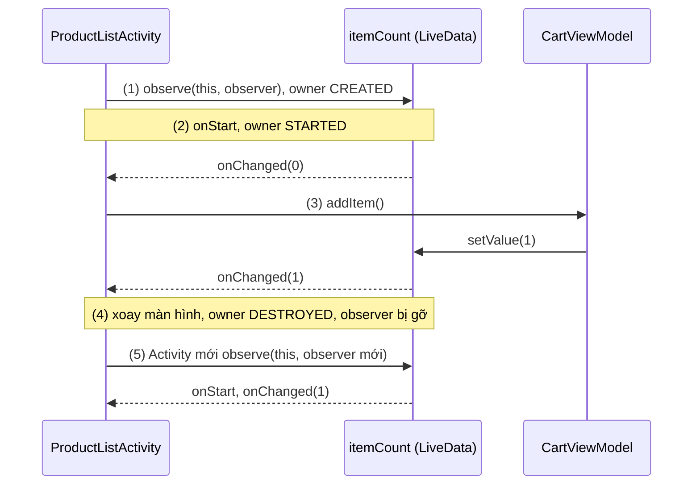
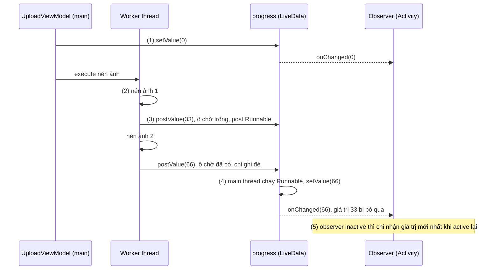
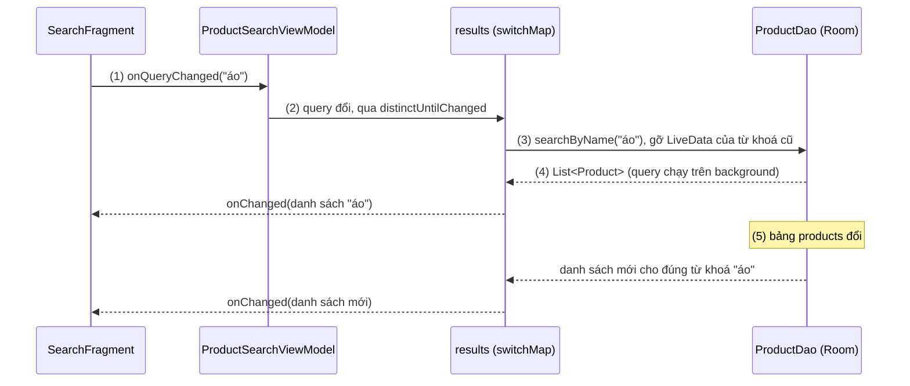
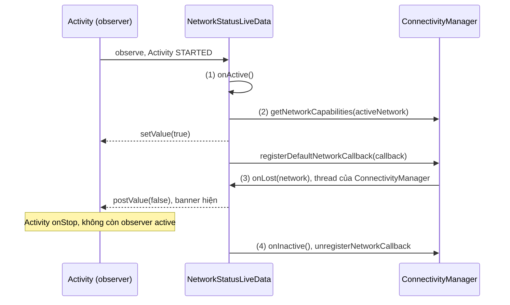
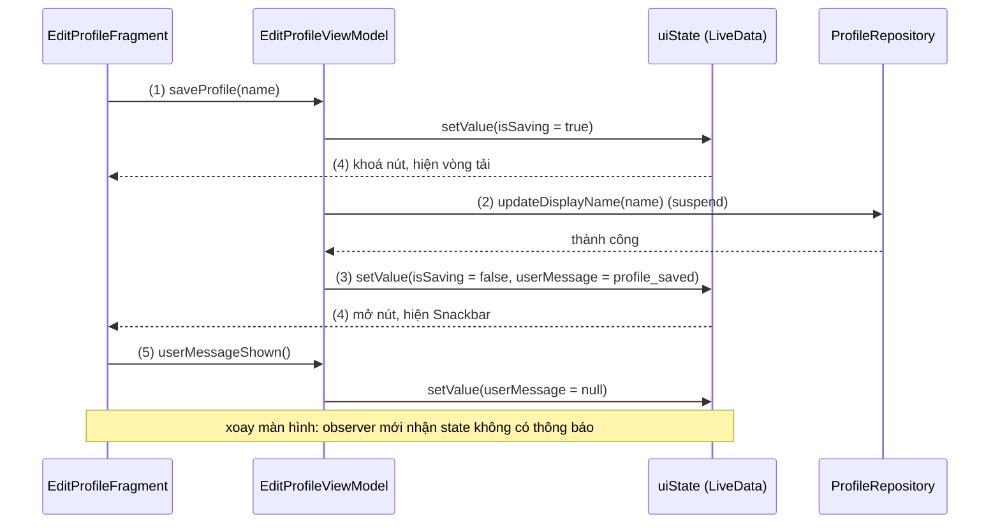

# LiveData

## Vấn đề cần giải quyết

UI cần hiển thị dữ liệu thay đổi theo thời gian: số món trong giỏ, kết quả tìm kiếm, trạng thái mạng, tiến độ tải lên. Dữ liệu đó thường đến **bất đồng bộ** (database, network, service của hệ thống), trong khi màn hình nhận nó có vòng đời riêng: bị đưa xuống background, bị huỷ rồi tạo lại khi xoay màn hình.

Cách gốc là để nơi giữ dữ liệu gọi thẳng callback vào màn hình:

```kotlin
// ProductListActivity.kt (cách làm có vấn đề)
override fun onCreate(savedInstanceState: Bundle?) {
    super.onCreate(savedInstanceState)
    cartManager.addListener { count ->       // listener giữ tham chiếu tới Activity
        cartBadge.text = count.toString()    // có thể chạy khi Activity đã bị huỷ
    }
}
```

Cách này có bốn điểm yếu:

- **Leak:** `cartManager` sống lâu hơn Activity, giữ listener, listener giữ Activity cũ sau mỗi lần xoay.
- **Crash hoặc làm việc thừa:** callback đến sau `onStop()`/`onDestroy()`, cập nhật View đã ẩn, hoặc chạy `FragmentTransaction` sau khi state đã lưu và ném `IllegalStateException`.
- **Tự quản lý đăng ký** ở `onStart()`/`onStop()` cho từng màn.
- **Mất dữ liệu khi tạo lại:** Activity mới sau khi xoay không có giá trị hiện tại.

Vấn đề cần giải quyết là: **một nơi giữ dữ liệu mà UI quan sát được, tự biết khi nào UI sẵn sàng nhận, tự dọn khi UI bị huỷ, và luôn có sẵn giá trị mới nhất cho UI vừa được tạo lại.**

## Sau khi học xong

- Giải thích được vì sao LiveData chỉ giao giá trị cho observer đang active (STARTED, RESUMED), tự gỡ observer khi owner DESTROYED và giao giá trị mới nhất khi observer active trở lại.
- Phân biệt được setValue với postValue, observe với observeForever, và MutableLiveData với LiveData khi đóng gói state trong ViewModel.
- Áp dụng được map, switchMap, distinctUntilChanged và MediatorLiveData để biến đổi và gộp nhiều nguồn dữ liệu.
- Triển khai được LiveData tự quản lý tài nguyên bằng onActive/onInactive, và nối LiveData với coroutine, Flow qua liveData {}, asLiveData(), asFlow().
- Xử lý được event một lần bị phát lại sau khi xoay màn hình bằng cách biểu diễn event thành UI state.

## LiveData là gì?

**LiveData** là class giữ dữ liệu (data holder) quan sát được và **lifecycle-aware** của Jetpack: nó giữ **một giá trị mới nhất**, và chỉ giao giá trị đó cho các observer có `LifecycleOwner` đang **active** (`STARTED` hoặc `RESUMED`); khi owner chuyển sang `DESTROYED`, observer bị gỡ tự động.

Mental model: LiveData là **một tấm bảng tin chỉ có một dòng**. Mỗi lần ghi, dòng cũ bị xoá và thay bằng dòng mới. Người trực bảng chỉ báo tin cho người đang có mặt (active); người vắng mặt (inactive) không bị gọi, nhưng khi quay lại sẽ được xem đúng dòng đang ghi trên bảng, không phải mọi dòng đã từng ghi. Người đã rời đi hẳn (`DESTROYED`) bị gạch tên khỏi danh sách.

`LifecycleOwner`, `Lifecycle.State` và cách `LifecycleRegistry` phát state cho observer đã học ở [Activity Lifecycle](../session_04/components/activity/lifecycle.md), mục "Cách hoạt động — Bộ ba cốt lõi".

## Cách hoạt động

### Ai được ghi: `MutableLiveData` và `LiveData`

`LiveData<T>` chỉ cho **đọc và quan sát** (`value`, `observe()`, `observeForever()`); hai hàm ghi `setValue()` và `postValue()` là `protected`. `MutableLiveData<T>` là lớp con mở hai hàm đó thành `public`.

Nơi giữ state thường là **ViewModel** (object giữ state của màn hình và sống qua configuration change, học ở [ViewModel](viewmodel.md)). Mẫu quen thuộc là **backing property**: `_itemCount` kiểu `MutableLiveData` để `private`, `itemCount` kiểu `LiveData` đưa ra ngoài, nên chỉ ViewModel ghi được.

```kotlin
// CartViewModel.kt
class CartViewModel : ViewModel() {

    private val _itemCount = MutableLiveData(0)   // giá trị khởi tạo 0
    val itemCount: LiveData<Int> = _itemCount     // UI chỉ đọc và quan sát

    fun addItem() {
        _itemCount.value = (_itemCount.value ?: 0) + 1  // chỉ ViewModel được ghi
    }
}
```

`MutableLiveData<Int>()` không truyền giá trị thì **chưa có giá trị** (`isInitialized == false`): `value` là `null`, observer chưa được gọi. Ở Kotlin, `value` luôn có kiểu `T?`.

### Observe theo lifecycle: active, inactive và tự gỡ

`observe(owner, observer)` đăng ký một `Observer` kèm `LifecycleOwner` (Activity, Fragment, `viewLifecycleOwner`); LiveData theo lifecycle của owner mà xếp observer vào ba trạng thái:

- **Inactive:** owner ở `CREATED` (vừa `onCreate()`, hoặc đã `onStop()`). Giá trị đổi nhưng observer không được gọi.
- **Active:** owner ở `STARTED` hoặc `RESUMED`. Mỗi lần giá trị đổi, `onChanged()` được gọi trên main thread.
- **Đã gỡ:** owner chuyển sang `DESTROYED`. LiveData tự gọi `removeObserver()`, không còn giữ tham chiếu tới observer hay owner.

Khi observer chuyển từ inactive sang active, nó nhận **giá trị mới nhất** nếu chưa nhận (mỗi observer nhớ **version** của giá trị cuối đã nhận, mục "Deep Dive"); nhờ vậy Activity tạo lại sau xoay màn hình có dữ liệu ngay. Vì observer được gọi ngay khi owner `STARTED`, nên observe trong `onCreate()` (Fragment: `onViewCreated()`), không phải `onResume()`.

#### Ví dụ: badge số lượng giỏ hàng qua xoay màn hình

**Bài toán:** badge hiện số món trong giỏ, cập nhật ngay khi bấm "Thêm vào giỏ" và giữ đúng con số khi xoay màn hình.

**Luồng chạy:**

1. `onCreate()`: Activity observe `itemCount`; owner đang `CREATED` nên observer inactive.
2. `onStart()`: owner `STARTED`, observer active, nhận ngay `0`.
3. Bấm "Thêm vào giỏ": ViewModel `setValue(1)`, observer nhận `1`.
4. Xoay màn hình: Activity cũ `DESTROYED`, observer cũ bị gỡ; ViewModel và LiveData vẫn sống.
5. Activity mới observe lại và nhận ngay `1` khi tới `STARTED`.



```kotlin
// ProductListActivity.kt
class ProductListActivity : AppCompatActivity() {

    private lateinit var binding: ActivityProductListBinding
    private val cartViewModel: CartViewModel by viewModels()

    override fun onCreate(savedInstanceState: Bundle?) {
        super.onCreate(savedInstanceState)
        binding = ActivityProductListBinding.inflate(layoutInflater)
        setContentView(binding.root)

        // (1) đăng ký một lần trong onCreate; (2)(5) được gọi khi Activity STARTED
        cartViewModel.itemCount.observe(this) { count ->
            binding.cartBadge.text = count.toString()
            binding.cartBadge.isVisible = count > 0
        }

        binding.addToCartButton.setOnClickListener {
            cartViewModel.addItem()                     // (3) ViewModel gọi setValue
        }
        // (4) không có removeObserver: LiveData tự gỡ khi Activity DESTROYED
    }
}
```

`binding` là [View Binding](view_binding.md); `by viewModels()` học ở [ViewModel](viewmodel.md).

**Kết quả:** bấm thêm ba lần, badge hiện `3`; xoay màn hình, badge vẫn `3` ngay. Xoay nhiều lần rồi bấm: observer chạy đúng một lần mỗi lần bấm, LeakCanary không báo Activity cũ bị giữ.

### `setValue` và `postValue`: ghi từ thread nào

LiveData giao giá trị cho observer trên **main thread**, nên mọi thay đổi cuối cùng phải đi qua main thread. Hai hàm ghi khác nhau ở chỗ ai đưa giá trị về đó:

| | `setValue(value)` (Kotlin: `value = …`) | `postValue(value)` |
|---|---|---|
| Gọi từ | Chỉ main thread; thread khác ném `IllegalStateException: Cannot invoke setValue on a background thread` | Bất kỳ thread nào |
| Khi nào đổi giá trị | Ngay, observer active được gọi đồng bộ trước khi hàm trả về | Khi main thread chạy tới task đã post |
| Gọi nhiều lần liên tiếp | Mỗi lần là một lần giao | Trước khi task chạy thì **chỉ giá trị cuối** được giao |

`postValue()` ghi vào một ô "đang chờ" và chỉ post **một** `Runnable` lên main thread khi ô đang trống; Runnable chạy thì lấy giá trị trong ô rồi gọi `setValue()`. Cơ chế gửi task qua `MessageQueue` đã học ở [Working with Thread](../session_05/working_with_thread.md), mục "Trái tim giao tiếp bất đồng bộ của Android: Looper, MessageQueue và Handler".

#### Ví dụ: tiến độ nén ảnh trước khi tải lên

**Bài toán:** app nén từng ảnh trên worker thread trước khi đăng bài và hiện phần trăm tiến độ.

**Luồng chạy:**

1. Trên main thread, ViewModel `setValue(0)` rồi giao việc nén cho executor.
2. Worker thread nén từng ảnh.
3. Sau mỗi ảnh, worker `postValue(phần trăm)`: giá trị vào ô chờ, ô đang trống mới post Runnable.
4. Main thread chạy Runnable, `setValue()` giá trị **mới nhất** trong ô; giá trị bị ghi đè không tới observer.
5. Chuyển sang app khác thì observer inactive, quay lại chỉ nhận giá trị mới nhất.



```kotlin
// UploadViewModel.kt
class UploadViewModel : ViewModel() {

    private val executor = Executors.newSingleThreadExecutor()  // onCleared() gọi shutdownNow(), xem viewmodel.md

    private val _progress = MutableLiveData(0)
    val progress: LiveData<Int> = _progress

    fun compressPhotos(photos: List<File>) {
        _progress.value = 0                                   // (1) main thread: setValue
        executor.execute {
            photos.forEachIndexed { index, photo ->
                compressPhoto(photo)                          // (2) việc nặng trên worker thread
                val percent = (index + 1) * 100 / photos.size
                _progress.postValue(percent)                  // (3) gửi về main thread
            }
        }
    }
}

// PostComposerActivity.kt
uploadViewModel.progress.observe(this) { percent ->          // (4)(5) luôn chạy trên main thread
    binding.uploadProgress.progress = percent
    binding.uploadPercentText.text = "$percent%"
}
```

**Kết quả:** vài ảnh lớn thì tiến độ tăng dần 33 → 66 → 100; rất nhiều ảnh nhỏ thì có thể nhảy cóc (4 → 37 → 100) vì giá trị giữa bị gộp, đúng hành vi của `postValue()`. Đổi thành `_progress.value = percent` trong worker thì app crash với `Cannot invoke setValue on a background thread`.

### Trong Fragment: observe bằng `viewLifecycleOwner`

Fragment sống lâu hơn View của nó, nên observer cập nhật View phải dùng **`viewLifecycleOwner`** và observe trong `onViewCreated()` (lý do ở [Fragment Lifecycle](../session_04/components/fragment/lifecycle.md), mục "View Lifecycle: vòng đời thứ hai trong Fragment").

```kotlin
// OrderListFragment.kt, trong onViewCreated()
orderViewModel.orders.observe(viewLifecycleOwner) { orders ->
    adapter.submitList(orders)
}
```

`observe()` chỉ chống trùng theo **chính instance `Observer`**, mà lambda trong `onViewCreated()` là instance mới mỗi lần tạo View. Observe bằng `this` thì khi Fragment vào backstack, observer cũ không bị gỡ (Fragment chưa `DESTROYED`); quay lại là có observer thứ hai, còn observer cũ giữ binding của cây View đã huỷ.

### Biến đổi: `map`, `switchMap`, `distinctUntilChanged`

Thư viện cung cấp ba hàm extension trên `LiveData` (trước đây gọi qua class `Transformations`). Mỗi hàm trả về một LiveData **mới**, bên trong là một `MediatorLiveData` (mục sau) lắng nghe LiveData nguồn:

| Hàm | Làm gì | Dùng khi |
|---|---|---|
| `source.map { x -> y }` | Biến mỗi giá trị nguồn thành một giá trị khác | Định dạng để hiển thị: `99+`, tiền tệ, ghép họ tên |
| `source.switchMap { x -> liveDataOf(x) }` | Với mỗi giá trị nguồn, tạo LiveData khác và **chuyển sang** quan sát nó, bỏ cái trước | Tham số đổi thì nguồn đổi: từ khoá tìm kiếm, id người dùng |
| `source.distinctUntilChanged()` | Chỉ giao khi khác giá trị trước (so bằng `equals`) | Chặn cập nhật lặp, vì `setValue()` cùng giá trị vẫn giao lại |

Hai đặc tính quan trọng: các hàm này **lười** (chỉ lắng nghe nguồn khi chính LiveData sinh ra có observer active; không ai observe thì `value` không được cập nhật), và lambda của chúng **chạy trên main thread**, nên việc nặng (lọc, sắp xếp danh sách lớn) trong `map` gây giật UI; việc đó nên đẩy xuống query của database hoặc Flow với `flowOn(Dispatchers.Default)`.

#### Ví dụ: tìm kiếm sản phẩm theo từ khoá

**Bài toán:** ô tìm kiếm lọc sản phẩm lưu trong Room; danh sách phải tự cập nhật khi bảng đổi. Mỗi từ khoá là một query, tức một LiveData nguồn khác: đúng việc của `switchMap`.

**Luồng chạy:**

1. Người dùng gõ, ViewModel ghi từ khoá đã `trim()` vào `query`.
2. `distinctUntilChanged()` bỏ qua từ khoá trùng lần trước.
3. `switchMap` gọi DAO lấy LiveData query mới, **gỡ** LiveData của từ khoá cũ.
4. Room chạy query trên background thread rồi đẩy kết quả; `results` giao cho observer.
5. Bảng `products` đổi: Room tự chạy lại query đang được lắng nghe.



```kotlin
// ProductDao.kt
@Dao
interface ProductDao {
    @Query("SELECT * FROM products WHERE name LIKE '%' || :keyword || '%' ORDER BY name")
    fun searchByName(keyword: String): LiveData<List<Product>>
}

// ProductSearchViewModel.kt
class ProductSearchViewModel(private val productDao: ProductDao) : ViewModel() {

    private val query = MutableLiveData("")

    val results: LiveData<List<Product>> = query
        .distinctUntilChanged()                                       // (2)
        .switchMap { keyword -> productDao.searchByName(keyword) }    // (3)(4)(5)

    fun onQueryChanged(text: String) {
        query.value = text.trim()                                     // (1)
    }
}
```

DAO trả `LiveData` là observable query của Room ([Room Architecture](../session_05/data_store/room_architecture.md)); ViewModel có tham số cần factory ([ViewModel](viewmodel.md)).

**Kết quả:** gõ "áo" thì chỉ còn sản phẩm có "áo" trong tên; sửa giá một sản phẩm bằng Database Inspector thì danh sách tự cập nhật. Gõ "áo" rồi thêm và xoá một dấu cách, `switchMap` chỉ chạy một lần. LiveData không có **debounce** (chờ ngừng gõ 300 ms mới query); cần thì dùng Flow (mục "Cầu nối với coroutine và Flow").

### Gộp nhiều nguồn: `MediatorLiveData`

`MediatorLiveData<T>` là một `MutableLiveData` **lắng nghe nhiều LiveData nguồn**: `addSource(source) { … }` đăng ký callback cho mỗi nguồn, `removeSource(source)` gỡ nó; nguồn đổi thì callback chạy và thường gọi `setValue()` cho mediator. Mediator cũng lười; `map`, `switchMap`, `distinctUntilChanged` được viết bằng nó.

Ví dụ: tổng tiền thanh toán phụ thuộc tạm tính giỏ hàng (`subtotal`, từ Room) và phần trăm giảm của mã (`discountPercent`, ghi bởi `applyCoupon()`); callback của **mỗi** nguồn đọc lại **cả hai** nguồn:

```kotlin
// CheckoutViewModel.kt (subtotal = cartDao.observeSubtotal(), discountPercent = MutableLiveData(0))
val total: LiveData<Long> = MediatorLiveData<Long>().apply {
    fun recalculate() {
        val amount = subtotal.value ?: 0L
        val percent = discountPercent.value ?: 0
        value = amount - amount * percent / 100
    }
    addSource(subtotal) { recalculate() }
    addSource(discountPercent) { recalculate() }
}
```

Giỏ hàng 200.000 đ, áp mã 10% thì tổng hiện 180.000 đ; tăng số lượng một món thì tổng tự tính lại. Không còn observer của `total` thì `recalculate()` không chạy, kể cả khi bảng `cart_items` đổi.

### `observe(owner)` và `observeForever`: khi không có lifecycle

`observeForever(observer)` đăng ký observer **không kèm owner**, được coi là **luôn active**. Không có lifecycle thì không ai tự gỡ, nên **người gọi phải `removeObserver(observer)`**; quên là LiveData giữ observer (và mọi thứ nó tham chiếu) mãi mãi. Trong UI luôn dùng `observe()`; `observeForever()` thường gặp nhất trong **unit test**, nơi không có owner.

`total` ở trên là mediator lười, nên test phải có observer mới đọc được tổng. `InstantTaskExecutorRule` (artifact `androidx.arch.core:core-testing`) coi thread của test là main thread, nên `setValue()` không ném lỗi trong JVM test.

```kotlin
// CheckoutViewModelTest.kt (có @get:Rule InstantTaskExecutorRule)
val viewModel = CheckoutViewModel(FakeCartDao(subtotal = 200_000L))
viewModel.applyCoupon(10)
val observer = Observer<Long> { }
viewModel.total.observeForever(observer)         // không có owner, luôn active: mediator bắt đầu tính
try {
    assertEquals(180_000L, viewModel.total.value)
} finally {
    viewModel.total.removeObserver(observer)     // bắt buộc tự gỡ
}
```

Bỏ `observeForever()` thì `total.value` là `null`, vì mediator chưa từng tính tổng. Unit test nói chung học ở [Unit Testing](../coding_analyst_and_testing/unit_testing.md).

### LiveData tự quản lý tài nguyên: `onActive` và `onInactive`

Kế thừa `LiveData` trực tiếp cho phép nó **tự bật và tắt nguồn dữ liệu** theo số observer đang active: `onActive()` được gọi khi số đó tăng từ 0 lên 1 (đăng ký listener, bật cảm biến), `onInactive()` khi nó giảm về 0 (huỷ đăng ký để không tốn pin). LiveData bọc service của hệ thống vì thế dùng chung được cho nhiều màn, chỉ kết nối service khi có màn hiển thị. Callback của nguồn kiểu này thường chạy trên thread khác, nên ghi bằng `postValue()`.

#### Ví dụ: banner "Đang offline" theo trạng thái mạng

**Bài toán:** nhiều màn hiện banner "Đang offline" khi mất Internet; app ở background thì ngừng lắng nghe `ConnectivityManager`. `NetworkCallback` và `NET_CAPABILITY_VALIDATED` đã học ở [Networking](../session_05/networking.md), mục "Quản lý trạng thái kết nối ở tầng OS: ConnectivityManager & NetworkCallback".

**Luồng chạy:**

1. Có observer active đầu tiên: `onActive()` chạy trên main thread.
2. `onActive()` `setValue()` trạng thái hiện tại rồi `registerDefaultNetworkCallback()`.
3. Mạng mặc định đổi hoặc mất: callback chạy trên thread của `ConnectivityManager`, gọi `postValue()`.
4. Không còn observer active: `onInactive()` huỷ đăng ký callback.



```kotlin
// NetworkStatusLiveData.kt (minSdk 24, cần quyền ACCESS_NETWORK_STATE)
class NetworkStatusLiveData(context: Context) : LiveData<Boolean>() {

    private val connectivityManager =
        context.applicationContext.getSystemService(Context.CONNECTIVITY_SERVICE) as ConnectivityManager

    private val callback = object : ConnectivityManager.NetworkCallback() {
        override fun onCapabilitiesChanged(network: Network, capabilities: NetworkCapabilities) {
            postValue(capabilities.isOnline())                // (3) không phải main thread
        }

        override fun onLost(network: Network) {
            postValue(false)                                  // (3)
        }
    }

    override fun onActive() {                                 // (1) có observer active đầu tiên
        val current = connectivityManager.getNetworkCapabilities(connectivityManager.activeNetwork)
        value = current?.isOnline() == true                   // (2) main thread: setValue
        connectivityManager.registerDefaultNetworkCallback(callback)
    }

    override fun onInactive() {                               // (4) không còn observer active
        connectivityManager.unregisterNetworkCallback(callback)
    }

    private fun NetworkCapabilities.isOnline() =
        hasCapability(NetworkCapabilities.NET_CAPABILITY_INTERNET) &&
            hasCapability(NetworkCapabilities.NET_CAPABILITY_VALIDATED)
}

// OrderListActivity.kt (networkStatus: một instance dùng chung cho cả app)
networkStatus.distinctUntilChanged().observe(this) { isOnline ->
    binding.offlineBanner.isVisible = !isOnline
}
```

**Kết quả:** bật chế độ máy bay, banner hiện; tắt, banner ẩn khi mạng được validated. Bấm Home: breakpoint trong `onCapabilitiesChanged` không còn dừng.

### Cầu nối với coroutine và Flow

Phần này dùng trước hai kiến thức: **coroutine** (hàm `suspend` chạy bất đồng bộ mà không chặn thread) được học ở 8.4.3 Coroutines (chưa có bài), và **Flow** (luồng giá trị bất đồng bộ của Kotlin) được học ở [Flow](../session_07/design_pattern/observer/flow.md); Flow trả về từ Room đã gặp ở [Async Transactions & Flow](../session_05/data_store/room_transactions.md).

Ba API nối LiveData với hai thế giới đó (dependency `androidx.lifecycle:lifecycle-livedata-ktx`):

- **`liveData { … }`**: tạo LiveData từ một khối coroutine, `emit(value)` đặt giá trị trên main thread. Khối chạy khi LiveData **active**; khi inactive, khối bị huỷ sau một **timeout** (mặc định 5 giây, tham số `timeoutInMs`). Bị huỷ giữa chừng thì chạy lại từ đầu khi active lại; đã xong thì không chạy lại.
- **`flow.asLiveData()`**: collect Flow khi LiveData active, ngừng sau cùng timeout đó khi inactive; Flow là `StateFlow` thì giá trị ban đầu được đặt luôn cho LiveData.
- **`liveData.asFlow()`**: biến LiveData thành Flow để dùng toán tử như `debounce`, `combine`.

Timeout tồn tại vì xoay màn hình gỡ rồi đăng ký lại observer chỉ trong vài trăm mili giây.

```kotlin
// ProfileViewModel.kt
val profile: LiveData<ProfileUiState> = liveData {                // chạy khi LiveData active
    emit(ProfileUiState.Loading)
    try {
        emit(ProfileUiState.Content(profileRepository.fetchProfile()))  // suspend, không bị huỷ khi xoay
    } catch (e: IOException) {                                    // cố ý không bắt CancellationException
        emit(ProfileUiState.Error)
    }
}
val recentOrders: LiveData<List<Order>> = profileRepository.observeRecentOrders().asLiveData()
```

Xoay màn hình khi `fetchProfile()` đang chạy: Activity mới observe lại trước 5 giây nên coroutine chạy tiếp, chỉ có một request. Bấm Home quá 5 giây khi request chưa xong rồi mở lại: request bị huỷ và gửi lại. Lý do không bắt `CancellationException` ở [Networking](../session_05/networking.md), mục "Sai lầm thường gặp", phần 4.

## Deep Dive: bên trong LiveData

Trong source `androidx.lifecycle.LiveData`, `observe()` bọc `Observer` trong `LifecycleBoundObserver`: owner đổi state thì wrapper tính lại `shouldBeActive()` (từ `STARTED` trở lên), gặp `DESTROYED` thì tự `removeObserver()`; `observeForever()` dùng `AlwaysActiveObserver` có `shouldBeActive()` luôn `true`, nên không ai gỡ hộ. LiveData giữ `mVersion` tăng sau mỗi `setValue()` (kể cả khi giá trị bằng cũ, nên cần `distinctUntilChanged()`), mỗi wrapper nhớ `mLastVersion`, và `considerNotify()` chỉ gọi `onChanged()` khi version của LiveData lớn hơn. Observer **mới** (version `-1`) vì thế luôn nhận giá trị hiện tại: nguồn gốc của event bị phát lại sau xoay màn hình. Observer gọi `setValue()` ngay trong `onChanged()` thì lần dispatch đang chạy bị đánh dấu không còn hợp lệ và vòng lặp giao lại từ đầu với giá trị mới, thay vì gọi đệ quy.

## Ví dụ thực tế

Với **event một lần** (Snackbar "Đã lưu", điều hướng), việc giao lại giá trị mới nhất cho observer mới thành lỗi: xoay màn hình là Snackbar hiện lại, hoặc màn đích mở hai lần. `SingleLiveEvent` (từ sample của Google, dùng cờ `AtomicBoolean`) và wrapper `Event<T>` (đọc qua `getContentIfNotHandled()`, lần hai nhận `null`) đều là mẹo chống lại thiết kế của LiveData. Khuyến nghị hiện nay là **biểu diễn event thành UI state**: hướng dẫn kiến trúc của Android nêu rằng event phát sinh từ ViewModel luôn phải dẫn tới một lần cập nhật UI state. Thông báo là một field của state, UI hiện nó rồi **báo lại** để ViewModel xoá field đó.

### Lưu hồ sơ và hiện thông báo đúng một lần

**Bài toán:** màn sửa hồ sơ khoá nút "Lưu" khi đang lưu, lưu xong hiện Snackbar thành công hoặc lỗi. Xoay màn hình sau khi Snackbar đã hiện thì không hiện lại; xoay **trong lúc** đang lưu thì vẫn hiện thông báo khi xong.

**Luồng chạy:**

1. Bấm "Lưu": ViewModel đặt `isSaving = true`.
2. ViewModel gọi `updateDisplayName()` trong `viewModelScope` (scope coroutine của ViewModel, [ViewModel](viewmodel.md)).
3. Lưu xong hoặc lỗi: `isSaving = false`, `userMessage` là id chuỗi thông báo.
4. Fragment observe `uiState` bằng `viewLifecycleOwner`: khoá hoặc mở nút; `userMessage` khác `null` thì hiện Snackbar.
5. Hiện xong, Fragment gọi `userMessageShown()`, ViewModel xoá `userMessage`; observer tạo sau đó không còn thấy thông báo. Xoay **trước** bước 3 thì observer mới vẫn nhận nó.



```kotlin
// EditProfileUiState.kt
data class EditProfileUiState(
    val isSaving: Boolean = false,
    @StringRes val userMessage: Int? = null       // thông báo đang chờ hiện, null = không có
)

// EditProfileViewModel.kt
class EditProfileViewModel(private val profileRepository: ProfileRepository) : ViewModel() {

    private val _uiState = MutableLiveData(EditProfileUiState())
    val uiState: LiveData<EditProfileUiState> = _uiState

    fun saveProfile(displayName: String) {
        if (currentState().isSaving) return
        _uiState.value = currentState().copy(isSaving = true)              // (1)
        viewModelScope.launch {                                            // chạy trên main thread
            val message = try {
                profileRepository.updateDisplayName(displayName.trim())    // (2)
                R.string.profile_saved
            } catch (e: IOException) {
                R.string.profile_save_failed
            }
            _uiState.value = currentState().copy(isSaving = false, userMessage = message) // (3)
        }
    }

    fun userMessageShown() {
        _uiState.value = currentState().copy(userMessage = null)          // (5) UI báo đã hiện
    }

    private fun currentState() = _uiState.value ?: EditProfileUiState()
}

// EditProfileFragment.kt, trong onViewCreated()
viewModel.uiState.observe(viewLifecycleOwner) { state ->                   // (4)
    binding.saveButton.isEnabled = !state.isSaving
    binding.savingProgress.isVisible = state.isSaving
    state.userMessage?.let { messageRes ->
        Snackbar.make(binding.root, messageRes, Snackbar.LENGTH_SHORT).show()
        viewModel.userMessageShown()                                       // (5)
    }
}
```

Gọi `userMessageShown()` trong observer là gọi `setValue()` lồng trong `onChanged()`; LiveData giao lại state mới từ đầu (mục "Deep Dive").

**Kết quả:** bấm "Lưu", Snackbar "Đã lưu hồ sơ" hiện một lần; xoay màn hình thì không hiện lại. Làm chậm mạng (Network throttling của emulator), bấm "Lưu" rồi xoay ngay: màn mới hiện đúng một Snackbar. Unit test chỉ cần đọc state: sau khi lưu `userMessage == R.string.profile_saved`, sau `userMessageShown()` thì `null`.

## Khi nào nên và không nên dùng

- **Nên dùng** để ViewModel đưa state ra UI View/XML, nhất là codebase Java hoặc đã dùng LiveData: lifecycle-aware sẵn, UI không cần coroutine. Code Kotlin mới thường dùng `StateFlow` (như ở [ViewModel](viewmodel.md)).
- **Nên dùng** với [Data Binding](data_binding.md) (6.2): layout gắn trực tiếp vào LiveData khi binding có `lifecycleOwner`.
- **Nên dùng** `onActive`/`onInactive` để bọc một nguồn của hệ thống chỉ nên chạy khi có màn hiển thị.
- **Không nên dùng** ở Repository, DataSource, domain layer (docs của Android khuyên vậy vì khả năng kết hợp luồng rất hạn chế và mọi biến đổi chạy trên main thread), hoặc khi cần toán tử phức tạp (debounce, retry, kết hợp nhiều luồng): dùng Flow, ViewModel đổi sang LiveData bằng `asLiveData()` nếu cần.
- **Không dùng** để gửi event một lần: biểu diễn thành UI state như mục "Ví dụ thực tế".
- **Không cần** cho màn Compose mới (thường dùng `StateFlow` với `collectAsStateWithLifecycle()`); LiveData vẫn đọc được qua `observeAsState()` (artifact `runtime-livedata`) khi chuyển dần màn cũ.

## Sai lầm thường gặp

### 1. Gọi `setValue` từ background thread

```kotlin
// Sai: callback của OkHttp chạy trên thread của OkHttp
override fun onResponse(call: Call, response: Response) {
    _orders.value = parseOrders(response)
}
```

**Lỗi lộ ra thế nào:** crash `IllegalStateException: Cannot invoke setValue on a background thread` ngay khi response về.

**Cách sửa:** dùng `_orders.postValue(...)`, hoặc gọi trong coroutine của `viewModelScope` (chạy trên main thread nên `value =` được).

### 2. Mong `postValue` giao đủ mọi giá trị

```kotlin
// Sai: dùng LiveData như một hàng đợi (chạy trên executor)
contacts.forEach { contact ->
    contactDao.insert(contact)
    _importedContact.postValue(contact)   // UI muốn hiện tên từng người
}
```

**Lỗi lộ ra thế nào:** UI thiếu người, mỗi lần thiếu một kiểu, vì các `postValue()` liên tiếp chỉ giao giá trị cuối.

**Cách sửa:** đưa ra state tích luỹ (`_importedCount.postValue(count)` hoặc danh sách đầy đủ), hoặc dùng Flow khi thật sự cần một luồng giá trị.

### 3. Tạo LiveData mới mỗi lần gọi hàm

```kotlin
// Sai: mỗi lần người dùng sửa địa chỉ, Fragment lại observe một LiveData khác
fun postalCodeOf(address: String): LiveData<String> = repository.lookupPostalCode(address)
viewModel.postalCodeOf(address).observe(viewLifecycleOwner) { binding.postalCode.text = it }
```

**Lỗi lộ ra thế nào:** observer cũ vẫn còn sau mỗi lần sửa, kết quả cũ về muộn có thể ghi đè kết quả mới; xoay màn hình thì tra lại từ đầu.

**Cách sửa:** để địa chỉ là một LiveData đầu vào và `switchMap` sang kết quả như ví dụ tìm kiếm: `val postalCode = address.switchMap { repository.lookupPostalCode(it) }`.

### 4. Dùng LiveData cho event một lần

```kotlin
// Sai: event điều hướng giữ trong LiveData
private val _navigateToOrderDetail = MutableLiveData<Long>()
// Fragment: observe rồi gọi navigate(orderId)
```

**Lỗi lộ ra thế nào:** xoay màn hình thì observer mới nhận lại `orderId` cũ và mở màn chi tiết thêm lần nữa.

**Cách sửa:** biểu diễn thành UI state và báo lại khi đã xử lý (mục "Ví dụ thực tế"); code cũ chưa chuyển được thì bọc bằng `Event<T>`.

Hai sai lầm khác đã nêu ở trên: observe bằng `this` trong Fragment, và `observeForever()` không `removeObserver()`.

## Lịch sử phát triển

- **Google I/O (05/2017):** Android Architecture Components ra mắt bản alpha, gồm Lifecycle, LiveData, ViewModel và Room.
- **Architecture Components 1.0.0 (11/2017):** bản stable đầu tiên, package `android.arch.lifecycle`.
- **Lifecycle 2.0.0 (09/2018):** chuyển sang AndroidX, package `androidx.lifecycle`.
- **Lifecycle 2.1.0 (09/2019):** extension Kotlin cho `observe` và các hàm `Transformations` (`liveData.map {}`), thêm `distinctUntilChanged`.
- **Lifecycle 2.2.0 (01/2020):** `lifecycle-livedata-ktx` có builder `liveData {}` và cầu nối với Flow; `lifecycle-extensions` bị deprecated.
- **Lifecycle 2.3.0 (02/2021):** extension `LiveData.observe()` dạng lambda bị deprecated nhờ SAM conversion của Kotlin 1.4; thêm Lint cảnh báo đặt `null` vào `MutableLiveData` khai báo non-null.
- **Lifecycle 2.6.0 (03/2023):** `Transformations` và `Observer` viết lại bằng Kotlin, code Kotlin buộc dùng extension `map {}`, `switchMap {}`; thêm `LiveData.isInitialized` và constructor nhận giá trị khởi tạo cho `MediatorLiveData`.
- **Lifecycle 2.7.0 (01/2024):** `lifecycle-livedata-ktx` gộp vào `lifecycle-livedata`; `map`, `switchMap` đặt sẵn giá trị ngay khi nguồn đã có giá trị, giống `distinctUntilChanged`.
- **Hiện nay:** hướng dẫn kiến trúc của Android dùng `StateFlow` cho state và khuyên biểu diễn event thành UI state; LiveData vẫn được duy trì, không bị deprecated.

## Kết nối hệ thống

- **Tiên quyết:**
  - [Activity Lifecycle](../session_04/components/activity/lifecycle.md): `LifecycleOwner`, `Lifecycle.State`.
  - [Fragment Lifecycle](../session_04/components/fragment/lifecycle.md): vì sao observe bằng `viewLifecycleOwner`.
  - [Working with Thread](../session_05/working_with_thread.md): main thread và `MessageQueue`, nền của `setValue` và `postValue`.
- **Liên quan:**
  - [View Binding](view_binding.md): cách các ví dụ truy cập View.
  - [Room Architecture](../session_05/data_store/room_architecture.md) và [Async Transactions & Flow](../session_05/data_store/room_transactions.md): DAO trả `LiveData` hoặc `Flow`.
  - [Networking](../session_05/networking.md): `NetworkCallback` làm nguồn cho `NetworkStatusLiveData`.
  - [Activity State Changes](../session_04/components/activity/state_changes.md): `SavedStateHandle.getLiveData()` cho state sống qua process death.
- **Học tiếp:**
  - [ViewModel](viewmodel.md) (6.4): nơi giữ LiveData, `viewModelScope` và factory.
  - [Data Binding](data_binding.md) (6.2): gắn LiveData trực tiếp vào layout.
  - [LiveData (Observer Pattern)](../session_07/design_pattern/observer/livedata.md): LiveData như một hiện thực của Observer Pattern.
  - [Flow](../session_07/design_pattern/observer/flow.md): `Flow`, `StateFlow` và các toán tử LiveData không có.
  - [MVVM](../session_07/architecture/mvvm.md): vị trí của LiveData giữa View và ViewModel.
  - 8.4.3 Coroutines (chưa có bài): coroutine trong `liveData {}` và `viewModelScope`.

## Tham khảo

- [LiveData overview - Android Developers](https://developer.android.com/topic/libraries/architecture/livedata)
- [Use Kotlin coroutines with lifecycle-aware components (Views) - Android Developers](https://developer.android.com/topic/libraries/architecture/views/coroutines-views)
- [UI events - Android Developers](https://developer.android.com/topic/architecture/ui-layer/events)
- [Lifecycle release notes - Android Developers](https://developer.android.com/jetpack/androidx/releases/lifecycle)
- [LiveData API reference - Android Developers](https://developer.android.com/reference/androidx/lifecycle/LiveData)
- [MediatorLiveData API reference - Android Developers](https://developer.android.com/reference/androidx/lifecycle/MediatorLiveData)
- [Source code LiveData.java - AndroidX (GitHub mirror)](https://github.com/androidx/androidx/blob/androidx-main/lifecycle/lifecycle-livedata-core/src/main/java/androidx/lifecycle/LiveData.java)
- [LiveData with SnackBar, Navigation and other events (the SingleLiveEvent case) - Android Developers Blog trên Medium](https://medium.com/androiddevelopers/livedata-with-snackbar-navigation-and-other-events-the-singleliveevent-case-ac2622673150)
- [ViewModel: One-off event antipatterns - Android Developers Blog trên Medium](https://medium.com/androiddevelopers/viewmodel-one-off-event-antipatterns-16a1da869b95)
