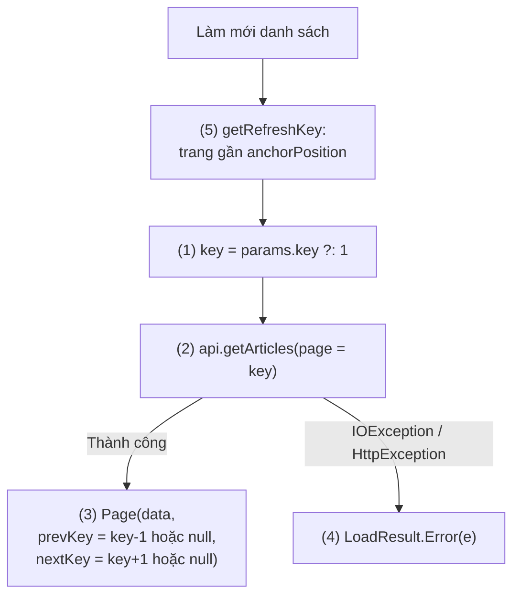
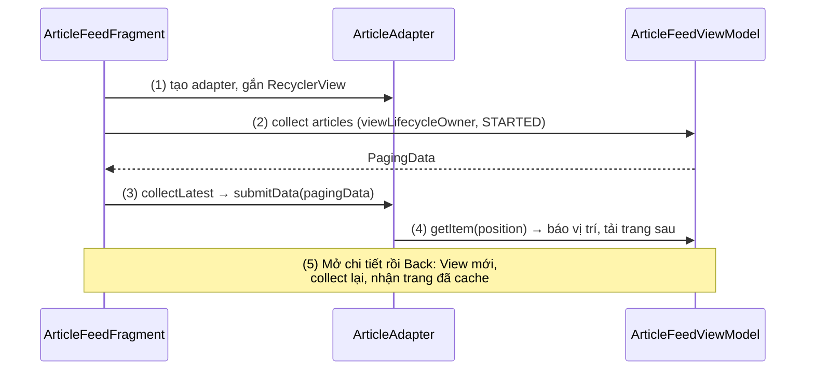
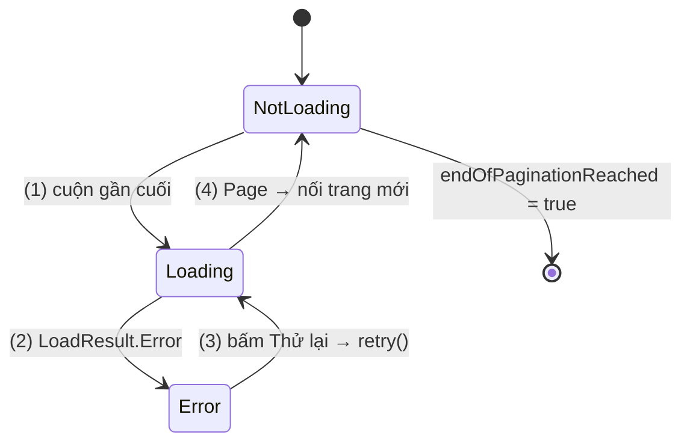
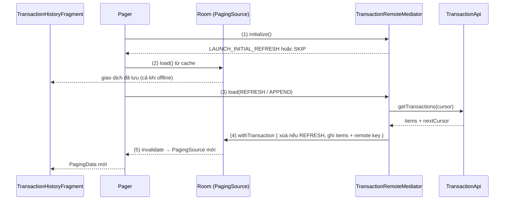
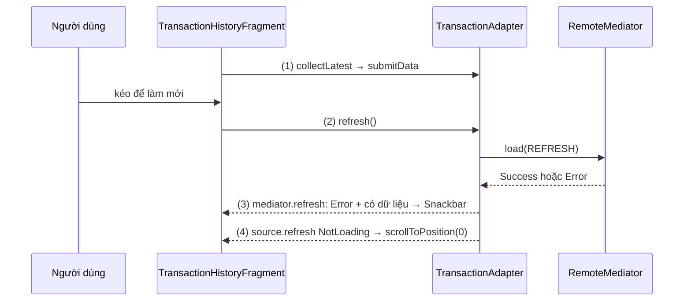

# Paging

## Vấn đề cần giải quyết

Feed, kết quả tìm kiếm, lịch sử giao dịch thường lớn hơn nhiều so với phần người dùng thực sự xem. Cách đơn giản nhất là tải hết:

```kotlin
val transactions = api.getAllTransactions()   // 20.000 bản ghi
adapter.submitList(transactions)
```

Người dùng chỉ xem 20 dòng đầu, nhưng app phải tải và giữ 20.000 object: màn hình trắng lâu, RAM tăng (có thể `OutOfMemoryError`), tốn data.

Tự viết cuộn vô tận thì phải tự lo chống request trùng, thử lại đúng trang lỗi, giữ dữ liệu khi xoay màn hình, huỷ request khi đổi từ khoá, hiện dữ liệu đã lưu khi offline: chỗ nào cũng dễ sai, và cách sửa giống nhau ở mọi app.

Vấn đề cần giải quyết là: **tải dữ liệu theo từng phần đúng lúc cần, với trạng thái tải, lỗi, thử lại, cache và làm mới được xử lý một lần, nhất quán.**

## Sau khi học xong

- Giải thích được cách PagingSource, Pager và PagingData tải dữ liệu theo trang, và vì sao mỗi PagingSource chỉ dùng cho một snapshot.
- Triển khai được danh sách phân trang với cachedIn và PagingDataAdapter hoặc collectAsLazyPagingItems.
- Xử lý được trạng thái tải, lỗi và retry bằng LoadState và withLoadStateFooter.
- Thiết kế được danh sách offline-first với Room và RemoteMediator.
- Nhận diện được các lỗi quên cachedIn, dùng lại PagingSource, getRefreshKey sai và key không ổn định.

## Paging là gì?

**Paging** (bài này nói về Paging 3, artifact `androidx.paging`) là thư viện Jetpack tải và hiển thị một tập dữ liệu lớn **theo từng trang, đúng lúc người dùng cuộn tới**: `PagingSource` biết cách tải một trang theo key, `Pager` biến nó thành luồng `Flow<PagingData>` được cache trong ViewModel, còn UI chỉ hiển thị và báo cho Paging biết người dùng đang xem tới đâu.

Mental model: Paging là một **cửa sổ trượt** trên một danh sách rất dài. Chỉ các trang quanh vị trí đang xem nằm trong bộ nhớ; cuộn gần mép cửa sổ thì Paging tự tải thêm trang ở mép đó, và nếu bạn đặt giới hạn thì các trang ở xa bị bỏ bớt. Bạn chỉ mô tả "lấy một trang thế nào"; việc trượt cửa sổ là của thư viện.

> [!NOTE]
> Kiến thức dùng trước: coroutine, `Flow` ([8.4.3 Coroutines](../session_08/async_threads/coroutines.md); [Flow](../session_07/design_pattern/observer/flow.md)); `ViewModel` ([6.4 ViewModel](viewmodel.md)); `RecyclerView`, `DiffUtil` ([ViewHolder Pattern](../session_07/design_pattern/viewholder_pattern.md)); Retrofit ([8.1.1 Retrofit](../session_08/networks/retrofit.md)) và lỗi mạng ([Networking](../session_05/networking.md)).

## Cách hoạt động

### Ba tầng của Paging

Repository: `PagingSource` tải **một** trang từ **một** nguồn theo key, tuỳ chọn `RemoteMediator` tải thêm từ mạng vào database. ViewModel: `Pager` + `PagingConfig` phát `Flow<PagingData>`, `cachedIn(viewModelScope)` giữ trang đã tải. UI: `PagingDataAdapter` hoặc `collectAsLazyPagingItems()` hiển thị và báo vị trí đang xem.

`PagingData` là một **snapshot** của danh sách đã phân trang: các trang đã tải, cộng một kênh để UI báo ngược "đang xem item thứ N". Mỗi lần nguồn đổi hẳn (làm mới, đổi từ khoá), `Pager` phát ra một `PagingData` mới.

Luồng chạy chung: UI collect `Flow<PagingData>`; `Pager` gọi `PagingSource.load()` cho lần tải đầu (refresh), nhận trang kèm key trang trước/sau, qua `cachedIn` tới UI. Cuộn tới cách mép ít hơn `prefetchDistance` item thì `Pager` gọi `load()` với key trang sau (append). Hai ví dụ feed bên dưới đi qua từng bước kèm sơ đồ.

```kotlin
// app/build.gradle.kts (chỉ thêm artifact bạn dùng)
dependencies {
    val pagingVersion = "3.5.3"
    implementation("androidx.paging:paging-runtime:$pagingVersion")      // lõi + PagingDataAdapter
    implementation("androidx.paging:paging-compose:$pagingVersion")      // nếu dùng Compose
    testImplementation("androidx.paging:paging-testing:$pagingVersion")  // TestPager, asSnapshot
    implementation("androidx.room:room-paging:$roomVersion")             // DAO trả PagingSource
}
```

### PagingSource: tải một trang theo key

`PagingSource<Key, Value>` (`Key` là số trang, cursor...; `Value` là kiểu item) override hai hàm:

- `suspend fun load(params)`: `params.key` là key cần tải (`null` ở lần tải đầu), `params.loadSize` là số item Paging *gợi ý*. Trả về `LoadResult.Page(data, prevKey, nextKey)` khi thành công (key `null` là hết trang theo hướng đó), `LoadResult.Error(throwable)` cho lỗi dự kiến (Paging chuyển thành `LoadState.Error`, cho phép retry), hoặc `LoadResult.Invalid()` khi nguồn đã đổi.
- `fun getRefreshKey(state)`: khi làm mới, trả về key để trang mới bắt đầu **gần vị trí đang xem** (`state.anchorPosition`) thay vì quay về đầu.

Một `PagingSource` là **một snapshot** của nguồn: khi nguồn đổi, nó bị `invalidate()` và `Pager` gọi factory tạo instance **mới** (mục "Deep Dive").

#### Ví dụ: feed bài viết từ API phân trang theo số trang

**Bài toán:** feed của app tin tức; API `GET /articles?page=N&limit=20` trả bài viết kèm `totalPages`.

**Luồng chạy:**

1. Lấy key cần tải: `params.key`, hoặc trang 1 nếu là lần tải đầu (`null`).
2. Gọi API với số trang đó và kích thước trang cố định của API.
3. Thành công: trả `LoadResult.Page`; `prevKey` là `null` ở trang 1, `nextKey` là `null` ở trang cuối.
4. `IOException` hoặc `HttpException`: trả `LoadResult.Error`.
5. `getRefreshKey()`: tìm trang gần vị trí đang xem nhất, suy ra số trang từ `prevKey + 1` hoặc `nextKey - 1`.



```kotlin
// ArticlePagingSource.kt
// api.getArticles(page, limit) trả ArticlePageResponse(articles: List<Article>, totalPages: Int)
class ArticlePagingSource(
    private val api: ArticleApi
) : PagingSource<Int, Article>() {

    override suspend fun load(params: LoadParams<Int>): LoadResult<Int, Article> {
        val page = params.key ?: FIRST_PAGE                                 // (1)
        return try {
            // (2) API theo số trang có kích thước cố định: luôn gửi PAGE_SIZE,
            // không gửi params.loadSize (lần tải đầu loadSize lớn gấp 3)
            val response = api.getArticles(page = page, limit = PAGE_SIZE)
            LoadResult.Page(                                                // (3)
                data = response.articles,
                prevKey = if (page == FIRST_PAGE) null else page - 1,
                nextKey = if (page >= response.totalPages) null else page + 1
            )
        } catch (e: IOException) {                                          // (4) mất mạng
            LoadResult.Error(e)
        } catch (e: HttpException) {                                        // (4) HTTP không phải 2xx
            LoadResult.Error(e)
        }
    }

    override fun getRefreshKey(state: PagingState<Int, Article>): Int? {    // (5)
        return state.anchorPosition?.let { anchor ->
            val anchorPage = state.closestPageToPosition(anchor)
            anchorPage?.prevKey?.plus(1) ?: anchorPage?.nextKey?.minus(1)
        }
    }

    companion object {
        const val FIRST_PAGE = 1
        const val PAGE_SIZE = 20
    }
}
```

Chỉ bắt `IOException` và `HttpException`, nên `CancellationException` không bị nuốt khi Paging huỷ một lần tải.

**Kết quả:** `TestPager` (mục "Ví dụ thực tế") cho thấy `refresh()` trả `prevKey = null`, `nextKey = 2`; trên API giả 3 trang, `append()` lần hai trả `nextKey = null`.

#### Khi nguồn là Room: để Room sinh PagingSource

Room ([Room Architecture](../session_05/data_store/room_architecture.md)) sinh sẵn `PagingSource` khi hàm `@Query` trả `PagingSource<Int, Entity>` và module có `room-paging`:

```kotlin
@Dao
interface ContactDao {
    @Query("SELECT * FROM contacts ORDER BY displayName COLLATE NOCASE, id")
    fun pagingSource(): PagingSource<Int, Contact>
}
```

`PagingSource` của Room dùng key là offset, đếm được tổng số dòng (nên hỗ trợ placeholder), đã có `getRefreshKey`, và tự `invalidate()` khi bảng trong query bị ghi, nhờ `InvalidationTracker` ở [Async Transactions & Flow](../session_05/data_store/room_transactions.md), mục "Flow từ Room — Cơ chế InvalidationTracker".

### Pager, PagingConfig và cachedIn trong ViewModel

`Pager` nhận một `PagingConfig`, một **factory** tạo `PagingSource` mới (`pagingSourceFactory`), và tuỳ chọn một `RemoteMediator`; `pager.flow` là `Flow<PagingData<Value>>`. `PagingConfig` quyết định cửa sổ trượt:

| Tham số | Mặc định | Ý nghĩa |
|---|---|---|
| `pageSize` | (bắt buộc) | Số item mỗi lần tải; nên bằng vài lần số item trên màn hình. |
| `prefetchDistance` | `pageSize` | Còn cách mép bao nhiêu item thì tải trang tiếp; `0` là chạm mép mới tải. |
| `initialLoadSize` | `pageSize * 3` | Số item xin ở lần tải đầu. |
| `enablePlaceholders` | `true` | Hiện item `null` cho phần chưa tải, **nếu** `PagingSource` đếm được tổng số (Room được, đa số API không). |
| `maxSize` | `MAX_SIZE_UNBOUNDED` | Số item tối đa giữ trước khi bỏ trang xa; ít nhất `pageSize + 2 * prefetchDistance`. |

`pageSize` và `initialLoadSize` chỉ là gợi ý đi vào `params.loadSize`. `cachedIn(scope)` **cache** các trang đã tải (và kết quả các biến đổi đặt trước nó) trong `scope`, sống qua xoay màn hình với `viewModelScope`; nó cũng **multicast**, cho UI mới (sau xoay màn hình, từ backstack) collect lại mà không tải lại, vì một `PagingData` mặc định chỉ collect được một lần.

Danh sách phụ thuộc tham số (từ khoá, bộ lọc) thì giữ tham số trong `StateFlow`, `flatMapLatest` tạo `Pager` mới cho mỗi giá trị và huỷ `Pager` cũ (kể cả request đang chạy), `cachedIn` đặt **sau** `flatMapLatest`:

```kotlin
// ProductSearchViewModel.kt
private val query = MutableStateFlow("")

@OptIn(ExperimentalCoroutinesApi::class)
val results: Flow<PagingData<Product>> = query
    .flatMapLatest { keyword ->                    // huỷ Pager của từ khoá cũ
        Pager(PagingConfig(pageSize = 30, enablePlaceholders = false)) {
            repository.searchPagingSource(keyword) // luôn tạo PagingSource mới
        }.flow
    }
    .cachedIn(viewModelScope)                      // sau flatMapLatest

fun onQueryChanged(keyword: String) { query.value = keyword.trim() }
```

App thật thường thêm `debounce` trước `flatMapLatest` để không tạo `Pager` cho mỗi ký tự gõ.

### Hiển thị: PagingDataAdapter và DiffUtil

`PagingDataAdapter<T, VH>` giống `ListAdapter` (cần `DiffUtil.ItemCallback<T>`) nhưng nhận dữ liệu bằng `submitData(pagingData)`:

- **`getItem(position)` trả `T?`:** `null` là placeholder; ViewHolder phải bind được `null`.
- **`getItem()` cũng là tín hiệu cuộn:** lấy item ở vị trí N là báo Paging "đang xem quanh N". Đọc mà không kích hoạt tải thì dùng `peek(index)`.
- **`submitData()` là hàm `suspend` không trả về** cho tới khi `PagingData` đó bị thay, nên collect bằng `collectLatest` để `PagingData` mới huỷ lần `submitData` cũ.

#### Ví dụ: hiển thị feed bài viết trong Fragment

**Bài toán:** hiển thị feed của `ArticlePagingSource` trong Fragment; mở chi tiết rồi Back thì feed vẫn ở vị trí cũ, không tải lại.

**Luồng chạy:**

1. `onViewCreated()`: tạo `ArticleAdapter`, gắn vào `RecyclerView`.
2. Collect `viewModel.articles` trong `viewLifecycleOwner.lifecycleScope` với `repeatOnLifecycle(STARTED)`.
3. Với mỗi `PagingData`, gọi `adapter.submitData()` trong `collectLatest`.
4. Cuộn: `onBindViewHolder` → `getItem(position)` → gần cuối thì Paging tải trang sau.
5. Mở chi tiết rồi Back: View mới collect lại; `cachedIn` trả ngay các trang đã tải.



```kotlin
// ArticleFeedViewModel.kt
class ArticleFeedViewModel(api: ArticleApi) : ViewModel() {
    val articles: Flow<PagingData<Article>> = Pager(
        config = PagingConfig(pageSize = ArticlePagingSource.PAGE_SIZE, enablePlaceholders = false),
        pagingSourceFactory = { ArticlePagingSource(api) }
    ).flow.cachedIn(viewModelScope)
}
```

```kotlin
// ArticleAdapter.kt
class ArticleAdapter(
    private val onArticleClick: (Article) -> Unit
) : PagingDataAdapter<Article, ArticleAdapter.ArticleViewHolder>(ArticleDiffCallback) {

    override fun onCreateViewHolder(parent: ViewGroup, viewType: Int) = ArticleViewHolder(
        ItemArticleBinding.inflate(LayoutInflater.from(parent.context), parent, false)
    )

    override fun onBindViewHolder(holder: ArticleViewHolder, position: Int) {
        holder.bind(getItem(position))                         // (4) getItem báo vị trí cho Paging
    }

    inner class ArticleViewHolder(
        private val binding: ItemArticleBinding
    ) : RecyclerView.ViewHolder(binding.root) {
        fun bind(article: Article?) {                          // null = placeholder (khi bật placeholders)
            binding.titleText.text = article?.title.orEmpty()
            binding.summaryText.text = article?.summary.orEmpty()
            binding.root.setOnClickListener { article?.let(onArticleClick) }
        }
    }
}

object ArticleDiffCallback : DiffUtil.ItemCallback<Article>() {
    override fun areItemsTheSame(oldItem: Article, newItem: Article) = oldItem.id == newItem.id
    override fun areContentsTheSame(oldItem: Article, newItem: Article) = oldItem == newItem
}
```

```kotlin
// ArticleFeedFragment.kt (binding theo mẫu _binding của bài View Binding)
override fun onViewCreated(view: View, savedInstanceState: Bundle?) {
    super.onViewCreated(view, savedInstanceState)
    val adapter = ArticleAdapter(onArticleClick = ::openArticle)       // (1)
    binding.articleList.adapter = adapter

    viewLifecycleOwner.lifecycleScope.launch {                         // (2)
        viewLifecycleOwner.repeatOnLifecycle(Lifecycle.State.STARTED) {
            viewModel.articles.collectLatest { pagingData ->
                adapter.submitData(pagingData)                         // (3)
            }
        }
    }
}
```

Lý do collect bằng `viewLifecycleOwner` ở [Fragment Lifecycle](../session_04/components/fragment/lifecycle.md), mục "View Lifecycle: vòng đời thứ hai trong Fragment".

**Kết quả:** cuộn feed, log OkHttp cho thấy `page=2`, `page=3` được gửi lần lượt khi gần cuối, không trùng dù cuộn nhanh. Mở chi tiết rồi Back, hoặc xoay màn hình: không có request mới.

#### Với Jetpack Compose

`collectAsLazyPagingItems()` (`paging-compose`) thay adapter; `itemKey` thay `areItemsTheSame`, `articles[index]` cũng là tín hiệu cuộn. Chi tiết ở 9.5.7 Lazy Paging Items (chưa có bài).

```kotlin
val articles = viewModel.articles.collectAsLazyPagingItems()
LazyColumn {
    items(count = articles.itemCount, key = articles.itemKey { it.id }) { index ->
        val article = articles[index]
        if (article != null) ArticleRow(article) else ArticlePlaceholder()
    }
}
```

### LoadState: trạng thái tải, lỗi và retry

`adapter.loadStateFlow` phát `CombinedLoadStates`: mỗi hướng tải `refresh` (tải đầu, làm mới), `append` (cuối), `prepend` (đầu) có một `LoadState` là `Loading`, `NotLoading(endOfPaginationReached)` hoặc `Error(error)`. `source` và `mediator` là trạng thái riêng của `PagingSource` và `RemoteMediator`; các thuộc tính gộp ưu tiên `RemoteMediator` nếu có.

`adapter.retry()` thử lại **những lần tải đang lỗi**; `adapter.refresh()` tải lại từ key của `getRefreshKey()`. `LoadStateAdapter` là adapter chỉ có 0 hoặc 1 item (hiện khi `Loading` hoặc `Error`); `withLoadStateFooter(footer)` ghép nó với `PagingDataAdapter` thành một `ConcatAdapter`, tự cập nhật theo `append`.

#### Ví dụ: footer "Thử lại" khi mất mạng giữa feed

**Bài toán:** đang đọc feed thì mất sóng. Trang 1–4 vẫn hiện; cuối danh sách hiện lỗi và "Thử lại", bấm thì tải lại đúng trang 5. Lỗi ngay lần đầu thì hiện lỗi toàn màn hình.

**Luồng chạy:**

1. Cuộn gần cuối: `append` là `Loading`, footer hiện vòng xoay.
2. `LoadResult.Error`: `append` thành `Error`, footer hiện nút "Thử lại".
3. Bấm "Thử lại": `adapter.retry()` gọi lại `load()` với đúng key trang 5.
4. Thành công: `append` về `NotLoading`, footer ẩn, trang 5 được nối vào.
5. Riêng `refresh`: theo dõi `loadStateFlow` để hiện vòng xoay hoặc lỗi toàn màn hình khi danh sách trống.



```kotlin
// RetryLoadStateAdapter.kt
class RetryLoadStateAdapter(
    private val errorMessage: String,
    private val onRetry: () -> Unit
) : LoadStateAdapter<RetryLoadStateAdapter.LoadStateViewHolder>() {

    override fun onCreateViewHolder(parent: ViewGroup, loadState: LoadState) = LoadStateViewHolder(
        ItemLoadStateBinding.inflate(LayoutInflater.from(parent.context), parent, false)
    )

    override fun onBindViewHolder(holder: LoadStateViewHolder, loadState: LoadState) = holder.bind(loadState)

    inner class LoadStateViewHolder(
        private val binding: ItemLoadStateBinding
    ) : RecyclerView.ViewHolder(binding.root) {
        init {
            binding.retryButton.setOnClickListener { onRetry() }        // (3)
        }

        fun bind(loadState: LoadState) {
            binding.progressBar.isVisible = loadState is LoadState.Loading   // (1)
            binding.errorGroup.isVisible = loadState is LoadState.Error      // (2)
            binding.errorText.text = errorMessage
        }
    }
}
```

```kotlin
// ArticleFeedFragment.kt, trong onViewCreated()
val adapter = ArticleAdapter(onArticleClick = ::openArticle)
// withLoadStateFooter trả về ConcatAdapter: phải gán chính adapter đó cho RecyclerView
binding.articleList.adapter = adapter.withLoadStateFooter(
    footer = RetryLoadStateAdapter(errorMessage = "Không tải được bài viết", onRetry = adapter::retry)
)
binding.fullScreenRetryButton.setOnClickListener { adapter.retry() }

viewLifecycleOwner.lifecycleScope.launch {
    viewLifecycleOwner.repeatOnLifecycle(Lifecycle.State.STARTED) {
        launch { viewModel.articles.collectLatest { adapter.submitData(it) } }
        launch {
            adapter.loadStateFlow.collect { loadStates ->                 // (5)
                val refresh = loadStates.refresh
                val isEmpty = adapter.itemCount == 0
                binding.fullScreenProgress.isVisible = refresh is LoadState.Loading && isEmpty
                binding.fullScreenError.isVisible = refresh is LoadState.Error && isEmpty
            }
        }
    }
}
```

**Kết quả:** cuộn tới trang 4, bật chế độ máy bay rồi cuộn tiếp: footer hiện "Không tải được bài viết", trang 1–4 vẫn còn. Tắt chế độ máy bay, bấm "Thử lại": log có request `page=5`, footer biến mất. Mở màn khi offline: lỗi toàn màn hình.

### Biến đổi PagingData: map, filter, insertSeparators

`PagingData` không phải `List`: biến đổi đặt trong `flow.map { pagingData -> ... }`, dùng toán tử của `PagingData`, chạy theo từng trang. `map` đổi kiểu từng item. `filter` lọc **sau khi trang đã tải** (trang có thể ít item hơn `pageSize`; điều kiện biết trước thì đưa vào query). `insertSeparators { before, after -> }` chèn item phân cách giữa hai item liền kề (trả `null` để không chèn; `before == null` là trước item đầu, `after == null` là sau item cuối). Đặt `cachedIn` **sau** các biến đổi để kết quả cũng được cache.

Ví dụ danh bạ (`ContactDao` ở trên) cần header "A", "B", "C" trước mỗi nhóm:

```kotlin
// ContactsViewModel.kt; ContactListItem là sealed interface gồm Header(letter) và Row(contact),
// contact.initial là chữ cái đầu (viết hoa) của displayName
val contacts: Flow<PagingData<ContactListItem>> = Pager(PagingConfig(pageSize = 50)) {
    contactDao.pagingSource()
}.flow
    .map { pagingData ->
        pagingData
            .map { contact -> ContactListItem.Row(contact) }
            .insertSeparators<ContactListItem.Row, ContactListItem> { before, after ->
                when {
                    after == null -> null                                   // sau item cuối: không chèn
                    before == null || before.contact.initial != after.contact.initial ->
                        ContactListItem.Header(after.contact.initial)
                    else -> null
                }
            }
    }
    .cachedIn(viewModelScope)
```

Phải ghi rõ `insertSeparators<ContactListItem.Row, ContactListItem>` vì kiểu kết quả rộng hơn kiểu đầu vào. `insertSeparators` được gọi cả cho cặp item ở hai trang liền kề, nên header đúng ở chỗ nối trang.

### RemoteMediator: Room làm nguồn sự thật, mạng tải thêm

Đọc thẳng API thì offline là danh sách trống. Mô hình **offline-first** ([Room Architecture](../session_05/data_store/room_architecture.md), mục "Single Source of Truth (SSOT) và Offline-first") cho UI chỉ đọc từ Room, mạng chỉ ghi thêm vào Room. Với `RemoteMediator`, `PagingSource` là của Room; khi nó hết dữ liệu theo một hướng hoặc khi làm mới, Paging gọi `RemoteMediator.load(loadType, state)`. Mediator gọi API, ghi vào Room trong một transaction, trả `MediatorResult.Success(endOfPaginationReached)` hoặc `MediatorResult.Error(e)`; ghi bảng làm `PagingSource` tự invalidate.

Ba điểm thiết kế:

- **Remote key:** key của API (số trang, cursor) không phải key của Room (offset); lưu vào bảng riêng, ghi cùng transaction với dữ liệu.
- **`initialize()`:** trả `LAUNCH_INITIAL_REFRESH` (mặc định) để làm mới ngay, hoặc `SKIP_INITIAL_REFRESH` khi cache còn mới.
- **Khoá chính ổn định:** id từ server làm `@PrimaryKey` (không `autoGenerate`), `ORDER BY` thêm `id` làm tiêu chí phụ.

`RemoteMediator` vẫn mang `@ExperimentalPagingApi`, nên cần `@OptIn(ExperimentalPagingApi::class)`.

#### Ví dụ: lịch sử giao dịch xem được khi offline

**Bài toán:** lịch sử giao dịch của app ví điện tử: offline vẫn thấy giao dịch đã xem, có mạng thì tự cập nhật, cuộn quá cache thì tải thêm từ `GET /transactions?cursor=...` (API trả `nextCursor`).

**Luồng chạy:**

1. `initialize()`: lần làm mới gần nhất quá 15 phút thì làm mới ngay, còn mới thì chỉ hiện cache.
2. `PagingSource` của Room hiển thị ngay những gì đang có trong bảng `transactions`.
3. `REFRESH`: gọi API với `cursor = null`. `APPEND`: đọc `nextCursor` từ bảng remote keys rồi gọi API.
4. Thành công: trong một `withTransaction`, nếu là `REFRESH` thì xoá cache cũ; ghi giao dịch mới và remote key mới.
5. Ghi bảng làm Room invalidate `PagingSource`; UI nhận dữ liệu mới. Lỗi mạng thì trả `MediatorResult.Error`, cache không bị đụng tới.



```kotlin
// TransactionEntities.kt, TransactionDao.kt
@Entity(tableName = "transactions")
data class TransactionEntity(
    @PrimaryKey val id: String,          // id từ server: ổn định qua mọi lần làm mới
    val amount: Long,                    // đơn vị nhỏ nhất (đồng), không dùng Double cho tiền
    val description: String,
    val createdAt: Long
)

@Entity(tableName = "remote_keys")
data class RemoteKey(@PrimaryKey val listName: String, val nextCursor: String?, val refreshedAt: Long)

@Dao
interface TransactionDao {
    @Query("SELECT * FROM transactions ORDER BY createdAt DESC, id DESC")
    fun pagingSource(): PagingSource<Int, TransactionEntity>

    @Upsert suspend fun upsertAll(items: List<TransactionEntity>)

    @Query("DELETE FROM transactions") suspend fun clearAll()
}
// RemoteKeyDao: get(listName): RemoteKey? và @Upsert upsert(key)
```

```kotlin
// TransactionRemoteMediator.kt
@OptIn(ExperimentalPagingApi::class)
class TransactionRemoteMediator(
    private val db: WalletDatabase,
    private val api: TransactionApi
) : RemoteMediator<Int, TransactionEntity>() {

    private val transactionDao = db.transactionDao()
    private val remoteKeyDao = db.remoteKeyDao()

    override suspend fun initialize(): InitializeAction {                       // (1)
        val refreshedAt = remoteKeyDao.get(LIST_NAME)?.refreshedAt ?: 0L
        val isFresh = System.currentTimeMillis() - refreshedAt < CACHE_TIMEOUT_MS
        return if (isFresh) InitializeAction.SKIP_INITIAL_REFRESH
        else InitializeAction.LAUNCH_INITIAL_REFRESH
    }

    override suspend fun load(
        loadType: LoadType,
        state: PagingState<Int, TransactionEntity>
    ): MediatorResult {
        val previousKey = remoteKeyDao.get(LIST_NAME)
        val cursor = when (loadType) {                                          // (3)
            LoadType.REFRESH -> null
            // Danh sách mới nhất ở trên cùng, REFRESH luôn lấy từ đầu: không cần prepend
            LoadType.PREPEND -> return MediatorResult.Success(endOfPaginationReached = true)
            LoadType.APPEND -> previousKey?.nextCursor
                ?: return MediatorResult.Success(endOfPaginationReached = true)
        }

        return try {
            val response = api.getTransactions(cursor = cursor, limit = state.config.pageSize)
            val now = System.currentTimeMillis()
            db.withTransaction {                                                // (4)
                if (loadType == LoadType.REFRESH) transactionDao.clearAll()
                remoteKeyDao.upsert(
                    RemoteKey(
                        listName = LIST_NAME,
                        nextCursor = response.nextCursor,
                        refreshedAt = if (loadType == LoadType.REFRESH) now
                                      else previousKey?.refreshedAt ?: now
                    )
                )
                transactionDao.upsertAll(response.items.map { it.toEntity() })  // (5) Room invalidate
            }
            MediatorResult.Success(endOfPaginationReached = response.nextCursor == null)
        } catch (e: IOException) {                                              // (5) cache giữ nguyên
            MediatorResult.Error(e)
        } catch (e: HttpException) {
            MediatorResult.Error(e)
        }
    }

    private companion object {
        const val LIST_NAME = "transactions"
        val CACHE_TIMEOUT_MS = TimeUnit.MINUTES.toMillis(15)
    }
}
```

```kotlin
// TransactionHistoryViewModel.kt
class TransactionHistoryViewModel(db: WalletDatabase, api: TransactionApi) : ViewModel() {
    @OptIn(ExperimentalPagingApi::class)
    val transactions: Flow<PagingData<TransactionEntity>> = Pager(
        config = PagingConfig(pageSize = 30),
        remoteMediator = TransactionRemoteMediator(db, api),
        pagingSourceFactory = { db.transactionDao().pagingSource() }           // (2)
    ).flow.cachedIn(viewModelScope)
}
```

`withTransaction` ở [Async Transactions & Flow](../session_05/data_store/room_transactions.md). Request mạng nằm **ngoài** transaction để không giữ khoá database lúc chờ mạng; lỗi mạng xảy ra trước khi xoá cache nên cache còn nguyên.

**Kết quả:** cuộn vài trang, tắt mạng, đóng hẳn app rồi mở lại: giao dịch đã tải vẫn hiện. Cuộn quá phần đã cache khi offline: `mediator.append` là `Error`, footer hiện "Thử lại".

## Deep Dive: generation, invalidate và cửa sổ trượt bên trong Pager

**Mỗi `PagingSource` là một generation.** Khi `invalidate()` được gọi (bảng Room bị ghi, `adapter.refresh()`), `Pager` hỏi `getRefreshKey(state)` của instance cũ, gọi factory lấy instance mới, gọi `load(Refresh, key = refreshKey)` rồi phát `PagingData` mới; `DiffUtil` giữ nguyên item không đổi. Vì vậy factory phải trả instance mới (Paging kiểm tra việc dùng lại để báo lỗi sớm), còn `getRefreshKey` trả `null` nghĩa là generation mới bắt đầu từ đầu.

**Tín hiệu cuộn và prefetch.** Mỗi lần UI lấy item ở vị trí N, Paging nhận gợi ý vị trí; gần mép hơn `prefetchDistance` thì gửi một lần `APPEND` (hoặc `PREPEND`). Mỗi hướng chỉ có một lần tải chạy cùng lúc, nên cuộn nhanh không gây request trùng. `PagingData` mang kênh hai chiều tới generation hiện tại (dữ liệu đi xuống, gợi ý vị trí đi lên), nên hai collector cùng lúc bị cấm; `cachedIn` phát lại bản cache dùng chung cho mỗi collector mới.

## Ví dụ thực tế

### Màn lịch sử giao dịch: kéo để làm mới khi đang offline

**Bài toán:** thêm kéo để làm mới cho màn lịch sử giao dịch ở mục "RemoteMediator"; lỗi mà đang có cache thì chỉ báo Snackbar, làm mới xong thì cuộn về đầu.

**Luồng chạy:**

1. Gắn adapter kèm footer `RetryLoadStateAdapter`, collect `transactions` bằng `collectLatest` + `submitData`, như ví dụ footer "Thử lại".
2. Kéo để làm mới: `SwipeRefreshLayout` gọi `adapter.refresh()`; Paging gọi `RemoteMediator.load(REFRESH)`.
3. Vòng xoay theo `mediator.refresh`; `mediator.refresh` là `Error` mà danh sách có dữ liệu thì hiện Snackbar.
4. Người dùng vừa kéo và `source.refresh` chuyển sang `NotLoading` thì cuộn về vị trí 0 (`source` đồng bộ với lúc UI đã nhận dữ liệu mới).



```kotlin
// TransactionHistoryFragment.kt, trong onViewCreated(); adapter + footer gắn như ArticleFeedFragment (1)
var scrollToTopAfterRefresh = false
binding.swipeRefresh.setOnRefreshListener {                                    // (2)
    scrollToTopAfterRefresh = true
    adapter.refresh()
}

viewLifecycleOwner.lifecycleScope.launch {
    viewLifecycleOwner.repeatOnLifecycle(Lifecycle.State.STARTED) {
        launch { viewModel.transactions.collectLatest { adapter.submitData(it) } }  // (1)

        launch {                                                               // (3)
            // chỉ phản ứng khi mediator.refresh đổi, để Snackbar không hiện lặp
            adapter.loadStateFlow.distinctUntilChangedBy { it.mediator?.refresh }.collect { loadStates ->
                val mediatorRefresh = loadStates.mediator?.refresh
                binding.swipeRefresh.isRefreshing = mediatorRefresh is LoadState.Loading
                if (mediatorRefresh is LoadState.Error) scrollToTopAfterRefresh = false
                if (mediatorRefresh is LoadState.Error && adapter.itemCount > 0) {
                    Snackbar.make(binding.root, "Đang hiển thị dữ liệu đã lưu", Snackbar.LENGTH_SHORT).show()
                }
            }
        }

        launch {                                                               // (4)
            adapter.loadStateFlow
                .distinctUntilChangedBy { it.source.refresh }
                .filter { it.source.refresh is LoadState.NotLoading }
                .collect {
                    if (scrollToTopAfterRefresh) {
                        scrollToTopAfterRefresh = false
                        binding.transactionList.scrollToPosition(0)
                    }
                }
        }
    }
}
```

Cờ `scrollToTopAfterRefresh` cần vì `source.refresh` cũng về `NotLoading` sau mỗi lần `APPEND` ghi thêm dữ liệu; không có cờ thì đang cuộn xuống sẽ bị kéo về đầu. `Snackbar` học ở [8.5.5 Message](../session_08/view_layout/message.md).

**Kết quả:** bật chế độ máy bay rồi kéo: Snackbar "Đang hiển thị dữ liệu đã lưu", danh sách giữ nguyên. Có mạng, kéo lại: giao dịch mới hiện trên cùng, danh sách cuộn về đầu.

### Kiểm thử PagingSource

`TestPager` (`paging-testing`) gọi `refresh()`, `append()` trực tiếp trên `PagingSource` và trả `LoadResult` để assert; luồng của ViewModel thì dùng `asSnapshot`, với test dispatcher ([Unit Testing](../coding_analyst_and_testing/unit_testing.md)).

```kotlin
@Test
fun refreshThenAppend_followsPageKeys() = runTest {
    val pager = TestPager(PagingConfig(pageSize = 20), ArticlePagingSource(FakeArticleApi(totalPages = 3)))

    val first = pager.refresh() as PagingSource.LoadResult.Page
    assertNull(first.prevKey)
    assertEquals(2, first.nextKey)

    pager.append()
    val last = pager.append() as PagingSource.LoadResult.Page
    assertNull(last.nextKey)                                // trang 3 là trang cuối
}
```

`RemoteMediator` test bằng in-memory database trong `androidTest` ([Room Architecture](../session_05/data_store/room_architecture.md)).

Lịch sử chat tải hai chiều: key là id tin nhắn, trả cả `prevKey` lẫn `nextKey`, `initialKey` của `Pager` là id tin chưa đọc đầu tiên.

## Khi nào nên và không nên dùng

- **Nên dùng** cho danh sách dài hoặc không biết trước độ dài; thêm `RemoteMediator` khi phải xem được offline.
- **Không cần** khi danh sách nhỏ, có giới hạn rõ (vài chục mục): `submitList()` hoặc Room `Flow<List<T>>` đơn giản hơn.
- **Không hợp** khi phải sửa danh sách tại chỗ liên tục mà không có database làm nguồn: `PagingData` không cho sửa trực tiếp.
- **Không thay** phân trang ở server: API vẫn phải hỗ trợ số trang, offset hoặc cursor.

## Sai lầm thường gặp

### 1. Quên `cachedIn` trong ViewModel

```kotlin
val articles = Pager(PagingConfig(pageSize = 20)) { ArticlePagingSource(api) }.flow   // Sai: không cache
```

**Lỗi lộ ra thế nào:** xoay màn hình là tải lại từ trang 1, mất vị trí cuộn; hai chỗ cùng collect thì crash `IllegalStateException`.

**Cách sửa:** `.cachedIn(viewModelScope)` ở cuối chuỗi, sau mọi biến đổi.

### 2. Tạo `Pager` mới mỗi lần collect

```kotlin
// Sai: Fragment gọi hàm này trong onViewCreated, mỗi lần là một Pager mới
fun articles() = Pager(PagingConfig(pageSize = 20)) { ArticlePagingSource(api) }.flow.cachedIn(viewModelScope)
```

**Lỗi lộ ra thế nào:** mỗi lần View được tạo lại là một `Pager` và một cache mới: danh sách tải lại từ đầu.

**Cách sửa:** khai báo thuộc tính `val`; có tham số thì `StateFlow` + `flatMapLatest` như `ProductSearchViewModel`.

### 3. `pagingSourceFactory` trả lại cùng một instance

```kotlin
val source = ArticlePagingSource(api)
val articles = Pager(PagingConfig(pageSize = 20)) { source }.flow.cachedIn(viewModelScope)   // Sai
```

**Lỗi lộ ra thế nào:** lần invalidate đầu tiên (kéo để làm mới) thì crash `IllegalStateException` báo `PagingSource` bị dùng lại.

**Cách sửa:** lambda phải tạo mới: `{ ArticlePagingSource(api) }`, với Room là `{ dao.pagingSource() }`.

### 4. Collect bằng `collect` hoặc sai scope

```kotlin
lifecycleScope.launch { viewModel.results.collect { adapter.submitData(it) } }   // Sai
```

**Lỗi lộ ra thế nào:** `submitData()` chưa trả về nên `PagingData` mới bị kẹt phía sau; `lifecycleScope` của Fragment sống qua `onDestroyView`.

**Cách sửa:** `viewLifecycleOwner.lifecycleScope` + `repeatOnLifecycle(STARTED)` + `collectLatest`.

### 5. `getRefreshKey` sai, hoặc gửi `params.loadSize` cho API theo số trang

```kotlin
override fun getRefreshKey(state: PagingState<Int, Article>): Int? = null      // Sai: luôn về đầu
val response = api.getArticles(page = page, limit = params.loadSize)           // Sai: page và limit lệch
```

**Lỗi lộ ra thế nào:** trả `null` thì mỗi lần invalidate danh sách nhảy về đầu. Gửi `loadSize` (lần đầu 60) thì "trang 1" là bài 1–60, `page = 2` lại trả bài 21–40: bài bị trùng.

**Cách sửa:** suy key từ trang gần `anchorPosition` như `ArticlePagingSource`; API theo số trang thì gửi kích thước cố định.

### 6. Key không ổn định khiến danh sách nhấp nháy

```kotlin
// Sai: id tự sinh; REFRESH xoá rồi chèn lại là ra id mới
@Entity data class TransactionEntity(@PrimaryKey(autoGenerate = true) val localId: Long = 0, val serverId: String /* ... */)
```

**Lỗi lộ ra thế nào:** sau mỗi lần làm mới, `DiffUtil` coi mọi item là mới: danh sách nhấp nháy, mất vị trí cuộn.

**Cách sửa:** id từ server làm khoá chính và làm `areItemsTheSame`; `ORDER BY` thêm `id`; Compose dùng `itemKey { it.id }`.

## Lịch sử phát triển

- **Trước Paging (đến 2017):** tự viết bằng `RecyclerView.OnScrollListener`.
- **Paging 1.0 (`android.arch.paging`, alpha từ cuối 2017, 1.0.0-rc1 04/2018, 1.0.1 06/2018):** `DataSource`, `PagedList`, `PagedListAdapter`, `BoundaryCallback`.
- **Paging 2.0.0 (10/2018):** chuyển sang AndroidX (`androidx.paging`), API giữ nguyên.
- **Paging 2.1.0 (01/2019):** thêm `setMaxSize()` và các extension KTX.
- **Paging 3.0.0-alpha01 (06/2020):** viết lại bằng Kotlin với coroutine và Flow: `PagingSource`, `PagingData`, `RemoteMediator`, `LoadState`.
- **Room 2.3.0 (04/2021):** DAO trả `PagingSource` cho Paging 3.
- **Paging 3.0.0 (05/2021):** bản stable đầu tiên của Paging 3; phần lớn API của Paging 2 bị đánh dấu deprecated.
- **Room 2.4.0-alpha04 (07/2021):** tách artifact `room-paging`.
- **Paging 3.2.0 (07/2023):** `paging-compose` (trước đó đánh số riêng 1.0.0-alphaXX) về cùng số version; thêm artifact `paging-testing`.
- **Paging 3.3.0 (05/2024):** `paging-common` hỗ trợ Kotlin Multiplatform.
- **Paging 3.5.3 (10/2026):** bản stable mới nhất tại thời điểm viết bài.

## Kết nối hệ thống

- **Tiên quyết:** [View Binding](view_binding.md), [Fragment Lifecycle](../session_04/components/fragment/lifecycle.md), [Room Architecture](../session_05/data_store/room_architecture.md), [Networking](../session_05/networking.md).
- **Liên quan:** [6.4 ViewModel](viewmodel.md), [6.3 LiveData](livedata.md) (`Pager.liveData` cho code chưa dùng Flow), [Async Transactions & Flow](../session_05/data_store/room_transactions.md), [Unit Testing](../coding_analyst_and_testing/unit_testing.md), [Jetpack Compose Overview](../jetpack_compose_ui/overview.md).
- **Học tiếp:** [Flow](../session_07/design_pattern/observer/flow.md), [ViewHolder Pattern](../session_07/design_pattern/viewholder_pattern.md), [8.4.3 Coroutines](../session_08/async_threads/coroutines.md), [8.1.1 Retrofit](../session_08/networks/retrofit.md), [8.5.1 Layouts](../session_08/view_layout/layouts.md); 9.5.7 Lazy Paging Items (chưa có bài).

## Tham khảo

- [Paging library overview - Android Developers](https://developer.android.com/topic/libraries/architecture/paging/v3-overview)
- [Load and display paged data - Android Developers](https://developer.android.com/topic/libraries/architecture/paging/v3-paged-data)
- [Load and display paged data (Views) - Android Developers](https://developer.android.com/topic/libraries/architecture/views/paging/v3-paged-data-views)
- [Page from network and database - Android Developers](https://developer.android.com/topic/libraries/architecture/paging/v3-network-db)
- [Manage and present loading states (Views) - Android Developers](https://developer.android.com/topic/libraries/architecture/views/paging/load-state-views)
- [Transform data streams - Android Developers](https://developer.android.com/topic/libraries/architecture/paging/v3-transform)
- [Test your Paging implementation - Android Developers](https://developer.android.com/topic/libraries/architecture/paging/test)
- [PagingConfig reference - Android Developers](https://developer.android.com/reference/kotlin/androidx/paging/PagingConfig)
- [Migrate to Paging 3 - Android Developers](https://developer.android.com/topic/libraries/architecture/paging/v3-migration)
- [Paging release notes - Android Developers](https://developer.android.com/jetpack/androidx/releases/paging)
- [Room release notes (room-paging) - Android Developers](https://developer.android.com/jetpack/androidx/releases/room)
