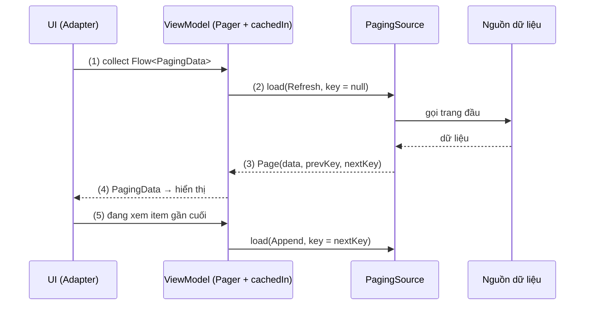
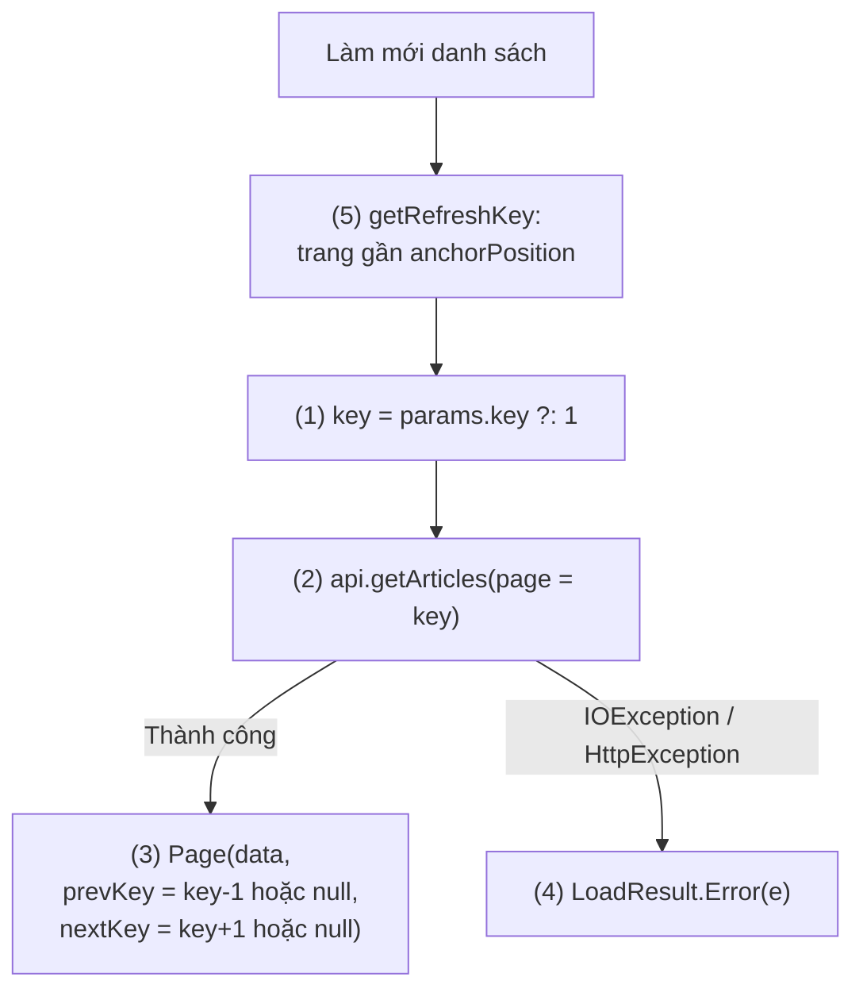
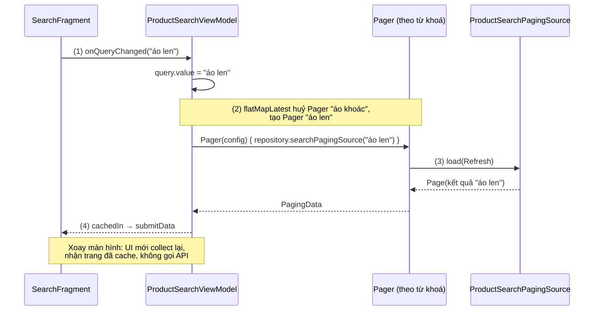
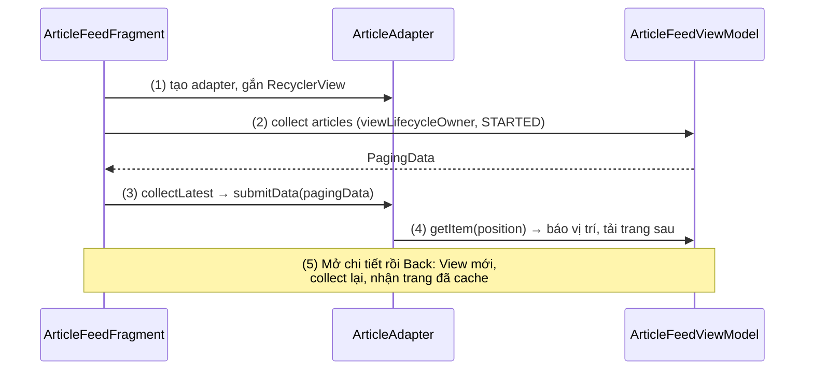
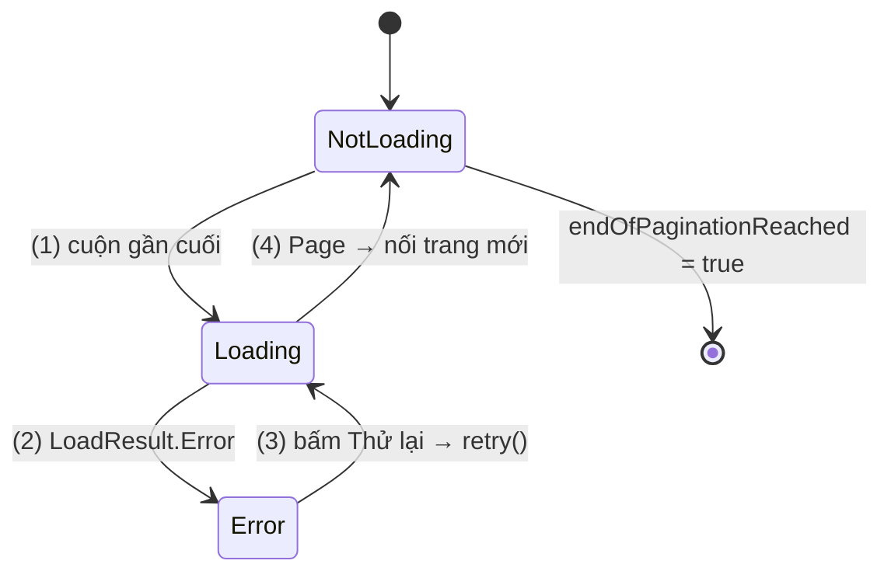
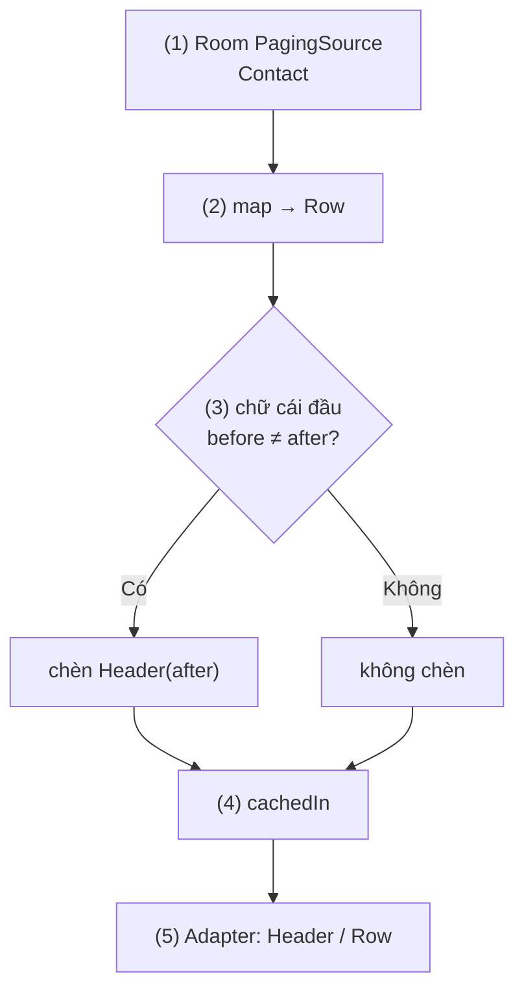
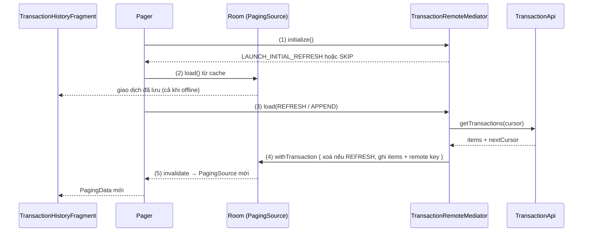
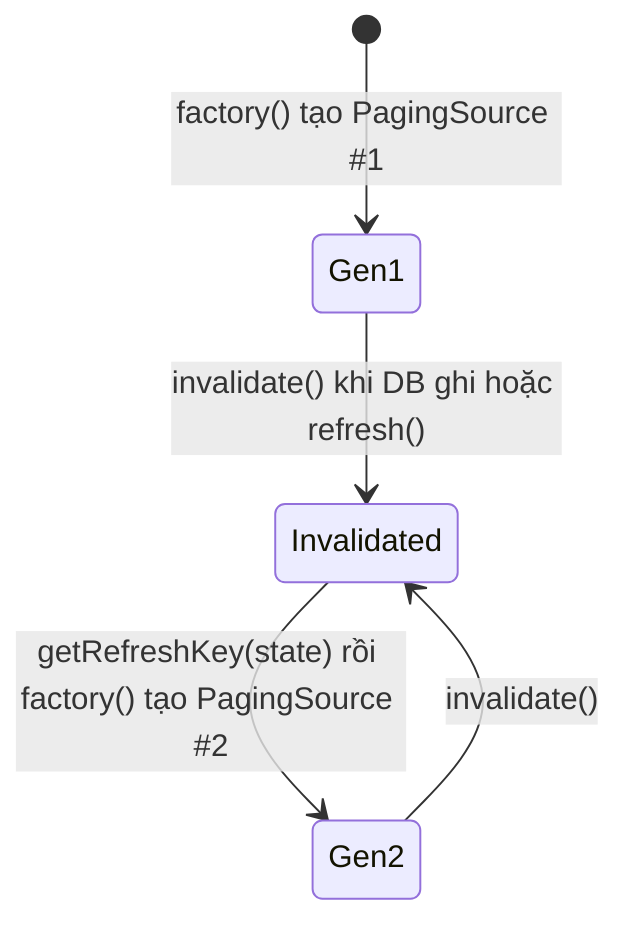
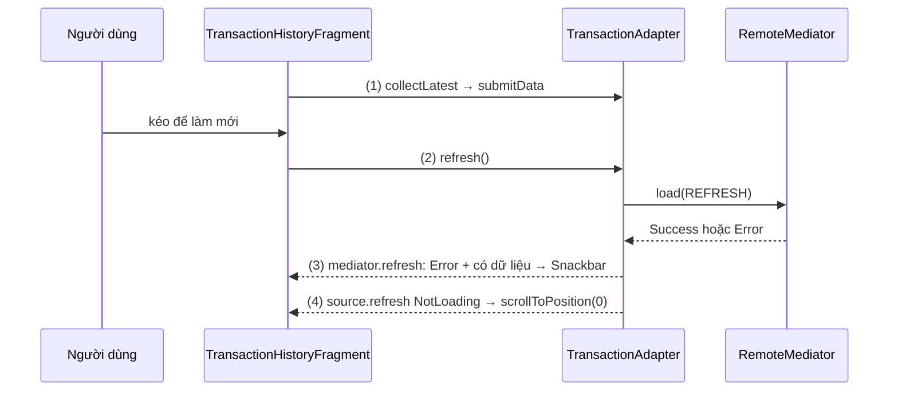

# Paging

## Vấn đề cần giải quyết

Nhiều màn hình hiển thị một danh sách mà nguồn dữ liệu lớn hơn rất nhiều so với những gì người dùng thực sự xem: feed bài viết, kết quả tìm kiếm, lịch sử giao dịch, danh bạ. Cách đơn giản nhất là tải hết một lần:

```kotlin
// Tải toàn bộ lịch sử giao dịch rồi mới hiển thị
val transactions = api.getAllTransactions()   // 20.000 bản ghi
adapter.submitList(transactions)
```

Người dùng chỉ xem 20 dòng đầu, nhưng app phải tải, parse và giữ 20.000 object: màn hình trắng lâu, RAM tăng (máy yếu có thể `OutOfMemoryError`), tốn data và pin cho những trang không ai mở.

Cách thứ hai là tự viết cuộn vô tận: gần cuối danh sách thì gọi trang tiếp theo. Nghe đơn giản, nhưng code tự viết phải tự lo:

- Cờ `isLoading` để cuộn nhanh không gửi hai request cho cùng một trang; biết khi nào hết dữ liệu.
- Lỗi mạng ở trang 5: hiện "Thử lại" ở cuối, thử lại đúng trang 5, giữ trang 1 đến 4; trạng thái riêng cho lần tải đầu (toàn màn hình) và lần tải thêm.
- Xoay màn hình không tải lại từ trang 1; đổi từ khoá thì huỷ request cũ, bỏ kết quả về muộn.
- Hiển thị dữ liệu đã lưu khi offline, đồng bộ khi có mạng.

Mỗi điểm là một chỗ dễ sai, và cách sửa giống nhau ở mọi app. Vấn đề cần giải quyết là: **tải dữ liệu theo từng phần đúng lúc cần, với trạng thái tải, lỗi, thử lại, cache và làm mới được xử lý một lần, nhất quán.**

## Sau khi học xong

- Giải thích được cách Paging tải dữ liệu theo trang qua PagingSource, Pager và PagingData, và vì sao mỗi PagingSource chỉ là một snapshot dùng một lần.
- Triển khai được danh sách phân trang gồm PagingSource, Pager với cachedIn trong ViewModel, và PagingDataAdapter hoặc collectAsLazyPagingItems ở UI.
- Xử lý được trạng thái tải, lỗi và retry bằng LoadState, kể cả footer tải thêm bằng withLoadStateFooter.
- Thiết kế được danh sách offline-first với Room làm nguồn sự thật và RemoteMediator tải thêm từ mạng.
- Nhận diện được các lỗi thường gặp như quên cachedIn, tạo Pager mới mỗi lần collect, dùng lại PagingSource, getRefreshKey sai và key không ổn định khiến danh sách nhấp nháy.

## Paging là gì?

**Paging** (bài này nói về Paging 3, artifact `androidx.paging`) là thư viện Jetpack tải và hiển thị một tập dữ liệu lớn **theo từng trang, đúng lúc người dùng cuộn tới**: `PagingSource` biết cách tải một trang theo key, `Pager` biến nó thành luồng `Flow<PagingData>` được cache trong ViewModel, còn UI chỉ hiển thị và báo cho Paging biết người dùng đang xem tới đâu.

Mental model: Paging là một **cửa sổ trượt** trên một danh sách rất dài. Chỉ các trang quanh vị trí đang xem nằm trong bộ nhớ; cuộn gần mép cửa sổ thì Paging tự tải thêm trang ở mép đó, và nếu bạn đặt giới hạn thì các trang ở xa bị bỏ bớt. Bạn chỉ mô tả "lấy một trang thế nào"; việc trượt cửa sổ là của thư viện.

> [!NOTE]
> Kiến thức dùng trước, chỉ dùng tối thiểu trong bài:
>
> - Coroutine (hàm `suspend`, `viewModelScope`, `lifecycleScope.launch`): chạy việc bất đồng bộ không chặn main thread, học ở 8.4.3 Coroutines (chưa có bài).
> - `Flow` và các toán tử `map`, `flatMapLatest`, `collectLatest`, `MutableStateFlow`: luồng giá trị bất đồng bộ, học ở 7.1.4.2 Flow (chưa có bài).
> - `ViewModel` và `viewModelScope`: nơi giữ trạng thái màn hình qua xoay màn hình, học ở [6.4 ViewModel](viewmodel.md).
> - `RecyclerView`, `ViewHolder`, `DiffUtil`: hiển thị danh sách, học ở 8.5.1 Layouts (chưa có bài) và 7.1.2 ViewHolder Pattern (chưa có bài).
> - Interface Retrofit (`@GET`, `suspend fun`, `retrofit2.HttpException`): gọi API, học ở 8.1.1 Retrofit (chưa có bài); phân loại lỗi mạng ở [Networking](../session_05/networking.md).

## Cách hoạt động

### Ba tầng của Paging

Paging chia việc tải danh sách thành ba tầng, khớp kiến trúc khuyến nghị của Android:

| Tầng | Thành phần | Việc của nó |
|---|---|---|
| Repository | `PagingSource<Key, Value>` | Tải **một** trang từ **một** nguồn (API hoặc database) theo key. |
| Repository | `RemoteMediator<Key, Value>` (tuỳ chọn) | Khi dữ liệu local hết, tải thêm từ mạng và ghi vào database. |
| ViewModel | `Pager` + `PagingConfig` | Điều phối việc gọi `PagingSource`, phát ra `Flow<PagingData<Value>>`. |
| ViewModel | `cachedIn(viewModelScope)` | Giữ các trang đã tải qua xoay màn hình, cho phép collect lại. |
| UI | `PagingDataAdapter` (RecyclerView) hoặc `collectAsLazyPagingItems()` (Compose) | Hiển thị `PagingData`, báo vị trí đang xem để Paging tải tiếp, phát `LoadState`. |

`PagingData` là một **snapshot** của danh sách đã phân trang: các trang đã tải, cộng một kênh để UI báo ngược "đang xem item thứ N". Mỗi lần nguồn đổi hẳn (làm mới, đổi từ khoá), `Pager` phát ra một `PagingData` mới.

Luồng chạy chung:

1. UI collect `Flow<PagingData>` từ ViewModel và đưa từng `PagingData` cho adapter.
2. `Pager` gọi `PagingSource.load()` cho lần tải đầu (refresh).
3. `PagingSource` trả về một trang kèm key của trang trước và trang sau.
4. Trang đi qua `cachedIn` trong ViewModel rồi tới UI; adapter hiển thị.
5. Người dùng cuộn; adapter báo vị trí đang xem. Khi còn cách mép dữ liệu ít hơn `prefetchDistance` item, `Pager` gọi `load()` với key trang sau (append).



Cài đặt (chỉ thêm artifact bạn dùng):

```kotlin
// app/build.gradle.kts
dependencies {
    val pagingVersion = "3.5.3"
    // Lõi + PagingDataAdapter cho RecyclerView
    implementation("androidx.paging:paging-runtime:$pagingVersion")
    // collectAsLazyPagingItems cho Jetpack Compose (nếu dùng Compose)
    implementation("androidx.paging:paging-compose:$pagingVersion")
    // TestPager, asSnapshot cho unit test
    testImplementation("androidx.paging:paging-testing:$pagingVersion")
    // DAO của Room trả về PagingSource; dùng cùng biến version với room-runtime
    implementation("androidx.room:room-paging:$roomVersion")
}
```

### PagingSource: tải một trang theo key

`PagingSource<Key, Value>` có hai tham số kiểu:

- `Key`: thứ dùng để xin một trang (số trang `Int`, cursor `String`...).
- `Value`: kiểu của từng item, ví dụ `Article`.

Bạn override hai hàm:

- `suspend fun load(params: LoadParams<Key>): LoadResult<Key, Value>`: tải một trang. `params.key` là key cần tải (`null` ở lần tải đầu), `params.loadSize` là số item Paging *gợi ý*. Trả về một trong ba dạng:
  - `LoadResult.Page(data, prevKey, nextKey)`: thành công. `prevKey`/`nextKey` là key của trang trước/sau; `null` nghĩa là không còn trang theo hướng đó.
  - `LoadResult.Error(throwable)`: lỗi dự kiến (mất mạng, HTTP 5xx). Paging chuyển nó thành `LoadState.Error` cho UI và cho phép retry.
  - `LoadResult.Invalid()`: nguồn đã đổi, `PagingSource` này không còn dùng được và cần được thay bằng instance mới.
- `fun getRefreshKey(state: PagingState<Key, Value>): Key?`: khi danh sách được làm mới, trả về key để trang mới bắt đầu **gần vị trí người dùng đang xem** (`state.anchorPosition`), thay vì quay về đầu danh sách.

Một `PagingSource` đại diện cho **một snapshot** của nguồn. Khi nguồn đổi, nó bị `invalidate()` và `Pager` gọi factory tạo instance **mới**; instance cũ không bao giờ được dùng lại (mục "Deep Dive").

#### Ví dụ: feed bài viết từ API phân trang theo số trang

**Bài toán:** feed của app tin tức; API `GET /articles?page=N&limit=20` trả bài viết kèm `totalPages`. Đây là dạng phân trang phổ biến nhất: key là số trang, trang cố định 20 bài.

**Luồng chạy:**

1. Lấy key cần tải: `params.key`, hoặc trang 1 nếu là lần tải đầu (`null`).
2. Gọi API với số trang đó và kích thước trang cố định của API.
3. Thành công: trả `LoadResult.Page`; `prevKey` là `null` ở trang 1, `nextKey` là `null` ở trang cuối.
4. Lỗi mạng (`IOException`) hoặc lỗi HTTP (`HttpException`): trả `LoadResult.Error` để UI hiện trạng thái lỗi và retry.
5. `getRefreshKey()`: tìm trang gần vị trí đang xem nhất, suy ra số trang của nó từ `prevKey + 1` hoặc `nextKey - 1`.



```kotlin
// ArticleApi.kt
interface ArticleApi {
    @GET("articles")
    suspend fun getArticles(
        @Query("page") page: Int,
        @Query("limit") limit: Int
    ): ArticlePageResponse
}

data class ArticlePageResponse(val articles: List<Article>, val totalPages: Int)

data class Article(val id: String, val title: String, val summary: String, val publishedAt: Long)
```

```kotlin
// ArticlePagingSource.kt
class ArticlePagingSource(
    private val api: ArticleApi
) : PagingSource<Int, Article>() {

    override suspend fun load(params: LoadParams<Int>): LoadResult<Int, Article> {
        val page = params.key ?: FIRST_PAGE                                 // (1)
        return try {
            // (2) API theo số trang có kích thước cố định: luôn gửi PAGE_SIZE,
            // không gửi params.loadSize (lần tải đầu loadSize lớn gấp 3)
            val response = api.getArticles(page = page, limit = PAGE_SIZE)
            LoadResult.Page(                                                // (3)
                data = response.articles,
                prevKey = if (page == FIRST_PAGE) null else page - 1,
                nextKey = if (page >= response.totalPages) null else page + 1
            )
        } catch (e: IOException) {                                          // (4) mất mạng
            LoadResult.Error(e)
        } catch (e: HttpException) {                                        // (4) HTTP không phải 2xx
            LoadResult.Error(e)
        }
    }

    override fun getRefreshKey(state: PagingState<Int, Article>): Int? {    // (5)
        return state.anchorPosition?.let { anchor ->
            val anchorPage = state.closestPageToPosition(anchor)
            anchorPage?.prevKey?.plus(1) ?: anchorPage?.nextKey?.minus(1)
        }
    }

    companion object {
        const val FIRST_PAGE = 1
        const val PAGE_SIZE = 20
    }
}
```

Hàm `suspend` của Retrofit tự chạy request trên thread nền, nên không cần `withContext(Dispatchers.IO)`. Chỉ bắt `IOException` và `HttpException`, nên `CancellationException` không bị nuốt khi Paging huỷ một lần tải.

**Kết quả:** kiểm chứng bằng `TestPager` (mục "Ví dụ thực tế"): `refresh()` trả trang có `prevKey = null`, `nextKey = 2`; trên API giả 3 trang, `append()` lần hai trả trang có `nextKey = null`; API giả lỗi mạng thì `refresh()` trả `LoadResult.Error`.

#### Khi nguồn là Room: để Room sinh PagingSource

Với dữ liệu trong database, không cần tự viết `PagingSource`: Room ([Room Architecture](../session_05/data_store/room_architecture.md)) sinh sẵn implementation khi hàm `@Query` trả `PagingSource<Int, Entity>` và module có `room-paging`:

```kotlin
// ContactDao.kt
@Dao
interface ContactDao {
    @Query("SELECT * FROM contacts ORDER BY displayName COLLATE NOCASE, id")
    fun pagingSource(): PagingSource<Int, Contact>
}
```

`PagingSource` của Room dùng key là vị trí (offset) trong kết quả query, đếm được tổng số dòng (nên hỗ trợ placeholder), đã có `getRefreshKey`, và tự `invalidate()` khi bảng trong query bị ghi, nhờ `InvalidationTracker` ở [Async Transactions & Flow](../session_05/data_store/room_transactions.md), mục "Flow từ Room — Cơ chế InvalidationTracker".

### Pager, PagingConfig và cachedIn trong ViewModel

`Pager` nhận một `PagingConfig`, một **factory** tạo `PagingSource` mới (`pagingSourceFactory`), và tuỳ chọn một `RemoteMediator`; `pager.flow` là `Flow<PagingData<Value>>`. `PagingConfig` quyết định cửa sổ trượt rộng bao nhiêu và trượt thế nào:

| Tham số | Mặc định | Ý nghĩa |
|---|---|---|
| `pageSize` | (bắt buộc) | Số item mỗi lần tải. Docs khuyên bằng vài lần số item hiện trên màn hình; card lớn kiểu mạng xã hội 10–20, lưới nhiều ô có thể gần 100. |
| `prefetchDistance` | `pageSize` | Còn cách mép dữ liệu đã tải bao nhiêu item thì tải trang tiếp. `0` nghĩa là chỉ tải khi chạm mép, người dùng sẽ thấy cuối danh sách hoặc placeholder. |
| `initialLoadSize` | `pageSize * 3` | Số item xin ở lần tải đầu, để lần cuộn đầu không phải chờ. |
| `enablePlaceholders` | `true` | Cho phép hiện item `null` thay cho phần chưa tải, **nếu** `PagingSource` đếm được tổng số item (Room đếm được, đa số API thì không). |
| `maxSize` | `MAX_SIZE_UNBOUNDED` | Số item tối đa giữ trong `PagingData` trước khi bỏ các trang xa. Phải ít nhất `pageSize + 2 * prefetchDistance`. |

`pageSize` và `initialLoadSize` chỉ là gợi ý đi vào `params.loadSize`; `PagingSource` có thể trả số item khác.

`cachedIn(scope)` là toán tử quan trọng nhất ở tầng ViewModel:

- **Cache:** giữ các trang đã tải (và kết quả các biến đổi đặt trước nó) trong `scope`. Với `viewModelScope`, cache sống qua xoay màn hình, mất khi ViewModel bị huỷ.
- **Multicast:** một `PagingData` mặc định chỉ collect được một lần; `cachedIn` cho phép UI mới (sau xoay màn hình, quay lại từ backstack) collect lại mà không tải lại.

Danh sách phụ thuộc tham số (từ khoá, bộ lọc) thì giữ tham số trong `StateFlow`, dùng `flatMapLatest` tạo `Pager` mới cho mỗi giá trị, và đặt `cachedIn` **sau** `flatMapLatest`.

#### Ví dụ: tìm kiếm sản phẩm theo từ khoá

**Bài toán:** tìm kiếm của app bán hàng; mỗi từ khoá là một danh sách phân trang khác. Gõ "áo khoác" rồi sửa thành "áo len": kết quả về muộn của "áo khoác" không được chen vào, và xoay màn hình không được tìm lại từ đầu.

**Luồng chạy:**

1. UI gọi `onQueryChanged()`; ViewModel ghi từ khoá vào `MutableStateFlow`.
2. `flatMapLatest` nhận từ khoá mới: huỷ `Pager` của từ khoá cũ (kể cả request đang chạy), tạo `Pager` mới với factory dùng từ khoá mới.
3. `Pager` gọi `PagingSource` của repository; mỗi lần invalidate thì factory tạo instance mới.
4. `cachedIn(viewModelScope)` giữ kết quả; UI collect lại sau xoay màn hình nhận ngay các trang đã tải.



```kotlin
// ProductRepository.kt (tầng repository: chỉ biết cách tạo PagingSource)
class ProductRepository(private val api: ProductApi) {
    fun searchPagingSource(keyword: String): PagingSource<Int, Product> =
        ProductSearchPagingSource(api, keyword)
}
```

```kotlin
// ProductSearchViewModel.kt
class ProductSearchViewModel(
    private val repository: ProductRepository
) : ViewModel() {

    private val query = MutableStateFlow("")

    @OptIn(ExperimentalCoroutinesApi::class)
    val results: Flow<PagingData<Product>> = query
        .flatMapLatest { keyword ->                                    // (2) huỷ Pager cũ
            Pager(
                config = PagingConfig(
                    pageSize = 30,
                    prefetchDistance = 10,
                    enablePlaceholders = false   // API không trả tổng số kết quả
                ),
                pagingSourceFactory = { repository.searchPagingSource(keyword) } // (3) luôn tạo mới
            ).flow
        }
        .cachedIn(viewModelScope)                                      // (4) sau flatMapLatest

    fun onQueryChanged(keyword: String) {                              // (1)
        query.value = keyword.trim()
    }
}
```

Cách tạo ViewModel có tham số (factory, Hilt) ở [6.4 ViewModel](viewmodel.md). Trong app thật thường thêm `debounce` trước `flatMapLatest` để không tạo `Pager` cho mỗi ký tự gõ.

**Kết quả:** gõ "áo khoác" rồi sửa nhanh thành "áo len": danh sách chỉ chứa kết quả "áo len" (request "áo khoác" bị huỷ, xem trong Logcat của OkHttp thấy request bị cancel). Xoay màn hình: danh sách giữ nguyên, không có request mới.

### Hiển thị: PagingDataAdapter và DiffUtil

Với `RecyclerView`, Paging có `PagingDataAdapter<T, VH>`: giống `ListAdapter` ở chỗ cần `DiffUtil.ItemCallback<T>` (`areItemsTheSame` so id ổn định, `areContentsTheSame` so nội dung), khác ở chỗ nhận dữ liệu bằng `submitData(pagingData)`. Ba điểm cần nắm:

- **`getItem(position)` trả `T?`:** `null` là placeholder cho item chưa tải (khi bật placeholder); ViewHolder phải bind được `null`.
- **`getItem()` cũng là tín hiệu cuộn:** lấy item ở vị trí N là báo cho Paging "đang xem quanh N" để nó quyết định tải tiếp. Đọc item mà không kích hoạt tải thì dùng `peek(index)`.
- **`submitData()` là hàm `suspend` không trả về** cho tới khi `PagingData` đó bị thay. Vì vậy collect bằng `collectLatest`: `PagingData` mới tới thì lần `submitData` cũ bị huỷ.

#### Ví dụ: hiển thị feed bài viết trong Fragment

**Bài toán:** hiển thị feed của `ArticlePagingSource` trong Fragment; mở chi tiết rồi Back thì feed vẫn ở vị trí cũ, không tải lại.

**Luồng chạy:**

1. `onViewCreated()`: tạo `ArticleAdapter` với `ArticleDiffCallback`, gắn vào `RecyclerView` qua View Binding.
2. Collect `viewModel.articles` trong `viewLifecycleOwner.lifecycleScope` với `repeatOnLifecycle(STARTED)`, để collector sống theo View của Fragment.
3. Với mỗi `PagingData`, gọi `adapter.submitData()` bên trong `collectLatest`.
4. Người dùng cuộn: `RecyclerView` gọi `onBindViewHolder` → `getItem(position)` → Paging nhận vị trí, gần cuối thì tải trang sau.
5. Mở chi tiết rồi Back: View mới, adapter mới, collect lại; `cachedIn` trả ngay các trang đã tải.



```kotlin
// ArticleFeedViewModel.kt
class ArticleFeedViewModel(api: ArticleApi) : ViewModel() {
    val articles: Flow<PagingData<Article>> = Pager(
        config = PagingConfig(pageSize = ArticlePagingSource.PAGE_SIZE, enablePlaceholders = false),
        pagingSourceFactory = { ArticlePagingSource(api) }
    ).flow.cachedIn(viewModelScope)
}
```

```kotlin
// ArticleAdapter.kt
class ArticleAdapter(
    private val onArticleClick: (Article) -> Unit
) : PagingDataAdapter<Article, ArticleAdapter.ArticleViewHolder>(ArticleDiffCallback) {

    override fun onCreateViewHolder(parent: ViewGroup, viewType: Int): ArticleViewHolder {
        val binding = ItemArticleBinding.inflate(LayoutInflater.from(parent.context), parent, false)
        return ArticleViewHolder(binding)
    }

    override fun onBindViewHolder(holder: ArticleViewHolder, position: Int) {
        holder.bind(getItem(position))                         // (4) getItem báo vị trí cho Paging
    }

    inner class ArticleViewHolder(
        private val binding: ItemArticleBinding
    ) : RecyclerView.ViewHolder(binding.root) {
        fun bind(article: Article?) {
            if (article == null) {                             // placeholder (khi bật placeholders)
                binding.titleText.text = ""
                binding.summaryText.text = ""
                binding.root.setOnClickListener(null)
                return
            }
            binding.titleText.text = article.title
            binding.summaryText.text = article.summary
            binding.root.setOnClickListener { onArticleClick(article) }
        }
    }
}

object ArticleDiffCallback : DiffUtil.ItemCallback<Article>() {
    override fun areItemsTheSame(oldItem: Article, newItem: Article) = oldItem.id == newItem.id
    override fun areContentsTheSame(oldItem: Article, newItem: Article) = oldItem == newItem
}
```

```kotlin
// ArticleFeedFragment.kt (binding theo mẫu _binding của bài View Binding)
override fun onViewCreated(view: View, savedInstanceState: Bundle?) {
    super.onViewCreated(view, savedInstanceState)
    val adapter = ArticleAdapter(onArticleClick = ::openArticle)       // (1)
    binding.articleList.adapter = adapter

    viewLifecycleOwner.lifecycleScope.launch {                         // (2)
        viewLifecycleOwner.repeatOnLifecycle(Lifecycle.State.STARTED) {
            viewModel.articles.collectLatest { pagingData ->
                adapter.submitData(pagingData)                         // (3)
            }
        }
    }
}
```

Lý do collect bằng `viewLifecycleOwner` ở [Fragment Lifecycle](../session_04/components/fragment/lifecycle.md), mục "View Lifecycle: vòng đời thứ hai trong Fragment".

**Kết quả:** cuộn feed, log của OkHttp cho thấy `page=2`, `page=3` được gửi lần lượt khi gần cuối, không trùng dù cuộn nhanh. Mở chi tiết rồi Back, hoặc xoay màn hình: không có request mới.

#### Với Jetpack Compose

Compose không cần adapter: `collectAsLazyPagingItems()` (`paging-compose`) biến `Flow<PagingData>` thành `LazyPagingItems` cho `LazyColumn`; `itemKey` thay vai trò `areItemsTheSame`. ViewModel và `PagingSource` giữ nguyên.

```kotlin
// ArticleFeedScreen.kt
@Composable
fun ArticleFeedScreen(viewModel: ArticleFeedViewModel) {
    val articles = viewModel.articles.collectAsLazyPagingItems()
    LazyColumn {
        items(count = articles.itemCount, key = articles.itemKey { it.id }) { index ->
            val article = articles[index]          // cũng là tín hiệu cuộn, như getItem()
            if (article != null) ArticleRow(article) else ArticlePlaceholder()
        }
    }
}
```

Chi tiết `LazyPagingItems` thuộc 9.5.7 Lazy Paging Items (chưa có bài); `LazyColumn` ở 9.5.4 Lazy Column (chưa có bài).

### LoadState: trạng thái tải, lỗi và retry

Paging phát trạng thái tải qua `adapter.loadStateFlow` (hoặc `addLoadStateListener`) dưới dạng `CombinedLoadStates`:

- Ba hướng tải (`LoadType`): `refresh` (tải đầu hoặc làm mới), `append` (thêm ở cuối), `prepend` (thêm ở đầu).
- Mỗi hướng có một `LoadState`: `Loading`; `NotLoading(endOfPaginationReached)` (`true` là đã hết dữ liệu theo hướng đó); `Error(error)` mang `Throwable` từ `LoadResult.Error`.
- `source` và `mediator` là trạng thái riêng của `PagingSource` và `RemoteMediator`; các thuộc tính gộp `refresh`/`append`/`prepend` ưu tiên `RemoteMediator` nếu có.

`adapter.retry()` thử lại **những lần tải đang lỗi** (ví dụ append trang 5), giữ các trang đã có. `adapter.refresh()` bỏ snapshot hiện tại, tải lại từ key của `getRefreshKey()`, dùng cho kéo để làm mới.

Để hiện trạng thái tải thêm ngay trong danh sách có `LoadStateAdapter`, adapter chỉ có 0 hoặc 1 item (mặc định hiện khi `Loading` hoặc `Error`). `withLoadStateFooter(footer)` (hoặc `withLoadStateHeader`, `withLoadStateHeaderAndFooter`) ghép nó với `PagingDataAdapter` thành một `ConcatAdapter`, tự cập nhật theo `append`/`prepend`.

#### Ví dụ: footer "Thử lại" khi mất mạng giữa feed

**Bài toán:** đang đọc feed thì vào thang máy mất sóng. Trang 1–4 vẫn hiện; cuối danh sách hiện lỗi và "Thử lại", bấm thì tải lại đúng trang 5. Lỗi ngay lần đầu thì hiện lỗi toàn màn hình.

**Luồng chạy:**

1. Người dùng cuộn gần cuối; `append` chuyển sang `Loading`, footer hiện vòng xoay.
2. `ArticlePagingSource` gặp `IOException`, trả `LoadResult.Error`; `append` thành `Error`, footer hiện thông báo và nút "Thử lại".
3. Bấm "Thử lại": footer gọi `adapter.retry()`, Paging gọi lại `load()` với đúng key trang 5.
4. Thành công: `append` về `NotLoading`, footer ẩn, trang 5 được nối vào.
5. Riêng `refresh`: theo dõi `loadStateFlow` để hiện vòng xoay hoặc lỗi toàn màn hình khi danh sách còn trống.



```kotlin
// RetryLoadStateAdapter.kt
class RetryLoadStateAdapter(
    private val errorMessage: String,
    private val onRetry: () -> Unit
) : LoadStateAdapter<RetryLoadStateAdapter.LoadStateViewHolder>() {

    override fun onCreateViewHolder(parent: ViewGroup, loadState: LoadState): LoadStateViewHolder {
        val binding = ItemLoadStateBinding.inflate(LayoutInflater.from(parent.context), parent, false)
        return LoadStateViewHolder(binding)
    }

    override fun onBindViewHolder(holder: LoadStateViewHolder, loadState: LoadState) {
        holder.bind(loadState)
    }

    inner class LoadStateViewHolder(
        private val binding: ItemLoadStateBinding
    ) : RecyclerView.ViewHolder(binding.root) {
        init {
            binding.retryButton.setOnClickListener { onRetry() }        // (3)
        }

        fun bind(loadState: LoadState) {
            binding.progressBar.isVisible = loadState is LoadState.Loading   // (1)
            binding.errorGroup.isVisible = loadState is LoadState.Error      // (2)
            if (loadState is LoadState.Error) {
                binding.errorText.text = errorMessage
            }
        }
    }
}
```

```kotlin
// ArticleFeedFragment.kt, trong onViewCreated()
val adapter = ArticleAdapter(onArticleClick = ::openArticle)
// withLoadStateFooter trả về ConcatAdapter: phải gán chính adapter đó cho RecyclerView
binding.articleList.adapter = adapter.withLoadStateFooter(
    footer = RetryLoadStateAdapter(errorMessage = "Không tải được bài viết", onRetry = adapter::retry)
)
binding.fullScreenRetryButton.setOnClickListener { adapter.retry() }

viewLifecycleOwner.lifecycleScope.launch {
    viewLifecycleOwner.repeatOnLifecycle(Lifecycle.State.STARTED) {
        launch { viewModel.articles.collectLatest { adapter.submitData(it) } }
        launch {
            adapter.loadStateFlow.collect { loadStates ->                 // (5)
                val refresh = loadStates.refresh
                val isEmpty = adapter.itemCount == 0
                binding.fullScreenProgress.isVisible = refresh is LoadState.Loading && isEmpty
                binding.fullScreenError.isVisible = refresh is LoadState.Error && isEmpty
                binding.emptyText.isVisible = refresh is LoadState.NotLoading &&
                    loadStates.append.endOfPaginationReached && isEmpty
            }
        }
    }
}
```

**Kết quả:** cuộn tới trang 4, bật chế độ máy bay rồi cuộn tiếp: footer hiện "Không tải được bài viết" và "Thử lại", trang 1–4 vẫn còn. Tắt chế độ máy bay, bấm "Thử lại": log có request `page=5`, footer biến mất. Mở màn khi offline: lỗi toàn màn hình thay vì danh sách trống.

### Biến đổi PagingData: map, filter, insertSeparators

`PagingData` không phải `List`. Biến đổi đặt trong `flow.map { pagingData -> ... }` (mỗi `PagingData` mới đều đi qua), dùng toán tử của chính `PagingData`, chạy theo từng trang khi trang được tải:

- `map { }`: đổi kiểu từng item, ví dụ entity sang model của UI.
- `filter { }`: bỏ item khỏi danh sách hiển thị. Lọc diễn ra **sau khi trang đã tải**, nên trang có thể ít item hơn `pageSize`; điều kiện biết trước lúc query thì đưa vào `WHERE` hoặc tham số API.
- `insertSeparators { before, after -> }`: chèn item phân cách giữa hai item liền kề, trả `null` để không chèn; `before == null` là trước item đầu, `after == null` là sau item cuối.

Đặt `cachedIn` **sau** các biến đổi để kết quả biến đổi cũng được cache.

#### Ví dụ: danh bạ nhóm theo chữ cái đầu

**Bài toán:** danh bạ vài nghìn liên hệ trong Room, sắp theo tên, cần header "A", "B", "C" trước mỗi nhóm. Header không có trong database mà phụ thuộc hai item liền kề, đúng việc của `insertSeparators`.

**Luồng chạy:**

1. Room sinh `PagingSource` từ `ContactDao.pagingSource()` (query đã sắp theo tên).
2. `map` đổi mỗi `Contact` thành `ContactListItem.Row`.
3. `insertSeparators` so chữ cái đầu của `before` và `after`; khác nhau (hoặc là item đầu) thì chèn `ContactListItem.Header`.
4. `cachedIn(viewModelScope)` cache cả item lẫn header đã chèn.
5. Adapter dùng `getItemViewType` để vẽ header và dòng liên hệ khác nhau.



```kotlin
// ContactListItem.kt
sealed interface ContactListItem {
    data class Header(val letter: Char) : ContactListItem
    data class Row(val contact: Contact) : ContactListItem
}

val Contact.initial: Char get() = displayName.first().uppercaseChar()
```

```kotlin
// ContactsViewModel.kt
class ContactsViewModel(contactDao: ContactDao) : ViewModel() {

    val contacts: Flow<PagingData<ContactListItem>> = Pager(
        config = PagingConfig(pageSize = 50),
        pagingSourceFactory = { contactDao.pagingSource() }                // (1)
    ).flow
        .map { pagingData ->
            pagingData
                .map { contact -> ContactListItem.Row(contact) }            // (2)
                .insertSeparators<ContactListItem.Row, ContactListItem> { before, after ->
                    when {                                                  // (3)
                        after == null -> null                               // sau item cuối: không chèn
                        before == null || before.contact.initial != after.contact.initial ->
                            ContactListItem.Header(after.contact.initial)
                        else -> null
                    }
                }
        }
        .cachedIn(viewModelScope)                                           // (4)
}
```

```kotlin
// ContactAdapter.kt (rút gọn): PagingDataAdapter<ContactListItem, RecyclerView.ViewHolder>
override fun getItemViewType(position: Int) = when (peek(position)) {    // (5) peek: không kích hoạt tải
    is ContactListItem.Header -> VIEW_TYPE_HEADER
    else -> VIEW_TYPE_CONTACT
}
// DiffUtil: Header so theo letter, Row so theo contact.id
```

Phải ghi rõ `insertSeparators<ContactListItem.Row, ContactListItem>` vì kiểu kết quả rộng hơn kiểu đầu vào; Kotlin không tự suy ra kiểu chung.

**Kết quả:** danh bạ hiện "A", các liên hệ chữ A, rồi "B"... Header vẫn đúng ở chỗ nối hai trang, vì `insertSeparators` được gọi cả cho cặp item ở hai trang liền kề. Thêm một liên hệ vào Room: `PagingSource` tự invalidate, header cập nhật đúng chỗ.

### RemoteMediator: Room làm nguồn sự thật, mạng tải thêm

`PagingSource` đọc thẳng API thì offline là danh sách trống. Mô hình **offline-first** ([Room Architecture](../session_05/data_store/room_architecture.md), mục "Single Source of Truth (SSOT) và Offline-first") cho UI chỉ đọc từ Room, mạng chỉ dùng để ghi thêm vào Room. Paging hỗ trợ mô hình này bằng `RemoteMediator`:

- `PagingSource` là của **Room**; UI chỉ thấy những gì có trong database.
- Khi `PagingSource` của Room hết dữ liệu theo một hướng (cuộn tới cuối cache), hoặc khi làm mới, Paging gọi `RemoteMediator.load(loadType, state)`.
- `RemoteMediator` gọi API, ghi kết quả vào Room trong một transaction, trả `MediatorResult.Success(endOfPaginationReached)` hoặc `MediatorResult.Error(e)`.
- Ghi bảng làm `PagingSource` của Room tự invalidate; `Pager` tạo instance mới, UI thấy dữ liệu mới.

Ba điểm thiết kế:

- **Remote key:** key của API (số trang, cursor) không phải key của Room (offset). Không suy ra được từ item cuối thì lưu vào bảng riêng, ghi cùng transaction với dữ liệu để hai thứ luôn khớp.
- **`initialize()`:** chạy trước mọi lần tải; trả `LAUNCH_INITIAL_REFRESH` (mặc định) để làm mới ngay khi mở màn hình, hoặc `SKIP_INITIAL_REFRESH` khi cache còn mới.
- **Khoá chính ổn định:** id từ server làm `@PrimaryKey` (không `autoGenerate`), `ORDER BY` thêm `id` làm tiêu chí phụ để thứ tự luôn xác định; nếu không, mỗi lần làm mới `DiffUtil` coi mọi item là mới và danh sách nhấp nháy.

`RemoteMediator` vẫn mang `@ExperimentalPagingApi`, nên cần `@OptIn(ExperimentalPagingApi::class)`.

#### Ví dụ: lịch sử giao dịch xem được khi offline

**Bài toán:** lịch sử giao dịch của app ví điện tử. Mở app trên tàu điện ngầm vẫn thấy giao dịch đã xem; có mạng thì tự cập nhật; cuộn quá phần đã cache thì tải thêm từ `GET /transactions?cursor=...&limit=...` (API trả `nextCursor`).

**Luồng chạy:**

1. Mở màn hình: `initialize()` kiểm tra lần làm mới gần nhất; quá 15 phút thì yêu cầu làm mới ngay, còn mới thì hiện cache.
2. `PagingSource` của Room hiển thị ngay những gì đang có trong bảng `transactions` (kể cả khi offline).
3. Làm mới (`REFRESH`): `RemoteMediator` gọi API với `cursor = null`. Cuộn tới cuối cache (`APPEND`): đọc `nextCursor` từ bảng remote keys rồi gọi API.
4. Thành công: trong một `withTransaction`, nếu là `REFRESH` thì xoá cache cũ; ghi giao dịch mới và remote key mới.
5. Ghi bảng làm Room invalidate `PagingSource`; `Pager` tạo `PagingSource` mới, UI nhận dữ liệu mới. Lỗi mạng thì trả `MediatorResult.Error`, cache không bị đụng tới.



```kotlin
// TransactionEntities.kt
@Entity(tableName = "transactions")
data class TransactionEntity(
    @PrimaryKey val id: String,          // id từ server: ổn định qua mọi lần làm mới
    val amount: Long,                    // đơn vị nhỏ nhất (đồng), không dùng Double cho tiền
    val description: String,
    val createdAt: Long
)

@Entity(tableName = "remote_keys")
data class RemoteKey(
    @PrimaryKey val listName: String,
    val nextCursor: String?,
    val refreshedAt: Long
)
```

```kotlin
// TransactionDao.kt, RemoteKeyDao.kt
@Dao
interface TransactionDao {
    @Query("SELECT * FROM transactions ORDER BY createdAt DESC, id DESC")
    fun pagingSource(): PagingSource<Int, TransactionEntity>

    @Upsert
    suspend fun upsertAll(items: List<TransactionEntity>)

    @Query("DELETE FROM transactions")
    suspend fun clearAll()
}

@Dao
interface RemoteKeyDao {
    @Query("SELECT * FROM remote_keys WHERE listName = :listName")
    suspend fun get(listName: String): RemoteKey?

    @Upsert
    suspend fun upsert(key: RemoteKey)
}
```

```kotlin
// TransactionRemoteMediator.kt
@OptIn(ExperimentalPagingApi::class)
class TransactionRemoteMediator(
    private val db: WalletDatabase,
    private val api: TransactionApi
) : RemoteMediator<Int, TransactionEntity>() {

    private val transactionDao = db.transactionDao()
    private val remoteKeyDao = db.remoteKeyDao()

    override suspend fun initialize(): InitializeAction {                       // (1)
        val refreshedAt = remoteKeyDao.get(LIST_NAME)?.refreshedAt ?: 0L
        val isFresh = System.currentTimeMillis() - refreshedAt < CACHE_TIMEOUT_MS
        return if (isFresh) InitializeAction.SKIP_INITIAL_REFRESH
        else InitializeAction.LAUNCH_INITIAL_REFRESH
    }

    override suspend fun load(
        loadType: LoadType,
        state: PagingState<Int, TransactionEntity>
    ): MediatorResult {
        val previousKey = remoteKeyDao.get(LIST_NAME)
        val cursor = when (loadType) {                                          // (3)
            LoadType.REFRESH -> null
            // Danh sách mới nhất ở trên cùng, REFRESH luôn lấy từ đầu: không cần prepend
            LoadType.PREPEND -> return MediatorResult.Success(endOfPaginationReached = true)
            LoadType.APPEND -> previousKey?.nextCursor
                ?: return MediatorResult.Success(endOfPaginationReached = true)
        }

        return try {
            val response = api.getTransactions(cursor = cursor, limit = state.config.pageSize)
            val now = System.currentTimeMillis()
            db.withTransaction {                                                // (4)
                if (loadType == LoadType.REFRESH) transactionDao.clearAll()
                remoteKeyDao.upsert(
                    RemoteKey(
                        listName = LIST_NAME,
                        nextCursor = response.nextCursor,
                        refreshedAt = if (loadType == LoadType.REFRESH) now
                                      else previousKey?.refreshedAt ?: now
                    )
                )
                transactionDao.upsertAll(response.items.map { it.toEntity() })  // (5) Room invalidate
            }
            MediatorResult.Success(endOfPaginationReached = response.nextCursor == null)
        } catch (e: IOException) {                                              // (5) cache giữ nguyên
            MediatorResult.Error(e)
        } catch (e: HttpException) {
            MediatorResult.Error(e)
        }
    }

    private companion object {
        const val LIST_NAME = "transactions"
        val CACHE_TIMEOUT_MS = TimeUnit.MINUTES.toMillis(15)
    }
}
```

```kotlin
// TransactionHistoryViewModel.kt
class TransactionHistoryViewModel(db: WalletDatabase, api: TransactionApi) : ViewModel() {

    @OptIn(ExperimentalPagingApi::class)
    val transactions: Flow<PagingData<TransactionEntity>> = Pager(
        config = PagingConfig(pageSize = 30),
        remoteMediator = TransactionRemoteMediator(db, api),
        pagingSourceFactory = { db.transactionDao().pagingSource() }           // (2)
    ).flow.cachedIn(viewModelScope)
}
```

`withTransaction` được giải thích ở [Async Transactions & Flow](../session_05/data_store/room_transactions.md), mục "`withTransaction { }` trên RoomDatabase". Request mạng nằm **ngoài** transaction để không giữ khoá database trong lúc chờ mạng; lỗi mạng xảy ra trước khi xoá cache nên cache còn nguyên.

**Kết quả:** cuộn vài trang khi có mạng, tắt mạng, đóng hẳn app rồi mở lại: giao dịch đã tải vẫn hiện. Cuộn quá phần đã cache khi offline: `mediator.append` là `Error`, footer hiện "Thử lại". Database Inspector của Android Studio cho thấy `remote_keys.nextCursor` khớp trang cuối đã tải.

## Deep Dive: generation, invalidate và cửa sổ trượt bên trong Pager

Phần này giải thích vì sao có các quy tắc ở trên (factory luôn tạo mới, cần `cachedIn`, cần `getRefreshKey`).

**Mỗi `PagingSource` là một generation.** `Pager` gọi `pagingSourceFactory()` lấy instance cho generation đầu và phát một `PagingData` gắn với nó. Khi `invalidate()` được gọi (Room thấy bảng bị ghi, `adapter.refresh()`, `RemoteMediator` vừa ghi dữ liệu), generation đó kết thúc:

1. `Pager` hỏi `getRefreshKey(state)` của instance cũ, với `state` chứa các trang đã tải và `anchorPosition` (vị trí người dùng xem gần nhất).
2. Gọi factory lấy instance mới, gọi `load(Refresh, key = refreshKey)`.
3. Phát ra `PagingData` mới; adapter dùng `DiffUtil` so với danh sách cũ, nên item không đổi giữ nguyên trên màn hình.



Vì vậy factory phải trả instance mới (instance đã invalidate không tải được nữa, và Paging kiểm tra việc dùng lại để báo lỗi sớm). Còn `getRefreshKey` trả `null` nghĩa là generation mới bắt đầu từ đầu: người dùng đang ở item 300 bị đưa về đầu mỗi khi dữ liệu đổi.

**Tín hiệu cuộn và prefetch.** Mỗi lần UI lấy item ở vị trí N (`getItem`, `lazyPagingItems[index]`), Paging nhận gợi ý về vị trí đang xem. N cách item cuối đã tải ít hơn `prefetchDistance` thì nó gửi một lần `APPEND` (tương tự `PREPEND` ở đầu). Mỗi hướng chỉ có một lần tải chạy tại một thời điểm, nên cuộn nhanh không gây request trùng: đây là "cờ `isLoading`" mà code tự viết phải tự lo. Có `maxSize` thì trang xa bị bỏ khỏi bộ nhớ, cuộn ngược về sẽ tải lại.

**`PagingData` chỉ collect được một lần.** Nó mang kênh hai chiều tới generation hiện tại (dữ liệu đi xuống, gợi ý vị trí đi lên); hai collector cùng lúc sẽ tranh nhau kênh này, nên Paging cấm. `cachedIn(scope)` giữ một bản cache dùng chung trong `scope` và phát lại cho mỗi collector mới.

## Ví dụ thực tế

Ba bài toán hay gặp với Paging:

1. **Màn lịch sử giao dịch hoàn chỉnh:** ghép `TransactionRemoteMediator` ở trên với kéo để làm mới, báo lỗi khi đang hiện cache, và cuộn về đầu sau khi làm mới. Đây là bài toán chính, code tầng UI bên dưới.
2. **Kiểm thử `PagingSource`:** dùng `TestPager` của `paging-testing`, code ngắn ở cuối mục.
3. **Lịch sử chat tải cả hai chiều:** mở cuộc trò chuyện ở tin chưa đọc đầu tiên, cuộn lên tải tin cũ (`PREPEND`), cuộn xuống tải tin mới (`APPEND`). `PagingSource` dùng key là id tin nhắn, trả cả `prevKey` lẫn `nextKey`; `initialKey` của `Pager` là id tin chưa đọc.

### Màn lịch sử giao dịch: kéo để làm mới khi đang offline

**Bài toán:** dùng `TransactionHistoryViewModel` của mục "RemoteMediator". Kéo xuống để làm mới; làm mới lỗi mà đang có cache thì chỉ báo bằng Snackbar, không xoá danh sách; làm mới xong thì cuộn về đầu để thấy giao dịch mới nhất.

**Luồng chạy:**

1. Gắn adapter kèm footer `RetryLoadStateAdapter`, collect `transactions` bằng `collectLatest` + `submitData`.
2. Kéo để làm mới: `SwipeRefreshLayout` gọi `adapter.refresh()`; Paging invalidate và gọi `RemoteMediator.load(REFRESH)`.
3. Vòng xoay của `SwipeRefreshLayout` theo `mediator.refresh`; `mediator.refresh` là `Error` mà danh sách có dữ liệu thì hiện Snackbar.
4. Người dùng vừa kéo và `source.refresh` chuyển sang `NotLoading` thì cuộn về vị trí 0. Dùng trạng thái của `source` vì nó đồng bộ với lúc UI đã nhận dữ liệu mới.



```kotlin
// TransactionHistoryFragment.kt
override fun onViewCreated(view: View, savedInstanceState: Bundle?) {
    super.onViewCreated(view, savedInstanceState)
    val adapter = TransactionAdapter()   // PagingDataAdapter<TransactionEntity, ...>, DiffUtil theo id
    binding.transactionList.adapter = adapter.withLoadStateFooter(                // (1)
        footer = RetryLoadStateAdapter(errorMessage = "Không tải được giao dịch", onRetry = adapter::retry)
    )
    var scrollToTopAfterRefresh = false
    binding.swipeRefresh.setOnRefreshListener {                                    // (2)
        scrollToTopAfterRefresh = true
        adapter.refresh()
    }

    viewLifecycleOwner.lifecycleScope.launch {
        viewLifecycleOwner.repeatOnLifecycle(Lifecycle.State.STARTED) {
            launch { viewModel.transactions.collectLatest { adapter.submitData(it) } }  // (1)

            launch {                                                               // (3)
                // chỉ phản ứng khi mediator.refresh đổi, để Snackbar không hiện lặp
                adapter.loadStateFlow.distinctUntilChangedBy { it.mediator?.refresh }.collect { loadStates ->
                    val mediatorRefresh = loadStates.mediator?.refresh
                    binding.swipeRefresh.isRefreshing = mediatorRefresh is LoadState.Loading
                    if (mediatorRefresh is LoadState.Error) scrollToTopAfterRefresh = false
                    if (mediatorRefresh is LoadState.Error && adapter.itemCount > 0) {
                        Snackbar.make(binding.root, "Đang hiển thị dữ liệu đã lưu", Snackbar.LENGTH_SHORT).show()
                    }
                }
            }

            launch {                                                               // (4)
                adapter.loadStateFlow
                    .distinctUntilChangedBy { it.source.refresh }
                    .filter { it.source.refresh is LoadState.NotLoading }
                    .collect {
                        if (scrollToTopAfterRefresh) {
                            scrollToTopAfterRefresh = false
                            binding.transactionList.scrollToPosition(0)
                        }
                    }
            }
        }
    }
}
```

`Snackbar` học ở 8.5.5 Message (chưa có bài). Cờ `scrollToTopAfterRefresh` cần thiết vì `source.refresh` cũng về `NotLoading` sau mỗi lần Room invalidate do `APPEND` ghi thêm dữ liệu; không có cờ thì đang cuộn xuống sẽ bị kéo về đầu. Header theo ngày ("Hôm nay", "Hôm qua") thêm bằng `insertSeparators` trong ViewModel, như ví dụ danh bạ.

**Kết quả:** bật chế độ máy bay, kéo để làm mới: vòng xoay tắt, Snackbar "Đang hiển thị dữ liệu đã lưu", danh sách giữ nguyên. Tắt chế độ máy bay, kéo lại: giao dịch mới xuất hiện trên cùng và danh sách cuộn về đầu; cuộn xuống tải thêm thì không bị kéo ngược lên.

### Kiểm thử PagingSource

`TestPager(config, pagingSource)` của `paging-testing` gọi `refresh()`, `append()`, `prepend()` trực tiếp trên một `PagingSource` và trả `LoadResult` để assert, không cần ViewModel hay UI. Để test cả luồng `Flow<PagingData>` của ViewModel (ví dụ header của `insertSeparators`), dùng `asSnapshot { scrollTo(index) }`: nó giả lập cuộn và trả `List` đã tải; luồng có `cachedIn(viewModelScope)` thì test cần thay `Dispatchers.Main` bằng test dispatcher.

```kotlin
// ArticlePagingSourceTest.kt
class ArticlePagingSourceTest {

    private val fakeApi = FakeArticleApi(totalPages = 3)   // 20 bài mỗi trang, có cờ giả lỗi mạng

    @Test
    fun refreshThenAppend_followsPageKeys() = runTest {
        val pager = TestPager(PagingConfig(pageSize = 20), ArticlePagingSource(fakeApi))

        val first = pager.refresh() as PagingSource.LoadResult.Page
        assertNull(first.prevKey)
        assertEquals(2, first.nextKey)

        pager.append()
        val last = pager.append() as PagingSource.LoadResult.Page
        assertNull(last.nextKey)                            // trang 3 là trang cuối
    }

    @Test
    fun networkFailure_returnsError() = runTest {
        fakeApi.failNextRequest = true
        val pager = TestPager(PagingConfig(pageSize = 20), ArticlePagingSource(fakeApi))
        assertTrue(pager.refresh() is PagingSource.LoadResult.Error)
    }
}
```

Fake và test dispatcher ở [Unit Testing](../coding_analyst_and_testing/unit_testing.md). `RemoteMediator` dùng Room nên test bằng in-memory database trong `androidTest`, như mục "Kiểm thử DAO với In-Memory Database" của [Room Architecture](../session_05/data_store/room_architecture.md).

## Khi nào nên và không nên dùng

- **Nên dùng** cho danh sách dài hoặc không biết trước độ dài: feed, kết quả tìm kiếm, lịch sử giao dịch, lịch sử chat, danh bạ lớn, thư viện ảnh. So với tự viết cuộn vô tận, Paging đã lo sẵn chống request trùng, retry, trạng thái tải, cache qua xoay màn hình.
- **Nên dùng `RemoteMediator`** khi danh sách phải xem được offline hoặc mở lại phải hiện ngay.
- **Không cần** khi danh sách nhỏ, có giới hạn rõ (vài chục mục): tải hết rồi `submitList()`, hoặc Room `Flow<List<T>>`, đơn giản hơn.
- **Không hợp** khi phải sửa danh sách tại chỗ liên tục (kéo thả sắp xếp, chọn nhiều rồi xoá) mà không có database làm nguồn: `PagingData` không cho sửa trực tiếp, mọi thay đổi phải đi qua nguồn rồi invalidate. Có Room làm nguồn thì ổn: ghi vào Room, Paging tự cập nhật.
- **Không thay** phân trang ở server: API vẫn phải hỗ trợ số trang, offset hoặc cursor.

## Sai lầm thường gặp

### 1. Quên `cachedIn` trong ViewModel

```kotlin
// Sai: không cache
val articles = Pager(PagingConfig(pageSize = 20)) { ArticlePagingSource(api) }.flow
```

**Lỗi lộ ra thế nào:** xoay màn hình hoặc quay lại từ backstack là tải lại từ trang 1, mất vị trí cuộn. Hai chỗ cùng collect một `PagingData` (ví dụ qua `combine`) thì crash `IllegalStateException` về việc collect hai lần, kèm gợi ý gọi `cachedIn`.

**Cách sửa:** `.cachedIn(viewModelScope)` ở cuối chuỗi, sau mọi biến đổi.

### 2. Tạo `Pager` mới mỗi lần collect

```kotlin
// Sai: mỗi lần gọi là một Pager mới; Fragment gọi hàm này trong onViewCreated
fun articles(): Flow<PagingData<Article>> =
    Pager(PagingConfig(pageSize = 20)) { ArticlePagingSource(api) }.flow.cachedIn(viewModelScope)
```

**Lỗi lộ ra thế nào:** mỗi lần View được tạo lại là một `Pager` và một cache mới trong `viewModelScope`: danh sách tải lại từ đầu, cache cũ không được dùng nữa.

**Cách sửa:** khai báo thuộc tính `val` để mọi lần collect dùng chung một luồng; danh sách có tham số thì `StateFlow` + `flatMapLatest` như ví dụ tìm kiếm.

### 3. `pagingSourceFactory` trả lại cùng một instance

```kotlin
// Sai: một PagingSource cho mọi generation
val source = ArticlePagingSource(api)
val articles = Pager(PagingConfig(pageSize = 20)) { source }.flow.cachedIn(viewModelScope)
```

**Lỗi lộ ra thế nào:** lần đầu chạy bình thường; lần invalidate đầu tiên (kéo để làm mới) thì crash `IllegalStateException` báo `PagingSource` bị dùng lại trong khi `Pager` cần instance mới.

**Cách sửa:** lambda phải tạo mới: `{ ArticlePagingSource(api) }`; với Room là `{ dao.pagingSource() }`.

### 4. Collect bằng `collect` hoặc sai scope

```kotlin
// Sai: scope của Fragment (không phải của View) và collect thường
lifecycleScope.launch {
    viewModel.results.collect { adapter.submitData(it) }
}
```

**Lỗi lộ ra thế nào:** `submitData()` chưa trả về khi `PagingData` cũ còn hiệu lực, nên với `collect`, `PagingData` mới (đổi từ khoá) bị kẹt phía sau và danh sách không đổi. `lifecycleScope` của Fragment sống qua `onDestroyView`, tiếp tục đẩy dữ liệu vào adapter của cây View đã huỷ.

**Cách sửa:** `viewLifecycleOwner.lifecycleScope` + `repeatOnLifecycle(STARTED)` + `collectLatest`.

### 5. `getRefreshKey` trả `null` hoặc tính sai

```kotlin
// Sai: luôn làm mới từ đầu
override fun getRefreshKey(state: PagingState<Int, Article>): Int? = null
```

**Lỗi lộ ra thế nào:** người dùng ở bài thứ 200, một lần invalidate xảy ra (dữ liệu đổi, `refresh()`): danh sách nhảy về đầu. Trả `anchorPosition` (vị trí item) cho API cần số trang thì sau khi làm mới hiện nhầm trang.

**Cách sửa:** suy key từ trang gần `anchorPosition` như `ArticlePagingSource`; key là offset thì lấy `anchorPosition` trừ nửa `initialLoadSize` (không nhỏ hơn 0).

### 6. Gửi `params.loadSize` cho API theo số trang

```kotlin
// Sai: page và limit lệch nhau giữa lần đầu và các lần sau
val response = api.getArticles(page = page, limit = params.loadSize)
```

**Lỗi lộ ra thế nào:** lần đầu `loadSize = 60`, API trả bài 1–60 làm "trang 1"; lần sau `page = 2, limit = 20` trả bài 21–40, đã hiển thị rồi. Danh sách có bài trùng.

**Cách sửa:** API theo số trang thì gửi kích thước cố định (hoặc đặt `initialLoadSize = pageSize`); `params.loadSize` chỉ an toàn với API theo offset hoặc cursor.

### 7. Key không ổn định khiến danh sách nhấp nháy

```kotlin
// Sai: id tự sinh; REFRESH xoá rồi chèn lại là ra id mới, DiffUtil so theo localId
@Entity(tableName = "transactions")
data class TransactionEntity(
    @PrimaryKey(autoGenerate = true) val localId: Long = 0,
    val serverId: String,
    val amount: Long,
    val createdAt: Long
)
```

**Lỗi lộ ra thế nào:** sau mỗi lần làm mới, `DiffUtil` coi mọi item là mới: cả danh sách nhấp nháy, mất vị trí cuộn. Tương tự khi `areItemsTheSame` so cả object, hoặc `ORDER BY createdAt` có nhiều dòng cùng thời điểm khiến thứ tự đổi giữa hai lần query.

**Cách sửa:** id từ server làm khoá chính và làm `areItemsTheSame`; `ORDER BY` thêm `id` làm tiêu chí phụ; Compose dùng `itemKey { it.id }`.

### 8. `pageSize` quá nhỏ, `prefetchDistance = 0`

```kotlin
// Sai: 5 item mỗi trang, chạm mép mới tải
PagingConfig(pageSize = 5, prefetchDistance = 0)
```

**Lỗi lộ ra thế nào:** màn hình hiện 10 item mà trang chỉ có 5: vừa mở đã gửi nhiều request liên tiếp; cuộn nhanh thì liên tục thấy cuối danh sách và vòng xoay.

**Cách sửa:** `pageSize` bằng vài lần số item trên màn hình; để `prefetchDistance` mặc định (bằng `pageSize`).

## Lịch sử phát triển

- **Trước Paging (đến 2017):** app tự viết cuộn vô tận bằng `RecyclerView.OnScrollListener`, số trang và cờ `isLoading`; dữ liệu local thường đi qua `CursorAdapter` và `Loader`.
- **Paging 1.0 (`android.arch.paging`, alpha từ cuối 2017, 1.0.0-rc1 04/2018, 1.0.1 06/2018):** ra mắt cùng Architecture Components. Mô hình gồm `DataSource` (ba loại `PageKeyedDataSource`, `ItemKeyedDataSource`, `PositionalDataSource`), `PagedList` chứa dữ liệu đã tải, `PagedListAdapter`, `LivePagedListBuilder`, và `BoundaryCallback` để biết khi dữ liệu local hết. Room đã sinh được `DataSource.Factory` từ DAO.
- **Paging 2.0.0 (10/2018):** chuyển sang AndroidX (`androidx.paging`), API giữ nguyên.
- **Paging 2.1.0 (01/2019):** thêm `setMaxSize()` để bỏ bớt trang khỏi bộ nhớ và các extension KTX cho Kotlin.
- **Paging 3.0.0-alpha01 (06/2020):** viết lại bằng Kotlin, lấy coroutine và Flow làm trung tâm. `PagingSource` thay ba loại `DataSource` bằng một hàm `load()`; `PagingData` thay `PagedList`; `RemoteMediator` thay `BoundaryCallback`; thêm `LoadState`, retry, refresh, header/footer, biến đổi `map`/`filter`/`insertSeparators`, hỗ trợ huỷ tải.
- **Room 2.3.0 (04/2021):** DAO trả `PagingSource` cho Paging 3.
- **Paging 3.0.0 (05/2021):** bản stable đầu tiên của Paging 3; phần lớn API của Paging 2 bị đánh dấu deprecated.
- **Room 2.4.0-alpha04 (07/2021):** tách artifact `room-paging` cho phần tích hợp Paging 3.
- **Paging 3.2.0 (07/2023):** `paging-compose` (trước đó đánh số riêng 1.0.0-alphaXX) nhập về cùng số version với các artifact Paging khác; artifact `paging-testing` có `TestPager`, `asSnapshot`, `asPagingSourceFactory`.
- **Paging 3.3.0 (05/2024):** `paging-common` hỗ trợ Kotlin Multiplatform, dùng được trong code chung ngoài Android.
- **Paging 3.5.3 (10/2026):** bản stable mới nhất tại thời điểm viết bài.

## Kết nối hệ thống

- **Tiên quyết:**
  - [View Binding](view_binding.md): ViewHolder và Fragment trong bài dùng class binding.
  - [Fragment Lifecycle](../session_04/components/fragment/lifecycle.md): vì sao collect `PagingData` bằng `viewLifecycleOwner`.
  - [Room Architecture](../session_05/data_store/room_architecture.md): Entity, DAO, Single Source of Truth, nền của `RemoteMediator`.
  - [Networking](../session_05/networking.md): phân loại lỗi mạng mà `LoadResult.Error` và `MediatorResult.Error` mang theo.
- **Liên quan:**
  - [6.4 ViewModel](viewmodel.md): nơi đặt `Pager` và `cachedIn(viewModelScope)`.
  - [6.3 LiveData](livedata.md): Paging cũng phát `PagingData` dưới dạng `LiveData` (`Pager.liveData`) cho code chưa dùng Flow.
  - [Async Transactions & Flow](../session_05/data_store/room_transactions.md): `withTransaction` và `InvalidationTracker`, cơ chế làm `PagingSource` của Room tự invalidate.
  - [Unit Testing](../coding_analyst_and_testing/unit_testing.md): fake, test dispatcher cho các test dùng `TestPager`, `asSnapshot`.
  - [Jetpack Compose Overview](../jetpack_compose_ui/overview.md): UI dùng `collectAsLazyPagingItems` thay adapter.
- **Học tiếp:**
  - 9.5.7 Lazy Paging Items (chưa có bài): Paging trong Compose chi tiết.
  - 7.1.4.2 Flow (chưa có bài) và 8.4.3 Coroutines (chưa có bài): nền của `Flow<PagingData>`, `flatMapLatest`, `collectLatest`.
  - 7.1.2 ViewHolder Pattern (chưa có bài) và 8.5.1 Layouts (chưa có bài): `RecyclerView`, `ViewHolder`, `DiffUtil`.
  - 8.1.1 Retrofit (chưa có bài): interface API dùng trong `PagingSource` và `RemoteMediator`.

## Tham khảo

- [Paging library overview - Android Developers](https://developer.android.com/topic/libraries/architecture/paging/v3-overview)
- [Load and display paged data - Android Developers](https://developer.android.com/topic/libraries/architecture/paging/v3-paged-data)
- [Load and display paged data (Views) - Android Developers](https://developer.android.com/topic/libraries/architecture/views/paging/v3-paged-data-views)
- [Page from network and database - Android Developers](https://developer.android.com/topic/libraries/architecture/paging/v3-network-db)
- [Manage and present loading states (Views) - Android Developers](https://developer.android.com/topic/libraries/architecture/views/paging/load-state-views)
- [Transform data streams - Android Developers](https://developer.android.com/topic/libraries/architecture/paging/v3-transform)
- [Test your Paging implementation - Android Developers](https://developer.android.com/topic/libraries/architecture/paging/test)
- [PagingConfig reference - Android Developers](https://developer.android.com/reference/kotlin/androidx/paging/PagingConfig)
- [Migrate to Paging 3 - Android Developers](https://developer.android.com/topic/libraries/architecture/paging/v3-migration)
- [Paging release notes - Android Developers](https://developer.android.com/jetpack/androidx/releases/paging)
- [Room release notes (room-paging) - Android Developers](https://developer.android.com/jetpack/androidx/releases/room)
