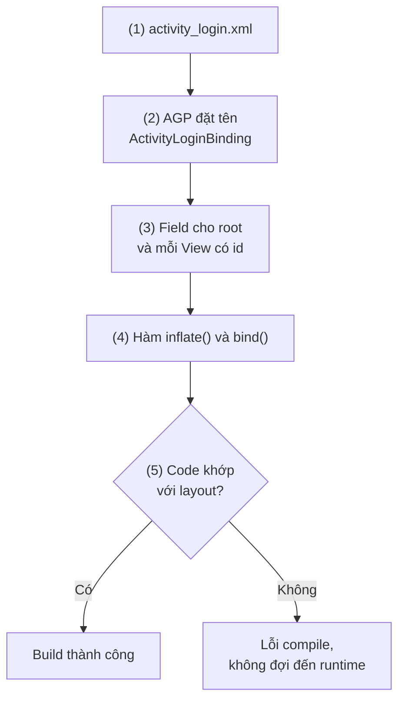
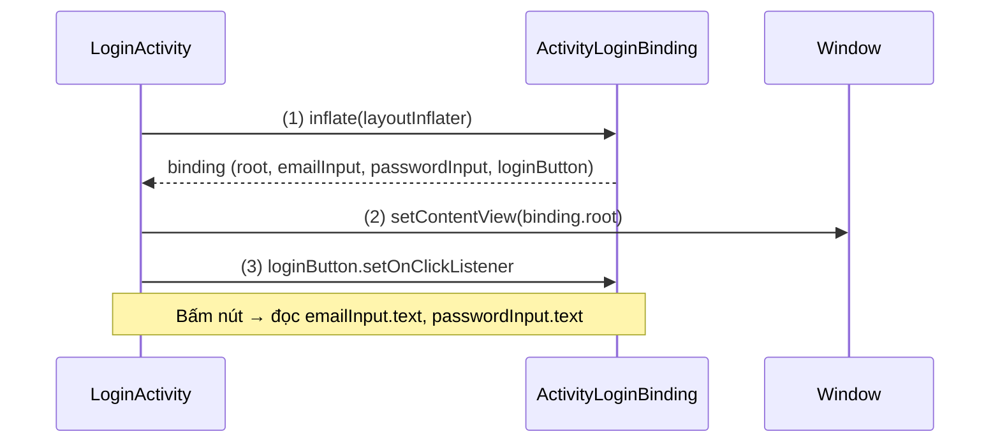
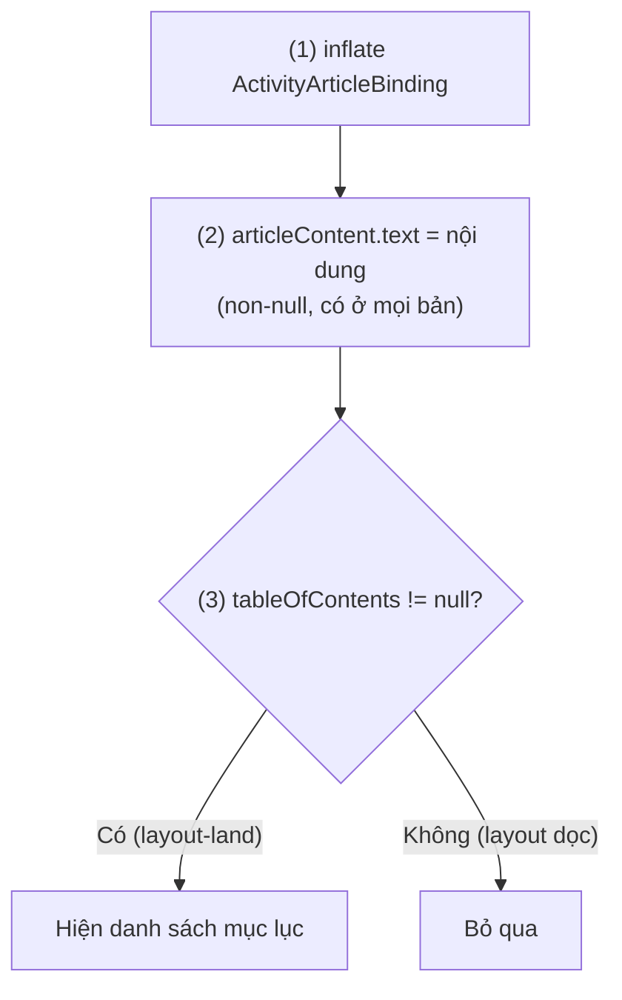
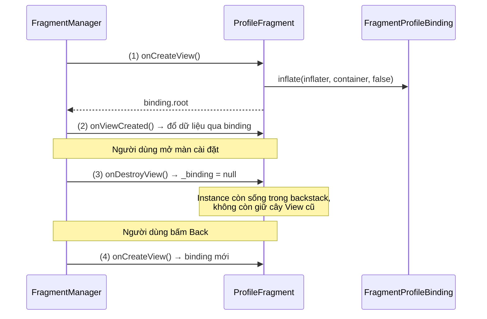
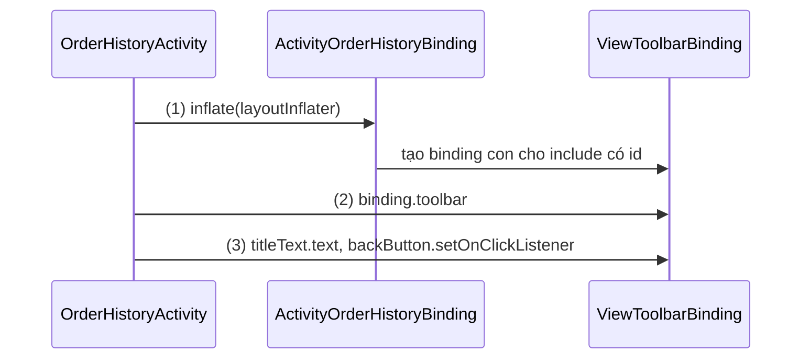
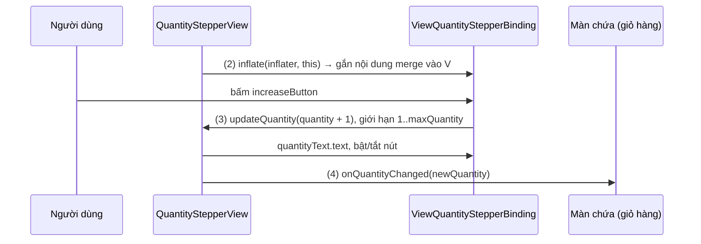

# View Binding

## Vấn đề cần giải quyết

Một màn hình viết bằng XML layout cần lấy tham chiếu tới từng View để đọc dữ liệu, gắn listener, đổi nội dung. Cách gốc là `findViewById`:

```kotlin
val emailInput = findViewById<EditText>(R.id.email_input)
val loginButton = findViewById<Button>(R.id.login_button)
```

Cách này có ba điểm yếu, và cả ba chỉ lộ ra **lúc chạy**, không phải lúc build:

- **Không an toàn về null:** `R.id` là một số nguyên toàn cục của module. Truyền id của một layout khác (hoặc id chỉ có trong `layout-land`) vẫn compile được, nhưng trả về `null` và crash khi dùng.
- **Không an toàn về kiểu:** kiểu `EditText` là do bạn khai báo, không phải do layout. Đổi `EditText` trong XML thành `TextInputLayout` thì code vẫn build, rồi `ClassCastException` lúc chạy.
- **Lặp và tốn công:** mỗi View một dòng tra cứu; layout có 20 View là 20 dòng gần giống nhau, và mỗi lần gọi là một lần duyệt cây View.

Các thư viện cũ như Butter Knife hay Kotlin synthetics giảm số dòng code, nhưng không giải quyết triệt để chuyện null và kiểu theo từng layout. Vấn đề cần giải quyết là: **cho code một cách truy cập View mà layout và code không thể lệch nhau mà vẫn build được.**

## Sau khi học xong

- Giải thích được class binding được AGP sinh ra từ layout XML lúc build và vì sao nó an toàn về null và kiểu hơn findViewById.
- Triển khai được View Binding trong Activity, Fragment, layout dùng include và custom view.
- Xử lý được binding trong Fragment theo vòng đời của View để không giữ cây View đã bị huỷ.
- Phân biệt được View Binding với findViewById, Kotlin synthetics, Data Binding và Compose.
- Nhận diện được các lỗi thường gặp như inflate hai lần, attachToParent sai và field kiểu View do khác kiểu giữa các cấu hình.

## View Binding là gì?

**View Binding** là tính năng build của Android Gradle Plugin (AGP): với mỗi file layout XML trong module, nó sinh ra một **class binding** chứa sẵn tham chiếu có kiểu tới View gốc và mọi View có `android:id` trong layout đó.

Mental model: class binding là **mục lục của một layout**. Mục lục được in một lần lúc build, từ chính layout đó; code tra View theo tên trong mục lục thay vì lật từng trang tìm id. Layout đổi thì mục lục được in lại, và code nào tra một mục không còn tồn tại sẽ không build được.

## Cách hoạt động

### Build sinh class binding từ layout

View Binding bật theo từng module trong `build.gradle.kts` của module đó. AGP là plugin Gradle lo toàn bộ quá trình build app, được học ở [Plugin](../session_04/android_manifest/package_build_gradle/plugin.md).

```kotlin
// app/build.gradle.kts
android {
    buildFeatures {
        viewBinding = true
    }
}
```

Từ đó, mỗi lần build, AGP làm các bước sau cho **mọi** layout của module:

1. Đọc file layout, ví dụ `activity_login.xml`.
2. Đặt tên class: tên file chuyển sang PascalCase cộng hậu tố `Binding` → `ActivityLoginBinding`, nằm trong package `<namespace>.databinding`.
3. Sinh một field cho View gốc (`root`) và cho mỗi View có id; tên field là id chuyển sang camelCase (`email_input` → `emailInput`), kiểu field là kiểu thẻ trong XML. View không có id thì không có field.
4. Sinh các hàm tĩnh `inflate(...)` và `bind(View)` để tạo instance binding.
5. Biên dịch code của app dựa trên class vừa sinh. Code gọi `binding.emailInput` mà layout không còn id `email_input` thì build lỗi ngay.



Layout nào không cần binding (ví dụ layout chỉ dùng qua `<include>` mà không ai tham chiếu) thì thêm `tools:viewBindingIgnore="true"` vào View gốc để AGP bỏ qua.

#### Ví dụ: form đăng nhập trong Activity

**Bài toán:** màn đăng nhập có ô email, ô mật khẩu và nút đăng nhập; nút chỉ làm việc khi cả hai ô đều có nội dung. Đây là trường hợp điển hình cần tham chiếu tới vài View để đọc nội dung và gắn listener.

**Luồng chạy:**

1. Trong `onCreate()`, gọi `ActivityLoginBinding.inflate(layoutInflater)`: layout được inflate thành cây View, và binding giữ tham chiếu tới các View có id.
2. Đưa `binding.root` cho `setContentView()`, để chính cây View đó được hiển thị.
3. Gắn listener cho `binding.loginButton`; khi bấm, đọc `binding.emailInput.text` và `binding.passwordInput.text`.



```xml
<!-- res/layout/activity_login.xml -->
<LinearLayout xmlns:android="http://schemas.android.com/apk/res/android"
    android:layout_width="match_parent"
    android:layout_height="match_parent"
    android:orientation="vertical"
    android:padding="24dp">

    <EditText
        android:id="@+id/email_input"
        android:layout_width="match_parent"
        android:layout_height="wrap_content"
        android:inputType="textEmailAddress" />

    <EditText
        android:id="@+id/password_input"
        android:layout_width="match_parent"
        android:layout_height="wrap_content"
        android:inputType="textPassword" />

    <Button
        android:id="@+id/login_button"
        android:layout_width="match_parent"
        android:layout_height="wrap_content"
        android:text="Đăng nhập" />
</LinearLayout>
```

```kotlin
// LoginActivity.kt
class LoginActivity : AppCompatActivity() {

    private lateinit var binding: ActivityLoginBinding

    override fun onCreate(savedInstanceState: Bundle?) {
        super.onCreate(savedInstanceState)
        binding = ActivityLoginBinding.inflate(layoutInflater) // (1) inflate + giữ tham chiếu
        setContentView(binding.root)                           // (2) hiển thị đúng cây View đó

        binding.loginButton.setOnClickListener {               // (3) field có kiểu Button
            val email = binding.emailInput.text.toString().trim()
            val password = binding.passwordInput.text.toString()
            if (email.isEmpty() || password.isEmpty()) {
                binding.emailInput.error = "Nhập email và mật khẩu"
                return@setOnClickListener
            }
            // gọi đăng nhập...
        }
    }
}
```

**Kết quả:** đổi `password_input` trong XML thành `password_field` rồi build: Android Studio báo `Unresolved reference: passwordInput` ngay ở `LoginActivity`, thay vì crash khi người dùng bấm nút. Trong Activity, binding sống cùng Activity nên không cần gán `null`; Activity bị huỷ thì binding đi theo.

### Null safety và type safety theo cấu hình

Một layout có thể có nhiều bản theo cấu hình: `layout/` cho màn dọc, `layout-land/` cho màn ngang, `layout-sw600dp/` cho tablet. Configuration qualifier được học ở 2.3 Resource Solutions (chưa có bài). AGP sinh **một** class binding cho tất cả các bản cùng tên, và tính field theo cả nhóm:

| Tình huống trong các bản layout | Field sinh ra |
|---|---|
| View có id ở mọi bản, cùng kiểu | Kiểu đó, non-null |
| View có id chỉ ở một số bản | Kiểu đó, `@Nullable` (Kotlin thấy là `TextView?`) |
| Cùng id nhưng kiểu khác nhau giữa các bản | `View`, kể cả khi hai kiểu có lớp cha chung |
| Như trên, có `tools:viewBindingType="X"` | Kiểu `X` (phải là lớp cha của thẻ và thống nhất ở mọi bản) |

Đây chính là "null safety" và "type safety" của View Binding: Kotlin buộc bạn xử lý `null` đúng ở View nào thực sự có thể vắng mặt, và field luôn có kiểu khớp với layout. Docs nói rõ View Binding không tự suy ra lớp cha chung (như `TextView` cho `TextView` và `EditText`) do giới hạn kỹ thuật, nên trường hợp khác kiểu cần `tools:viewBindingType`.

#### Ví dụ: panel mục lục chỉ có khi xoay ngang

**Bài toán:** màn đọc bài viết ở màn dọc chỉ có nội dung; khi xoay ngang có thêm panel mục lục bên trái. Code phải chạy đúng với cả hai layout mà không cần kiểm tra orientation bằng tay.

**Luồng chạy:**

1. Activity inflate `ActivityArticleBinding`; hệ thống chọn `layout/` hoặc `layout-land/` theo cấu hình hiện tại.
2. `binding.articleContent` có ở cả hai bản nên non-null, gán nội dung luôn.
3. `binding.tableOfContents` chỉ có ở `layout-land/` nên là `RecyclerView?`; dùng `?.let` để chỉ cấu hình nội dung mục lục khi panel tồn tại.



```kotlin
// ArticleActivity.kt
// layout/activity_article.xml:      TextView article_content
// layout-land/activity_article.xml: TextView article_content + RecyclerView table_of_contents
class ArticleActivity : AppCompatActivity() {

    private lateinit var binding: ActivityArticleBinding

    override fun onCreate(savedInstanceState: Bundle?) {
        super.onCreate(savedInstanceState)
        binding = ActivityArticleBinding.inflate(layoutInflater) // (1) chọn layout theo cấu hình
        setContentView(binding.root)

        val article = IntentCompat.getParcelableExtra(intent, EXTRA_ARTICLE, Article::class.java)
            ?: return finish()
        binding.articleContent.text = article.body               // (2) non-null

        binding.tableOfContents?.let { toc ->                    // (3) RecyclerView?
            toc.layoutManager = LinearLayoutManager(this)
            toc.adapter = HeadingAdapter(article.headings)
        }
    }

    companion object {
        const val EXTRA_ARTICLE = "extra_article"
    }
}
```

`RecyclerView` và adapter ở đây chỉ là View cần hiển thị danh sách, được học ở [8.5.1 Layouts](../session_08/view_layout/layouts.md); điểm cần chú ý là kiểu `RecyclerView?` do View Binding sinh ra.

**Kết quả:** chạy màn dọc thì không có mục lục và không crash; xoay ngang thì mục lục hiện. Xoá `table_of_contents` khỏi `layout-land/` thì field biến mất khỏi binding và đoạn `?.let` báo lỗi compile, nhắc bạn dọn code theo.

### View Binding trong Fragment: binding sống theo View

Fragment có hai vòng đời: Fragment instance sống lâu hơn View của nó. Khi Fragment vào backstack, `onDestroyView()` huỷ View nhưng instance vẫn còn ([Fragment Lifecycle](../session_04/components/fragment/lifecycle.md), mục "Fragment Lifecycle là gì?"). Binding giữ tham chiếu tới toàn bộ cây View, nên nếu binding là field của Fragment thì nó phải **sống theo View**, không theo Fragment:

- Tạo binding khi View được tạo: `inflate(inflater, container, false)` trong `onCreateView()`, hoặc `bind(view)` trong `onViewCreated()` nếu Fragment truyền layout qua constructor `Fragment(R.layout.…)`.
- Bỏ tham chiếu trong `onDestroyView()`. Docs ghi chú: Fragment sống lâu hơn View của nó, nên phải dọn tham chiếu tới binding ở `onDestroyView()`.

Mẫu thường dùng là hai property: `_binding` nullable để gán `null`, và `binding` non-null để dùng trong khoảng View còn sống.

#### Ví dụ: màn hồ sơ trong app nhiều tab

**Bài toán:** Fragment hồ sơ hiển thị tên, avatar và nút đăng xuất. Người dùng mở màn cài đặt (Fragment hồ sơ vào backstack) rồi bấm Back. View của hồ sơ bị huỷ rồi tạo lại, nên binding cũng phải được tạo lại.

**Luồng chạy:**

1. `onCreateView()`: inflate `FragmentProfileBinding`, gán vào `_binding`, trả `binding.root` cho FragmentManager.
2. `onViewCreated()`: đổ dữ liệu và gắn listener qua `binding`.
3. Mở màn cài đặt: Fragment vào backstack, `onDestroyView()` gán `_binding = null`. Cây View cũ không còn bị Fragment giữ, có thể được thu hồi.
4. Bấm Back: `onCreateView()` chạy lại và tạo một binding mới cho cây View mới.



```kotlin
// ProfileFragment.kt
class ProfileFragment : Fragment() {

    private var _binding: FragmentProfileBinding? = null
    // Chỉ dùng giữa onCreateView và onDestroyView
    private val binding get() = _binding!!

    override fun onCreateView(
        inflater: LayoutInflater,
        container: ViewGroup?,
        savedInstanceState: Bundle?
    ): View {
        _binding = FragmentProfileBinding.inflate(inflater, container, false) // (1)
        return binding.root
    }

    override fun onViewCreated(view: View, savedInstanceState: Bundle?) {
        super.onViewCreated(view, savedInstanceState)
        binding.nameText.text = requireArguments().getString(ARG_DISPLAY_NAME)  // (2)
        binding.logoutButton.setOnClickListener { onLogoutClicked() }
    }

    override fun onDestroyView() {
        super.onDestroyView()
        _binding = null                                                         // (3)
    }

    private fun onLogoutClicked() { /* ... */ }

    companion object {
        private const val ARG_DISPLAY_NAME = "arg_display_name"
    }
}
```

Nếu Fragment dùng constructor `Fragment(R.layout.fragment_profile)` thì FragmentManager tự inflate layout; khi đó bỏ `onCreateView()` và tạo binding bằng `FragmentProfileBinding.bind(view)` ở đầu `onViewCreated()`. Mẫu này đã có trong [Fragment Overview](../session_04/components/fragment/index.md), mục "Bước 2: Tạo Fragment với ViewBinding".

Khi chỉ cần binding trong `onViewCreated()` (không dùng ở hàm khác), có thể bỏ hẳn field và dùng biến cục bộ `val binding = FragmentProfileBinding.bind(view)`; lambda listener vẫn giữ binding, nhưng chúng gắn vào chính các View đó nên được thu hồi cùng cây View.

**Kết quả:** bật LeakCanary (thư viện phát hiện memory leak) và mở/đóng màn cài đặt nhiều lần: không có cảnh báo về View bị Fragment giữ. Bỏ dòng `_binding = null` thì LeakCanary báo cây View cũ bị `ProfileFragment._binding` giữ trong lúc Fragment nằm trong backstack.

### Layout dùng lại: `<include>` và `<merge>`

Layout dùng lại (toolbar, thanh trạng thái tải) được nhúng bằng `<include>`. Thẻ này được học cùng các layout khác ở [8.5.1 Layouts](../session_08/view_layout/layouts.md). View Binding xử lý nó như sau:

- `<include>` **có id** → binding ngoài có một field mang kiểu binding của layout con. Ví dụ `<include android:id="@+id/toolbar" layout="@layout/view_toolbar"/>` sinh field `toolbar: ViewToolbarBinding`, truy cập `binding.toolbar.titleText`.
- Layout con có gốc `<merge>` thì không có View gốc riêng để mang id, nên binding ngoài không có field cho nó. Gọi `ViewToolbarBinding.bind(binding.root)` để lấy binding của phần đã merge.
- Class binding của layout gốc `<merge>` có `inflate(inflater, parent)` với `parent` bắt buộc, vì nội dung merge luôn phải gắn vào một View cha.

#### Ví dụ: toolbar dùng chung cho nhiều màn

**Bài toán:** nhiều màn dùng chung một toolbar tự vẽ gồm nút back và tiêu đề. Mỗi màn chỉ cần đổi tiêu đề và gắn hành động back.

**Luồng chạy:**

1. Màn hình inflate binding của layout ngoài, trong đó `<include>` có id `toolbar`.
2. Truy cập `binding.toolbar`, một `ViewToolbarBinding` được tạo sẵn cùng binding ngoài.
3. Đổi `titleText` và gắn listener cho `backButton` qua binding con.



```xml
<!-- res/layout/view_toolbar.xml -->
<LinearLayout xmlns:android="http://schemas.android.com/apk/res/android"
    android:layout_width="match_parent"
    android:layout_height="56dp"
    android:gravity="center_vertical">

    <ImageButton
        android:id="@+id/back_button"
        android:layout_width="48dp"
        android:layout_height="48dp"
        android:contentDescription="Quay lại"
        android:src="@drawable/ic_arrow_back" />

    <TextView
        android:id="@+id/title_text"
        android:layout_width="wrap_content"
        android:layout_height="wrap_content" />
</LinearLayout>

<!-- res/layout/activity_order_history.xml -->
<LinearLayout xmlns:android="http://schemas.android.com/apk/res/android"
    android:layout_width="match_parent"
    android:layout_height="match_parent"
    android:orientation="vertical">

    <include
        android:id="@+id/toolbar"
        layout="@layout/view_toolbar" />

    <TextView
        android:id="@+id/empty_text"
        android:layout_width="wrap_content"
        android:layout_height="wrap_content" />
</LinearLayout>
```

```kotlin
// OrderHistoryActivity.kt
class OrderHistoryActivity : AppCompatActivity() {

    private lateinit var binding: ActivityOrderHistoryBinding

    override fun onCreate(savedInstanceState: Bundle?) {
        super.onCreate(savedInstanceState)
        binding = ActivityOrderHistoryBinding.inflate(layoutInflater) // (1)
        setContentView(binding.root)

        val toolbar: ViewToolbarBinding = binding.toolbar             // (2) binding con
        toolbar.titleText.text = "Lịch sử đơn hàng"                   // (3)
        toolbar.backButton.setOnClickListener { finish() }
    }
}
```

**Kết quả:** tiêu đề hiện "Lịch sử đơn hàng", bấm nút back đóng màn. Bỏ `android:id` khỏi `<include>` thì `binding.toolbar` không còn, và code báo lỗi compile.

## Deep Dive: class binding sinh ra trông thế nào

Class binding là code Java thường do AGP sinh, nằm trong `build/generated/` của module (trong Android Studio chọn Go to Declaration trên `ActivityLoginBinding` để xem). Rút gọn, nó có dạng:

```java
// ActivityLoginBinding.java (rút gọn, do AGP sinh)
public final class ActivityLoginBinding implements ViewBinding {
  @NonNull private final LinearLayout rootView;
  @NonNull public final EditText emailInput;
  @NonNull public final EditText passwordInput;
  @NonNull public final Button loginButton;

  @Override @NonNull
  public LinearLayout getRoot() { return rootView; }

  @NonNull
  public static ActivityLoginBinding inflate(@NonNull LayoutInflater inflater,
      @Nullable ViewGroup parent, boolean attachToParent) {
    View root = inflater.inflate(R.layout.activity_login, parent, false);
    if (attachToParent) parent.addView(root);
    return bind(root);
  }

  @NonNull
  public static ActivityLoginBinding bind(@NonNull View rootView) {
    // Tìm từng View theo id MỘT lần; thiếu View bắt buộc thì ném lỗi ngay
    EditText emailInput = ViewBindings.findChildViewById(rootView, R.id.email_input);
    if (emailInput == null) {
      throw new NullPointerException("Missing required view with ID: "
          + rootView.getResources().getResourceName(R.id.email_input));
    }
    // ... tương tự cho passwordInput, loginButton
    return new ActivityLoginBinding((LinearLayout) rootView, emailInput, passwordInput, loginButton);
  }
}
```

Ba điều rút ra từ đoạn code này:

- **Không có phép màu lúc chạy:** binding vẫn dùng cơ chế tìm View theo id, nhưng chỉ một lần trong `bind()`, rồi giữ kết quả trong field `final`. Không có reflection hay annotation processing, nên chi phí runtime gần như bằng `findViewById` viết tay, và build nhanh hơn Data Binding.
- **`inflate()` luôn đi qua `bind()`:** `inflate()` chỉ là "inflate layout rồi `bind()`". Vì vậy hai cách tạo binding (inflate trong `onCreateView`, hoặc `bind(view)` khi layout đã được inflate sẵn) cho cùng một kết quả.
- **Lỗi `Missing required view with ID`:** chỉ xảy ra khi `bind()` nhận một View không phải gốc của layout đó (ví dụ `bind()` nhầm layout). Dùng đúng `inflate()` của chính class binding thì không gặp.

`ViewBinding` là interface nhỏ trong thư viện `androidx.viewbinding:viewbinding` (AGP tự thêm khi bật tính năng), chỉ có `getRoot()`. Nhờ nó, code dùng chung (base class, adapter generic) có thể nhận "bất kỳ binding nào" mà vẫn lấy được View gốc.

## Ví dụ thực tế

Ba bài toán hay gặp với View Binding:

1. **Custom view ghép từ nhiều View** (ô chọn số lượng có nút trừ, số, nút cộng): dùng layout gốc `<merge>` và `inflate(inflater, this)`. Đây là bài toán chính, code đầy đủ bên dưới.
2. **Item của danh sách:** `ViewHolder` giữ binding của item, tạo bằng `ItemProductBinding.inflate(LayoutInflater.from(parent.context), parent, false)` trong `onCreateViewHolder`. Cách tổ chức ViewHolder được học ở 7.1.2 ViewHolder Pattern (chưa có bài).
3. **Chuyển màn hình cũ từ Kotlin synthetics hoặc `findViewById`:** bật `viewBinding`, xoá plugin `kotlin-android-extensions` và mọi import `kotlinx.android.synthetic.*`, tạo binding trong `onCreate`/`onCreateView`, rồi đổi `nameText.text = …` thành `binding.nameText.text = …`. Build báo lỗi ở mọi chỗ còn sót, nên chuyển từng màn và build liên tục là cách an toàn. Nếu module đang dùng `@Parcelize` qua plugin cũ thì chuyển sang plugin `kotlin-parcelize`.

### Custom view chọn số lượng sản phẩm

**Bài toán:** giỏ hàng, trang chi tiết sản phẩm và màn đặt lại đơn đều cần một ô chọn số lượng: nút trừ, số hiện tại, nút cộng, giới hạn trong khoảng 1 đến tồn kho. Gói nó thành một custom view để mọi màn dùng chung, và dùng View Binding để custom view truy cập các View con.

**Luồng chạy:**

1. Layout `view_quantity_stepper.xml` có gốc `<merge>`, vì chính `QuantityStepperView` (một `LinearLayout`) đã là View cha; không cần thêm một lớp layout nữa.
2. Constructor của custom view gọi `ViewQuantityStepperBinding.inflate(LayoutInflater.from(context), this)`: nội dung merge được gắn thẳng vào `this`, binding giữ tham chiếu tới ba View con.
3. Bấm cộng hoặc trừ: tính số mới trong khoảng `1..maxQuantity`, cập nhật `binding.quantityText`, bật/tắt nút ở hai đầu giới hạn.
4. Báo số mới ra ngoài qua `onQuantityChanged`, để màn chứa custom view cập nhật giỏ hàng.



```xml
<!-- res/layout/view_quantity_stepper.xml -->
<!-- (1) gốc merge: View cha chính là QuantityStepperView -->
<merge xmlns:android="http://schemas.android.com/apk/res/android"
    xmlns:tools="http://schemas.android.com/tools"
    tools:parentTag="android.widget.LinearLayout"
    tools:orientation="horizontal">

    <ImageButton
        android:id="@+id/decrease_button"
        android:layout_width="40dp"
        android:layout_height="40dp"
        android:contentDescription="Giảm số lượng"
        android:src="@drawable/ic_remove" />

    <TextView
        android:id="@+id/quantity_text"
        android:layout_width="48dp"
        android:layout_height="wrap_content"
        android:gravity="center" />

    <ImageButton
        android:id="@+id/increase_button"
        android:layout_width="40dp"
        android:layout_height="40dp"
        android:contentDescription="Tăng số lượng"
        android:src="@drawable/ic_add" />
</merge>
```

```kotlin
// QuantityStepperView.kt
class QuantityStepperView @JvmOverloads constructor(
    context: Context,
    attrs: AttributeSet? = null
) : LinearLayout(context, attrs) {

    // (2) layout gốc <merge>: inflate(inflater, parent) gắn nội dung vào this
    private val binding = ViewQuantityStepperBinding.inflate(LayoutInflater.from(context), this)

    var maxQuantity: Int = 99
        set(value) {
            field = value.coerceAtLeast(1)
            updateQuantity(quantity)
        }

    var quantity: Int = 1
        private set

    var onQuantityChanged: ((Int) -> Unit)? = null

    init {
        orientation = HORIZONTAL
        gravity = Gravity.CENTER_VERTICAL
        binding.decreaseButton.setOnClickListener { updateQuantity(quantity - 1) }
        binding.increaseButton.setOnClickListener { updateQuantity(quantity + 1) }
        render()
    }

    fun updateQuantity(value: Int) {
        val newQuantity = value.coerceIn(1, maxQuantity)  // (3) giữ trong giới hạn
        if (newQuantity == quantity) {
            render()
            return
        }
        quantity = newQuantity
        render()
        onQuantityChanged?.invoke(newQuantity)            // (4) báo ra ngoài
    }

    private fun render() {
        binding.quantityText.text = quantity.toString()
        binding.decreaseButton.isEnabled = quantity > 1
        binding.increaseButton.isEnabled = quantity < maxQuantity
    }
}
```

```kotlin
// CartItemViewHolder hoặc màn chi tiết sản phẩm: dùng custom view qua binding của màn đó
binding.quantityStepper.maxQuantity = product.stock
binding.quantityStepper.onQuantityChanged = { newQuantity ->
    cartController.updateQuantity(product.id, newQuantity)
}
```

`tools:parentTag` chỉ giúp Layout Editor xem trước layout `<merge>` như thể nó nằm trong `LinearLayout`; nó không ảnh hưởng tới code sinh ra hay lúc chạy.

**Kết quả:** đặt `maxQuantity = 3`, bấm cộng tới 3 thì nút cộng bị tắt; bấm trừ về 1 thì nút trừ bị tắt; mỗi lần đổi số, `onQuantityChanged` nhận đúng giá trị mới. Đổi layout gốc từ `<merge>` sang `LinearLayout` thì binding không còn hàm `inflate(inflater, parent)` hai tham số, và constructor phải đổi sang `inflate(inflater, this, true)`. Cách đó vẫn chạy nhưng cây View thừa một lớp `LinearLayout` lồng nhau.

## So sánh với các cách tiếp cận khác

| Cách | Cơ chế | Null safety | Type safety | Chi phí build | Trạng thái |
|---|---|---|---|---|---|
| `findViewById` | Tìm theo id mỗi lần gọi | Không | Không (kiểu do người viết khai báo) | Không | Vẫn dùng được, là nền của mọi cách khác |
| Butter Knife | Annotation `@BindView`, annotation processing | Một phần (lỗi khi bind) | Không | Có (kapt) | Deprecated, README khuyên chuyển sang View Binding |
| Kotlin synthetics | Plugin `kotlin-android-extensions` sinh property theo id | Không theo cấu hình (dễ trỏ nhầm layout) | Có | Thấp | Deprecated từ Kotlin 1.4.20 |
| **View Binding** | AGP sinh class binding theo layout | Có, `@Nullable` theo cấu hình | Có | Thấp, không annotation processing | Khuyên dùng cho UI XML |
| Data Binding | Như View Binding + biểu thức và biến trong XML | Có | Có | Cao hơn (annotation processing) | Vẫn hỗ trợ, dùng khi cần binding trong XML |
| Jetpack Compose | UI là hàm Kotlin, không có XML để tra View | Không áp dụng | Không áp dụng | Compose compiler | Hướng chính cho UI mới |

View Binding và Data Binding không loại trừ nhau: cùng một module có thể bật cả hai, dùng Data Binding cho layout cần biểu thức hay two-way binding và View Binding cho phần còn lại. Data Binding được học ở [Data Binding](data_binding.md); Compose ở [Jetpack Compose Overview](../jetpack_compose_ui/overview.md).

## Khi nào nên và không nên dùng

- **Nên dùng** cho mọi màn hình, Fragment, dialog, item danh sách và custom view còn viết bằng XML layout. Bật nó gần như không tốn gì và loại bỏ cả một nhóm crash runtime.
- **Nên dùng** khi chuyển code cũ khỏi Kotlin synthetics hay Butter Knife: hai công cụ đó đã deprecated.
- **Không cần** cho layout không có View nào phải truy cập từ code: thêm `tools:viewBindingIgnore="true"` để bớt class sinh ra.
- **Không đủ** khi muốn khai báo dữ liệu ngay trong XML (`android:text="@{user.name}"`) hoặc two-way binding cho form: đó là việc của Data Binding.
- **Không áp dụng** cho UI viết bằng Compose: không có layout XML nên không có gì để binding. Màn hình Compose nhúng View cũ qua `AndroidView` vẫn có thể dùng binding cho phần View đó.

## Sai lầm thường gặp

### 1. Giữ binding của Fragment sau `onDestroyView()`

```kotlin
// Sai: binding là lateinit, không bao giờ được dọn
class ProfileFragment : Fragment() {
    private lateinit var binding: FragmentProfileBinding
    override fun onCreateView(inflater: LayoutInflater, container: ViewGroup?, savedInstanceState: Bundle?): View {
        binding = FragmentProfileBinding.inflate(inflater, container, false)
        return binding.root
    }
}
```

**Lỗi lộ ra thế nào:** khi Fragment vào backstack, View bị huỷ nhưng `binding` vẫn giữ cả cây View cũ (kèm bitmap, adapter). LeakCanary báo leak; với nhiều Fragment trong backstack, bộ nhớ tăng dần.

**Cách sửa:** dùng `_binding` nullable và gán `null` trong `onDestroyView()` như mục "View Binding trong Fragment". Truy cập binding trong callback bất đồng bộ sau `onDestroyView()` là một lỗi khác của cùng nguyên nhân, xem [Fragment Lifecycle](../session_04/components/fragment/lifecycle.md), mục "Sai lầm thường gặp", phần 2 "Truy cập binding sau `onDestroyView`".

### 2. Inflate binding rồi lại `setContentView(R.layout...)`

```kotlin
// Sai: hai cây View khác nhau
binding = ActivityLoginBinding.inflate(layoutInflater)
setContentView(R.layout.activity_login)   // inflate thêm lần nữa
binding.loginButton.setOnClickListener { login() }
```

**Lỗi lộ ra thế nào:** màn hình hiện bình thường nhưng bấm nút không có gì xảy ra, đổi text qua binding cũng không thấy. Lý do: `setContentView(R.layout…)` inflate một cây View **mới** để hiển thị, còn `binding` trỏ tới cây View tạo bởi `inflate()`, vốn không được gắn vào Window.

**Cách sửa:** luôn hiển thị đúng cây View của binding: `setContentView(binding.root)`.

### 3. `attachToParent = true` trong `onCreateView()`

```kotlin
// Sai: tự gắn View vào container
_binding = FragmentProfileBinding.inflate(inflater, container, true)
return binding.root
```

**Lỗi lộ ra thế nào:** crash `IllegalStateException: The specified child already has a parent. You must call removeView() on the child's parent first.` Với `attachToParent = true`, View gốc đã được thêm vào `container`; sau đó FragmentManager lại thêm View mà `onCreateView()` trả về vào chính container đó lần nữa.

**Cách sửa:** trong Fragment luôn truyền `false`; FragmentManager mới là bên gắn View vào container. `container` vẫn cần được truyền vào để layout params của View gốc được tính theo View cha.

### 4. Field bỗng có kiểu `View` sau khi thêm layout cho cấu hình khác

```xml
<!-- layout/profile_header.xml -->
<TextView android:id="@+id/user_bio" ... />
<!-- layout-sw600dp/profile_header.xml: tablet cho sửa bio tại chỗ -->
<EditText android:id="@+id/user_bio" ... />
```

**Lỗi lộ ra thế nào:** mọi chỗ dùng `binding.userBio.text = …` báo lỗi compile, vì field giờ có kiểu `View`. Nhiều người sửa bằng ép kiểu `(binding.userBio as TextView)` rải khắp code.

**Cách sửa:** khai báo kiểu chung trong layout bằng `tools:viewBindingType="TextView"` ở thẻ `EditText`. Giá trị phải là lớp cha của thẻ đó và phải ra cùng một kiểu ở mọi bản layout; View Binding không kiểm tra giá trị này, đặt sai sẽ lỗi ở compile hoặc runtime.

## Lịch sử phát triển

- **Android 1.0 (API 1, 2008):** `findViewById(int)` trả về `View`, người viết tự ép kiểu.
- **Butter Knife (từ 2013):** thư viện của Jake Wharton dùng annotation `@BindView` và annotation processing để sinh code gọi `findViewById`. Về sau README ghi rõ thư viện đã deprecated và khuyên chuyển sang View Binding.
- **Data Binding Library (Google I/O 2015):** binding sinh từ layout bọc trong thẻ `<layout>`, kèm biểu thức trong XML. Mạnh nhưng phải đổi layout và tốn thời gian build.
- **Kotlin Android Extensions:** plugin `kotlin-android-extensions` cho phép gọi View theo id như property (synthetics). Gọn, nhưng không phân biệt View theo layout và cấu hình, dễ trỏ nhầm View của layout khác.
- **Android 8.0 (API 26, 2017):** `findViewById` thành hàm generic `<T extends View> T findViewById(int)`, bỏ được phép ép kiểu tường minh nhưng vẫn không an toàn về kiểu.
- **Android Studio 3.6 / AGP 3.6 (02/2020):** View Binding ra mắt, bật theo module, không cần sửa layout và không dùng annotation processing.
- **AGP 4.0.0 (04/2020):** thêm khối `buildFeatures` để bật/tắt từng tính năng build; `viewBinding.enabled` cũ bị deprecated, cách bật chuyển sang `buildFeatures { viewBinding = true }` như hiện nay.
- **Kotlin 1.4.20 (11/2020):** JetBrains deprecate synthetic views của `kotlin-android-extensions` để thay bằng View Binding, và tách phần sinh `Parcelable` sang plugin riêng `kotlin-parcelize`.

## Kết nối hệ thống

- **Tiên quyết:**
  - [Activity Lifecycle](../session_04/components/activity/lifecycle.md): binding của Activity được tạo trong `onCreate()`.
  - [Fragment Lifecycle](../session_04/components/fragment/lifecycle.md): vì sao binding của Fragment phải theo vòng đời View.
- **Liên quan:**
  - [Plugin](../session_04/android_manifest/package_build_gradle/plugin.md): AGP là bên sinh class binding lúc build.
  - [Dialog and DialogFragment](../session_04/components/fragment/dialog_and_dialogfragment.md): dialog có custom layout dùng binding theo cùng quy tắc với Fragment.
  - [Jetpack Compose Overview](../jetpack_compose_ui/overview.md): hướng UI không cần View Binding.
- **Học tiếp:**
  - [Data Binding](data_binding.md): binding có biểu thức và biến trong XML, mở rộng từ chính class binding ở bài này.
  - 7.1.2 ViewHolder Pattern (chưa có bài): binding trong item của danh sách.
  - [8.5.1 Layouts](../session_08/view_layout/layouts.md): `<include>`, `<merge>` và các layout dùng trong ví dụ.

## Tham khảo

- [View binding - Android Developers](https://developer.android.com/topic/libraries/view-binding)
- [Migrate from Kotlin synthetics to Jetpack view binding - Android Developers](https://developer.android.com/topic/libraries/view-binding/migration)
- [What's new in Kotlin 1.4.20 (deprecation of synthetic views) - Kotlin](https://kotlinlang.org/docs/whatsnew1420.html)
- [Android Studio 3.6 release notes - Android Developers](https://developer.android.com/studio/releases/past-releases/as-3-6-0-release-notes)
- [Android Gradle Plugin 4.0.0 release notes (buildFeatures) - Android Developers](https://developer.android.com/build/releases/past-releases/agp-4-0-0-release-notes)
- [Butter Knife (README: deprecated, switch to view binding) - GitHub](https://github.com/JakeWharton/butterknife)
- [Fragment lifecycle - Android Developers](https://developer.android.com/guide/fragments/lifecycle)
