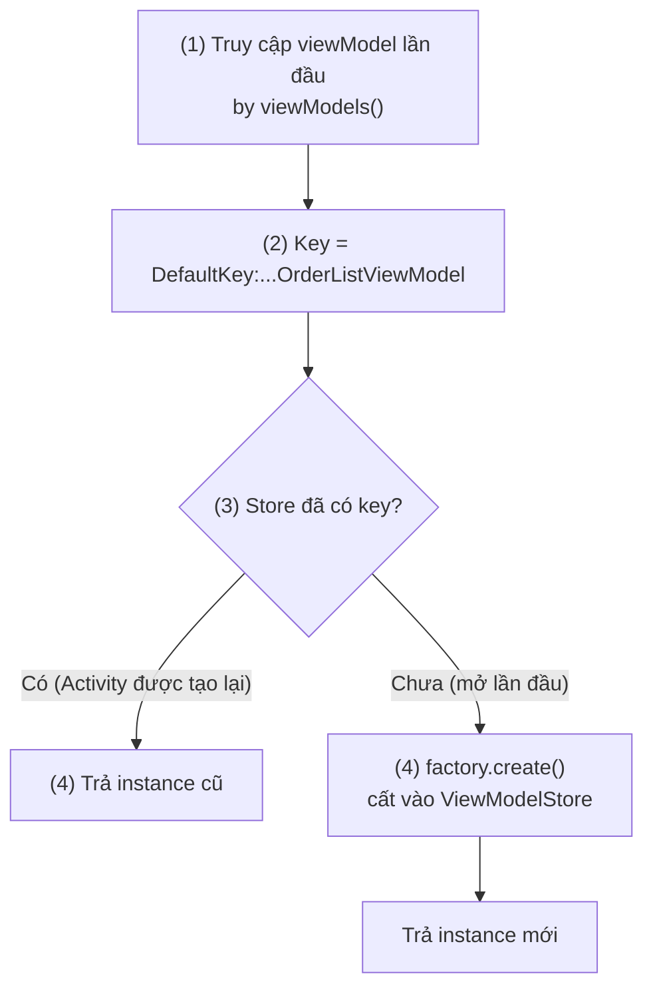
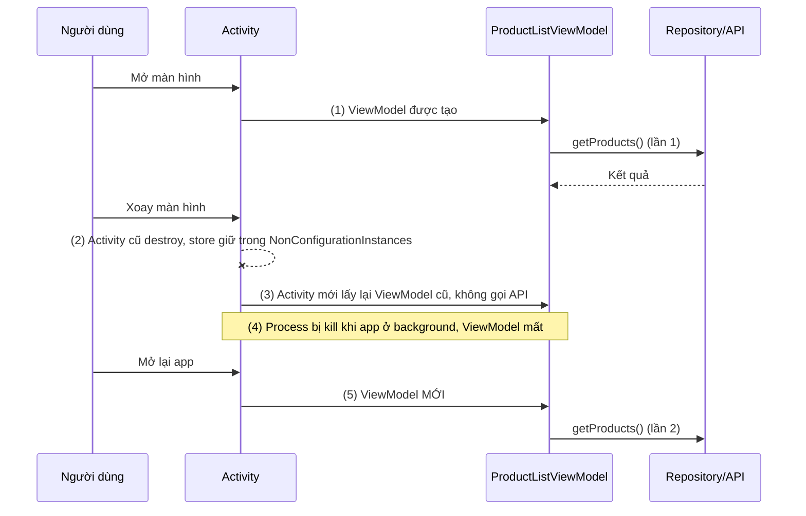
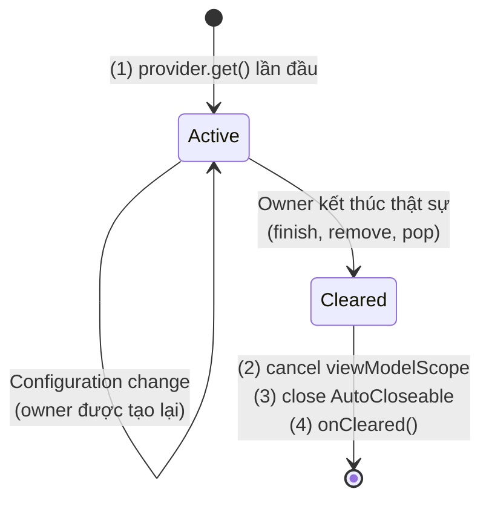
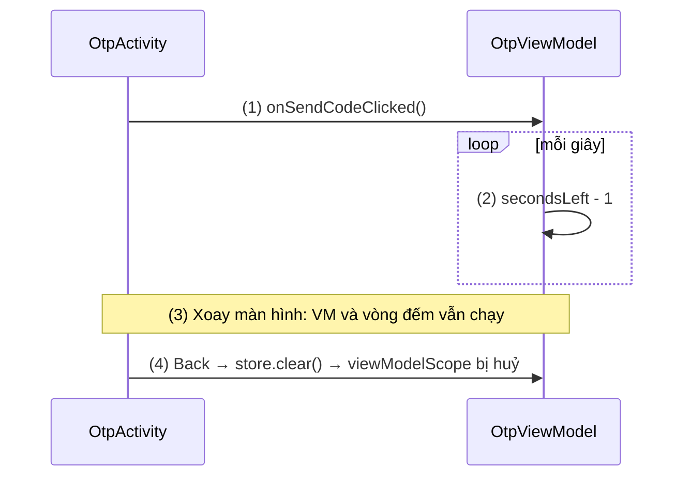
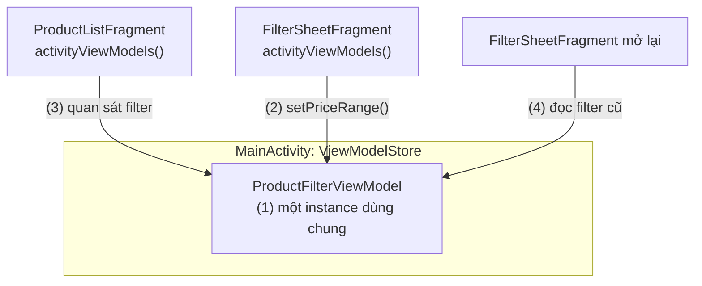
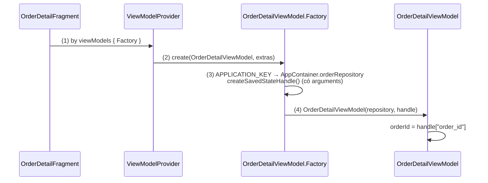
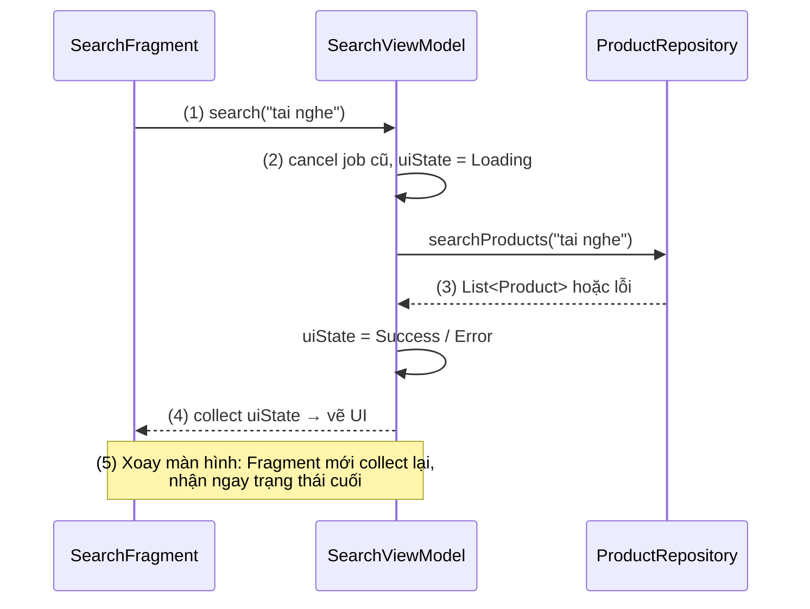

# ViewModel

## Vấn đề cần giải quyết

Activity và Fragment là **UI controller**: chúng vẽ giao diện và nhận thao tác của người dùng. Nhưng hệ thống được quyền huỷ và tạo lại chúng bất cứ lúc nào. Khi xoay màn hình, đổi ngôn ngữ, bật dark mode hay đổi kích thước cửa sổ, Activity cũ bị destroy và một Activity mới được tạo ([Activity State Changes](../session_04/components/activity/state_changes.md), mục "Configuration Change").

Nếu dữ liệu và logic của màn hình nằm ngay trong Activity, mỗi lần tạo lại sẽ kéo theo ba vấn đề:

- **Mất dữ liệu và gọi lại mạng:** danh sách vừa tải xong nằm trong field của Activity cũ, Activity mới phải tải lại từ đầu.
- **Callback trả về một Activity đã chết:** request mạng bắt đầu ở Activity cũ trả kết quả sau khi Activity đó bị destroy. Callback giữ tham chiếu tới Activity cũ thì gây leak, còn cập nhật View đã huỷ thì gây crash hoặc không có tác dụng.
- **Logic khó test:** logic nằm trong Activity thì chỉ test được khi chạy cả Android framework.

`onSaveInstanceState()` chỉ giải quyết được một phần: Bundle phải nhỏ (vài chục KB), dữ liệu phải `Parcelable`, và không giữ được một request đang chạy dở. Cần một nơi giữ state và logic của màn hình **tách khỏi vòng đời ngắn của UI controller**.

## Sau khi học xong

- Giải thích được ViewModelStore, ViewModelStoreOwner và ViewModelProvider phối hợp ra sao để ViewModel sống qua configuration change nhưng mất khi process chết.
- Phân biệt được các scope viewModels, activityViewModels, navGraphViewModels và chọn đúng owner cho từng loại dữ liệu.
- Triển khai được ViewModel có dependency bằng factory với CreationExtras và giải phóng tài nguyên trong onCleared hoặc addCloseable.
- Áp dụng được cách tải dữ liệu lười và đưa UI state ra ngoài qua StateFlow để màn hình không gọi lại API sau mỗi lần xoay.
- Nhận diện được các sai lầm như giữ Context hoặc View trong ViewModel, tự tạo ViewModel bằng constructor và launch coroutine trong init.

## ViewModel là gì?

**ViewModel** là object giữ state và logic của một màn hình, được cất trong `ViewModelStore` của một `ViewModelStoreOwner` (Activity, Fragment, navigation destination). Nhờ vậy nó sống qua configuration change và chỉ bị clear khi owner kết thúc thật sự.

Mental model: `ViewModelStore` là **tủ gửi đồ gắn với một chỗ ở**, ViewModel là đồ trong tủ, Activity là người đang ở. Xoay màn hình giống người đó ra khỏi phòng rồi vào lại: người mới (Activity mới) mở đúng cái tủ cũ và lấy lại đồ. Chỉ khi trả phòng hẳn (Activity `finish()`, Fragment bị remove, destination bị pop) thì tủ mới được dọn (`onCleared()`). Còn nếu cả toà nhà mất điện (process bị kill) thì tủ cũng mất theo.

## Cách hoạt động

### ViewModelStore và ViewModelProvider: lấy lại đúng instance

Ba thành phần phối hợp với nhau:

- **`ViewModelStore`**: một map từ key (chuỗi) tới instance ViewModel. Mỗi owner có một store.
- **`ViewModelStoreOwner`**: interface của thứ sở hữu một store. `ComponentActivity`, `Fragment` và `NavBackStackEntry` đều là owner.
- **`ViewModelProvider`**: nhận một store và một factory. `get(MyViewModel::class)` tra store theo key; có thì trả instance cũ, chưa có thì nhờ factory tạo rồi cất vào store.

Delegate `by viewModels()` (thư viện `activity-ktx`, `fragment-ktx`) chỉ là cách viết gọn cho `ViewModelProvider(this, factory)[MyViewModel::class]`. Nó lười: ViewModel chỉ được lấy ở lần truy cập đầu tiên.

#### Ví dụ: màn danh sách đơn hàng lấy ViewModel

**Bài toán:** màn "Đơn hàng của tôi" cần một `OrderListViewModel`. Lần mở đầu tiên phải tạo mới; các lần Activity được tạo lại sau đó phải nhận lại đúng instance cũ.

**Luồng chạy:**

1. Activity truy cập `viewModel` lần đầu; delegate `by viewModels()` tạo `ViewModelProvider` từ `viewModelStore` của Activity và factory mặc định.
2. Provider tính key, mặc định là `"androidx.lifecycle.ViewModelProvider.DefaultKey:"` cộng tên class đầy đủ.
3. Provider tra key trong store.
4. Có sẵn (Activity được tạo lại sau xoay màn hình): trả về instance cũ, factory không được gọi. Chưa có (lần mở đầu): factory tạo instance mới và cất vào store.



```kotlin
// OrderListActivity.kt
class OrderListActivity : AppCompatActivity() {

    // (1) Lười: chỉ lấy ViewModel ở lần truy cập đầu tiên
    private val viewModel: OrderListViewModel by viewModels()

    override fun onCreate(savedInstanceState: Bundle?) {
        super.onCreate(savedInstanceState)
        // (2)–(4) diễn ra ở dòng này: lần mở đầu tạo mới, sau xoay màn hình nhận lại instance cũ
        Log.d("OrderList", "ViewModel@${System.identityHashCode(viewModel)}")
    }
}

// OrderListViewModel.kt
class OrderListViewModel : ViewModel()
```

**Kết quả:** mở màn hình rồi xoay vài lần: Logcat in cùng một mã `identityHashCode` cho ViewModel, trong khi `this` của Activity đổi mỗi lần. Bấm Back thoát màn rồi mở lại thì mã mới, vì store cũ đã được dọn.

### Vì sao ViewModel sống qua configuration change nhưng mất khi process chết

Store không nằm trong Activity cũ theo nghĩa "chết cùng Activity". Khi Activity bị huỷ **để tạo lại** vì configuration change, `ComponentActivity` trả `ViewModelStore` của nó qua `onRetainNonConfigurationInstance()`. Hệ thống giữ object này (`NonConfigurationInstances`) trong process và đưa cho Activity mới; Activity mới lấy lại store bằng `getLastNonConfigurationInstance()`.

Khi Activity bị destroy, `ComponentActivity` kiểm tra `isChangingConfigurations`. Nếu `false` (người dùng thoát hẳn, gọi `finish()`), nó gọi `viewModelStore.clear()`, và mọi ViewModel trong store nhận `onCleared()`.

Mọi thứ trên chỉ nằm trong bộ nhớ của process. Khi app ở background và hệ thống kill process để lấy RAM, store và ViewModel mất theo. Dữ liệu cần sống qua process death phải nằm trong saved state (`SavedStateHandle`) hoặc storage, xem [Activity State Changes](../session_04/components/activity/state_changes.md), mục "SavedStateHandle: lưu user input quan trọng qua process death".

| Sự kiện | Activity | ViewModel |
|---|---|---|
| Xoay màn hình, đổi ngôn ngữ, dark mode | Destroy → tạo mới | **Giữ nguyên** (store được chuyển sang Activity mới) |
| Người dùng bấm Back thoát màn, `finish()` | Destroy | `onCleared()`, bị huỷ |
| App ở background, process bị kill | Mất | **Mất**, tạo mới khi mở lại |

#### Ví dụ: danh sách sản phẩm khi xoay màn hình và khi process bị kill

**Bài toán:** màn danh sách sản phẩm tải dữ liệu từ API. Xoay màn hình không được gọi lại API; sau process death thì bắt buộc phải tải lại, vì không còn gì trong bộ nhớ.

**Luồng chạy:**

1. Mở màn hình: ViewModel được tạo, gọi `getProducts()` lần 1.
2. Xoay màn hình: Activity cũ destroy với `isChangingConfigurations = true`; store được giữ trong `NonConfigurationInstances`.
3. Activity mới lấy lại store cũ, nên nhận lại ViewModel cũ cùng dữ liệu đã tải; không gọi API.
4. App xuống background, process bị kill: store và ViewModel mất.
5. Người dùng mở lại: ViewModel mới được tạo và gọi `getProducts()` lần 2.



Code của `ProductListViewModel` (pipeline tải lười bằng `stateIn`) ở mục "Tải dữ liệu: lười, không launch trong init" bên dưới.

**Kết quả:** bật "Show taps" và theo dõi log của OkHttp hoặc Repository: xoay màn hình không sinh request mới. Kill process khi app ở background (cách test ở [Activity State Changes](../session_04/components/activity/state_changes.md), mục "Process Death — hiểu và test") rồi mở lại: có đúng một request mới.

### Vòng đời ViewModel và `onCleared()`

ViewModel bắt đầu sống từ lần đầu được lấy qua provider (thường trong `onCreate()`). Nó kết thúc khi owner biến mất vĩnh viễn: Activity finish, Fragment bị remove khỏi FragmentManager (Fragment chỉ nằm trong backstack thì ViewModel **vẫn còn**), destination bị pop khỏi back stack của Navigation, hoặc composable owner rời khỏi Composition.

Khi đó store gọi `clear()` trên từng ViewModel, theo thứ tự:

1. Huỷ `viewModelScope`. Đây là coroutine scope gắn với ViewModel, nên coroutine đang chạy trong đó bị cancel.
2. Đóng các `AutoCloseable` đã gắn bằng `addCloseable()` hoặc truyền qua constructor `ViewModel(vararg closeables)`.
3. Gọi `onCleared()`, nơi dọn những thứ còn lại.

`viewModelScope` và coroutine là kiến thức dùng trước: coroutine là cách viết code bất đồng bộ tuần tự trong Kotlin, học ở 8.4.3 Coroutines (chưa có bài); `viewModelScope` đã được so sánh với `lifecycleScope` ở [Activity Lifecycle](../session_04/components/activity/lifecycle.md), mục "viewModelScope".



#### Ví dụ: đếm ngược gửi lại mã OTP

**Bài toán:** màn xác thực OTP hiện "Gửi lại mã sau 60 giây" và đếm ngược. Đếm ngược không được chạy lại từ 60 khi xoay màn hình, và phải dừng hẳn khi người dùng rời màn hình.

**Luồng chạy:**

1. ViewModel bắt đầu đếm trong `viewModelScope` khi người dùng yêu cầu gửi mã.
2. Mỗi giây giảm `secondsLeft`; UI hiển thị giá trị mới nhất.
3. Xoay màn hình: ViewModel còn nguyên, coroutine vẫn chạy, UI mới đọc tiếp số giây đang đếm.
4. Người dùng bấm Back rời màn: ViewModel bị clear, `viewModelScope` bị huỷ nên coroutine đếm ngược dừng; không cần tự huỷ trong `onCleared()`.



```kotlin
// OtpViewModel.kt
class OtpViewModel : ViewModel() {

    private val _secondsLeft = MutableStateFlow(0)
    val secondsLeft: StateFlow<Int> = _secondsLeft.asStateFlow()

    private var countdownJob: Job? = null

    fun onSendCodeClicked() {
        if (countdownJob?.isActive == true) return
        countdownJob = viewModelScope.launch {       // (1) chạy trong scope của ViewModel
            for (second in 60 downTo 0) {
                _secondsLeft.value = second           // (2)
                delay(1_000)
            }
        }
        // (3) xoay màn hình: ViewModel không đổi nên vòng lặp không bị khởi động lại
    }

    override fun onCleared() {
        // (4) viewModelScope đã bị huỷ trước khi hàm này chạy; chỉ dọn tài nguyên không phải coroutine
        super.onCleared()
    }
}
```

`StateFlow` (luồng giữ một giá trị hiện tại mà UI quan sát được) là kiến thức dùng trước, học ở 7.1.4.2 Flow (chưa có bài). Tài nguyên không phải coroutine (một kết nối, một listener của SDK) thì gắn bằng `addCloseable(connection)` để ViewModel tự đóng nó lúc clear, thay vì nhớ đóng trong `onCleared()`.

**Kết quả:** bấm "Gửi mã", xoay màn hình ở giây 45 thì UI tiếp tục từ 45 chứ không về 60. Rời màn hình rồi đặt breakpoint trong vòng lặp: không còn chạy nữa.

### Scope: ViewModel thuộc về owner nào

Cùng một class ViewModel có thể có nhiều instance, tuỳ store mà nó được cất vào. Chọn owner là chọn **dữ liệu sống bao lâu và ai được dùng chung**:

| Cách lấy | Owner (store) | Sống tới khi | Dùng cho |
|---|---|---|---|
| `by viewModels()` trong Activity | Activity | Activity finish | State của màn hình là Activity |
| `by viewModels()` trong Fragment | Fragment | Fragment bị remove (không phải vào backstack) | State riêng của một màn Fragment |
| `by activityViewModels()` | Activity chứa Fragment | Activity finish | Dữ liệu dùng chung giữa các Fragment cùng Activity |
| `by viewModels(ownerProducer = { requireParentFragment() })` | Fragment cha | Fragment cha bị remove | Dữ liệu dùng chung giữa các Fragment con |
| `by navGraphViewModels(R.id.checkout_graph)` | `NavBackStackEntry` của nav graph | Graph bị pop khỏi back stack | Một luồng nhiều bước (checkout, onboarding) |
| `viewModel()` trong Compose | Owner gần nhất (Activity, Fragment, destination) | Owner đó kết thúc | Màn hình viết bằng Compose |

Scope càng rộng thì dữ liệu càng sống lâu: một ViewModel lấy bằng `activityViewModels()` trong app Single-Activity gần như sống cùng cả app. Docs khuyên dùng ViewModel làm state holder **ở cấp màn hình**, không dùng cho component UI tái sử dụng (một chip group, một form con), vì mọi chỗ dùng chung owner sẽ nhận cùng một instance.

#### Ví dụ: bottom sheet bộ lọc và danh sách sản phẩm dùng chung ViewModel

**Bài toán:** màn danh sách sản phẩm mở một bottom sheet bộ lọc (một Fragment khác). Chọn khoảng giá trong sheet thì danh sách phía sau phải lọc lại ngay, và lựa chọn phải còn khi mở sheet lần nữa.

**Luồng chạy:**

1. `ProductListFragment` và `FilterSheetFragment` đều lấy `ProductFilterViewModel` bằng `activityViewModels()`, nên nhận **cùng một instance** từ store của Activity.
2. Người dùng chọn khoảng giá trong sheet: sheet gọi `viewModel.setPriceRange(...)`.
3. ViewModel cập nhật `filter`; danh sách đang quan sát `filter` nên lọc lại.
4. Đóng rồi mở lại sheet: sheet là Fragment mới nhưng vẫn lấy instance cũ, nên đọc lại đúng khoảng giá đã chọn.



```kotlin
// ProductFilterViewModel.kt
data class ProductFilter(val minPrice: Long? = null, val maxPrice: Long? = null)

class ProductFilterViewModel : ViewModel() {
    private val _filter = MutableStateFlow(ProductFilter())
    val filter: StateFlow<ProductFilter> = _filter.asStateFlow()

    fun setPriceRange(min: Long?, max: Long?) {
        _filter.update { it.copy(minPrice = min, maxPrice = max) }   // (2)
    }
}

// FilterSheetFragment.kt
class FilterSheetFragment : BottomSheetDialogFragment() {
    private val filterViewModel: ProductFilterViewModel by activityViewModels()  // (1), (4)

    private fun onApplyClicked(min: Long?, max: Long?) {
        filterViewModel.setPriceRange(min, max)
        dismiss()
    }
}

// ProductListFragment.kt
class ProductListFragment : Fragment(R.layout.fragment_product_list) {
    private val filterViewModel: ProductFilterViewModel by activityViewModels()  // (1)

    override fun onViewCreated(view: View, savedInstanceState: Bundle?) {
        super.onViewCreated(view, savedInstanceState)
        viewLifecycleOwner.lifecycleScope.launch {
            viewLifecycleOwner.repeatOnLifecycle(Lifecycle.State.STARTED) {
                filterViewModel.filter.collect { filter -> showProducts(filter) }  // (3)
            }
        }
    }

    private fun showProducts(filter: ProductFilter) { /* lọc và hiển thị */ }
}
```

Mẫu collect bằng `repeatOnLifecycle` trên `viewLifecycleOwner` được giải thích ở [Fragment Lifecycle](../session_04/components/fragment/lifecycle.md). `BottomSheetDialogFragment` ở [Dialog and DialogFragment](../session_04/components/fragment/dialog_and_dialogfragment.md).

**Kết quả:** chọn giá 100.000–500.000 rồi đóng sheet: danh sách lọc ngay. Mở lại sheet: khoảng giá vẫn được chọn sẵn. Đổi sheet sang `by viewModels()` thì sheet có ViewModel riêng: danh sách không lọc, và lựa chọn mất mỗi lần mở lại.

### Factory và CreationExtras: ViewModel có dependency

Factory mặc định chỉ tạo được ViewModel có constructor rỗng, hoặc constructor nhận `SavedStateHandle` (và `Application` với `AndroidViewModel`). ViewModel thật thường cần Repository, nên phải tự cung cấp `ViewModelProvider.Factory`.

Từ Lifecycle 2.5.0, `create()` nhận thêm `CreationExtras`: một túi giá trị mà owner đưa vào lúc tạo ViewModel, gồm `Application` (`APPLICATION_KEY`), dữ liệu để tạo `SavedStateHandle` (đã chứa sẵn `arguments` của Fragment hoặc extras của Intent). DSL `viewModelFactory { initializer { … } }` giúp viết factory gọn, và `createSavedStateHandle()` lấy `SavedStateHandle` từ extras.

Trong project dùng Hilt, `@HiltViewModel` cùng constructor `@Inject` sinh factory tự động; Hilt được học ở 7.1.5.3 Hilt (chưa có bài). Hiểu factory viết tay giúp hiểu Hilt đang làm gì thay bạn.

#### Ví dụ: màn chi tiết đơn hàng cần Repository và orderId

**Bài toán:** `OrderDetailViewModel` cần `OrderRepository` để tải đơn, và cần `orderId` mà màn trước truyền qua `arguments` của Fragment. `orderId` phải còn sau process death.

**Luồng chạy:**

1. Fragment lấy ViewModel bằng `by viewModels { OrderDetailViewModel.Factory }`.
2. Lần tạo đầu, provider gọi factory và đưa vào `CreationExtras` của Fragment.
3. Initializer lấy `Application` từ extras để đến được `AppContainer` (nơi giữ các Repository), và gọi `createSavedStateHandle()`; handle này đã chứa `arguments` của Fragment, gồm `order_id`.
4. Factory gọi constructor với `repository` và `savedStateHandle`; ViewModel đọc `orderId` từ handle.



```kotlin
// ShopApplication.kt: container đơn giản giữ các dependency của app
class ShopApplication : Application() {
    val container: AppContainer by lazy { AppContainer(this) }
}

// OrderDetailViewModel.kt
class OrderDetailViewModel(
    private val repository: OrderRepository,
    savedStateHandle: SavedStateHandle
) : ViewModel() {

    private val orderId: String = checkNotNull(savedStateHandle["order_id"])   // (4)

    companion object {
        val Factory: ViewModelProvider.Factory = viewModelFactory {
            initializer {                                                         // (2)
                val app = checkNotNull(this[APPLICATION_KEY]) as ShopApplication  // (3)
                OrderDetailViewModel(
                    repository = app.container.orderRepository,
                    savedStateHandle = createSavedStateHandle()                   // (3)
                )
            }
        }
    }
}

// OrderDetailFragment.kt
class OrderDetailFragment : Fragment(R.layout.fragment_order_detail) {
    private val viewModel: OrderDetailViewModel by viewModels { OrderDetailViewModel.Factory } // (1)
}
```

`APPLICATION_KEY` là `ViewModelProvider.AndroidViewModelFactory.APPLICATION_KEY`. Factory chỉ được gọi **một lần** cho mỗi instance; các lần Fragment được tạo lại sau đó nhận instance cũ mà không chạm tới factory.

**Kết quả:** mở chi tiết đơn từ danh sách, ViewModel đọc đúng `orderId`. Kill process khi đang ở màn chi tiết rồi mở lại: `arguments` được khôi phục cùng saved state của Fragment, nên `createSavedStateHandle()` vẫn có `order_id` và màn hình tải lại đúng đơn.

### Tải dữ liệu: lười, không launch trong `init`

Phần lớn ViewModel phải tải dữ liệu ban đầu. Có ba chỗ hay được chọn, và chỉ một chỗ đúng:

- **Gọi `viewModel.loadProducts()` trong `onCreate()`:** `onCreate()` chạy lại sau mỗi lần xoay, nên nếu hàm không tự kiểm tra thì API bị gọi lại mỗi lần.
- **Launch coroutine trong `init` của ViewModel:** chỉ chạy một lần mỗi instance, nhưng docs khuyên **không** làm vậy. Việc bất đồng bộ khởi động trong constructor có thể đọc hoặc ghi object trước khi nó khởi tạo xong; ViewModel giữ Compose State còn có thể gặp `IllegalStateException`. Nó cũng làm việc tải chạy ngay khi tạo, khó test và khó điều khiển.
- **Tải lười:** đưa dữ liệu ra ngoài bằng một pipeline chỉ chạy khi UI bắt đầu quan sát, ví dụ `stateIn(viewModelScope, SharingStarted.WhileSubscribed(5_000), …)`. Khi không dùng được Flow thì dùng một hàm `initialize()` idempotent: gọi nhiều lần cũng chỉ tải một lần.

`WhileSubscribed(5_000)` giữ pipeline chạy thêm 5 giây sau khi UI ngừng collect. Activity mới sau khi xoay collect lại trong khoảng đó, nên API không bị gọi lại. App nằm background lâu hơn 5 giây thì pipeline dừng, rồi chạy lại khi UI quay lại; muốn chỉ tải một lần cho mỗi instance thì dùng `SharingStarted.Lazily`.

```kotlin
// ProductListViewModel.kt
class ProductListViewModel(private val repository: ProductRepository) : ViewModel() {

    // Tải lười: chỉ gọi API khi UI bắt đầu collect; kết quả nằm trong ViewModel nên sống qua xoay màn hình
    val products: StateFlow<List<Product>> =
        flow { emit(repository.getProducts()) }
            .catch { emit(emptyList()) /* app thật: chuyển sang trạng thái lỗi */ }
            .stateIn(viewModelScope, SharingStarted.WhileSubscribed(5_000), emptyList())
}

// Khi không dùng được Flow: initialize() idempotent
class ReportViewModel(private val repository: ReportRepository) : ViewModel() {
    private var initializeCalled = false

    @MainThread
    fun initialize() {
        if (initializeCalled) return       // gọi lại sau xoay màn hình: ViewModel cũ, cờ đã bật
        initializeCalled = true
        viewModelScope.launch { repository.loadMonthlyReport() }
    }
}
```

Ví dụ đầy đủ kết hợp tải lười với `SavedStateHandle` (search query và category sống qua process death) ở [Activity State Changes](../session_04/components/activity/state_changes.md), mục "Ví dụ thực tế".

## Deep Dive: store được giữ qua đâu

Đi theo source của AndroidX (Activity 1.x, Fragment 1.x, Lifecycle 2.x):

- **Activity:** `ComponentActivity.onRetainNonConfigurationInstance()` gói `viewModelStore` vào một object `NonConfigurationInstances` riêng của `ComponentActivity`. Framework giữ object này trong `ActivityClientRecord` khi relaunch Activity, rồi trả lại qua `getLastNonConfigurationInstance()`. Lần đầu gọi `getViewModelStore()`, Activity mới lấy store từ đó, không có thì tạo store mới.
- **Dọn store:** `ComponentActivity` đăng ký một `LifecycleEventObserver`; ở `ON_DESTROY`, nếu `!isChangingConfigurations()` thì `viewModelStore.clear()`.
- **Fragment:** Fragment không tự đi qua cơ chế trên. `FragmentManager` giữ một `FragmentManagerViewModel`, bản thân nó là một ViewModel nằm trong store của Activity (hoặc của Fragment cha). Object này chứa một map `ViewModelStore` cho từng Fragment theo `mWho`. Activity được tạo lại thì `FragmentManagerViewModel` sống sót cùng store của Activity, kéo theo store của mọi Fragment. Fragment bị remove hẳn (không vào backstack) thì store của nó bị clear.
- **Navigation:** mỗi `NavBackStackEntry` là một `ViewModelStoreOwner`; store của các entry được giữ trong một ViewModel của NavController, và bị clear khi entry bị pop.
- **Key:** `ViewModelProvider.get(modelClass)` dùng key `"androidx.lifecycle.ViewModelProvider.DefaultKey:" + canonicalName`. Có thể truyền key riêng (`get(key, modelClass)` hoặc tham số `key` của `viewModel()` trong Compose) để có nhiều instance cùng class trong một store.

Vì thế "ViewModel sống qua configuration change" thực ra là "store được chuyển giao qua configuration change, trong cùng một process".

## Ví dụ thực tế

Ba bài toán hay gặp với ViewModel:

1. **Màn tìm kiếm có trạng thái tải, lỗi, kết quả, kèm unit test:** bài toán chính, code đầy đủ bên dưới.
2. **Luồng checkout nhiều bước:** các màn giỏ hàng, địa chỉ, thanh toán là các destination trong một nav graph con; dùng `navGraphViewModels(R.id.checkout_graph)` để chia sẻ đơn đang soạn, và đơn tự bị dọn khi người dùng thoát khỏi graph.
3. **Màn hình Compose:** `val viewModel: ProfileViewModel = viewModel(factory = ProfileViewModel.Factory)` trong composable cấp màn hình. Chỉ truyền state và lambda xuống các composable con, không truyền ViewModel, như [Jetpack Compose Overview](../jetpack_compose_ui/overview.md) đã nêu ở mục "Sai lầm thường gặp".

### Màn tìm kiếm sản phẩm với UI state và unit test

**Bài toán:** người dùng nhập từ khoá rồi bấm tìm. Màn hình hiện loading, rồi kết quả, hoặc thông báo lỗi kèm nút thử lại. Xoay màn hình giữa chừng không được mất kết quả hay gọi lại API. Logic phải test được mà không cần thiết bị.

**Luồng chạy:**

1. Người dùng bấm tìm: Fragment gọi `viewModel.search(query)`.
2. ViewModel huỷ lần tìm trước nếu còn chạy, đặt `uiState = Loading`, rồi launch trong `viewModelScope`.
3. Repository trả kết quả: `uiState` thành `Success(products)`; ném lỗi: `uiState` thành `Error(message)`.
4. Fragment collect `uiState` bằng `repeatOnLifecycle(STARTED)` trên `viewLifecycleOwner` và vẽ theo trạng thái.
5. Xoay màn hình: Fragment mới collect lại cùng `StateFlow` và nhận ngay trạng thái cuối; lần tìm đang chạy (nếu có) vẫn tiếp tục trong ViewModel.
6. Unit test dùng `FakeProductRepository` để kiểm tra chuỗi trạng thái, không cần Android framework.



```kotlin
// SearchUiState.kt
sealed interface SearchUiState {
    data object Idle : SearchUiState
    data object Loading : SearchUiState
    data class Success(val products: List<Product>) : SearchUiState
    data class Error(val message: String) : SearchUiState
}

// SearchViewModel.kt
class SearchViewModel(private val repository: ProductRepository) : ViewModel() {

    private val _uiState = MutableStateFlow<SearchUiState>(SearchUiState.Idle)
    val uiState: StateFlow<SearchUiState> = _uiState.asStateFlow()   // chỉ đưa ra bản read-only

    private var searchJob: Job? = null
    private var lastQuery: String = ""

    fun search(query: String) {                                       // (1)
        val trimmed = query.trim()
        if (trimmed.isEmpty()) return
        lastQuery = trimmed
        searchJob?.cancel()                                           // (2) bỏ lần tìm cũ
        _uiState.value = SearchUiState.Loading
        searchJob = viewModelScope.launch {
            _uiState.value = try {
                SearchUiState.Success(repository.searchProducts(trimmed))   // (3)
            } catch (e: CancellationException) {
                throw e                                               // không nuốt việc huỷ coroutine
            } catch (e: IOException) {
                SearchUiState.Error("Không kết nối được, thử lại sau")
            }
        }
    }

    fun retry() = search(lastQuery)

    companion object {
        val Factory = viewModelFactory {
            initializer {
                val app = checkNotNull(this[APPLICATION_KEY]) as ShopApplication
                SearchViewModel(app.container.productRepository)
            }
        }
    }
}

// SearchFragment.kt
class SearchFragment : Fragment(R.layout.fragment_search) {

    private val viewModel: SearchViewModel by viewModels { SearchViewModel.Factory }

    override fun onViewCreated(view: View, savedInstanceState: Bundle?) {
        super.onViewCreated(view, savedInstanceState)
        val binding = FragmentSearchBinding.bind(view)
        binding.searchButton.setOnClickListener {
            viewModel.search(binding.queryInput.text.toString())            // (1)
        }
        binding.retryButton.setOnClickListener { viewModel.retry() }

        viewLifecycleOwner.lifecycleScope.launch {
            viewLifecycleOwner.repeatOnLifecycle(Lifecycle.State.STARTED) {
                viewModel.uiState.collect { state -> render(binding, state) } // (4), (5)
            }
        }
    }

    private fun render(binding: FragmentSearchBinding, state: SearchUiState) {
        binding.progress.isVisible = state is SearchUiState.Loading
        binding.errorGroup.isVisible = state is SearchUiState.Error
        binding.resultList.isVisible = state is SearchUiState.Success
        if (state is SearchUiState.Error) binding.errorText.text = state.message
        if (state is SearchUiState.Success) (binding.resultList.adapter as ProductAdapter).submitList(state.products)
    }
}
```

Binding cục bộ trong `onViewCreated()` theo cách ở [View Binding](view_binding.md), mục "View Binding trong Fragment". `ProductAdapter` là adapter danh sách, học ở 7.1.2 ViewHolder Pattern (chưa có bài).

```kotlin
// SearchViewModelTest.kt (src/test): (6) chạy trên JVM, không cần thiết bị
class FakeProductRepository : ProductRepository {
    var result: Result<List<Product>> = Result.success(emptyList())
    override suspend fun searchProducts(query: String): List<Product> = result.getOrThrow()
}

@OptIn(ExperimentalCoroutinesApi::class)
class SearchViewModelTest {

    private val dispatcher = StandardTestDispatcher()

    @Before fun setUp() = Dispatchers.setMain(dispatcher)
    @After fun tearDown() = Dispatchers.resetMain()

    @Test
    fun search_success_emitsLoadingThenSuccess() = runTest(dispatcher) {
        val repository = FakeProductRepository().apply {
            result = Result.success(listOf(Product(id = "p1", name = "Tai nghe")))
        }
        val viewModel = SearchViewModel(repository)

        viewModel.search("tai nghe")
        assertEquals(SearchUiState.Loading, viewModel.uiState.value)

        advanceUntilIdle()
        assertEquals(SearchUiState.Success(listOf(Product(id = "p1", name = "Tai nghe"))), viewModel.uiState.value)
    }

    @Test
    fun search_networkError_emitsError() = runTest(dispatcher) {
        val repository = FakeProductRepository().apply { result = Result.failure(IOException()) }
        val viewModel = SearchViewModel(repository)

        viewModel.search("tai nghe")
        advanceUntilIdle()

        assertTrue(viewModel.uiState.value is SearchUiState.Error)
    }
}
```

`Dispatchers.setMain`, `runTest` và `StandardTestDispatcher` thuộc thư viện `kotlinx-coroutines-test`. Chúng thay main dispatcher (mà `viewModelScope` dùng) bằng dispatcher test để test điều khiển được thời điểm coroutine chạy. Cách tổ chức unit test nói chung ở [Unit Testing](../coding_analyst_and_testing/unit_testing.md).

**Kết quả:** tìm "tai nghe" thì thấy loading rồi danh sách; tắt mạng rồi tìm thì thấy lỗi, bật mạng bấm "Thử lại" thì có kết quả. Xoay màn hình khi danh sách đang hiện: danh sách còn nguyên, log Repository không có lời gọi mới. Hai test chạy bằng `./gradlew testDebugUnitTest` trong vài giây, không cần emulator.

## So sánh với các cách tiếp cận khác

| Cách giữ state | Sống qua config change | Sống qua process death | Giới hạn | Dùng cho |
|---|---|---|---|---|
| Field trong Activity/Fragment | Không | Không | Mất mỗi lần tạo lại | Không nên dùng cho state màn hình |
| `onSaveInstanceState()` / `SavedStateHandle` | Có | Có | Bundle nhỏ, dữ liệu phải lưu vào Bundle được | Input của người dùng, id, vị trí |
| **ViewModel** | Có | Không | Chỉ trong bộ nhớ | Dữ liệu màn hình đã tải, request đang chạy, logic UI |
| `setRetainInstance(true)` (Fragment không UI) | Có | Không | Deprecated từ Fragment 1.3.0 | Code cũ; thay bằng ViewModel |
| `remember` / `rememberSaveable` (Compose) | `remember`: không; `rememberSaveable`: có | `rememberSaveable`: có | Gắn với composition | State UI thuần của composable |
| Repository / Room / DataStore | Có | Có | Không phải state của màn hình | Dữ liệu lâu dài của app |

Thực tế các cách này kết hợp với nhau: ViewModel giữ dữ liệu đã tải và logic; `SavedStateHandle` bên trong ViewModel giữ phần nhỏ cần sống qua process death; Repository giữ nguồn dữ liệu thật. Bảng chọn công cụ theo loại dữ liệu ở [Activity State Changes](../session_04/components/activity/state_changes.md), mục "Chọn công cụ nào? — Bản đồ quyết định".

## Khi nào nên và không nên dùng

- **Nên dùng** cho state và logic của từng màn hình: dữ liệu đã tải, trạng thái loading/lỗi, xử lý thao tác người dùng, request đang chạy.
- **Nên dùng** để chia sẻ dữ liệu giữa các Fragment hoặc các destination của một luồng, với scope vừa đủ rộng (`activityViewModels`, Fragment cha, `navGraphViewModels`).
- **Không dùng** làm nơi lưu dữ liệu toàn app hay dữ liệu lâu dài: đó là việc của Repository, Room, DataStore; ViewModel chỉ đọc từ chúng.
- **Không dùng** làm state holder cho component UI tái sử dụng (một ô chọn ngày dùng ở nhiều chỗ trên cùng màn hình): mọi chỗ cùng owner sẽ nhận chung một instance; dùng một class state holder thường.
- **Không truyền** ViewModel xuống class, hàm hay component cấp thấp hơn; docs khuyên giữ nó ở gần Activity, Fragment, composable cấp màn hình hoặc destination.

## Sai lầm thường gặp

### 1. Giữ Context, View hoặc Activity trong ViewModel

```kotlin
// Sai: ViewModel sống lâu hơn Activity
class CheckoutViewModel(private val activity: Activity) : ViewModel() {
    fun showSuccess() = Toast.makeText(activity, "Đặt hàng thành công", Toast.LENGTH_SHORT).show()
}
```

**Lỗi lộ ra thế nào:** xoay màn hình thì ViewModel vẫn giữ Activity cũ đã bị destroy: LeakCanary báo leak cả cây View của Activity cũ. Gọi Toast hay `startActivity` qua Activity cũ có thể crash hoặc không hiện.

**Cách sửa:** ViewModel chỉ đưa ra state (ví dụ trạng thái `OrderPlaced`), UI quan sát và tự hiện Toast hoặc điều hướng. Cần tài nguyên app (string) thì để UI tra từ một id hoặc từ state. Docs ghi rõ ViewModel không nên giữ API gắn với lifecycle như `Context` hay `Resources`, và khuyên không dùng `AndroidViewModel`: thứ gì cần `Context` nên nằm ở tầng UI hoặc tầng data (ví dụ Repository), còn factory có thể lấy `Application` qua `APPLICATION_KEY` để dựng các dependency đó. Lỗi tương tự với Intent ở [Explicit Intents](../session_04/intent/explicit_intents.md), mục "Sai lầm thường gặp".

### 2. Tự tạo ViewModel bằng constructor

```kotlin
// Sai: object thường, không đi qua ViewModelStore
private val viewModel = SearchViewModel(repository)
```

**Lỗi lộ ra thế nào:** mọi thứ trông bình thường cho tới khi xoay màn hình: Activity mới tạo một `SearchViewModel` mới, kết quả tìm kiếm mất, request bị gọi lại. `viewModelScope` của các instance cũ không bao giờ bị huỷ vì không store nào gọi `clear()`.

**Cách sửa:** luôn lấy ViewModel qua `by viewModels { factory }`, `ViewModelProvider` hoặc `viewModel()`; truyền dependency qua factory như mục "Factory và CreationExtras".

### 3. Launch coroutine trong `init`

```kotlin
// Không nên: việc bất đồng bộ bắt đầu ngay trong constructor
class ProductListViewModel(private val repository: ProductRepository) : ViewModel() {
    private val _products = MutableStateFlow<List<Product>>(emptyList())
    init {
        viewModelScope.launch { _products.value = repository.getProducts() }
    }
}
```

**Lỗi lộ ra thế nào:** coroutine có thể truy cập field chưa khởi tạo xong (property khai báo bên dưới `init` vẫn đang `null`); với ViewModel giữ Compose State có thể gặp `IllegalStateException`. Request chạy ngay cả khi chưa có UI nào cần, và test khó điều khiển thời điểm tải.

**Cách sửa:** tải lười bằng `stateIn(... WhileSubscribed ...)` hoặc `initialize()` idempotent, như mục "Tải dữ liệu: lười, không launch trong init".

### 4. Dùng `activityViewModels()` cho dữ liệu chỉ một màn cần

**Lỗi lộ ra thế nào:** trong app Single-Activity, ViewModel scope theo Activity sống gần như suốt phiên dùng app. Dữ liệu của màn chi tiết (ảnh, danh sách bình luận) nằm trong bộ nhớ cả khi người dùng đã rời màn đó từ lâu. Mở chi tiết sản phẩm khác thì vẫn thấy dữ liệu của sản phẩm cũ trong khoảnh khắc đầu.

**Cách sửa:** chỉ dùng `activityViewModels()` cho dữ liệu thật sự dùng chung giữa nhiều Fragment; dữ liệu riêng của một màn dùng `viewModels()`. Luồng nhiều bước dùng `navGraphViewModels()` để dữ liệu tự được dọn khi thoát luồng.

### 5. Đưa `MutableStateFlow` hay `MutableLiveData` ra ngoài

```kotlin
// Sai: UI ghi thẳng vào state
val uiState = MutableStateFlow<SearchUiState>(SearchUiState.Idle)
```

**Lỗi lộ ra thế nào:** Fragment (hoặc một Fragment khác dùng chung ViewModel) gán `viewModel.uiState.value = …`, state đổi mà không đi qua logic của ViewModel; bug kiểu "màn hình hiện Success nhưng danh sách rỗng" rất khó truy ra ai đã ghi.

**Cách sửa:** giữ bản mutable `private` (`_uiState`), đưa ra ngoài bản read-only (`asStateFlow()`), và đổi state chỉ qua hàm của ViewModel. Mẫu tương tự với LiveData ở [LiveData](livedata.md).

### 6. Tin rằng ViewModel sống qua process death

**Lỗi lộ ra thế nào:** chỉ test bằng xoay màn hình nên mọi thứ ổn. Ngoài thực tế, người dùng chuyển sang app khác lâu rồi quay lại: form đang điền trống trơn, bước checkout quay về đầu.

**Cách sửa:** phần dữ liệu người dùng đã nhập hoặc cần để dựng lại màn hình (id, query, bước hiện tại) đặt trong `SavedStateHandle`; dữ liệu lớn tải lại từ Repository theo id. Test bằng cách kill process như ở [Activity State Changes](../session_04/components/activity/state_changes.md), mục "Process Death — hiểu và test".

## Lịch sử phát triển

- **Trước 2017:** dữ liệu qua xoay màn hình được giữ bằng `onRetainNonConfigurationInstance()`, Loader, hoặc Fragment không UI với `setRetainInstance(true)`; mỗi cách có giới hạn riêng và dễ leak.
- **Google I/O 2017:** Android Architecture Components ra mắt, gồm Lifecycle, LiveData, ViewModel và Room, kèm `ViewModelProviders.of(activity).get(...)`.
- **09/2018 (Lifecycle 2.0.0):** chuyển sang package AndroidX `androidx.lifecycle`.
- **09/2019 (Lifecycle 2.1.0):** thêm extension `viewModelScope`.
- **01/2020 (Lifecycle 2.2.0):** `ViewModelProviders.of()` bị deprecated, thay bằng constructor `ViewModelProvider(owner)` và delegate `by viewModels()`; `lifecycle-extensions` ngừng được khuyên dùng. Cùng giai đoạn, `SavedStateHandle` (lifecycle-viewmodel-savedstate 1.0.0) cho ViewModel giữ dữ liệu qua process death.
- **02/2021 (Fragment 1.3.0):** `setRetainInstance()` bị deprecated; ViewModel là cách thay thế.
- **06/2022 (Lifecycle 2.5.0):** thêm `CreationExtras` cho factory, DSL `viewModelFactory { initializer { } }`, `addCloseable()`, `SavedStateHandle.getStateFlow()`, và `viewModel { }` nhận lambda trong Compose.
- **2024 (Lifecycle 2.8.0):** ViewModel được viết lại bằng Kotlin và hỗ trợ Kotlin Multiplatform; `viewModelScope` có thể được truyền qua constructor để thay dispatcher khi test.

## Kết nối hệ thống

- **Tiên quyết:**
  - [Activity Lifecycle](../session_04/components/activity/lifecycle.md): ViewModel sống dài hơn vòng đời này; mục "viewModelScope" so sánh scope của ViewModel với `lifecycleScope`.
  - [Activity State Changes](../session_04/components/activity/state_changes.md): configuration change, process death và `SavedStateHandle`, ba thứ ViewModel phối hợp cùng.
  - [Fragment Lifecycle](../session_04/components/fragment/lifecycle.md): collect state trên `viewLifecycleOwner`.
- **Liên quan:**
  - [Fragment State Changes](../session_04/components/fragment/state_changes.md): ViewModel và `arguments` của Fragment qua các tình huống recreate.
  - [View Binding](view_binding.md): UI vẽ state của ViewModel qua binding.
  - [Unit Testing](../coding_analyst_and_testing/unit_testing.md): test ViewModel trên JVM.
- **Học tiếp:**
  - [LiveData](livedata.md): một cách khác để ViewModel đưa state ra UI, lifecycle-aware sẵn.
  - [Paging](paging.md): `cachedIn(viewModelScope)` giữ dữ liệu phân trang trong ViewModel.
  - 7.1.4.2 Flow (chưa có bài): `StateFlow`, `stateIn` dùng trong bài.
  - 7.1.5.3 Hilt (chưa có bài): sinh factory cho ViewModel tự động.
  - [MVVM](../session_07/architecture/mvvm.md): vị trí của ViewModel trong kiến trúc.

## Tham khảo

- [ViewModel overview - Android Developers](https://developer.android.com/topic/libraries/architecture/viewmodel)
- [ViewModel scoping APIs - Android Developers](https://developer.android.com/topic/libraries/architecture/viewmodel/viewmodel-apis)
- [Create ViewModels with dependencies (CreationExtras, viewModelFactory) - Android Developers](https://developer.android.com/topic/libraries/architecture/viewmodel/viewmodel-factories)
- [Saved State module for ViewModel - Android Developers](https://developer.android.com/topic/libraries/architecture/viewmodel/viewmodel-savedstate)
- [Lifecycle release notes (2.1.0, 2.2.0, 2.5.0, 2.8.0) - Android Developers](https://developer.android.com/jetpack/androidx/releases/lifecycle)
- [State holders and UI state (không launch trong init) - Android Developers](https://developer.android.com/topic/architecture/ui-layer/state-production)
- [Test Kotlin coroutines on Android - Android Developers](https://developer.android.com/kotlin/coroutines/test)
- [ComponentActivity source (onRetainNonConfigurationInstance) - AndroidX](https://cs.android.com/androidx/platform/frameworks/support/+/androidx-main:activity/activity/src/main/java/androidx/activity/ComponentActivity.kt)
